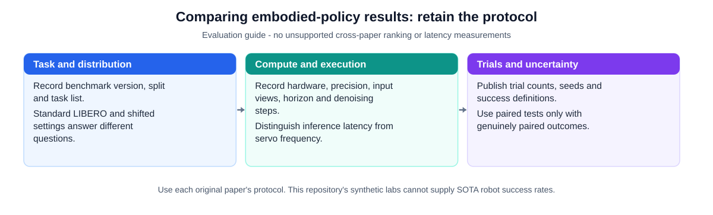

# **Towards Practical Embodied Intelligence (走向实用具身智能：综述门户、深度教材与代码库)** [](https://awesome.re)

<p align="center">
  <a href="https://169884902hzl.github.io/Towards-Practical-Embodied-Intelligence/"></a>
  <a href="https://github.com/169884902hzl/Towards-Practical-Embodied-Intelligence/actions/workflows/ci.yml"></a>
  <a href="https://github.com/169884902hzl/local-domain-expert-vault"></a>
  <a href="./labs/"></a>
  <a href="./LICENSE"></a>
</p>

<p align="center">
  <a href="./README.md"><b>English</b></a> | <b>简体中文</b> | <a href="https://169884902hzl.github.io/Towards-Practical-Embodied-Intelligence/"><b>🌐 在线打开交互式 HTML 知识工作台</b></a>
</p>

随着**具身智能（Embodied Intelligence, EI）**从早期的单任务视觉运动模仿学习，迅速演进为通用**视觉-语言-动作大模型（VLA）**、**世界动作模型（WAM）**、**面向扩散与流匹配策略的在线强化学习（Flow/Diffusion RL）**、**视触觉与富接触灵巧操作（Visuotactile & Contact-Rich Manipulation）**、**人形与全身协同控制（Whole-Body Control, WBC）**以及**实时异步动作块执行（Real-Time Chunking, RTC）**，本仓库构建了**“外层学术综述索引门户 + 内层教科书级深度教程与可运行代码库”**的双层开源体系：

1. **全景学术综述与文献分类门户（`README.md` / `README_zh.md`）**：系统梳理 **60 篇具身智能必读经典与前沿论文榜单**、**17 项数据集、仿真器与评测基准条目**，以及按 7 大核心研究方向组织的 **2023–2026 顶会与前沿论文索引**（涵盖 RSS、CoRL、ICRA、IROS、ICLR、NeurIPS、CVPR、IJRR 與 IEEE TRO）。
2. **教科书级深度教程与 PyTorch 实验代码库（[`docs/`](./docs/) & [`labs/`](./labs/)）**：包含超过 **6,900 行**数学说明与有前提的推导（$SE(3)$ 旋量与雅可比、柔顺阻抗/导纳控制、Flow Matching 向量场、流策略梯度稳定性的条件分析、异步实时动作块掩码修补、Wilson 置信区间与配对 McNemar 检验）、**44 张教学图谱（25 张 SVG＋19 张 JPG）**、**35 道自测思考题与完整标准解析**，以及 **5 个仅需所列依赖的合成教学实验脚本**。

本仓库持续维护与动态更新，欢迎通过 Issue 或 Pull Request 补充最新论文、数据集与开源基线。

<p align="center">
  
</p>

---

## 🔗 快速导航 (Quick Navigation)

- [📚 内层深度教程分册与 PyTorch 实验代码库](#-内层深度教程分册与-pytorch-实验代码库)
- [🏅 团队近期发表与开源工作 (Our Recent Publications)](#-团队近期发表与开源工作-our-recent-publications--research-infrastructure)
- [📖 具身智能与机器人操作综述论文 (Survey Papers)](#-具身智能与机器人操作综述论文-survey-papers)
- [📊 核心数据集、物理仿真器与评测基准 (Datasets & Benchmarks)](#-核心数据集物理仿真器与评测基准-datasets--benchmarks)
- [🏆 具身智能必读论文 Top-60 典藏榜 (Top-60 Must-Read Canon)](#-具身智能必读论文-top-60-典藏榜-top-60-must-read-canon)
- [🗂️ 2023–2026 七大前沿研究方向论文分类索引](#️-20232026-七大前沿研究方向论文分类索引)
  - [1. 视觉-语言-动作大模型 (VLA Foundation Models)](#1-视觉-语言-动作大模型-vla-foundation-models)
  - [2. 世界动作模型与视频-动作联合预训练 (WAM & Video-Action Pretraining)](#2-世界动作模型与视频-动作联合预训练-wam--video-action-pretraining)
  - [3. 面向流匹配与扩散策略的强化学习 (RL for Flow & Diffusion VLAs)](#3-面向流匹配与扩散策略的强化学习-rl-for-flow--diffusion-vlas)
  - [4. 视触觉感知、柔顺控制与富接触操作 (Visuotactile & Contact-Rich Manipulation)](#4-视触觉感知柔顺控制与富接触操作-visuotactile--contact-rich-manipulation)
  - [5. 实时动作块执行、延迟预算与边缘端推理加速 (RTC & Edge Acceleration)](#5-实时动作块执行延迟预算与边缘端推理加速-rtc--edge-acceleration)
  - [6. 在线执行验证、失败检测与闭环自主恢复 (Verification, Failure Detection & Recovery)](#6-在线执行验证失败检测与闭环自主恢复-verification-failure-detection--recovery)
  - [7. 3D 空间锚定、高自由度灵巧手、全身控制与柔性物体操作 (3D VLA, Dexterous, WBC & DLO)](#7-3d-空间锚定高自由度灵巧手全身控制与柔性物体操作-3d-vla-dexterous-wbc--dlo)

---

## 📚 内层深度教程分册与 PyTorch 实验代码库

不同于仅罗列链接的传统 Awesome 列表，本仓库在 [`docs/`](./docs/) 与 [`labs/`](./labs/) 中提供了完整的**研究生级模块化深度教程**与**可复现实验代码**：

| 模块 | 教程分册 / 代码路径 | 核心内容涵盖 | 架构图 / 实验 |
|:---:|:---|:---|:---:|
| **Part 0** | [**具身智能必读论文 Top-60 典藏榜单**](./docs/00_Must_Read_60_Leaderboard.md) | 4 周 30 天精读路线图；按 6 大核心赛道梳理 60 篇奠基之作与 2026 最新 SOTA 的核心贡献、量化指标与必读理由 | 6 张结构化榜单 |
| **Stage 1** | [**第一阶段：控制基础、模仿学习与强化学习地基**](./docs/01_Foundations_Compliant_Control_and_RL.md) | 观测/状态/动作契约、$SE(3)$ 几何学与雅可比、笛卡尔阻抗/导纳/混合力位控制、BC/ACT/Diffusion Policy/Flow Matching 数学同源推导、PPO/GRPO/SAC/`HIL-SERL`/IQL/Cal-QL、25 道基础自测题与完整标准答案 | 6 张引用图谱 |
| **Stage 2A** | [**第二阶段（上）：VLA 演进、世界动作模型与流策略 RL**](./docs/02_VLA_WAM_and_Flow_RL.md) | RT-1 $\rightarrow$ OpenVLA $\rightarrow$ $\pi_0 \rightarrow \pi_{0.7}$ 六代演进、视觉语言主干与记忆（`Qwen-RobotManip` / `REKI`）、WAM（`DreamZero`, `Fast-WAM`, `OpenWAM`, `V-JEPA 2`）、流策略 RL 七大流派（`DPPO`, `ReinFlow`, $\pi_{\texttt{RL}}$, `RLinf`, `DSRL`, `ResFiT`, `RECAP`, `RL-100`） | 20 张引用图谱 |
| **Stage 2B** | [**第二阶段（下）：触觉 VLA、实时动作块 (RTC) 与验证恢复闭环**](./docs/03_Tactile_RTC_and_Verification_Recovery.md) | 光学/磁敏触觉硬件（`GelSight`, `ViTai`, `AnySkin`）、触觉预训练表征（`T3`, `Sparsh`, `UniTouch`）、2026 触觉 VLA（`T-Rex`, `SimpleTouch`, `PACE`, `FACT`）、`Real-Time Chunking (RTC)`、`Knowledge Insulation`、在线验证与恢复（`FAVOR`, `DiVeR`, `SAFE`, `E-TTS`） | 1 张引用图谱 |
| **Stage 3** | [**第三阶段：开源数据集、Scaling Laws 辩证与评测统计规范**](./docs/04_Datasets_Scaling_Laws_and_Statistical_Eval.md) | Open X, DROID, LIBERO, ManiSkill3, LeRobot v3, AgiBot World（百万级真机轨迹）、精度诅咒（$\log N \propto \frac{1}{P-c}$）、Wilson 95% 置信区间、最小试验次数规划、配对 McNemar 检验与双盲 A/B 评测（`RoboArena`, `TRI LBM`） | 5 张引用图谱 |
| **Stage 4A** | [**第四阶段（上）：富接触操作、双臂柔性物体与通用具身架构**](./docs/05_Contact_Rich_Manipulation_and_Generalist_EI.md) | 富接触操作（Contact-Rich Manipulation）统一问题分类学、双臂柔性线状物体（DLO/线束）四大状态表征与六大失效闭环恢复、快中慢三频段通用具身智能架构与 90:9:1 数据金字塔 | 5 张引用图谱 |
| **Stage 4B** | [**第四阶段（下）：全局词典、论文审计清单与 5 个 PyTorch 实验**](./docs/06_Glossary_Templates_and_Checklists.md) | 全局唯一核心术语词典、论文批判性审计卡片模板、10 道综合架构题标准答案、边缘端量化剪枝（`BitVLA`, `TurboVLA`）、2027–2030 路线预测、5 个可运行 PyTorch 代码实验 | 8 张引用图谱 |
| **完整合订本** | [**单文件完整版 Markdown 教材**](./docs/Full_Tutorial_CN.md) \| [**🌐 在线交互式 HTML 知识工作台**](https://169884902hzl.github.io/Towards-Practical-Embodied-Intelligence/) ([源码](./index.html)) | 按分章同步的单文件教材与可直接在浏览器打开的交互式工作台（含章节目录导航、60 篇必读榜、44 张纯白底图谱画廊与 1,186 篇本地文献检索卡片） | 全部 44 张图谱 |

---

## 🏅 团队近期发表与开源工作 (Our Recent Publications & Research Infrastructure)

<details open>
<summary>📚 展开/收起团队开源科研基础设施与相关论文</summary>

- **[2026 · IEEE CASE（已录用，论文编号 ThCT6.3）]** [**Active Observation for Robust Visual Servoing in Robotic Manipulation**](https://hzl666.xyz/projects/active-observation/)（**Zhilun Hu**, Yuqi Cheng, Yuxiang Tan, Wen-pan Li, Weiming Shen, *2026 IEEE International Conference on Automation Science and Engineering (CASE)*）：针对严重遮挡下的机器人抓取操作，提出主动观察机械臂与目标-夹爪相对视觉伺服协同框架，结合两阶段视点调度与遮挡触发式主动探索机制，在操作全过程中维持或自主恢复关键视觉反馈。 [[IEEE CASE 官方程序册 (ThCT6.3)](https://ras.papercept.net/conferences/scripts/rtf/CASE26_ContentListWeb_4.html)] [[项目主页](https://hzl666.xyz/projects/active-observation/)] [[论文列表](https://hzl666.xyz/publications/)]
- **[2026 · 开源科研底座]** [**Local Domain Expert Vault (`local-domain-expert-vault`, v1.0)**](https://github.com/169884902hzl/local-domain-expert-vault)：本地优先的 Obsidian + Zotero + 多智能体协同（`Claudian` / `Gemini` / `DeepSeek` / `Codex`）**领域专家文献库与科研治理工作台（Research Governance Workbench）**。沉淀了支撑本仓库的 **1,186 条公开文献索引卡片**（`wiki/topics/`、`wiki/concepts/`、`wiki/entities/`）、带锚点的证据原语（`paper_primitives.v1`）、arXiv OAI-PMH 本地镜像每日追踪管线与 fail-closed 对抗式同行评审门控。 [[GitHub 仓库](https://github.com/169884902hzl/local-domain-expert-vault)] [[学术主页](https://hzl666.xyz/)]

</details>

---

## 📖 具身智能与机器人操作综述论文 (Survey Papers)

<details open>
<summary>📚 展开/收起具身智能与机器人学习综述论文</summary>

- **A Survey on Vision-Language-Action Models for Embodied AI** [[arXiv:2405.14093](https://arxiv.org/abs/2405.14093)]
- **What Matters in Building Vision-Language-Action Models for Generalist Robots** [[arXiv:2412.14058](https://arxiv.org/abs/2412.14058)]
- **Towards a Unified Understanding of Robot Manipulation: A Comprehensive Survey** [[arXiv:2510.10903](https://arxiv.org/abs/2510.10903)]
- **Robot Learning as an Empirical Science: Best Practices for Policy Evaluation** (*Kress-Gazit et al., 2024*) [[arXiv:2409.09491](https://arxiv.org/abs/2409.09491)]
- **A Careful Examination of Large Behavior Models for Multitask Dexterous Manipulation** (*TRI LBM, 2025*) [[arXiv:2507.05331](https://arxiv.org/abs/2507.05331)]
- **A Survey on Robotic Manipulation of Deformable Objects: Recent Advances, Open Challenges and New Frontiers** [[arXiv:2312.10419](https://arxiv.org/abs/2312.10419)]

</details>

---

## 📊 核心数据集、物理仿真器与评测基准 (Datasets & Benchmarks)

| 名称 | 发表会议 / 机构 | 年份 | 核心规模与开源链接 | 模态与本体构型 |
|:---:|:---:|:---:|:---|:---:|
| **Open X-Embodiment** | ICRA | 2024 | 联合 21 家机构汇总 22 种机器人构型、100 万+ 条真实操作轨迹 [[paper](https://arxiv.org/abs/2310.08864)] [[code](https://github.com/google-deepmind/open_x_embodiment)] [[dataset](https://robotics-transformer-x.github.io/)] | RGB-D, 本体状态, 语言 (22 种构型) |
| **DROID** | RSS | 2024 | 564 个真实自然场景下采集 7.6 万条（350 小时）Franka 机械臂轨迹 [[paper](https://arxiv.org/abs/2403.12945)] [[code](https://github.com/droid-dataset/droid)] [[dataset](https://droid-dataset.github.io/)] | 双目 RGB-D, 腕部相机, 本体, 语言 |
| **BridgeData V2** | CoRL | 2023 | 24 个桌面场景下采集 6 万+ 条低成本 WidowX 250 6-DoF 机械臂轨迹 [[paper](https://arxiv.org/abs/2308.12952)] [[code](https://github.com/rail-berkeley/bridge_data_v2)] [[dataset](https://rail-berkeley.github.io/bridgedata/)] | RGB, 本体状态, 语言, 目标图像 |
| **AgiBot World Colosseo** | 智元机器人 | 2025 | 100+ 真实生活与工业场景下的 100 万+ 条双臂全身移动操作真机轨迹 [[paper](https://arxiv.org/abs/2503.06669)] [[code](https://github.com/OpenDriveLab/AgiBot-World)] [[dataset](https://huggingface.co/agibot-world)] | 多视角 RGB-D, 视触觉, 双臂全身 |
| **Galaxea Open-World** | 星海图 | 2025 | 50 个真实场景下 500+ 小时同构移动双臂全身协同轨迹 [[paper](https://arxiv.org/abs/2509.00576)] [[dataset](https://opengalaxea.github.io/GalaxeaVLA/)] | RGB-D, 移动底盘 + 躯干 + 双臂 |
| **RoboMIND** | 北京大学等 | 2024 | 覆盖单臂、双臂、人形与五指灵巧手的 10.7 万条跨构型规范化轨迹 [[paper](https://arxiv.org/abs/2412.13877)] [[code](https://huggingface.co/datasets/x-humanoid-robomind/RoboMIND)] [[dataset](https://x-humanoid-robomind.github.io/)] | 多构型 RGB-D + 本体状态 |
| **RH20T** | ICRA | 2024 | 11 万条包含高频六维力/力矩（6-Axis F/T）记录的富接触操作数据集 [[paper](https://arxiv.org/abs/2307.00595)] [[dataset](https://rh20t.github.io/)] | RGB-D, **六维力/力矩**, 本体 |
| **LIBERO / LIBERO-Plus** | NeurIPS | 2023/2025 | 130 个终身学习操作任务（Spatial/Object/Goal/Long）及 OOD 鲁棒性扩展套件 [[paper](https://arxiv.org/abs/2306.03310)] [[code](https://github.com/Lifelong-Robot-Learning/LIBERO)] | 仿真 RGB, 本体, 语言 |
| **CALVIN** | IEEE RA-L | 2022 | 长程语言条件桌面操作基准（连续完成 5 个子任务链 `ABC->D`） [[paper](https://arxiv.org/abs/2112.03227)] [[code](https://github.com/mees/calvin)] | 仿真 RGB-D, 触觉, 语言 |
| **ManiSkill3** | RSS / SAPIEN | 2024/2025 | GPU 并行加速（30,000+ FPS）刚体、关节物体与柔性物体操作基准 [[paper](https://arxiv.org/abs/2410.00425)] [[code](https://github.com/haosulab/ManiSkill)] | GPU 仿真 RGB-D, 点云, 力反馈 |
| **RoboTwin / RoboTwin 2.0** | CVPR / CoRL | 2025/2026 | 数字孪生双臂协同操作生成与抗杂乱真机迁移基准（`RoboTwin-C2R`） [[paper](https://arxiv.org/abs/2506.18088)] [[code](https://github.com/RoboTwin-Platform/RoboTwin)] | 双臂协同仿真与真机 RGB-D |
| **RoboCasa** | RSS | 2024 | 基于 MimicGen 轨迹扩增的大规模家庭厨房长程移动双臂仿真环境 [[paper](https://arxiv.org/abs/2406.02523)] [[code](https://github.com/robocasa/robocasa)] | 家庭场景移动双臂仿真 |
| **UniVTAC** | arXiv | 2026 | 面向紧密公差插接、卡扣装配与盲装的统一视触觉基准与数据集 [[paper](https://arxiv.org/abs/2602.10093)] | RGB + **光学视触觉** + 本体 |
| **ForceBench** | arXiv | 2026 | 面向力感知机器人操作的综合评测基准与模态消融套件 [[paper](https://arxiv.org/abs/2610.19604)] | RGB + **六维力/力矩** |
| **RoboArena** | 多高校联合 | 2025 | 分布式真实世界双盲配对 A/B 评测平台与 Bradley-Terry Elo 排行榜 [[paper](https://arxiv.org/abs/2506.18123)] [[project](https://robo-arena.github.io/)] | 真实世界双盲配对评测 |
| **Newton / Isaac Lab** | NVIDIA/DeepMind | 2025/2026 | 开源 GPU 可微物理引擎（`MuJoCo Warp` / XPBD / MPM），支持刚柔耦合仿真 [[project](https://github.com/newton-physics/newton)] [[isaac-lab](https://github.com/isaac-sim/IsaacLab)] | GPU 可微物理与大规模 RL |
| **LeRobot (v3)** | HuggingFace | 2024–2026 | 统一 PyTorch 代码库与 `LeRobotDataset v3` 标准格式（支持 ACT, Diffusion, $\pi_0$, SmolVLA） [[code](https://github.com/huggingface/lerobot)] [[datasets](https://huggingface.co/lerobot)] | 统一训练、数据与评测框架 |

<p align="center">
  
</p>

---

## 🏆 具身智能必读论文 Top-60 典藏榜 (Top-60 Must-Read Canon)

> 完整 60 篇论文的 6 大分赛道详细注解表与 4 周 30 天精读计划请参阅 [**`docs/00_Must_Read_60_Leaderboard.md`**](./docs/00_Must_Read_60_Leaderboard.md)。以下为每位研究者入场必读的 **12 篇 Tier-0 奠基核心文献**：

| 序号 | 论文简称 | 发表会议/机构 | 年份 | 一句话核心范式贡献 | 论文与代码 |
|:---:|:---|:---:|:---:|:---|:---:|
| **01** | **ACT / ALOHA** | RSS | 2023 | 提出动作分块（Action Chunking，$H$ 步联合预测）+ CVAE 隐变量 + 时序指数集成 | [[paper](https://arxiv.org/abs/2304.13705)] [[code](https://github.com/tonyzhaozh/act)] |
| **02** | **Diffusion Policy** | RSS / IJRR | 2023 | 将条件去噪扩散过程引入机器人动作块生成，彻底解决多模态轨迹平均化崩溃 | [[paper](https://arxiv.org/abs/2303.04137)] [[code](https://github.com/real-stanford/diffusion_policy)] |
| **03** | **RT-2** | CoRL | 2023 | 开创性提出 VLA 概念，将离散机器人动作作为文本 Token 与互联网 VLM 联合微调 | [[paper](https://arxiv.org/abs/2307.15818)] |
| **04** | **Open X-Embodiment** | ICRA | 2024 | 构建 22 种机器人构型、100 万+ 轨迹的跨本体大数据集，训练 RT-X 通用策略 | [[paper](https://arxiv.org/abs/2310.08864)] [[code](https://github.com/google-deepmind/open_x_embodiment)] |
| **05** | **Octo** | RSS | 2024 | 首款全开源跨构型通用操作基座模型，支持语言与目标图像双条件及轻量化扩散头 | [[paper](https://arxiv.org/abs/2405.12213)] [[code](https://github.com/octo-models/octo)] |
| **06** | **OpenVLA** | CoRL | 2024 | 7B 开源 VLA 标杆（`Llama-2` + `DINOv2` + `SigLIP`），提供完整 LoRA 与量化微调生态 | [[paper](https://arxiv.org/abs/2406.09246)] [[code](https://github.com/openvla/openvla)] |
| **07** | **UMI** | RSS | 2024 | 无本体依赖（Embodiment-Free）手持鱼眼 SLAM 夹爪，以 1/10 成本实现跨构型零样本迁移 | [[paper](https://arxiv.org/abs/2402.10329)] [[code](https://github.com/real-stanford/universal_manipulation_interface)] |
| **08** | **HIL-SERL** | arXiv | 2024 | 人类在环样本高效真机强化学习框架，1–2.5 小时真机交互将精密装配推至近 100% 成功率 | [[paper](https://arxiv.org/abs/2410.21845)] [[code](https://github.com/rail-berkeley/serl)] |
| **09** | **$\pi_0$ (openpi)** | Physical Intelligence | 2024 | 确立“VLM 语义主干（`PaliGemma-3B`）+ 300M 独立流匹配动作专家（50Hz）”现代 VLA 标准架构 | [[paper](https://arxiv.org/abs/2410.24164)] [[code](https://github.com/Physical-Intelligence/openpi)] |
| **10** | **$\pi_{0.5}$** | Physical Intelligence | 2025 | 异构协同预训练（离散 FAST 动作词元 + 连续 Flow 专家）与高层语义子任务显式推理 | [[paper](https://arxiv.org/abs/2504.16054)] [[code](https://github.com/Physical-Intelligence/openpi)] |
| **11** | **Knowledge Insulation** | Physical Intelligence | 2025 | 揭示连续动作专家梯度会破坏 VLM 预训练语义，提出 `stop_gradient` 知识绝缘训练准则 | [[paper](https://arxiv.org/abs/2505.23705)] |
| **12** | **Real-Time Chunking (RTC)** | Physical Intelligence | 2025 | 提出动作块前缀锁定（$a_{0:d}$）与流匹配软掩码引导修补，彻底消除异步推理换块停顿与跳变 | [[paper](https://arxiv.org/abs/2506.07339)] [[follow-up](https://arxiv.org/abs/2512.05964)] |

---

## 🗂️ 2023–2026 七大前沿研究方向论文分类索引

### 1. 视觉-语言-动作大模型 (VLA Foundation Models)

<details open>
<summary>📚 展开/收起 VLA 基础模型相关论文</summary>

- **[2026.10]** **VLA-$\Delta$**: Learning Physical State Transition for Vision-Language-Action Models [[paper](https://arxiv.org/abs/2610.21306)]
- **[2026.10]** **ObjDream**: Guiding Vision-Language-Action Models with Object-Level Understanding and Future State Prediction [[paper](https://arxiv.org/abs/2610.20223)]
- **[2026.10]** **TacitVLA**: Reasoning Vision-Language-Action Models Without Reasoning Latency [[paper](https://arxiv.org/abs/2610.17540)]
- **[2026.10]** **REKI**: Registering Knowledge in VLAs [[paper](https://arxiv.org/abs/2610.22178)]
- **[2026.10]** **EvoMem-VLA**: State-Evolution Memory for Long-Horizon Robot Manipulation [[paper](https://arxiv.org/abs/2610.05418)]
- **[2026.09]** **SAVLA**: Symmetry-Aware Vision-Language-Action Models for Robotic Manipulation [[paper](https://arxiv.org/abs/2609.16641)]
- **[2026.08]** **StreamPI**: Streaming Multimodal Temporal Modeling for Vision-Language-Action Models [[paper](https://arxiv.org/abs/2608.26067)]
- **[2026.07]** **LaMem-VLA**: Dual Latent Memory in Vision-Language-Action Models for Robotic Manipulation [[paper](https://arxiv.org/abs/2607.07608)]
- **[2026.06]** **Qwen-RobotManip**: Qwen-RobotManip Technical Report: Alignment Unlocks Scale for Robotic Manipulation Foundation Models [[paper](https://arxiv.org/abs/2606.17846)]
- **[2026.06]** **ERVLA**: Revisiting Embodied Chain-of-Thought for Generalizable Robot Manipulation [[paper](https://arxiv.org/abs/2606.03784)]
- **[2026.04]** **$\pi_{0.7}$**: a Steerable Generalist Robotic Foundation Model with Emergent Capabilities [[paper](https://arxiv.org/abs/2604.15483)]
- **[2026.03]** **MEM**: Multi-Scale Embodied Memory for Vision Language Action Models [[paper](https://arxiv.org/abs/2603.03596)]
- **[2025.10]** **Gemini Robotics 1.5**: Pushing the Frontier of Generalist Robots with Advanced Embodied Reasoning, Thinking, and Motion Transfer [[paper](https://arxiv.org/abs/2510.03342)]
- **[2025.07]** **GR-3**: GR-3 Technical Report [[paper](https://arxiv.org/abs/2507.15493)]
- **[2025.06]** **SmolVLA**: A Vision-Language-Action Model for Affordable and Efficient Robotics [[paper](https://arxiv.org/abs/2506.01844)] [[code](https://github.com/huggingface/lerobot)]
- **[2025.03]** **Gemini Robotics**: Bringing AI into the Physical World [[paper](https://arxiv.org/abs/2503.20020)]
- **[2025.03]** **GR00T N1 / N1.5**: Open Foundation Model for Generalized Humanoid Robot Skills [[code](https://github.com/NVIDIA/Isaac-GR00T)]
- **[2025.02]** **OpenVLA-OFT**: Fine-Tuning Vision-Language-Action Models: Optimizing Speed and Success (RSS 2025) [[paper](https://arxiv.org/abs/2502.19645)] [[code](https://github.com/moojink/openvla-oft)]
- **[2025.01]** **FAST**: Efficient Action Tokenization for Vision-Language-Action Models [[paper](https://arxiv.org/abs/2501.09747)]

</details>

---

### 2. 世界动作模型与视频-动作联合预训练 (WAM & Video-Action Pretraining)

<details open>
<summary>📚 展开/收起世界动作模型 (WAM) 相关论文</summary>

- **[2026.10]** **OpenWAM**: An Open Framework for Composable World-Action Models [[paper](https://arxiv.org/abs/2610.07922)]
- **[2026.10]** **Long-WAM**: Scaling the Context of World-Action Models [[paper](https://arxiv.org/abs/2610.10528)]
- **[2026.03]** **Fast-WAM**: Do World Action Models Need Test-time Future Imagination? [[paper](https://arxiv.org/abs/2603.16666)]
- **[2026.03]** **EVA**: Aligning Video World Models with Executable Robot Actions via Inverse Dynamics Rewards [[paper](https://arxiv.org/abs/2603.17808)]
- **[2026.02]** **DreamZero**: World Action Models are Zero-shot Policies [[paper](https://arxiv.org/abs/2602.15922)]
- **[2025.06]** **V-JEPA 2**: Self-Supervised Video Models Enable Understanding, Prediction and Planning [[paper](https://arxiv.org/abs/2506.09985)] [[code](https://github.com/facebookresearch/vjepa2)]
- **[2025.05]** **DreamGen**: Unlocking Generalization in Robot Learning through Video World Models [[paper](https://arxiv.org/abs/2505.12705)]

</details>

---

### 3. 面向流匹配与扩散策略的强化学习 (RL for Flow & Diffusion VLAs)

<details open>
<summary>📚 展开/收起流策略与扩散策略强化学习论文</summary>

- **[2026.10]** **NSL**: Noise Space Learning for VLA Adaptation [[paper](https://arxiv.org/abs/2610.13943)]
- **[2026.10]** **VaM**: Value as Memory: Online Value-Guided Post-training for General Robot Policies [[paper](https://arxiv.org/abs/2610.22368)]
- **[2026.09]** **RoboFFT**: Finetuning generative robot policy via online reinforcement learning with forward process [[paper](https://arxiv.org/abs/2609.32236)]
- **[2026.04]** **RL Token (RLT)**: Bootstrapping Online RL with Vision-Language-Action Models [[paper](https://arxiv.org/abs/2604.23073)]
- **[2025.11]** **$\pi^*_{0.6}$ (RECAP)**: a VLA That Learns From Experience [[paper](https://arxiv.org/abs/2511.14759)]
- **[2025.10]** **$\pi_{\texttt{RL}}$**: Online RL Fine-tuning for Flow-based Vision-Language-Action Models [[paper](https://arxiv.org/abs/2510.25889)]
- **[2025.10]** **RL-100**: Performant Robotic Manipulation with Real-World Reinforcement Learning [[paper](https://arxiv.org/abs/2510.14830)]
- **[2025.09]** **ResFiT**: Residual Off-Policy RL for Finetuning Behavior Cloning Policies [[paper](https://arxiv.org/abs/2509.19301)]
- **[2025.09]** **RLinf**: Flexible and Efficient Large-scale Reinforcement Learning via Macro-to-Micro Flow Transformation [[paper](https://arxiv.org/abs/2509.15965)] [[code](https://github.com/RLinf/RLinf)]
- **[2025.06]** **DSRL**: Steering Your Diffusion Policy with Latent Space Reinforcement Learning [[paper](https://arxiv.org/abs/2506.15799)]
- **[2025.05]** **ReinFlow**: Fine-tuning Flow Matching Policy with Online Reinforcement Learning [[paper](https://arxiv.org/abs/2505.22094)]
- **[2025.02]** **ConRFT**: A Reinforced Fine-tuning Method for VLA Models via Consistency Policy [[paper](https://arxiv.org/abs/2502.05450)]
- **[2024.12]** **PA-RL**: Policy Agnostic RL: Offline RL and Online RL Fine-Tuning of Any Class and Backbone [[paper](https://arxiv.org/abs/2412.06685)]
- **[2024.10]** **HIL-SERL**: Precise and Dexterous Robotic Manipulation via Human-in-the-Loop Reinforcement Learning [[paper](https://arxiv.org/abs/2410.21845)] [[code](https://github.com/rail-berkeley/serl)]
- **[2024.09]** **DPPO**: Diffusion Policy Policy Optimization [[paper](https://arxiv.org/abs/2409.00588)] [[code](https://github.com/irom-princeton/dppo)]

</details>

---

### 4. 视触觉感知、柔顺控制与富接触操作 (Visuotactile & Contact-Rich Manipulation)

<details open>
<summary>📚 展开/收起视触觉与富接触操作相关论文</summary>

- **[2026.10]** **ForceBench**: Benchmarking Force Integration for Robotic Manipulation [[paper](https://arxiv.org/abs/2610.19604)]
- **[2026.10]** **FACT**: A Multimodal Force-Action-Track Foundation Model for Human-to-Robot Dexterity [[paper](https://arxiv.org/abs/2610.19155)]
- **[2026.10]** **PRISM**: Precision Forcing for Generalist Vision-Language-Action Policies [[paper](https://arxiv.org/abs/2610.14704)]
- **[2026.10]** **PACE**: Temporal-Role Tactile Conditioning for Chunk-Based Insertion Policies (CoRL 2026) [[paper](https://arxiv.org/abs/2610.16308)]
- **[2026.10]** **Spark-0**: Scaling Spatially Aligned Tactile Pretraining for Robot Dexterous Manipulation [[paper](https://arxiv.org/abs/2610.22342)]
- **[2026.10]** **SimpleTouch**: Can Vision-Language-Action Models Master Contact-Rich Manipulation Without Tactile Policy Pretraining? [[paper](https://arxiv.org/abs/2610.02784)]
- **[2026.07]** **$N_0$-VTLA**: Scaling Vision-Tactile-Language-Action Model with Latent Tactile Tokens [[paper](https://arxiv.org/abs/2607.23782)]
- **[2026.07]** **FA-RDP**: A Frequency-Adaptive Reactive Diffusion Policy for Contact-Rich Manipulation [[paper](https://arxiv.org/abs/2607.28596)]
- **[2026.06]** **T-Rex**: Tactile-Reactive Dexterous Manipulation [[paper](https://arxiv.org/abs/2606.17055)]
- **[2026.03]** **TacVLA**: Contact-Aware Tactile Fusion for Robust Vision-Language-Action Manipulation [[paper](https://arxiv.org/abs/2603.12665)]
- **[2026.03]** **ForceVLA2**: Unleashing Hybrid Force-Position Control with Force Awareness for Contact-Rich Manipulation (CVPR 2026) [[paper](https://arxiv.org/abs/2603.15169)]
- **[2026.02]** **UniVTAC**: A Unified Simulation Platform for Visuo-Tactile Manipulation Data Generation, Learning, and Benchmarking [[paper](https://arxiv.org/abs/2602.10093)]
- **[2026.02]** **GAP (Gradient Adjustment with Phase-guidance)**: When would Vision-Proprioception Policies Fail in Robotic Manipulation? (ICLR 2026) [[paper](https://arxiv.org/abs/2602.12032)]
- **[2025.12]** **ImplicitRDP**: An End-to-End Visual-Force Diffusion Policy with Structural Slow-Fast Learning (RA-L 2026) [[paper](https://arxiv.org/abs/2512.10946)]
- **[2025.05]** **ForceVLA**: Enhancing VLA Models with a Force-aware MoE for Contact-rich Manipulation (NeurIPS 2025) [[paper](https://arxiv.org/abs/2505.22159)]
- **[2025.03]** **Reactive Diffusion Policy (RDP)**: Slow-Fast Visual-Tactile Policy Learning for Contact-Rich Manipulation (RSS 2025) [[paper](https://arxiv.org/abs/2503.02881)] [[code](https://github.com/xiaoxiaoxh/reactive_diffusion_policy)]
- **[2025.02]** **FACTR**: Force-Attending Curriculum Training for Contact-Rich Policy Learning [[paper](https://arxiv.org/abs/2502.17432)]
- **[2024.10]** **Sparsh**: Self-supervised touch representations for vision-based tactile sensing (CoRL 2024) [[paper](https://arxiv.org/abs/2410.24090)] [[code](https://github.com/facebookresearch/sparsh)]
- **[2024.10]** **3D-ViTac**: Learning Fine-Grained Manipulation with Visuo-Tactile Sensing (CoRL 2024) [[paper](https://arxiv.org/abs/2410.24091)]
- **[2024.10]** **ACP**: Adaptive Compliance Policy: Learning Approximate Compliance for Diffusion Guided Control [[paper](https://arxiv.org/abs/2410.09309)]
- **[2024.09]** **AnySkin**: Plug-and-play Skin Sensing for Robotic Touch [[paper](https://arxiv.org/abs/2409.08276)]
- **[2024.06]** **T3**: Transferable Tactile Transformers for Representation Learning Across Diverse Sensors and Tasks [[paper](https://arxiv.org/abs/2406.13640)] [[code](https://github.com/alanzjl/t3)]
- **[2024.01]** **UniTouch**: Binding Touch to Everything: Learning Unified Multimodal Tactile Representations [[paper](https://arxiv.org/abs/2401.18084)]

</details>

---

### 5. 实时动作块执行、延迟预算与边缘端推理加速 (RTC & Edge Acceleration)

<details open>
<summary>📚 展开/收起实时执行与边缘加速相关论文</summary>

- **[2026.10]** **Chronos Policy**: Learning Robot Policies on Physical Time [[paper](https://arxiv.org/abs/2610.13929)]
- **[2026.10]** **REACT**: Rolling Denoising and Dual Decoupling for Reactive Robot Control with VLA Models (CoRL 2026) [[paper](https://arxiv.org/abs/2610.12007)]
- **[2026.07]** **TurboVLA**: Real-Time Vision-Language-Action Model at 32 Hz on an RTX 4090 with <1 GB VRAM [[paper](https://arxiv.org/abs/2607.27205)]
- **[2026.07]** **FabriVLA**: A Lightweight Vision-Language-Action Model with Conformal Action Chunk Uncertainty [[paper](https://arxiv.org/abs/2607.08575)]
- **[2025.12]** **Training-Time RTC**: Training-Time Action Conditioning for Efficient Real-Time Chunking [[paper](https://arxiv.org/abs/2512.05964)]
- **[2025.06]** **BitVLA**: 1-bit Vision-Language-Action Models for Robotics Manipulation [[paper](https://arxiv.org/abs/2506.07530)]
- **[2025.06]** **Real-Time Chunking (RTC)**: Real-Time Execution of Action Chunking Flow Policies (NeurIPS 2025) [[paper](https://arxiv.org/abs/2506.07339)]
- **[2025.05]** **Knowledge Insulation (KI)**: Knowledge Insulating Vision-Language-Action Models: Train Fast, Run Fast, Generalize Better [[paper](https://arxiv.org/abs/2505.23705)]
- **[2025.02]** **VLA-Cache**: Efficient Vision-Language-Action Manipulation via Adaptive Token Caching (NeurIPS 2025) [[paper](https://arxiv.org/abs/2502.02175)]
- **[2024.11]** **DeeR-VLA**: Dynamic Inference of Multimodal Large Language Models for Efficient Robot Execution (NeurIPS 2024) [[paper](https://arxiv.org/abs/2411.02359)]

</details>

---

### 6. 在线执行验证、失败检测与闭环自主恢复 (Verification, Failure Detection & Recovery)

<details open>
<summary>📚 展开/收起在线验证、失败检测与自主恢复相关论文</summary>

- **[2026.10]** **FAVOR**: Future Anchored Verification and Online Recovery for World Action Models [[paper](https://arxiv.org/abs/2610.06280)]
- **[2026.10]** **DiVeR**: Decision-Critical Verifier Learning for VLA Test-Time Scaling [[paper](https://arxiv.org/abs/2610.04933)]
- **[2026.08]** **Active Observation**: Active Observation for Robust Visual Servoing in Robotic Manipulation (*Hu et al., IEEE CASE 2026 已录用, ThCT6.3*) [[program](https://ras.papercept.net/conferences/scripts/rtf/CASE26_ContentListWeb_4.html)] [[project](https://hzl666.xyz/projects/active-observation/)]
- **[2026.07]** **Harness VLA**: Steering Frozen VLAs into Reliable Manipulation Primitives via Memory-Guided Agents [[paper](https://arxiv.org/abs/2607.08448)]
- **[2026.06]** **E-TTS**: A New Embodied Test-Time Scaling Framework for Robotic Manipulation (ECCV 2026) [[paper](https://arxiv.org/abs/2606.27268)]
- **[2025.06]** **SAFE**: Multitask Failure Detection for Vision-Language-Action Models (NeurIPS 2025) [[paper](https://arxiv.org/abs/2506.09937)]
- **[2025.03]** **FAIL-Detect**: Can We Detect Failures Without Failure Data? Uncertainty-Aware Runtime Failure Detection for Imitation Learning Policies (RSS 2025) [[paper](https://arxiv.org/abs/2503.08558)]

</details>

---

### 7. 3D 空间锚定、高自由度灵巧手、全身控制与柔性物体操作 (3D VLA, Dexterous, WBC & DLO)

<details open>
<summary>📚 展开/收起 3D VLA、灵巧手、全身控制与柔性物体操作论文</summary>

- **[2026.10]** **VioLA**: Learning Generalist Humanoid Control Policies from Human Data [[paper](https://arxiv.org/abs/2610.12435)]
- **[2026.09]** **Online Material Estimation for DLOs**: Online Material Estimation for Conditioned Diffusion Policy in Shaping Deformable Linear Objects [[paper](https://arxiv.org/abs/2609.12634)]
- **[2026.07]** **The Curse of Precision**: A Data Scaling Law for High-Precision Robotic Manipulation (ICRA 2026) [[paper](https://arxiv.org/abs/2607.23108)]
- **[2026.06]** **DLO-Lab & DeformX**: DLO-Lab: Benchmarking Deformable Linear Object Manipulations with Differentiable Physics; DeformX: A Versatile Co-Simulation Framework for Deformable Linear Objects (ICML 2026) [[DLO-Lab](https://arxiv.org/abs/2606.04206)] [[DeformX](https://arxiv.org/abs/2606.22116)]
- **[2026.06]** **WireCraft**: A Simulation Benchmark for Industrial DLO Manipulation (CoRL 2026) [[paper](https://arxiv.org/abs/2606.18097)]
- **[2025.11]** **SONIC**: Supersizing Motion Tracking for Natural Humanoid Whole-Body Control [[paper](https://arxiv.org/abs/2511.07820)]
- **[2025.08]** **BeyondMimic**: From Motion Tracking to Versatile Humanoid Control via Guided Diffusion [[paper](https://arxiv.org/abs/2508.08241)]
- **[2025.05]** **DexUMI**: Using Human Hand as the Universal Manipulation Interface for Dexterous Manipulation [[paper](https://arxiv.org/abs/2505.21864)]
- **[2025.03]** **PointVLA**: Injecting the 3D World into Vision-Language-Action Models [[paper](https://arxiv.org/abs/2503.07511)]
- **[2025.02]** **ASAP**: Aligning Simulation and Real-World Physics for Learning Agile Humanoid Whole-Body Skills (RSS 2025) [[paper](https://arxiv.org/abs/2502.01143)] [[code](https://github.com/LeCAR-Lab/ASAP)]
- **[2025.01]** **SpatialVLA**: Exploring Spatial Representations for Visual-Language-Action Model (RSS 2025) [[paper](https://arxiv.org/abs/2501.15830)]
- **[2024.10]** **HOVER**: Versatile Neural Whole-Body Controller for Humanoid Robots (ICRA 2025) [[paper](https://arxiv.org/abs/2410.21229)]
- **[2024.10]** **DexMimicGen**: Automated Data Generation for Bimanual Dexterous Manipulation via Imitation Learning (ICRA 2025) [[paper](https://arxiv.org/abs/2410.24185)]
- **[2023.10]** **MimicGen**: A Data Generation System for Scalable Robot Learning using Human Demonstrations (CoRL 2023) [[paper](https://arxiv.org/abs/2310.17596)] [[code](https://github.com/NVlabs/mimicgen)]

</details>

---

## 💻 快速上手：一键运行 5 个 PyTorch 实验脚本与教学图谱

[`labs/`](./labs/) 目录下的 5 个实验脚本均为单文件自包含设计，仅依赖 `Python >= 3.10` 与 `torch==2.9.0`：

```bash
python labs/lab1_openpi_ki_and_latency_profiler.py
python labs/lab2_rtc_soft_masked_inpainting.py
python labs/lab3_cascade_tactile_flow.py
python labs/lab4_final_step_gaussian_ppo_and_critic.py
python labs/lab5_rigorous_robot_eval_statistics.py
```

### 5 个合成教学实验的机制示意与解析／统计示例（不是真机测量）

<p align="center">
  
  
</p>
<p align="center">
  
  
</p>
<p align="center">
  
</p>

