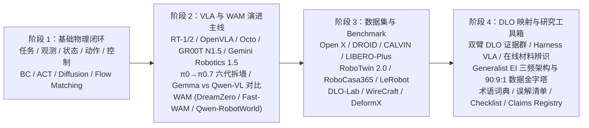
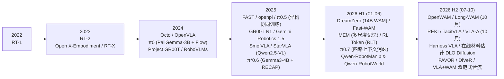
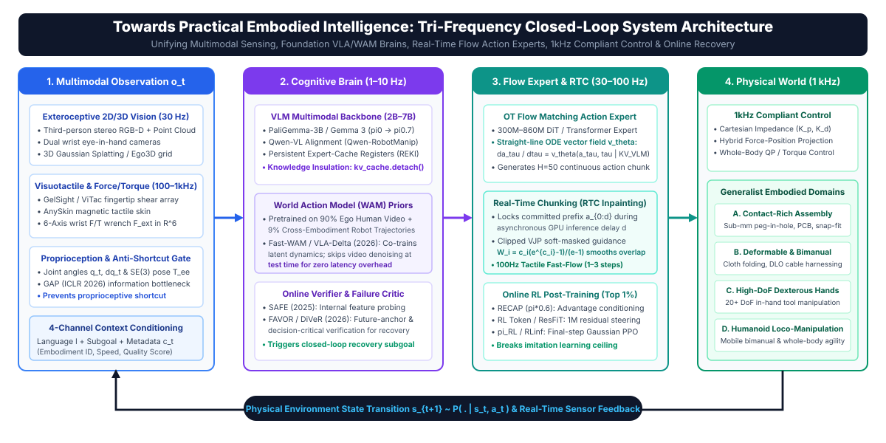
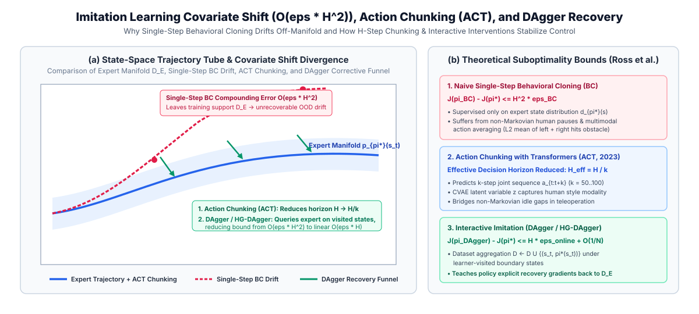
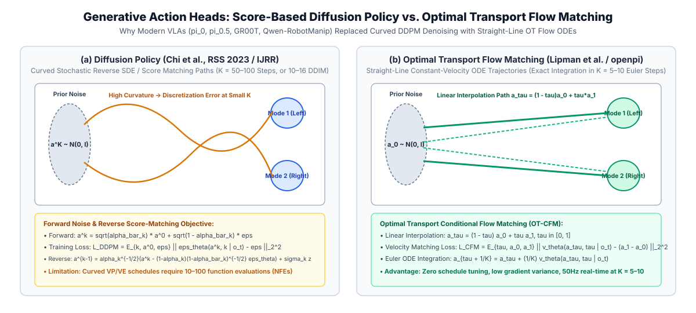
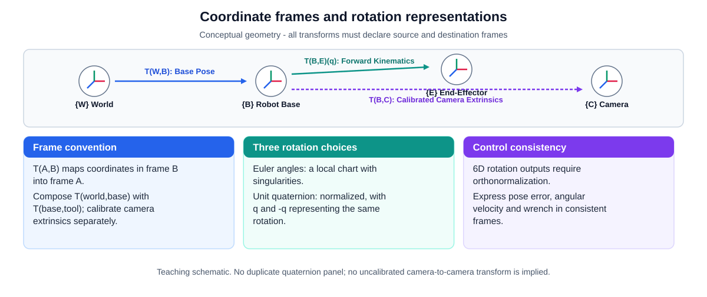
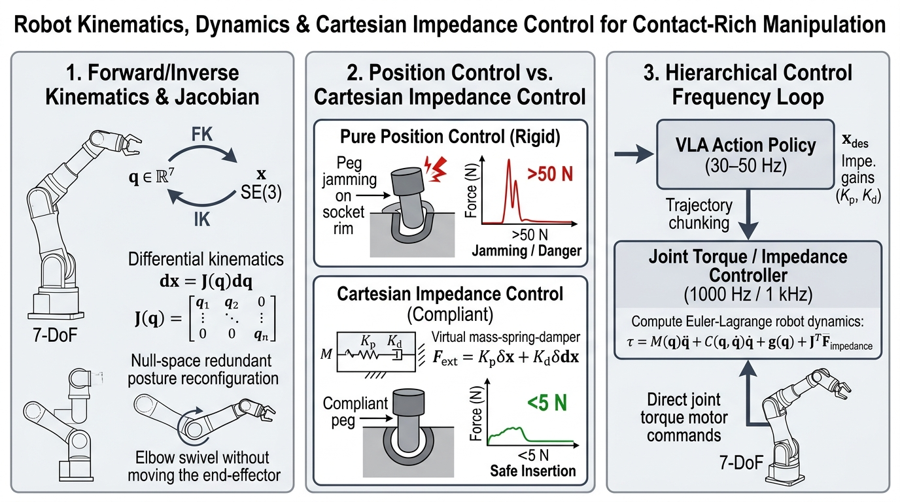
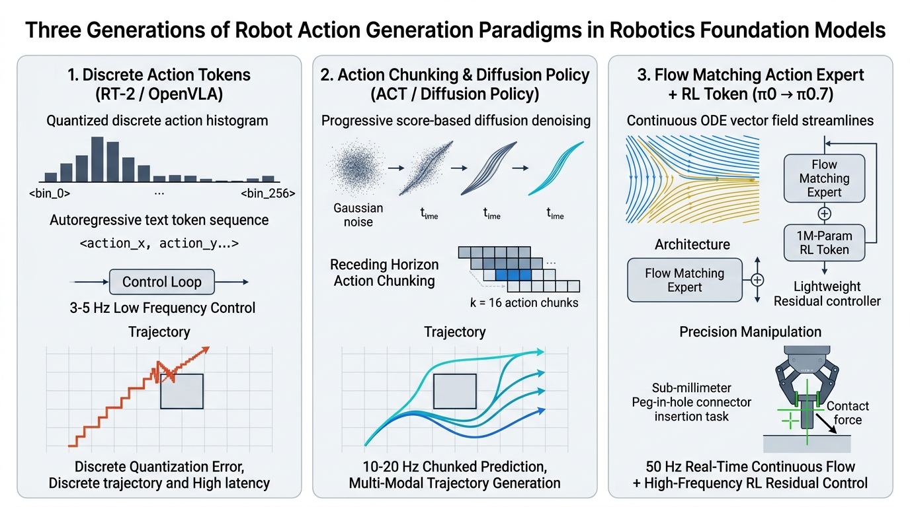

<p align="center">
  <a href="../README.md"><b>🏠 English Survey Portal</b></a> |
  <a href="../README_zh.md"><b>🏠 中文综述门户</b></a> |
  <a href="./00_Must_Read_60_Leaderboard.md"><b>🏆 Top-60 Must-Read</b></a> |
  <a href="./01_Foundations_Compliant_Control_and_RL.md"><b>Stage 1</b></a> |
  <a href="./02_VLA_WAM_and_Flow_RL.md"><b>Stage 2A</b></a> |
  <a href="./03_Tactile_RTC_and_Verification_Recovery.md"><b>Stage 2B</b></a> |
  <a href="./04_Datasets_Scaling_Laws_and_Statistical_Eval.md"><b>Stage 3</b></a> |
  <a href="./05_Contact_Rich_Manipulation_and_Generalist_EI.md"><b>Stage 4A</b></a> |
  <a href="./06_Glossary_Templates_and_Checklists.md"><b>Stage 4B & Labs</b></a>
</p>

---

# 具身智能完整教程：从基础控制、VLA/WAM、强化学习到富接触与全身操作

> [!note] 全书导读与结构概览
> 本教程面向**具身智能（Embodied Intelligence, EI）与机器人操作（Robotic Manipulation）**研究者及工程人员，构建从底层运动与柔顺控制、模仿学习、视觉-语言-动作大模型（VLA）、世界动作模型（WAM）、流匹配/扩散强化学习（Flow/Diffusion RL），到视触觉富接触操作、实时异步执行（RTC）、在线验证恢复、全身/灵巧控制与严格统计评测的完整知识体系：
> - **必读论文总榜（60 篇分级导读）**：按“奠基方法 $\rightarrow$ 流匹配/扩散强化学习 $\rightarrow$ 视触觉与富接触操作 $\rightarrow$ 实时执行与验证恢复 $\rightarrow$ 视觉语言基座、世界模型与全身控制 $\rightarrow$ 数据缩放律与统计评测”六大模块分级整理，并提供四周精读路线；
> - **阶段 1（基础控制、模仿学习与强化学习）**：涵盖观测/状态/动作定义、$SE(3)$ 坐标变换、笛卡尔阻抗/导纳/力位混合控制、行为克隆（BC）、ACT、Diffusion Policy、强化学习基础（MDP、PPO、GRPO、SAC、`HIL-SERL`、IQL、Cal-QL）及 25 道自检题解析；
> - **阶段 2（VLA、WAM 与核心进阶专题）**：涵盖主流模型演进、$\pi_0 \rightarrow \pi_{0.7}$ 技术剖析、`Gemma` 与 `Qwen-VL`（`Qwen-RobotManip` / `REKI`）基座对比、WAM 世界动作模型、3D 空间感知与全身灵巧控制、**流匹配/扩散 VLA 强化学习七大路线**、**视触觉传感硬件与预训练表征及策略**、**实时异步动作块执行（`RTC`）与知识绝缘（`Knowledge Insulation`）**、以及**在线验证与失败恢复闭环**；
> - **阶段 3（数据集、Benchmark、数据缩放律与统计评测）**：涵盖主流数据集与仿真基准、模仿学习数据缩放律与精度瓶颈（*The Curse of Precision*）、**Wilson 95% 置信区间、样本量规划、配对初始位姿与 McNemar 检验及盲测协议**，以及富接触与双臂柔性物体（DLO）专题；
> - **阶段 4（研究方法、术语词典、阅读模板与 5 个可执行代码实验）**：提供证据等级评估体系、核心术语词典、论文精读模板、10 道自检题解析以及 **5 个自包含可运行的 PyTorch 实验脚本**。

> [!tip] VLA / WAM 论文阅读路径
> 重点读阶段 2 的模型时间线、开放边界、证据等级，以及 **核心进阶专题**（$\pi_0 \rightarrow \pi_{0.7}$ 六代演进与 RECAP / RLT / 四路消歧机制、`Gemma` vs `Qwen-VL`（`Qwen-RobotManip` / `REKI`）视觉语言基模对比、WAM 世界动作模型 `DreamZero` / `Fast-WAM` / `Long-WAM` / `Qwen-RobotWorld`、以及 `Gemini Robotics 1.5`），再用阶段 4 的模型卡模板审计每篇论文。目标是把“模型很强”改写成“在某协议、某数据配方、某控制频率和某指标下成立”。

> [!tip] 双臂 DLO 研究路径
> 先读阶段 1 的 action chunk、控制频率和失败恢复，再读阶段 3 的 benchmark、split、DLO 指标和 DLO benchmark 蓝图，重点研读 **DLO 章节中的 2026-06 至 2026-10 直接证据群（DLO-Lab、WireCraft、DeformX、Sim-grounded ACT、ViTac-tracing、Harness VLA、在线材料估计扩散策略）** 与 **专题五：通用具身智能（Generalist EI）三频架构与双臂 DLO 破局之道**。任何没有线缆、绳索、wire、cable 或等价柔性体实验的论文，都只能标为 `[DLO 启发]`，不能标为 `[DLO 证明]`。

> [!info] 分层阅读原则
> 本教程各章节默认按三层深度递进组织：`必读层` 只看闭环、动作、控制、ACT、Diffusion Policy 和基础 benchmark；`进阶层` 再看 OpenVLA、Octo、openpi、$\pi_{0.5}$ 和数据协议；`前沿层` 深入研读 $\pi^*_{0.6}$（RECAP）、MEM、RL Token（RLT）、$\pi_{0.7}$、视觉语言主干与记忆策略（`Qwen-RobotManip`、`REKI`）、WAM 世界动作模型（`DreamZero`、`Fast-WAM`、`Long-WAM`、`Qwen-RobotWorld`）、`Gemini Robotics 1.5`、双臂 VLA 新证据（`Co-VLA`、`TwinVLA`）以及 DLO 专用 benchmark 与最新算法（`DLO-Lab`、`WireCraft`、`DeformX`、`Harness VLA`）。这样既保留研究纵深，又避免把概念地基和最新前沿混为同一难度。

## 证据标签系统

| 标签 | 使用条件 | 禁止外推 |
|---|---|---|
| `[已验证事实]` | 公开论文、官方项目页、官方 GitHub、模型卡或 Hugging Face 模型卡能直接核对的发布时间、输入输出、开源范围、许可证等事实 | 不能从“存在页面/仓库”推出“完整系统可复现” |
| `[论文报告]` | 作者在论文实验、表格或明确 protocol 中报告的结果 | 不能写成社区已复现或跨实验室已确认 |
| `[官方宣称]` | 官方博客、demo、模型页或发布材料中的能力展示与定位 | 不能替代 peer-reproducible benchmark |
| `[本地精读证据]` | vault 中 `[[...]]` 精读笔记记录的机制、数字、局限或读表结论 | 对外导出时仍需补公开论文、DOI、arXiv 或项目页 |
| `[合理推论]` | 从机制和已知实验边界推出的研究启发 | 不能写成事实结论 |
| `[尚不确定]` | 公开材料不足、版本迭代太快、复现边界不明或缺少目标任务实验 | 不能用强结论替代 |
| `[DLO 启发]` | 方法接口、数据 schema、动作头、评测协议或后训练机制可能帮助 DLO，但论文没有 DLO/rope/cable/wire 等直接实验 | 不能写成已经适合 DLO |
| `[DLO 证明]` | 同时包含 DLO 或等价线状柔性体任务、DLO 指标、明确 split，并在对应仿真或真机协议下验证 | 仿真结果不能直接写成真实机器人证明 |

## 总体学习路线



## 2022-2026.10 VLA 与 WAM 主线进展（按公开发布时间核查）



## 阅读建议

1. 如果完全新手，先通读阶段 1，不要直接跳到模型排行榜。
2. 如果已经懂基本机器人学习，阶段 2 可以重点看 VLA 证据等级、开放边界、动作接口以及 **核心进阶专题**。
3. 如果准备做实验，阶段 3 要优先读，因为模型结论最终要落到数据和 benchmark。
4. 如果准备写综述、组会或推进双臂 DLO 课题，阶段 3 末尾的 **DLO 与通用具身智能终局蓝图** 及阶段 4 是最核心的实战工具区。

---


## 具身智能入门：阶段 1 基础框架

> [!note] 阶段边界
> 本文件主体对应阶段 1：第 0-6 章，只建立入门框架，不展开时间敏感的模型排名、数据集规模和 benchmark 细节。VLA 与 WAM 时间线见 阶段 2（本文阶段 2），数据集与 Benchmark 见 阶段 3（本文阶段 3）。本文后半部分保留的词典、误解清单、论文清单与 checklist 是阶段 4 的工具区，已单独标注。

> [!abstract] 阶段 1 输出物
> 读完本阶段，应能画出 `observation -> policy -> action -> controller -> robot -> physical environment -> observation` 的完整物理闭环；能解释 ACT、action chunk、Diffusion Policy、receding horizon 和 flow matching 的基本作用；能判断一篇方法论文解决的是动作生成、控制接口、数据覆盖还是评测协议问题。

### 使用方法

这份笔记不是代码教程，也不是论文排行榜。它的目标是让新手先形成一个稳定的“读论文坐标系”：看到一篇具身智能论文时，能立刻问出输入是什么、输出是什么、动作如何执行、数据从哪里来、评测是否可信。

学习时不要一开始追逐最新模型名字。先把六个基础问题搞清楚：

- 机器人从世界里读到什么：`observation`、`state`、`proprioception`。
- 模型到底输出什么：`action`、`pose`、`delta pose`、`action chunk`。
- 动作如何真的落到硬件：`controller`、`closed-loop`、`control frequency`。
- 学习信号来自哪里：`demonstration`、`behavior cloning`、`imitation learning`。
- 为什么动作可以被生成模型建模：`Diffusion Policy`、`receding horizon`、`flow matching`。
- 为什么长任务不是“生成更长动作”：`planning`、`memory`、`world model`、`failure recovery`。

### 第 0 章：先建立全局直觉



具身智能关心的是智能体如何在物理世界里完成任务。它和纯图文模型最大的区别是：输出会改变世界，世界变化后又反过来影响下一步观测。

最小闭环可以写成：

```text
observation -> policy -> action -> controller -> environment changes -> new observation
```

新手最容易漏掉的是最后两步（控制器执行与物理环境反馈）。机器人不是一次性回答问题，而是在误差、延迟、接触、遮挡和失败中反复修正。一个 VLM 能描述“杯子在桌上”，不等于机器人知道从哪个方向接近、夹爪开多大、接触后是否打滑、放下时是否稳定。

本章达标标准：

- 能解释“看懂图像”和“执行动作”的区别。
- 能说出为什么闭环反馈比单次预测重要。
- 能意识到真实机器人任务天然包含安全和物理约束。

### 第 1 章：观测、状态、动作

`observation` 是模型实际看到或测到的输入，可以包括 RGB 图像、深度图、点云、关节角、末端位姿、力/力矩、触觉和语言指令。`state` 更像系统真正的内部物理状态，但真实任务里通常无法完整获得，只能通过观测近似。

`action` 是策略给控制系统的命令。它不一定是电机电流，也不一定是最终的物体位姿。常见动作表示包括：

- 末端执行器的 `delta pose`。
- 关节位置或关节速度。
- 夹爪开合命令。
- 一段未来动作序列，也就是 `action chunk`。

入门时先记住一个原则：论文里的 action space 决定了这个方法能解决什么，也决定了它不能直接迁移到什么机器人上。

本章达标标准：

- 能区分 `observation` 和 `state`。
- 能读懂论文里 action space 的定义。
- 能解释为什么动作空间不统一会阻碍跨机器人泛化。

### 第 2 章：控制、坐标系与执行

机器人学习论文常把策略网络画成从图像到动作，但真实系统中间还有坐标系、控制器和安全约束。相机看到的是相机坐标，机械臂执行的是基座或关节坐标；策略输出的高层动作还要经过低层控制器变成稳定可执行的轨迹。

对新手来说，先掌握三个层次就够：

- `task planning`：决定先做什么、后做什么。
- `motion planning`：决定机械臂如何无碰撞地到达目标。
- `control`：让电机和末端执行器按期望轨迹运动。

端到端模型并不意味着这些问题消失了。许多系统只是把部分决策交给神经网络，底层仍然依赖传统控制、碰撞检查、限位保护和安全停止。

本章达标标准：

- 能画出相机坐标、机器人基座坐标、末端位姿之间的关系。
- 能解释 policy 和 controller 不是同一个东西。
- 能说明为什么真实部署比仿真 benchmark 更容易暴露问题。

### 第 3 章：模仿学习与 Behavior Cloning



真实机器人数据昂贵，所以机器人学习里最常见的起点是模仿学习：让人或已有策略提供示范轨迹，模型学习从观测到动作的映射。最朴素的形式是 `Behavior Cloning`，也就是监督学习版的“看老师怎么做，我就怎么做”。

核心风险是 `covariate shift`。训练时模型只看到老师走过的状态；部署时模型一旦犯小错，就会进入老师数据里少见的状态，后续错误会累积。ACT、Diffusion Policy、DAgger 等方法都可以从不同角度理解为在缓解这个问题。

本章达标标准：

- 能用自己的话解释 Behavior Cloning。
- 能说明 covariate shift 为什么会让机器人越跑越偏。
- 能判断一篇论文的数据是人类遥操作、脚本生成、仿真专家，还是混合来源。

### 第 4 章：ACT 与 Action Chunk



ACT 的关键直觉是：不要让策略每一帧只预测一个瞬时动作，而是一次预测一小段未来动作。这样可以让动作更连贯，也能把人类遥操作中的时间结构学出来。

`action chunk` 不是简单地“预测越长越好”。chunk 太短，动作可能抖；chunk 太长，模型对未来的修正变慢。实际系统通常还会用 temporal ensembling 或 receding horizon，把多次预测的动作片段融合起来，让执行更平滑。

ACT 适合新手作为第一篇认真拆的方法论文，因为它把几个现代机器人学习关键词连在一起：示范数据、视觉输入、动作序列、潜变量、闭环执行和真实双臂任务。

本章达标标准：

- 能解释 action chunk 解决了什么问题。
- 能说清 chunk horizon 和 control frequency 的关系。
- 能指出 ACT 仍然依赖数据覆盖，不能凭空泛化到任意任务。

### 第 5 章：Diffusion Policy 与动作生成

Diffusion Policy 把动作看成需要生成的连续序列，而不是单点回归。直觉上，机器人任务常常存在多种合理动作：绕左边抓可以，绕右边抓也可以；先调整姿态可以，先接近物体也可以。生成模型更容易表达这种多峰分布。

它和图像扩散模型的共同点是“从噪声逐步去噪”，不同点是生成对象变成了动作轨迹，并且必须在闭环控制中快速执行。实际部署时常用 `receding horizon`：模型预测一段未来动作，只执行前几步，然后读取新观测再预测。

`flow matching` 可以看成另一类连续生成路线。入门阶段不必先推公式，只要抓住差别：它同样学习从简单分布到目标动作分布的连续变换，但常被用来追求更高效的动作生成。

本章达标标准：

- 能说出动作扩散和图像扩散的相同点、不同点。
- 能解释为什么 receding horizon 对机器人很重要。
- 能把 ACT、Diffusion Policy、flow matching 都归到“动作序列建模”的大框架里。

### 第 6 章：长时程任务、世界模型与失败恢复

长任务不是把一个动作序列拉得更长。真实机器人做“整理桌面”时，可能要先识别物体，再选择顺序，再抓取、移动、放置，还要在失败后恢复。杯子掉了要重新定位，抽屉卡住要换策略，目标区域被占满要重新规划。

`world model` 可以粗略理解为：一个能预测“如果我这么做，世界接下来会怎样”的内部模型。`latent dynamics` 是在潜空间里建模这种变化。它的吸引力在于，如果系统能在内部模拟后果，就更可能进行反事实评估、长时程规划和失败恢复。DreamerV3 是通用 RL 里世界模型路线的代表之一；具身方向则越来越多地把 world model、VLM/VLA、memory 与 planning 结合起来。

LLM/VLM 更适合放在高层：任务分解、语义 grounding、候选技能排序、失败原因解释、代码或 API 调用、场景问答。它们不能自动替代低层控制器、碰撞检测、安全策略和接触执行。

本章达标标准：

- 能区分 task planning、motion planning 和 low-level control。
- 能说明为什么 success detection 与 failure recovery 是长任务的核心。
- 能解释“高层推理模块 + 低层动作模块”为什么比单纯拉长动作序列更稳。

### 阶段 1 深入讲义：从图文智能到机器人闭环

这一节是阶段 1 的主体扩展。它不追逐最新模型名字，而是把新手最容易混淆的机制拆开：什么是机器人任务，什么是观测，什么是动作，什么是控制，为什么模仿学习会失败，为什么 ACT 和 Diffusion Policy 会成为现代机器人策略的核心路线。你后面读 RT-1、OpenVLA、π0、DROID、CALVIN、LIBERO 时，真正复用的不是某个模型结论，而是这里的分析框架。

#### 0.1 具身智能的最小问题定义

具身智能的最小问题不是“模型能不能理解一句话”，而是“一个带身体的系统能不能在环境反馈中持续做出安全、有效、可修正的动作”。这个定义里至少有四个约束。第一，系统有身体，因此动作会受到几何、动力学、摩擦、关节限位、夹爪形状和传感器布置的限制。第二，系统处在环境里，因此物体会遮挡、滑动、变形、被碰倒，环境状态不会因为模型不知道就停止变化。第三，系统有目标，因此动作不是随便动，而是要把当前状态推向任务成功条件。第四，系统必须闭环，因为一次预测不可能覆盖真实世界全部不确定性。

纯图文模型的输出通常是描述、答案或代码。机器人策略的输出会进入物理世界，并改变下一帧输入。一个错误的文字答案可以改写，一个错误的动作可能把杯子推下桌、让夹爪撞到物体、让线缆缠得更紧，甚至造成硬件损坏。因此具身智能的核心难点不是“多模态输入”本身，而是多模态输入和物理动作之间存在因果闭环。

入门时可以把任何具身系统写成三层。高层是任务层，回答“我要达成什么、先做什么、后做什么”。中层是策略层，回答“当前观测下下一段动作应该怎么生成”。低层是控制层，回答“这些动作如何稳定、安全地落到电机和末端执行器”。很多论文会把三层压缩进一个漂亮的模型图里，但读论文时必须重新拆开。只要你看不出一篇论文是在解决哪一层的问题，就很容易把语义理解、动作生成和硬件控制混为一谈。

#### 0.2 新手最该先建立的三条分界线

第一条分界线是 VLM 和 VLA 的区别。VLM 主要把图像和语言映射到文本、标签、框、描述或中间表示。VLA 则必须进一步把视觉和语言条件映射到机器人动作。动作不是普通文本，它有单位、坐标系、频率、限幅、执行延迟和安全约束。把动作编码成 token 只是工程形式，不意味着动作就拥有和自然语言完全相同的统计结构。

第二条分界线是 policy 和 controller 的区别。Policy 决定要输出什么动作，controller 负责让机器人按这个动作稳定执行。Policy 可以输出末端位姿增量、关节位置、速度命令或动作 chunk，但硬件最终执行还要经过插值、轨迹跟踪、阻抗控制、安全限位、碰撞检测和急停逻辑。说“模型控制机器人”时，严谨表达通常应该是“模型输出策略动作，底层控制器执行并约束这些动作”。

第三条分界线是 benchmark success 和真实能力的区别。Benchmark 给出的是特定任务、特定初始分布、特定评测协议下的成功率。真实能力还涉及未见物体、未见光照、未见桌面布局、硬件误差、传感器延迟、操作者标注噪声和失败恢复。一个模型在仿真任务上得分高，不代表它能直接在真实双臂线缆操作中稳定工作；一个真实机器人 demo 很震撼，也不代表它在系统性评测中有同样成功率。

#### 0.3 读具身论文的固定六问

读任何具身智能论文，都先问六个问题。第一，输入是什么：单张图像、多帧图像、深度、点云、语言、本体感知、力/力矩、触觉，还是这些的组合。第二，输出是什么：离散动作 token、连续末端位姿、关节命令、速度、夹爪状态、未来动作序列，还是高层技能调用。第三，数据从哪里来：人类遥操作、脚本专家、运动规划器、仿真回放、真实机器人在线交互，还是互联网图文数据加机器人数据混合。第四，训练目标是什么：行为克隆损失、扩散去噪损失、flow matching、RL reward、对比学习、语言建模，还是多目标混合。第五，评测协议是什么：仿真还是真机，多少任务，多少 trials，成功条件怎么判定，是否有未见物体和未见环境。第六，开放范围是什么：论文、代码、权重、数据、训练脚本、评测脚本和硬件说明分别是否公开。

这六问能过滤掉大多数表面热闹。比如一篇论文声称“通用机器人模型”，但如果只在一个夹爪、一张桌子、几十个物体上测试，那么它更准确的定位是“特定平台上的多任务策略”。又比如一篇论文声称“语言理解能力强”，但如果语言只是从固定模板里抽样，模型可能只是学会了任务 ID，而不是开放语言 grounding。再比如一篇论文说“零样本泛化”，但零样本的范围可能只是未见指令组合，而不是未见机器人、未见相机、未见控制接口。

### 第 1 章扩展：观测不是“图片”，状态也不是“真相”

#### 1.1 Observation 的层次

`observation` 是策略真正拿到的输入，不是环境真实状态本身。最常见的视觉观测是 RGB 图像，它便宜、信息量大，能捕捉颜色、纹理、物体类别和场景布局。但 RGB 不直接给出几何深度，遇到反光、透明、弱纹理、遮挡和光照变化时会不稳定。深度图和点云提供空间几何，但会受传感器噪声、缺失深度、反射材质和相机标定影响。腕部相机能看清夹爪附近细节，但视野小、容易被夹爪遮挡；外部相机视野大，但与末端执行器之间需要更严格的外参标定。

本体感知是新手常低估的输入。关节角、关节速度、末端位姿、夹爪开度、力/力矩、触觉都能提供“机器人自己在哪里、是否接触、是否受力”的信息。如果只看 RGB，模型可能知道杯子在哪里，却不知道夹爪已经接触到杯壁、是否夹紧、末端是否偏离目标。尤其在接触丰富任务里，视觉往往只能看到接触结果的一部分，力和触觉才是判断滑移、卡滞、插入是否对齐的重要证据。

语言观测也有层次。简单任务里，语言只是任务 ID，例如“pick up the red block”。复杂任务里，语言包含目标、约束、顺序和偏好，例如“把易碎的杯子放到托盘左侧，不要碰到盘子”。对于新手，关键不是把语言看成神奇能力来源，而是问：语言到底在这个任务里消除了什么不确定性？它是指定物体、指定动作、指定目标关系，还是要求模型进行常识推理？

#### 1.2 State 与 observation 的区别

`state` 通常指环境和机器人完整的物理状态，但真实系统很少能完整获得。一个杯子的真实状态包括位置、姿态、速度、质量、摩擦、是否装水、接触关系等；机器人观测到的可能只是一张图像、一个深度点云和当前关节角。策略学习面对的是部分可观测问题：它必须根据有限观测推断足够行动的信息。

因此很多机器人策略会使用历史窗口。单帧图像可能看不出物体是否在滑动，多帧图像能提供运动线索；单帧力读数可能只是噪声，一段力曲线能揭示接触是否稳定；单步动作可能看不出策略意图，一段 action chunk 能反映未来轨迹。Transformer、RNN、temporal ensembling、diffusion horizon 等设计，本质上都在处理时间信息。

要警惕一种误解：给模型更多传感器不等于自动解决状态估计。多模态输入还需要时间同步、坐标标定、噪声建模和融合结构。一个带深度相机、触觉、力传感器的系统，如果标定不准、延迟不一致、训练数据不足，反而可能更难学习。论文里看到“RGB-D + proprioception + language”时，不要只觉得高级，要继续问每种模态如何编码、如何对齐、缺失时怎么办、消融实验是否证明它有贡献。

#### 1.3 Action space 是论文成败的隐藏核心

动作空间是具身论文的隐藏核心。很多方法看起来都是“输入图像和语言，输出动作”，但动作定义不同，难度完全不同。输出末端 `delta pose` 的策略，只需要预测相对位移和姿态变化，通常更容易跨场景稳定；输出绝对末端位姿的策略，要求坐标标定和目标定位更准；输出关节角的策略更贴近硬件，但对机器人本体更敏感；输出速度可能更适合连续控制，但对频率和延迟更敏感。

动作还涉及粒度。单步动作适合高频闭环，但可能短视、抖动；动作 chunk 能表达一段局部计划，但 chunk 太长会降低反馈修正能力；高层技能调用能简化长任务，但依赖技能库质量。读论文时必须把 action dimension、单位、频率、horizon、是否归一化、是否离散化、是否包含夹爪状态写下来。只看模型架构而忽略 action space，几乎一定会误判方法贡献。

动作空间也是跨本体泛化的主要障碍。Franka、UR5、WidowX、ALOHA、humanoid 的关节数、夹爪、工作空间、相机位置都不同。即使两个机器人都能“抓杯子”，它们的可行动作集合也不同。VLA 试图用统一动作 token 或相对末端动作缓解这个问题，但统一只是近似。真正落地时，仍然需要 embodiment-specific adapter、动作反归一化、控制器和安全约束。

#### 1.4 对 DLO 和双臂任务的启发

你的研究方向涉及双臂 DLO 操控，这一类任务特别能说明 observation 和 action 的复杂性。线缆、绳子、软管这类 DLO 的状态不是一个刚体位姿，而是连续形状、拓扑关系、张力、接触点和遮挡关系。只用单张 RGB 图像很难完整描述“线是否打结、是否绕过障碍、哪一段受力、哪一段被遮挡”。这时点云、关键点、轮廓、触觉、力反馈和双臂末端相对位姿都会变得重要。

双臂动作也不是两个单臂动作简单拼接。两只手之间有协调约束：一只手拉紧，另一只手插入；一只手固定，另一只手绕过；一只手递交，另一只手接收。动作空间必须表达相对运动、同步时序和接触状态。如果一篇通用 VLA 论文只在单臂 pick-and-place 上表现好，不能直接推出它能解决 DLO 双臂协调。阶段 1 先建立这个判断，后面读前沿模型时就不会被“通用”二字带跑。

### 第 2 章扩展：坐标、控制与真实执行

#### 2.1 坐标系是视觉到动作的桥



机器人动作必须落在坐标系里。相机坐标系描述像素或点云相对于相机的位置；机器人基座坐标系描述机械臂工作空间；末端坐标系描述夹爪自身姿态；物体坐标系描述目标物体的位置和朝向。视觉模型可能在图像里找到杯子中心，但机械臂需要知道这个点在基座坐标系里的三维位置。中间依赖内参、外参、深度、手眼标定和坐标变换。

新手不用一开始推完整李代数，但必须知道坐标错误的后果。相机外参偏一点，抓取点可能整体偏移；深度缺失，末端可能撞到桌面；基座坐标和相机坐标混用，动作方向可能完全反了；夹爪坐标下的前进，在世界坐标里可能不是你以为的方向。很多真实机器人失败不是模型“不理解语言”，而是几何、标定和控制链路有误差。

读论文时要找三类信息。第一，是否说明相机位置和标定方式。第二，动作是在什么坐标系下定义，是 world frame、robot base frame、end-effector frame，还是 camera frame。第三，训练数据和部署时的坐标约定是否一致。如果论文只说“predict 7-DoF action”，但没有说明坐标系、单位和频率，就不能认为实现细节充分。

#### 2.2 低层控制不是附属细节



低层控制决定动作是否稳定。位置控制适合让末端到达某个目标位姿；速度控制适合连续跟踪；力控制和阻抗控制适合接触任务；混合控制会在不同方向上使用不同控制目标。对于插孔、拧螺丝、拉线缆、开抽屉这类任务，接触力不是噪声，而是任务信息的一部分。

策略输出如果太激进，控制器会限幅；策略输出如果频率太低，机器人会卡顿；策略输出如果没有考虑碰撞，控制器或安全层可能拒绝执行；策略输出如果没有处理接触，末端可能推偏物体。论文里“end-to-end policy”不代表没有控制器，而是控制器被放在系统图下游。严谨阅读要把模型输出和硬件执行之间的接口写清楚。

低层控制还影响数据分布。人类遥操作数据是在某个控制器下采集的，如果换控制器，示范动作的含义可能改变。仿真里使用 perfect controller，真实机器人里使用有延迟和误差的控制器，策略表现也会变化。因此 Sim-to-Real 不是只随机化视觉纹理，还包括控制误差、摩擦、刚度、接触模型、传感器延迟和动作执行频率。

#### 2.3 闭环频率与延迟

机器人策略必须在时间里运行。假设控制频率是 30Hz，意味着每 33 毫秒就要产生或执行一次动作。如果模型推理太慢，就必须降低策略频率、预测更长 action chunk，或者把高层推理和低层控制拆开。很多 VLA 使用大模型作为高层或低频模块，再用小模型、动作专家或控制器执行高频动作，本质上就是在处理延迟和实时性。

延迟会造成分布偏移。模型根据 100 毫秒前的图像预测动作，真实物体可能已经移动；夹爪接触后力反馈还没进入下一帧，策略可能继续推进；动作队列过长时，后续动作可能基于过时观测。Diffusion Policy 的 receding horizon、ACT 的 temporal ensembling、异步推理栈等设计，都与延迟和实时性有关。

新手读论文时不要只看“模型参数量”和“成功率”，还要看推理频率、动作频率、控制频率和硬件平台。一个 55B 模型如果只能低频输出高层动作，它和一个 100M 模型高频输出连续控制命令，解决的是不同层次的问题。没有频率信息，无法判断方法是否适合真实部署。

#### 2.4 安全边界与失败停止

真实机器人必须有安全边界。动作限幅、工作空间限制、碰撞检测、夹爪力限制、急停、速度限制、异常检测都不是可选项。大模型策略可能输出看似合理但物理上危险的动作；视觉误检可能导致夹爪撞向错误物体；语言指令可能含糊或不安全。系统必须能拒绝、降级或停止。

这也是为什么“端到端”在机器人里要谨慎理解。端到端训练可以减少手工模块，但不等于取消安全工程。一个能在公开视频里完成任务的系统，背后可能有大量不可见的安全过滤、人工重置和任务筛选。读官方 demo 时尤其要问：失败片段是否公开？成功率是多少？每个任务试了多少次？失败后系统能否自主恢复？是否有人类干预？


#### 柔顺控制与接触力学基础：阻抗控制、导纳控制与力-位混合控制（Compliant Control & Contact Mechanics）

在进入紧配合插孔（Peg-in-Hole）、卡扣按压（Snap-Fit）、USB/端子插拔或双臂协同拉线等**富接触操作（Contact-Rich Manipulation）**之前，必须理解一个物理底线：**在刚性接触环境中，纯位置控制（Pure Position Control）极易因微米/毫米级位姿误差引发较大接触力**。以下仅作量纲示例，不代表任何特定硬件：若等效刚度为 $K=10^5\text{ N/m}$、位移偏差为 $2\text{ mm}$，则线性准静态模型给出 $200\text{ N}$；若刚度为 $500\text{ N/m}$，同样偏差给出 $1\text{ N}$。实际接触力还取决于接触刚度、控制器饱和、动态过程与保护阈值，必须按硬件实测。

##### 1. 笛卡尔空间阻抗控制（Cartesian Impedance Control）
阻抗控制（Hogan, 1985）的核心思想是不再把控制器设计为刚性位置追踪器，而是将机械臂末端塑造为一个具有期望惯量 $M_d$、阻尼 $D_d$ 和刚度 $K_d$ 的**虚拟质量-弹簧-阻尼系统（Mass-Spring-Damper System）**，建立位置偏差 $e = x - x_d$ 与外部环境接触力 $F_{\text{ext}} \in \mathbb{R}^6$ 之间的动态力学关系：
这里 $x-x_d$ 是局部任务误差坐标的简写；姿态误差采用下文的 $SO(3)$ 对数映射，不是对旋转矩阵或欧拉角的全局相减。

$$M_d (\ddot{x} - \ddot{x}_d) + D_d (\dot{x} - \dot{x}_d) + K_d (x - x_d) = F_{\text{ext}}$$
在准静态（$\dot x = \ddot x = 0$、$x_d$ 恒定）情况下，上式退化为稳态柔顺关系 $F_{\text{ext}} = K_d (x - x_d)$。实际中最常用的是不显式整形惯量的**柔顺控制（compliance control，又称无惯量整形的笛卡尔阻抗控制）**，通过雅可比矩阵转置 $J^\top(q)$ 写为：
$$\tau = J^\top(q) \Big[ K_d\, e_d + D_d (\dot{x}_d - \dot{x}) \Big] + C(q, \dot{q})\dot{q} + g(q), \qquad e_d = \begin{bmatrix} p_d - p \\ \log\!\big(R_d R^\top\big)^\vee \end{bmatrix}$$
其中 $K_d = \operatorname{diag}(k_x, k_y, k_z, k_{rx}, k_{ry}, k_{rz})$ 为对称正定刚度矩阵（平移 N/m、转动 Nm/rad）。两点注意：（1）该控制律的闭环惯量仍是机器人本身的笛卡尔惯量 $\Lambda(q)$，要真正实现上式中的期望惯量 $M_d$，需要测量 $F_{\text{ext}}$ 并做惯量整形；（2）姿态误差不能直接对欧拉角相减，应在 $SO(3)$ 上用对数映射 $\log(R_d R^\top)^\vee$（或四元数误差）计算，且需与角速度在同一坐标系下表达。刚度的调度原则：
- **自由空间移动阶段**：保持较高刚度 $K_d$，确保轨迹追踪精度；
- **接触与插合阶段**：在垂直于插入轴的径向平面（$x, y$ 轴及倾角）主动降低刚度 $K_d$（顺应倒角与孔壁导向，自动消除微米级对准误差），而在插入轴向（$z$ 轴）保持适度推进力。

##### 2. 导纳控制（Admittance Control）与力-位混合控制（Hybrid Force/Position Control）
- **阻抗 vs 导纳的硬件边界**：
  - **阻抗控制（Impedance Control，输入位移偏差 $\rightarrow$ 输出力矩 $\tau$）**：要求机械臂底层开放高频（$500\text{–}1000\text{ Hz}$）关节力矩控制接口（如 Franka Emika Panda/FR3、KUKA iiwa 或准直驱 QDD 机械臂）；
  - **导纳控制（Admittance Control，输入六维力传感器读数 $F_{\text{ext}} \rightarrow$ 输出修正参考位姿 $x_{\text{ref}}$）**：适用于仅开放位置/速度接口的工业机械臂（如 UR5e、ABB YuMi）。外环根据腕部六维力/力矩传感器（6-axis F/T Sensor）实时求解微分方程 $M_d \ddot{x}_c + D_d \dot{x}_c + K_d x_c = F_{\text{ext}}$，将柔顺位移修正量 $x_c$ 叠加到内环高增益位置控制器 $x_{\text{cmd}} = x_d + x_c$ 上。
- **正交子空间力-位混合控制（Raibert & Craig, 1981）**：
  利用任务空间正交选择矩阵 $S = \operatorname{diag}(s_1, \dots, s_6)$（$s_i \in \{0, 1\}$）将任务空间解耦为运动控制子空间与力控制子空间：
  $$F_{\text{cmd}} = S \cdot F_{\text{motion}}(x_d - x, \dot{x}_d - \dot{x}) + (I - S) \cdot F_{\text{force}}(F_d - F_{\text{ext}})$$
  例如在平面擦拭或线束卡槽压入任务中，沿法向（$z$ 轴，$s_z=0$）严格维持恒定接触压力 $F_{d,z}$，而在切向平面（$x,y$ 轴，$s_x=s_y=1$）执行轨迹跟踪。

##### 3. 2024–2026 学习型柔顺与力控策略演进（从固定增益到策略联合输出）
传统VLA或扩散策略只输出目标位置 $x_d$，把刚度 $K_d$ 固定为常数，无法在“自由空间快速逼近—接触瞬间缓冲—过盈配合发力”之间动态切换。2024–2026 年的四项代表工作确立了学习型柔顺控制的新标准：
1. **`ACP`（*Adaptive Compliance Policy: Learning Approximate Compliance for Diffusion Guided Control*, Hou et al., Stanford, [arXiv:2410.09309](https://arxiv.org/abs/2410.09309)）**：策略网络不再只输出位姿，而是**联合预测参考虚拟目标位姿与时变三维刚度矩阵（Variable Stiffness Matrix）**，使机械臂在接触边缘自动降低刚度顺应几何约束，在需要发力刮擦或推入时主动硬化刚度；
2. **`FoAR`（*FoAR: Force-Aware Reactive Policy for Contact-Rich Robotic Manipulation*, He et al., [arXiv:2411.15753](https://arxiv.org/abs/2411.15753)）**：引入未来接触状态概率预测器，在日常抓放与高精接触阶段之间动态融合高频六维力反馈与视觉特征；
3. **`PRISM`（*PRISM: Precision Forcing for Generalist Vision-Language-Action Policies*, 2026.10, [arXiv:2610.14704](https://arxiv.org/abs/2610.14704)）**：指出流匹配目标在不同上下文与流时间上平均分配误差、对少数决定成败的时刻监督不足（称为 Flow-Time Starvation），据此按精度需求重加权流匹配监督并将精度需求内化到 VLM 条件表征中；无需新传感器，即在驱动器接插件插入、双臂接插件对接与拧螺丝上把端到端成功率从 38.3% 提升到 86.7%；
4. **`ForceBench`（*ForceBench: Benchmarking Force Integration for Robotic Manipulation*, Xuan Han et al., 2026.10, [arXiv:2610.19604](https://arxiv.org/abs/2610.19604)）的核心实证结论**：`[论文报告]` 该仿真基准在统一协议下、以共享 $\pi_{0.5}$ 为骨干比较了 1 个无力基线与 6 种六轴腕部力融合设计（8 项任务、1,600 条示范）。`Prompt Fusion` 取得最高仿真均值 35.31%（无力基线 23.25%）；时序与预测类设计的增益集中在物理属性推断任务上，**两种时序设计在装配任务上反而低于无力基线**；真机五项任务上 `Prompt Fusion` 与 `Dual-Path Fusion` 均为 63.00%（基线 40.00%）。**启示**：力融合方式本身就是关键变量，新提出的视触觉或力觉 VLA 应在消融中同时报告无力基线与简单融合基线，并按任务类别分别给出结果，而不是只报告平均值。

### 第 3 章扩展：模仿学习的力量和脆弱性

#### 3.1 为什么真实机器人偏爱模仿学习

真实机器人很少一上来就用纯 RL 从零探索。原因很直接：探索成本高，失败可能损坏硬件，奖励难设计，真实世界重置慢。模仿学习用人类示范或专家策略提供初始数据，让模型直接学习“在这种观测下，人类会怎么动”。这使它成为真实操作任务里最常见的路线。

Behavior Cloning 的形式非常简单：给定观测和示范动作，训练模型预测同样的动作。它的优点是稳定、易实现、可扩展到大数据。它的缺点也明显：模型只学到示范分布里的状态，一旦部署时偏离示范轨迹，就可能不知道如何回到正轨。这就是 covariate shift。

模仿学习的难点不是损失函数本身，而是数据覆盖。示范是否包含失败恢复？是否包含不同物体、光照、桌面布局、初始姿态？是否包含操作者风格差异？是否包含接触过程？是否有语言标注？是否有多相机同步？这些问题往往比模型架构更决定真实效果。

#### 3.2 Covariate shift 的具体样子

以抓杯子为例。训练数据里人类每次都从合适角度接近杯子，夹爪中心对准杯壁。部署时模型第一步偏了 2 厘米，第二步看到的图像就不再像训练数据，夹爪可能遮挡杯子，深度可能缺失，第三步继续偏，最后把杯子推倒。单步误差不大，但闭环累积后变成任务失败。

以开抽屉为例。训练数据里人类抓住把手后会自然调整方向。模型如果第一次接触点稍偏，力方向不对，抽屉没开，下一帧仍然看到把手，但状态已经变成“夹爪压在把手旁边”。如果训练数据没有这种失败状态，模型可能继续拉，导致滑脱或卡住。

以 DLO 操控为例。示范数据里线缆可能总是平整摆放。部署时线缆出现交叉或局部遮挡，模型拉错一段，拓扑状态变化，后续观测进入训练数据没有覆盖的区域。此时不是“再多预测几步动作”能解决，而是需要状态估计、接触反馈、拓扑判断和恢复策略。

#### 3.3 数据质量比数据量更难判断

大规模数据并不自动等于高质量数据。机器人数据有几个特殊问题。第一，动作标签与控制器绑定，同一条轨迹在不同机器人或控制器上未必有同样含义。第二，示范质量不均，人类操作者可能有犹豫、回退、抖动、误操作。第三，语言标注可能粗糙，同一句指令可能对应多个策略，多个指令也可能描述同一行为。第四，失败数据有价值但难用，如果不标注失败原因，模型可能学到错误动作。

读数据集时要看轨迹单位。一个 episode 是一次完整任务，trajectory 可能是一段演示，frame 是时间步。小时数、episode 数、task 数、scene 数、embodiment 数分别衡量不同维度。100 万帧可能只是很少任务的高频采样；1000 个任务如果每个任务只有几条示范，也未必足够训练稳定策略。阶段 3 会详细处理这些口径，阶段 1 先建立警觉。

#### 3.4 DAgger 与在线纠偏的直觉

DAgger 的直觉是：不要只在老师走过的状态上训练学生，而要让学生自己跑，收集它会进入的状态，再让老师给这些状态标注正确动作。这样训练集逐渐覆盖学生实际会遇到的分布。真实机器人里直接 DAgger 成本高，因为每次学生犯错都可能需要人工接管、重置和标注，但它揭示了模仿学习的核心问题：部署分布和训练分布不一致。

许多现代方法可以看作在不同位置缓解这个问题。ACT 通过 action chunk 和 temporal ensembling 提高局部动作连贯性。Diffusion Policy 通过多模态动作分布减少平均化错误。离线数据混合通过覆盖更多状态减少偏移。在线微调和 RL correction 通过部署反馈修正策略。失败检测和恢复策略则承认错误不可避免，重点是从错误中回来。

### 第 4 章扩展：ACT 为什么适合作为第一篇方法论文

#### 4.1 ACT 的核心机制

ACT 可以理解为一种 chunk-based imitation learning。模型不是每次只输出一个动作，而是根据当前观测输出未来一段动作序列。这样做有三个好处。第一，动作更平滑，因为模型能看到局部时间结构。第二，能学习人类示范中的短期意图，例如“接近、闭合夹爪、抬起”是一段连续行为。第三，推理时可以用 temporal ensembling，把不同时间预测到的同一执行时刻动作加权平均，降低抖动。

ACT 常和 CVAE 联系在一起。CVAE 的作用不是让模型“更神秘”，而是帮助表示示范中的多样性。同一个观测下，人类可能有多种合理动作。直接回归平均动作可能得到不合理中间解；引入潜变量可以让模型表达不同动作模式。入门阶段不需要推完整 ELBO，但要明白潜变量解决的是多模态示范和动作不确定性。

#### 4.2 Action chunk 的优势和代价

Action chunk 的优势是连贯，代价是反馈滞后。chunk 越长，模型越像在做局部计划；但真实世界一旦发生意外，长 chunk 里的后续动作可能已经过时。chunk 太短，策略必须高频反应，容易抖动或短视。合适的 chunk horizon 取决于任务时间尺度、控制频率、模型推理速度和环境动态。

举例说，抓取静止方块可以使用较短 chunk，因为任务反馈简单；折叠衣服或双臂操作可能需要更长 chunk 来表达连续动作；插入和接触任务则需要更频繁地根据力和视觉反馈修正。没有一个通用最佳 chunk 长度。论文里如果只给最终成功率，不说明 chunk horizon、执行前几步、temporal ensembling 方式，就很难判断方法本身贡献。

#### 4.3 ACT 与双臂低成本平台的关系

ACT 之所以在入门阶段重要，还因为它和低成本双臂遥操作平台联系紧密。双臂任务的数据采集难度高，动作维度更高，左右臂需要同步。Action chunk 能显式建模双臂动作片段，让模型学到短期协调模式。比如一只手固定袋口，另一只手放入物体；一只手拉紧布料，另一只手折叠；一只手拿线缆一端，另一只手整理另一段。

但双臂也放大了 ACT 的问题。左右臂动作如果时序偏一点，就可能互相干扰；chunk 如果不包含足够反馈，接触状态变化后会继续执行错误协同；如果训练数据里左右臂配合方式单一，模型可能无法处理未见姿态。读 ACT 类论文时，要看它如何编码双臂观测、是否共享视觉特征、动作维度如何组织、是否有左右臂同步约束。

#### 4.4 ACT 的常见误读

第一种误读是“ACT 等于 CVAE”。其实 ACT 的实用价值来自多个设计组合：视觉编码、动作 chunk、潜变量、temporal ensembling、遥操作数据和真实任务平台。只盯 CVAE 会错过动作序列建模的核心。

第二种误读是“chunk 越长越先进”。长 chunk 在稳定任务中有帮助，但在强反馈任务中可能危险。机器人不是视频生成，动作执行会改变环境，反馈越关键，越不能盲目延长开环动作。

第三种误读是“ACT 解决了泛化”。ACT 主要改善从示范到动作的学习和执行平滑性。它不自动解决新物体、新环境、新机器人、新任务组合。泛化仍然依赖数据覆盖、表示学习、任务条件和控制接口。

### 第 5 章扩展：Diffusion Policy 与动作分布

#### 5.1 为什么动作不能总用 MSE 回归

许多机器人任务存在多种合理解。同一个杯子可以从左边抓，也可以从右边抓；同一个抽屉把手可以从上方接近，也可以从侧面接近；整理线缆时可以先拉左端，也可以先理顺中段。如果用简单 MSE 回归多种示范，模型可能学到平均动作，而平均动作可能恰好不是任何合理策略。

Diffusion Policy 的直觉是学习动作分布，而不是只预测一个均值。训练时给真实动作序列加噪声，让模型学会在观测条件下逐步去噪，恢复合理动作。推理时从噪声开始生成动作序列，再执行其中一部分。这使它更适合表达多峰动作、连续轨迹和复杂接触前的准备动作。

#### 5.2 条件动作生成的关键变量

动作扩散不是独立生成动作，而是条件生成。条件可以包括当前图像、历史图像、语言、机器人状态、目标图像、点云或触觉。条件质量决定生成动作是否有意义。如果视觉编码看不到目标，扩散过程再强也只能生成训练分布里的平均行为；如果本体状态缺失，模型可能不知道夹爪是否已经闭合；如果语言标注含糊，模型可能生成与目标不一致的动作。

动作序列的维度也很关键。生成 7D 末端动作和生成 14D 双臂动作难度不同；生成关节轨迹和生成末端 delta pose 难度不同；生成包含夹爪开合的动作和只生成位移也不同。扩散模型的“生成能力”必须放到具体 action space 里理解。

#### 5.3 Receding horizon 的机器人意义

Receding horizon 是把动作生成和闭环反馈连接起来的关键。模型每次预测未来一段动作，但只执行前面几步，然后重新观察环境，再预测下一段。这样系统既能利用生成模型的短期轨迹规划能力，又不会完全开环。

这和自动控制里的模型预测控制有相似直觉：不断滚动规划，不断用新观测修正。机器人任务中，receding horizon 能处理物体轻微移动、夹爪接触偏差、视觉遮挡变化和人类干扰。但它也要求模型推理足够快，动作切换足够平滑，控制器能稳定跟踪。否则频繁重规划可能引入抖动。

#### 5.4 Diffusion Policy 的局限

Diffusion Policy 不是万能。第一，采样可能比单步回归慢，需要权衡推理速度和动作质量。第二，它仍然依赖示范数据覆盖，没见过的状态不会自动解决。第三，生成动作平滑不等于任务成功，尤其接触任务需要精确力和几何约束。第四，动作分布如果被训练数据里的坏示范污染，模型也可能生成坏动作。第五，不同任务对随机性的需求不同，有些工业任务需要高度确定性和安全边界。

因此读扩散策略论文时，要看采样步数、推理频率、动作 horizon、执行 horizon、是否使用视觉历史、是否在真实机器人评测、是否报告失败模式。只看成功率和漂亮轨迹图是不够的。

#### 5.5 Flow matching 与连续动作专家

Flow matching 可以粗略理解为学习从简单分布到目标动作分布的连续流。它和 diffusion 都属于生成式动作建模路线，但训练目标和采样方式不同。近年来一些机器人基础模型使用 flow matching action expert，原因之一是希望在连续高维动作上获得更高效、更稳定的生成。

新手不需要马上比较 SDE、ODE、score matching、flow matching 的数学细节。阶段 1 只要掌握：它们都在解决“如何生成合理动作分布”，而不是只回归一个均值。等读 π0、SmolVLA、GR00T 等模型时，再回到具体实现：动作专家接在哪里，输入条件是什么，输出动作 horizon 多长，如何适配机器人本体，是否能实时部署。

### 第 6 章扩展：长任务不是长动作

#### 6.1 长时程任务的组成

长时程任务通常由多个短技能组成。整理桌面可能包含识别物体、选择顺序、抓取、搬运、放置、避障、重新规划；做饭可能包含打开抽屉、取工具、抓取食材、移动容器、清理台面；DLO 穿线可能包含识别线缆形状、选择抓取点、拉直、绕过障碍、插入、检查张力。每个子任务都有自己的成功条件和失败模式。

如果把长任务理解为一次生成很长动作序列，就会忽略两个事实。第一，长任务中环境状态会发生不可预测变化。第二，不同子任务需要不同感知和控制策略。高层计划应该能在子任务之间切换，低层策略应该能在局部闭环中执行，失败检测应该能决定何时回退或重试。

#### 6.2 Planning 的三种层次

任务规划处理符号和顺序，例如“先打开抽屉，再取出餐具”。运动规划处理几何路径，例如“机械臂如何绕开障碍到达把手”。接触规划处理力和相互作用，例如“沿哪个方向拉抽屉，插入时如何顺应孔位”。很多失败来自层次错配：高层计划合理，但运动路径碰撞；运动路径可行，但接触力方向不对；接触动作局部成功，但下一步任务条件没有满足。

LLM/VLM 适合参与高层任务规划和语义推理，但不天然懂低层接触。VLA 可以把视觉语言条件映射到动作，但也不保证长任务中的全局一致性。传统规划和控制仍然有价值，尤其在安全、约束和几何可行性方面。现代系统越来越像混合架构：语言模型负责理解和分解，视觉/策略模型负责动作，控制器负责执行，监测模块负责成功检测和失败恢复。

#### 6.3 World model 的位置

World model 的目标是预测动作后果。它可以是像素级未来预测，也可以是潜空间动力学，也可以是对象状态变化预测。对机器人来说，一个有用的世界模型不一定要生成漂亮视频，关键是能帮助决策：如果我从这里抓，会不会碰撞？如果我拉这端线缆，另一端会不会移动？如果我继续推进，插头会不会卡住？

世界模型难在误差累积。预测一步可能还行，预测十步后可能偏离真实世界。接触、摩擦、柔性物体、液体、布料尤其难。入门阶段不要把 world model 神化。它是帮助规划和评估后果的工具，不是自动解决所有物理问题的魔法模块。

#### 6.4 Failure recovery 的基本结构

失败恢复至少包含四步：检测失败、诊断原因、选择恢复策略、重新进入任务。检测失败可以来自视觉、力、触觉、状态机或 learned success detector。诊断原因可能是抓空、滑落、遮挡、碰撞、目标不可达、语言目标含糊。恢复策略可能是重定位、重新抓取、换抓取点、调整姿态、请求人类帮助或放弃任务。

没有失败恢复的系统，即使短任务成功率高，也很难完成真实长任务。因为长任务成功率会随着步骤数快速下降。假设每个子步骤成功率 95%，十个步骤全成功概率只有约 60%；如果能检测并恢复部分失败，系统级成功率才可能上去。因此评估长任务时，不只看单步成功率，还要看失败是否可检测、是否可恢复、恢复成本是多少。

#### 6.5 Success detection 不是小模块

Success detection 判断任务是否完成。它看似简单，其实很难。抓取成功不是夹爪闭合，而是物体被稳定抓住；放置成功不是末端到达目标区域，而是物体稳定留在目标区域；插入成功不是末端推进到某个位置，而是接触状态和几何关系正确；DLO 整理成功不是线缆某个点到位，而是整体形状和拓扑满足目标。

很多机器人系统需要专门的 success detector，因为策略本身未必知道任务是否成功。VLM 可以检查场景图像，力传感可以检查接触，状态估计可以检查物体位姿，规则可以检查目标区域。长任务中，如果 success detection 错误，高层计划会提前进入下一步或无限重试。读长任务论文时，一定要找 success criterion 和自动检测方式。

### 四个贯穿例子

#### 例子 1：桌面 pick-and-place

最简单的 pick-and-place 也包含完整闭环。观测可能是外部 RGB 图像和机器人本体状态。策略需要定位目标物体，生成接近、夹取、抬起、移动、放下的动作。控制器需要保证末端轨迹平滑，夹爪闭合力度合适。成功条件是物体稳定到达目标区域。

这个任务适合新手，因为它暴露基本概念但不太复杂。你可以用它练习六问：输入是几张图？动作是末端 delta pose 还是关节角？数据是人类遥操作还是脚本生成？训练是 BC、ACT 还是 diffusion？评测有多少物体和位置？是否报告抓空、推倒、放置不稳等失败？

不要以为 pick-and-place 简单就没有研究价值。它是许多 VLA 和数据集的基本技能单元。真正的问题在于分布扩大：新物体、新背景、新光照、新相机、新机器人、新语言组合。一个方法如果只在固定物体和固定桌面上成功，它解决的是局部控制；如果能跨大量场景和任务稳定工作，才接近通用策略。

#### 例子 2：开抽屉

开抽屉比 pick-and-place 更能体现接触。模型不仅要找到把手，还要沿正确方向施力。视觉上看，把手位置可能清楚，但如果抓取角度不对或拉力方向不对，抽屉不会打开。成功还取决于摩擦、滑轨、夹爪接触和阻抗控制。

读开抽屉任务时，要注意动作空间。如果策略只输出末端位姿，底层控制器如何处理拉力？如果没有力反馈，模型如何知道抽屉卡住？如果训练数据里抽屉都很顺滑，真实抽屉阻力不同怎么办？如果语言要求“打开左边抽屉”，视觉 grounding 和空间关系是否可靠？

这个例子说明，具身智能不是识别把手就结束。真正难的是从语义目标走到接触执行，再根据反馈判断是否成功。

#### 例子 3：线缆整理与 DLO 操控

DLO 任务的难点在于状态高维、可变形、容易遮挡、接触复杂。线缆不像刚体块，只需要一个 6D pose。它的形状是连续曲线，拓扑可能变化，局部受力会影响远端。双臂操作时，两只手的相对动作决定张力和形状演化。

对于 DLO，新手要特别警惕通用模型的外推。一个 VLA 在刚体抓放上表现好，不代表它理解线缆拓扑；一个扩散策略能生成平滑动作，不代表它能避免打结；一个 VLM 能描述“线缆在桌上”，不代表它能估计隐藏段和接触点。DLO 需要更强的状态表示、几何约束、力/触觉反馈和恢复策略。

这也解释了为什么阶段 1 要强调 observation、state、action、control。DLO 的关键不是给模型更多流行名词，而是明确需要什么观测才能估计形状，什么动作才能安全改变形状，什么反馈能判断失败，什么控制能处理接触。

#### 例子 4：双臂协作装配

双臂装配任务同时考验时序、接触和协调。一只手可能拿零件，另一只手固定基座；一只手插入，另一只手提供支撑；两只手需要避免互相碰撞，还要维持相对姿态。动作维度更高，错误模式更多，数据采集更难。

双臂任务不能简单看成两个单臂 policy 并行。左右臂之间需要共享任务状态、同步动作阶段、处理相互遮挡和接触耦合。模型如果只独立预测两臂动作，可能出现一只手先动、另一只手没跟上，导致物体掉落或卡住。读双臂论文时，要看模型是否显式编码两臂关系，动作是否同步，评测是否包含失败恢复。

### 阶段 1 的知识闭环

#### 从概念到论文图

阶段 1 学完后，你应该能看懂大多数机器人学习论文的主图。看到视觉 encoder，你知道它处理 observation；看到 language encoder，你知道它提供任务条件；看到 Transformer 或 diffusion module，你知道它在建模条件动作分布；看到 action head，你会追问输出空间；看到 robot controller，你知道它是执行接口；看到 benchmark 表，你会追问任务分布和成功条件。

如果论文图里没有画 controller，不代表 controller 不存在；如果没有画标定，不代表标定不重要；如果没有画安全层，不代表真实系统不需要安全层。主图是论文叙事，不是完整系统工程图。新手的任务是从主图反推出系统链路。

#### 从方法到实验

方法读完后，不要急着接受结论。先看实验是否覆盖方法声称的能力。如果方法声称长时程，就要看多步骤任务而不是单步抓取；如果声称跨本体，就要看不同机器人而不是同一机械臂不同物体；如果声称语言泛化，就要看未见语言组合和真实语义变化；如果声称真实部署，就要看硬件、trials、失败案例和重置方式。

实验表格也要拆。平均成功率可能掩盖任务差异；少数简单任务可能抬高整体分数；未见物体和未见环境是不同泛化；仿真和真机不能直接相加；官方 demo 不能替代完整评测。严谨阅读的目标不是否定论文，而是知道结论成立在哪个边界内。

#### 从读懂到能复述

真正读懂阶段 1，不是能背术语，而是能复述机制。你应该能向别人解释：为什么 VLM 不等于 VLA；为什么 policy 不等于 controller；为什么 observation 不等于 state；为什么 Behavior Cloning 会 covariate shift；为什么 action chunk 能平滑但会反馈滞后；为什么 Diffusion Policy 能表达多模态动作但仍依赖数据；为什么长任务需要 planning、success detection 和 failure recovery。

如果你能用 pick-and-place、开抽屉、DLO 整理、双臂装配四个例子把这些概念讲通，那么阶段 1 就达标了。后面阶段 2 的模型时间线和阶段 3 的数据集核实，都会建立在这套分析语言上。


### 第 7 章：机器人强化学习基础——从 MDP、PPO、SAC 到离线强化学习（IQL / Cal-QL）

模仿学习（Behavior Cloning、ACT、Diffusion Policy、Flow Matching VLA）解决的是“如何模仿人类示范分布 $\pi_\beta(a \mid o)$”，但它天然受限于两个理论边界：（1）**协变量偏移（Covariate Shift）**：一旦真机接触发生 $1\text{ mm}$ 偏差进入示范未覆盖的边界状态，模型缺乏纠错恢复能力；（2）**次优示范天花板**：人类遥操作员存在视觉延迟与动作抖动，纯监督学习无法在插装速度与亚毫米接触成功率上稳定超越示范者。**强化学习（Reinforcement Learning, RL）**通过最大化期望累积奖励，使策略能够从自主试错（On-Policy Rollouts）与失败经验中学会主动纠错与超人精度控制。

#### 1. 马尔可夫决策过程（MDP / POMDP）与策略梯度定理（Policy Gradient）
- **形式化定义**：在部分可观测机器人闭环（POMDP）中，记物理状态为 $s_t \in \mathcal{S}$，多模态观测（多视角 RGB + 本体 $q_t$ + 力/视触觉 $f_t$）为 $o_t \in \mathcal{O}$，连续动作（或动作块）为 $a_t \in \mathcal{A}$，环境状态转移概率为 $P(s_{t+1} \mid s_t, a_t)$，奖励函数为 $r(s_t, a_t)$，折扣因子为 $\gamma \in (0, 1)$。策略 $\pi_\theta(a_t \mid o_t)$ 的目标是最大化期望折扣回报：
  $$J(\theta) = \mathbb{E}_{\tau \sim \pi_\theta} \left[ \sum_{t=0}^{T} \gamma^t r(s_t, a_t) \right]$$
- **策略梯度与广义优势估计（GAE, Schulman et al., 2016）**：
  利用对数求导技巧（Log-Derivative Trick），策略梯度可写为：
  $$\nabla_\theta J(\theta) = \mathbb{E}_{\tau \sim \pi_\theta} \left[ \sum_{t=0}^{T} \nabla_\theta \log \pi_\theta(a_t \mid o_t) \cdot \hat{A}_t \right]$$
  为了在偏差（Bias）与方差（Variance）之间取得最优折中，使用价值网络 $V_\phi(o_t)$ 计算单步 TD 残差 $\delta_t^V = r_t + \gamma V_\phi(o_{t+1}) - V_\phi(o_t)$，并按指数加权构造 $\text{GAE}(\gamma, \lambda)$：
  $$\hat{A}_t^{\text{GAE}(\gamma, \lambda)} = \sum_{l=0}^{T-t-1} (\gamma \lambda)^l \delta_{t+l}^V$$
  **核心前提注意**：定理成立的数学条件是策略密度对参数 $\theta$ 可微且满足积分与求导可交换的正则性条件；而在工程实践中，要低方差、单次前向地执行策略梯度更新（尤其是计算 PPO 重要性采样比率 $\rho_t(\theta)$），则要求策略对数似然 $\log \pi_\theta(a_t \mid o_t)$ **可被显式计算或低方差估计**（例如高斯策略 $\pi_\theta(a\mid o) = \mathcal{N}(\mu_\theta(o), \Sigma_\theta)$ 或离散 Softmax 策略）。而多步 ODE/SDE 流匹配与扩散策略的边际似然需对整条去噪轨迹积分，这正是阶段 2 中直接运行同策略 RL 的核心工程与数学障碍！

#### 2. 同策略（On-Policy）算法基石：PPO 与 GRPO
- **近端策略优化（PPO, Schulman et al., 2017）**：
  直接沿策略梯度做大步更新会导致新策略 $\pi_\theta$ 偏离采样策略 $\pi_{\theta_{\text{old}}}$ 过远而引发性能崩溃。PPO 引入重要性采样比率 $\rho_t(\theta) = \frac{\pi_\theta(a_t \mid o_t)}{\pi_{\theta_{\text{old}}}(a_t \mid o_t)}$，并通过截断代理目标（Clipped Surrogate Objective）将每次更新限制在信任域邻域 $[1-\epsilon, 1+\epsilon]$ 内：
  $$\mathcal{L}_{\text{PPO}}(\theta) = \hat{\mathbb{E}}_t \left[ \min\Big( \rho_t(\theta) \hat{A}_t,\; \operatorname{clip}\big(\rho_t(\theta), 1-\epsilon, 1+\epsilon\big) \hat{A}_t \Big) - \beta D_{\text{KL}}\big(\pi_\theta(\cdot \mid o_t) \,\|\, \pi_{\text{ref}}(\cdot \mid o_t)\big) \right]$$
  在微调预训练机器人策略（如 VLA 后训练）时，末尾的 **KL 散度锚定项（`KL-to-IL` Anchor）** $\beta D_{\text{KL}}(\pi_\theta \| \pi_{\text{IL}})$ 至关重要——它防止在线探索产生的噪声梯度破坏模仿学习预训练学到的平滑运动流形。
- **群组相对策略优化（GRPO, Shao et al., 2024 / 具身迁移如 $\pi_{\texttt{RL}}$）**：
  当训练一个大尺寸多模态价值网络 $V_\phi(o_t)$ 显存开销过大或在稀疏奖励下价值估计不准时，GRPO 针对同一初始状态并行采样一组 $G$ 条轨迹 $\{\tau^{(1)}, \dots, \tau^{(G)}\}$ 获得回报 $\{R^{(1)}, \dots, R^{(G)}\}$，直接用组内标准化得分替代 Critic 网络：
  $$\hat{A}^{(i)} = \frac{R^{(i)} - \operatorname{mean}(R^{(1:G)})}{\operatorname{std}(R^{(1:G)}) + \varepsilon}$$
  GRPO 在大规模 GPU 并行仿真环境（如 Isaac Lab / ManiSkill3）中表现尤为突出，但在单台真实机器人上因难以对完全相同的物理初始状态重置采样 $G$ 次，通常仍需结合学习的价值网络或经验回放。

#### 3. 异策略（Off-Policy）高样本效率基石：SAC 与真机 `HIL-SERL`
- **为什么同策略 PPO 在纯真机从头训练时样本效率偏低？**
  PPO 属于同策略（On-Policy）算法，每次参数更新后旧轨迹即作废；而真实机器人受物理时钟限制，每小时仅能采集数百条轨迹。
- **软演员-评论家（SAC, Haarnoja et al., 2018）**：
  SAC 属于基于重放缓冲区（Replay Buffer $\mathcal{D}$）的**异策略（Off-Policy）最大熵强化学习**，可以反复利用历史所有交互轨迹与人类示范数据，真机样本效率通常比同策略方法高出 $5\text{–}10\times$。其目标函数同时最大化期望回报与策略熵 $\mathcal{H}(\pi(\cdot \mid s_t))$：
  $$J_{\text{SAC}}(\pi) = \sum_{t=0}^{T} \mathbb{E}_{(s_t, a_t) \sim \rho_\pi} \Big[ r(s_t, a_t) + \alpha \mathcal{H}\big(\pi(\cdot \mid s_t)\big) \Big]$$
  采用双评论家网络（Twin Q-Critics $Q_{\phi_1}, Q_{\phi_2}$）取最小值抑制价值高估，软贝尔曼目标为：
  $$y_t = r(s_t, a_t) + \gamma \left( \min_{j=1,2} Q_{\bar{\phi}_j}(s_{t+1}, a'_{t+1}) - \alpha \log \pi_\theta(a'_{t+1} \mid s_{t+1}) \right), \quad a'_{t+1} \sim \pi_\theta(\cdot \mid s_{t+1})$$
- **真机工程里程碑：`SERL` 与 `HIL-SERL`（Jianlan Luo et al., UC Berkeley, *Science Robotics* 2025, [arXiv:2410.21845](https://arxiv.org/abs/2410.21845)）**：
  `[已验证事实] + [论文报告]` `HIL-SERL`（Human-in-the-Loop Sample-Efficient Robotic RL）将高更新样本比（UTD Ratio）的异策略 RL、预训练视觉编码器、底层柔顺阻抗控制器与**人类在环干预（Human-in-the-Loop Intervention）**结合：人类通过 SpaceMouse 在策略即将卡死或越界时实时接管纠偏，算法同时维护“自主探索 Buffer”与“人类示范/干预 Buffer”进行对称采样。在电脑主板内存条插装、USB 盲插、正时皮带装配、双臂翻转等高难度接触任务上，仅需 **1 至 2.5 小时真机训练即可实现接近 100% 的成功率**，并将操作节拍缩短至初期遥操作的 $1.8\times$ 以上。

#### 4. 离线强化学习（Offline RL）与离线到在线过渡（IQL / Cal-QL）
当我们手头已有大量人类示范与次优历史轨迹数据集 $\mathcal{D}_{\text{offline}}$，想在不交互的情况下先训练出强策略与强 Critic，再平滑切换到真机在线微调（Offline-to-Online RL）时，直接运行标准 SAC 会立即崩溃——原因在于**分布外动作价值高估（OOD Action Extrapolation Error）**：在贝尔曼更新 $\max_{a'} Q_\phi(s', a')$ 中，策略会挑出数据集 $\mathcal{D}_{\text{offline}}$ 从未覆盖但 $Q_\phi$ 偶然给出虚高分数的病态动作 $a'$，导致误差沿时间步滚雪球式爆炸。
- **`IQL`（*Implicit Q-Learning*, Kostrikov et al., ICLR 2022）——完全不查询未见动作的期望分位数回归**：
  IQL 仅使用数据集中实际出现过的动作 $(s, a) \sim \mathcal{D}$ 训练状态价值网络 $V_\psi(s)$，通过非对称的**期望分位数损失（Expectile Regression，$\tau \in (0.5, 1)$，通常取 $\tau=0.7 \sim 0.9$）**隐式拟合动作分布的上分位包络：
  $$\mathcal{L}_V^\tau(\psi) = \mathbb{E}_{(s,a)\sim\mathcal{D}}\Big[ \big|\tau - \mathbb{I}\big(Q_{\hat{\phi}}(s,a) - V_\psi(s) < 0\big)\big| \cdot \big(Q_{\hat{\phi}}(s,a) - V_\psi(s)\big)^2 \Big]$$
  随后用单步 SARSA 式目标 $\mathcal{L}_Q(\phi) = \mathbb{E}_{(s,a,s')\sim\mathcal{D}}[(r(s,a) + \gamma V_\psi(s') - Q_\phi(s,a))^2]$ 更新 $Q_\phi$，最后通过优势加权回归（AWR，$\exp(\beta(Q(s,a)-V(s)))$）提取策略。
- **`Cal-QL`（*Calibrated Q-Learning*, Nakamoto et al., NeurIPS 2023）——消除离线转在线的“性能深蹲（Unlearning Dip）”**：
  传统保守离线 RL（如 CQL）为了压制 OOD 动作，会把所有 Q 值压得极低；一旦切换到真机在线交互，真实奖励涌入会导致 Q 值剧烈跳变，策略在在线微调前几千步反而发生严重的性能暴跌（Unlearning Dip）。`Cal-QL` 在压制 OOD 动作 $Q_\phi(s, a_{\text{OOD}})$ 的同时，增加了一条**下界校准约束（Calibration Lower Bound）**——强制要求保守惩罚不得把 Q 值压低到行为策略真实蒙特卡洛回报 $V^\mu(s)$ 以下：
  $$\mathcal{L}_{\text{Cal-QL}}(\phi) = \alpha \left( \mathbb{E}_{s\sim\mathcal{D}, a\sim\pi}\Big[\max\big(Q_\phi(s,a),\; V^\mu(s)\big)\Big] - \mathbb{E}_{(s,a)\sim\mathcal{D}}\big[Q_\phi(s,a)\big] \right) + \frac{1}{2}\mathcal{L}_{\text{TD}}(\phi)$$
  这使 Critic 在离线阶段即具备准确的绝对数值尺度，成为 `ConRFT`、`HIL-SERL` 等真机 VLA/扩散策略微调系统的标准 Critic 初始化协议。

| RL 算法家族 | 代表方法 | 核心机制 | 是否需要显式 $\log \pi(a\mid o)$ | 真机样本效率 | 典型具身应用场景 |
|---|---|---|---|---|---|
| **同策略梯度 (On-Policy)** | `PPO` / `GRPO` | 截断重要性采样比率 / 组内相对回报归一化 | **需要**（对原生 Flow/Diffusion 需改造） | 中（适合并行仿真或小头微调） | `RLinf`、$\pi_{\texttt{RL}}$、`RL Token`、`DPPO`（只微调末端去噪步） |
| **异策略最大熵 (Off-Policy)** | `SAC` / `HIL-SERL` | Replay Buffer 复用 + 双 Q 网络 + 人类在环干预 | 需要高斯重参数化策略 | **极高**（1–2.5 小时真机收敛） | 高精插孔、主板装配、双臂精密操作 |
| **离线转在线 (Offline-to-Online)** | `IQL` / `Cal-QL` | Expectile 回归 / 校准保守下界 $V^\mu(s)$ | 否（可用 AWR 或优势条件化提取） | 高（零样本预热 + 平滑在线微调） | `ConRFT`、离线示范预热 Critic |

### 阶段 1 自检题库

#### 基础概念题

1. 为什么说具身智能的输出会改变下一步输入？
2. Observation 和 state 有什么区别？请用 RGB 图像和物体真实位姿举例。
3. 为什么机器人不能只依赖 VLM 的图像描述完成操作？
4. Policy 输出的动作为什么不等于电机命令？
5. Action space 为什么会影响跨机器人迁移？
6. 什么情况下末端 delta pose 比绝对 pose 更合适？什么情况下关节动作更重要？
7. 为什么本体感知对接触任务很重要？
8. 为什么语言条件可能只是任务 ID，而不是真正开放语言理解？

#### 模仿学习题

1. Behavior Cloning 的训练目标是什么？
2. Covariate shift 在机器人闭环执行中如何发生？
3. 为什么示范数据里的失败状态反而可能有价值？
4. 人类遥操作数据、planner demos、SAC-generated trajectories 的差别是什么？
5. 为什么大规模数据不必然等于高质量数据？
6. DAgger 的核心思想是什么？真实机器人中为什么难直接使用？

#### ACT 题

1. Action chunk 解决了什么问题？
2. Chunk horizon 太长会有什么风险？
3. Temporal ensembling 为什么能降低动作抖动？
4. CVAE 在 ACT 类方法中主要处理什么不确定性？
5. 为什么双臂任务会放大 action chunk 的同步问题？

#### Diffusion Policy 题

1. 为什么多模态动作分布不适合简单 MSE 均值回归？
2. 动作扩散和图像扩散的相似点是什么？差别是什么？
3. Receding horizon 为什么是闭环执行的关键？
4. 扩散策略的推理速度会怎样影响真实部署？
5. Flow matching action expert 和离散动作 token 的直觉差异是什么？

#### 长任务题

1. 为什么长任务不是一次生成更长动作序列？
2. Task planning、motion planning、low-level control 分别解决什么？
3. Success detection 为什么会影响长任务系统成功率？
4. Failure recovery 至少包含哪四步？
5. World model 在机器人任务中可能帮助什么？又为什么难？
6. 为什么 DLO 操控不能简单套用刚体抓放结论？


#### 阶段 1 自检题库参考答案（25 题完整解析）

> [!tip] 自测核对指南
> 建议先独立作答，再展开核对以下标准解析。每道题均对应阶段 1 的核心物理闭环与算法机制。

<details>
<summary><b>点击展开：阶段 1 自检题库全部 25 题参考答案</b></summary>

##### 一、基础概念题参考答案
1. **为什么说具身智能的输出会改变下一步输入？**  
   因为机器人与物理环境构成非独立同分布（Non-i.i.d.）的马尔可夫闭环：$o_t \xrightarrow{\pi_\theta} a_t \xrightarrow{\text{Controller}} \tau_t \xrightarrow{\text{Physics}} s_{t+1} \rightarrow o_{t+1}$。时刻 $t$ 的动作直接改变了机械臂位姿与被操作物体的几何/接触状态，从而决定了 $t+1$ 时刻相机看到的画面与力传感器读数。
2. **Observation 和 State 有什么区别？请用 RGB 图像和物体真实位姿举例。**  
   真实物理状态 $s_t$（State）是完备决定系统下一拍动力学的充分统计量（如插头的精确 6D 位姿 $T_{WO} \in SE(3)$、摩擦系数 $\mu$、接触内力与线缆内部弯曲应力分布）；而观测 $o_t$（Observation）是传感器对状态的带噪有损投影（如 2D RGB 图像）。当夹爪遮挡插孔时，真实孔位 $s_t$ 依然存在，但单帧 RGB 观测 $o_t$ 丢失了孔位信息（部分可观测性 Partial Observability）。
3. **为什么机器人不能只依赖 VLM 的图像描述完成操作？**  
   VLM 的图像描述停留在高层离散语义层（如“插头在插座上方”），缺乏连续三维度量几何（毫米级 SE(3) 相对位姿）、高频时序闭环速率（30–50Hz）以及接触力学反馈（阻抗/力矩控制），无法直接转化为平滑稳定的关节伺服轨迹。
4. **Policy 输出的动作为什么不等于电机命令？**  
   常见 VLA 或扩散策略输出的是中低频（10–50Hz）的任务空间位姿增量 $\Delta x_{\text{ee}}$ 或目标关节角 $q_d$；而底层伺服驱动器需要的是 $500\text{–}1000\text{ Hz}$ 的电机电流/力矩指令 $\tau$。中间必须经过逆运动学（IK）、轨迹插值器与底层阻抗/PID 控制器完成高频力学转换。
5. **Action Space 为什么会影响跨机器人迁移？**  
   关节空间动作（Joint Space, $q \in \mathbb{R}^n$）与特定机器人的自由度数、连杆长度（DH/URDF 参数）及关节零位强绑定，无法直接跨构型迁移；而笛卡尔末端执行器空间（End-Effector Space, $x_{\text{ee}} \in SE(3)$，尤其是相机系或末端局部系下的相对增量 $\Delta T_{\text{ee}}$）剥离了连杆运动学差异，更利于跨本体预训练与 UMI 无本体数据迁移。
6. **什么情况下末端 delta pose 比绝对 pose 更合适？什么情况下关节动作更重要？**  
   - **相对增量位姿（Delta Pose）**：适合对基坐标系标定偏移鲁棒的局部精细操作、跨本体迁移与手持 UMI 数据训练；
   - **绝对位姿（Absolute Pose）**：适合长动作块（Action Chunk）内抑制步间积分漂移；
   - **关节空间动作（Joint Action）**：在双臂狭小空间避碰、跨越运动学奇异点（Singularity）、全身移动操作（WBC）及 20+ DoF 灵巧手控制中不可或缺，因为末端 6D 位姿无法唯一确定冗余零空间（Null-Space）姿态。
7. **为什么本体感知对接触任务很重要？**  
   第一，在接触瞬间视觉往往发生严重自遮挡（Self-Occlusion），此时关节角 $q_t$、关节力矩 $\tau_t$ 与六维力/触觉是唯一能反映真实接触深度的无遮挡信号；第二，需要注意防范“本体捷径病（Proprioceptive Shortcut，`arXiv:2602.12032`）”，即避免历史本体序列在自由空间移动阶段抑制视觉编码器学习。
8. **为什么语言条件可能只是任务 ID，而不是真正开放语言理解？**  
   若训练集仅包含 5 个任务且每个任务的语言指令固定不变（如永远写 `"insert the red peg"`），网络只需将该字符串哈希映射为 5 维 One-Hot 任务编号即可拟合动作，根本未学到颜色、空间方位词与未见物体的组合泛化（Compositional Generalization）。

##### 二、模仿学习题参考答案
1. **Behavior Cloning 的训练目标是什么？**  
   在专家示范数据集 $\mathcal{D} = \{(o_t, a_t)\}$ 上，通过最大似然估计（MLE）或最小化预测动作与专家动作的距离（如 MSE、L1 或生成式流匹配损失）来拟合条件分布 $\pi_\theta(a_t \mid o_t)$。
2. **Covariate Shift 在机器人闭环执行中如何发生？**  
   训练时策略只在专家轨迹分布 $d_{\pi^*}(o)$ 上受监督；测试闭环执行时，单步微小误差 $\epsilon$ 会使机器人在下一拍进入略微偏离专家轨迹的状态 $o'_{t+1} \notin d_{\pi^*}$。由于策略从未见过如何从偏离状态纠偏，误差随时间步 $H$ 呈二次方级联放大 $\mathcal{O}(\epsilon H^2)$，最终导致脱轨失败。
3. **为什么示范数据里的失败状态反而可能有价值？**  
   纯成功轨迹只展示了“走在钢丝绳正中央怎么做”，没有包含“半只脚踩偏后如何拉回正轨”的恢复梯度。显式包含从边界/轻微失败状态回到正常轨迹的纠偏片段（Recovery / Intervention Trajectories），或者在优势条件化训练（如 `RECAP` $\pi^*_{0.6}$）中给失败片段打上负优势标签，能显著扩展策略的吸引域（Basin of Attraction）。
4. **人类遥操作数据、Planner Demos、SAC-Generated Trajectories 的差别是什么？**  
   - **人类遥操作数据**：语义与策略灵活性高，但含有人类反应延迟、停顿犹豫与多模态异质性（不同采集员习惯不同）；
   - **运动规划器（Planner Demos，如 RRT*/OMPL）**：几何路径平滑且无碰撞，但依赖仿真特权三维真值，且难以规划高接触形变任务；
   - **强化学习生成轨迹（SAC/PPO Demos）**：动作反应极快、单模态确定性强，适合蒸馏，但可能包含高频抖动或利用仿真物理漏洞的“投机动作”。
5. **为什么大规模数据不必然等于高质量数据？**  
   根据数据缩放律（Data Scaling Laws），在同一固定场景重复采集数千条同质轨迹很快就会饱和；此外，若海量数据中混入动作迟缓、频繁停顿或互相冲突的粗糙轨迹而未做元数据消歧（如 $\pi_{0.7}$ 的 Quality/Speed 条件化），模型会发生模态求平均而退化为平庸策略。
6. **DAgger 的核心思想是什么？真实机器人中为什么难直接使用？**  
   DAgger（Dataset Aggregation）让当前学习策略在环境中实际执行（On-Policy Rollout），并由专家对访问到的真实状态打上正确动作标签并入训练集，从而将复合误差从 $\mathcal{O}(\epsilon H^2)$ 压降至 $\mathcal{O}(\epsilon H)$。在真机中难以直接照搬原版 DAgger，是因为人类操作员无法对机器正在自主高速跑出的轨迹进行“事后逐帧离线标注真实关节增量”，工程上必须改造为**人类在环实时接管纠偏（HG-DAgger / HIL-SERL Intervention）**。

##### 三、ACT 题参考答案
1. **Action Chunk 解决了什么问题？**  
   将单步预测 $a_t$ 改为一次性预测未来 $H$ 步动作序列 $a_{t:t+H}$：（1）将有效时间步长缩短为 $T/H$，显著缓解长时程复合误差；（2）能够自然跨越人类示范中的局部短暂静止/犹豫期（非马尔可夫停顿）；（3）保证局部轨迹的时间平滑度。
2. **Chunk Horizon 太长会有什么风险？**  
   若生成的动作块过长且在执行期内开环盲跑，策略将丧失对中途突发物理扰动（如插孔卡阻、物体滑动、线缆被挂住）的实时反应能力；同时过长预测窗口在远期步上的方差急剧增大。
3. **Temporal Ensembling 为什么能降低动作抖动？**  
   在每一步都触发推理，将过去多个时间步预测出的、覆盖当前时刻 $t$ 的动作按指数衰减权重 $w_i = \exp(-m \cdot i)$ 加权平均，相当于对相继动作块施加了因果低通滤波，消除了块间切换（Chunk Boundary）的阶跃跳变（但注意：若真实分布处于双峰分叉点，对左右两路动作块强行求平均仍可能撞上障碍物）。
4. **CVAE 在 ACT 类方法中主要处理什么不确定性？**  
   通过引入低维高斯潜变量 $z \sim q_\phi(z \mid o_t, a_{t:t+H})$ 捕捉人类示范中的随机性与**动作风格多样性**（如运动速度、接近弧度），防止确定性 L1 损失把多条不同弧度的示范退化为死板的均值轨迹。
5. **为什么双臂任务会放大 Action Chunk 的同步问题？**  
   双臂存在严苛的闭链运动学约束（如双手共同端起托盘或拉紧同一根线缆）。若左右臂动作解耦预测或块边界相位不同步，哪怕单臂位置误差仅 $3\text{ mm}$，双手相对距离误差也会转化为剧烈的内应力（Internal Wrench），导致物体掉落或线缆被扯断。

##### 四、Diffusion Policy 题参考答案
1. **为什么多模态动作分布不适合简单 MSE 均值回归？**  
   在最小化 $\mathbb{E}[\|a - \hat{a}\|_2^2]$ 下，最优解是条件期望 $\hat{a} = \mathbb{E}[a \mid o]$。当前方有障碍柱，专家 50% 走左侧（$a=-1$）、50% 走右侧（$a=+1$）时，MSE 会输出两个峰中间的低概率零密度点 $\hat{a}=0$，直接撞向障碍物正中央。
2. **动作扩散和图像扩散的相似点是什么？差别是什么？**  
   相似点：均通过学习条件向量场（Score / Velocity Field）将高斯噪声逐步去噪为目标数据分布。差别：（1）动作序列维度低（如 $50 \times 14$）但对**高频物理连续性与因果控制延迟（`<20 ms`）**极其敏感；（2）动作直接作用于物理刚柔体，微小的去噪高频毛刺都会引发机械臂电机剧烈震颤。
3. **Receding Horizon 为什么是闭环执行的关键？**  
   每次预测未来 $H$ 步动作块（如 $H=16$ 或 $50$），但只实际执行前 $s$ 步（$s < H$，如 $s=8$），随后立即根据最新观测重新规划。这在保留长块动作平滑性的同时，恢复了中高频闭环抗干扰能力（进阶方案见阶段 2 的 `Real-Time Chunking [RTC]` 软掩码无缝拼接）。
4. **扩散策略的推理速度会怎样影响真实部署？**  
   传统 DDPM 需 50–100 步去噪（耗时数百毫秒），导致机器人在两个动作块之间出现明显的停顿卡手（Thinking Stall），无法应对动态接触任务。因此现代具身模型普遍转向 DDIM（10 步）、**Flow Matching 直线流（5–10 步 ODE）**或一致性蒸馏（1–2 步）。
5. **Flow Matching Action Expert 和离散动作 Token 的直觉差异是什么？**  
   离散动作 Token（如 RT-2 / OpenVLA）把连续空间切成 256 个格子逐词自回归解码，既有格点量化截断误差，又受限于自回归串行解码（3–5Hz）；Flow Matching 动作专家（如 $\pi_0 / \pi_{0.5}$）在连续欧氏空间中沿直线概率路径 $\mathrm{d}a^\tau = v_\theta\,\mathrm{d}\tau$ 并行积分整个动作块，兼具无损连续精度与 50Hz 高频输出。

##### 五、长任务题参考答案
1. **为什么长任务不是一次生成更长动作序列？**  
   物理世界的环境不确定性随时间呈指数发散，开环生成 60 秒（3000 步）动作在几秒内就会因微小的摩擦或滑动偏差而彻底失效；长任务必须拆解为**高层子任务/视觉子目标规划 + 中层闭环动作块执行 + 实时验证与失败恢复**。
2. **Task Planning、Motion Planning、Low-Level Control 分别解决什么？**  
   - **Task Planning（任务规划，0.1–1Hz）**：离散符号或语义子目标序列决策（先拔插头、再绕过线夹、最后插入新孔）；
   - **Motion Planning / Policy（运动生成，10–50Hz）**：生成满足几何避障与运动学约束的连续轨迹/动作块；
   - **Low-Level Control（底层控制，500–1000Hz）**：关节力矩/阻抗伺服，抵抗高频动力学扰动与接触冲击。
3. **Success Detection 为什么会影响长任务系统成功率？**  
   若由 $K$ 个子阶段组成的长任务中，单阶段成功分类器存在假阳性（未插紧却误判已完成进入下一阶段）或假阴性（已插好却反复拔出重试），总成功率将按 $\prod_{k=1}^K p_k$ 急剧衰减。这也是 `FAVOR`、`SAFE` 与迭代验证-精修（Verify-and-Refine）类方法把高精度验证器作为长任务核心支柱的原因。
4. **Failure Recovery 至少包含哪四步？**  
   （1）**实时异常/失败检测（Failure Detection）**：通过价值网络骤降、力/触觉突刺或视觉验证器识别偏离；（2）**安全刹停与顺应退让（Safe Halt / Compliant Retreat）**：立即卸载过大接触力或张力；（3）**根因诊断与回退重置（Diagnosis & Rollback）**：退回上一可逆安全状态（如松爪重抓或回抽 2cm）；（4）**条件重规划/局部重采样（Verify-and-Refine Replanning）**：调整子目标或重新采样无碰撞接触动作块。
5. **World Model 在机器人任务中可能帮助什么？又为什么难？**  
   帮助：（1）从海量无动作标签人类视频中自监督学习物理动力学先验；（2）作为测试期轨迹验证器（Best-of-$N$ 打分）或合成数据引擎（`DreamGen` / `OpenWAM`）。难点：像素级视频生成计算延迟高（需结合 `Fast-WAM` 跳过测试期渲染），且纯视觉世界模型在刚柔高接触瞬间容易出现穿模幻觉（违反接触力学守恒）。
6. **为什么 DLO 与高接触装配不能简单套用刚体抓放结论？**  
   刚体抓放只需估计 6-DoF 刚体位姿且容差常大于 $1\text{ cm}$；而高接触装配（容差 $<0.5\text{ mm}$）受制于静摩擦锥与卡死奇异性，DLO（柔性线缆）则具有无穷维连续形变空间、严重自遮挡、不可逆打结拓扑跃迁及过张力拉断风险，必须引入**视触觉/力控闭环、异步无停顿动作块（RTC）与在线验证恢复**。

</details>

### 阶段 1 最小阅读成果

学完本阶段，你至少应该产出三样东西。第一，一张闭环图，包含 observation、policy、action、controller、environment、feedback。第二，一张术语表，解释 state、observation、action、policy、controller、trajectory、episode、demonstration、chunk、horizon、success detection。第三，一份论文阅读卡片模板，强制记录输入、输出、数据、训练目标、评测协议、开放范围和局限。

这三样东西比背模型名字更重要。因为模型会更新，数据集会扩展，leaderboard 会变化，但这些分析框架相对稳定。阶段 2 和阶段 3 的内容会频繁涉及 2022-2026 年模型和数据版本；如果没有阶段 1 的稳定框架，新手很容易被时间线淹没。

### 阶段 1 机制拆解：把每个模块放回系统里

#### 感知模块：不是“看见”，而是形成可行动信息

机器人感知的目标不是生成一句自然语言描述，而是提供足以支持动作决策的信息。对人来说，“杯子在桌子右侧”可能够了；对机器人来说，还要知道杯子的三维位置、姿态、可抓区域、是否被遮挡、夹爪从哪个方向接近、接触后是否会滑、目标区域是否空。图像理解如果不能转化为行动约束，就只是语义识别。

因此读视觉模块时，不要只看 backbone 名字。ResNet、ViT、CLIP、DINO、SigLIP 等视觉编码器只是表征来源，关键是表征如何接到动作。它是输出全局特征，还是保留空间 token？是否能处理多相机？是否使用历史帧？是否把机器人本体状态注入视觉特征？是否能在遮挡时保留目标信息？这些问题比“用了哪个大模型”更影响机器人策略。

空间信息尤其重要。很多 VLM 强在语义识别，但机器人操作还需要几何。一个模型知道“红色方块在蓝色碗旁边”，不代表它知道方块中心的可抓取点、碗边缘高度、夹爪张开宽度和碰撞风险。点云、深度、3D 表征、关键点、物体姿态估计、场景坐标变换都在弥补这个差距。阶段 1 不要求掌握全部算法，但必须知道“语义正确”和“几何可执行”是两件事。

#### 语言模块：任务条件、约束和推理入口

语言在机器人中至少有三种作用。第一，指定任务，例如“把红色积木放进盒子”。第二，提供约束，例如“不要碰到杯子”“先把线缆拉直再插入”。第三，触发高层推理，例如“如果抽屉打不开，检查是不是方向错了”。不同论文的语言能力可能只覆盖其中一种。

很多机器人数据集里的语言并不开放，而是有限模板。比如“pick up X”“place X on Y”可以覆盖很多组合，但模型可能学到的是对象和动作槽位，而不是复杂语义理解。读论文时要看语言标注来源：人工写的自由语言、模板生成、任务 ID 转文字、VLM 自动生成，还是后处理 paraphrase。语言来源不同，能支持的泛化也不同。

语言还会带来歧义。“把杯子放到右边”里的右边是相机右边、机器人右边、用户右边，还是某个物体的右边？“小心放下”需要速度和力约束；“整理一下桌面”需要任务分解和目标偏好。VLA 如果没有明确的空间参照和控制约束，可能在语义上听懂，在执行上失败。

#### 策略模块：从条件到动作分布

策略模块不是“智能”的唯一位置，而是把观测条件映射到动作。它可以是简单 MLP、CNN、RNN、Transformer、ACT、Diffusion Policy、flow matching action head，也可以是层级结构。选择哪种策略结构，取决于任务时间尺度、动作多模态程度、数据规模、推理频率和硬件接口。

如果任务短、数据少、动作确定，简单 BC 可能已经足够。如果任务有明显短期时序结构，ACT 可能更稳。如果同一观测下有多种合理动作，Diffusion Policy 或其他生成式策略可能更合适。如果任务需要语言推理和多场景泛化，VLA 可能提供更强的条件理解。如果任务需要高频接触控制，大模型本体可能太慢，需要小动作专家或控制器。

策略模块的输出也要看概率性质。确定性策略每次给同一动作，便于稳定复现，但可能难表达多解；随机策略能表达多样性，但需要采样、选择和安全过滤；生成式策略能输出动作分布，但推理成本更高。机器人系统通常还要把策略输出经过平滑、限幅、碰撞过滤和控制器执行。

#### 控制模块：把动作变成稳定物理过程

控制模块是很多 AI 论文里被省略、但真实系统中不可缺的部分。一个策略输出 `delta x, delta y, delta z, delta roll, delta pitch, delta yaw, gripper`，控制器要把它转换成轨迹，再让关节跟踪。这个过程涉及逆运动学、关节限位、速度限制、加速度限制、碰撞检查、末端姿态约束和夹爪控制。

接触任务里，控制模块更关键。开抽屉不是到达把手位置就结束，而是抓住把手后沿滑轨方向施力；插孔不是把末端移动到孔口，而是要在接触中微调姿态；整理线缆不是移动某个点，而是控制张力和形状变化。阻抗控制、柔顺控制、力反馈和安全停止会直接影响任务是否成功。

如果论文没有公开控制细节，复现难度会大幅增加。两个团队使用同样模型和数据，但底层控制器不同，结果可能差很多。新手读论文时要在笔记里单独留一项“控制接口”，哪怕原文没有写，也要标注“未说明”。这比盲目比较模型名称更严谨。

### 方法对比：BC、ACT、Diffusion、VLA 的正确位置

#### Behavior Cloning 是基线，不是过时方法

Behavior Cloning 经常被当作简单基线，但它并不过时。很多强系统的底层仍然包含监督模仿学习，只是模型更大、数据更多、动作表示更复杂。BC 的优势是稳定、清晰、可扩展；缺点是容易受 covariate shift 和多模态动作影响。

判断 BC 是否足够，要看任务是否确定、数据是否覆盖、反馈是否频繁。如果任务是固定物体固定位置的抓放，BC 可能表现很好。如果任务涉及未见场景、接触失败、长时程组合，BC 的局限会显现。新手不要把“简单”理解为“没价值”，也不要把“复杂模型”理解为“必然更好”。方法选择应服务于任务难点。

#### ACT 是把短期动作结构显式化

ACT 相比普通 BC 的关键变化是显式预测动作序列。它把“下一步动作”变成“未来一小段动作”，让模型能学习局部动作模式。对于人类遥操作数据，这很有意义，因为操作者的动作天然是连续片段，而不是互相独立的时间步。

ACT 的局限也来自这个选择。它主要处理短期连续性，不负责高层任务规划；它能平滑动作，但不能自动理解新任务；它依赖示范质量，不能从少量单一数据中学出开放泛化。读 ACT 类工作时，要问它解决的是“动作生成质量”还是“任务泛化能力”。这两个贡献常被混在一起。

#### Diffusion Policy 是动作分布建模

Diffusion Policy 的优势在于多模态动作和连续轨迹。它适合那些“同一观测下存在多种合理动作”的任务，也适合从人类示范中学习平滑轨迹。它通常比简单回归更能避免平均化动作。

但扩散策略不是自动规划器。它生成的是在训练分布中合理的动作序列，不会凭空获得物理常识。它也不自动解决长时程任务，因为每次生成 horizon 有限，仍然需要闭环重规划和成功检测。它的推理成本、采样步数和实时性也是实际部署关键。

#### VLA 是条件理解和动作输出的统一接口

VLA 的吸引力在于把视觉、语言和动作放进统一模型或统一训练框架。它可以利用 VLM 的语义理解，处理更丰富的语言任务，并在机器人数据上学习动作输出。RT-2、OpenVLA、π0、GR00T、SmolVLA 等路线都可以放在这个大框架下理解。

但 VLA 不是机器人问题的终结。它仍然需要动作表示、数据、控制器、评测协议和安全系统。一个 VLA 如果动作空间只适配某些机器人，就不能直接控制任意机器人；如果训练数据没有 DLO 或双臂接触任务，就不能假设它具备这类能力；如果模型只能低频推理，就需要动作专家或控制层补足实时性。

#### 动作生成三代范式演进与方法比较



| 方法 / 范式 | 主要解决 | 典型控制频率 | 典型优势 | 典型风险 | 新手读法 |
|---|---|---|---|---|---|
| **BC (Behavior Cloning)** | 从示范观测到动作的单点回归 | 10–50 Hz | 简单、稳定、可扩展 | covariate shift、多模态示范被平均化 | 先作为所有策略学习的地基 |
| **离散 Action Tokens (`RT-2` / `OpenVLA`)** | 将连续动作量化为 256 个离散 bin 接入 VLM 词表 | 3–5 Hz | 直接复用大模型自回归训练管线，语义对齐强 | 量化截断误差大、自回归解码慢、轨迹呈阶梯状抖动 | 看量化区间、词表占用和反归一化 |
| **ACT (Action Chunking)** | 预测短期未来动作序列（Chunk）+ CVAE 潜变量 | 20–50 Hz | 动作连贯、适合双臂遥操作、抑制单步抖动 | chunk 过长导致闭环反馈滞后 | 看 action chunk 长度和 temporal ensembling |
| **Diffusion Policy** | 条件去噪建模多模态连续动作分布 | 10–30 Hz | 轨迹平滑自然、能表达左绕/右绕等多峰解 | 多步 SDE/DDIM 采样耗时长、仍受限于示范覆盖 | 看条件编码、prediction/execution horizon |
| **Flow Matching + RL Token ($\pi_0 \rightarrow \pi_{0.7}$ / `RLT`)** | VLM 语义条件 + 独立动作专家学习连续 ODE 向量场 + 1M 参数残差 RL 修正 | 30–50 Hz | 直线流积分步数少（5–10 步）、高频丝滑、支持 15 分钟真机精密插拔微调 | 跨本体零样本仍需上下文消歧与安全边界约束 | 看 KV-Cache 共享、ODE 步数、RL Token 锚定 |
| **WAM (World Action Model, `DreamZero` / `Fast-WAM`)** | 联合预测未来物理视觉状态（或潜空间）与动作序列 | 7 Hz (`DreamZero`) $\rightarrow$ 20–50 Hz (`Fast-WAM` / `REKI`) | 可直接吸纳海量无动作标签人类视频学习物理直觉（重力、形变、动量） | 测试时若显式渲染像素视频会导致延迟过高（需用 `Fast-WAM` 隐式动力学绕过） | 区分“训练时视频协同监督”与“测试时像素生成” |

### 训练数据的细粒度理解

#### Demonstration 不只是“示范”

`demonstration` 可以来自很多来源。人类遥操作示范包含真实操作直觉，但有噪声和个体差异。脚本专家示范干净、可规模化，但可能过于理想化。运动规划器生成的示范几何上可行，但未必像人类操作。RL agent 生成的轨迹可能包含探索和失败。互联网视频有丰富语义和动作先验，但缺少机器人可执行动作标签。

这些示范来源决定了模型学到什么。人类示范可能学到柔顺和策略选择；planner 示范可能学到直线路径和规范轨迹；仿真示范可能学到任务结构但缺少真实噪声；混合数据可能提升覆盖，也可能引入动作语义不一致。读数据集时要把来源拆开，而不是只写“使用 demonstration data”。

#### Episode、trajectory、transition 的区别

Episode 通常是一轮完整任务，从初始状态到成功、失败或超时。Trajectory 是状态动作序列，有时等同 episode，有时是一段截取。Transition 是单步 `(observation, action, next observation)`。不同论文可能口径不同。一个数据集说有 100k trajectories，不一定等于 100k 完整任务；一个数据集说有 350 小时，不说明频率也无法换算成有效示范数量。

对于机器人学习，任务多样性和状态覆盖比单纯帧数更重要。高频采样会增加 frame 数，但相邻帧高度相似；大量重复任务会增加 trajectory 数，但泛化有限；多操作者数据会增加风格多样性，但也增加噪声。阶段 3 统计数据规模时必须分开写 tasks、episodes、hours、scenes、embodiments、operators。

#### 语言标注与动作标签的对齐

语言标注如果和动作片段不对齐，模型会学得很困难。比如整段 episode 标注为“整理桌面”，但中间包含抓杯子、放盘子、关抽屉多个子动作，模型需要自己推断每个时间步的局部目标。如果每个子任务都有细粒度语言，训练更清晰，但标注成本高。如果语言来自模板，语义多样性有限；如果语言来自人工自由描述，表达丰富但不一致。

动作标签也有对齐问题。遥操作设备的坐标系、采样频率、控制延迟、夹爪命令都要和图像同步。时间错位几十毫秒，在高速接触任务中就可能影响学习。多相机系统还要保证图像帧同步。数据越大，清洗和对齐越重要。

#### 失败数据要不要保留

失败数据不是垃圾。它能教模型识别危险状态、学习恢复策略、避免重复错误。但如果没有标注失败原因，直接混入成功示范，模型可能学到坏动作。因此失败数据的使用取决于训练目标。行为克隆通常偏好高质量成功示范；失败检测需要失败样本；恢复策略需要失败后如何修正的轨迹；RL 或 preference learning 可以利用成功失败对比。

新手读论文时要看数据是否只包含成功轨迹。如果只训练成功轨迹，部署时遇到偏离状态可能缺乏恢复能力。如果包含失败轨迹，要看模型如何区分失败动作和恢复动作。长任务系统尤其需要失败相关数据，否则失败恢复只能靠手写规则或人工接管。

### 实验判读：如何不被数字带跑

#### Success rate 的有效范围

Success rate 只有在同一任务、同一评测协议、同一初始分布、同一成功判定下才有直接比较意义。CALVIN 的成功率不能和 DROID 真实机器人任务成功率直接比较；LIBERO 的 suite 平均不能和 RLBench 的 few-shot 结果直接比较；同一 benchmark 上，如果 observation、action space、训练数据、episode length 不同，也不能粗暴比较。

读表格时先看 denominator。每个任务多少 trials？是否随机种子？是否报告标准差？是否有人工重置？是否排除了失败任务？是否只展示代表性任务？如果每个任务只有 10 次真机评测，成功率变化 10% 可能只是一两次 trial 的差异。真实机器人评测成本高，可以理解，但写作时必须标注不确定性。

#### Seen、unseen、zero-shot 的边界

“Unseen” 必须问 unseen 的是什么。未见物体、未见背景、未见语言、未见任务组合、未见机器人本体、未见相机视角、未见控制器，是完全不同的泛化难度。很多论文的 zero-shot 指在训练机器人和相似场景内的未见指令，不是任意新机器人零样本部署。

写综述时应避免一句“模型具有零样本能力”带过。更严谨的写法是：在某某训练分布内，对某类未见指令/物体/环境表现出泛化；对未见机器人本体或未见 setup 是否成立，需要另行验证。OpenVLA 模型卡明确提醒未见 embodiment/setup 需要微调，这种边界非常适合新手学习。

#### Ablation 的真实价值

Ablation 用来判断哪个设计真正有贡献。一个方法如果包含大模型、更多数据、新动作头、新训练损失、新评测任务，最终性能提升不能直接归因于某一个模块。好的消融会分别移除语言、移除本体感知、缩短 history、改变 action horizon、替换动作头、减少数据规模、改变视觉 encoder。

读消融时要看是否公平。替换模块后参数量是否相近？训练步数是否相同？数据是否相同？调参是否充分？消融只在一个任务上做，能否支持全局结论？有些论文的消融只是辅助说明，不足以证明因果。阶段 1 要培养这种怀疑，但不是为了挑刺，而是为了知道结论强度。

#### Demo 视频的正确读法

Demo 视频有价值，因为它展示系统真实运行方式、动作流畅性和任务形态。但 demo 视频不是统计证据。剪辑可能只展示成功，失败可能被省略；任务可能经过筛选；环境可能被严格布置；人类可能在镜头外重置。看 demo 时要记录能观察到的事实：机器人平台、相机、任务、动作速度、是否有停顿、是否有人工干预痕迹。不要从一个视频推出泛化能力。

对于闭源系统，demo 往往是主要公开材料。此时最严谨的写法是“官方演示显示系统能在这些场景完成任务；但由于代码、权重、数据、评测协议未开放，社区复现和边界评估仍不确定”。这正是阶段 2 会反复使用的证据分层。

### 新手常犯的深层错误

#### 把模型规模当成机器人能力

大模型能提供更强表示和语义先验，但机器人能力还取决于数据、动作接口、控制器、传感器和评测任务。一个小模型在特定高质量数据和稳定控制器上，可能比大模型更可靠。一个大 VLA 如果动作头不适合目标机器人，或推理频率不够，真实部署也会失败。

规模讨论必须绑定任务。语言推理任务可能受益于更大 VLM；高频接触控制可能更依赖小而快的动作专家；跨本体泛化可能更依赖数据覆盖和动作归一化；DLO 操控可能更依赖状态表示和接触反馈。不要用一个“参数量”解释所有现象。

#### 把开源当成可复现

开源也有层次。论文公开、代码公开、权重公开、数据公开、训练脚本公开、评测脚本公开、硬件说明公开，是不同等级。只开源推理代码和 checkpoint，不等于能复现训练；公开数据下载入口，不等于公开清洗流程；公开模型，不等于能适配你的机器人。

写作时要具体说“开放了什么”。例如代码和权重开放，但基座训练数据未完整公开；数据集开放，但训练模型只公开部分 checkpoint；API 可用，但模型权重和数据闭源。这样的表述比简单写“开源/闭源”更严谨。

#### 把仿真可控当成真实简单

仿真 benchmark 的价值很大：可重复、可规模化、可比较、可快速迭代。但仿真也会简化真实世界。接触模型、摩擦、柔性物体、视觉噪声、相机延迟、执行误差、物体质量分布都可能不同。Sim-to-Real 不是一个小后处理，而是机器人研究的核心问题之一。

因此仿真结果应作为机制验证和算法比较，不能直接等价于真实部署。真实机器人结果也不自动更高质量，因为真实实验可能任务少、trials 少、环境窄。最强证据通常来自：清晰仿真协议 + 真实机器人验证 + 失败分析 + 开源复现。

#### 把“通用”当成无限泛化

机器人论文中的 generalist、foundation、universal 等词要谨慎读。它们通常表示相对过去更大规模、更多任务、更多数据或更多本体，而不是无限泛化。通用能力总有边界：训练过哪些机器人，动作空间如何统一，任务类型有哪些，传感器配置是什么，是否需要微调，是否能处理接触和失败。

新手写综述时可以使用“更通用”“跨多个本体”“多任务”“开放词汇语言条件”等具体表达，少用“万能”。任何“万能机器人模型”式表述都需要极强证据，目前公开研究通常不支持这种说法。

### 面向后续阶段的桥接

#### 读 RT-1 时用哪些阶段 1 概念

RT-1 要用 observation、language instruction、action token、closed-loop control、real robot episodes 来读。重点不是它是不是最大模型，而是它如何把真实机器人多任务数据喂给 Transformer，如何定义动作 token，如何在 3Hz 闭环中执行。你会看到阶段 1 的全部基础概念：图像输入、语言条件、离散动作、真实数据、长任务组合和控制频率。

#### 读 RT-2/OpenVLA 时用哪些概念

RT-2 和 OpenVLA 要用 VLM/VLA 分界、action tokenization、open-source boundary、zero-shot boundary 来读。它们把视觉语言模型推向动作输出，但动作 token 的表示、离散化、反归一化和机器人适配仍然是核心。不要只看“模型能理解语言”，要看“语言理解如何变成可执行动作”。

#### 读 Octo/π0/SmolVLA 时用哪些概念

Octo、π0、SmolVLA 要用 Diffusion Policy、flow matching、action expert、receding horizon、fine-tuning 来读。它们体现从离散动作 token 到连续动作生成的路线。阶段 1 的动作分布、多模态动作、推理频率、控制接口会直接派上用场。

#### 读 Open X/DROID/LeRobot 时用哪些概念

Open X、DROID、LeRobot 要用 demonstration 来源、episode/trajectory/hours 口径、embodiment、action space、data format 来读。它们不是单纯“更大数据”，而是在解决机器人数据难统一、难采集、难复现的问题。阶段 3 会展开，但阶段 1 已经给出判断框架。

#### 读 CALVIN/LIBERO/RLBench/ManiSkill/RoboMimic 时用哪些概念

这些 benchmark 要用 success rate、task suite、simulation vs real、observation modality、action space、evaluation protocol 来读。它们适合验证不同能力，但不能互相直接替代。阶段 1 的实验判读方法能帮你避免把 benchmark 数字当成模型绝对能力。

### 阶段 1 写作规范

#### 概念解释要绑定任务

写“observation”时，不要只说“观测是输入”，要举 RGB、Depth、proprioception 在抓取、插入、DLO 中分别有什么作用。写“action”时，不要只说“动作是输出”，要说明末端 delta pose、关节动作和动作 chunk 的差异。写“policy”时，不要只说“策略从状态到动作”，要说明它和 controller 的接口。

这种写法不会掺水，因为每个概念都被任务约束检验。没有任务例子的概念解释很容易变成空泛科普；没有概念框架的任务描述又容易变成故事。阶段 1 的目标是把二者结合。

#### 论断必须有边界

不要写“Diffusion Policy 比 BC 更好”，要写“在多模态连续动作和复杂示范分布中，Diffusion Policy 往往比简单均值回归更有表达力；但它仍受数据覆盖、采样速度和控制接口限制”。不要写“VLA 能泛化”，要写“VLA 可能利用 VLM 预训练提升语义泛化，但跨机器人、跨 setup 和接触任务仍需要数据和适配验证”。

边界不是削弱内容，而是提高可信度。学术写作最怕绝对化。新手入门文档尤其要避免把方向性趋势写成已解决事实。

#### 少用口号，多写机制

“具身智能是 AI 的未来”“大模型赋能机器人”“端到端改变一切”这类句子信息量很低。更好的写法是：大模型提供视觉语言表示，机器人数据提供动作监督，动作头把表示映射到控制接口，底层控制器执行并约束动作，闭环反馈修正误差。机制越具体，越不容易掺水。

阶段 1 文档要尽量让每段都能回答一个问题：这个概念解决什么？输入输出是什么？失败模式是什么？和相邻概念有什么区别？读论文时在哪里能看到它？如果一段话不能回答任何问题，就应该删掉或改写。

### 阶段 1 终局检查

如果要判断自己是否真的入门，可以用下面这组综合题。任选一篇机器人学习论文，写出以下内容：任务是什么；观测有哪些；动作空间是什么；控制频率是多少；训练数据来自哪里；是否有语言；是否使用历史帧；模型输出单步动作还是 action chunk；是否生成动作分布；是否使用 receding horizon；评测是真实还是仿真；success criterion 是什么；失败模式有哪些；开源了哪些内容；哪些结论不能外推。

如果你能完整回答，说明你已经具备阅读阶段 2 和阶段 3 的基础。如果回答不出来，不要急着读更多模型名字，先回到 observation、action、control、data、evaluation 五个地基。具身智能入门最重要的不是速度，而是不要把语义理解误当执行能力，不要把 demo 误当证据，不要把 benchmark 数字误当真实能力。

### 阶段 1 案例化精读：把框架用在真实论文问题上

#### 案例 A：为什么“把动作写成 token”既聪明又危险

动作 tokenization 的聪明之处在于，它把机器人动作转换成大模型熟悉的序列预测问题。视觉语言模型原本擅长处理 token：文字 token、图像 patch token、位置 token。把连续动作离散成 token 后，模型就可以像生成文本一样生成动作序列。这让 VLM 的预训练能力更容易迁移到机器人策略，也让统一多模态输入输出成为可能。

但危险也在这里。自然语言 token 的错误通常是语义错误，动作 token 的错误会变成物理错误。一个数字 token 偏差可能对应末端位置偏移、夹爪开合错误或姿态变化。动作离散化还会带来精度损失：bin 数太少，动作粗糙；bin 数太多，学习更难。不同机器人动作范围不同，同一个 token 在不同本体上未必有同样含义。读 action token 工作时，必须看离散化范围、bin 数、反归一化、动作频率和控制器。

新手容易把 action token 理解成“动作就是语言”。更准确的说法是：动作可以被编码成序列符号，但这些符号背后仍然绑定物理单位、坐标系和执行接口。语言 token 的分布来自文本语料，动作 token 的分布来自机器人轨迹；二者都能被 Transformer 建模，但语义、误差代价和数据来源完全不同。

#### 案例 B：为什么“连续动作生成”成为新路线

连续动作生成路线的出发点是：许多机器人任务需要平滑、高精度、可多解的动作。离散 token 适合接入语言模型，但可能牺牲连续控制精度；简单回归动作均值又可能处理不好多模态示范。Diffusion Policy、flow matching action head、动作专家等路线试图直接在连续动作空间里建模分布。

连续生成不是为了追求形式新，而是对应真实控制需求。插入、折叠、擦拭、装配、线缆整理等任务都需要连续轨迹和接触适应。动作如果抖动，会破坏接触；动作如果过于平均，会错过合理路径；动作如果生成太慢，又无法闭环。好的连续动作模型必须同时考虑轨迹质量、实时性和反馈重规划。

因此读 π0、SmolVLA、GR00T 等工作时，不能只记“用了 flow matching”或“用了某种动作 Transformer”。要按版本追问动作专家输入什么条件，输出几步动作，执行几步，如何接控制器，如何适配不同机器人，是否有动作归一化，是否需要后训练。连续动作生成的价值要在这些细节里判断。

#### 案例 C：为什么“多机器人数据”不等于自动跨本体泛化

跨本体数据的价值很大，因为单一实验室、单一机器人、单一任务的数据太窄。把多种机器人数据合并，可以让模型见到更广泛的物体、场景、相机、动作和任务。但跨本体也带来结构性问题：机器人关节不同，夹爪不同，动作空间不同，相机视角不同，控制频率不同，任务成功条件不同。数据多了，异质性也更强。

统一数据格式只能解决一部分问题。比如把动作都表示成末端位姿增量，看起来统一，但不同机器人工作空间、夹爪能力和控制器响应仍然不同。把语言都写成任务字符串，也不代表任务语义完全一致。一个数据集里的“open drawer”和另一个数据集里的“open drawer”可能使用不同抽屉、不同把手、不同相机和不同控制方式。

所以跨本体泛化要看实证边界。模型是在已见机器人上跨任务泛化，还是到新机器人上微调，还是完全未见机器人零样本？训练中是否包含目标机器人同类数据？动作接口是否相同？评测任务是否和训练任务相似？新手写综述时，应把“跨数据集训练”“跨机器人微调”“跨本体零样本”分开。

#### 案例 D：为什么“语言泛化”不是一个单一指标

语言泛化至少有四层。第一层是同义改写，例如“pick up the cup”和“grab the cup”。第二层是组合泛化，例如见过“red block”和“blue bowl”，能执行“put red block into blue bowl”。第三层是语义推理，例如“pick the object used for drinking”。第四层是任务规划，例如“把桌面整理到可以吃饭的状态”。

机器人论文常报告其中一层，但读者容易理解成全部。一个模型能处理同义改写，不代表能做常识推理；能根据对象属性选择物体，不代表能规划多步任务；能规划多步任务，也不代表低层动作能稳定执行。语言能力必须和动作能力共同评估。

此外，语言泛化依赖视觉 grounding。如果模型听懂“右边的杯子”，但图像坐标和机器人坐标没有对齐，动作仍会错。如果模型理解“轻轻放下”，但控制器没有力或速度约束，执行仍可能粗暴。语言指令中的空间词、关系词、约束词都要落到感知和控制链路里。

#### 案例 E：为什么“成功检测”会决定长任务上限

长任务系统如果没有可靠成功检测，就像没有刹车和仪表盘。它不知道什么时候该进入下一步，也不知道什么时候该重试。比如“把杯子放进柜子”，如果杯子放歪但没有掉，视觉可能看起来接近成功；如果抽屉没完全打开，下一步取物会失败；如果线缆只是局部拉直但仍然绕结，系统可能误判完成。

Success detection 可以是规则、视觉分类器、VLM 判断、状态估计、力阈值、触觉模式或多源融合。不同任务需要不同检测方式。抓取任务可以检查物体是否随夹爪移动；放置任务可以检查目标区域和物体稳定性；插入任务可以检查接触力、末端位置和视觉状态；DLO 任务可能需要检查整体形状、关键点和拓扑关系。

评测论文时，要看 success criterion 是人工判定还是自动判定。人工判定更灵活，但成本高且可能主观；自动判定可重复，但可能与真实任务目标不完全一致。长任务中，success detection 本身就是研究问题，不应被当作细枝末节。

### 阶段 1 面向研究的延伸判断

#### 判断一个方向是否适合博士研究

新手入门后，很快会面对选题。一个具身智能方向是否值得研究，可以从五个维度判断。第一，任务是否有真实痛点，而不是只为了套模型。第二，现有方法失败在哪里，是感知、动作、数据、控制、长时程，还是评测。第三，你是否能构造可验证实验，而不是只能展示 demo。第四，是否能获得或构建数据。第五，结果是否能形成清晰机制贡献，而不是只比 leaderboard 数字。

以 DLO 双臂操作为例，它有明确物理难点：状态高维、拓扑变化、接触复杂、双臂协调、真实部署困难。它也有明确研究空间：形状表示、张力估计、抓取点选择、双臂协同、失败检测、Sim-to-Real。相比泛泛做“更大 VLA”，这种方向更容易形成机制贡献，因为难点具体，评测可设计，失败可分析。

#### 判断一篇论文是否只是系统堆叠

机器人论文常包含很多模块：VLM、policy、planner、controller、dataset、simulator、hardware。系统堆叠本身不坏，真实机器人本来就需要系统。但学术贡献要清楚：新模块解决了什么问题？没有它会怎样？它是否在多个任务上稳定有效？是否有消融？是否有失败分析？

如果一篇论文把多个已有模块拼起来，只展示 demo，没有消融和边界，那它可能更像系统集成报告。如果它通过清晰实验说明某个接口、动作表示、数据混合或恢复机制显著改善了特定失败模式，就有更强研究价值。读论文时要把“工程完整性”和“科学贡献”分开评价。

#### 判断结果是否能支撑标题

标题和摘要常会使用强表述，例如 generalist、foundation、robust、zero-shot、long-horizon。读者要检查实验是否支撑这些词。Generalist 至少需要多任务、多场景或多本体证据；robust 需要扰动、未见环境或失败模式；zero-shot 需要清楚说明未见对象；long-horizon 需要多步骤任务和恢复机制；foundation model 需要大规模预训练、迁移和适配证据。

如果标题说“通用”，实验只有少数桌面任务，就应在笔记里写“通用性证据有限”。如果标题说“真实世界”，实验只有仿真，就要标注。这样的判断不是吹毛求疵，而是学术严谨。新手越早养成这种习惯，越不容易被热点词汇牵着走。

### 阶段 1 与数学基础的关系

#### 哪些数学先不用深挖

入门阶段不必先完整推导 Transformer 注意力矩阵、扩散 SDE、flow matching ODE、机器人动力学方程、李群李代数和最优控制。不是这些不重要，而是过早深挖会让你失去系统图。阶段 1 的优先级是知道每个数学对象在系统里解决什么问题。

比如注意力机制解决序列 token 间的信息交互；扩散损失解决从噪声恢复动作分布；flow matching 学习连续变换场；运动学解决关节和末端位姿映射；动力学处理力、质量和加速度；最优控制处理约束下的轨迹优化。先知道“为什么需要”，再决定是否推公式。

#### 哪些数学必须有直觉

虽然不用一开始推到底，但有些直觉必须建立。坐标变换直觉：同一个点在不同坐标系有不同数值。概率分布直觉：同一观测下可能有多个合理动作。误差累积直觉：闭环系统的小误差会改变后续输入。优化直觉：训练损失下降不等于任务成功。采样直觉：生成模型输出需要时间和选择。控制直觉：动作命令和物理执行之间有动态响应。

这些直觉决定你能不能读懂论文。很多新手卡住不是因为公式不会，而是因为不知道公式对应的机器人问题。阶段 1 的目标是先把直觉打牢。

#### 何时回头补数学

当你读 ACT 时，遇到潜变量和 CVAE，可以回头补变分自编码器；读 Diffusion Policy 时，遇到去噪和 score，可以补扩散模型；读 flow matching action head 时，可以补连续正规化流和 ODE 直觉；读坐标和控制时，可以补 Modern Robotics 的刚体变换和雅可比；读接触任务时，可以补阻抗控制和力控制。

这样学数学更有效，因为每个公式都有任务牵引。博士阶段当然需要严肃数学，但入门文档的任务是建立路线，而不是把所有推导一次性塞给新手。

### 阶段 1 的高质量笔记写法

#### 每篇论文做一张“系统卡”

系统卡应包含：任务、机器人平台、传感器、输入、输出、动作频率、控制器、数据来源、训练目标、评测协议、成功条件、失败模式、开放范围、能外推的结论、不能外推的结论。这个卡片比普通摘要更有用，因为它强制你从机器人系统角度阅读。

例如读一篇 VLA 论文时，摘要可能说“模型在多任务机器人操作中表现优秀”。系统卡会追问：多任务是多少任务？真实还是仿真？动作空间是什么？是否需要微调？评测多少 trials？失败如何处理？代码和权重是否公开？一旦这些问题写清，论文定位就会准确很多。

#### 每个概念做一条“反误解”

概念笔记不要只写定义，还要写常见误解。比如 `VLA` 的反误解是“不是 ChatGPT 直接控制任意机器人”；`Diffusion Policy` 的反误解是“生成平滑动作不等于任务成功”；`Benchmark` 的反误解是“不同 benchmark 分数不能横向乱比”；`Open-source` 的反误解是“开源权重不等于开源训练数据和复现流水线”。

反误解能帮助新手建立边界。具身智能里很多概念都容易被营销化表达包裹，反误解是防止概念漂移的工具。

#### 每个结论标注证据等级

建议使用三个等级。`已验证事实`：论文、官方项目页、代码、模型卡或数据文档明确写出。`合理推断`：从公开证据可以推出，但原文没有直接声明。`尚不确定`：公开资料不足、版本口径不一致、需要实验验证。这个标注方式会贯穿 study3 和 study4。

例如“DROID 是真实机器人数据集”是已验证事实；“DROID 更有助于真实分布泛化”是合理推断，需要结合具体训练实验证明；“某个模型用 DROID 后一定能真实泛化”就是尚不确定甚至不成立。这样的写法能让文档更像研究笔记，而不是宣传稿。

### 阶段 1 的最终学习路线

第一遍读，只看闭环：observation、policy、action、environment、feedback。第二遍读，只看动作：action space、chunk、horizon、frequency、controller。第三遍读，只看数据：demonstration 来源、规模口径、质量、语言标注、失败数据。第四遍读，只看评测：task suite、success criterion、seen/unseen、real/sim、trials。第五遍读，再看模型结构：Transformer、ACT、Diffusion、VLA、flow matching。

这个顺序故意把模型结构放后面。因为新手最容易被模型图吸引，却忽略动作、数据和评测。机器人论文的模型图只是系统的一部分，真正决定结论的往往是动作定义、数据质量和评测边界。

阶段 1 达标后，你读阶段 2 的模型时间线时，不会只问“哪个模型最新”；你会问它的动作表示是什么、数据来自哪里、开源到什么程度、能否复现、对未见机器人是否需要微调。读阶段 3 的数据集时，也不会只背规模；你会问它是真实还是仿真、任务如何定义、成功如何判定、是否适合你的研究问题。

### 阶段 1 面向新手的严谨结论

具身智能入门不是从最大模型开始，而是从物理闭环开始。任何机器人智能都必须经过观测、动作、控制和反馈；任何模型能力都必须被数据和评测约束；任何 demo 都必须回到成功率、失败模式和复现边界。ACT、Diffusion Policy、VLA、world model、planning 都不是孤立潮词，而是在这个闭环里解决不同位置的问题。

如果用一句话概括阶段 1：机器人学习的核心不是让模型“看懂世界”，而是让系统在不完整观测、有限数据、真实控制和持续反馈中，把任务目标稳定地转化为可执行动作。这个句子里的每个词都对应后续学习的一个方向：不完整观测对应状态估计，多源数据对应数据集和标注，真实控制对应控制器和部署，持续反馈对应闭环和恢复，可执行动作对应 action space 和策略学习。

### 阶段 1 复盘：把新手错题提前暴露

#### 错题 1：看到“视觉语言模型”就默认它会操作

视觉语言模型可以识别物体、描述关系、回答问题，但操作需要把语义变成动作。这个转换需要动作空间、坐标系、控制器和数据监督。没有机器人轨迹训练，模型通常不知道某个语义目标对应怎样的末端运动；没有控制接口，模型即使给出高层建议也不能直接执行；没有反馈，模型无法知道动作是否成功。正确理解是：视觉语言模型提供语义和表征基础，机器人策略还需要动作学习和闭环执行。

#### 错题 2：把“端到端”理解成没有工程系统

端到端通常指从观测到动作的学习链路减少手工中间模块，不代表真实系统没有标定、控制、安全和重置。实际机器人仍然需要相机标定、动作限幅、控制器、硬件驱动、碰撞保护、急停和日志。论文图里省略这些，不代表部署时不存在。正确理解是：端到端是学习接口的简化，不是物理系统约束的消失。

#### 错题 3：认为真实机器人数据一定比仿真数据“高级”

真实数据更接近部署分布，但不一定更适合所有问题。真实数据昂贵、噪声大、覆盖有限，失败重置慢。仿真数据可控、可重复、易扩展，适合机制验证和大规模评测。真正严谨的做法是按问题选择数据：研究真实部署需要真机验证；研究算法结构可以先用仿真；研究 Sim-to-Real 需要二者连接。不要用“真实”或“仿真”单独判断论文质量。

#### 错题 4：把动作平滑当成任务成功

动作平滑很重要，但平滑动作可能走向错误目标。一个策略可以生成非常顺滑的轨迹，却抓错物体、推倒杯子、错过插孔或拉乱线缆。任务成功还需要目标 grounding、几何可行、接触正确、反馈修正和成功检测。评估动作生成方法时，要同时看轨迹质量和任务结果，不能只看视频是否流畅。

#### 错题 5：把长任务失败归因于模型不够大

长任务失败可能来自很多位置：高层计划顺序错、视觉识别错、动作空间不适合、控制器跟踪差、成功检测误判、失败后不会恢复、任务数据覆盖不足。模型变大可能改善语义理解，但不一定修复接触控制和状态估计。正确分析要沿系统链路定位失败，而不是把所有问题归因于模型规模。

#### 错题 6：把“泛化”写得过宽

泛化必须指定对象。未见物体泛化、未见背景泛化、未见任务泛化、未见语言泛化、未见机器人泛化是不同问题。一个模型能在同一机器人上处理未见物体，不代表能迁移到新机器人；能处理未见语言组合，不代表能处理新接触动力学。写作时要明确“泛化到什么”，否则就是空泛表述。

#### 错题 7：只看模型，不看数据采集方式

机器人数据采集方式决定模型能学到什么。遥操作数据包含人类策略，但动作可能有延迟和噪声；planner 数据路径规整，但缺少人类纠错；仿真专家数据规模大，但真实差距明显；互联网视频有语义丰富性，但缺少机器人动作标签。模型结构再先进，也无法完全弥补数据目标和任务目标不一致。读论文时，数据部分不应跳过。

#### 错题 8：把 benchmark 当作绝对排名

Benchmark 是受控评测工具，不是宇宙排名。每个 benchmark 都有任务集合、初始分布、观察模态、动作接口和成功判定。一个方法在 LIBERO 上好，可能是因为适合其任务结构；在 RLBench 上好，可能是因为适合 planner demo 分布；在 DROID 上好，可能是因为真实数据覆盖更接近目标。跨 benchmark 比较必须解释差异，不能直接排总榜。

#### 错题 9：忽视失败样本和失败恢复

许多入门者只关心成功演示，却不看失败。实际上失败样本能暴露模型边界：抓空说明定位或夹爪控制问题；滑落说明接触或力估计问题；放错位置说明目标 grounding 或坐标问题；长任务中断说明 success detection 或 planning 问题。高质量论文通常会分析失败模式，至少给出局限。只展示成功视频而没有失败统计，证据强度有限。

#### 错题 10：把 DLO、双臂、接触任务看成普通抓放的延伸

DLO 和双臂任务不是普通抓放任务加一点复杂度。DLO 有连续形状、拓扑、遮挡、张力和接触传播；双臂有同步、相对运动、互相遮挡和协同约束。刚体抓放中的物体位姿表示、单臂动作空间和简单成功条件往往不够。对这类任务，状态表示和反馈比模型名称更关键。通用 VLA 可以提供语义和初始策略，但通常还需要任务专门的状态估计、控制和评测设计。

### 阶段 1 的研究素养清单

#### 清单 1：每个术语都要能落到系统变量

说 observation，就指出具体传感器和时间窗口。说 action，就指出维度、单位、坐标系、频率和执行 horizon。说 policy，就指出输入输出和训练目标。说 controller，就指出控制模式和安全约束。说 dataset，就指出来源、规模口径和标注方式。说 benchmark，就指出任务、split、success criterion 和 trials。不能落到变量的术语，暂时不要当作已经理解。

#### 清单 2：每个能力都要能落到评测协议

说 language generalization，就说明语言如何划分训练和测试。说 cross-embodiment，就说明机器人本体是否未见。说 long-horizon，就说明任务步数和失败恢复。说 robust，就说明扰动类型。说 real-world，就说明硬件、场景和 trials。说 open-source，就说明开放代码、权重、数据还是训练脚本。能力描述如果没有评测协议，就只是愿望。

#### 清单 3：每个结论都要有反例意识

如果结论是“动作 chunk 提升稳定性”，反例是 chunk 太长导致反馈滞后。如果结论是“扩散策略表达多模态动作”，反例是采样慢或数据覆盖不足。如果结论是“VLA 提升语义泛化”，反例是动作接口不适配新机器人。如果结论是“真实数据更可信”，反例是真实任务太少、trials 太少、环境太窄。能主动写出反例，说明你理解的是机制而不是口号。

#### 清单 4：每个方法都要问它没有解决什么

BC 没有自动解决分布偏移。ACT 没有自动解决高层规划。Diffusion Policy 没有自动解决数据覆盖和实时性。VLA 没有自动解决控制和安全。World model 没有自动解决接触和误差累积。Benchmark 没有自动代表真实世界。每个方法都有位置，也都有边界。学术严谨性来自同时看到贡献和边界。

### 阶段 1 结业版心智模型

具身智能可以被看作一个不断压缩不确定性的过程。视觉和传感器把外部世界压缩成观测；表示学习把观测压缩成可用于决策的特征；策略把特征和任务条件压缩成动作；控制器把动作压缩成硬件命令；环境反馈再把执行结果暴露出来。每一次压缩都会丢失信息，每一次执行都会引入误差。学习算法的任务不是消除所有不确定性，而是在不确定性下保持任务可推进。

这套心智模型能解释为什么数据重要：没有足够状态覆盖，策略不知道偏离后怎么办。能解释为什么控制重要：动作如果无法稳定执行，再好的策略也只是建议。能解释为什么评测重要：没有清晰成功条件，就不知道系统是否真的完成任务。能解释为什么 VLA 重要：它把语义条件和动作学习连接起来。也能解释为什么 VLA 还不够：语义到动作之间仍有物理、数据和控制鸿沟。

阶段 1 的最终目标，是让你看到任何新模型时都能先把它放进系统链路：它增强了感知、语言、策略、动作生成、控制、规划、数据利用、评测，还是开放生态？它的证据来自论文、代码、数据、真机评测还是官方演示？它的结论能外推到你的双臂 DLO 研究吗？如果不能，缺的是状态表示、动作空间、接触反馈、数据，还是评测协议？能回答这些问题，才算真正入门。

### 阶段 1 最后核查表：从“看懂”到“会判断”

#### 核查一：能否把任务拆成可执行变量

不要只说“机器人要整理桌面”。要能拆成：识别哪些物体，目标区域在哪里，先后顺序如何决定，抓取点如何选择，末端从哪个方向接近，夹爪何时闭合，放置是否需要避开障碍，失败后如何重试。任何任务只要不能拆成这些可执行变量，就还停留在语义描述层，没有进入机器人问题。

同理，不要只说“机器人要穿线”。要能拆成：线缆当前形状如何表示，是否有交叉和遮挡，双臂分别抓哪里，哪只手固定，哪只手移动，张力如何维持，接触点如何检测，目标孔位如何定位，插入失败如何回退。这个拆解过程本身就是研究能力。

#### 核查二：能否判断一个输入是否足够

如果任务只需要把桌上明显物体抓起，单目图像加本体状态可能够用。如果任务需要避开透明杯、估计堆叠高度或处理遮挡，深度或多视角可能更重要。如果任务需要插入、拧紧、拉线缆，力和触觉可能比外观更关键。如果任务需要按自然语言选择目标，语言和视觉 grounding 必须可靠。

输入不是越多越好，而是要和任务不确定性匹配。多加一个传感器会增加标定、同步、噪声和数据采集成本。高质量系统设计不是把所有模态堆上去，而是明确每个模态解决什么不可观测因素。读论文时，如果作者加入某个模态却没有消融和解释，就要谨慎判断它的真实贡献。

#### 核查三：能否判断一个动作表示是否合适

同一个任务可以用不同动作表示。末端相对位移适合许多桌面操作，因为它和局部视觉反馈配合自然；关节空间动作适合需要精确控制具体机器人姿态的情况；速度控制适合连续跟踪；力或阻抗控制适合接触；动作片段适合短期连贯行为；高层技能适合长任务分解。没有一种动作表示适合所有任务。

判断动作表示时要看四件事：它是否足够表达任务需要的运动；是否能被底层控制器稳定执行；是否便于从数据中学习；是否能迁移到目标机器人。一个看似通用的动作 token，如果迁移到另一台机器人时需要复杂映射，就不能称为直接通用。一个简单的末端位移，如果能稳定完成目标任务，也不应被低估。

#### 核查四：能否看出数据和评测是否匹配

如果训练数据来自固定桌面，评测却声称开放家庭环境，就需要强证据。若训练只有成功示范，评测却要求失败恢复，就要问恢复数据从哪里来。若训练只在仿真，评测声称真实部署，就要看真实实验是否充分。若训练数据包含目标任务，评测再说零样本，就要检查划分是否严格。

数据和评测不匹配，是许多夸大结论的来源。高质量论文会清楚写明训练集、测试集、未见维度、任务划分和失败模式。低质量表述常把“未见初始位置”“未见物体”“未见任务”“未见机器人”混在一起。新手要养成逐项核对的习惯。

#### 核查五：能否区分能力展示和因果证据

能力展示回答“系统能不能做出这个现象”。因果证据回答“为什么能做到，是哪个模块带来的”。机器人 demo 往往是能力展示；消融实验、对照实验、失败分析和跨设置评测才更接近因果证据。两者都重要，但不能互相替代。

例如一个系统展示了双臂叠衣服，这说明系统在该设置下能完成任务。若要证明动作生成模块关键，需要去掉该模块或换成基线比较；若要证明语言理解关键，需要测试语言变化；若要证明跨场景泛化，需要改变场景；若要证明失败恢复，需要展示失败检测和恢复流程。没有这些证据，就只能说“展示了能力”，不能说“证明了机制”。

#### 核查六：能否写出边界而不削弱贡献

严谨写作不是把论文说得很弱，而是把贡献放在正确边界内。比如可以写：该方法在真实桌面操作中展示了多任务模仿学习能力，但跨机器人和强接触任务仍需验证。也可以写：该模型利用开放数据和权重降低了 VLA 入门门槛，但未见本体零样本部署不应默认成立。这样的表述比“方法很强”更有学术价值。

边界清楚，贡献反而更可信。因为读者知道你没有把证据外推到它不支持的地方。阶段 2 和阶段 3 的所有模型、数据集、benchmark 都应按这个标准写。

#### 核查七：能否形成自己的研究问题

入门的最终目的不是背完术语，而是能提出问题。看到 VLA，你可以问：如何让语言条件在双臂 DLO 中真正约束拓扑目标？看到 Diffusion Policy，你可以问：动作分布能否表达线缆张力和双臂同步？看到 DROID，你可以问：真实多场景数据能否覆盖接触失败恢复？看到 LIBERO，你可以问：仿真长任务 protocol 能否迁移到柔性物体？这些问题比泛泛追热点更接近博士研究。

如果一个问题能指出任务、缺口、变量、评测和可能方法，它就是可研究问题。如果只是“把大模型用于机器人”，还太宽。阶段 1 的所有概念，最终都应服务于把大方向收缩成可验证的小问题。

### 阶段 1 结语

到这里，阶段 1 不再只是概念扫盲，而是一套判断系统。它告诉你：先看闭环，再看动作；先看数据，再看模型；先看评测，再看结论；先看边界，再谈泛化。后面阶段 2 会遇到大量模型名，阶段 3 会遇到大量数据集名。只要这套判断系统在，名字再多也不会乱。

### 阶段 1 术语使用规范

写作时要避免把相近术语混用。观察是模型实际收到的信息，状态是环境和机器人真实但未必可完全获得的信息；动作是策略输出的控制目标或命令，执行是控制器和硬件完成动作的过程；任务是要达成的目标，轨迹是完成任务过程中的状态动作序列；示范是训练数据来源，策略是从观测到动作的映射；规划处理未来步骤和约束，控制处理当前动作如何稳定落地。

还要避免把形容词写成结论。通用、鲁棒、开放、长时程、真实世界、零样本、多模态，这些词都必须接具体证据。通用要说明任务和机器人范围；鲁棒要说明扰动类型；开放要说明开放代码、权重、数据还是评测；长时程要说明步骤数和失败恢复；真实世界要说明硬件和场景；零样本要说明未见维度；多模态要说明每个模态是否真的被使用和验证。

最后，所有强结论都要能回答“相比什么”。说一个方法更好，要说明相比哪个基线、在哪些任务、使用什么数据、评测多少次、统计是否稳定。说一个模型更适合新手，要说明是因为代码清楚、数据开放、文档完整、硬件门槛低，还是因为论文图容易理解。没有比较对象的“更好”没有学术意义。

这些规范看起来琐碎，但它们能防止入门文档变成堆名词。高质量学习笔记应该让读者不仅知道一个概念是什么，还知道这个概念不能被怎样滥用。只要术语使用清楚，后续讨论模型、数据集和 benchmark 时就会自然严谨。

### 阶段 1 最后一句原则

真正的新手友好，不是把内容写浅，而是把复杂问题拆成稳定顺序。先问机器人看到了什么，再问它要输出什么；先问动作如何执行，再问模型如何训练；先问数据覆盖哪里，再问结果能否外推；先问失败发生在哪一环，再问需要换模型还是补系统。这个顺序能避免两种极端：一种是只背论文名，另一种是一开始就陷入公式和工程细节。

后续学习如果迷路，就回到这条主线：目标定义、观测建模、动作表示、数据来源、策略学习、控制执行、反馈修正、评测边界。每个新模型和新数据集，都只是这条主线上的一个具体回答。能把回答放回主线，就不会被热点牵着走。

如果只允许保留一个判断习惯，那就是任何时候都把“模型能力”翻译成“系统能力”。模型能力说的是网络在给定输入下能预测什么；系统能力还包括传感器是否可靠、动作是否可执行、控制是否稳定、数据是否覆盖、失败是否可恢复、评测是否真实。机器人研究的严谨性，恰恰来自不把这两者混为一谈。

因此，阶段一不是低级内容，而是后续所有判断的地基。没有这个地基，读阶段二会把模型时间线看成热闹榜单，读阶段三会把数据规模看成简单数字。有了这个地基，才会知道每个模型解决哪一环，每个数据集证明哪一类能力，每个实验结果还能外推多远。

这也是我建议新手先慢下来读基础的原因：具身智能不是单个模型名，而是一条从任务到传感、从传感到动作、从动作到控制、从控制到反馈、从反馈到学习的链路。链路中任何一环含糊，最终结论都会变虚。

后续所有章节都应服务于这条链路，而不是脱离链路堆材料。只有这样，入门文档才会既厚实，又不掺水。

判断始终回到任务、观测、动作、数据、控制和评测六个支点。
只要这六个支点清楚，读者就能分辨概念解释、方法贡献、工程实现和实验结论各自的位置，也能知道哪些内容已经被证据支持，哪些仍只是合理猜测。
这是阶段一的最低合格线，也是后续学习的稳定起点。

### 阶段 1 核心讲义补强：为什么这些基础足够支撑后续三阶段

阶段二会讨论很多模型，但模型之间真正可比的不是名字，而是它们在同一条系统链路中的位置。RT-1 强在真实机器人多任务策略，RT-2 强在把视觉语言预训练迁移到动作输出，OpenVLA 强在开放 VLA 栈，Octo 强在开放通用策略和扩散动作解码，π0 和 SmolVLA 强在连续动作专家，GR00T 强在 humanoid 方向，Gemini Robotics 强在闭源系统集成。没有阶段一的观测、动作、控制、数据和评测框架，这些差异会被压扁成“哪个更先进”的简单问题。

阶段三会讨论很多数据集，但数据集之间真正可比的也不是规模，而是它们能支撑什么证据。Open X 支撑跨本体数据统一，DROID 支撑真实场景分布，CALVIN 支撑长时程语言条件仿真评测，LIBERO 支撑 lifelong learning protocol，RLBench 支撑多任务仿真操作，ManiSkill 支撑三维视觉和技能学习，RoboMimic 支撑离线模仿学习复现，LeRobot 支撑数据格式和社区训练闭环。没有阶段一的数据来源、动作空间和评测边界意识，这些条目也会被误读成“谁的数据量更大”。

阶段四会整理术语、误解、清单和阅读模板。它看似是附录，其实是把阶段一的判断方式工具化。术语词典防止概念混用，误解清单防止过度外推，阅读模板强制记录输入输出和证据边界，checklist 强制把论文结论落到任务、数据和评测。阶段一如果写得太浅，阶段四就会变成形式化清单；阶段一足够扎实，阶段四才能成为真实可用的研究工具。

所以阶段一的篇幅不是为了显得完整，而是为了降低后续误判成本。具身智能新手常见的问题不是信息太少，而是信息太多且层次混乱。模型、数据、仿真、真机、控制、语言、动作、评测同时出现，如果没有先验结构，很容易把系统能力归因于单个模型，把数据规模当成泛化能力，把仿真结果当成真实部署，把官方演示当成可复现实验。阶段一的任务就是在这些误判发生前建立防线。

这个防线可以压缩成三句话。第一，任何模型都必须回答它接收什么观测、输出什么动作、如何被控制器执行。第二，任何数据都必须回答它来自哪里、覆盖什么分布、是否能支持目标结论。第三，任何结果都必须回答评测协议是什么、成功条件是什么、失败模式是什么、能外推到哪里。只要这三句话在，后续学习就不会散。

### 阶段 1 方法选择原则

选择方法时，先看任务失败来自哪里。如果失败主要来自语义目标不清，应该增强语言理解和视觉 grounding；如果失败主要来自动作抖动，应该考虑 action chunk、temporal ensembling 或更合适的连续动作模型；如果失败主要来自多种合理动作被平均，应该考虑扩散或其他分布建模；如果失败主要来自接触不稳定，应该检查控制器、力反馈和动作空间；如果失败主要来自长任务中断，应该补 success detection、planning 和 failure recovery；如果失败主要来自未见场景，应该检查数据覆盖和评测 split。

这个原则能避免“看见新方法就套”的问题。比如 DLO 任务失败如果来自线缆状态不可观测，直接换更大的 VLA 未必有效，可能更需要形状表示、关键点跟踪、张力估计或触觉反馈。双臂任务失败如果来自左右臂时序不同步，单纯增加语言数据也不够，可能需要显式协同动作表示和同步约束。插入任务失败如果来自接触方向不对，视觉语义模型再强也不能替代柔顺控制。

方法选择还要考虑实验可验证性。一个好方法应该能对应可观测的失败改善：动作更平滑、抓取点更准、恢复次数减少、未见物体成功率提升、长任务链中断率下降、接触力更稳定。若一个方法只能在叙事上显得高级，却不能设计清楚对照实验，就不适合作为严肃研究主线。

因此，阶段一的最后能力不是“知道很多方法”，而是“知道何时不用某个方法”。不是所有任务都需要 VLA，不是所有任务都需要扩散，不是所有任务都需要三维表示，也不是所有失败都能靠更多数据解决。能根据失败来源选择最小有效方法，才是具身智能入门真正成熟的表现。

一个实用判断是：先用最简单的基线暴露失败，再决定是否引入复杂模型。若行为克隆已经失败，要看失败是数据不足、动作空间不对、观测缺失还是控制不稳；若简单动作回归已经足够，就不必为了追热点强行加入生成模型；若任务只需要确定性短动作，复杂随机采样可能增加不稳定；若任务需要多步恢复，单步策略再强也不够。方法越复杂，越需要清楚说明它解决的具体失败模式。

这也是新手训练研究品味的关键。真正好的方法不是听起来最大，而是和任务瓶颈匹配、能被实验验证、能解释失败改善。阶段一把这些判断提前讲清楚，后面读任何模型都不会只看名气。

基线优先还有一个好处：它能让你知道复杂方法到底增加了什么。如果简单基线在固定场景能成功，而在未见初始状态失败，说明问题可能是泛化；如果在所有场景都抖动，说明问题可能是动作表示或控制；如果在视觉遮挡时失败，说明问题可能是观测；如果一到长任务就失败，说明问题可能是规划和恢复。只有先有基线，复杂方法的贡献才有参照。

这条原则对真实机器人尤其重要，因为每一次实验都有时间和硬件成本。先用清楚基线定位瓶颈，再引入更复杂模型，才能把研究推进建立在证据上，而不是建立在直觉和热点上。

如果一个入门者能坚持这种顺序，他读论文时就不会被模型名压住，也不会被大规模数据吓住，而是能稳定地追问：问题是什么，证据在哪里，边界到哪里。

这种追问能力，比记住任何单个模型都更重要。
因为模型会更新，数据集会扩展，排行榜会变化，但任务、观测、动作、控制、数据和评测这六个支点不会过时。抓住它们，后续学习才有稳定坐标。
这就是阶段一必须厚实的理由。
它不是为了堆篇幅，而是为了让新手在面对复杂论文、复杂数据和复杂机器人系统时，有一套能反复使用的判断骨架。
这个骨架越清楚，后续学习越省力。
也越不容易被表面热度带偏。
这是可靠入门的关键。
也是后续研究判断的稳定起点。

### 阶段 1 经典论文补强：ACT、ALOHA 与 Diffusion Policy 为什么必须精读

阶段一如果只讲“观测、动作、控制、数据、评测”这些抽象概念，还不够支撑新手真正读懂具身智能论文。新手需要至少精读两类经典方法：一类是以 ACT / ALOHA 为代表的模仿学习动作分块路线，另一类是以 Diffusion Policy 为代表的条件生成式动作路线。前者让读者理解为什么机器人策略不能只预测一个瞬时动作，后者让读者理解为什么机器人动作经常不是一个确定答案，而是一个多峰分布。这两类方法都不等于 VLA，但它们提供了后续理解 VLA action head、continuous action expert、flow matching、diffusion action decoding 和真实机器人部署的基础语言。

ACT 对应的核心论文是 Learning Fine-Grained Bimanual Manipulation with Low-Cost Hardware，也就是通常和 ALOHA 系统一起讨论的低成本双臂模仿学习工作。它解决的问题非常具体：在低成本、存在机械误差和感知噪声的双臂硬件上，如何通过真实示范学习完成精细操作，例如扣线束、插电池、打开半透明杯盖。这个问题对入门者很重要，因为它不是“机器人看懂了什么”的问题，而是“机器人如何连续、稳定、协调地动”的问题。论文的贡献也不是把模型做得更大，而是把真实双臂遥操作硬件、示范数据采集、动作序列建模和高频闭环执行组合成一个可工作的系统。

ACT 的名字是 Action Chunking with Transformers。Action chunk 的意思是一次预测未来一段动作，而不是只预测下一帧动作。例如双臂插入电池时，如果策略每 20 毫秒只预测一次左右臂末端的微小位移，它很容易在视觉噪声和小误差中抖动；如果策略一次预测未来 1 秒内的一串末端动作，模型就能学习“先靠近、再对准、再推入”的局部动作片段。这个片段不是完整计划，也不是底层伺服控制，而是介于高层意图和低层控制之间的动作接口。新手读 ACT 时要抓住这个中间层：它解释了为什么很多现代机器人策略输出的是 action sequence、action horizon 或 action chunk，而不是单个动作。

ACT 还使用 CVAE，也就是 Conditional Variational Autoencoder。这里的 CVAE 不是为了做花哨生成，而是为了处理人类示范中的不确定性。同一个任务可能有多种合理动作：从左边绕过障碍、从右边绕过障碍、先移动左臂、先移动右臂。若直接用均方误差回归一个平均动作，模型可能学到一个谁都不像的中间动作。CVAE 通过潜变量表达示范中的变化模式，让模型在给定图像和机器人状态时生成一段合理的动作序列。对新手来说，CVAE 的重点不是推导 ELBO，而是理解“动作数据不是单一标签”。机器人模仿学习里，标签本身可能有多个合理答案。

Temporal ensembling 是 ACT 另一个必须讲清的词。因为 ACT 每个时刻都会预测一个未来动作 chunk，连续几个时刻的预测会在时间上重叠。Temporal ensembling 的做法是把这些重叠预测按时间加权平均或融合，得到当前真正执行的动作。它的作用类似把多个相邻时刻的局部判断合成更平滑的执行命令。例子很直观：如果第 t 时刻预测“稍微向右推”，第 t+1 时刻预测“继续向右但幅度小一点”，第 t+2 时刻预测“保持接触”，融合后动作会比单次预测更稳定。常见误解是把 temporal ensembling 当作简单后处理。实际上它和 action chunk 配套，目的是减少 compounding errors 和高频抖动，让低成本硬件也能执行相对精细的动作。

ALOHA 的价值也不能只写成“便宜硬件”。它的教学价值在于让新手看到数据采集和硬件接口如何限制算法。低成本遥操作系统的优点是能快速采集真实双臂示范，缺点是机械精度、标定、传感和执行稳定性都不如昂贵平台。ACT 之所以重要，是因为它不是在完美仿真里验证一个算法，而是在这些不完美条件下把模仿学习做成了系统。对双臂 DLO 研究者来说，这一点尤其关键。DLO 任务往往需要双手协同、接触连续、线缆状态不完全可观测。如果没有可用的遥操作采集系统，再好的策略结构也缺少真实示范；如果没有 action chunk 和 temporal smoothing，双臂执行容易出现左右臂不同步、接触点抖动和线缆张力突变。

ACT 的实验结论应该谨慎使用。它能证明 action chunk、CVAE、Transformer 和 temporal ensembling 在一组精细双臂任务中有效，也能证明低成本硬件配合真实示范可以做出有竞争力的模仿学习系统。但它不能证明所有双臂任务都能靠 ACT 解决，也不能证明 DLO 任务只要换成 ACT 就能成功。DLO 多了可变形状态、遮挡、缠绕、摩擦和张力约束，普通刚体插拔任务的成功经验只能迁移为接口设计和实验组织启发。严谨写法应该是：ACT 为双臂模仿学习提供了清晰的 action chunk 范式；是否适用于 DLO，需要额外加入 DLO 状态表示、张力或接触反馈、双臂同步指标和真实失败恢复实验。

Diffusion Policy 对应的是另一条基础路线。**`Diffusion Policy`（Chi et al., [arXiv:2303.04137](https://arxiv.org/abs/2303.04137)）** 的核心思想是把机器人 visuomotor policy 表示成 conditional denoising diffusion process。白话说，策略不是直接从图像回归动作，而是从噪声动作序列开始，在视觉观测和机器人状态的条件下逐步去噪，生成一段未来动作。这个设计解决的是多峰动作分布和高维连续动作的问题。比如把杯子放到盘子里，机器人可以从左边绕、从右边绕、先抬高再放下、先靠近再调整；这些都可能成功。普通回归容易把多种动作平均成不自然路径，而扩散策略可以表达多个可能模式，并在采样过程中生成其中一个连贯动作序列。

Diffusion Policy 的关键词有三个：conditional denoising、action horizon、receding horizon。Conditional denoising 指动作生成过程以当前观测为条件。模型看到图像、状态或语言目标后，把随机噪声逐步变成可执行动作。Action horizon 指模型一次预测的未来动作长度，类似 ACT 的 chunk，但生成机制不同。Receding horizon 指机器人不会把整段预测动作一次性开环执行到底，而是执行前面一小段，然后重新观察、重新生成后续动作。这个设计非常适合真实机器人，因为真实世界会偏离预测：物体滑了一点、夹爪接触早了一点、DLO 形状变了、相机遮挡出现了。每隔短时间重新观测，可以把生成式动作和闭环控制接起来。

Diffusion Policy 的另一个重要贡献是把 score 的概念带入机器人动作学习。这里的 score 不是成绩，而是 action distribution 的梯度方向，可以理解为“动作序列应该往哪个方向改，才更像示范数据中的可行动作”。模型训练时学习从噪声恢复真实动作的过程，推理时沿着学到的方向一步步把噪声动作改成可执行动作。新手不需要先掌握随机微分方程，但必须理解一点：扩散策略不是一次性分类，也不是普通回归，而是一个迭代生成过程。这个过程让它更擅长表示多峰分布，但也带来采样延迟和推理频率问题。

因此，Diffusion Policy 的限制同样要写清。第一，采样需要多步去噪，可能增加实时控制延迟。第二，扩散模型生成的是动作序列，不自动保证接触力安全、碰撞约束或 DLO 张力限制。第三，视觉 conditioning 如果看不到关键状态，生成过程无法凭空恢复真实物理状态。第四，benchmark 高分不等于真实部署，因为仿真任务的接触、摩擦、相机噪声和硬件延迟通常比真实系统简单。第五，receding horizon 能降低开环风险，但不等于完整 failure recovery；如果动作已经把线缆缠住，重新生成下一段动作未必能自动解开。

把 ACT 和 Diffusion Policy 放在一起读，新手会看到两种不同的动作生成哲学。ACT 更像“从观测直接预测一个短动作程序，然后用时间融合稳定执行”；Diffusion Policy 更像“在观测条件下从动作分布里采样一条短期轨迹，再滚动更新”。二者都使用 action sequence，但一个强调 chunking 和 ensemble，一个强调 denoising 和 distribution。二者都能服务模仿学习，但处理不确定性的方式不同。二者都能接真实机器人，但都需要合适的控制器、频率、观测和安全约束。这个比较能防止新手把所有“输出一串动作”的方法混为一谈。

3D Diffuser Actor 和 3D Diffusion Policy 系列进一步说明，扩散策略不是一个固定公式，而是一类动作生成接口。**`3D Diffuser Actor`（Ke et al., CoRL 2024）** 使用 tokenized 3D scene representation 和 diffusion，把三维场景结构引入动作生成；**`Diffusion Policy`（Chi et al., [arXiv:2303.04137](https://arxiv.org/abs/2303.04137)）** 更强调视觉条件动作扩散的通用框架；后续 3D policy 工作则关注点云、query point、interaction-aware flow 等不同三维表征。对入门者来说，关键不是记住哪个名字，而是理解为什么 3D 会改变问题。二维图像里，物体遮挡、深度和接触位置需要模型隐式推断；三维表示能更直接表达空间关系、抓取位置和相对位姿。对 DLO 来说，三维更重要，因为线缆形状、绕障路径和左右臂接触点都发生在三维空间。可是三维表示也不是万能：点云噪声、透明物体、细线缆、遮挡、相机外参误差都会影响生成动作。

Tube Diffusion Policy 和 TacDiffusion 则说明扩散策略如何向接触反馈靠近。**`Tube Diffusion Policy`（Xue et al., 2026）** 强调 reactive visual-tactile streaming，把视觉和触觉信息放进连续流式策略中，适合解释为什么“观察”不应只等于 RGB 图像。**`TacDiffusion`（Wu et al., 2025）** 用 force-domain 6D wrench DDPM 和动态系统滤波，把触觉/力反馈和高频控制连接起来。它们对新手的价值是把 Diffusion Policy 从“视觉动作生成”扩展成“多模态接触动作生成”。如果任务是推块、插拔、擦拭、穿线或 DLO 拉扯，触觉和力并不是附加信息，而是判断是否接触、是否滑移、是否过力的核心状态。只靠相机看接触，往往会晚一步。

**`Hierarchical DLO Routing`（Li et al., 2025）** 的 DLO routing diffusion 案例可以作为阶段一和双臂富接触与 DLO 研究方向的直接桥梁。这个方向不是简单把 DLO 任务塞进通用 VLA，而是把 DLO routing 拆成可学习和可控制的阶段：例如先用 RL 或规划处理插入/路径选择，再用 Diffusion Policy 做闭环拉动或局部动作生成。它提醒我们，DLO 不是普通刚体操作。线缆会弯曲、扭转、缠绕，会受摩擦、张力和障碍约束影响；同一个末端动作可能产生不同线形变化。扩散策略在这里可以建模多种局部动作，但任务成功还依赖 DLO 状态表示、约束设计、失败检测和恢复策略。

DemoDiffusion 也值得放进阶段一作为“动作生成接口”的反例和扩展。**`DemoDiffusion`（Park et al., 2026）** 关注 one-shot human imitation，把人类演示和预训练 diffusion/flow policy 联系起来。它说明扩散或 flow policy 不一定只从机器人示范中训练，也可能通过人类视频、跨本体映射或中间噪声状态获得行为先验。但这种方向的边界更大：人手动作到机器人动作的 retargeting、本体差异、接触力缺失、相机视角差异都会影响结果。对新手来说，它的价值不是直接拿来做 DLO，而是理解“示范来源”和“动作可执行性”是两个不同问题。人类视频看起来合理，不代表机器人能按同样方式执行。

把这些案例合起来，可以得到一个阶段一的核心结论：动作生成方法不是按名字分类，而是按接口分类。ACT 接口是观测到 action chunk；Diffusion Policy 接口是观测到去噪生成的 action horizon；3D Diffuser Actor 接口是三维场景 token 到动作；Tube/TacDiffusion 接口是视觉触觉或力反馈到动作；DLO routing diffusion 接口是 DLO 状态和阶段任务到闭环动作。每种接口都回答三个问题：输入什么状态，输出什么动作，动作如何被控制器执行。只要这三个问题不清楚，方法再新也不适合作为严谨入门材料。

### 阶段 1 术语深讲：名字、例子、误解与 DLO 关系

**ACT（Action Chunking with Transformers）**：定义是用 Transformer 从视觉和机器人状态预测未来一段动作序列的模仿学习方法。例子是双臂机器人看到电池和插槽后，一次预测“靠近、对齐、推入”的连续动作片段，而不是每次只给一个瞬时位移。常见误解是把 ACT 当成“大模型机器人”。实际上 ACT 的关键不是语言模型规模，而是 action chunk、CVAE 和 temporal ensembling 组合起来缓解误差累积。和 DLO 的关系是：双臂 DLO 需要左右臂时序协调，action chunk 能表达局部协同片段，但必须配合 DLO 形状观测和张力约束。

**ALOHA**：定义是低成本双臂遥操作与学习系统，常和 ACT 一起出现。例子是操作者用主从结构采集真实双臂示范，再训练策略复现精细操作。常见误解是把 ALOHA 简化成“便宜机械臂”。更准确地说，它的贡献是降低真实双臂示范采集门槛，并把硬件、遥操作、数据和策略训练连成闭环。和 DLO 的关系是：如果要做线缆绕障、穿孔、打结或整理，稳定采集双臂示范比选择模型同样重要。

**action chunk**：定义是未来一段动作，而不是一个动作。例子是 50 个控制步组成的末端位姿增量序列。常见误解是 chunk 越长越好。实际上 chunk 太短会抖动，太长会开环风险大；合适长度取决于控制频率、任务时长、观测延迟和环境变化速度。对 DLO 来说，chunk 长度还要考虑线缆形状变化速度和接触反馈频率。绕障拉动时可以预测较短局部片段，避免线缆状态变化后仍执行旧动作。

**CVAE（Conditional Variational Autoencoder）**：定义是在条件输入下学习多种可能输出的生成模型。例子是给定同一张桌面图像，模型可以生成从左侧抓取或从右侧抓取两种合理动作。常见误解是 CVAE 只是为了增加随机性。实际上它用于表达示范中的多样性，避免均方误差把多种动作平均成失败动作。对双臂 DLO 来说，同一线缆初始形状可能有多种可行绕行方式，CVAE 或其他生成模型能比单峰回归更自然。

**temporal ensembling**：定义是融合多个时间点对同一执行时刻的动作预测。例子是连续三个 chunk 都包含第 t+5 步动作，系统把这些预测按时间权重合成一个更稳定命令。常见误解是它只是平滑滤波。更准确地说，它利用 action chunk 的重叠结构减少预测不一致和高频抖动。对 DLO 来说，平滑动作有助于避免张力突变，但过度平滑也可能让机器人错过快速纠偏时机，所以应结合滑移、张力和接触事件分析。

**Diffusion Policy**：定义是把机器人策略建模为条件去噪扩散过程，从噪声动作序列生成可执行动作序列。例子是机器人看到 Push-T 或插入任务场景后，逐步去噪得到未来一段末端动作。常见误解是扩散策略一定比 ACT 更先进。更严谨的说法是：扩散策略更适合多峰、高维、连续动作分布，但也引入采样延迟和部署复杂性。对 DLO 来说，它适合表达多种拉线或绕障动作，但不能替代 DLO 状态估计和接触安全控制。

**denoising**：定义是从加噪样本逐步恢复结构化样本的过程。在动作生成里，样本不是图片，而是动作序列。例子是初始动作全是随机位移，经过多步去噪后变成“左臂拉紧、右臂绕过障碍、双臂同步放置”的局部片段。常见误解是 denoising 等于修正执行噪声。实际上它发生在模型推理内部，不是机器人已经执行后再修正。真实执行误差还需要闭环观察和控制器处理。

**score**：定义是概率分布对样本的梯度方向，可以理解为“当前动作序列应该如何改变才更像训练数据中的合理动作”。例子是一个随机动作序列可能包含突然反向运动，score 会把它推向更平滑、更接近示范的区域。常见误解是 score 是任务得分。它不是 success rate，也不是 reward。对 DLO 来说，score 只反映训练分布中的动作结构；如果训练数据没有覆盖缠绕恢复，score 不会自动知道如何解缠。

**receding horizon**：定义是滚动时域执行：预测一段，执行前几步，重新观察，再预测下一段。例子是机器人每次生成未来 16 步动作，只执行前 4 步，然后用新图像更新。常见误解是 receding horizon 等于完全闭环安全。实际上它只缩短开环执行长度，不能保证碰撞、过力或任务恢复。对 DLO 来说，receding horizon 很必要，因为线缆形状会随动作快速变化；但还需要显式检测张力、滑移和缠绕。

**flow matching**：定义是学习从简单分布到数据分布的连续变换场，常被用作比传统扩散更快或更稳定的生成式建模路线。例子是未来动作从噪声状态沿着 learned flow 逐步变成可执行轨迹。常见误解是 flow matching 和 diffusion 完全一样。二者都属于生成式动作建模家族，但训练目标、采样路径和速度特性可以不同。后续 π0/openpi 中的 action expert 就会用到这类思想。对 DLO 来说，flow matching 的价值在于可能降低动作生成延迟，但仍要面对真实接触和形状观测问题。

**action expert**：定义是在大模型或 VLA 系统中专门负责连续动作生成的模块。例子是语言视觉 backbone 理解目标，“把线缆绕过柱子”，action expert 把这个目标和观测转成连续末端动作。常见误解是 action expert 只是最后一层线性头。更准确地说，它可能是 diffusion、flow matching、transformer decoder 或专门的控制头，承担从语义到连续控制的关键转换。对 DLO 来说，action expert 必须能处理双臂同步、接触反馈和长条柔性体状态，而不能只输出普通刚体抓放动作。

**policy 与 controller 的区别**：policy 是从观测到动作目标的决策函数，controller 是把动作目标转成电机命令或末端轨迹跟踪的执行层。例子是 policy 输出“末端向右移动 3 厘米并闭合夹爪”，controller 负责让机械臂关节按动力学约束完成这个目标。常见误解是策略学会了，控制就自动解决。真实机器人里，控制频率、力限制、轨迹插值、碰撞检查和安全停机都在 controller 层。对 DLO 来说，policy 可能决定绕障方向，controller 决定拉动是否平滑、是否超力、双臂是否同步。两层混淆会导致错误归因：实验失败可能不是模型语义错，而是控制器执行或动作空间定义错。

**policy learning 与 planning 的区别**：policy learning 从数据中学习观测到动作的映射，planning 在显式状态、模型或搜索空间中计算行动序列。例子是 ACT 从示范中学习插电池动作，规划器则可能根据障碍位置搜索一条绕行轨迹。常见误解是学到的 policy 可以完全替代 planning。对于结构化任务，二者常常需要结合。DLO routing 就很典型：全局绕障路径可以通过几何或图搜索给出，局部拉动和接触调整可以由 learned policy 生成。把规划和学习分层，往往比用一个黑盒模型吃掉全部问题更可验证。

**behavior cloning**：定义是用专家示范监督训练策略，让模型模仿示范动作。例子是给定机器人相机图像和关节状态，预测人类遥操作示范中的下一段动作。常见误解是 behavior cloning 太简单、不值得研究。实际上 ACT、Diffusion Policy 和许多 VLA 微调都可以看作更强结构下的模仿学习。它的核心限制是分布偏移：模型一旦走到示范没覆盖的状态，错误会继续累积。对 DLO 来说，失败状态特别多，例如线缆滑脱、缠绕、交叉、遮挡，必须考虑失败数据、恢复示范或在线修正。

**multimodal action distribution**：定义是同一观测下存在多个合理动作模式。例子是绕过一个障碍时可以从左绕或右绕，两条路径都成功。常见误解是多峰只在高层规划中出现。实际上低层操作也常多峰，例如抓取点、接近方向、双臂分工和绕线路径。ACT 用潜变量表达一部分多样性，Diffusion Policy 用条件生成过程表达多峰动作分布。DLO 任务中多峰更常见，因为线缆状态和障碍布局会产生多条可行拓扑路径。

**sampling latency**：定义是生成式策略从观测到动作输出所需的推理时间。例子是扩散策略需要多步去噪，如果每次推理耗时过长，机器人控制频率就会下降。常见误解是离线 benchmark 成功率高就代表真实部署没问题。真实机器人要求稳定频率、低延迟和可预测响应；延迟过大可能导致接触点变化后仍执行旧动作。对 DLO 来说，采样延迟会影响张力控制和滑移纠正，因此应报告推理频率、控制频率和执行 horizon。

**closed-loop visual feedback**：定义是机器人执行过程中持续观察环境并根据新观测修正动作。例子是插入任务中看到插头偏了，就重新调整角度。常见误解是只要 policy 输入图像就是闭环。真正的闭环还取决于观察频率、动作执行长度、控制延迟和是否能响应失败。ACT 和 Diffusion Policy 都可以接入闭环执行，但如果动作 horizon 太长、重新规划太慢，闭环能力会下降。DLO 中闭环尤其关键，因为线缆形状不可完全预测。

**demonstration**：定义是一条专家示范轨迹，包含观测、动作、状态和可能的语言目标。例子是人类遥操作双臂完成一次线缆绕障，记录每个时刻的图像、末端位姿和夹爪状态。常见误解是 demonstration 数量越多越好。质量、覆盖、失败状态、标注和动作一致性同样重要。DLO 任务中，少量高质量、覆盖不同初始形状和失败恢复的示范，可能比大量重复成功轨迹更有价值。

**action space**：定义是策略可以输出的动作形式。例子包括关节速度、末端位姿增量、夹爪开合、力/力矩目标或离散动作 token。常见误解是动作空间只是工程细节。实际上动作空间决定模型难度、控制稳定性和可迁移性。ACT 和 Diffusion Policy 多使用连续动作序列；VLA 可能使用离散 token 或连续 action head。DLO 任务中，末端位姿动作容易上手，但可能无法表达张力目标；力控动作更贴近接触，但训练和安全更难。

### 阶段 1 论文级阅读卡：把经典方法读成可迁移能力

读 ACT 时，第一张阅读卡应围绕“精细双臂操作为什么难”展开。问题不是简单抓取，而是低成本硬件上的精细、接触、协调和闭环。机制不是“Transformer 很强”，而是 action chunk 让模型预测局部动作程序，CVAE 让模型表达示范多样性，temporal ensembling 让重叠预测更平滑，真实遥操作数据让模型看到实际硬件误差。实验不是抽象 benchmark，而是真实双臂任务，例如开盖、插电池、扣线束一类需要精细接触的任务。局限也很清楚：它依赖示范质量，遇到训练外状态仍可能失败，动作生成本身不保证力安全，也没有解决所有长时程恢复问题。适合新手理解的是：机器人学习不只关心语义，还关心动作序列、闭环频率和硬件误差。不能外推的是：不能因为 ACT 在若干双臂刚体精细任务有效，就认定它已经解决 DLO 操作。

读 Diffusion Policy 时，第一张阅读卡应围绕“为什么动作生成要建模分布”展开。问题是传统回归在多峰动作中容易平均失败，高维连续动作难以稳定建模，接触任务需要生成连贯动作轨迹。机制是条件去噪扩散：用视觉和状态作为条件，从噪声动作序列逐步恢复未来动作；再通过 receding horizon 只执行前段动作并不断重规划。实验应抓住四类信息：使用哪些 benchmark，任务是否包含真实机器人，和哪些 baselines 比较，平均提升是否来自对等设置。局限包括采样延迟、观测缺失、接触安全和真实部署频率。适合新手理解的是：policy 可以是生成模型，动作可以是一段轨迹，评测必须同时看 success rate 和执行稳定性。不能外推的是：扩散策略高分不等于任何 DLO 任务都能直接成功。

读 3D Diffuser Actor 或 3D diffusion policy 时，阅读卡要从“二维视觉够不够”切入。问题是平面图像把深度、遮挡和接触关系压缩进像素，模型需要隐式推理空间结构。机制是把场景表示为点云、三维 token 或与交互相关的 query points，再在三维条件下生成动作。实验通常会覆盖 RLBench、CALVIN 或真实机器人多任务，读者要看清是否使用多视角、点云质量如何、训练和测试场景是否真的不同。局限是三维传感也有噪声，细长柔性体和透明物体尤其难；点云缺失会导致策略看不见关键接触区域。适合新手理解的是：表征选择会改变 policy 学习难度。不能外推的是：三维表示提升空间泛化，不代表自动理解拓扑、张力和材料属性。

读 Tube Diffusion Policy、TacDiffusion 一类工作时，阅读卡要从“接触反馈如何进入 policy”切入。问题是视觉反馈往往看不到接触力、微小滑移和过力风险，而很多真实操作失败恰恰发生在接触瞬间。机制可能是视觉触觉流式输入、force-domain 生成、wrench 序列建模或动态系统滤波。实验要看是否真的在物理机器人上验证接触任务，是否报告推理频率、控制频率和失败类型，而不是只看平均成功率。局限是触觉硬件、标定、采样频率和力控接口都会影响可复现性。适合新手理解的是：机器人观测不是只有相机，动作不是只有位置。不能外推的是：加入触觉不自动解决所有接触问题，错误的触觉同步或动作空间也会让系统更难训练。

读 DLO routing diffusion 时，阅读卡要从“柔性体为什么不能当成刚体”切入。问题是 DLO 状态高维、部分可观测、受摩擦和接触历史影响，同一个末端动作可能导致不同线形变化。机制通常需要分层：全局路径或插入阶段可以由规划、RL 或任务结构处理，局部拉动和恢复动作可以由 Diffusion Policy 或其他生成式策略处理。实验要特别看三类 split：未见线缆形状、未见障碍布局、未见摩擦或材料参数；如果只有固定场景成功，就不能写成 DLO 泛化。局限是仿真材料参数和真实线缆差异很大，真实数据采集成本高，失败恢复比刚体任务复杂。适合新手理解的是：DLO 操作需要把动作生成、物理约束和任务拓扑放在一起读。不能外推的是：普通 manipulation benchmark 的成功率不能直接证明 DLO 能力。

这几张阅读卡也给阶段一一个更实用的自测方式。看到任何新方法时，先不要问它是不是 SOTA，而要填六格：问题是什么，输入是什么，动作是什么，机制如何生成动作，实验如何证明，局限在哪里。如果填不出来，说明还没有读懂。如果只会写“使用 Transformer 提升效果”或“使用 diffusion 生成动作”，说明阅读停在方法名层面。真正读懂的标志是能说出这个方法在哪个环节改变了系统链路，以及这个改变为什么能改善某一种失败。

**compounding error（误差累积）**：定义是策略执行中小错误不断把机器人带到训练数据未覆盖状态，后续动作越来越不可靠。例子是插入任务中第一次对准偏了 2 毫米，下一步又根据偏离状态继续错误推进。常见误解是只要模型足够大就能消除误差累积。实际上它和数据覆盖、闭环频率、动作空间和恢复策略都有关。ACT 用 action chunk 和 temporal ensembling 缓解一部分局部误差，Diffusion Policy 用 receding horizon 重新观测缓解开环偏离，但二者都不能自动处理所有失败恢复。DLO 中误差累积更明显，因为线缆一旦滑脱或缠绕，状态会进入示范数据之外。

**observation horizon**：定义是模型输入中包含的过去观测长度。例子是策略不仅看当前图像，还看过去几帧图像和机器人状态，从而判断物体是否正在滑动。常见误解是历史越长越好。历史太短看不到速度和趋势，历史太长会增加模型负担并引入过时信息。DLO 中 observation horizon 很有用，因为线缆形状变化和张力趋势不能只靠单帧判断；但历史观测如果没有对齐时间戳，也可能误导策略。

**prediction horizon**：定义是模型一次预测的未来动作总长度。例子是 Diffusion Policy 一次生成未来 16 步动作。常见误解是 prediction horizon 等于全部执行长度。真实系统通常只执行前面一小段，然后重新观察。DLO 中 prediction horizon 需要足够长以表达绕障局部意图，又不能长到忽略线缆快速变化。

**execution horizon 或 action horizon**：定义是真正送给控制器执行的前几步动作。例子是预测 16 步，只执行 4 步。常见误解是它只是超参数。实际上它决定开环风险和闭环频率。执行 horizon 越长，推理压力越小但环境变化风险越大；越短，闭环更强但推理负担更大。DLO 任务通常更偏向短执行 horizon，因为接触状态变化快。

**position control 与 velocity control**：position control 输出目标位置或位姿，velocity control 输出速度或增量速度。例子是末端移动到某个目标点，或者每步向右移动 1 厘米。常见误解是二者只是单位不同。它们影响稳定性、延迟、平滑性和安全。Diffusion Policy 的实验和后续工作经常比较不同控制形式；DLO 中位置控制容易规划路径，速度控制更适合连续拉动，力控或阻抗控制则更适合接触安全。

**impedance / compliance（阻抗与柔顺）**：定义是控制器在接触时表现出的软硬程度。例子是插头遇到孔壁时，柔顺控制允许末端轻微让步，而不是刚性顶住。常见误解是 policy 可以直接学会柔顺。实际柔顺通常在控制器和硬件层实现，policy 只输出目标或调整策略。DLO 拉动、绕障、穿孔都需要柔顺，否则容易过力、滑脱或损伤物体。

**failure recovery（失败恢复）**：定义是系统检测失败或异常状态后重新进入可成功轨迹的能力。例子是线缆从夹爪中滑了一点，机器人重新夹紧或调整路径。常见误解是 receding horizon 就是恢复。Receding horizon 只是在正常执行中反复重规划，失败恢复还需要检测、状态分类、恢复动作和安全边界。ACT 和 Diffusion Policy 基础论文主要证明动作生成和模仿能力，并不自动给出完整恢复系统。DLO 研究若要严谨，必须单独评测恢复成功率。

**teleoperation（遥操作）**：定义是人通过主手、手柄、VR 或其他接口控制机器人执行任务并采集示范。例子是操作者控制双臂机器人整理线缆。常见误解是遥操作只是收集数据的辅助环节。实际上遥操作接口决定示范质量、动作分布、可学性和硬件成本。ALOHA 的价值就在于把低成本遥操作变成可扩展示范采集路径。DLO 中遥操作难度更高，因为人要同时关注线形、接触、张力和双臂协调。

**retargeting（动作重定向）**：定义是把一个本体或人类动作转换到另一个机器人本体上。例子是把人手视频中的拉线动作转换成双臂机械臂末端轨迹。常见误解是 retargeting 只是坐标变换。真实 retargeting 要处理关节限制、夹爪形状、接触点、速度、力和可达性。DemoDiffusion 和人类视频模仿方向都离不开这个问题。DLO 中 retargeting 更难，因为线缆接触状态和手指操作细节很难从视频中完整恢复。

**real-time constraint（实时约束）**：定义是策略必须在控制周期内输出动作。例子是 20 Hz 控制要求每 50 毫秒给出新命令。常见误解是模型离线推理能跑通就可部署。真实机器人需要稳定延迟、错误处理和安全停机。扩散和 flow policy 都要报告采样步数、推理频率和硬件配置。DLO 中实时性尤其影响滑移和张力控制，因为状态变化可能在很短时间内发生。

**action smoothness（动作平滑性）**：定义是连续动作在时间上不出现不必要的突变。例子是双臂拉线时末端轨迹连续，夹爪不突然反向。常见误解是越平滑越好。过度平滑可能牺牲必要的快速纠偏；不够平滑则会导致抖动、过力和机械磨损。ACT 的 temporal ensembling 和 Diffusion Policy 的 trajectory generation 都有助于平滑，但仍需结合任务指标判断。DLO 中应同时看平滑性、张力、路径误差和最终成功。

**contact-rich manipulation（接触丰富操作）**：定义是任务成功依赖持续接触、摩擦、力和几何约束，而不是简单自由空间移动。例子包括插入、擦拭、推物、穿线、拉线和绕障。常见误解是只要视觉定位准确，接触任务就能完成。接触任务还需要柔顺控制、力反馈、失败检测和动作细节。ACT 展示了精细双臂接触模仿的价值，Diffusion Policy 展示了生成式轨迹的价值，但 DLO 接触还涉及柔性体内部状态。

把这些术语加入阶段一，不是为了提前讲完所有方法，而是为了让读者读论文时能把名词翻译成实验问题。比如看到 action horizon，就问执行几步、闭环多快；看到 diffusion，就问采样延迟和多峰动作；看到 teleoperation，就问示范质量和覆盖；看到 force feedback，就问频率、标定和安全；看到 DLO，就问形状、张力、接触和拓扑是否被评测。这样读下去，阶段二的 VLA 和阶段三的 benchmark 才会落在真实机器人问题上。

最后还要强调一个入门层面的判断：ACT 和 Diffusion Policy 都不是“越新越好”的替代关系，而是两种可组合的动作建模思想。一个真实系统完全可能用 ACT 风格的 chunk 表达局部协同，用 diffusion 或 flow 生成多峰动作，用 receding horizon 保持闭环，再用阻抗控制处理接触。新手读论文时如果只按模型名排序，会误以为方法之间互相淘汰；如果按系统接口阅读，就会看到它们分别解决动作长度、多样性、平滑性、实时性和接触反馈中的不同问题。

对博士研究来说，这种接口化阅读还能直接转化为实验设计。以双臂 DLO 绕障为例，第一组实验可以比较单步动作、ACT chunk 和 diffusion action horizon，观察哪一种更能降低双臂同步误差；第二组实验可以固定动作模型，只改变 observation horizon，观察是否能更早发现滑移；第三组实验可以加入触觉或张力估计，观察失败恢复是否改善；第四组实验可以把普通 success rate 拆成路径偏差、张力越界、缠绕次数和恢复成功率。这样设计出来的实验，才是在检验机制，而不是只在比较模型名。

因此，阶段一的经典论文补强并不是额外阅读负担，而是后续所有章节的语言训练。ACT 让读者理解 action chunk、示范质量和双臂协调；Diffusion Policy 让读者理解多峰动作、去噪生成和滚动执行；3D、触觉和 DLO 扩展案例让读者理解观测模态和任务物理会改变方法边界。只要这套语言建立起来，后续看到 π0、openpi、Octo、OpenVLA、RL Token、Eva-VLA 或 EVA / Executable Video Alignment，读者就能继续追问同一组问题：动作如何生成，执行如何闭环，证据能支持到哪里。

这也是为什么本文把“名字解释”放在正文里，而不是只放在词典里。名词不是考试概念，而是阅读论文、设计实验和判断外推边界的工具。每个名字都必须能落到例子、误解和机器人关系上，否则新手会记住术语，却不会用术语检查方法。阶段一做到这一点，后面三阶段才有共同语言。

换句话说，阶段一的任务不是把所有机器人学习方法讲完，而是把读任何方法都要用到的坐标系建起来，并让读者能用这个坐标系检查输入、动作、控制、数据、评测和外推边界，从而形成可复用的研究判断。

后续阶段会继续用这套坐标系检查 π0.5、π*0.6、π0.7、Eva-VLA 和 Executable Video Alignment 等更新条目；阶段一这里只标出衔接关系，不提前替代阶段二、阶段三的详细讨论。

这些术语之所以要在阶段一就讲透，是因为后续阶段二和阶段三会反复出现它们。π0 的 flow matching action expert、OpenVLA 的 action token、Octo 的 diffusion action head、LIBERO 的 rollout success、RoboMimic 的 demonstration split、DROID 的真实机器人轨迹，本质上都要回到“观测是什么、动作是什么、控制如何执行、数据如何采集、评测如何定义”。新手如果在阶段一把这些名字理解成可操作概念，后面读 VLA 和 benchmark 就会清楚得多。

### 六周学习路线图（阶段衔接）

下面这份路线刻意**不写任何安装、环境、代码教程**，只关心知识框架。每周只抓 5 个核心概念，避免掉进细节泥潭。

##### 第 0 天：建立全局直觉

- 目标：知道具身智能到底在解什么问题，为什么它不是 VLM/LLM 的简单延伸。  
- 必懂概念：具身智能、闭环、观测、动作、控制。  
- 读什么：RT-1 项目页、RT-2 项目页、PaLM-E 摘要、Open X-Embodiment 项目页。 ([robotics-transformer1.github.io](https://robotics-transformer1.github.io/))  
- 看完应该能回答什么：为什么“看懂图”不等于“会抓杯子”；为什么真实世界比网页/图像更难。  
- 小白自测题：  
  - 什么是闭环控制？  
  - 为什么机器人需要身体状态输入？  
  - 为什么动作错误的后果比文本错误更严重？  
- 达标标准：能用自己的话把“感知—理解—决策—动作—反馈—学习”讲清楚。  
- 暂时不用学什么：矩阵推导、李代数、控制理论细节。  

##### 第一周：深度学习与 Transformer 基础

- 学习目标：看懂“视觉/语言/动作 token 是怎么被放进一个模型里”的基本图。  
- 本周只抓哪 5 个核心概念：token、embedding、attention、Transformer、VLM。  
- 推荐论文或资料：Transformer、ViT、CLIP、Flamingo/PaLM-E。 ([arxiv.org](https://arxiv.org/abs/1706.03762))  
- 阅读时重点看哪张图/哪一节：Transformer 架构图、ViT 的 patch 图、CLIP 的双塔对比学习图。  
- 小白自测题：  
  - attention 在干什么？  
  - 图像为什么能切成 patch token？  
  - CLIP 为什么能用文字找图像？  
  - VLM 为什么不等于机器人控制器？  
- 达标标准：能解释自注意力公式的白话含义。  
- 暂时不用学什么：多头注意力的全部矩阵推导、优化器细节。  

##### 第二周：机器人基础

- 学习目标：把机器人最基本的“观测—动作—控制—坐标系”讲明白。  
- 本周只抓哪 5 个核心概念：state、observation、action、pose、controller。  
- 推荐论文或资料：Modern Robotics 教材、MIT Manipulation 课程若干章节、RLBench 观察模态简介。 ([hades.mech.northwestern.edu](https://hades.mech.northwestern.edu/images/7/7f/MR.pdf))  
- 阅读重点：位姿变换图、机械臂控制分层图。  
- 小白自测题：  
  - 为什么机器人不能只靠摄像头？  
  - 相机坐标为什么不能直接当机械臂目标？  
  - AI 策略输出动作为什么不等于电机执行？  
- 达标标准：能自己画出相机坐标 → 基座坐标 → 末端目标位姿的流程。  
- 暂时不用学什么：完整动力学方程、阻抗控制推导。  

##### 第三周：模仿学习、Behavior Cloning、ACT

- 学习目标：理解机器人如何从示范学习。  
- 本周只抓哪 5 个核心概念：demonstration、behavior cloning、covariate shift、action chunk、ACT。  
- 推荐论文或资料：DAgger、ACT/ALOHA、Mobile ALOHA。 ([arxiv.org](https://arxiv.org/abs/1011.0686))  
- 阅读重点：ACT 的模型图、ALOHA 成功率视频与任务图。  
- 小白自测题：  
  - 为什么行为克隆会越跑越偏？  
  - action chunk 为什么比单步动作更平滑？  
  - ACT 为什么需要潜变量？  
- 达标标准：能用“老师开车，学生模仿”的比喻讲清 covariate shift。  
- 暂时不用学什么：CVAE 的完整变分推导。  

##### 第四周：Diffusion Policy 与动作生成模型

- 学习目标：建立“为什么生成模型可以生成动作”的直觉。  
- 本周只抓哪 5 个核心概念：diffusion、denoising、action horizon、receding horizon、flow matching。  
- 推荐论文或资料：Diffusion Policy、3D Diffusion Policy、Flow Matching for Generative Modeling、PointFlowMatch、π0。 ([arxiv.org](https://arxiv.org/abs/2303.04137))  
- 阅读重点：Diffusion Policy 的 pipeline 图、DP3 的 3D 表征图、π0 的架构图。  
- 小白自测题：  
  - 动作扩散与图像扩散的相同点和不同点是什么？  
  - 为什么扩散动作可以表达多种合理解？  
  - 为什么 flow matching 可能更快？  
- 达标标准：能说清 ACT、扩散、流匹配分别怎么生成动作。  
- 暂时不用学什么：SDE/ODE 细节、概率流方程推导。  

##### 第五周：VLA 和机器人基础模型（阶段 2 预告）

- 学习目标：搞清楚 2022–2026 年 VLA 主线和每个代表模型到底解决了什么。  
- 本周只抓哪 5 个核心概念：VLA、robot foundation model、action tokenization、cross-embodiment、open-source boundary。  
- 推荐论文或资料：RT-1、RT-2、RT-X/Open X、Octo、OpenVLA、π0、GR00T、Gemini Robotics、SmolVLA。 ([robotics-transformer-x.github.io](https://robotics-transformer-x.github.io/))  
- 阅读重点：时间线、动作表示图、开放范围说明。  
- 小白自测题：  
  - OpenVLA 和 RT-2 最大差异是什么？  
  - 为什么 π0 更强调连续动作生成？  
  - 为什么动作 tokenization 是 VLA 的痛点？  
- 达标标准：能用一张表讲清几种代表模型的输入、输出、数据与开放范围。  
- 暂时不用学什么：所有 leaderboards 的小数点比较。  

##### 第六周：数据集、Benchmark、论文阅读（阶段 3 预告）

- 学习目标：学会不被 benchmark 数字和官方 demo 轻易带跑。  
- 本周只抓哪 5 个核心概念：benchmark、success rate、teleoperation、sim-to-real、reproducibility。  
- 推荐论文或资料：Open X、DROID、CALVIN、LIBERO、RLBench、ManiSkill、robomimic、robosuite、LeRobot。 ([droid-dataset.github.io](https://droid-dataset.github.io/))  
- 阅读重点：数据规模、任务定义、成功判定、是否真实机器人。  
- 小白自测题：  
  - 为什么 success rate 不能跨 benchmark 生搬硬套？  
  - 为什么真实机器人数据这么贵？  
  - 什么叫“官方 demo 不等于完整可复现实验”？  
- 达标标准：你能读一篇论文时先问输入、输出、数据、是否真实机器人、开放范围。  
- 暂时不用学什么：极细 benchmark 排名、所有 ablation 细枝末节。  

#### 分层知识树

| 层级 | 必学/后学 | 知识点 | 为什么 | 不懂会影响什么 |
|---|---|---|---|---|
| 第一层 | 必学 | observation | 这是机器人看到/感到什么 | 不懂输入就看不懂论文 |
| 第一层 | 必学 | action | 机器人到底输出什么 | 不懂输出就看不懂策略图 |
| 第一层 | 必学 | policy | 机器人如何从输入到输出 | 不懂策略就看不懂方法名 |
| 第一层 | 必学 | trajectory | 学习数据的基本单位 | 不懂就看不懂数据集 |
| 第一层 | 必学 | token | Transformer 的基本单位 | 不懂就看不懂 VLA/VLM |
| 第一层 | 必学 | imitation learning | 最主流真实机器人学习路线 | 不懂就会误以为 RL 是全部 |
| 第一层 | 必学 | action chunk | ACT、扩散策略、chunk-based VLA 关键概念 | 不懂就看不懂现代策略输出 |
| 第一层 | 必学 | VLA 和 VLM 的区别 | 整条主线的分水岭 | 不懂就会把图文模型误当机器人模型 |
| 第二层 | 后续尽快学 | coordinate transform | 视觉到动作必须经过它 | 不懂就看不懂抓取落地 |
| 第二层 | 后续尽快学 | controller | 决定动作如何被执行 | 不懂会把策略等同电机控制 |
| 第二层 | 后续尽快学 | diffusion policy | 现代动作生成路线核心 | 不懂会错过 2023 之后主线 |
| 第二层 | 后续尽快学 | action tokenization | 自回归 VLA 的瓶颈 | 不懂看不懂 FAST/OpenVLA 一类路线 |
| 第二层 | 后续尽快学 | sim-to-real | 真实部署最核心难点之一 | 不懂会高估仿真结果 |
| 第二层 | 后续尽快学 | benchmark evaluation | 读论文必须会 | 不懂会被数字误导 |
| 第三层 | 可以后学 | Lie group 细节 | 对严谨几何推导重要 | 不影响第一轮论文阅读 |
| 第三层 | 可以后学 | optimal control 数学推导 | 对控制理论深化重要 | 不影响第一轮理解 |
| 第三层 | 可以后学 | advanced RL theory | 对理论深入重要 | 不影响你看懂 ACT/VLA 主线 |
| 第三层 | 可以后学 | differentiable physics | 前沿方向 | 第一轮入门不是必须 |
| 第三层 | 可以后学 | tactile representation learning | 很重要但更细分 | 可入门后再专攻 |
| 第三层 | 可以后学 | formal safety verification | 高价值但偏专门 | 不是第一轮框架必需 |

#### 论文阅读指南

读具身智能论文时，最危险的做法，是“只看模型图和结果表就自以为懂了”。真正有效的做法是：先定任务，再看输入输出，再盯数据，再查开放范围，最后才看数字。特别是 VLA 论文，**动作表示、控制接口、数据来源、真实机器人验证和成功定义**，往往比模型骨架名字更重要。([huggingface.co](https://huggingface.co/openvla/openvla-7b))

下面是可复制的单篇论文速读卡片模板（完整深度审计模板详见阶段 4B）：

```markdown
### [论文简称] 完整标题 (Venue / Year / arXiv)
- **任务与对象**：刚体 / 铰接体 / 柔性体 (DLO/布料)；单臂 / 双臂 / 移动操作
- **输入模态与输出动作接口**：RGB / 深度 / 触觉 / 本体 -> Δx / 关节角 / 力矩 / 动作块 (Chunk H, 控制频率 Hz)
- **核心机制与训练范式**：BC (Diffusion / Flow Matching / 自回归) / 离线或在线 RL / 世界模型
- **开源边界与证据等级**：[已验证事实] 代码 / 权重 / 数据集开源情况
- **局限性与课题启发**：在接触瞬态、遮挡或分布外 (OOD) 下的失效边界
```

---
