

  <a href="../README.md"><b>🏠 English Survey Portal</b></a> |
  <a href="../README_zh.md"><b>🏠 中文综述门户</b></a> |
  <a href="./00_Must_Read_60_Leaderboard.md"><b>🏆 Top-60 Must-Read</b></a> |
  <a href="./01_Foundations_Compliant_Control_and_RL.md"><b>Stage 1</b></a> |
  <a href="./02_VLA_WAM_and_Flow_RL.md"><b>Stage 2A</b></a> |
  <a href="./03_Tactile_RTC_and_Verification_Recovery.md"><b>Stage 2B</b></a> |
  <a href="./04_Datasets_Scaling_Laws_and_Statistical_Eval.md"><b>Stage 3</b></a> |
  <a href="./05_Contact_Rich_Manipulation_and_Generalist_EI.md"><b>Stage 4A</b></a> |
  <a href="./06_Glossary_Templates_and_Checklists.md"><b>Stage 4B & Labs</b></a>

---

## 具身智能入门：阶段 2 VLA 与机器人基础模型时间线

> [!abstract] 阶段 2 输出物
> 读完本阶段，应能画出 RT-1 -> RT-2 -> Open X/RT-X -> Octo/OpenVLA -> π 系列/GR00T/Gemini Robotics 的时间线；能给每个模型填写输入、输出、动作表示、开放范围、证据标签和 DLO 边界；能区分 Eva-VLA（VLA 鲁棒性评测框架）与 EVA / Executable Video Alignment（视频世界模型可执行性对齐）。

> [!note] 阶段边界
> 本文件只处理 VLA 与机器人基础模型。数据集与 Benchmark 的真实性、规模和使用场景放在 阶段 3。这里涉及数据时，只作为模型背景，不展开成数据集评测章节。

### 检索口径

本文件按八类证据标注：

- **已验证事实**：来自论文、官方项目页、官方 GitHub、官方模型卡或 Hugging Face 模型卡，能直接核对发布时间、输入输出、开源范围、许可证等事实。
- **论文报告**：作者在论文实验、表格、摘要或明确 protocol 中报告的结果。
- **官方宣称/演示**：来自官方博客、模型页、视频或报告，但社区无法独立复现完整系统。
- **本地精读证据**：来自 vault 中 `[[...]]` 精读笔记；若对外导出，旁边仍需补公开论文、arXiv、DOI 或项目页。
- **合理推论**：从机制、实验边界和研究目标推出的启发。
- **尚不确定**：公开材料不足、版本之间口径不同，或需要具体代码/权重/数据才能确认。
- **DLO 启发**：能迁移接口、协议、指标或实验设计，但没有 DLO/rope/cable/wire 等直接实验。
- **DLO 证明**：包含 DLO 或等价柔性体任务，并报告 DLO 相关指标、split 和仿真/真机协议。

截至 2026-07-22，适合新手的主线不是“谁最强”，而是理解三次转向：

- 从单平台多任务策略转向跨本体数据：RT-1 -> Open X-Embodiment / RT-X。
- 从离散动作 token 转向连续动作生成：RT-2 / OpenVLA -> Octo / π0 / GR00T。
- 从单一端到端策略转向高层推理 + 低层控制：Gemini Robotics-ER / Gemini Robotics、GR00T 等系统都体现了这个方向。

### 一页时间线

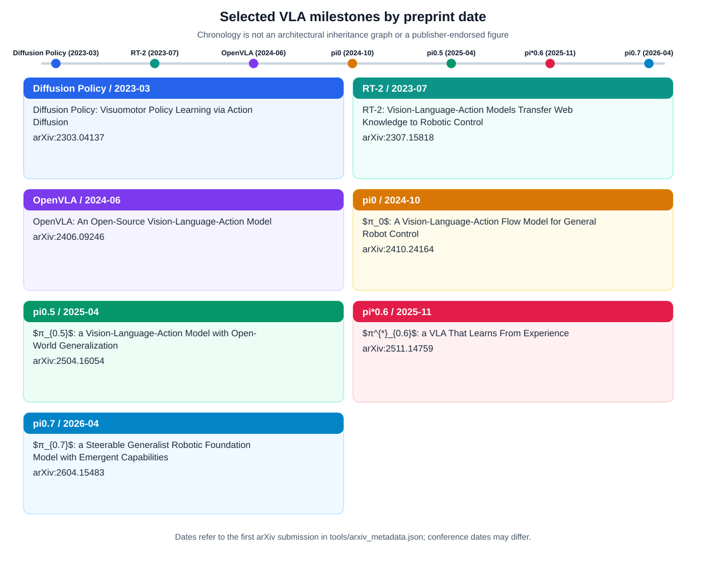

| 年份 | 代表项目 | 关键问题 | 新手应抓住的点 |
|---|---|---|---|
| 2022 | RT-1 | 真实机器人多任务策略能否规模化 | Transformer 可以直接做闭环机器人策略，但仍依赖特定平台和数据 |
| 2023 | RT-2 | VLM 能否直接输出动作 | 把动作编码成文本 token，形成 VLA 范式 |
| 2023 | Open X-Embodiment / RT-X | 跨机构、跨本体数据能否统一 | 机器人数据开始接近“公共语料库”形态 |
| 2024 | Octo | 开源通用机器人策略如何设计 | Transformer + diffusion policy，强调可微调和新机器人适配 |
| 2024 | OpenVLA | 开放 VLA 能否成为社区样板 | 7B VLA、Open X 数据、可训练/微调/推理的开放栈 |
| 2024 | π0 / openpi | 灵巧操作是否更适合连续动作生成 | VLM + flow matching action expert，强调高频连续控制 |
| 2025 | GR00T N1 | humanoid VLA 如何做 | 面向类人机器人的开放基础模型路线 |
| 2025 | Gemini Robotics 1.5 | 闭源多模态推理如何进入机器人控制 | 官方私有预览，强系统集成，但社区不可复现 |
| 2025 | SmolVLA | 普通研究者能否训练轻量 VLA | 450M、社区公开数据、消费级硬件友好 |
| 2025 Q4 | π*0.6 / RECAP | VLA 如何从真实经验和专家纠偏中继续学习 | 论文报告的从经验学习主线，不能写成 2026 首发 |
| 2026 | Gemini Robotics-ER 1.6 / GR00T N1.5 | 高层 embodied reasoning 与 humanoid VLA 如何演进 | 一个偏高层推理，一个偏开放 humanoid VLA 栈 |
| 2026 | RL Token / RLT | VLA 如何适配出 RL token 再接 online RL | adapt/expose compact RL token + freeze/readout + 小 actor-critic head + VLA anchoring |
| 2026 | π0.7 | generalist VLA 如何被多上下文 steer | 论文/官方主张支持 steerable generalist 方向，社区复现另行核查 |
| 2026 | EVA / Executable Video Alignment | 视频世界模型未来如何对齐可执行动作 | 与 Eva-VLA 鲁棒性评测不是同一件事 |
| 2026 | Wall-OSS-0.5 | 预训练 VLA 能否不经微调直接作为可部署策略被评测 | pretrain-as-policy 评测口径：直接评 pretrained checkpoint 的 task progress，而不是只报 fine-tune 后分数 |
| 2026-06 | Isaac GR00T 参考人形机器人 | 开放硬件 + 软件参考设计能否降低 humanoid 研究门槛 | 平台发布是生态事件，不是新模型能力证明；GR00T 模型线最新仍为 N1.7 |

### 总表

| 项目 | 性质 | 输入 | 输出 | 开放程度 | 教学定位 |
|---|---|---|---|---|---|
| RT-1 | 真实机器人 Transformer 策略 | 图像序列 + 语言任务 | 离散动作 token | 论文、项目页、代码和数据入口公开 | 规模化真实机器人策略起点 |
| RT-2 | VLA | 图像 + 语言 + 机器人观测 | 文本化动作 token | 论文/项目/博客公开，代码权重未公开 | VLA 范式起点 |
| Open X / RT-X | 数据集 + 跨本体模型 | 多机器人数据 | 统一动作近似与 RT-X 策略 | 数据集与部分模型公开 | 跨本体学习入口 |
| Octo | 开源 generalist robot policy | 多相机、语言或目标图像 | 连续动作块，diffusion decoding | 代码、权重、训练/微调接口公开 | 最适合读实现的开放策略样板之一 |
| OpenVLA | 开源 VLA | 图像 + 语言 | 7-DoF 末端动作，离散化 | 代码、权重、训练和微调接口公开 | 开源 VLA 主教材 |
| π0 / openpi | VLA / robot foundation model | 图像、语言、机器人状态 | 连续动作，flow matching action expert | 代码和若干 checkpoint 公开，基座数据不完全公开 | 连续动作生成路线代表 |
| FAST / π0-FAST | action tokenization / autoregressive VLA | 动作 chunk、机器人状态、语言/视觉条件 | DCT + BPE 压缩后的动作 token | tokenizer、部分模型和文档公开，速度结论需分训练/推理 | 动作表示和实时接口教材 |
| π0.5 | VLA / open-world generalization 主线 | 文本、图像、机器人状态、web/robot cotraining 信息 | 高层文本 + 低层 flow matching 动作 | 官方论文/博客与 openpi 入口，社区复现边界需核查 | 开放场景泛化叙事教材 |
| π*0.6 / RECAP | VLA 后训练 / 从经验学习 | demonstrations、rollouts、expert interventions | advantage-conditioned / RL-style specialist | 论文报告为主，官方宣称为辅 | 经验学习和专家化路线 |
| RL Token / RLT | VLA + online RL 接口 | 适配后 VLA compact readout、图像、语言、状态 | compact RL token + actor-critic 修正动作 | 论文报告 + 本地精读证据 | VLA 到样本高效 RL 的接口 |
| π0.7 | steerable generalist VLA | 语言、metadata、control modalities、visual subgoals | 多上下文条件下的机器人动作 | 论文报告 + 官方宣称，开放边界需核查 | context conditioning 主线 |
| GR00T N1/N1.7 | humanoid VLA | 语言、图像、本体感知 | 连续动作或动作 token/控制接口 | N1.7 代码、权重和参考栈公开 | humanoid 与跨本体路线代表 |
| Gemini Robotics 1.5 | 闭源 VLA 系统 | 文本 + 图像 | 文本 + 动作 | Private preview / Partners | 闭源系统上限与官方演示样例 |
| Gemini Robotics-ER 1.6 | embodied reasoning VLM | 文本、图像、音频、视频 | 文本与空间/任务推理结果 | API/AI Studio 预览，非低层控制器 | 高层推理模块样例 |
| SmolVLA | 轻量开源 VLA | 图像、语言、机器人状态 | 动作块，flow matching decoder | 代码、模型、公开社区数据路线 | 新手上手和复现实验入口 |
| Eva-VLA | VLA 鲁棒性评测框架 | VLA、任务、物理扰动参数 | failure rate / robustness 评测结果 | arXiv 论文报告 | physical variation benchmark 教材 |
| EVA / Executable Video Alignment | world model post-training / alignment | 视频世界模型、inverse dynamics model、机器人轨迹 | 可执行性 reward 与对齐后视频未来 | arXiv 论文报告 | 世界模型可执行性教材 |
| Wall-OSS-0.5 | 开源 VLA technical report | 图像、语言、机器人状态 | 连续动作（flow matching 风格 action head） | 论文报告开源模型与 pretrain-as-policy 评测协议 | 预训练即策略的评测口径教材，本地精读见 **`Wall-OSS-0.5`（Yu et al., 2026）** |

### RT-1

**已验证事实**

- 官方项目页标题为 “RT-1: Robotics Transformer for Real-World Control at Scale”。
- RT-1 输入短图像序列和自然语言任务，输出离散化动作 token。
- 官方项目页给出的数据规模是超过 130k real-world episodes、700+ tasks、13 台机器人、17 个月采集。
- 项目页说明 RT-1 以 3Hz 做闭环控制，并开源了 RT-1 model 和数据入口。

**官方宣称/演示**

- 官方结果强调 RT-1 在 seen tasks、unseen instructions、背景变化、干扰物等场景下优于若干基线。
- 与 SayCan 组合后可执行长任务，但这类系统结果不能只归因于 RT-1 本身。

**尚不确定**

- 开源栈是否足以完全复现论文级训练流水线，需要按具体仓库、数据版本和训练配置再核对。

**新手读法**

把 RT-1 当作“真实机器人数据 + Transformer 策略”的起点。它不是 VLA 的终点，但能帮你理解机器人策略最基本的输入、输出和闭环执行。

主要来源：[RT-1 官方项目页](https://robotics-transformer1.github.io/)。

### RT-2

**已验证事实**

- 官方项目页将 RT-2 定义为 Vision-Language-Action Models。
- RT-2 的核心做法是把机器人动作表示成文本 token，使 VLM 能在同一 token 形式下学习语言响应和机器人动作。
- 官方项目页写明 RT-2 使用互联网视觉语言任务与机器人轨迹共同训练，并报告 6k evaluation trials。

**官方宣称/演示**

- 官方报告和项目页展示了符号理解、简单推理、未见物体/指令泛化。
- 这些能力有历史意义，但主要证据来自官方论文、项目页和 demo。

**尚不确定**

- 未看到官方代码、权重和完整训练数据开放；因此 RT-2 不适合作为新手第一套复现实验。
- 机器人数据与 web-scale VLM 数据的完整配比、控制栈细节、工程安全栈都无法仅凭公开页面完全复原。

**新手读法**

RT-2 要抓住一个问题：为什么“把动作当成另一种语言”能把 VLM 能力迁移到机器人控制。不要一开始纠结闭源实现细节。

主要来源：[RT-2 官方项目页](https://robotics-transformer2.github.io/)。

### Open X-Embodiment 与 RT-X

**已验证事实**

- 官方项目页写明 Open X-Embodiment 汇集 21 个机构、22 种机器人本体、527 个技能、160,266 个任务。
- 数据集包含 1M+ real robot trajectories，覆盖 22 robot embodiments。
- RT-X 是基于这类跨本体数据训练的一组模型，核心意义是验证跨机器人经验迁移。

**官方宣称/演示**

- 官方页面展示 RT-X 在多机器人设置中有正迁移效果。
- 这些结果要结合具体 robot embodiment、任务和数据混合方式阅读。

**尚不确定**

- RT-1-X 与 RT-2-X 的开放范围不同；教学中不能把“Open X 数据开放”误说成“所有 RT-X 模型和训练细节完全开放”。

**新手读法**

Open X 更像“机器人版公共语料库”，不是单个模型。它解释了为什么 2024 年之后 Octo、OpenVLA、GR00T 等工作都绕不开数据格式和跨本体问题。

主要来源：[Open X-Embodiment / RT-X 官方项目页](https://robotics-transformer-x.github.io/)。

### Octo

**已验证事实**

- Octo 官方项目页称其为 open-source generalist robot policy。
- Octo 是 transformer-based diffusion policy，预训练在来自 Open X-Embodiment 的 800k robot episodes 上。
- 官方 GitHub 公开代码、checkpoint、训练/微调和推理示例。
- Octo 支持多 RGB 相机、语言指令、目标图像，并强调对新观测、新动作空间和新机器人本体的微调能力。

**官方宣称/演示**

- 官方页面展示 Octo 在多个真实机器人设置上的 out-of-the-box 和微调结果。
- 这类结果要结合是否来自预训练分布、目标域示范数量、评估环境一致性来读。

**尚不确定**

- Octo 不是“强语义 VLA”的代表，更接近开放通用策略底座；不能把它和 Gemini Robotics 这类闭源系统做直接能力排名。

**新手读法**

Octo 是理解开放 robot policy 工程形态的好入口。重点看它如何统一 task、observation、action，并如何支持微调。

主要来源：[Octo 官方项目页](https://octo-models.github.io/)，[Octo GitHub](https://github.com/octo-models/octo)。

### OpenVLA

**已验证事实**

- Hugging Face 模型卡和项目资料显示 OpenVLA 使用 970k robot episodes 训练，来自 Open X-Embodiment 数据混合。
- OpenVLA 公开了模型、代码、训练/微调与推理接口。
- 模型卡明确提醒：OpenVLA 不能零样本泛化到未见过的机器人本体或 setup；这些情况建议收集目标 setup 的示范并微调。

**官方宣称/演示**

- OpenVLA 宣称是强开放 VLA，并提供多个机器人域上的使用示例。
- 这些示例适合作为工程入口，但不能推出“任意机器人零样本可用”。

**尚不确定**

- 项目名常写作 OpenVLA 7B；具体参数口径可能因实现统计或模型卡元数据而不同，教学中以项目名为主，并提醒精确参数需按版本核对。

**新手读法**

OpenVLA 是阶段 2 最值得真正打开代码和模型卡读的一项。它能把“VLM 到动作输出”的抽象概念落到 repo、checkpoint、fine-tuning 脚本和 action discretization 上。

主要来源：[OpenVLA Hugging Face 模型卡](https://huggingface.co/openvla/openvla-7b)。

### π0 与 openpi

**已验证事实**

- openpi 官方 GitHub 公开了 π0 系列模型的代码、若干 base checkpoint、微调 checkpoint、训练和推理文档。
- π0 路线强调在预训练 VLM 上接 action expert，用 flow matching 生成连续动作。
- openpi README 明确区分基础 checkpoint、任务微调 checkpoint 和适配目标硬件时需要的后训练。
- openpi 当前包含 π0、π0-FAST、π0.5 三类模型，并提供 base model checkpoints、推理示例和 fine-tuning 到自有数据的流程；README 也明确提醒，π0 为 Physical Intelligence 自家机器人开发，适配 ALOHA、DROID 等常见平台时不保证每次都成功。

**官方宣称/演示**

- Physical Intelligence 官方资料展示了洗衣、折叠、桌面清理、装箱等高灵巧任务。
- 这些 demo 说明方向重要，但不能等同于社区可独立复现的全量能力。

**尚不确定**

- 基座训练的大规模原始机器人数据、完整数据清洗配方、内部硬件 setup 和完整官方评测协议没有等价完整公开；因此更准确的说法是 open code / open weights / partially open training and fine-tuning entry point，而不是“全要素开源”。
- 不同 π0 版本、π0-FAST、π0.5 的动作表示和适配方式需要按对应 checkpoint 与文档分别核对。

**新手读法**

π0 的核心价值是让你看到 VLA 从离散动作 token 走向连续动作生成。读它时重点比较 OpenVLA 的 action discretization 与 π0 的 flow matching action expert。

主要来源：[openpi GitHub](https://github.com/Physical-Intelligence/openpi)。

### GR00T N1 与 N1.7

**已验证事实**

- NVIDIA Isaac GR00T GitHub 公开 N1.5 模型与参考栈，写明提供预训练模型权重、参考代码、微调与推理能力。
- README 将 GR00T N1.5 描述为 open VLA model for generalized humanoid robot skills。
- N1.5 支持多模态输入，包括 language、images，并面向 bimanual、semi-humanoid、humanoid 数据。
- Hugging Face GR00T-N1.5-3B model card 将 N1.5 写为 vision-language encoders 加 flow matching action transformer，用于在 vision、language 和 proprioception 条件下建模 action chunk；若讨论 N1/N1.x 历史架构，应另行注明版本，不能把不同版本动作头混写。
- README 还写明 N1.5 引入 20K hours EgoScale human video data 参与预训练。许可证必须拆开写：GitHub code/reference stack 以仓库 LICENSE/README 为准；Hugging Face 模型权重以模型卡为准，当前 GR00T-N1.5-3B 使用 NVIDIA Open Model License Agreement；数据许可证需要单独核查，不能从代码或权重许可证推断。

**官方宣称/演示**

- 官方宣称 N1.5 相比初代 N1 有更好的 generalization 与 language-following。
- 官方 workflow 覆盖 collect、finetune、evaluate、deploy，但真实机器人部署仍需要自己的控制接口、数据和安全工程。

**尚不确定**

- 早期 GR00T N1、N1.5、N1.6、N1.7 之间的动作头描述和数据配比可能随版本变化；引用时必须写清版本。
- “humanoid foundation model” 不等于可以零样本控制任意 humanoid。
- “代码仓库显示 Apache-2.0”不等于“模型权重、数据和全部训练材料都是 Apache-2.0”。写作时至少拆成代码许可证、权重许可证、数据许可证、Early Access/GA 状态和检查日期。

**新手读法**

GR00T 是理解 humanoid VLA 的代表。读它时不要只看 demo，要看 embodiment tag、数据格式、action horizon、deployment API 和控制器连接方式。

主要来源：[NVIDIA Isaac GR00T GitHub](https://github.com/NVIDIA/Isaac-GR00T)。

### Gemini Robotics 1.5

**已验证事实**

- Google DeepMind 官方模型页写明模型名为 Gemini Robotics 1.5。
- 状态为 Private preview，可用性为 Partners。
- 输入为 Text 和 Image，输出为 Text 和 Action。
- 知识截止和模型卡、技术报告由官方模型页给出。

**官方宣称/演示**

- 官方展示多步操作、空间理解、跨机器人系统等能力。
- 这些属于官方系统级演示，包含模型、控制栈、安全策略、硬件接口和内部数据的共同贡献。

**尚不确定**

- 代码、权重、训练数据和完整评测协议未开放，社区不能做对等复现。
- 外部读者很难拆分模型能力、控制工程和安全工程各自贡献。

**新手读法**

Gemini Robotics 适合当“闭源系统上限”的案例，不适合当第一套可复现实验。读它要始终标注“官方宣称/私有预览”。

主要来源：[Gemini Robotics 技术报告 (arXiv:2503.20020)](https://arxiv.org/abs/2503.20020)、[Gemini Robotics 1.5 技术报告 (arXiv:2510.03342)](https://arxiv.org/abs/2510.03342) 与 [Gemini Robotics 官方模型页](https://deepmind.google/models/gemini-robotics/gemini-robotics/)。此外，字节跳动 Seed 团队发布的 **GR-3**（[arXiv:2507.15493](https://arxiv.org/abs/2507.15493)，4B 参数 Flow-Matching VLA）同样展示了“互联网图文数据 + 人类 VR 轨迹 + 真机轨迹”协同训练在长程柔性衣物折叠与复杂桌面清理任务上的泛化潜力 `[论文报告]`。

### Gemini Robotics-ER 1.6

**已验证事实**

- 官方模型卡写明 Gemini Robotics-ER 1.6 是增强空间和物理推理能力的 VLM，基于 Gemini 3.0 Flash。
- 输入包括文本、图像、音频和视频，上下文窗口最高 128k；输出是文本。
- 官方模型卡将其定位为具身推理模型，适合视觉空间理解、任务规划和 success detection。

**官方宣称/演示**

- 官方发布内容展示 ER 模型能做空间理解、安全判断、任务分解、工具或机器人 API 调用辅助。

**尚不确定**

- ER 1.6 本身不是低层控制器，也不是直接输出连续机器人动作的通用 VLA。它需要接 VLA、技能库、规划器或机器人 API。
- 具体生产部署限制、商业使用范围和安全要求应以当时 API 与模型卡为准。

**新手读法**

把 Gemini Robotics-ER 当成“高层大脑”，把 Gemini Robotics 或其他 VLA/控制器当成“动作执行模块”。这能避免把 reasoning model 误读成低层 robot policy。

主要来源：[Gemini Robotics-ER 1.6 模型卡](https://deepmind.google/models/model-cards/gemini-robotics-er-1-6/)。

### SmolVLA

**已验证事实**

- Hugging Face 官方博客介绍 SmolVLA-450M 是 compact open-source VLA。
- 博客写明它只用兼容许可的开源社区共享数据预训练，并配套 LeRobot 生态。
- 博客写明 SmolVLA 使用 fewer than 30k training episodes，并结合 flow-matching decoders 与异步推理栈。

**官方宣称/演示**

- 官方博客称 SmolVLA 在 LIBERO、Meta-World 和 SO100/SO101 真实任务上能匹配或超过更大模型和 ACT 等基线。
- 这些结论需要结合具体 benchmark、训练集、评测设置和复现代码阅读。

**尚不确定**

- 它是低门槛开放路线，不代表能力上限超过闭源大模型。数据规模、本体覆盖和硬件范围都限制了泛化。

**新手读法**

SmolVLA 不是用户阶段 2 必读的历史起点，但非常适合做“我想真实跑起来”的入口：小模型、公开数据、LeRobot 生态、硬件门槛低。

主要来源：[SmolVLA Hugging Face 官方博客](https://huggingface.co/blog/smolvla)。

### 阶段 2 深入分析：VLA 时间线背后的机制变化

#### 变化一：从机器人专用策略到视觉语言动作统一建模

RT-1 的历史意义在于证明真实机器人多任务数据可以训练一个可扩展策略。它还不是后面意义上的强 VLA，因为语义和推理能力仍然有限，核心贡献更接近“机器人 Transformer 策略规模化”。RT-2 的转折在于把视觉语言模型迁移到动作输出，把动作写成文本 token，让机器人动作进入大模型的序列生成框架。这个转折不是简单换模型，而是把机器人策略从“专用控制模型”推向“视觉语言动作统一接口”。

这个变化有两面。积极的一面是，VLM 预训练带来的物体、属性、关系和常识先验可以帮助机器人处理未见语言和未见语义组合。风险的一面是，动作 token 并不等同于语言 token。动作有单位、坐标、频率、误差代价和控制接口。RT-2 的思想很重要，但它闭源，社区很难验证完整训练配方和控制栈。OpenVLA 的价值就在于把这条路线开放化，让研究者可以真正检查模型卡、推理代码、微调脚本和动作离散化。

新手读这条线时，不要只记“RT-2 开启 VLA”。更准确的理解是：RT-1 证明真实机器人策略可以规模化；RT-2 证明 VLM 表征可以被改造成动作输出；OpenVLA 让这条路线进入开源可学习阶段；SmolVLA 则把开源门槛继续降低。

#### 变化二：从离散动作 token 到连续动作专家

早期 VLA 倾向把动作离散化为 token，优点是容易接入语言模型，缺点是精度、连续性和动作空间适配会成为瓶颈。机器人操作中，很多任务需要平滑连续轨迹，尤其是接触、插入、双臂协调和灵巧操作。Octo、π0、SmolVLA、GR00T 等路线都体现了一个趋势：把高层视觉语言表征和低层连续动作生成拆开，用 diffusion 或 flow matching 类动作头生成动作。

这个趋势不是否定 action tokenization，而是说明动作表示正在分层。语言和高层任务可以保持 token 化，低层动作可以由连续动作专家生成。这样做更接近机器人系统需求：高层语义可以低频推理，低层控制需要高频、平滑和稳定。π0 的 openpi 文档、SmolVLA 的 flow matching decoder、GR00T N1.5 的 flow matching action transformer，都可以放在这个框架里理解。

对新手来说，关键问题是：动作头接在哪里？它看哪些输入？生成多少步？执行多少步？如何和控制器交互？是否能适配新机器人？如果这些问题答不出来，只说“用了 flow matching”没有意义。

#### 变化三：从单模型叙事到系统架构叙事

2022-2023 年的叙事更容易集中在模型本身：RT-1 是 Robotics Transformer，RT-2 是 VLA。到 2025-2026 年，前沿系统越来越强调架构分层。Gemini Robotics-ER 更像高层 embodied reasoning 模型，它能做空间理解、任务分解、成功检测和工具调用辅助，但它本身不是低层控制器。Gemini Robotics 1.5 才是面向动作输出的闭源系统。GR00T 也强调视觉语言基础模型和动作头的组合，并面向 humanoid deployment。

这说明“一个大模型端到端解决所有机器人问题”的叙事并不严谨。真实系统通常需要高层推理、低层动作、控制器、安全层、状态监测和失败恢复。闭源系统的强大往往来自模型、数据、控制栈和工程系统共同作用。开源系统的价值则在于能让社区拆开这些环节，看清哪些部分可复现，哪些部分仍依赖内部资源。

#### 变化四：从单机构数据到开放数据生态

RT-1 的数据主要来自 Google / Everyday Robots 的长期真实机器人采集。Open X-Embodiment 把跨机构、跨本体数据统一起来，DROID 提供更接近真实世界的 in-the-wild 数据，LeRobot 则把数据格式、训练代码和社区发布连接起来。VLA 的进展不是只靠模型变大，也靠数据生态成熟。

这条线对初学者特别重要。很多模型能力看似来自架构，其实来自数据覆盖。OpenVLA 的 970k episodes、Octo 的 800k trajectories、π0 的 10k+ 小时内部多平台数据、SmolVLA 的公开社区数据，代表了不同数据策略。开放模型和闭源模型之间的差距，不只是参数量，也包括基座训练数据是否公开、数据质量是否可审计、能否复现实验。

### 开源边界与复现难度

#### 为什么必须拆开“开源”

“开源”至少包含七个层次：论文公开、项目页公开、代码公开、模型权重公开、训练数据公开、训练脚本公开、评测脚本公开。一个项目可能开放代码和权重，但不开放基座训练数据；可能开放数据，但不开放完整训练配方；可能开放 API，但不开放权重；可能开放 inference，但不开放真实机器人部署细节。阶段 2 的核心不是把项目粗暴分成开源和闭源，而是明确开放到哪一层。

RT-2 和 Gemini Robotics 1.5 是典型闭源或私有预览路线，适合看方向和系统上限，不适合作为复现实验主教材。OpenVLA、Octo、openpi、SmolVLA、GR00T N1.5 则更适合打开仓库学习，但它们也不是完全同质。OpenVLA 更适合理解 VLA action tokenization 和微调；Octo 更适合理解 generalist policy 与 diffusion action decoding；openpi 更适合理解 flow matching action expert；SmolVLA 更适合低门槛复现实验；GR00T 更适合理解 humanoid VLA 栈。

#### 复现难度的四个等级

第一等级是“可读不可复现”：论文和 demo 公开，但代码、权重、数据缺失。RT-2 和 Gemini Robotics 1.5 多数结论对社区属于这个等级。它们可以作为理论和趋势材料，但不能要求新手复现。

第二等级是“可推理可微调”：权重和推理代码公开，社区可以在已有模型上测试和微调，但完整基座训练数据不公开。openpi、GR00T 等部分开放模型常落在这个区间。它们很有价值，但写作时要避免说“全量可复现”。

第三等级是“可训练可审计”：代码、模型、训练脚本、部分或全部训练数据都较清楚。OpenVLA、Octo、SmolVLA 更接近这个层级，但具体还要看数据访问和硬件环境。

第四等级是“可部署可复验”：不仅能训练和推理，还能在公开硬件、公开数据、公开评测协议上复现实机结果。机器人领域很少有项目完全达到这个等级，因为硬件、相机、标定、控制器和安全环境都很难统一。

#### 新手选择复现对象的建议

如果目标是理解 VLA 概念，先读 OpenVLA 和 Octo；如果目标是跑通轻量训练，优先看 SmolVLA 和 LeRobot；如果目标是理解连续动作生成，读 openpi；如果目标是理解 humanoid VLA，读 GR00T；如果目标是理解闭源前沿系统边界，读 Gemini Robotics 和 Gemini Robotics-ER，但不要把它们作为复现实验起点。

对博士生来说，复现选择还要服务研究问题。如果你研究双臂 DLO，不一定要复现最大的 VLA。更有效的路线可能是用 open-source policy 或 LeRobot 数据格式搭一个可控基线，再把研究焦点放在 DLO 状态表示、双臂动作空间、接触反馈和失败恢复上。

### 模型逐项比较：不要只看年份

#### RT-1 与 RT-2 的真正差别

RT-1 和 RT-2 都来自 Google 系列，但问题不同。RT-1 主要回答真实机器人多任务策略能否规模化；RT-2 主要回答视觉语言模型的语义先验能否迁移到机器人动作。RT-1 的关键是真实 episodes、任务覆盖和闭环控制；RT-2 的关键是 action-as-text、web-scale VLM pretraining 和机器人动作微调。

因此 RT-2 不是 RT-1 的简单放大版。RT-2 改变的是输入输出接口和预训练来源，把机器人策略与互联网视觉语言知识连接起来。读两者对比时，要把“数据规模”“模型预训练”“动作表示”“开源范围”“复现条件”分开。RT-1 更适合理解机器人 Transformer 基础，RT-2 更适合理解 VLA 范式，但后者闭源限制更强。

#### Octo 与 OpenVLA 的真正差别

Octo 和 OpenVLA 都开放，都使用 Open X 相关数据，但定位不同。OpenVLA 更像开放 VLA 样板，强调图像语言到动作输出，适合理解 VLM backbone 如何接 action head。Octo 更像 open generalist robot policy，强调多观测、多任务条件、新动作空间和微调能力，动作输出使用 diffusion policy。

新手如果只问“哪个更强”，问题就错了。更好的问题是：我想学 action tokenization 还是 diffusion action decoding？我想看 VLA 模型卡还是 generalist policy 训练接口？我想做语言条件任务还是目标图像条件任务？我想微调新机器人还是理解开放 VLA 架构？不同目标对应不同阅读顺序。

#### π0、SmolVLA 与 GR00T 的共同点和差别

π0、SmolVLA、GR00T 都体现连续动作生成和动作专家路线，但侧重点不同。π0 强调高灵巧通用策略和多平台机器人数据，开源 openpi 降低了研究门槛，但基座训练数据并未完全公开。SmolVLA 强调轻量化、公开社区数据和消费级硬件友好，更适合新手跑通。GR00T 强调 humanoid 和 NVIDIA 生态，面向更复杂身体和部署栈。

它们共同说明 VLA 不是只有“动作 token”一条路。未来很可能是高层语义模型、动作专家、控制器和数据生态结合。对 DLO 和双臂任务来说，这个趋势有启发：复杂接触和连续形变可能更需要连续动作生成与任务专门反馈，而不是单纯依赖离散动作 token。

#### Gemini Robotics 与 Gemini Robotics-ER 的关系

Gemini Robotics-ER 更偏 embodied reasoning，它能理解空间、任务和安全，输出文本或结构化建议，并可辅助工具调用。Gemini Robotics 1.5 则是闭源 VLA 系统，输入文本和图像，输出文本和动作。二者不应混为一谈。ER 像高层大脑，Robotics 1.5 更接近能接动作执行的系统。

这一区分对新手很重要。看到 Gemini Robotics-ER 的空间推理能力，不能直接说它能控制机器人完成低层动作；看到 Gemini Robotics 的 demo，也不能把系统能力全部归因于单个模型。闭源系统需要更严格的证据标注：官方宣称、私有预览、社区未复现。

### 阶段 2 常见误读清单

#### 误读一：VLA 就是把 ChatGPT 接到机器人

VLA 不是聊天模型加机械臂。它需要机器人动作数据、动作表示、控制接口和真实评测。语言模型可以帮助任务理解，但不能自动产生稳定控制命令。把 VLA 简化成“ChatGPT 控制机器人”会忽略最关键的动作学习和物理闭环。

#### 误读二：开源模型一定能直接控制我的机器人

开源权重通常只适配特定 observation 和 action space。要部署到自己的机器人，通常需要相机标定、动作归一化、控制接口适配、目标任务数据和微调。OpenVLA 模型卡已经明确提醒未见 embodiment/setup 不应默认零样本可用，这类边界必须写进教学材料。

#### 误读三：闭源 demo 代表真实通用能力

闭源 demo 能展示方向，但不能替代公开评测。Gemini Robotics 这类系统可能很强，但外部研究者无法检查训练数据、控制栈、失败率和筛选条件。严谨写法是承认官方演示价值，同时标注不可复现边界。

#### 误读四：数据规模越大模型就越强

数据规模重要，但质量、覆盖、动作一致性、标注、机器人本体和任务分布同样重要。Open X 的价值在于跨本体和统一格式，但异质性也强；DROID 的价值在于真实场景多样，但不是标准排行榜；SmolVLA 用较少公开数据降低门槛，但能力上限受数据覆盖限制。数据不能只看总量。

#### 误读五：最新模型一定最适合新手

最新模型未必最适合入门。新手需要可读、可跑、可验证。RT-2 和 Gemini Robotics 历史意义大，但闭源；GR00T 很重要，但生态和硬件假设更复杂；OpenVLA、Octo、SmolVLA、LeRobot 更适合作为入门实践材料。学习顺序应该按可理解性和可复现性，而不是按热度。

### 面向双臂 DLO 研究的阶段 2 启发

VLA 时间线对双臂 DLO 研究的启发，不是“直接拿最大模型做线缆操作”，而是把通用模型能力拆成可利用部分。视觉语言模型可以帮助识别任务目标、物体关系和高层语言约束；开放机器人策略可以提供动作生成基线；连续动作专家可能更适合线缆这类平滑接触任务；数据生态可以帮助组织遥操作轨迹；高层 reasoning model 可以辅助失败诊断和任务分解。

但 DLO 的关键缺口仍然存在：线缆状态表示、拓扑变化、张力估计、遮挡恢复、双臂同步、接触反馈和任务成功检测。这些缺口不是通用 VLA 自动解决的。更合理的研究策略是：用开源 VLA 或 diffusion policy 作为底座，加入 DLO 专门状态表示和反馈约束，再设计能暴露拓扑和接触失败的评测。

因此阶段 2 文档不应把前沿模型写成终点，而应写成工具箱。RT-1/RT-2 提供历史坐标，Open X/DROID/LeRobot 提供数据背景，OpenVLA/Octo/SmolVLA 提供开放学习入口，π0/GR00T/Gemini 提供未来系统形态参考。真正的博士研究问题，要从这些工具和你的具体任务缺口之间产生。

### 阶段 2 质量 Checklist

写完任何 VLA 模型卡，都应检查以下项目：

| 项目 | 必须回答的问题 |
|---|---|
| 性质 | 它是 VLA、generalist policy、reasoning model、humanoid model，还是数据项目？ |
| 输入 | 图像、语言、本体感知、历史帧、多相机分别是否使用？ |
| 输出 | 离散动作 token、连续动作、动作 chunk、高层计划还是文本？ |
| 数据 | 数据规模、来源、真实/仿真、是否公开分别是什么？ |
| 动作 | 动作空间、频率、horizon、坐标系、离散化或生成方式是什么？ |
| 开放 | 论文、代码、权重、数据、训练、评测、硬件说明开放到哪一层？ |
| 证据 | 结论来自官方演示、论文实验、模型卡、社区复现还是推断？ |
| 边界 | 哪些能力不能外推到未见机器人、未见 setup、接触任务或双臂 DLO？ |

### 阶段 2 逐项阅读图谱

#### 第一层：历史起点

RT-1 和 RT-2 应该放在历史起点层。RT-1 让你理解真实机器人多任务策略如何规模化，RT-2 让你理解为什么 VLA 成为新范式。读这一层时，不要急着复现，而是抓基本概念：真实 episodes、语言条件、动作 token、闭环控制、视觉语言预训练、动作作为文本输出。它们回答的是“这条路线为什么出现”。

这一层的阅读产出应是一张对比表：RT-1 的输入、输出、数据、控制频率、开源范围；RT-2 的输入、输出、动作编码、VLM 迁移、闭源边界。写清后你就会发现，RT-2 的概念影响力很大，但复现价值受闭源限制；RT-1 更基础，但能让你看清机器人策略的真实数据和控制接口。

#### 第二层：开放底座

Open X、Octo、OpenVLA 是开放底座层。Open X 解决数据统一问题；Octo 解决开放 generalist policy 问题；OpenVLA 解决开放 VLA 样板问题。读这一层时，要把“数据”“策略”“VLA”分开。Open X 不是模型，Octo 不只是 VLA，OpenVLA 不只是数据。三者共同构成 2024 年以后社区可学习、可微调、可复验的核心材料。

这一层的阅读产出应包括：Open X 的数据规模和异质性；Octo 的 observation/action/task 接口；OpenVLA 的模型卡边界和微调方式。尤其要记住 OpenVLA 对未见 embodiment/setup 的限制，这个提醒能帮助你避免过度宣传开源 VLA。

#### 第三层：连续动作生成

π0、SmolVLA、GR00T 可以放在连续动作生成层。它们并不完全相同，但都体现一个趋势：仅靠离散动作 token 不足以覆盖高精度连续控制，动作专家和生成式动作头越来越重要。读这一层时，要把 diffusion、flow matching、action expert、action horizon、inference speed、robot adaptation 连在一起。

这一层的阅读产出应是一张动作头表：模型使用什么高层 backbone，动作头是什么，输出连续还是离散，是否公开权重，训练数据是否公开，适合什么硬件。对你的双臂 DLO 方向，这一层尤其关键，因为线缆和双臂接触更依赖连续轨迹、同步和反馈。

#### 第四层：闭源系统与高层推理

Gemini Robotics 和 Gemini Robotics-ER 应放在闭源系统与高层推理层。它们非常重要，但不能按开源模型的证据标准阅读。Gemini Robotics 1.5 是私有预览的机器人模型系统，Gemini Robotics-ER 1.6 是 embodied reasoning VLM。前者更接近动作系统，后者更适合高层空间理解、任务推理、成功检测和工具调用。

这一层的阅读产出不是复现实验，而是证据边界表：官方展示了什么，模型页确认了什么，哪些仍不可验证，哪些结论只能写成官方宣称。闭源系统可以启发研究方向，但不能替代自己的可复现实验。

#### 第五层：轻量化和社区化

SmolVLA 与 LeRobot 生态代表轻量化和社区化。它们的价值不是宣称超过所有闭源大模型，而是让普通研究者能接触到完整训练、数据格式、模型发布和低成本硬件流程。对新手来说，这类项目往往比最强闭源 demo 更有学习价值。

这一层的阅读产出应是实践路线：下载数据、理解 LeRobotDataset、跑一个小模型、微调一个简单任务、记录失败模式。只有真正跑过一次，才会理解动作空间、数据格式、控制接口和评测协议为什么重要。

### 阶段 2 最终判断

阶段 2 的高质量结论应该是分层的。历史上，RT-1 到 RT-2 完成了从机器人 Transformer 到 VLA 的转折。开放生态上，Open X、Octo、OpenVLA、SmolVLA 和 LeRobot 让社区具备系统学习条件。动作建模上，π0、SmolVLA、GR00T 等路线说明连续动作专家越来越重要。系统架构上，Gemini Robotics-ER 与 Gemini Robotics 提醒我们高层推理和低层动作应分开看。研究启发上，通用 VLA 提供底座，但双臂 DLO 这类任务仍需要专门状态表示、接触反馈和评测设计。

如果这五层都写清楚，阶段 2 就不会变成模型名单，而会变成一张机器人基础模型的发展地图。

### 阶段 2 写作模板：每个模型都按同一把尺子写

为了避免模型章节变成宣传式介绍，每个模型都应按同一套模板写。第一段写性质：它到底是机器人策略、VLA、数据项目、推理模型，还是 humanoid foundation model。第二段写输入输出：输入包括哪些视觉、语言和本体信息，输出是文本、动作 token、连续动作、动作 chunk，还是高层工具调用。第三段写数据：真实还是仿真，规模是多少，是否公开，是否包含多本体。第四段写训练和动作头：是行为克隆、语言建模、diffusion、flow matching，还是混合目标。第五段写开放范围：代码、权重、数据、训练和评测分别开放到哪一层。第六段写边界：哪些结论不能外推。

这个模板的好处是让不同模型可比较。RT-2 强在范式但闭源；OpenVLA 强在开源 VLA 样板；Octo 强在开放 generalist policy；π0 强在连续动作专家和灵巧操作展示；GR00T 强在 humanoid 栈；Gemini Robotics 强在闭源系统集成；SmolVLA 强在轻量社区化。它们不是一条简单排行榜，而是解决不同子问题。

### 阶段 2 的证据等级写法

写 VLA 时间线时，建议每个结论都加证据等级。`已验证事实` 用于官方模型卡、论文、GitHub、项目页明确写出的内容。`官方宣称/演示` 用于官方博客、视频、私有预览报告展示的能力。`尚不确定` 用于代码未公开、训练数据未公开、版本口径不一致、社区无法复现的点。这个三分法能显著提高文档可信度。

例如“OpenVLA 使用 970k robot episodes 训练”可以写为已验证事实，因为模型卡和项目资料明确写出。“Gemini Robotics 能跨多种机器人执行复杂任务”应写为官方宣称/演示，因为主要证据来自官方页面和私有系统。“某闭源模型在所有真实家庭任务中泛化良好”不能写成事实，除非有公开系统评测。这个边界对新手非常重要。

### 阶段 2 的研究问题生成法

读完模型时间线后，不要只停留在“哪个模型强”。应该把每条路线转化为研究问题。动作 token 路线会引出：离散化如何影响高精度接触？连续动作专家路线会引出：flow matching 或 diffusion 如何处理双臂同步？跨本体数据路线会引出：统一动作空间是否掩盖了本体差异？高层 reasoning 路线会引出：任务分解和 success detection 如何与低层策略交互？轻量开源路线会引出：小模型在特定任务上能否通过高质量数据超过大模型？

这些问题比单纯追最新模型更适合博士研究。对双臂 DLO 而言，一个具体问题可以是：开放 VLA 能否提供语言和视觉语义底座，再由 DLO 专门的连续动作专家处理形状和张力？另一个问题可以是：高层 reasoning model 能否诊断线缆缠绕、滑脱和张力不足，并触发恢复策略？这些问题都来自阶段 2，但必须回到阶段 1 的观测、动作、控制和反馈框架。

### 阶段 2 结论强度排序

最强结论通常来自开放代码、开放权重、开放数据、公开评测和社区可复现。中等强度结论来自论文和项目页明确报告但复现条件不足。较弱结论来自官方 demo、博客视频和私有预览。最弱结论是从模型名或趋势推断出来、没有直接证据的说法。

因此，教学中可以大胆讲 RT-2 的历史意义，但不能把它当成可复现实验样板；可以承认 Gemini Robotics 展示了强系统能力，但必须标注闭源和私有预览；可以推荐 OpenVLA、Octo、SmolVLA 作为学习材料，但也要写清它们对未见机器人和复杂接触任务的边界。严谨性不是保守，而是把证据强度和结论强度匹配。

### 阶段 2 本地精读案例库：从模型名读到实验结论

阶段 2 如果只停留在“RT-2 很重要、OpenVLA 开源、π0 用 diffusion、GR00T 面向人形机器人”这一层，对新手帮助有限。真正有训练价值的读法，是把每个模型拆成四个问题：它声称解决什么瓶颈，实验怎样支持这个声称，实验没有覆盖什么，后续工作如何补这个缺口。本节只使用本地已精读笔记中的证据，并把结论强度写清楚。这样做的目的不是把阶段 2 变成文献综述，而是让新手知道如何把 VLA 时间线读成可操作的研究地图。

#### 案例 1：RT-2 的历史意义不是“模型更大”，而是把动作接到 VLM 语义空间

**`RT-2`（Brohan et al., [arXiv:2307.15818](https://arxiv.org/abs/2307.15818)）** 是阶段 2 必须精读的起点。它的重要性不在于某个具体 success rate 最高，而在于提出了一个范式转换：把机器人动作离散化为文本 token，让视觉语言模型可以在同一个序列建模框架中接收图像、语言指令并输出动作。论文中的动作表示把 7-DoF 控制量离散到 256 个 bin，再作为 token 进入语言模型输出空间。这一点对新手很关键，因为它解释了为什么后来的 VLA 文献会反复讨论“动作 token 化”“动作专家”“连续动作生成”：RT-2 证明了 VLM 语义知识可以通过 token 接口进入机器人控制，但这个接口本身会带来控制频率、精度和动作连续性的限制。

文献精读记录中最有价值的实验信息有三组。第一，RT-2 在 Google Mobile Manipulator 上进行真实机器人评测，实验规模达到约 6000 次真实机器人试验，不是只在仿真中展示。第二，在 seen tasks 上，RT-2-PaLI-X 和 RT-2-PaLM-E 与 RT-1 接近，成功率分别约 91%、93%、92%，说明大模型并没有在已见技能上自动压倒专门机器人策略。第三，在 generalization 与 emergent skill 评测中，RT-2 的优势更明显：文献精读记录记录的 generalization 平均约 62%，而 RT-1 约 32%；emergent 评测中 RT-2-PaLI-X 平均约 60，而 RT-1 约 17。这组数字适合教学，因为它把 RT-2 的贡献限定在“语义泛化和网络知识迁移”，而不是笼统说“更大的模型控制更好”。

因此，对 RT-2 的严谨表述应该是：已验证事实层面，它展示了 VLM 预训练知识可以通过 action-as-text 接口迁移到机器人任务，尤其对未见语义组合和 emergent 指令更有帮助；官方和论文实验层面，它的真实机器人评测规模很大，能支撑“VLA 范式成立”的历史判断；尚不确定或不可直接外推的部分，是这种 token 化动作接口能否适应高频、接触丰富、双臂协同或 DLO 操控。RT-2 的控制频率约 1-3 Hz，依赖云端 TPU 推理，模型规模达到 55B/305B 级别，且完整系统不可社区复现。新手如果忽略这些边界，就容易把 RT-2 误读成“只要把 VLM 接到机器人上就能解决操控”。正确读法是：RT-2 打开了门，但也暴露了离散动作、低频控制、闭源系统和平台绑定的代价。

这也解释了为什么 RT-2 后面的路线会分叉。一条路线继续扩大通用语义能力，代表是 RT-X、Gemini Robotics、GR00T 等系统；另一条路线追求开放复现，代表是 Octo、OpenVLA、SmolVLA；还有一条路线修补动作生成接口，代表是 diffusion action head、flow matching、混合动作空间和动作专家。把 RT-2 放在这三条分叉的起点上，新手才会理解时间线的逻辑，而不是记一串年份。

#### 案例 2：Open X / RT-X 的贡献是把“单机器人策略”推向“跨本体数据假设”

**`Open X-Embodiment`（[arXiv:2310.08864](https://arxiv.org/abs/2310.08864)）** 对阶段 2 的意义在于提出了跨本体数据规模化的共同实验场。Open X-Embodiment 汇集来自多机构、多机器人的演示数据，文献精读记录记录的口径是 22 种机器人、21 个机构、60 个数据集、超过 100 万条轨迹、527 个技能与 160266 个任务。这个数字本身不是最重要的，最重要的是它改变了 VLA 的训练假设：机器人基础模型不再只从一个实验室、一个平台、一个任务分布中学习，而是尝试从不同机器人形态、相机视角、动作空间和任务语言中抽取可迁移规律。

RT-X 的实验对新手有两个教学价值。第一，它证明跨本体数据在某些条件下可以提供正迁移。本地精读笔记记录，RT-1-X 在多个小数据域上相对单域训练平均提高约 50%，RT-2-X 在 emergent skill 上约有 3 倍提升。第二，它同时暴露了跨本体训练的结构性困难：动作空间需要粗略对齐，不同数据集的绝对/相对坐标混杂，数据质量和成功标准不统一，训练使用的本体只覆盖全部本体的一部分。也就是说，Open X 不是“把所有机器人数据倒进一个池子就会得到通用机器人”，而是第一次把跨本体数据统一问题推到社区中心。

这段历史对阶段 2 文档的写法很重要。讲 Open X/RT-X 时，不能只写“数据规模大、跨机器人、促进泛化”。更严谨的写法是：已验证事实是它形成了大规模跨本体演示数据集合，并支撑 RT-1-X、RT-2-X 等模型做跨平台训练与真实机器人评测；官方论文结论是跨本体数据能在若干平台上提升泛化；尚不确定的是这种提升能否稳定迁移到动作空间差异更大、接触更复杂、精密力控或 DLO 等任务。对新手而言，Open X 的真正启发是“数据统一本身就是研究问题”，不是“数据越杂越好”。

如果要把 Open X 的经验迁移到双臂 DLO，需要格外谨慎。DLO 操控中的关键状态包括形状、张力、接触点、遮挡、双臂相对运动和材料属性，这些变量在普通 tabletop pick-and-place 数据中很少被显式记录。跨本体数据能帮助学习视觉语义和粗粒度操作模式，但不能自动提供 DLO 的力学状态表示。阶段 2 可以把 Open X 当成数据规模化路线的里程碑，却不能把它当成 DLO 研究的直接证据。

#### 案例 3：Octo 的价值在于开放 generalist policy，而不是在所有任务上压倒专用模型

**`Octo`（Octo Model Team, [arXiv:2405.12213](https://arxiv.org/abs/2405.12213)）** 适合放在 RT-X 之后阅读，因为它代表了开放通用机器人策略的另一个方向。Octo 使用 Open X-Embodiment 中的约 800k 演示，来自 25 个数据集；模型采用 token 化输入、block-wise masked Transformer、readout token 和 diffusion action head。它有 27M 与 93M 两种规模，强调可以接入新的 observation 和 action head。对新手来说，Octo 的重点不是“又一个 VLA”，而是它让社区可以真正下载、微调、替换头部并在多机构设置中检验 generalist policy。

文献精读记录中有几条实验结果特别适合教学。第一，Octo 在 9 个机器人设置、4 个机构中评测，说明它不是只服务一个实验室平台。第二，在约 100 条演示的微调设置中，Octo 平均成功率约 72，而从头训练的 ResNet+Transformer 约 20，VC-1 约 15。这说明通用机器人预训练可以显著改善小数据微调。第三，消融实验显示 Octo-Small 约 83，RT-X mix 约 60，single robot 约 43，离散动作约 18，MSE 连续动作约 35，ResNet+Transformer 约 70。这组结果能帮助新手看到：数据混合、动作建模、模型架构和训练目标都会影响最终性能，不能只看参数量。

但 Octo 也必须带着边界读。文献精读记录记录，goal-image conditioning 在某些 WidowX 任务上比 language conditioning 强约 25%，说明语言条件并不总是最可靠的目标表示。novel skills 平均约 5% 的结果也提醒我们，开放 generalist policy 并不会自动获得强组合泛化。Octo 对 wrist camera、语言条件和最优演示依赖仍有明显限制。对 DLO、双臂和接触丰富任务，它提供的是开放训练和微调范式，不是直接能力证明。

所以阶段 2 对 Octo 的推荐语应该是：如果新手想理解开放 robot foundation policy 的工程形态，Octo 是比闭源 RT-2 更适合动手的材料；如果新手想证明通用模型可以解决任意操控任务，Octo 的证据远远不够。它的优势是开放、可微调、结构清晰；它的局限是新技能泛化、语言 grounding、复杂接触与高精度控制仍弱。这个判断比简单写“Octo 是 open-source generalist robot policy”更有学术价值。

#### 案例 4：OpenVLA 把 VLA 从闭源叙事拉回可复现比较

**`OpenVLA`（Kim et al., [arXiv:2406.09246](https://arxiv.org/abs/2406.09246)）** 是阶段 2 中最适合新手动手阅读的 VLA 论文之一。它的定位很清楚：构建一个 7B 开源 VLA，基于 Prismatic-7B、SigLIP、DinoV2 和 Llama2，在 Open X-Embodiment 的约 970k 机器人演示上训练，并继续使用 7D 动作离散到 256 个 bin 的 action token 方式。它不像 RT-2 那样依赖超大闭源模型和内部机器人系统，因此更适合作为“如何复现一个 VLA”的入口。

OpenVLA 的核心证据来自跨平台真实机器人比较和微调实验。本地精读笔记记录，在 BridgeData V2 的 17 个任务、每个任务 10 次试验上，OpenVLA 达到 70.6±3.2，而 RT-2-X 为 50.6±3.5，Octo 为 20.0±2.6，RT-1-X 为 18.5±2.7。在 Google Robot 设置上，OpenVLA 为 85.0±4.6，RT-2-X 为 78.3±5.4。微调实验也显示 OpenVLA 在 Franka-Tabletop 和 Franka-DROID 上有较强表现，Franka-Tabletop 平均约 67.2±4.0，Franka-DROID 平均约 58.3±7.2。LoRA 微调只训练约 1.4% 参数时，性能约 68.2，接近全量微调约 69.7；int4 量化在记录中约 71.9 且显存约 7.0GB，而 bfloat16 约 71.3 且显存约 16.8GB。这些细节对新手很有用，因为它们把“开源 VLA”落到可训练成本、显存、微调方式和真实机器人评测上。

同时，OpenVLA 也是理解 VLA 局限的好材料。它仍然使用离散动作 token，主要是单图像 observation，对高频控制不友好。文献精读记录明确指出，它的吞吐与动作表示不适合直接覆盖 ALOHA 这类 50Hz 双臂遥操作数据，也缺少 DLO、双臂和灵巧手等复杂接触直接证据。它在常见真实机器人任务上强，但 typical success 仍不能简单写成“接近可靠部署”。这正好训练新手形成证据边界：OpenVLA 可以支持“开放 VLA 能在若干真实机器人平台上达到强基线，并可用 LoRA/量化降低微调门槛”，不能支持“开放 VLA 已经解决通用操控”。

OpenVLA 还适合用来解释为什么阶段 2 不能脱离阶段 3。OpenVLA 的能力与 Open X-Embodiment 的数据覆盖强相关，BridgeData、Google Robot、DROID 子集和具体微调数据都会影响结论。新手如果只读模型结构，很容易忽略训练数据分布。正确读法是：模型架构、动作表示、数据来源、微调协议和评测任务必须一起读；少任何一项，success rate 都可能被误解释。

#### 案例 5：从 OpenVLA 到结构化 VLA，LIBERO 上的高分要看清 protocol

OpenVLA 之后，许多工作尝试在 VLA 上加入结构化推理、动作分层、RL 后训练或失败检测。这里可以用 **`NS-VLA`（Zhu et al., 2026）**、**`Libra-VLA`（Wei et al., 2026）** 和 **Xiao et al. (2026, World-Env)** 建立读法。它们的共同点是常在 LIBERO、CALVIN 或类似 tabletop benchmark 上报告高 success rate；它们的差异是改动的位置不同：NS-VLA 引入 neuro-symbolic 表示和 solver，Libra-VLA 使用 coarse-to-fine 混合动作空间，World-Env 把 world model 当作 VLA RL 后训练环境。

**`NS-VLA`（Zhu et al., 2026）** 的文献精读记录记录，NS-VLA 在 LIBERO 1-shot 上平均 success rate 约 69.1，在 LIBERO-Plus 上约 79.4；CALVIN ABC->D 的 5-task success rate 约 91.2，但这个数值在文献精读记录中属于 figure approximation，结论强度要低于表格数值。这个案例适合提醒新手：结构化推理确实可能改善少样本和组合泛化，但如果关键数值来自图像估读或只在仿真 tabletop 中验证，就不能写成强现实部署结论。

**`Libra-VLA`（Wei et al., 2026）** 的文献精读记录记录，Libra-VLA 使用语义 planner 生成离散 macro intent，再用 diffusion action refiner 产生连续 micro alignment，并通过 asynchronous FIFO intent buffer 降低高层语义规划与低层控制频率不匹配的问题。它在 LIBERO 上平均约 97.2，在 LIBERO-Plus zero-shot 上约 79.5，监督微调后约 82.3。文献精读记录还记录了 LIBERO 训练数据规模约 1693 个 episodes、273465 帧、10Hz，LIBERO-Plus 约 14347 个 episodes、2238036 帧、20Hz。这个案例的关键不是背分数，而是理解“混合动作空间为什么会出现”：离散高层意图适合表达语义阶段，连续低层动作适合处理几何和接触细节。

**Xiao et al. (2026, World-Env)** 则把 VLA 后训练问题讲得更直接。它为 VLA 构造物理一致的虚拟环境，并用 VLM-guided instant reflector 给出反馈。文献精读记录记录，在每个任务 5 条演示的设置下，World-Env 使 OpenVLA-OFT 在 LIBERO 上平均约 79.6，而 OpenVLA-OFT 基线约 74.85，UniVLA 约 74.75，OpenVLA 约 60.7，π0 约 61.1，π0+FAST 约 55.0。真实世界只包含 4 个 tabletop 任务，每个任务约 10 条轨迹，对应分数为 30/50/40/50，而 OpenVLA-OFT 为 20/30/30/20。这组结果适合训练证据分级：仿真中改进比较清楚，真实世界样本很小，只能作为初步验证，不能证明通用真实机器人泛化。

把这三篇放在一起，阶段 2 的结论会更稳：OpenVLA 提供开放 VLA 底座，NS-VLA 和 Libra-VLA 说明结构化表示、混合动作空间可能提升仿真 benchmark 表现，World-Env 说明 VLA 后训练可以利用世界模型和反思机制提升有限数据下的成功率。但它们共同的外推边界也很明显：主要评测是 tabletop、刚体、仿真或少量真实任务；复杂 DLO、双臂协作、柔顺接触和力控仍缺直接证据。对博士入门而言，这个边界比单个分数更重要。

#### 案例 6：部署效率论文提醒我们，VLA 不是只比较 success rate

阶段 2 的另一个常见盲点，是只看模型成功率而不看推理延迟、控制频率、能耗和硬件成本。**`Characterizing VLA Systems`（Zhou et al., 2026）** 的文献精读记录提供了很好的反例。该工作把 VLA 系统拆成 VLM backbone 和 action expert 两类计算瓶颈：前者更偏 compute-bound，后者更偏 memory-bound。它在 LIBERO 仿真、Franka 真实桌面清洁和 JAKA S5 双臂 put-in-bowl 等任务上比较延迟、控制频率、成功率、能耗和成本。

这类实验对新手有直接价值。比如文献精读记录记录，DP-Cache 在 π0 的 LIBERO 设置中可带来约 2.1 倍加速，但 success rate 下降约 3.6%；V-AEFusion 约 1.3 倍加速，下降约 0.3%；Franka 真实任务中 π0.5-droid 使用 DP-Cache 约 1.28 倍加速，但 success rate 下降约 6%；OpenVLA 使用 Spec+Cache 约 1.29 倍加速，success rate 下降约 6.6%。JAKA S5 的 stale steps 消融更直观：0 步缓存时成功率约 92/86，5 步约 88/78，6 步约 80/66，7 步约 50/42，9 步约 10/6。这个结果说明机器人控制中的“旧动作”不是免费资源，缓存和跳帧会在动态任务中快速积累误差。

这篇论文对阶段 2 的写作要求是：评价 VLA 必须加入系统指标。一个模型即使在 benchmark 上分数高，如果推理只能低频运行、需要昂贵加速器、对 stale action 敏感，也不能直接部署到需要快速闭环的任务。对于 DLO 操控，这一点尤其重要，因为绳索、线缆、布料和柔性体的局部状态会随接触持续变化，缓存策略可能比刚体 pick-and-place 更危险。阶段 2 可以把部署效率作为从“模型论文”走向“机器人系统”的桥梁。

#### 案例 7：失败检测与恢复是 VLA 走向真实机器人时不能跳过的层

VLA 论文常把任务 success rate 当作主要指标，但真实机器人系统还需要知道何时失败、为什么失败、能否恢复。**`RC-NF`（Zhou et al., 2026）** 的文献精读记录提供了一个面向 VLA/π0 运行时异常检测的案例。它构建 LIBERO-Anomaly-10，包含 Gripper Open、Gripper Slippage、Spatial Misalignment 等异常类型，并使用关系条件神经场做状态检测。文献精读记录记录，RC-NF 平均 AUC 约 0.9309，AP 约 0.9494；GPT-5 baseline 的 AUC 约 0.8500，AP 约 0.8507；FailDetect 的 AUC 约 0.7181，AP 约 0.7700。在 Spatial Misalignment 上，RC-NF AUC 约 0.9676，而若干 VLM baseline 接近随机。

这个案例不能被误读为“VLA 已经能自我纠错”。更严谨的说法是：在预定义任务和异常类型下，显式几何/关系状态检测可以比通用 VLM 更可靠地发现某些执行偏差；但它依赖 SAM2 分割、每任务阈值、2D point set 和有限任务覆盖。它证明的是“运行时监控层有必要”，不是“基础模型自身已经具备稳定安全性”。对 DLO 研究而言，这个方向很值得借鉴，因为 DLO 失败往往不是语义理解失败，而是局部接触、滑移、缠绕、张力和形状演化异常。阶段 2 应该把它放在 VLA 系统化的后半段，而不是与 RT-2/OpenVLA 这类底座模型混为一谈。

#### 案例 8：力觉和接触丰富 VLA 是相关方向，但当前证据不能替代 DLO 研究

本地检索还命中了 **Li et al. (2026, ForceVLA2, [arXiv:2603.15169](https://arxiv.org/abs/2603.15169))** 这类 force-aware VLA 工作。它说明 VLA 社区已经意识到纯视觉语言输入不足以覆盖接触丰富操作，开始引入力觉、触觉或接触状态作为模型输入或训练信号。对 DLO、双臂和精密装配研究者来说，这个方向比单纯提高语言理解更接近真实瓶颈。但在阶段 2 中要避免把它过度扩大：只要实验任务、传感器配置、对象材料和控制频率没有覆盖 DLO 的核心变量，就不能把“force-aware VLA”写成“已解决柔性线状物操作”。

更稳的写法是：力觉增强 VLA 提供了一个研究信号，说明下一代 VLA 可能从 vision-language-action 扩展到 vision-language-force-action 或 multimodal-action；但 DLO 操控仍需要专门的状态表示和评测协议。比如线缆形状可以有多解投影，局部遮挡会使视觉估计不稳定，双臂拉拽会引入非局部形变，接触力和材料刚度影响可达状态集合。这些问题不是在普通 tabletop 任务中自然出现的。阶段 2 文档如果面向机器人操控博士生，就应该明确写出这条边界：通用 VLA 是底座，DLO 仍是需要自建状态、数据和 benchmark 的研究问题。

### 阶段 2 证据表：哪些结论能写强，哪些只能写弱

| 结论 | 可引用本地证据 | 结论强度 | 写作边界 |
|---|---|---|---|
| VLM 语义知识可以迁移到机器人控制 | **`RT-2`（Brohan et al., [arXiv:2307.15818](https://arxiv.org/abs/2307.15818)）** 的真实机器人 generalization 与 emergent skill 评测 | 强 | 限于论文平台和低频动作接口，不等于通用物理技能 |
| 跨本体数据能在部分机器人任务上带来正迁移 | **`Open X-Embodiment`（[arXiv:2310.08864](https://arxiv.org/abs/2310.08864)）** 中 RT-1-X、RT-2-X 多机器人评测 | 中强 | 数据对齐、任务分布和本体覆盖会影响结论 |
| 开放 VLA 可以达到强真实机器人基线 | **`OpenVLA`（Kim et al., [arXiv:2406.09246](https://arxiv.org/abs/2406.09246)）** 的 BridgeData V2、Google Robot、Franka 微调结果 | 中强 | 仍以单臂 tabletop 为主，离散动作和单图像 observation 有边界 |
| 通用机器人预训练能改善小数据微调 | **`Octo`（Octo Model Team, [arXiv:2405.12213](https://arxiv.org/abs/2405.12213)）** 的 100-demo 微调和消融 | 中强 | novel skill 与 language conditioning 仍弱 |
| 结构化推理和混合动作空间能提升仿真 benchmark 表现 | **`NS-VLA`（Zhu et al., 2026）**、**`Libra-VLA`（Wei et al., 2026）** 的 LIBERO/CALVIN 结果 | 中 | 主要是仿真 tabletop，部分数值来自图像估读，现实外推要降级 |
| 世界模型和反思机制可用于 VLA 后训练 | **Xiao et al. (2026, World-Env)** 的 LIBERO 与少量真实任务结果 | 中 | 真实任务数量小，不能证明开放真实场景泛化 |
| 推理缓存和部署优化存在 success rate 代价 | **`Characterizing VLA Systems`（Zhou et al., 2026）** 的 latency、stale steps 与真实任务消融 | 中强 | 任务多为 pick-and-place/tabletop，DLO 需要重新验证 |
| 运行时异常检测比单纯 VLM 判断更可靠 | **`RC-NF`（Zhou et al., 2026）** 的 LIBERO-Anomaly 结果 | 中 | 异常类型、任务和感知模块受限，不能泛化到所有失败 |

这个表可以作为阶段 2 写作时的“刹车”。只要一个结论超过了本地证据覆盖，就应该降级表述。例如可以写“OpenVLA 在若干真实机器人 tabletop 任务上表现强，并显著降低开放 VLA 研究门槛”，不应写“OpenVLA 已经具备通用机器人操作能力”。可以写“Libra-VLA 在 LIBERO 系列 benchmark 上展示了混合动作空间的优势”，不应写“混合动作空间已经解决真实双臂协作”。可以写“RC-NF 表明 VLA 系统需要显式失败监控”，不应写“VLA 已经具备可靠自我修复”。

### 阶段 2 新手常见错读与纠正示例

**错读 1：模型越新越适合入门。**  
纠正：入门应优先读结构清楚、证据可复查、代码或数据可获得的材料。RT-2 虽然历史重要，但闭源和系统成本高；OpenVLA、Octo、SmolVLA、LeRobot 相关材料更适合动手。Gemini Robotics、GR00T、π0 适合建立趋势判断，但如果材料主要来自官方演示，就要把它们放在“理解方向”而不是“复现实验”的位置。

**错读 2：VLA 的核心就是把语言模型接到机器人。**  
纠正：VLA 至少包含视觉编码、语言理解、动作表示、数据分布、控制频率、机器人接口和评测协议。RT-2 的 action-as-text、Octo 的 diffusion action head、OpenVLA 的离散 7D token、Libra-VLA 的 hybrid action space，都是围绕动作接口展开的设计。只讲语言模型会遮蔽机器人控制真正困难的部分。

**错读 3：success rate 可以跨论文直接排名。**  
纠正：success rate 只在同一机器人、同一任务、同一试验次数、同一成功定义、同一数据预算和同一评测 protocol 下可比。BridgeData V2、Google Robot、LIBERO、CALVIN、真实 Franka tabletop、JAKA S5 双臂任务之间不能简单合并排名。阶段 2 文档如果需要比较模型，必须把“评测环境”和“训练数据”写在分数旁边。

**错读 4：开源模型等于可复现结论。**  
纠正：开源权重和代码只是复现的起点。还要看训练数据能否获得、预处理是否完整、动作空间是否一致、真实机器人是否可用、评测脚本是否公开、硬件和控制栈是否一致。OpenVLA 比 RT-2 更开放，但真实机器人复现仍需要设备和数据；Octo 开放了模型和训练框架，但不同机构设置下的相机、夹爪和控制接口仍会影响结果。

**错读 5：仿真高分可以直接说明真实机器人能力。**  
纠正：LIBERO、CALVIN、RLBench、ManiSkill 等 benchmark 对方法比较非常有用，但它们不能替代真实物理接触。NS-VLA、Libra-VLA、World-Env 在仿真或少量真实任务中展示了强结果，说明结构化推理、混合动作和后训练值得研究；它们没有自动证明在 DLO、柔性体、双臂和复杂接触中同样有效。

**错读 6：部署优化只是工程细节。**  
纠正：机器人策略的实时性会改变任务能力。缓存、量化、投机解码、动作复用都可能降低延迟，但也可能降低控制质量。**`Characterizing VLA Systems`（Zhou et al., 2026）** 中 stale steps 增加后成功率快速下降，说明系统效率与控制稳定性是同一个问题的两面。对高动态接触任务，部署指标甚至比离线 benchmark 分数更接近真实瓶颈。

### 阶段 2 面向研究选题的读法

如果新手只是想入门，可以按时间线读；如果目标是深入具体研究课题，就要把时间线改写成可检验的技术问题。下面给出几条从公开文献直接归纳出的研究路径。

第一条路径是动作表示。RT-2 和 OpenVLA 证明离散 action token 可以工作，但它们也暴露了低频、量化误差和高精度控制限制。Octo、π0、GR00T、Libra-VLA 等路线说明连续动作生成和动作专家会越来越重要。对 DLO 操控而言，可研究的问题不是“把动作改成 diffusion 是否更好”这么粗，而是“连续动作生成如何表达双臂协同、张力调节和接触保持”。这需要把 action representation 与 DLO 状态变量绑定起来。

第二条路径是跨本体数据。Open X/RT-X 证明跨机器人数据有价值，但数据对齐和动作空间统一仍是核心困难。DROID、LeRobot 和 Open X 可以提供真实数据生态经验，但 DLO 数据常常缺少显式形状、张力和接触标签。可研究的问题是：如何把普通 manipulator 数据中的视觉语义迁移到 DLO，同时用少量 DLO 专门数据校正接触和形变分布。

第三条路径是结构化推理。NS-VLA、Libra-VLA 和 VLA-Thinker 这类工作说明，把任务分解、符号状态、macro intent 或 reasoning trace 引入 VLA，可能改善长任务和组合泛化。DLO 任务天然具有阶段结构，例如抓取端点、建立张力、沿路径牵引、避障、放置和释放。可研究的问题是：这些阶段是否应该由语言 planner 表达，还是由几何/力学状态机表达；高层阶段错误如何被低层控制纠正。

第四条路径是失败检测与恢复。RC-NF 和 World-Env 说明，后训练、反思和异常检测是 VLA 系统走向真实机器人的必要层。DLO 失败往往不是最终掉落才发生，而是在局部滑移、缠绕、过松、过紧、遮挡和接触点漂移时逐步形成。可研究的问题是：怎样定义 DLO 的中间失败状态，怎样用视觉、力觉或触觉检测，怎样让 VLA 或低层策略触发恢复动作。

第五条路径是部署约束。VLA-XPU 类工作提醒我们，模型能力必须落到延迟、频率和硬件上。DLO 控制中的快速局部变化会放大 stale action 的风险，因此任何大模型策略都要回答：推理频率是否足够，动作是否能被低层控制器平滑执行，缓存是否会错过关键接触变化，量化是否影响精细动作。这个问题不如“模型结构创新”显眼，但更接近真实系统。

### 阶段 2 写成学习材料时的最低质量线

一份面向新手的阶段 2 文档，至少应满足以下要求。第一，每个模型都要说明输入、输出和动作表示，不允许只写“使用大模型”。第二，每个模型都要说明训练数据来源，不允许把模型能力和数据规模混在一起。第三，每个模型都要区分开放程度：论文、权重、代码、数据、评测脚本、真实机器人系统分别是否可得。第四，每个模型都要给出至少一个实验事实和至少一个限制。第五，涉及最新闭源系统时，要把官方演示与社区可复现结果分开。第六，所有 success rate 都要附带任务、平台和 protocol。第七，面向 DLO 或双臂研究的外推必须降级，除非实验确实覆盖了相应对象和控制场景。

按这个标准看，当前阶段 2 的整体框架适合新手入门，但必须保留这种“证据分层”写法。新手最容易被模型名和官方 demo 吸引，反而忽略动作接口、数据分布和评测协议。阶段 2 的教学目标不是让读者相信某个 VLA 很强，而是让读者学会问：强在哪里，靠什么数据强，在什么机器人上强，是否能复现，失败在哪里，能否迁移到我的任务。

### 阶段 2 的三条技术主线

阶段 2 的模型很多，但真正贯穿时间线的主线并不复杂。可以把它们压缩成三条：动作表示如何从离散 token 走向连续控制，数据来源如何从单平台走向跨本体，系统结构如何从端到端策略走向分层推理与执行。只要把这三条看清，新手就不会被模型名称淹没。

#### 主线 1：动作表示从 token 化到连续动作专家

RT-2 和 OpenVLA 都使用了动作离散化，把机器人控制量切成有限 bin，再用语言模型式的 token 输出。这种做法的优点是接口统一：模型不需要另建一个完全不同的动作解码器，动作可以和语言 token 处在同一个预测框架中。它也非常适合展示 VLA 范式，因为输入是图像和语言，输出可以被解释成动作 token，整个系统在形式上很像视觉问答模型。

但机器人控制不是文本生成。动作 token 化会遇到三个直接问题。第一，连续控制被量化，精细位姿、速度、夹爪力度和双臂相对动作都会受到分辨率限制。第二，模型推理速度受大语言模型影响，低频控制会让闭环反应变慢。第三，动作序列的物理可执行性不只取决于 token 概率，还取决于控制器、动力学、接触状态和安全约束。RT-2 的 1-3 Hz 控制频率和 OpenVLA 对高频双臂场景的限制，都说明 token 接口是一个历史上有效但并不终局的设计。

Octo、π0、GR00T、Libra-VLA 等工作把注意力转向连续动作生成、diffusion action head、flow matching 或动作专家，本质上是在修补同一个问题：语义理解可以由 VLM 或 VLA backbone 提供，但动作执行需要更适合连续控制的模块。对新手来说，这里最重要的不是记住哪个模型用了 diffusion，而是理解为什么要把“理解任务”和“生成动作”拆开。语言空间擅长表达目标、对象和步骤，动作空间需要表达时间连续性、稳定性、控制频率和接触约束。把两者硬塞进一个 token 预测接口会简单，但会牺牲控制质量。

面向 DLO 时，动作表示问题会更尖锐。DLO 操控往往需要双臂协调、端点约束、路径跟随、张力维护和局部接触调节。单个末端执行器的 7D 位姿动作很难完整表达“让线缆保持轻微张力并绕过障碍”这种目标。更合理的研究问题可能是：高层 VLA 输出可解释的阶段目标或约束，低层连续控制器负责双臂轨迹和力/形状反馈；或者动作专家直接生成双臂相对运动，同时引入 DLO 形状状态。阶段 2 文档应该让新手看到这个差异，而不是把所有 VLA 都写成同一类端到端模型。

#### 主线 2：数据从单平台走向跨本体，但数据对齐成为瓶颈

RT-1 时代的核心是一个平台上的大规模真实机器人数据。RT-2 延续了这种内部平台优势，同时引入 VLM 预训练知识。Open X/RT-X 则把问题变成跨机器人数据统一：如果不同机器人、不同相机、不同夹爪、不同控制接口、不同任务语言的数据能混合训练，模型是否能学到更一般的操作规律。

跨本体数据的价值在于覆盖面。单一实验室平台很难收集足够多的对象、场景、任务和失败模式，多机构数据可以缓解这个问题。Open X 的 22 种机器人、60 个数据集和百万级轨迹，提供了一个真正意义上的数据生态起点。OpenVLA 和 Octo 都从这种生态中受益，说明开放模型能力并不是单纯来自模型结构，也来自数据集合的扩展。

但跨本体数据的困难也正来自覆盖面。不同机器人动作空间不一致，有些是末端相对位姿，有些是关节命令，有些包含夹爪，有些包含移动底盘；不同数据集的相机视角、控制频率、任务语言和成功标准也不一样。把它们统一成一个训练格式，并不等于语义和物理意义已经一致。模型可能学到某些共同模式，也可能被噪声、偏置和不兼容动作干扰。

因此阶段 2 要把“数据规模”和“数据可用性”分开写。百万轨迹说明规模大，但不能说明每条轨迹都同等高质量；跨机器人说明覆盖广，但不能说明每个机器人之间都能互相迁移；公开数据说明可研究，但不能说明真实机器人评测可复现。OpenVLA 的成功需要放在 Open X 数据、BridgeData V2、Google Robot、Franka 微调等具体数据语境里理解，Octo 的结果也要和 25 个 OXE 数据集、9 个机器人设置和具体消融绑定。

对 DLO 研究而言，跨本体数据的启发是“先复用通用视觉语义，再补专门物理数据”。普通 open-vocabulary tabletop 数据可以帮助模型识别物体、理解语言目标、学习抓取和放置的常见阶段；DLO 数据则必须补充形状、张力、遮挡、端点、接触和双臂协同。阶段 2 不能直接解决这个问题，但可以帮助新手理解为什么阶段 3 的数据集质量判断非常重要。

#### 主线 3：系统从端到端策略走向分层推理、执行和监控

早期 VLA 叙事容易给人一种印象：只要模型足够大，就可以从图像和语言直接生成动作。后续工作逐渐把这个印象拆开。Gemini Robotics-ER 强调 embodied reasoning，Gemini Robotics 强调把高层理解接到低层动作系统，GR00T 面向人形机器人也天然需要分层控制；NS-VLA、Libra-VLA、World-Env、RC-NF 等本地精读案例则从不同角度证明：推理、动作、后训练、异常检测很难由单一端到端输出完全承担。

这种分层不是工程妥协，而是机器人任务的结构要求。高层需要处理任务目标、对象关系、语言约束和步骤规划；中层需要选择技能、阶段和参考轨迹；低层需要处理连续控制、接触稳定和安全约束；监控层需要检测偏差、失败和恢复机会。VLA 可以参与多个层次，但不必也不应该在所有层次上都用同一种表示。

LIBERO 和 CALVIN 这类 benchmark 为什么常出现在结构化 VLA 论文中，也和这个主线有关。它们把任务拆成语言条件、对象操作、长时程序列和组合泛化，适合检验高层任务理解与低层动作执行之间的接口。NS-VLA 的 neuro-symbolic 设计、Libra-VLA 的 macro intent 与 continuous refinement、World-Env 的虚拟环境后训练，都在回答同一个问题：怎样让模型不只是一次性输出动作，而是在结构化状态和反馈中改进执行。

对真实机器人而言，监控层尤其关键。RC-NF 的异常检测结果说明，在某些空间错位和夹爪异常中，显式关系建模可以比通用 VLM 更可靠。这个结论对 DLO 很有启发，因为 DLO 任务中的失败往往是连续积累的：线缆逐渐失去张力、某段被遮挡、接触点滑移、绕障路径偏离、双臂相对姿态不协调。如果系统只在任务结束时统计 success rate，就无法提供可恢复信号。阶段 2 因此应该提醒新手：真正可用的 VLA 系统不只是一个 policy checkpoint，而是一整套感知、推理、控制和监控闭环。

### 阶段 2 的读表方法：从 success rate 反推实验设计

很多新手读 VLA 论文时先看排行榜，但更专业的读法是从分数反推实验设计。一个 success rate 至少要回答八个问题：任务是什么，机器人是什么，训练数据包含什么，测试任务是否见过，对象是否见过，语言指令是否新组合，试验次数多少，失败如何定义。缺少这些信息，分数就很难解释。

以 **`OpenVLA`（Kim et al., [arXiv:2406.09246](https://arxiv.org/abs/2406.09246)）** 为例，BridgeData V2 的 70.6±3.2 很有意义，因为它和 RT-2-X、Octo、RT-1-X 在同一真实机器人任务集合中比较，并给出任务数和试验次数。这个分数支持“OpenVLA 在该协议下强于列出的基线”。但它不能直接支持“OpenVLA 强于所有 VLA”，因为其他模型可能没有在同一设置中评测；也不能支持“OpenVLA 适合双臂 DLO”，因为任务分布并未覆盖这种场景。

以 **`Octo`（Octo Model Team, [arXiv:2405.12213](https://arxiv.org/abs/2405.12213)）** 为例，100-demo 微调平均 72 的价值，在于它和从头训练、VC-1 等基线比较，揭示预训练对小数据学习的帮助。它不是一个孤立高分，而是一个关于数据效率的实验。相反，novel skills 平均约 5% 的结果也很重要，因为它提醒读者不要把“generalist policy”理解成强组合泛化。好论文中的负面或弱结果往往比高分更能指导研究方向。

以 **`Characterizing VLA Systems`（Zhou et al., 2026）** 为例，success rate 甚至不是唯一核心指标。缓存带来 2.1 倍加速但降低 3.6% 成功率，这类结果要求读者在速度和可靠性之间做权衡。JAKA S5 的 stale steps 消融说明，多复用几步旧动作可能让成功率从可接受快速跌到不可用。若只看模型名称或最终平均分，就看不到部署系统真正的约束。

因此，阶段 2 文档可以把读表流程写成固定模板：

1. 先定位 benchmark 或真实机器人平台。
2. 再定位训练数据是否包含测试分布。
3. 接着看 baselines 是否在同一协议中运行。
4. 再看试验次数、置信区间或方差。
5. 然后读失败案例和消融。
6. 最后才判断模型贡献。

这个顺序看起来慢，但能防止最大的问题：把论文作者想证明的结论，误读成模型已经解决的能力。

### 阶段 2 的复现路线：新手应该先跑什么

阶段 2 的学习不应该只读论文。更合理的路线是先选择开放、低门槛、能在本地或少量资源上验证的模型和数据格式。对新手来说，RT-2、Gemini Robotics、GR00T 的系统级能力可以读，但不适合作为第一个复现实验；OpenVLA、Octo、SmolVLA 和 LeRobot 生态更适合作为实践入口。

第一步可以从数据格式开始。先理解一条机器人 trajectory 包含什么：图像、语言指令、状态、动作、时间戳、episode 边界、成功标记和 metadata。没有这个基础，直接读 VLA 架构会很虚。LeRobot 或 Open X 的数据格式材料适合承担这个角色，因为它们把采集、存储、训练和发布流程串起来。

第二步可以选择一个小模型或已有 checkpoint 做推理。目标不是追求高分，而是看清输入如何变成动作：图像如何预处理，语言如何 token 化，动作如何反归一化，控制频率如何设置，机器人接口如何接收命令。如果没有真实机器人，可以先在仿真或离线数据上检查模型输出分布。

第三步再做小数据微调。OpenVLA 的 LoRA 结果说明，低参数量微调可以接近全量微调性能；Octo 的 100-demo 结果说明，预训练 policy 对小数据任务有实际帮助。新手可以用这些实验理解微调到底改了什么：是视觉适配、动作分布适配、语言指令适配，还是全部都有。

第四步才是评测。评测不要只跑一个任务一次，而要记录任务描述、对象变化、初始状态、失败原因、推理延迟和动作异常。即使是小实验，也要养成写评测协议的习惯。阶段 2 的重点是模型，但从第一天开始就要用阶段 3 的 benchmark 意识约束自己。

第五步是失败分析。把失败分成语义错误、感知错误、动作错误、控制频率错误、数据分布错误和安全约束错误。比如模型拿错物体可能是语义 grounding 问题，抓到但放偏可能是几何控制问题，动作迟缓可能是推理频率问题，重复开合夹爪可能是动作输出或后处理问题。只有这样，读 VLA 才会从“看模型强不强”变成“定位系统瓶颈”。

### 阶段 2 与双臂 DLO 的具体映射

用户的研究方向包含双臂 DLO 操控，因此阶段 2 不能只服务一般具身智能入门，还要帮助判断哪些 VLA 经验能迁移到 DLO，哪些不能迁移。下面把 VLA 中常见模块逐一映射到 DLO 研究。

**视觉语义理解。**  
VLA 的视觉语言 backbone 可以帮助识别任务对象、理解自然语言目标、从场景中定位相关物体。对 DLO 来说，这部分可迁移性相对高，例如识别线缆、端点、夹具、孔洞、障碍物、目标区域和工具。限制是，普通 VLM 对 DLO 的连续形状、遮挡下端点、接触点和张力状态通常没有可靠显式表示。因此可以复用语义识别能力，但不能把它当成 DLO state estimator。

**任务分解。**  
大模型擅长把“把线缆绕过障碍并插入端口”拆成若干语义步骤。这个能力对 DLO 有用，因为许多任务确实有阶段结构。但阶段边界不能只靠语言推理，还要由几何和力学状态确认。例如“已经绕过障碍”不是语言判断，而是线缆空间曲线与障碍物的拓扑关系和接触状态。VLA 可以给出候选阶段，底层系统必须验证。

**动作生成。**  
当前主流 VLA 的动作多面向单臂末端位姿或离散动作 token。DLO 需要双臂协同动作，且动作效果依赖柔性体形变。直接把单臂 action token 扩展到双臂 14D 控制并不自然。更合理的方向是用 VLA 输出高层目标、约束点或局部子任务，再由专门的双臂控制器、MPC、diffusion policy 或 learned low-level policy 生成连续动作。

**数据预训练。**  
Open X、DROID、LeRobot 等数据生态可以提供大量真实机器人操作先验，但其中 DLO 专门数据有限。它们可以帮助初始化视觉编码器、动作 prior 或语言 grounding，却不能替代 DLO 数据采集。DLO 数据应该记录形状曲线、关键点、端点、接触、张力或至少可由图像重建的状态；否则模型只会看到“抓取和移动”，看不到柔性物体物理。

**评测协议。**  
VLA 常用 success rate，但 DLO 需要更细指标。例如路径偏差、缠绕状态、张力区间、端点误差、接触保持时间、双臂同步误差、操作时间和恢复次数。一个 VLA 如果只能在最终成功率上比较，很难解释 DLO 中间过程质量。因此阶段 2 读到任何 VLA 结果时，都要问：如果换成 DLO，这个指标是否仍能反映任务质量。

**失败恢复。**  
DLO 操作中失败恢复比一次性成功更重要。VLA 的高层语义推理可以帮助选择恢复策略，例如重新抓取、放松张力、调整路径、绕开障碍或回退到安全状态。但恢复触发必须来自可靠状态监控。RC-NF 类异常检测、World-Env 类反思后训练、force-aware VLA 类多模态输入，都可以作为启发，但需要重新定义 DLO 异常类型。

### 阶段 2 高质量笔记样例

为了让新手知道“精读一个 VLA 模型应该写到什么程度”，可以用下面的样例格式。每个模型至少写满这些字段，才算真的读懂。

**模型：OpenVLA。**  
研究问题：开放社区能否训练出强 VLA，并在真实机器人任务上接近或超过闭源 RT-X 类模型。  
输入：单图像 observation 与语言指令。  
输出：离散化 7D 动作 token。  
训练数据：Open X-Embodiment 约 970k 机器人演示。  
核心结构：Prismatic-7B，SigLIP 与 DinoV2 视觉特征，Llama2 语言模型。  
主要证据：BridgeData V2 上 70.6±3.2，优于同协议 RT-2-X、Octo、RT-1-X；Google Robot 上 85.0±4.6；LoRA 微调接近全量微调。  
限制：单图像、离散动作、主要单臂 tabletop、缺少 DLO 和高频双臂证据。  
适合新手学什么：VLA 数据管线、开放权重、微调和量化。  
不适合证明什么：不能证明开放 VLA 已具备任意真实操控泛化。

**模型：Octo。**  
研究问题：开放 generalist robot policy 能否通过多数据集预训练改善新任务微调。  
输入：多模态 observation 与任务条件，可支持语言或目标图像。  
输出：通过 readout token 和 diffusion action head 生成动作。  
训练数据：Open X-Embodiment 中约 800k 演示，来自 25 个数据集。  
主要证据：9 个机器人设置、4 个机构评测；约 100 demo 微调平均 72，高于从头训练和 VC-1；消融显示数据混合、动作头和架构均重要。  
限制：novel skills 弱，language conditioning 不总是优于 goal image，复杂接触和 DLO 证据不足。  
适合新手学什么：开放通用策略、微调协议、动作头设计。  
不适合证明什么：不能证明 generalist policy 自然获得强组合泛化。

**模型：RT-2。**  
研究问题：VLM 的互联网语义知识能否迁移到机器人动作。  
输入：图像与自然语言指令。  
输出：动作作为文本 token。  
训练数据：机器人数据与互联网 VQA 数据 co-fine-tuning。  
主要证据：约 6000 次真实机器人评测；generalization 与 emergent skill 明显优于 RT-1；seen tasks 上与 RT-1 接近。  
限制：闭源、大模型、云 TPU、低频控制、平台绑定。  
适合新手学什么：VLA 范式的历史起点和 action-as-text 的意义。  
不适合证明什么：不能作为开源复现实验模板，也不能证明高频精密控制已经解决。

这样的笔记比普通摘要长，但不会掺水。因为每一项都对应一个判断功能：研究问题帮助定位贡献，输入输出帮助理解系统接口，训练数据帮助解释能力来源，主要证据支撑结论，限制防止外推，适合/不适合说明学习用途。

### 阶段 2 术语的精确定义

**VLA。**  
在阶段 2 中，VLA 指能够把视觉 observation、语言任务描述和机器人动作连接起来的模型或系统。它不必一定是单个端到端 Transformer，也不必一定输出离散 token。关键是模型在视觉、语言和动作之间建立可训练接口。

**Robot foundation model。**  
这个术语比 VLA 更宽。它强调跨任务、跨对象、跨场景甚至跨机器人本体的基础能力，可以包含 VLA、动作专家、世界模型、技能库、推理模块和控制器。GR00T、Gemini Robotics、Octo、OpenVLA 都可以在不同语境中被放入这个讨论，但开放程度和系统构成差异很大。

**Generalist policy。**  
指一个策略覆盖多个任务、对象或机器人设置，而不是只为单任务训练。generalist 不等于 universal。Octo 是开放 generalist policy 的典型材料，但它在 novel skills 上的弱结果说明，generalist 仍可能依赖训练分布。

**Action token。**  
把连续动作离散成 token 后由语言模型式输出生成。优点是接口统一，缺点是量化误差、低频推理和连续控制表达受限。RT-2 和 OpenVLA 是理解这个术语的核心例子。

**Action expert。**  
通常指专门负责生成连续动作的模块，可以与高层 VLM/VLA backbone 分开。它体现了阶段 2 后半段的趋势：语义理解和动作控制逐步解耦。

**Embodied reasoning。**  
不是普通文字推理，而是结合物理环境、可行动作、对象状态和任务目标的推理。Gemini Robotics-ER 这类系统强调这一点，但如果缺少开放权重和可复现实验，应标注为官方宣称或演示层证据。

**Post-training。**  
在已有 VLA 底座上通过 RL、偏好、世界模型、反思、失败反馈或任务数据继续训练。World-Env 这类工作说明 post-training 正成为 VLA 提升可靠性的重要路径，但其结论必须和环境真实性绑定。

### 阶段 2 的最终学习产出

学完阶段 2，新手至少应该能完成四个输出。第一，画出从 RT-1、RT-2、Open X/RT-X、Octo、OpenVLA、π0、GR00T、Gemini Robotics 到 SmolVLA/LeRobot 生态的时间线，并说明每个节点解决了什么问题。第二，拿到一个新 VLA 论文时，能迅速定位它改的是数据、架构、动作表示、推理模块、后训练还是部署系统。第三，看到 success rate 时，能追问任务、机器人、训练数据、试验次数和失败定义。第四，能把通用 VLA 能力与自己的研究问题分开，知道哪些能力可以复用，哪些必须重新建模。

如果读完阶段 2 只记住“RT-2 是 VLA 起点、OpenVLA 开源、π0 很新、GR00T 面向人形机器人”，说明学习还停在目录层。合格的学习结果应该是能说出：RT-2 的动作 token 化为什么重要又为什么受限；Open X 为什么改变数据假设又为什么带来对齐问题；Octo 和 OpenVLA 为什么适合新手动手又为什么不能直接证明 DLO；LIBERO 高分为什么不能代表真实机器人部署；部署延迟和异常检测为什么是 VLA 系统的一部分。达到这一层，阶段 2 才真正适合博士新生入门。

### 阶段 2 逐模型边界卡

这一节把前面的时间线压缩成可直接复习的边界卡。边界卡的用途不是代替论文，而是训练新手在读任何 VLA 项目时都能同时写出“能证明什么”和“不能证明什么”。如果一个模型只能写优点，说明还没有读懂；如果只能写缺点，说明没有抓住它为什么重要。

#### RT-1：机器人 Transformer 的规模化起点

RT-1 的教学位置在 VLA 之前。它说明真实机器人多任务数据可以训练一个统一策略，也说明机器人数据采集本身非常昂贵。新手读 RT-1 时，不应把它当成强语义 VLA，而应把它当成“机器人策略规模化”的基线。它回答的是：一个 Transformer policy 能否在大量真实机器人 episodes 上学习多任务闭环控制。

能证明的结论：真实机器人数据规模化对多任务策略有价值；统一策略可以覆盖多个对象、指令和技能；机器人学习开始从单任务模型转向多任务模型。不能证明的结论：不能证明互联网级 VLM 语义知识已经迁移到动作，也不能证明跨机器人本体泛化已经解决。RT-1 的意义是给 RT-2 提供对照：没有 VLM 语义预训练时，机器人策略已经能做什么；接入 VLM 后，泛化和 emergent skill 又改善在哪里。

#### RT-2：VLA 概念成立，但不是复现入口

RT-2 的边界卡必须同时写强贡献和强限制。强贡献是 action-as-text，把 VLM 的语义空间接到机器人动作，真实机器人评测规模也足够支撑历史地位。强限制是闭源、大模型、低频控制、平台绑定和硬件依赖。它适合作为阶段 2 的概念转折点，不适合作为新手第一个工程复现对象。

能证明的结论：在 Google 内部平台和协议下，VLM 语义知识可以改善泛化和 emergent instruction following。不能证明的结论：不能证明离散动作 token 适合所有机器人，也不能证明 VLA 可以零样本控制任意平台，更不能证明复杂接触和双臂 DLO 已经解决。新手写 RT-2 时，如果没有写 action discretization、control frequency、closed-source system 和 real robot evaluation，就还没有写到关键处。

#### Open X / RT-X：数据生态贡献大于单个模型贡献

Open X/RT-X 的边界卡要把“数据集合”和“模型实验”分开。Open X 的价值是把多机构、多机器人、多任务数据组织成统一生态；RT-X 的价值是用 RT-1-X、RT-2-X 检验跨本体数据是否带来迁移。它不是一个单纯排行榜，也不是一个说明“所有机器人数据天然可合并”的证据。

能证明的结论：跨本体数据在若干机器人任务和机构中能带来正迁移，机器人基础模型需要更广的数据覆盖。不能证明的结论：不能证明动作空间对齐已经完全解决，也不能证明小众任务和复杂物理任务会自动受益。对 DLO 研究而言，Open X 是数据组织和规模化的参考，不是直接数据替代品。

#### Octo：开放通用策略的工程教材

Octo 的边界卡要强调“开放”和“通用策略”，不要把它写成最强语义推理模型。它适合新手学习如何把多数据集机器人演示、任务条件、observation、动作头和微调接口组织成一个可用系统。它的 diffusion action head 也能帮助新手理解连续动作生成为什么重要。

能证明的结论：开放 generalist policy 预训练能改善小数据微调，多数据集训练和动作头设计会影响性能。不能证明的结论：不能证明新技能组合泛化很强，也不能证明语言条件一定优于目标图像条件，更不能证明复杂接触任务自然解决。Octo 的最佳学习方式是结合代码、checkpoint、微调示例和消融结果一起读。

#### OpenVLA：开放 VLA 的标准样板

OpenVLA 的边界卡最适合作为新手作业。它有清楚的模型卡、开放权重、训练/微调接口和真实机器人比较结果，能把抽象 VLA 概念落到工程细节。它也保留了 RT-2 式动作 token 化，便于对比“闭源历史起点”和“开放社区实现”。

能证明的结论：开放 VLA 可以在若干真实机器人 tabletop protocol 上达到强基线，并且 LoRA、量化等工程手段能降低微调和部署门槛。不能证明的结论：不能证明未见机器人零样本可用，不能证明高频双臂控制适配，不能证明 DLO 或灵巧操作可靠。OpenVLA 的模型卡提醒目标 setup 需要采集示范并微调，这句话对新手非常重要，因为它直接反驳“开箱通用”的误读。

#### π0 / openpi：理解连续动作专家和后训练

π0 路线的边界卡要区分官方 demo、开放代码权重和完整训练数据。openpi 让社区能看到模型接口、checkpoint、微调和推理文档，这是重要进展；但基座训练的全量数据与系统细节没有等价完整开放。因此它是理解连续动作专家的好材料，但不是全要素复现材料。

能证明的结论：VLA 正在从离散动作 token 走向 flow matching 或类似连续动作生成，基础模型适配目标硬件通常需要后训练和微调。不能证明的结论：不能把官方高灵巧 demo 等同于所有社区用户可复现能力，也不能把某个 checkpoint 的表现推广到所有机器人。对 DLO 来说，π0 的启发在动作连续性和多平台适配，不在于已经覆盖 DLO 物理。

#### GR00T：humanoid VLA 栈的代表，但版本必须写清

GR00T 的边界卡要紧扣 humanoid 和 NVIDIA 生态。它面向双臂、半人形和人形机器人数据，强调 vision-language foundation model 与动作生成模块结合，并提供 Early Access 权重、参考代码、微调和推理能力。N1.7 需要按 Hugging Face model card 写为 flow matching action transformer，而不是笼统写成 diffusion transformer head。它比纯论文 demo 更接近可学习系统，但仍要注意版本、数据配比、硬件接口和部署栈。

能证明的结论：人形机器人基础模型正在形成开放权重和微调生态，连续动作头与大规模人类视频/机器人数据结合是重要方向。不能证明的结论：不能证明任意 humanoid 零样本可控，不能证明家庭场景长期自主可靠，也不能证明双臂 DLO 操控自然包含在能力范围内。GR00T 对新手的价值是理解复杂本体下的数据格式、action horizon、控制接口和部署流程。

#### Gemini Robotics 与 Gemini Robotics-ER：闭源系统上限和高层推理参考

Gemini Robotics 1.5 和 Gemini Robotics-ER 1.6 必须拆开读。前者是 Text/Image 到 Text/Action 的机器人模型或系统，处于 private preview 和 partner 可用状态；后者是增强空间和物理推理能力的 VLM，输出文本，适合做任务规划、空间理解和 success detection。把 ER 当成低层控制器是错误读法。

能证明的结论：闭源大模型系统正在把高层 embodied reasoning 与机器人动作执行结合，官方展示的系统能力代表了工业界方向。不能证明的结论：由于代码、权重、训练数据和完整评测协议未开放，不能把官方演示当作社区复现实验，也不能拆分模型能力、控制工程、安全策略和硬件系统各自贡献。阶段 2 可以用 Gemini 系列展示上限想象，但不应把它作为新手实验基线。

#### SmolVLA：低门槛入门入口，不是能力上限

SmolVLA 的边界卡要避免两种误读。一种是因为它小就认为不重要，另一种是因为它开放好跑就认为代表最强能力。它的价值在于低参数量、公开社区数据、LeRobot 生态和异步推理栈，适合新手真实跑通 VLA 数据到模型再到简单硬件任务的流程。

能证明的结论：小模型和良好工程生态可以显著降低 VLA 入门门槛，开放数据和低成本硬件对教育与快速迭代很重要。不能证明的结论：不能证明轻量模型在复杂开放世界、灵巧双臂或强语义推理上超过大闭源系统。SmolVLA 更像“第一台可拆开的发动机”，适合学习结构，不适合代表终局能力。

### 阶段 2 与阶段 3 的衔接：模型问题最终会落到数据问题

阶段 2 看似是模型时间线，实际上每个模型结论最后都会落到阶段 3 的数据和 benchmark。RT-2 的能力来自内部机器人数据与互联网 VQA 数据共同微调；Open X/RT-X 直接以跨本体数据为核心；Octo 和 OpenVLA 的开放能力依赖 Open X-Embodiment；π0、GR00T 和 SmolVLA 的复现门槛也与公开数据、数据格式和目标硬件采集密切相关。没有阶段 3，阶段 2 很容易变成模型宣传册。

具体来说，读模型时要同步记录数据字段。第一，训练数据来自真实机器人还是仿真。真实数据更接近物理部署，但更难复现、更有噪声；仿真数据可控，但存在 Sim-to-Real gap。第二，数据是否包含目标机器人。OpenVLA 模型卡提醒未见 setup 需要示范和微调，说明机器人本体差异仍然重要。第三，任务语言是否与测试一致。VLA 的语言泛化不能脱离任务语料。第四，动作空间是否一致。跨本体数据中最难统一的往往不是图像，而是动作意义。第五，评测是否和训练数据分布隔离。没有隔离，就很难谈泛化。

阶段 3 还会帮助纠正阶段 2 的分数误读。LIBERO、CALVIN、RLBench、ManiSkill、RoboMimic 这些 benchmark 的目标不同：有的强调语言条件长任务，有的强调多任务仿真，有的强调机器人控制环境，有的强调离线模仿学习协议。一个模型在 LIBERO 高分，不等于在 RLBench 高分；在 ManiSkill 中有效，不等于在真实 Franka 上有效；在 RoboMimic can/square 上有效，不等于能处理开放语言任务。阶段 2 文档必须把这些差异预告给新手，否则阶段 3 会变成孤立的数据集列表。

对 DLO 研究者来说，阶段 2 到阶段 3 的衔接尤其重要。模型时间线告诉我们通用 VLA 可以提供视觉语言先验、动作生成模块和开放训练框架；数据集章节会告诉我们现有 benchmark 很少直接覆盖柔性线状物、双臂张力控制和接触恢复。因此合理路线不是等待通用 VLA 自动解决 DLO，而是用开放 VLA 作为底座，用 DLO 专门数据和 benchmark 填补任务物理。这个判断应该贯穿整个学习规划。

### 阶段 2 的学术写作规范

写阶段 2 时，语气必须克制。可以说“RT-2 established the VLA paradigm in a large-scale real-robot setting”，但不能说“RT-2 solved robotic manipulation”。可以说“OpenVLA provides an open and reproducible entry point for VLA research”，但不能说“OpenVLA is generally deployable on unseen robots”。可以说“Octo shows the benefit of generalist robot policy pretraining for data-efficient finetuning”，但不能说“Octo has strong open-world skill generalization”。可以说“Gemini Robotics demonstrates a high-end closed system direction”，但不能把官方 demo 当作 peer-reproducible benchmark。

中文写作中也要避免营销式形容词。不要写“革命性地解决”“全面超越”“通用智能已经到来”“端到端一统天下”。更学术的写法是“在某协议下提升”“在某数据分布中表现更强”“提供开放复现入口”“提示动作表示瓶颈”“显示跨本体数据的潜力”。这些表达不弱，反而更精确。

每个模型段落都可以采用同一逻辑：先写问题，再写方法，再写证据，再写限制，再写对新手的意义。例如 OpenVLA 段落不应只写架构和分数，而要写它试图解决闭源 VLA 不可复查的问题，方法上用开放 VLM backbone 和 OXE 数据训练，证据来自 BridgeData V2、Google Robot 和 Franka 微调，限制是未见本体、高频控制和复杂接触，学习意义是提供可打开的 VLA 栈。这样的段落长度会更长，但信息密度也更高。

学术严谨性还要求区分事实层级。论文表格中的数值属于可核对事实；官方博客中的 demo 属于官方宣称；模型卡中的限制属于官方自述事实；本地从图中估读的数值只能低置信使用；未开放系统的能力拆分属于不确定。阶段 2 中每个重要结论都应能归入这些类别之一。归不进去的句子，通常就是泛泛评价。

### 阶段 2 可操作 Checklist

读完任意一个 VLA 或机器人基础模型后，按下面 checklist 检查。若答不出来，说明还需要回到论文、模型卡或代码。

| 检查项 | 必须回答 |
|---|---|
| 问题定义 | 它解决的是语义泛化、动作生成、数据效率、跨本体迁移、后训练、部署效率还是失败恢复？ |
| 输入 | 使用图像、语言、状态、历史帧、视频、力觉或其他传感器吗？ |
| 输出 | 输出离散动作 token、连续动作、动作序列、文本计划、技能调用还是成功检测？ |
| 数据 | 训练数据来自哪些机器人、多少任务、真实还是仿真、是否公开？ |
| 模型 | backbone、动作头、planner、world model、控制器分别是什么？ |
| 评测 | 在哪些 benchmark 或真实机器人上评测，试验次数和成功定义是什么？ |
| 基线 | 基线是否同协议、同数据预算、同机器人？ |
| 开放性 | 论文、代码、权重、数据、训练脚本、评测脚本、部署说明分别是否开放？ |
| 限制 | 作者承认的限制和本地阅读推断的限制分别是什么？ |
| 外推 | 能否迁移到双臂、DLO、接触丰富、高频控制或未见本体？证据在哪里？ |

这个 checklist 也可以作为阶段 2 文档的质量审计标准。如果某个模型条目只回答了前两项，就还只是简介；能回答到评测和开放性，才算入门；能回答限制和外推，才开始具备研究判断力。

### 阶段 2 的结论应当服务选题，而不是服务热度

VLA 是热门方向，但博士入门不能只跟随热度。阶段 2 的真正价值，是帮助学生判断自己应该站在哪个缺口上。如果兴趣是大模型推理，可以关注 Gemini Robotics-ER、VLA-Thinker、NS-VLA 这类高层结构；如果兴趣是动作控制，可以关注 π0、Octo、Libra-VLA、GR00T 的动作专家和连续生成；如果兴趣是开放复现，可以从 OpenVLA、SmolVLA、LeRobot 入手；如果兴趣是真实机器人部署，可以关注延迟、缓存、量化、安全和异常检测；如果兴趣是 DLO，则要把通用 VLA 当作工具箱，而不是最终答案。

对双臂 DLO 来说，最有价值的选题通常在交界处。一个方向是 VLA 语义 planner 与 DLO 状态机结合，让模型负责任务阶段和目标约束，状态机负责物理可行性。一个方向是用开放 VLA 初始化视觉语言表征，再用小规模 DLO 数据微调低层动作专家。一个方向是构建 DLO-Anomaly 或 DLO-LIBERO 类 benchmark，专门评估滑移、缠绕、张力丢失和双臂不同步。还有一个方向是研究部署频率与柔性体状态变化之间的关系，检验大模型策略在 DLO 中允许多少推理延迟。

这些问题都不是“再做一个更大的 VLA”能够自动解决的。阶段 2 的学习应该把学生从模型热度带回研究缺口：哪些能力已经有强证据，哪些能力只有官方演示，哪些能力在自己的任务中完全没有证据。只有做到这一点，阶段 2 才不是追新列表，而是博士研究路线的前置训练。

### 阶段 2 的自学安排：四周读完而不是一天扫完

如果把阶段 2 当成真正入门材料，建议按四周推进，而不是一次性浏览所有模型。一天内看完所有项目名，只会得到一个热词列表；四周逐层读，才能建立判断力。

第一周只读 RT-1、RT-2 和 Open X/RT-X。目标是理解为什么机器人数据规模化困难，为什么 VLM 语义迁移重要，为什么跨本体数据会成为基础模型前提。读完这一周，应该能写出三句话：RT-1 证明真实机器人多任务策略可扩展，RT-2 证明 VLM 语义知识可通过动作 token 接入机器人，Open X/RT-X 证明跨本体数据在部分设置下有正迁移但对齐困难仍在。

第二周读 Octo 和 OpenVLA。目标是从闭源历史转向开放工程。读 Octo 时看 generalist policy、diffusion action head、微调接口和消融；读 OpenVLA 时看模型卡、动作离散化、OXE 数据、LoRA、量化和真实机器人评测。读完这一周，应该能回答：如果我要真实跑一个 VLA，应该从哪里下载模型，输入输出是什么，动作如何后处理，微调需要什么数据，评测应如何记录。

第三周读 π0、SmolVLA 和 GR00T。目标是理解连续动作专家、轻量化和复杂本体路线。π0 代表从离散 action token 走向 flow matching action expert；SmolVLA 代表低门槛开放生态；GR00T 代表 humanoid 与双臂/人形机器人栈。读完这一周，应该能解释为什么“动作头”变成核心话题，以及为什么人形机器人基础模型不只是把机械臂模型放大。

第四周读 Gemini Robotics、Gemini Robotics-ER 和本地精读案例中的 NS-VLA、Libra-VLA、World-Env、RC-NF、VLA-XPU。目标是理解高层 embodied reasoning、结构化 VLA、后训练、失败检测和部署效率。读完这一周，应该能把 VLA 系统拆成高层推理、动作生成、世界反馈、异常检测和部署优化五层，而不是把所有能力都归给一个 checkpoint。

每周结束都应写一页反思。反思不要写“这个模型很强”，而要写三个问题：本周模型解决了什么旧问题，实验怎样证明，哪些能力仍没有证据。四周后再回头看阶段 2，模型时间线就会变成研究问题时间线。

### 阶段 2 错误表述改写库

下面这些改写可以直接用于检查文档质量。左边是常见但不严谨的说法，右边是更适合学术写作的表达。

| 不严谨表述 | 更严谨表述 |
|---|---|
| RT-2 让机器人拥有常识。 | RT-2 显示 VLM 预训练语义知识可以在特定真实机器人平台上改善未见语义指令和 emergent skill 表现。 |
| Open X 解决了跨机器人泛化。 | Open X/RT-X 提供了大规模跨本体数据和初步正迁移证据，但动作空间对齐、数据质量和未覆盖本体仍是限制。 |
| Octo 是通用机器人策略。 | Octo 是开放 generalist robot policy，在小数据微调中显示预训练收益，但 novel skill 和复杂接触泛化仍有限。 |
| OpenVLA 可以直接部署到新机器人。 | OpenVLA 是开放 VLA 强基线，但模型卡明确提示未见 setup 通常需要目标示范和微调。 |
| π0 解决了连续控制。 | π0 路线用 flow matching action expert 强化连续动作生成，但完整能力仍依赖数据、后训练、硬件接口和任务分布。 |
| GR00T 是通用人形机器人智能。 | GR00T 是面向 humanoid 的 VLA 栈，提供开放权重和工具，但任意人形机器人零样本控制仍不能直接推出。 |
| Gemini Robotics 证明闭源模型已经超过开源模型。 | Gemini Robotics 展示了闭源系统级能力方向，但缺少开放权重、数据和对等评测，不能与开源模型做严格排行榜比较。 |
| LIBERO 高分说明可以真实部署。 | LIBERO 高分说明模型在该仿真协议下表现强，真实部署仍需硬件、感知、控制频率、安全和 Sim-to-Real 验证。 |
| VLA 可以用于 DLO。 | VLA 的视觉语言先验和动作模块可为 DLO 提供底座，但 DLO 的形状、张力、接触和双臂协同需要专门状态与数据。 |

这张表的价值在于强迫写作者把“模型宣传语”改成“证据限定语”。学术严谨不是把所有句子写得保守，而是让每句话都和证据范围一致。强证据可以写强，弱证据必须写弱；没有证据的外推，要明确标为研究假设。

### 阶段 2 给新手的最低阅读成果清单

完成阶段 2 后，新手应至少交付五个小成果。第一，画一张时间线图，把 RT-1、RT-2、Open X/RT-X、Octo、OpenVLA、π0、GR00T、Gemini Robotics、SmolVLA 放到正确位置，并在每个节点旁写一句贡献和一句限制。第二，写一张开放性表，区分论文、代码、权重、数据、训练脚本、评测脚本和部署说明是否可得。第三，复现或至少逐行阅读一个开放项目的 inference 流程，明确图像和语言如何变成动作。第四，选择两个模型做对照，例如 OpenVLA 与 Octo，写出它们在动作表示、训练数据、评测协议和适用场景上的差异。第五，把一个通用 VLA 结论改写成 DLO 研究假设，并明确缺少哪些数据和实验。

这五个成果比“读完十篇论文”更有用。因为它们覆盖了时间线、开放性、工程接口、模型比较和个人研究映射。博士新生最需要的不是知道所有名字，而是能把一个新模型放进已有坐标系：它延续哪条路线，改变哪个模块，依赖什么数据，用什么评测，开放到什么程度，对自己的任务有什么真实价值。

### 阶段 2 的质量自检

在最终提交阶段 2 文档前，可以用下面的问题自检。若任何一项答不出来，就说明文档仍可能只是资料堆叠。

1. 是否解释了 RT-2 为什么是范式转折，而不仅是大模型应用？
2. 是否把 Open X/RT-X 的数据贡献和模型实验分开？
3. 是否说明 Octo 与 OpenVLA 的定位差异，而不是只比较谁更强？
4. 是否写清 π0、SmolVLA、GR00T 中连续动作生成和动作专家的意义？
5. 是否把 Gemini Robotics 系列标为闭源或官方演示层证据？
6. 是否对每个 success rate 写清平台、任务和评测协议？
7. 是否解释开源的层级，而不是粗暴写“开源/闭源”？
8. 是否明确 DLO、双臂、接触丰富任务缺少直接证据？
9. 是否给新手提供可执行阅读顺序和复现入口？
10. 是否避免了“通用”“解决”“全面超过”这类无边界词？

如果这十项都满足，阶段 2 就不是简单模型清单，而是一份可以训练研究判断力的 VLA 入门材料。

### 阶段 2 答疑式判断

**问：新手第一篇应该读 RT-2 还是 OpenVLA？**  
如果目标是理解历史转折，先读 RT-2；如果目标是动手复现，先读 OpenVLA。RT-2 解释了为什么 VLM 可以变成 VLA，OpenVLA 解释了社区如何把这个想法变成可检查的模型、代码和微调流程。最好的顺序是先用 RT-2 建概念，再用 OpenVLA 落工程。

**问：Octo 和 OpenVLA 都开放，为什么都要读？**  
因为它们训练的不是同一种直觉。OpenVLA 更适合理解视觉语言模型如何输出动作 token，Octo 更适合理解 generalist robot policy 如何用 diffusion action head 和多任务预训练支持微调。只读 OpenVLA，容易低估连续动作头的重要性；只读 Octo，容易弱化 VLA 语义接口和模型卡审计。

**问：为什么不能直接把 Gemini Robotics 当成最先进标准？**  
因为官方系统演示和社区 benchmark 是两种证据。Gemini Robotics 适合说明闭源系统的能力方向，包括空间推理、多步任务和机器人动作执行；但代码、权重、训练数据和完整评测协议未开放，外部研究者无法做严格对等复现。学术写作中可以把它放在趋势和上限讨论，不能把它放进开源模型排行榜。

**问：π0、GR00T、SmolVLA 都讲动作专家，区别是什么？**  
π0 代表高灵巧连续动作生成路线，重点是 flow matching action expert 和后训练；GR00T 代表 humanoid 与双臂/人形机器人生态，重点是复杂本体、数据格式和部署栈；SmolVLA 代表低门槛开放路线，重点是小模型、社区数据和 LeRobot 生态。它们共同说明动作生成正在从简单 token 输出走向更专门的连续动作模块，但适用对象、开放程度和学习用途不同。

**问：阶段 2 是否已经足够支撑“做 DLO VLA”？**  
不够。阶段 2 可以支撑的结论是：VLA 能提供视觉语言先验、任务分解能力、动作生成模块和开放训练框架；阶段 2 不能直接支撑的结论是：现有 VLA 已经能可靠处理 DLO 的形状、张力、滑移、缠绕和双臂协同。要做 DLO VLA，必须进入阶段 3 和后续阶段，检查数据集、benchmark、自建数据协议和任务指标。

**问：如果只能复现一个项目，选哪个？**  
如果机器资源有限且重视上手，优先 SmolVLA/LeRobot；如果想学开放 VLA 主干，选 OpenVLA；如果想学 generalist policy 和 diffusion action head，选 Octo；如果想学连续动作专家和后训练接口，选 openpi；如果想学 humanoid 栈，选 GR00T。选择标准不是“谁最强”，而是“哪个项目最符合当前学习目标、硬件条件和研究问题”。

**问：怎样判断一个新发布的 VLA 是否值得加入阶段 2？**  
先看它是否改变了关键轴：动作表示、数据规模、跨本体迁移、后训练、部署效率、失败监控或开放生态。如果只是换了 backbone，在同一 benchmark 上小幅涨分，而且没有清楚消融和开放材料，就不应占据主线位置。阶段 2 需要的是能改变学习框架的节点，不是所有新模型。

**问：怎样把阶段 2 的内容写进自己的开题或综述？**  
不要按“某年某模型”机械罗列，而要按问题组织。可以写成：早期工作证明真实机器人多任务策略可扩展；RT-2 将 VLM 语义知识接入动作 token，开启 VLA 范式；Open X/RT-X 使跨本体数据成为核心；Octo 和 OpenVLA 将通用策略与开放 VLA 推向可复现社区；π0、GR00T、SmolVLA 体现连续动作专家和开放生态趋势；Gemini Robotics 系列展示闭源系统上限；但复杂接触、双臂 DLO、失败恢复和真实部署仍缺强证据。这样的写法比逐项报菜名更像综述。

### 阶段 2 的一句话总纲

阶段 2 的总纲可以写成：VLA 的发展不是单纯把语言模型变大，而是围绕“语义知识如何进入动作、跨本体数据如何统一、连续控制如何生成、系统如何分层部署、失败如何检测恢复”这五个问题逐步展开。RT-2 回答第一个问题，Open X/RT-X 回答第二个问题，Octo/OpenVLA 给出开放工程路径，π0/GR00T/SmolVLA 推动第三个问题，Gemini Robotics 与 ER 展示第四个问题的闭源系统方向，World-Env、RC-NF 和部署效率研究提醒第五个问题仍在形成。对 DLO 研究者来说，这条主线的最终含义是：通用 VLA 可以成为底座，但真正的研究价值在于把底座接到柔性体状态、双臂动作、接触反馈和可靠评测上。

### 阶段 2 引用与版本核查规则

VLA 时间线比传统机器人论文更容易过期，因为模型卡、GitHub、checkpoint、官方博客和私有预览状态都会变化。阶段 2 文档若要长期使用，必须保留版本核查习惯。核查时不要只看论文题目，要记录检查日期、模型版本、仓库分支、checkpoint 名称、许可证、训练数据口径和可用性状态。尤其是 GR00T、openpi、SmolVLA、Gemini Robotics 这类仍在快速迭代的项目，版本差异可能直接改变动作头、数据配比、开放权重和部署接口。

引用开放项目时，优先顺序应是论文、官方模型卡、官方 GitHub、官方项目页、官方博客。论文给出方法和实验，模型卡给出使用限制和数据口径，GitHub 给出实际可运行接口，项目页和博客给出方向与演示。若四者不一致，写作时要说明采用哪个来源。例如模型卡说不支持未见 setup 零样本泛化，而博客展示了若干 demo，就应以模型卡限制约束结论，不能用 demo 抹掉限制。

引用闭源系统时，必须避免“暗示可复现”。Gemini Robotics 1.5 处于 private preview 和 partner 可用状态时，可以写它的官方输入输出、官方定位和官方演示方向，但不能写成社区已经验证。Gemini Robotics-ER 1.6 是高层 embodied reasoning VLM，输出文本，不能因为名字里有 Robotics 就写成低层动作策略。类似地，Physical Intelligence 的官方 demo 可以说明 π0 路线的系统潜力，但若完整训练数据和评测协议不开放，就不能作为独立复现实验。

引用本地精读证据时，也要区分数值来源。表格中的 success rate 可以正常引用；从图中估读的数值要降低置信；少量真实机器人任务只能支持初步验证；仿真 benchmark 高分不能推出真实部署；单平台评测不能推出跨本体通用。阶段 2 的学术严谨性，最终体现在这些小句子上：不是所有数字都同等强，不是所有官方页面都等同论文，不是所有开源都等于全量复现。

建议每次更新阶段 2 时都做三件事。第一，检查所有“最新”“当前”“state-of-the-art”一类措辞，能删就删，必须保留时写明日期和来源。第二，检查所有模型开放性描述，确认代码、权重、数据、训练脚本和评测脚本没有被混写。第三，检查所有面向 DLO 的外推句，确认它们是“启发”而不是“已证明”。这样文档才能在模型快速变化时保持可维护。

### 阶段 2 的维护策略

阶段 2 不应频繁追逐每一个新模型，而应按“是否改变主线”决定是否纳入。一个新项目如果只是把已有 VLA 换成更大的 backbone，且只在同一仿真 benchmark 上小幅提升，不必放进主线；可以在附录或后续综述中记录。一个新项目如果公开了新的跨本体数据、改变了动作表示、显著降低复现门槛、提供真实机器人强评测、解决部署延迟或提出可靠失败恢复机制，就值得进入阶段 2。

维护时还要保持层级稳定。第一层是历史节点，例如 RT-1、RT-2、Open X/RT-X。它们即使不再最强，也不应删除，因为它们定义了问题。第二层是开放学习入口，例如 Octo、OpenVLA、SmolVLA、LeRobot 和 openpi。它们承担教学和复现功能，评价标准是可获得、可理解、可运行。第三层是趋势节点，例如 GR00T、Gemini Robotics、结构化 VLA、世界模型后训练和部署优化。它们帮助读者理解方向，但要按开放性和证据强度标注。第四层是个人研究映射，也就是这些模型对双臂 DLO 的启发和缺口。

更新文档时不要简单替换旧模型。很多旧模型虽然性能不再领先，但仍是概念源头。RT-2 可能不是最适合复现的模型，但没有它就很难解释 VLA 范式；OpenVLA 未来可能被更强开放模型超过，但它仍是理解开放 VLA 的清晰样板；Octo 未来可能不再是最高分 generalist policy，但它的开放微调和动作头设计仍有教学价值。阶段 2 的任务不是排行榜维护，而是概念谱系维护。

最后，维护者要记录“为什么不纳入”。如果某个新模型没有开放权重、没有对等评测、没有清楚数据口径，或者只展示官方视频，就可以写入观察列表，但不放进主线。这样做能避免文档膨胀成模型新闻汇总，也能保持新手学习路径稳定。真正高质量的入门材料，不是信息最多，而是每个信息都有位置、证据和边界。

### 阶段 2 最后边界提醒

阶段 2 的核心边界可以压缩成一句话：VLA 让机器人策略获得了更强的语义接口，但机器人能力仍受数据、动作、控制、硬件和评测约束。任何绕过这些约束的说法，都不适合放进严谨入门材料。新手最需要建立的不是乐观或悲观态度，而是证据态度：看到模型名先问来源，看到 demo 先问协议，看到高分先问任务，看到开源先问开放到哪一层，看到“通用”先问覆盖了哪些本体。

这条边界对研究训练也有直接意义。若学生未来做 VLA，可以从 OpenVLA、Octo、SmolVLA 或 openpi 中选择可运行入口；若学生未来做 DLO，则应把这些系统当作视觉语言和动作生成基础，而不是当作已经完成的 DLO 方法；若学生未来做 benchmark，则应把 LIBERO、CALVIN、RLBench、ManiSkill、RoboMimic 和真实数据集的差异写清；若学生未来做系统部署，则应尽早考虑延迟、频率、安全、异常检测和恢复策略。阶段 2 不是结论终点，而是把后续学习问题摆上桌面的地图。

因此，本文件的最终使用方式应是反复回查。读阶段 3 时回来看哪些模型依赖哪些数据；读阶段 4 术语和误解时回来看哪些概念最容易混淆；做自己的课题时回来看哪些结论有证据、哪些只是启发。这样阶段 2 才能真正服务博士入门，而不是成为一次性资料堆积。

还有一个很实用的判断：如果读者无法把某个 VLA 模型讲给没有读过论文的人听，并同时说出一个可复现实验、一个不可外推边界和一个对自己课题的启发，就说明阅读还没有完成。阶段 2 的目标不是记忆，而是形成这种讲清楚、查得到、用得上的能力。对新手而言，这比追逐最新模型更重要；对研究者而言，这也是后续提出问题、设计实验和写综述时最稳定的基础。

最终验收时，可以要求读者任选一个模型做三分钟口头汇报：第一分钟讲任务和模型接口，第二分钟讲实验和结果，第三分钟讲限制和个人研究启发。如果三分钟内只能复述论文摘要，就说明材料还没有内化；如果能把证据边界讲清楚，说明阶段 2 已经完成它的入门训练作用。

这也是本文坚持大量写“限制”的原因：限制不是削弱模型价值，而是告诉读者下一步该研究什么。VLA 的发展空间恰恰藏在这些限制里，包括动作连续性、跨本体数据对齐、真实部署、异常恢复、柔性物体状态估计和安全控制。

所以，阶段 2 的最佳阅读结果不是“我知道了哪些模型”，而是“我知道每个模型把问题推进到哪里，又把哪些问题留给了下一阶段”。

这个判断会直接影响后续读数据集、读 benchmark、设计实验和选择自己的研究切入点。

因此它也是整套具身智能入门规划中承上启下的一章。

后续所有数据、评测和术语判断，都应回到这里建立的证据边界。

这样才不会在热度中迷失主线。

### 阶段 2 最新主线补强：π 系列、RL Token、Eva-VLA 与 Executable Video Alignment

阶段 2 原本已经覆盖 RT-1、RT-2、RT-X、OpenVLA、Octo、π0、GR00T 和 Gemini Robotics，但如果要作为 2026 年的新手入门材料，还必须把 Physical Intelligence 的 π 系列后续路线、RL Token、Eva-VLA（VLA 鲁棒性评测框架）、EVA / Executable Video Alignment（视频世界模型可执行性对齐）以及若干强相关 2026 论文补上。补这些内容不是为了追热点，而是为了让读者看见 VLA 正在从“语言视觉到动作”进一步走向“可后训练、可强化、可在线适应、可评测鲁棒性、可对齐世界模型”的阶段。这里最重要的写法仍然是证据分级：官方页面和 arXiv 论文能支持“已发布或已宣称”，本地精读笔记能支持“在该论文设置下的实验结论”，社区复现和跨任务外推若没有证据，就必须保留为尚不确定。

#### π0 / openpi：从通用 VLA 到开放动作专家入口

**证据等级**：`[已验证事实]` 发布与仓库范围；`[官方宣称]` 官方 demo 和定位；`[尚不确定]` 完整预训练数据、内部评测协议和任意硬件适配；`[DLO 启发]` 连续动作 VLA 底座；`[DLO 证明]` 无，除非另有 DLO 实验。

**已验证事实**：Physical Intelligence 官方页面列出 π0、open sourcing π0、FAST、π0.5、π*0.6、RL Token/RLT 和 π0.7 等节点；π0 是这条路线的基础模型节点，openpi 是其开放生态入口。π0 的关键教学价值不只是模型名，而是它把 vision-language backbone 与连续动作生成连接起来，并把 flow matching action expert 这样的概念推到 VLA 入门材料中心。换句话说，π0 让新手看到：VLA 不一定把动作完全离散成文本 token，也可以让语义模型输出条件，再由连续动作专家生成可执行动作。

**官方宣称**：官方叙事强调 π0 作为 generalist robot foundation model 的潜力，并通过多任务演示展示其对真实机器人操作的覆盖能力。openpi 的价值在于降低学习和复现实验入口，让研究者能看到数据、模型接口、动作头和微调方式，而不是只看官方视频。对于入门材料，openpi 应被写成“开放学习入口”，而不是写成“完整复现 Physical Intelligence 内部系统”。开放项目通常开放的是代码、模型/checkpoints、推理与 fine-tuning examples，不必然开放完整数据配方、内部评测协议、全部硬件细节或官方 demo 的完整复现条件。

**尚不确定**：π0 的完整训练数据构成、不同任务的真实泛化边界、对 DLO 类柔性体任务的直接能力、社区在同等硬件上的稳定复现程度，都不能因为官方 demo 或开源入口而自动确认。尤其是 DLO 操作中，柔性体拓扑、张力、遮挡和双臂协同并非普通 pick-place 或刚体插拔能覆盖。严谨写法应是：π0/openpi 为连续动作 VLA 提供了重要入口；它对 DLO 的价值主要是底座、动作专家和微调框架启发。

**实验/案例读法**：读 openpi 或 π0 相关材料时，读者要记录四件事：模型输入包含哪些图像、语言和状态；动作专家输出什么连续动作；训练和微调数据来自哪些机器人和任务；评测是否是真实机器人、仿真 benchmark 还是官方演示。若一个实验只展示固定场景成功，不能写成跨场景泛化；若只开放推理接口，不能写成完整训练可复现。

**对 DLO 的启发**：DLO 研究可以借鉴 π0/openpi 的连续动作接口和多模态 conditioning，但需要补 DLO 状态表示、双臂同步约束、张力或触觉反馈、失败恢复数据和 DLO 专用评测。更具体地说，可以把 π0/openpi 作为语义和视觉底座，把 DLO 局部动作交给专门的 action expert 或 diffusion/flow head，再用真实 DLO 数据做小规模微调和严格 ablation。

#### FAST / π0-FAST：为什么动作 tokenization 和高频 chunk 变成关键问题

**证据等级**：`[已验证事实]` FAST 是 Frequency-space Action Sequence Tokenization，核心是动作序列 tokenization/压缩；`[官方宣称]` 官方报告训练效率和任务表现；`[尚不确定]` 跨硬件部署和真实推理延迟；`[DLO 启发]` action chunk 时间尺度与实时闭环；`[DLO 证明]` 无。

**已验证事实**：Physical Intelligence 官方路线中包含 FAST，即 Frequency-space Action Sequence Tokenization。它用 DCT 把 action chunk 转到频域，再结合 BPE 把 raw action chunk 压缩成较少的 dense action tokens；官方页面给出的典型量级是每个 chunk 约 30-60 个 token，并声称相对 prior tokenization 约 10x compression。这个节点说明一个现实问题：如果大模型推理和机器人控制频率不匹配，就必须设计更合适的动作表示和执行接口。

**四个维度分开读**：第一，action tokenization 指 DCT+BPE 压缩动作序列，不是一个控制器。第二，training speed 指官方报告 π0-FAST 训练可比原 π0 更高效，这不等于所有部署推理都更快。第三，inference speed 要和 π0 flow matching head 分开看：π0-FAST 是 autoregressive VLA，推理成本可能高于 π0 的 flow matching decoding。第四，control frequency 还取决于 action chunk 长度、执行 horizon、重规划频率、控制器和安全停止。

**官方宣称**：FAST/π0-FAST 方向强调让大模型更有效地产生实时动作 chunk，从而把大模型语义能力和低层控制频率接起来。它可以被理解为对 ACT 思想的一种 VLA 化延伸：不是简单每步生成一个动作，而是用结构化动作片段提高训练和动作表示效率。它也提醒读者，VLA 的动作接口不是纯粹理论问题，而是直接决定能否上真机。

**尚不确定**：如果没有对等的开放训练细节和跨硬件复现实验，FAST 的真实部署边界仍应谨慎表述。尤其是对 DLO，实时动作 chunk 只是必要条件之一，不会自动解决线缆状态估计、接触力和拓扑约束。严谨写法是：FAST 强化了 action chunk 与大模型实时部署之间的联系，但不能替代任务物理建模。

**例子**：假设一个 VLA 需要控制双臂把软线绕过柱子。每一步都调用大模型生成微动作，延迟可能过高；一次生成过长动作，又可能因为线形变化而失效。FAST 类思路启发我们寻找中间粒度：生成短而可执行的动作 chunk，并在关键接触点重新观察。这个例子能让新手理解为什么 action representation 是 VLA 的核心，而不是附属工程。

#### π0.5：从单场景策略到开放世界泛化叙事

**证据等级**：`[已验证事实]` 官方发布时间、页面标题和方法描述；`[论文报告]` 论文实验中的新 home/OOD 条件结果；`[官方宣称]` 官方 demo 与 open-world generalization 定位；`[尚不确定]` 社区复现、跨实验室稳定性和 DLO 直接能力；`[DLO 启发]` 更丰富的 split 和 context；`[DLO 证明]` 无。

**已验证事实**：π0.5 是 Physical Intelligence 官方路线中的后续节点，官方页面于 2025-04-22 发布，标题使用 “a VLA with Open-World Generalization”。它的教学价值在于把 π0 的通用动作生成进一步推向更开放、更复杂的任务分布。阶段 2 原有文本已经提到 π0.5，但需要更明确地区分“官方宣称的泛化能力”和“社区可复现的实验边界”。

**官方宣称**：π0.5 通常被描述为面向更开放环境、更长任务和更强泛化的模型节点。官方材料会展示复杂家庭或真实场景中的任务能力，这些演示对理解系统目标很有价值。它说明 VLA 不再只追求单个 benchmark 的 success rate，而是追求跨场景、跨任务、跨物体的行为泛化。

**尚不确定**：开放世界能力最容易被过度解读。一个模型能在官方设置中完成多种任务，不等于它能在任意新家庭、新机器人、新 DLO 材料或新接触条件下成功。π0.5 对 DLO 的直接证据仍需看是否有柔性体、双臂和接触恢复实验。若没有，应写成“对开放任务泛化有启发”，不能写成“已解决 DLO 泛化”。

**对 DLO 的启发**：π0.5 给 DLO 的启发主要有两点。第一，DLO 任务不应只在固定桌面、固定线缆、固定障碍中评测，而应设计未见线缆长度、未见初始形状、未见障碍布局和未见端口位置。第二，泛化声明必须绑定 split。若 split 只是随机初始位姿，不能写成开放世界；若 split 包含材料、形状和接触条件变化，才更接近 DLO 研究需要。

#### π*0.6 / RECAP：从模仿学习到“从经验学习”的 VLA

**证据等级**：`[已验证事实]` arXiv v1 提交于 2025-11-18，公开时间线应放 2025 Q4；`[论文报告]` RECAP 方法和任务结果；`[官方宣称]` 官方页面定位；`[尚不确定]` 完整训练配方、社区复现和跨任务外推；`[DLO 启发]` 失败轨迹、人工干预和经验学习；`[DLO 证明]` 无。

**已验证事实**：Physical Intelligence 官方页面和 arXiv 条目将 π*0.6 描述为 a VLA that learns from experience，并关联 RECAP。arXiv v1 提交日期是 2025-11-18，因此主时间线应放在 2025 Q4；2026 章节只能把它作为后训练主线的延续来讨论。论文摘要层面的关键信息是：它使用 heterogeneous data，包括 demonstrations、on-policy rollouts 和 expert interventions；通过 offline RL 预训练 generalist VLA，再用 on-robot data specialization 提升特定任务表现。官方/论文叙事还提到在折衣、装盒、咖啡机/espresso 等真实任务上的 specialist 能力提升。

**官方宣称**：π*0.6 的核心主张是 VLA 不能只依赖离线模仿，还需要从机器人自己的经验中学习。RECAP 这类框架强调 advantage-conditioned 或 RL-style 数据利用，把成功、失败、干预和在线采样纳入训练。对阶段 2 来说，这是一个主线变化：VLA 从“看示范学动作”进入“利用经验改善动作”的方向。

**尚不确定**：π*0.6 的强结论不能直接外推到所有任务。首先，specialist 提升可能依赖大量任务定制数据和工程调参；其次，on-policy 数据采集成本高，失败也可能损伤硬件；再次，DLO 任务的失败状态更复杂，expert intervention 标注和恢复策略更难。若没有公开同等训练配方和 DLO 类实验，不能把 π*0.6 写成通用 RL 后训练答案。

**实验/案例读法**：读 π*0.6 时，新手要问：offline RL 用了哪些数据，on-policy rollouts 如何采集，expert interventions 如何进入训练，specialist 是在什么任务上提升，是否和 π0.5 或 π0.7 用同样评测协议比较。若一个结果是 specialist 在固定真实任务上提升，它证明的是任务内经验学习能力，不是所有机器人任务的零样本能力。

**对 DLO 的启发**：DLO 非常需要“从经验学习”，因为示范很难覆盖所有缠绕、滑脱和摩擦状态。π*0.6 / RECAP 启发我们把失败轨迹、人工干预和恢复动作纳入训练，而不是只收成功示范。一个 DLO 版本的 RECAP 思路可以是：普通示范提供初始策略，失败 rollout 暴露线形分布外状态，人工干预记录恢复片段，优势或偏好信号帮助策略更倾向低张力、少缠绕、高成功的动作。

#### RL Token / RLT：先让 VLA 形成 RL token，再用小型 RL head 在线修正

**证据等级**：`[已验证事实]` arXiv v1 提交于 2026-04-24，方法包含 RL token、小型 actor-critic head 和 VLA anchoring；`[论文报告]` 四个真实机器人精密任务；`[本地精读证据]` **`RL Token / RLT`（Xu et al., [arXiv:2604.23073](https://arxiv.org/abs/2604.23073)）**；`[尚不确定]` DLO 状态可表达性、reward 设计和安全探索；`[DLO 启发]` 局部在线修正；`[DLO 证明]` 无。

**已验证事实**：arXiv 摘要把 RLT 的机制分成两步：第一，adapt the VLA to expose an RL token，也就是让 VLA 产生一个 compact、task-relevant 的 readout representation；第二，在这个 RL token 上训练 small actor-critic head 来 refine actions，并用 VLA anchoring 约束学习后的策略不要偏离 VLA prior。**`RL Token / RLT`（Xu et al., [arXiv:2604.23073](https://arxiv.org/abs/2604.23073)）** 的本地精读笔记把它概括为“预训练 VLA 提供参考动作与内部 compact state，小型 RL head 在线学习修正”。这个条目必须写，因为它代表 VLA 与在线 RL 结合的一种具体接口，而不是泛泛说“用 RL 提升 VLA”。

**机制解释**：可以把 RL Token 理解为 VLA 给 online RL 准备的“压缩状态接口”。普通 online RL 如果直接从高维图像和语言学，很容易样本效率低、训练不稳；RLT 先把 VLA 适配到能输出 task-relevant RL token 的形式，再把这个 compact representation 作为小型 actor-critic head 的输入。后续在线学习主要发生在轻量 RL head 上，而不是从零训练整个大 VLA。VLA anchoring 则像一条安全绳：RL head 可以微调动作，但不应完全偏离 VLA 已学到的可行动作分布。

**实验/案例**：**`RL Token / RLT`（Xu et al., [arXiv:2604.23073](https://arxiv.org/abs/2604.23073)）** 的文献精读记录记录了 screw installation、zip tie fastening、charger insertion、Ethernet insertion 等精密操作任务。这些任务共同特点是接触精细、几何约束强、成功窗口窄，普通离线模仿可能差一点就失败。RL Token 的价值在于用较小在线学习代价改善这类精密任务，而不是从零训练一个大策略。

**尚不确定**：RL Token 的边界同样要写清。第一，适配后 VLA 的 token 是否足够覆盖目标任务，决定 RL token 是否有用；第二，actor-critic head 的动作空间和 reward 设计仍然关键；第三，VLA anchoring 可能限制探索，也可能提升稳定性，具体取决于任务；第四，精密插入成功不等于 DLO 任务成功，因为 DLO 的状态变化和失败模式更高维。若没有 DLO 实验，只能写成机制启发。

**对 DLO 的启发**：RL Token 对 DLO 很有吸引力，因为 DLO 任务往往需要在一个较强视觉语言底座上做小规模在线适应。可行研究问题包括：能否从 VLA 中提取 compact token 表示线缆形状、障碍和目标路径；能否用小型 RL head 学习张力安全的局部修正；能否用 anchoring 保持动作不偏离示范太远；能否用失败奖励或恢复奖励处理缠绕和滑脱。关键是不要把 RL Token 写成万能增强器，它只是把 VLA 表征和样本高效 RL 连接起来的一种接口。

#### π0.7：steerable generalist model 与多模态上下文控制

**证据等级**：`[已验证事实]` arXiv v1 提交于 2026-04-16，官方/论文标题与方法定位可核对；`[论文报告]` steerable generalist、diverse context conditioning 和作者报告的任务结果；`[官方宣称]` 官方页面定位；`[尚不确定]` 社区复现、开放边界、完整数据配方和 DLO 直接能力；`[DLO 启发]` metadata、visual subgoal 和阶段控制；`[DLO 证明]` 无。

**已验证事实**：Physical Intelligence 官方页面列出 π0.7，官方博客将其描述为 steerable generalist model，arXiv 条目提交于 2026-04-16，摘要强调它可以根据多样化指令在未见环境中执行任务，并使用包括语言、metadata、control modalities 和 visual subgoals 在内的多样上下文条件。论文摘要还提到多阶段厨房电器任务、跨本体零样本迁移和 laundry folding 等案例。

**官方宣称**：π0.7 的核心叙事是“可操控的 generalist”，也就是同一个模型不仅听语言，还能通过 metadata、控制条件、视觉子目标等多种上下文被引导。它和 π*0.6 specialist 的关系也值得写清：π*0.6 更强调从经验学习和专家化，π0.7 更强调一个 generalist 在多上下文条件下被 steer。官方材料中会比较 π0.7 generalist 与 π*0.6 specialists 的任务表现，但写作时必须说明这是官方/论文证据，不等于社区完全复现。

**尚不确定**：π0.7 是很新的节点，社区复现、开放边界、完整数据配方和跨实验室稳定性都需要时间验证。尤其对 DLO，metadata 和 visual subgoal 很可能有用，但是否足够表达线缆拓扑和接触约束并无直接结论。严谨写法应是：π0.7 强化了 context conditioning 和 steerability 的主线，为 DLO 任务的子目标、约束和阶段控制提供启发；它尚不能被写成 DLO 通用解决方案。

**例子**：在 DLO 绕障中，语言指令可以是“把线缆绕过左侧柱子并放入槽中”，metadata 可以包含线缆类型、长度或允许张力范围，visual subgoal 可以是一张期望线形图，control modality 可以指定双臂末端速度或阻抗模式。π0.7 的启发是把这些上下文统一输入 generalist，而不是只给一句语言。但真正实验仍要验证模型是否能把这些上下文转成低风险动作。

#### Eva-VLA：真实物理变化下的 VLA 鲁棒性评测

**证据等级**：`[已验证事实]` arXiv 条目和题名可核对；`[论文报告]` object 3D transformations、illumination、adversarial regions 等扰动和对应失败率；`[尚不确定]` 不同 VLA、不同任务和真实部署的泛化范围；`[DLO 启发]` physical variation suite；`[DLO 证明]` 无。

**已验证事实**：Eva-VLA 是 Evaluating Vision-Language-Action Models' Robustness Under Real-World Physical Variations 的方向，关注 VLA 在真实物理变化下的鲁棒性。它把物体三维变换、光照变化、对抗贴片等物理扰动作为评测对象，并报告 VLA 在这些变化下可能出现较高失败率。这个 Eva-VLA 条目是评测框架，不是动作生成方法。

**机制解释**：Eva-VLA 的关键不是提出一个新 policy，而是提出如何系统地改变物理条件来测试 VLA。普通 benchmark 往往只在固定场景或有限随机化下评测，容易高估模型稳健性；Eva-VLA 把变化写成连续优化或系统扰动，让评测更接近真实部署中的分布偏移。对新手来说，它训练的是“不要只看平均 success rate”的意识。

**尚不确定**：Eva-VLA 的具体结论依赖测试模型、扰动范围、任务长度和成功标准。不能把某一批 VLA 在某一设置下脆弱，写成所有 VLA 在所有物理变化下必然失败。更不能把它和 EVA / Executable Video Alignment 混淆。它的价值是提供鲁棒性评测语言：物理 variation、OOD、adversarial patch、illumination、object transform、long-horizon failure。

**对 DLO 的启发**：DLO 本身就是物理 variation 密集任务。线缆长度、刚度、摩擦、颜色、初始形状、遮挡和障碍布局都会改变任务难度。Eva-VLA 启发我们设计 DLO robustness suite：固定模型，系统改变线缆材料、线径、初始拓扑、光照、背景和障碍位置，记录 success rate、张力越界、缠绕和恢复。这样才能证明模型不是只记住一个演示场景。

#### Executable Video Alignment (EVA)：把 video world model 对齐到可执行动作

**证据等级**：`[已验证事实]` arXiv 条目和题名可核对；`[论文报告]` inverse dynamics reward、RoboTwin 与真实双臂实验结果；`[尚不确定]` inverse dynamics 准确性、真实物理一致性和 DLO 拓扑/张力适配；`[DLO 启发]` 视频未来与可执行性检查；`[DLO 证明]` 无。

**已验证事实**：另一个同缩写方向是 EVA: Aligning Video World Models with Executable Robot Actions via Inverse Dynamics Rewards，本文统一写作 EVA / Executable Video Alignment。它关注 video world model 生成未来视频后，如何让这些视频和机器人可执行动作对齐。核心问题是 executability gap：视频看起来合理，不代表机器人能生成对应动作并成功执行。该方向使用 inverse dynamics reward 来鼓励视频世界模型产生可由机器人动作实现的未来。

**机制解释**：Video world model 可以想象未来画面，但机器人需要动作。Inverse dynamics model 则从前后状态或帧估计可能的动作。Executable Video Alignment 的思想是用 inverse dynamics reward 评价生成视频是否“可执行”：如果生成的未来需要一个机器人做不到或不合理的动作，奖励就低；如果生成的视频对应可执行动作，奖励就高。这样，世界模型不只是会生成好看的未来，而是更贴近机器人行动空间。

**尚不确定**：EVA / Executable Video Alignment 的真实价值取决于 inverse dynamics model 的准确性、视频模型的物理一致性、任务和机器人本体覆盖。若 inverse dynamics 本身在 DLO 上不准，alignment reward 也会误导。视频可执行性也不等于安全性，特别是 DLO 中张力、摩擦和内部形变很难只从视频判断。因此它适合写成世界模型与行动对齐的趋势，而不是成熟 DLO 控制方案。

**对 DLO 的启发**：DLO 研究很需要区分“看起来能绕过去”和“机器人真的能绕过去”。一个未来方向是让视频预测模型生成线缆未来形状，再用 inverse dynamics 或 differentiable simulator 判断双臂动作是否可执行，并加入张力、碰撞和缠绕约束。Executable Video Alignment 给了这个方向一个清晰名字：世界模型必须和行动空间对齐，否则它只能做想象，不能做控制。

#### 2026 趋势论文：强相关但证据要降级书写

**Wang et al. (2026, $\pi$-StepNFT)** 的 π-StepNFT 展示了 flow-based VLA 的 critic/likelihood-free online RL 路线。文献精读记录中，LIBERO few-shot 和 ManiSkill OOD 结果显示它能显著改善部分设置下的 π0 系列表现。它的入门价值是说明 flow policy 并不只用于离线模仿，也可以进入在线 RL 或后训练框架。局限是 benchmark 设置、数据量、基线协议和真实机器人覆盖需要逐项核对。对 DLO 的启发是：可以探索不显式写 likelihood 的在线改进方法，但必须控制安全探索和接触风险。

**Jie et al. (2026, OmniVLA-RL)** 的 OmniVLA-RL 关注 MoT 多专家结构和 Flow-GSPO，并在 LIBERO、LIBERO-Plus 等设置中报告强结果。它说明 VLA-RL 正在从单一 action head 走向专家分工和更复杂的优化方法。新手应理解 MoE/MoT 的直觉：不同任务或动作模式可能由不同专家处理，路由机制负责选择或融合。尚不确定的是，这类多专家结构在真实双臂 DLO 中是否能稳定学习拓扑相关专家；若没有直接实验，应只写为结构启发。

**Xiao et al. (2026, World-Env)** 的 World-Env 提供了一个很重要的趋势：通过世界环境或生成式环境帮助 OpenVLA-OFT 这类模型改进训练和评测。它提醒读者，VLA 的提升不只来自模型结构，也来自训练环境和数据生成方式。对 DLO 来说，世界模型或环境生成可能帮助覆盖更多线缆初始形状和失败状态，但仿真到真实的材料差异仍是主要风险。

**Chen et al. (2026, LaST-R1)** 的 LaST-R1 关注 latent chain-of-thought physical reasoning 和 RL-style 优化。文献精读记录中的 LIBERO 和真实双臂结果说明它试图把物理推理引入 VLA 后训练。入门写法要谨慎：它可以作为“物理推理和后训练结合”的趋势案例，但不能因为有 reasoning 就认定模型理解了全部物理。DLO 中的物理推理必须被线形、张力、接触、失败恢复指标验证。

**Li et al. (2026, ForceVLA2, [arXiv:2603.15169](https://arxiv.org/abs/2603.15169))** 的 ForceVLA2 直接把力反馈放进 VLA 讨论，是阶段 2 与阶段 1 TacDiffusion/触觉讨论的衔接点。它说明接触丰富任务里，force prompt、force bypass 或 Cross-Scale MoE 一类结构可能帮助模型利用力信息。对 DLO 很有启发，因为线缆拉动和插入任务高度依赖张力与接触。但证据边界仍要清楚：若任务集中在特定 contact-rich 设置，不能外推到所有柔性体；若使用特定力传感器，复现还受硬件限制。

**Li et al. (2026, X-DiffVLA)** 的 X-DiffVLA 把 diffusion action head、Embodied Forcing 和 Morphological Tree Diffusion 放进统一 VLA 讨论中，且文献精读记录记录了 RoboCasa、Isaac Gym 等结果。它的价值是把扩散动作生成和跨形态机器人联系起来，说明阶段一的 Diffusion Policy 基础会在阶段二 VLA 中反复出现。对 DLO 来说，它提醒我们不要把 VLA 动作头只理解成离散 token；连续生成式动作头可能更适合双臂和柔性体控制。但如果没有 DLO benchmark，仍只能写成启发。

**Wu et al. (2026, Large Reward Models)** 的 Large Reward Models 则提醒另一个方向：VLA 后训练可能依赖奖励模型、偏好模型或更强评估器。对新手来说，这和 RL Token、π-StepNFT、π*0.6 是同一大趋势下的不同工具：都试图让 VLA 不止模仿示范，而能用反馈改进行为。对 DLO 来说，奖励模型必须能识别线缆状态、张力风险、缠绕和任务完成，而不能只看物体是否移动到目标附近。

#### 阶段 2 新增术语：名字解释、例子与误解

**RL Token**：定义是 VLA 经适配后输出的 compact task-relevant readout，用作小型 RL 模块的状态输入。例子是 VLA 看见螺丝和孔位后，RL token 包含对当前插入状态有用的信息，actor-critic head 输出微调动作。常见误解是 RL Token 等于把 RL 直接加到大模型上。更准确地说，它先让 VLA 暴露适合 RL 使用的紧凑表示，再主要用小模型做样本更高效的在线修正，并用 VLA anchoring 约束偏离。与 DLO 的关系是：它可能把线缆形状和目标路径压缩成 RL 可用状态，但需要验证 token 是否真的包含张力和拓扑信息。

**VLA anchoring**：定义是在线学习时让新策略不要偏离预训练 VLA 行为太远的约束或正则。例子是 RL head 想尝试一个更大插入力，但 anchoring 会限制它保持在 VLA 认为合理的动作范围内。常见误解是 anchoring 一定保守。它可能降低危险探索，也可能限制必要探索。DLO 中 anchoring 很重要，因为任意探索可能导致缠绕或损坏；但如果预训练 VLA 没见过 DLO，anchoring 也可能把策略锁在不适合的动作附近。

**RECAP**：这里指 π*0.6 相关的从经验学习框架，用 demonstrations、on-policy rollouts 和 expert interventions 等 heterogeneous data 改进 VLA。例子是机器人先模仿折衣示范，再在真实折衣中收集失败和人工干预，最后专门提升折衣任务。常见误解是 RECAP 等于普通 supervised fine-tuning。它更强调经验数据和 RL-style 信号。DLO 中可以把人工纠偏、失败恢复和安全边界纳入类似框架。

**advantage conditioning**：定义是让策略根据动作或轨迹相对平均水平的优势信息学习更偏向好行为。例子是同样把线缆绕过柱子，低张力且不缠绕的轨迹 advantage 高，过力或失败轨迹 advantage 低。常见误解是 advantage 只属于传统 RL 算法。现代 VLA 后训练也可能用优势或偏好信号指导生成式策略。DLO 中 advantage 设计要包含任务成功、张力安全、路径质量和恢复成本。

**context conditioning**：定义是用语言、图像、状态、metadata、子目标或控制模式作为模型条件。例子是 π0.7 接收语言指令、任务 metadata 和 visual subgoal 来 steer 同一个 generalist。常见误解是 context 越多越好。上下文必须可用、可靠且和动作相关；错误 metadata 或不清晰子目标会误导模型。DLO 中 context 可以包括线缆类型、目标拓扑、允许张力和阶段子目标。

**visual subgoal**：定义是用目标图像或中间视觉状态指导机器人。例子是给机器人一张线缆最终绕过障碍后的形状图，让它朝这个视觉状态移动。常见误解是 visual subgoal 等于完整计划。它只是目标条件，模型还要生成可执行动作并处理中间接触。DLO 中 visual subgoal 很有潜力，因为最终线形比语言更具体，但它仍缺少力和拓扑约束。

**metadata prompting**：定义是把任务或环境的结构化信息作为模型输入，例如机器人类型、工具、物体属性、场景标签或安全限制。例子是告诉模型当前线缆较硬、最长允许张力较低、机器人是双臂 Franka。常见误解是 metadata 是自然语言说明。它可以是结构化字段，也可以被编码成提示。DLO 中 metadata 可能比普通语言更重要，因为材料属性会改变动作策略。

**executable video**：定义是视觉上合理且能被机器人动作实现的视频未来。例子是视频显示线缆顺利绕过柱子，如果需要机器人手臂穿过障碍或产生不可能的线缆拓扑变化，就不是 executable。常见误解是视频预测越逼真越有用。机器人需要的是可执行未来，而不是只看起来真实。Executable Video Alignment 正是在处理这个差异。

**inverse dynamics model**：定义是根据状态变化反推需要什么动作的模型。例子是看到线缆从直线变成绕柱状态，模型估计双臂末端可能如何移动。常见误解是 inverse dynamics 在视觉上总能准确。DLO 中状态变化由接触、摩擦和材料历史共同决定，反推动作可能多解且不稳定。因此用 inverse dynamics reward 做 EVA / Executable Video Alignment 时必须谨慎。

**executability gap**：定义是计划、视频或语言目标看起来合理，但机器人实际动作无法实现之间的差距。例子是世界模型生成了线缆穿过障碍物的未来画面，视觉上连贯但物理上不可能。常见误解是更大 world model 会自然消除这个差距。实际需要动作空间、控制约束、碰撞和物理反馈共同约束。DLO 中 executability gap 是核心问题之一。

**physical variation robustness**：定义是模型面对真实物理变化时保持性能的能力。例子是同一 VLA 在不同光照、物体旋转、贴片干扰或线缆材料变化下仍能成功。常见误解是 OOD 只指新物体或新语言。真实机器人 OOD 更常来自物理变化。Eva-VLA 的价值就在于把这种变化系统化评测。DLO 中最重要的 physical variation 包括长度、刚度、摩擦、初始形状和遮挡。

这批新增术语把阶段 2 从“模型时间线”推进到“训练和评测机制”。π0/openpi 让读者理解连续动作 VLA 入口；FAST 让读者理解实时 action chunk；π0.5 和 π0.7 让读者理解 generalist 与 context conditioning；π*0.6 和 RL Token 让读者理解经验学习与在线 RL；Eva-VLA 和 Executable Video Alignment 让读者理解鲁棒性评测与可执行世界模型。这样阶段 2 才能跟上最新主线，同时保持学术边界。

### 阶段 2 新增模型边界卡：怎样把最新论文写得严谨

**π0/openpi 边界卡**：问题是开放连续动作 VLA 如何成为可学习入口。机制是视觉语言 backbone 连接 flow/diffusion 风格 action expert，并通过 openpi 暴露训练、推理或微调接口。实验价值在于让读者能从代码和模型接口理解 VLA，而不是只读官方叙事。局限是开放入口不等于完整内部系统，公开 checkpoint 不等于公开全量数据配方，单个实验跑通不等于跨本体泛化。适合新手理解的是：VLA 的“动作”不是抽象词，而要落到 action head、action horizon、控制频率和数据格式。不能外推的是：不能把 openpi 能运行写成它已经覆盖 DLO、力控或所有真实家庭任务。

**FAST / π0-FAST 边界卡**：问题是大模型输出动作时如何满足实时控制约束。机制是动作 chunk、动作 tokenization 或高效解码，让模型一次输出局部动作片段并适配控制频率。实验价值在于把 inference latency、control rate 和 action sequence 放进同一张表。局限是 chunk 过长会降低闭环性，chunk 过短会增加推理负担，真实机器人还需要轨迹插值、安全停止和控制器约束。适合新手理解的是：动作表示会决定部署能力。不能外推的是：实时 chunk 解决的是接口效率，不自动解决接触物理和失败恢复。

**π0.5 边界卡**：问题是 generalist VLA 能否从固定任务走向更开放场景。机制通常包含更丰富数据、更强模型和更复杂环境条件。实验价值在于观察模型在多场景、多任务和长时程任务中的行为。局限是官方 demo 和论文结果仍受场景、任务和数据覆盖约束，开放世界不是无限世界。适合新手理解的是：泛化必须绑定 split 和任务分布。不能外推的是：不能因为模型在家庭任务中表现强，就推断它能处理线缆绕障、柔性体打结或双臂张力控制。

**π*0.6 / RECAP 边界卡**：问题是 VLA 如何从机器人自己的经验中继续变强。机制是把 demonstrations、rollouts、expert interventions 和 advantage 或 RL-style 信号纳入训练。实验价值在于它把失败、在线数据和专家化写进 VLA 主线。局限是经验学习代价高，安全探索难，specialist 强不等于 generalist 强。适合新手理解的是：模仿学习不是终点，真实机器人后训练会越来越重要。不能外推的是：不能把某些任务上的 specialist improvement 写成所有任务都能靠 RECAP 解决。

**RL Token / RLT 边界卡**：问题是如何让 online RL 利用预训练 VLA 的任务表征而不是从零学视觉语言。机制是先适配 VLA 暴露 compact RL token，再让小型 actor-critic head 基于该 token 在线修正动作，并通过 VLA anchoring 保持行为先验。实验价值在于精密操作任务中检验样本效率和在线改进。局限是 reward 设计、动作空间、探索安全和 token 信息含量仍然决定成败。适合新手理解的是：VLA 可以作为 RL 的状态压缩器和行为先验。不能外推的是：RL Token 不是自动奖励设计器，也不是 DLO 状态估计器；如果 token 看不见线缆拓扑，RL head 也很难凭空恢复。

**π0.7 边界卡**：问题是同一个 generalist 如何被语言、metadata、控制模式和 visual subgoal steer。机制是多样上下文 conditioning，让模型不仅接收一句自然语言，还接收结构化或视觉目标。实验价值在于观察模型是否能按不同上下文改变行为。局限是上下文需要准确、可解释且与动作相关；错误或冲突上下文可能导致错误行为。适合新手理解的是：未来 VLA 的输入会越来越像“任务规格书”，而不是单句 prompt。不能外推的是：context conditioning 不自动等于物理约束满足。

**Eva-VLA 边界卡**：问题是 VLA 在真实物理变化下是否稳健。机制是系统改变物体变换、光照、对抗贴片和长时程条件，观察失败率变化。实验价值在于它把 robustness 从口号变成协议。局限是扰动范围和测试模型会影响结论，不同 VLA、不同任务和不同物理变化不可简单横比。适合新手理解的是：一个模型的平均成功率必须经受 OOD 物理条件检验。不能外推的是：不能用某一组扰动失败率替代全部真实部署风险。

**Executable Video Alignment 边界卡**：问题是 video world model 的未来想象如何变成机器人可执行动作。机制是 inverse dynamics reward 惩罚不可执行未来，鼓励视频预测和动作空间对齐。实验价值在于连接世界模型、视频生成和 robot control。局限是 inverse dynamics model 可能不准，视频一致性不等于力安全，DLO 的拓扑和张力很难只从图像恢复。适合新手理解的是：世界模型必须和行动接口绑定。不能外推的是：会预测未来视频不代表会控制机器人。

### 阶段 2 DLO 外推写法模板

写 DLO 启发时，建议使用“三段式”。第一段写模型在原论文或官方材料中真正证明了什么，例如“RL Token 在若干精密接触插入任务中展示了 VLA compact readout 加小型 RL head 的在线改进潜力”。第二段写它和 DLO 的相似点，例如“DLO 也需要精细接触、局部在线修正和失败恢复”。第三段写关键差异，例如“DLO 多了柔性体形状、拓扑、张力和双臂协调，因此需要额外状态表示和评测”。只有三段都写完，启发才不会变成夸大。

一个严谨句式可以是：“该方法尚未证明 DLO 能力，但它提供了某个可迁移接口。”例如，π0.7 尚未证明能做线缆绕障，但它提供了把 metadata、visual subgoal 和语言目标统一输入 generalist policy 的接口；RL Token 尚未证明能处理 DLO 拓扑，但它提供了 VLA compact token 加小型 online RL 的接口；Executable Video Alignment 尚未证明能预测真实线缆物理，但它提供了把视频世界模型和可执行动作对齐的训练信号。

另一个严谨句式是：“该结果支持任务内改进，不支持跨任务通用。”例如 π*0.6 specialist 在某些真实任务上提升，支持从经验学习对任务内性能有帮助；但如果没有跨线缆、跨材料、跨障碍和跨机器人实验，就不能写成 DLO generalist。类似地，π-StepNFT、OmniVLA-RL 和 Large Reward Models 的 benchmark 提升可以支持 VLA 后训练趋势，却不能替代真实 DLO 评测。

第三个严谨句式是：“该 benchmark 结果只能说明协议内能力。”例如 LIBERO、ManiSkill、RoboCasa 或 Isaac Gym 的高分，说明模型在对应仿真任务、数据配方和指标下表现好；若任务没有柔性体、双臂张力和真实接触，不能推出 DLO 能力。这样写并不是削弱论文，而是把论文贡献放在正确位置。对博士写作来说，这种边界感比“列很多最新模型”更重要。

### 阶段 2 研究选题生成：从最新主线反推可做问题

从 π0/openpi 可以生成一个问题：开放 VLA 的 action expert 是否适合双臂 DLO？可做实验是固定视觉语言底座，比较离散 action token、ACT chunk、diffusion action head 和 flow action head 在同一 DLO 绕障协议上的表现。指标不能只看最终成功率，还应看双臂同步误差、张力越界、路径偏差和推理延迟。

从 FAST 可以生成一个问题：DLO 任务中 action chunk 的最佳时间尺度是什么？可做实验是设置不同 prediction horizon 和 execution horizon，观察短 horizon 是否提高闭环恢复，长 horizon 是否提高局部动作连贯性。这个问题很适合阶段一和阶段二衔接，因为它同时涉及 ACT、Diffusion Policy、π0-FAST 和真实控制频率。

从 π*0.6 和 RL Token 可以生成一个问题：DLO 失败轨迹和人工干预能否用于在线后训练？可做实验是先用示范训练初始策略，再收集滑脱、缠绕、过力等失败状态，用人工恢复片段和 reward/advantage 信号训练小型修正 head。这里必须设计安全边界，避免为了探索而损坏线缆或机器人。

从 π0.7 可以生成一个问题：DLO 任务规格是否应该超越语言指令？可做实验是比较三种 conditioning：只有语言、语言加 metadata、语言加 metadata 加 visual subgoal。若 visual subgoal 能显著降低路径偏差或缠绕率，就说明 DLO 任务中“目标形状”比单句语言更有信息量。

从 Eva-VLA 可以生成一个问题：DLO VLA 是否对物理变化稳健？可做实验是系统改变线缆长度、刚度、颜色、光照、背景、障碍位置和初始形状，构建 DLO robustness suite。这里的关键是不要只报告平均值，而要报告哪类 variation 导致失败，以及失败是语义、视觉、动作、控制还是接触造成的。

从 Executable Video Alignment 可以生成一个问题：视频预测能否帮助 DLO planning，但又不产生不可执行未来？可做实验是让视频模型预测线缆未来形状，再用 inverse dynamics、仿真约束或真实 rollout 检查动作可执行性。若视频预测经常生成穿模、无张力约束或不可能拓扑，就说明需要更强的 executability reward。

这些选题说明，阶段 2 的最新模型不是为了让新手追论文名，而是为了把研究问题具体化。每个新模型都应转化为一个可验证接口、一个可设计实验和一个清晰边界。只有做到这一步，阶段 2 才真正服务博士研究，而不是成为模型新闻列表。

### 阶段 2 新条目的版本与证据标注标准

新增 π 系列、RL Token、Eva-VLA 与 EVA / Executable Video Alignment 后，阶段 2 必须更严格地区分“来源类型”。官方页面适合确认模型发布时间、官方定位、演示方向和开放入口；arXiv 论文适合确认方法、实验设置、任务范围和作者声称的结果；本地精读笔记适合确认我们已经读过哪些机制、数字和局限；GitHub 或模型卡适合确认代码、权重、许可证和推理接口。四类来源不能互相替代。官方 demo 不能替代论文表格，论文摘要不能替代代码可运行性，文献精读记录不能替代最新版本核查，GitHub 可下载也不能证明训练数据完整公开。

每个新条目建议保留一个“检查日期”意识。比如 π0.7 是 2026 年 4 月的很新节点，写作时可以说“截至 2026-07-22，官方与 arXiv 材料支持其作为 steerable generalist model 的定位”，但不要写“社区已经确认它是最强通用机器人模型”。π*0.6 可以写“官方和论文将其定位为从经验学习的 VLA”，但不要写“RL 已经解决 VLA 后训练”。RL Token 可以写“本地精读和官方 RLT 页面共同支持其 adapt/expose RL token + actor-critic head + VLA anchoring 的机制”，但不要写“所有 VLA 都适合用 RL Token 改进”。

同名缩写的标注尤其要谨慎，因为 Eva-VLA 与 EVA / Executable Video Alignment 对应两个不同方向。Eva-VLA 是评测鲁棒性，问题是 VLA 在真实物理变化下是否稳定；Executable Video Alignment 是世界模型对齐，问题是视频未来是否能由机器人动作执行。写文档时必须第一次出现就写全称，后面再用缩写时也要保留方向提示。若只写缩写而不解释，很容易把评测框架和视频对齐方法混在一起。对新手来说，这种同名缩写混淆比单个数字错误更危险，因为它会造成方法类别误读。

数字引用也要降级使用。官方页面上的吞吐、demo 成功或任务展示，只能支持“官方展示”；论文表格中的 success rate 可以支持“论文在该协议下报告”；文献精读记录中的数字若来自图中估读，应写成弱证据；若来自表格和实验设置，则可以写强一些。对 2026 新论文，例如 π-StepNFT、OmniVLA-RL、World-Env、LaST-R1、ForceVLA2、X-DiffVLA 和 Large Reward Models，最合适的写法是“趋势层证据”：它们说明 VLA 正在朝 RL 后训练、世界环境、力反馈、扩散动作头和奖励模型发展，但不应被写成已经成为稳定共识。

最后，所有面向 DLO 的句子都应使用“启发”而不是“证明”，除非论文真的包含 DLO 或等价柔性体真实实验。可以写“π0.7 的 visual subgoal 启发 DLO 目标形状 conditioning”，不能写“π0.7 能解决 DLO 目标形状控制”；可以写“RL Token 启发 VLA compact readout 加在线局部修正”，不能写“RL Token 已经适合线缆绕障”；可以写“Eva-VLA 启发构造物理变化鲁棒性评测”，不能写“Eva-VLA 已证明某模型能/不能做 DLO”。这条边界是阶段 2 学术严谨性的底线。

这种证据写法也能保护后续综述质量。VLA 领域更新很快，今天的最新模型明天可能被新系统超过；但如果文档记录的是问题、接口、实验协议和边界，即使模型排名变化，材料仍然有用。π 系列给出连续动作和后训练主线，RL Token 给出在线适应接口，Eva-VLA 给出鲁棒性检查方式，EVA / Executable Video Alignment 给出可执行性检查方式。这些主线比单个排行榜位置更稳定，也更适合博士生长期使用。

因此，阶段 2 的最终目标不是让读者背出模型发布时间，而是让读者能把任何新 VLA 放进同一张表：它的输入是什么、动作接口是什么、训练信号是什么、开放到哪一层、实验在哪些协议上成立、对 DLO 只能启发到哪里。只要这张表能填清楚，新模型再多也不会打乱学习主线，也不会把官方宣称、论文证据和研究设想混写在一起，从而保证后续阶段的实验设计有证据基础，并能持续更新而不失去严谨性。

这也是本阶段扩写的核心目的：让最新模型进入结构化知识框架，而不是让结构化框架被最新模型牵着走；让读者面对新论文时先问证据，再谈启发，最后再考虑自己的实验、数据和可复现边界。这才是可长期维护的入门材料，也是真正有用的研究导航和判断工具集合。

如果后续再加入新模型，也应先判断它改变了哪一条主线：动作表示、数据来源、后训练、评测鲁棒性、世界模型对齐还是部署效率。只有改变主线或提供强证据的工作，才适合进入正文主干。

### 阶段 2 扩展专题：多模态鲁棒性、潜空间力学与双臂协同证据

本节汇总 2026 年年中对 $\pi$ 系列、GR00T、Gemini Robotics、RL Token (RLT) 与 EVA 主线的核查结论，以及多篇双臂与流式 VLA 精读证据。

#### 1. 主线与许可证核查
- **$\pi$ 系列**：`[已验证事实]` Physical Intelligence 官方博客（https://www.pi.website/blog）在 2026 年 4 月发布 $\pi_{0.7}$（[arXiv:2604.15483](https://arxiv.org/abs/2604.15483)）与 RLT（[arXiv:2604.23073](https://arxiv.org/abs/2604.23073)）（官方商业服务进展以 Physical Intelligence 博客公告为准，属 `[官方宣称]`）。
- **GR00T N1.5 许可证边界核查**：`[已验证事实]` NVIDIA 开放人形基础模型 `GR00T N1.5`（Hugging Face `nvidia/GR00T-N1.5-3B`，动作头为 Flow Matching Action Transformer）的**代码与参考栈仓库（`NVIDIA/Isaac-GR00T`）采用 Apache-2.0 许可证，但部分衍生模型权重或数据集附带 NVIDIA Open Model License 条款**，二者不可混同为单一 Apache-2.0 许可。
- **Gemini Robotics 系列与字节跳动 `GR-3` 补齐**：
  - **`Gemini Robotics` 初代（[arXiv:2503.20020](https://arxiv.org/abs/2503.20020)）与 `Gemini Robotics 1.5`（[arXiv:2510.03342](https://arxiv.org/abs/2510.03342)）**：`[已验证事实]` 确立了云端具身空间推理大模型（`Gemini Robotics-ER`）与高频动作生成模型（`Gemini Robotics`）协同的双层基线；
  - **字节跳动 `GR-3`（ByteDance Seed, 2025.07, [arXiv:2507.15493](https://arxiv.org/abs/2507.15493)）**：`[已验证事实] + [论文报告]` 4B 参数级视觉-语言-动作大模型，结合图文数据、人类 VR 遥操作轨迹与机器人轨迹协同训练，配合流匹配动作解码器，在长时程餐桌清理、柔性衣物挂架与新物体指令遵循上展示了扎实的多任务泛化能力。

#### 2. 预训练即策略、潜动力学与双臂 VLA 证据群
- **`Wall-OSS-0.5`**（基于 `Qwen2.5-VL-3B-Instruct` 扩展的 4B 开源 VLA，`[论文报告]` Yu et al., 2026）：将预训练权重直接作为真机策略（Pretrain-as-Policy）评测，在 17-task zero-shot suite 上报告 51.1 平均任务进度（Task Progress），在 15-task 微调套件上报告 60.5 平均任务进度。注意：Task Progress 与二值 Success Rate 口径不同，不可直接横向混比。
- **`LDA-1B`**（Latent Dynamics Action Model，`[论文报告]` Lyu et al., 2026）：配套 EI-30k（30k+ 小时混合具身数据），在 RoboCasa-GR1 上报告平均 55.4%（对比 GR00T-EI10k 的 51.3%），验证了异构数据统一摄取管线的重要性。
- **双臂 VLA 架构创新群（`Co-VLA`、`TwinVLA`、`Dexora`、`XR-1`）**：
  - **`Co-VLA`**（Wang et al., 2026 (`[论文报告]`)）：将双臂动作头设计为共享-残差结构（Shared-Residual Action Expert, SAE），并在执行期调制双臂同步与安全约束，显式解决双臂闭链协同问题；
  - **`TwinVLA`**（Im et al., 2026 (`[论文报告]`)）：利用联合注意力与 MoE 将两个预训练单臂 VLA 组合为双臂策略，在约 800h 单臂预训练 + 每任务 50 条双臂示范微调下验证了“单臂底座结构化组合”路线；
  - **`Dexora`**（Zhang et al., 2026 (`[论文报告]`)）：开源双臂双灵巧手 36-DoF 系统，采集 110K episodes 混合数据并引入质量感知扩散 Transformer 训练；
  - **`XR-1`**（Fan et al., 2026 (`[论文报告]`)）：采用双分支 VQ-VAE 学习统一视觉-运动码本（UVMC），在 6 种机器人本体、123 个真实任务上进行大规模跨本体评估。
- **流式分频部署新证据（`Reflex` 与 `UniFS`）**：`Reflex`（Guo et al., 2026 (`[论文报告]`)）利用分区注意力与异步调度降低流匹配 VLA 反应延迟；`UniFS`（Sun et al., 2026 (`[论文报告]`)）将 VLM 按层划分为不同更新频率协调动作专家，在 LIBERO 上报告 98.3% 平均成功率与 17.8 ms 平均延迟。

---

### 阶段 2 核心专题：VLA、WAM、强化学习、视触觉与验证恢复全景

> [!important] 阶段 2 核心主线导读
> 从 2024 年 10 月 $\pi_0$ 发布到 2026 年 10 月，具身智能模型层面的演进可归纳为六条紧密咬合的技术主线：
> 1. **$\pi_0 \rightarrow \pi_{0.7}$ 六代演进**：围绕高频连续动作生成（Flow Matching / FAST）、异构数据协同训练（$\pi_{0.5}$）、优势条件化离线/在线强化学习（$\pi^*_{0.6}$ / RECAP）、多尺度记忆（MEM）、轻量在线残差 RL（RL Token）以及四路上下文消歧（$\pi_{0.7}$）展开；
> 2. **VLM 视觉语言主干与动作专家接口**：分别核对 Gemma 系策略、Qwen-RobotManip 与 REKI 的原始技术报告，不从模型族名称推断具体结构；
> 3. **从 VLA 到 WAM（World Action Model）及世界模型评估器**：涵盖 `DreamZero`、`Fast-WAM`（`arXiv:2603.16666`）、`Qwen-RobotWorld`（`arXiv:2606.17030`）、`OpenWAM`（`arXiv:2610.07922`）、`V-JEPA 2`（`arXiv:2506.09985`）与 `DreamGen`（`arXiv:2505.12705`）；
> 4. **Flow / Diffusion VLA 的强化学习后训练（核心专章 A）**：系统拆解 `DPPO`、`ReinFlow`、$\pi_{\texttt{RL}}$、`RLinf`、`RoboFFT`、`DSRL`、`NSL`、`ResFiT`、`HIL-SERL`、`RL-100`，并以高斯化去噪步 PPO 与欧拉链求导对比为教学示例（`Lab 4`）；
> 5. **视触觉表征与富接触操作策略（核心专章 B）**：系统覆盖 `T3`、`Sparsh`、`UniTouch`、`T-Rex`、`SimpleTouch`、`PACE`、`FACT`、`Spark-0`、`UniVTAC`、`ForceBench` 与视触觉实验设计的混淆变量控制；
> 6. **实时异步动作块执行（`RTC` / `REACT` / `KI`，核心专章 C）与在线验证恢复（`FAVOR` / `DiVeR` / `SAFE` / `E-TTS`，核心专章 D）**。

---

#### 专题一：从 $\pi_0$ 到 $\pi_{0.7}$——Physical Intelligence 六代演进与技术机制拆解

**证据等级**：`[已验证事实]` 论文发布时间、arXiv 编号、模型架构、开源仓库；`[论文报告]` 各代消融实验与真机评测指标；`[合理推论]` 对富接触操作与双臂协同的迁移边界。

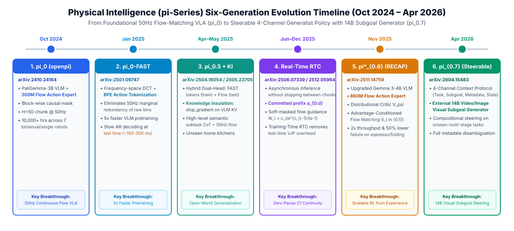

如果按**“上一代解决了什么问题 $\rightarrow$ 暴露出什么新瓶颈 $\rightarrow$ 下一代引入什么机制”**的因果链条阅读，$\pi_0$ 到 $\pi_{0.7}$ 的演进脉络如下：

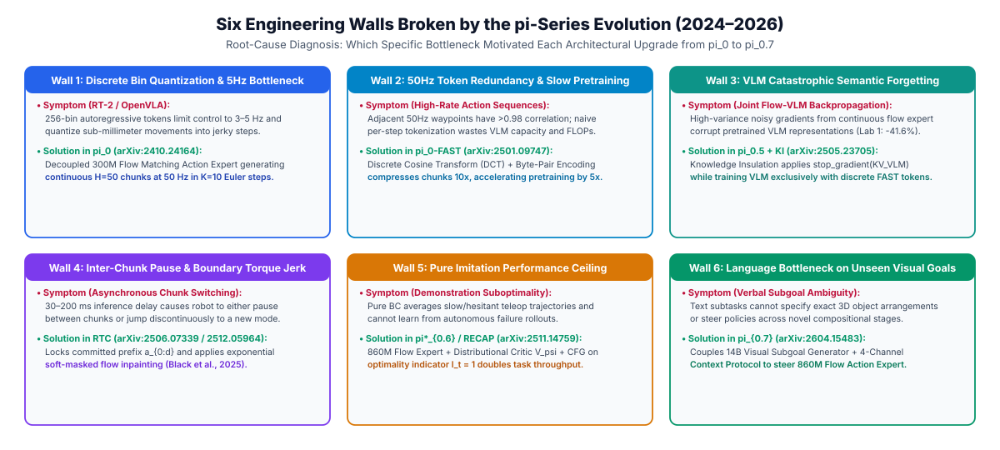

##### 1. 第一阶段（$\pi_0$ & $\pi_0\text{-FAST}$，2024.10–2025.01）：从低频离散 Token 到 50Hz 连续流匹配动作专家
- **核心问题**：`RT-2` 与 `OpenVLA` 将动作量化为 256 个离散文本 Token，不仅存在量化截断误差，而且自回归逐 Token 解码仅能运行在 **3–5 Hz**，难以胜任高频连续操作。
- **机制设计**：
  - **$\pi_0$（[arXiv:2410.24164](https://arxiv.org/abs/2410.24164)）**：采用 **`PaliGemma-3B`**（内部由 `Gemma-2B` [~2.5B 语言解码器] + `400M SigLIP` 视觉编码器组成）作为语义主干，外挂一个独立的 **`300M Flow Matching Action Expert`（流匹配动作专家）**，总参数约 **3.3B**。两者通过 Blockwise 掩码共享自注意力 KV-Cache，动作专家在连续空间中通过 10 步欧拉 ODE 积分生成未来 $H=50$ 步（1 秒、**50 Hz**）的连续动作块（Action Chunk）。
  - **$\pi_0\text{-FAST}$（[arXiv:2501.09747](https://arxiv.org/abs/2501.09747)）**：针对自回归预训练收敛慢的问题，利用 **离散余弦变换（DCT）+ BPE** 将高频动作曲线转换到频域压缩约 $10\times$（每个 Chunk 仅 30–60 个 Token），使自回归 VLA 训练速度提升约 $5\times$。

##### 2. 第二阶段（$\pi_{0.5}$，2025.04）：异构数据协同训练与高层子任务接地
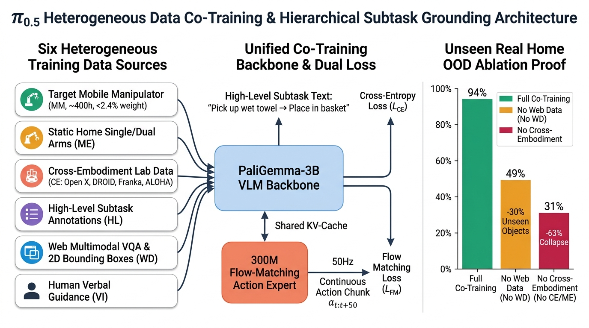
- **核心问题**：目标机器人的真机遥操作数据采集成本高且场景覆盖有限，单靠目标本体轨迹难以泛化到未见过的真实家庭环境（OOD Homes）。
- **机制设计（$\pi_{0.5}$，[arXiv:2504.16054](https://arxiv.org/abs/2504.16054)）**：
  - **异构数据协同训练（Heterogeneous Data Co-training）**：将 6 类不同模态与来源的数据（目标移动机器人真机轨迹 MM [仅占约 `< 2.4%` 权重]、非移动多房间静态轨迹 ME、跨本体实验室机械臂数据 CE、高层子任务语义标注 HL、互联网图文数据 WD、人类口头指导数据 VI）共同投入同一个 `PaliGemma-3B + 300M Action Expert` 联合分布：
    $$p(\hat{\ell}_{\text{subtask}}, a_{t:t+H} \mid o_t, \ell_{\text{task}}, q_t)$$
    模型先以自回归文本形式预测当前高层语义子目标 $\hat{\ell}_{\text{subtask}}$，再以该子目标的 KV-Cache 为条件驱动 `300M` 流匹配动作专家生成 50Hz 底层动作块。随后在 `Knowledge Insulation`（[arXiv:2505.23705](https://arxiv.org/abs/2505.23705)）中进一步证明，截断连续流专家向 VLM 的反向梯度并用离散 `FAST` Token 监督 VLM 可显著保护预训练语义表征。
  - **消融结果（`[论文报告]`）**：在未见过的真实家庭测试中，完整协同训练的 $\pi_{0.5}$ 任务进度达 **94%**；移除跨本体机器人数据（No CE/ME）后降至 **31%**；移除互联网图文数据（No WD）后对未见物体的泛化率从 **79%** 降至 **49%**。

##### 3. 第三阶段（$\pi_{0.6}$ & $\pi^*_{0.6}$ [RECAP]，2025.11）：扩容至 5B 级主干与优势条件化强化学习
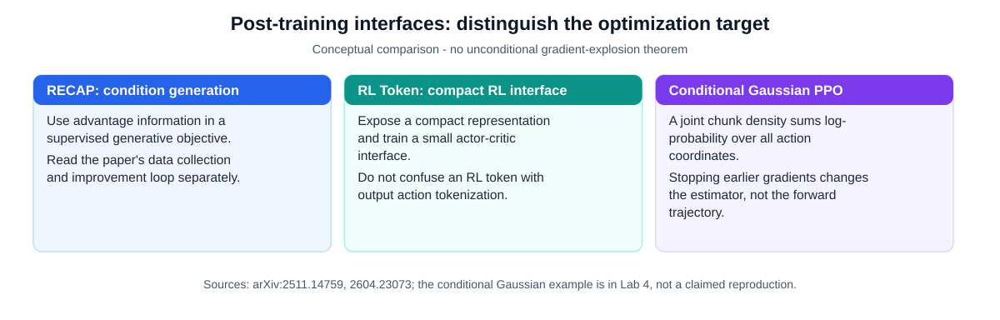
- **架构升级与精确参数核查（`[已验证事实]`）**：
  在 **$\pi^*_{0.6}$（[arXiv:2511.14759](https://arxiv.org/abs/2511.14759)）** 中，Physical Intelligence 已将模型升级为 **`Gemma 3 4B` 视觉语言主干 + 扩容至 `860M` 的流匹配动作专家（总参数约 5B）**（注：動作专家从 `300M` 升级至 `860M` 发生在 $\pi^*_{0.6}$ 阶段，而非等到 $\pi_{0.7}$）。
- **核心问题：为什么纯模仿学习存在天花板，以及直接在 4B–5B 流匹配 VLA 上做全参数在线 RL 面临哪些挑战？**
  1. **行为克隆天花板**：人类遥操作员存在反应延迟与动作犹豫，纯行为克隆（BC）在遭遇毫米级接触偏差（Covariate Shift）时缺乏自主纠错与恢复能力；
  2. **全参数在线策略梯度的工程挑战**：一方面，如核心专章 A 所述，原生确定性流匹配（ODE）缺乏闭式边缘对数似然 $\log \pi_\theta(a\mid o)$，直接穿越 10 步欧拉链反向传播策略梯度成本高且易引发梯度震荡；另一方面，真实机器人物理采样批量极小，若缺乏 KL 锚定或噪声空间改造，全参数在线更新样本效率低且易损伤 VLM 预训练特征（注：通过引入可学习噪声将 ODE 转为 SDE [如 $\pi_{\texttt{RL}}$ `arXiv:2510.25889`，在 LIBERO 上微调 $\pi_0/\pi_{0.5}$ 达到 98.3%] 或将价值内化为记忆 [如 `VaM` `arXiv:2610.22368`]，社区已证明在适当算法改造下 VLA 完全可以进行策略梯度强化学习）。
- **$\pi^*_{0.6}$ 的解法（`RECAP`：RL with Experience and Corrections via Advantage-conditioned Policy，[arXiv:2511.14759](https://arxiv.org/abs/2511.14759)）**：
  `RECAP` 选择了一条极其稳定的**优势条件化监督流匹配（Advantage-Conditioned Supervised Flow Matching）**路线：
  1. 训练一个独立的分布式价值评估网络 $V_\phi(o_t, \ell)$（预测距离任务成功还剩多少步）；
  2. 对人类示范、自主成功/失败 Rollout 及人类 DAgger 纠偏接管轨迹计算优势值 $A_t$，并离散化为二值优势指示符 $I_t \in \{\texttt{Advantage: Positive}, \texttt{Advantage: Negative}\}$；
  3. 用标准监督流匹配损失训练 ~5B 模型：$\mathcal{L}_{\text{RECAP}}(\theta) = \mathbb{E}\left[ \| v_\theta(a_t^\tau, o_t, \ell, I_t) - u(a_t \mid a_t^\tau) \|^2 \right]$。推理时固定输入 $I_t = \texttt{Advantage: Positive}$ 并结合无分类器引导（CFG），在意式咖啡制作、纸箱折叠与衣物整理任务上使吞吐量提升约 $2\times$、失败率降低约一半。

##### 4. 第四阶段 & 第五阶段（MEM & RL Token [RLT]，2026.03–04）：多尺度记忆与轻量在线残差 RL
- **MEM（Multi-Scale Embodied Memory，2026.03，[arXiv:2603.03596](https://arxiv.org/abs/2603.03596)）**：针对单帧 VLA 在关门或移开视线后遗忘历史状态的非马尔可夫问题，设计了**双尺度记忆架构**——底层用 **1 分钟短视频 ViT 编码器**捕捉近期精细操作动态，高层用 **15 分钟自回归语言摘要记忆**记录跨阶段事件，在长程翻找与操作任务上显著提升成功率。
- **RL Token / RLT（2026.04，[arXiv:2604.23073](https://arxiv.org/abs/2604.23073)）** ：
  针对紧配合装配、插拔等精密接触任务，RLT 提出**冻结预训练 VLA 主干**，从 VLA 内部自适应暴露出一个紧凑的任务状态表征 **RL Token**，并在其上挂载一个轻量级 **2–3 层 MLP Actor-Critic 网络**（参数量级约为百万级 `~1M params [估算]`）学习残差动作修正，同时通过 **VLA Anchoring** 约束探索边界。`[论文报告]` 原文实验表明，在单台真实机器人上经过 **数分钟至数小时的在线练习（"within minutes to a few hours of practice"，具体任务覆盖 15 分钟至 5 小时）**，即可将精密操作成功率大幅推高，并将接触瓶颈阶段的执行速度提升最高达 $3\times$。

##### 5. 第六阶段（$\pi_{0.7}$，2026.04，[arXiv:2604.15483](https://arxiv.org/abs/2604.15483)）：四路上下文消歧与可引导通用策略
- **核心问题（异构大数据的模态平均退化 Mode Averaging）**：当继续向 ~5B 模型（`Gemma 3 4B` + `860M` 动作专家）灌入快慢不一、质量参差、含失败回退及不同控制模态的大规模轨迹时，若缺乏显式条件标签，监督学习会将冲突轨迹求平均，导致策略表现平庸化。

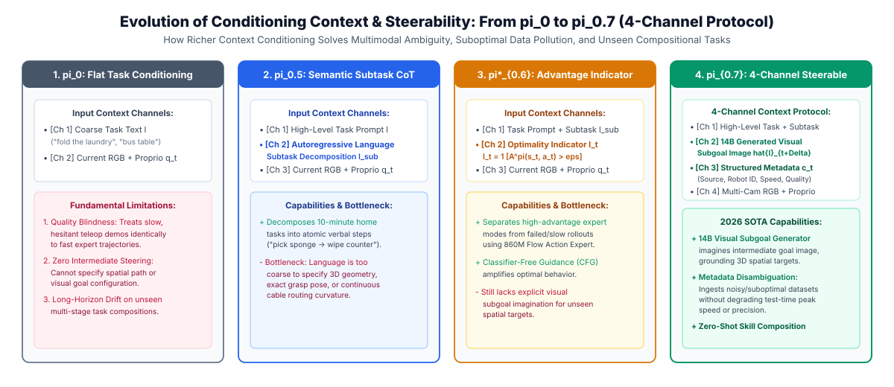

- **机制设计（$\pi_{0.7}$ 的四路上下文消歧协议 — Diverse Context Conditioning）**：
  1. **多粒度语言指令（Language）**：高层任务目标与中层子步骤指令；
  2. **轨迹质量与速度元数据（Episode Metadata）**：训练时显式标注每条轨迹的执行速度档位（Speed）、操作质量评分（Quality）与失败标记；推理时指定高质量与快速档位，消除次优数据对专家分布的干扰；
  3. **显式控制模态条件（Control Modalities）**：支持在同一模型内切换末端执行器位姿与关节空间控制；
  4. **每 4 秒生成的视觉子目标（Visual Subgoals via 14B Image Editing Model）** ：使用一个独立的 **14B 参数混合 Transformer（14B Mixture-of-Transformers）图像生成/编辑模型**，每隔 **4 秒** 预测一张未来视觉子目标图像注入 VLA 上下文。`[论文报告]` 原文明确指出，该 14B 视觉子目标生成器虽然增强了空间引导，但**带来了较高的额外计算延迟开销（High Latency Overhead）**，并非轻量级模块。
- **关键实验结果（`[论文报告]`）**：在未进入该任务训练集的双臂 **UR5e** 上执行叠衣服任务，$\pi_{0.7}$ 依靠跨本体迁移与上下文条件化达到 **80.0%** 成功率（对比目标机器 375 小时专有数据微调基线的 **80.6%**），并支持通过人类实时语言指点（Coachable Verbal Guidance）组合已有运动原语完成新电器交互。

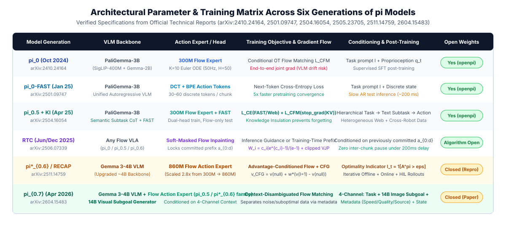

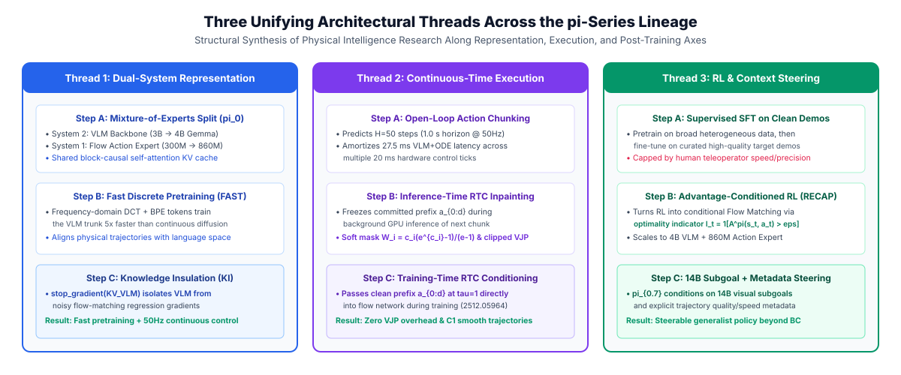

##### 6. 开源边界与社区复现生态核查（截至 2026-10-18）

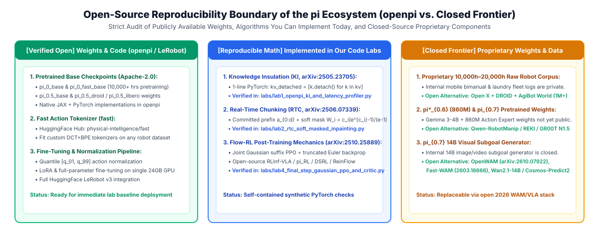

| 仓库 / 项目 | GitHub Stars (2026.10) | 包含模型与核心内容 | 复现与使用边界（`[已验证事实]`） |
|---|---|---|---|
| **[`Physical-Intelligence/openpi`](https://github.com/Physical-Intelligence/openpi)** | **~14.2k** | 官方开源仓库，提供 $\pi_0$、$\pi_0\text{-FAST}$、$\pi_{0.5}$ 的预训练与微调权重（JAX / PyTorch） | **未包含** $\pi^*_{0.6}$、RLT 与 $\pi_{0.7}$ 的官方权重及内部私有预训练数据配方 |
| **[`huggingface/lerobot`](https://github.com/huggingface/lerobot)** | **~28.3k** | 社区主流具身框架，已原生集成 PyTorch 版 `pi0`、`pi0_fast`、`pi05`、`SmolVLA` 与 `XVLA` | 推荐作为真机与仿真实验的工程基座，支持单卡 RTX 4090/5090 微调与 `LeRobotDataset` 标准格式 |
| **[`RLinf/RLinf`](https://github.com/RLinf/RLinf)** | **~5.4k** | 面向 $\pi_0$、$\pi_{0.5}$ 与 OpenVLA 的强化学习后训练基础设施（[arXiv:2509.15965](https://arxiv.org/abs/2509.15965)） | 原生支持 $\pi_{\texttt{RL}}$（Flow-Noise / Flow-SDE PPO & GRPO），连接 ManiSkill3、LIBERO 与 Isaac Lab |
| **[`Knight1112D/CBC_Pi0.7_Openpi`](https://github.com/Knight1112D/CBC_Pi0.7_Openpi)** | **~41** | 基于 `openpi` 复现 $\pi_{0.7}$ 的上下文条件化与概念瓶颈控制（CBC） | 属于社区机制级实验代码，**非** PI 官方 5B 全量预训练权重 |

---

#### 专题二：视觉语言主干的证据边界：Gemma、Qwen-VL 与动作专家

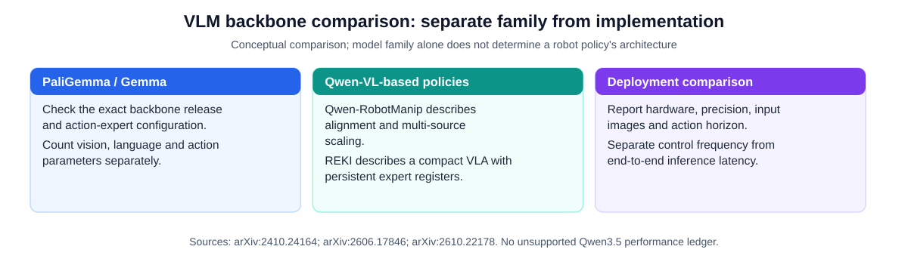

**`[论文报告]`** `Qwen-RobotManip Technical Report: Alignment Unlocks Scale for Robotic Manipulation Foundation Models`（[arXiv:2606.17846](https://arxiv.org/abs/2606.17846)）描述基于 **Qwen-VL** 的策略，通过表征、运动与行为对齐整合多源操作数据；公开机器人数据与人类视频组成约 38,100 小时预训练语料，并包含跨 15 种平台的人机轨迹合成。此处不将其等同于某个 Qwen3.5 层数、注意力比例或固定参数配置。

**`[论文报告]`** `REKI: Registering Knowledge in VLAs`（[arXiv:2610.22178](https://arxiv.org/abs/2610.22178)）报告一个 **2.4B** VLA，采用 VLM 加流匹配动作专家；少量寄存器 Token 汇总每帧 VLM 特征并保存在专家缓存中。摘要报告这种记忆使姿态振荡约减少到四分之一。本文不从模型族名称推断未核实的主干版本、寄存器数量或延迟。

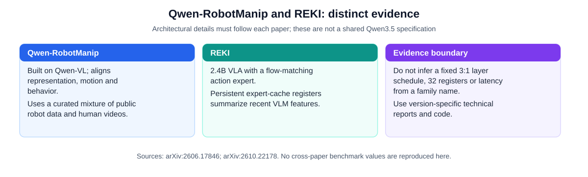

比较参数量时应分别列明视觉、语言、动作专家和独立规划模型；比较延迟时必须保留硬件、精度、图像数量、动作块长度与积分步数。不同数据配方的结果不能解释成主干结构的受控消融。

#### 专题三：从 VLA 到 WAM（World Action Model）与世界模型评估器/数据引擎

**证据等级**：`[已验证事实]` 论文发表与模型架构；`[论文报告]` `DreamZero`、`Fast-WAM`（`arXiv:2603.16666`）、`Qwen-RobotWorld`（`arXiv:2606.17030`）、`OpenWAM`（`arXiv:2610.07922`）、`V-JEPA 2`（`arXiv:2506.09985`）与 `DreamGen`（`arXiv:2505.12705`）。

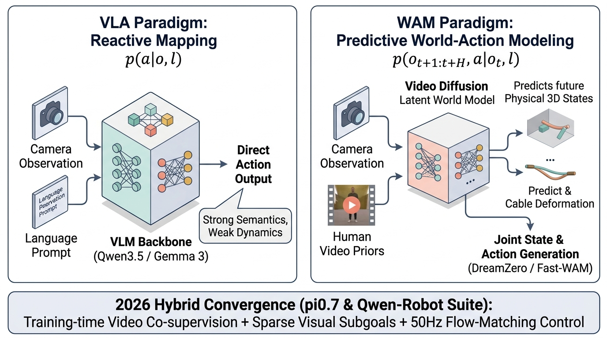

##### 1. VLA 与 WAM 的数学形式对比
- **VLA（反应式条件映射）**：$p(a_{t:t+H} \mid o_t, \ell)$。优势是推理链路短、延迟低（20–30 ms）；局限是动作专家依赖带机器人动作标签 $(o_t, a_t)$ 的轨迹数据，难以直接从无动作标签的人类操作视频中学习物理状态演化。
- **WAM（世界状态与动作联合生成）**：$p(o_{t+1:t+H},\; a_{t:t+H} \mid o_t, \ell)$。通过预测未来视觉帧或物理潜空间状态，使模型能够在无动作标签视频上通过自监督视频预测学习刚柔体接触、重力与形变规律，并为动作生成提供动力学先验。

##### 2. 2025–2026 WAM 核心代表作与事实核查（含 `Fast-WAM`、`OpenWAM`、`V-JEPA 2`、`DreamGen`）

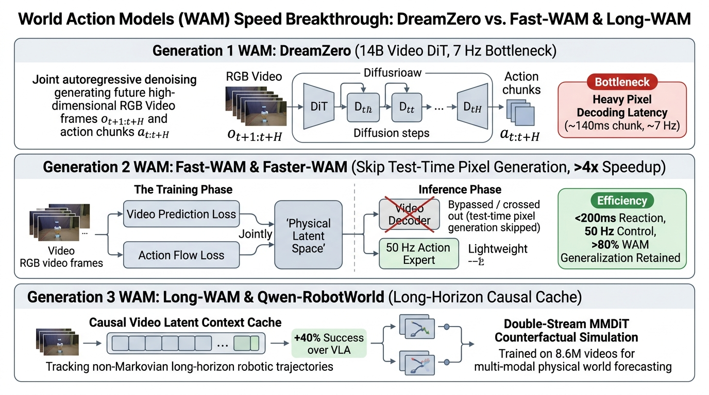

| 类别与代表工作 | 架构与核心机制 | 关键实验结论（`[论文报告]`） | 适用场景与局限边界 |
|---|---|---|---|
| **联合视频-动作生成** **NVIDIA `DreamZero`** (2026.02, 14B Video DiT) | 基于 14B 自回归视频扩散模型，在去噪过程中同步生成未来视频帧与动作块 | 在未见环境与物体 OOD 任务上较基线 VLA 提升显著，支持从少量人类视频或 30 分钟随机游走数据跨本体迁移 | 测试期需在像素空间生成视频，即便经流式优化控制频率仍约为 **7 Hz（~140 ms）**，不适合直接跑高频接触反射 |
| **训练期协同监督 vs 测试期想象** **`Fast-WAM`** ([arXiv:2603.16666](https://arxiv.org/abs/2603.16666)) | 探讨 *"Do World Action Models Need Test-time Future Imagination?"*：在训练期保留视频预测协同监督，但**在测试推理期直接跳过未来视频像素生成** |  原文实验证明：**WAM 的性能收益主要来自训练期视频协同训练对表征的塑造（移除训练期视频协同训练会导致性能显著下降），而非测试期显式渲染未来视频**；跳过测试期想象后，`Fast-WAM` 保持了与完整视频生成相当的竞争力，同时将单次推理延迟压至 **约 190 ms（实现 $>4\times$ 推理加速）** | 为“用世界模型目标训练表征、按纯 VLA 速度实时推理”提供了核心实证依据 |
| **开源多尺度世界动作基座** **`OpenWAM`** (2026.10, [arXiv:2610.07922](https://arxiv.org/abs/2610.07922)) **`Long-WAM`** (2026) | `OpenWAM` 提供开放权重与训练管线的世界动作模型基座；`Long-WAM` 引入因果历史视频潜空间上下文（Causal Video Latent Context） | 在长时程非马尔可夫操作与跨场景泛化上超越单帧 VLA 基线 | 推动 WAM 从闭源巨型模型走向学术实验室可微调复现 |
| **潜空间自监督物理世界模型** **Meta `V-JEPA 2`** (2025.06, [arXiv:2506.09985](https://arxiv.org/abs/2506.09985)) | 基于联合嵌入预测架构（Joint-Embedding Predictive Architecture），在超 100 万小时互联网视频上**直接在抽象特征潜空间预测被掩码的未来时空表征**（完全不重建像素），随后用少量机器人轨迹训练动作条件世界模型 `V-JEPA 2-AC` | 在不重建背景像素噪声的前提下习得精细物体交互物理直觉，支持零样本/少样本视觉模型预测控制（MPC）抓放与放置 | 证明“三维/语义潜空间预测”比“RGB 像素重建”更契合具身规划 |
| **世界模型作为合成数据引擎与策略评估器** **NVIDIA `DreamGen`** ([arXiv:2505.12705](https://arxiv.org/abs/2505.12705)) **阿里 `Qwen-RobotWorld`** ([arXiv:2606.17030](https://arxiv.org/abs/2606.17030)) | `DreamGen` 利用微调后的视频世界模型生成新物体/新环境的合成视频，再由逆动力学模型（IDM / 伪动作标注器）提取可执行神经轨迹（Neural Trajectories）；`Qwen-RobotWorld` 基于 Double-Stream MMDiT 在 860 万视频上预训练，支持动作条件反事实推演与闭环策略评估 | `DreamGen` 仅凭单张或少量目标环境图片即可合成成千上万条泛化训练轨迹；`Qwen-RobotWorld` 可在不上真机的情况下作为离线视觉策略评估器（World-Model-as-Evaluator）预测策略成败 | 合成视频在极端刚柔耦合接触（如过盈插孔、紧拉线结）下仍可能违反局部力学守恒，需结合真实接触数据校准 |

---

#### 专题四：2026.07–10 国际旗舰系统核查——`Gemini Robotics 2` 与开放权限边界

**证据等级**：`[官方宣称]` Google DeepMind 官方发布博客（无公开 arXiv 预印本或开源权重）；`[尚不确定]` 外部独立实验室复现（闭源系统）。

- **官方发布事实与开放权限核查（属 `[官方宣称]`，据 Google DeepMind 官方博客说明）**：
  1. **`Gemini Robotics-ER 2`（高层具身推理 VLM）**：**已通过 Gemini API 与 Google AI Studio 向全球开发者公开开放**，强化了三维空间理解、长程任务分解、关键点指向与安全边界推理；
  2. **`Gemini Robotics 2`（主 VLA 策略）与 `Gemini Robotics On-Device 2`（本地端侧版本）**：官方博客明确说明这两款动作控制模型**目前仅向部分受邀早期合作伙伴（Early-Access Partners / Trusted Testers）开放**，并未公开发布模型权重或通用开源微调 SDK；
  3. **多本体与灵巧手边界**：官方展示了在双臂 ALOHA、Franka、Apptronik Apollo 人形机器人以及搭载 **22-DoF SharpaWave 灵巧手**平台上的操作演示与少样本适应能力，但官方博客同时坦诚指出：**高自由度多指灵巧操作目前仍然具有挑战性（"multi-finger dexterity remains challenging"）**。在学术论文引用时，应严格将其标为 `[官方宣称]` 的闭源工业旗舰参照，不作未经证实的开源可用性外推。

---

#### 专题五：机器人自身感知、本体捷径病与力/视触觉融合（Proprioception & Body Schema）

**证据等级**：`[已验证事实]` 论文发布与 arXiv 编号；`[论文报告]` *When would Vision-Proprioception Policies Fail in Robotic Manipulation?*（`arXiv:2602.12032`, ICLR 2026）、`Think Proprioceptively`（`arXiv:2602.06575`）与 `ActiveVLA`（`arXiv:2601.08325`）。

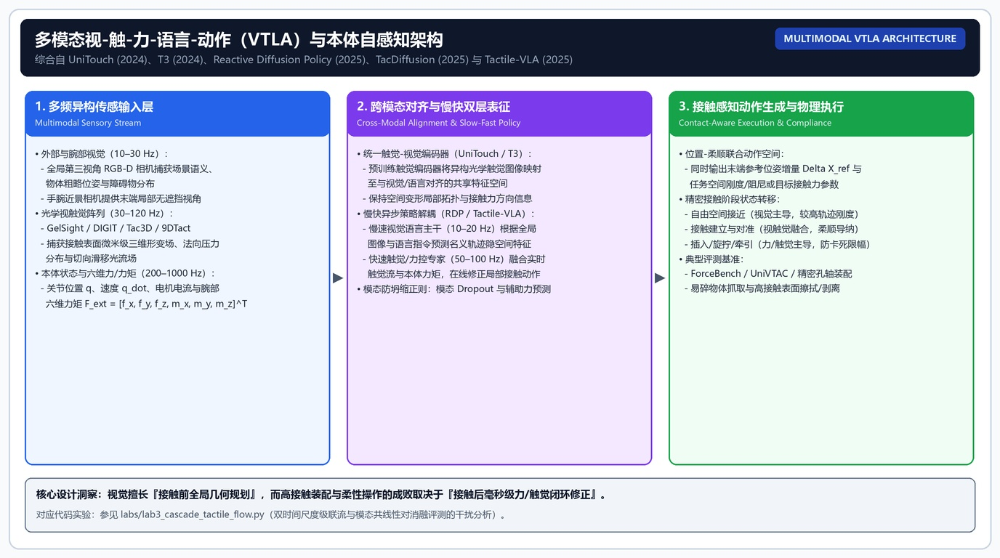

##### 1. 运动学本体感知（Proprioception）与“本体捷径病（Proprioceptive Shortcut）”
- **物理定义**：狭义本体感知包括关节角 $q_t$、角速度 $\dot{q}_t$、电机电流/关节力矩 $\tau_t$、末端 6D 位姿 $x_{\text{ee}}$ 与夹爪开合度 $g_t$。
- **为什么加入本体状态 $q_t$ 有时反而导致测试期空间泛化下降？**
  **ICLR 2026 (`arXiv:2602.12032`)** 揭示了模仿学习中的**本体优化主导抑制（Proprioceptive Optimization Dominance）**：在训练初期，低维、平滑、强自相关的本体序列 $q_{t-k:t}$ 拟合下一拍动作 $a_{t+1}$ 的损失下降速度远快于高维 RGB 图像分支，导致视觉编码器遭遇“表征饥饿（Representation Starvation）”，策略退化为开环背诵关节轨迹。当测试期目标物体位置平移数厘米时，机械臂仍按原轨迹抓空。
- **两类代表性缓解方案**：
  1. **`GAP`（Gradient Adjustment with Phase-guidance, [arXiv:2602.12032](https://arxiv.org/abs/2602.12032)）与本体 Dropout**：在需要视觉定位的接近阶段动态调制本体分支梯度或对 $q_t$ 施加随机掩码，迫使视觉分支保持空间敏感性；
  2. **`Think Proprioceptively`（[arXiv:2602.06575](https://arxiv.org/abs/2602.06575)）**：将本体状态编码为查询 Token，在网络早期主动门控筛选与当前机械臂姿态相关的视觉区域（State-Grounded Visual Token Selection）。

##### 2. 身体图式（Body Schema）与主动视角感知（`ActiveVLA`）
- **身体图式**：跨本体策略通过统一物理语义槽位（如 `RDT-1B` 的 128-D 向量或 `Qwen-RobotManip` 的 80-D 规范动作空间）以及正向运动学（FK）三维包络投影（如 `SpatialVLA` 的 `Ego3D`），显式编码双臂工作空间与防自碰撞边界。
- **`ActiveVLA`（[arXiv:2601.08325](https://arxiv.org/abs/2601.08325)）**：将主动调整相机观测视角（Coarse-to-Fine 3D Zoom-in）纳入决策空间，在精细插拔或双臂遮挡时主动消除感知盲区（注：关于力控与视触觉 VLA 的完整硬件、表征与策略体系见上文 **核心专章 B**）。

---

#### 专题六：三维空间几何与显式 3D VLA（`SpatialVLA` / `PointVLA` / `VistaVLA` / `3DGS`）

**证据等级**：`[已验证事实]` 论文发布与开源仓库；`[论文报告]` `SpatialVLA`（RSS 2025, `arXiv:2501.15830`）、`PointVLA`（`arXiv:2503.07511`）、`VistaVLA`（`arXiv:2607.12356`）。

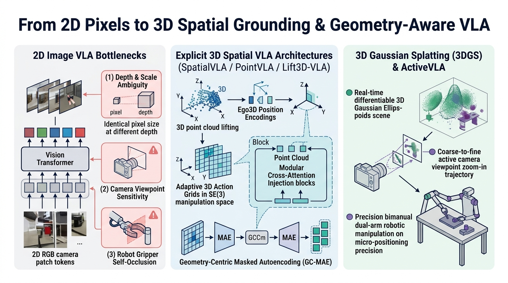

- **2D 图像 VLA 的几何局限**：（1）深度与尺度歧义（Depth & Scale Ambiguity）；（2）对相机外参标定偏移敏感；（3）在遮挡下缺乏三维空间拓扑连贯性。
- **代表性 3D VLA 架构**：
  1. **`SpatialVLA`（RSS 2025, [arXiv:2501.15830](https://arxiv.org/abs/2501.15830)）**：提出 **`Ego3D` 位置编码**（将深度反投影得到的相机系 3D 坐标注入视觉特征）与 **自适应三维动作网格（Adaptive 3D Action Grids）**，在 110 万条机器人轨迹上预训练，提升跨机位与跨本体空间泛化；
  2. **`PointVLA`（[arXiv:2503.07511](https://arxiv.org/abs/2503.07511)）**：保持预训练 2D VLA 动作专家权重冻结，通过跳过块分析（Skip-Block Analysis）以轻量级注入模块融合 3D 点云特征，避免重训 3D 大模型破坏 2D 视觉语义先验；
  3. **`VistaVLA`（[arXiv:2607.12356](https://arxiv.org/abs/2607.12356)）与 `3DGS` 场景表征**：将 3D Gaussian Splatting 显式几何辐射场特征耦合进 VLA 多视角特征融合管线，提供跨视角三维几何一致性。

---

#### 专题七：新一代 GPU 可微物理仿真引擎与 Real-to-Sim-to-Real 闭环（`Newton` / `Genesis` / `Isaac Lab`）

**证据等级**：`[已验证事实]` Linux 基金会、Google DeepMind、NVIDIA 与 Disney Research 开源发布 `Newton` 物理引擎；`[论文报告]` GPU 并行可微物理与系统辨识。

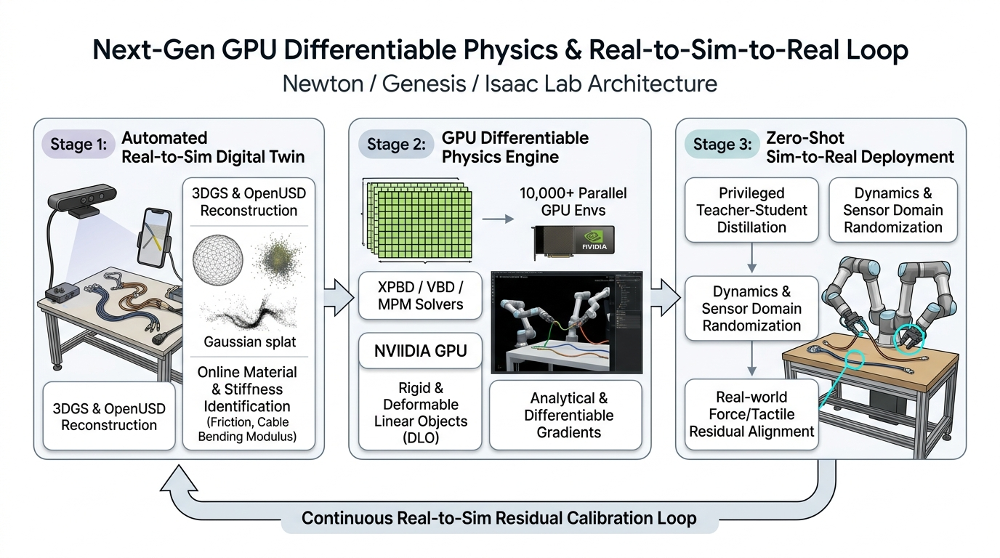

1. **开源 `Newton` 物理引擎（Google DeepMind + NVIDIA + Disney Research，Linux 基金会托管）与 `Genesis` / `Isaac Lab`**：基于 `NVIDIA Warp` 与 `OpenUSD` 构建，集成 **`MuJoCo Warp`**（高精刚体关节动力学）、**`XPBD` / `VBD`**（扩展位置/顶点块动力学，适合柔性线缆 DLO 与布料形变模拟）与 **`MPM`**（物质点法），支持 GPU 万级环境并发与可微物理梯度计算；
2. **接触与视触觉高保真仿真（`TacEx` / `UniVTAC` `arXiv:2602.10093`）**：在 `Isaac Lab` 中耦合 GPU 有限元接触求解器（GIPC/UIPC），实现毫秒级光学视触觉形变与切向摩擦场合成；
3. **自动化 `Real-to-Sim-to-Real` 闭环**：通过 RGB-D / `3DGS` 重建真实工作台几何，利用少量真实交互轨迹在线辨识摩擦系数与材料刚度参数（如 `arXiv:2609.12634` 的在线材料分类器），在仿真中大规模训练后再迁移回真机。

---

#### 专题八：低成本数据采集硬件、灵巧手接口与轨迹自动倍增（`ALOHA` / `UMI` / `DexUMI` / `MimicGen`）

**证据等级**：`[已验证事实]` 开源硬件、代码与数据集；`[论文报告]` `UMI`（RSS 2024, `arXiv:2402.10329`）、`DexCap`（RSS 2024, `arXiv:2403.07788`）、`DexUMI`（CoRL 2025, `arXiv:2505.21864`）、`FastUMI-100K`（`arXiv:2510.08022`）、`HIL-UMI`（`arXiv:2609.20659`）、`UMI-Bridge`（`arXiv:2609.18232`）、`MimicGen`（CoRL 2023, `arXiv:2310.17596`）与 `DexMimicGen`（ICRA 2025, `arXiv:2410.24185`）。

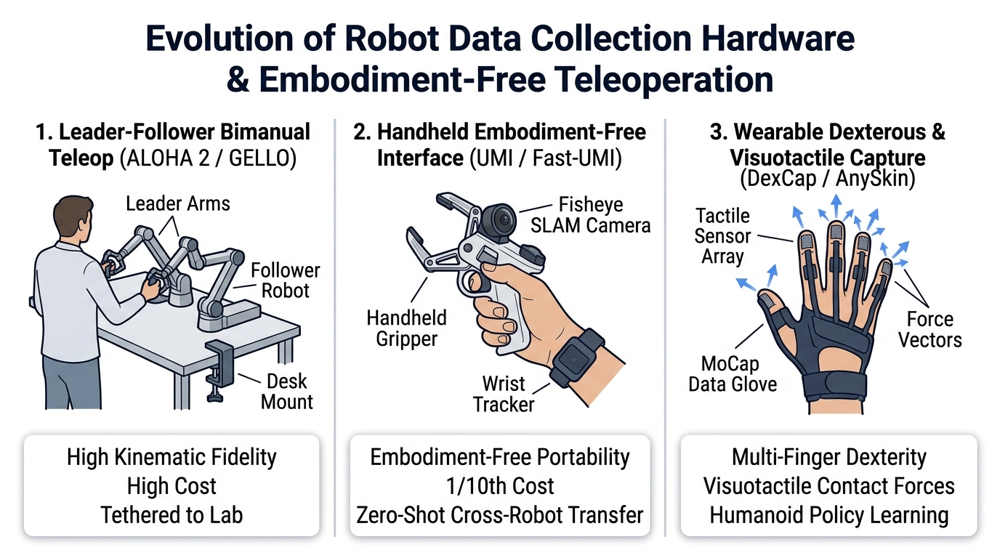

| 数据获取范式 | 代表系统与核心文献 | 硬件配置与成本 | 核心机制与研究价值 |
| :--- | :--- | :--- | :--- |
| **1. 主从同构双臂遥操** (Leader-Follower Teleop) | `ALOHA 2`、`GELLO`、同构外骨骼遥操台 | 需实体主从机械臂或外骨骼，固定于实验台 | 运动学同构、支持关节力矩直接映射；但硬件成本高，难以大规模走出实验室 |
| **2. 手持无本体夹爪接口** (Embodiment-Free `UMI`) | **`UMI`** ([arXiv:2402.10329](https://arxiv.org/abs/2402.10329)) $\rightarrow$ **`FastUMI-100K`** ([arXiv:2510.08022](https://arxiv.org/abs/2510.08022), 10 万+轨迹) $\rightarrow$ **`HIL-UMI`** ([arXiv:2609.20659](https://arxiv.org/abs/2609.20659)) $\rightarrow$ **`UMI-Bridge`** ([arXiv:2609.18232](https://arxiv.org/abs/2609.18232)) | 极低（数百美元），3D 打印手持夹爪 + GoPro 鱼眼相机 + 视觉 SLAM/VIO 位姿追踪 | 采集过程完全不依赖真实机械臂，腕部鱼眼视角与真机严格一致，支持跨不同机械臂迁移；`HIL-UMI` 进一步打通手持设备在环纠偏后训练 |
| **3. 穿戴式灵巧手与触觉采集** (`DexUMI` & `DexCap`) | **`DexUMI`** (*DexUMI: Using Human Hand as the Universal Manipulation Interface for Dexterous Manipulation*, Mengda Xu et al., CoRL 2025, [arXiv:2505.21864](https://arxiv.org/abs/2505.21864)) **`DexCap`** ([arXiv:2403.07788](https://arxiv.org/abs/2403.07788)) + **`AnySkin`** | 穿戴式人手外骨骼/动捕手套 + 掌心/指尖相机 + 触觉传感贴片 | **`DexUMI`** 通过硬件与软件双重适配将人手自然动作与视觉观测直接转化为多指灵巧手可执行示范（消除人手与机器手外观及运动学差异），配套指尖触觉反馈实现高接触灵巧采集 |
| **4. 少量人类示范的万倍自动合成** (`MimicGen` & `DexMimicGen`) | **`MimicGen`** (Mandlekar et al., CoRL 2023, [arXiv:2310.17596](https://arxiv.org/abs/2310.17596)) **`DexMimicGen`** (Jiang et al., ICRA 2025, [arXiv:2410.24185](https://arxiv.org/abs/2410.24185)) | 仅需 **10–20 条** 人类源示范 + 仿真环境 | 将人类示范自动切分为**以目标物体局部坐标系为中心的轨迹片段（Object-Centric Sub-Trajectory Segments）**；当新场景中物体位姿随机变化时，通过刚体变换对齐与过渡插值，自动合成 **10,000+ 条** 跨单臂、双臂与双灵巧手的高质量训练轨迹 |

---

#### 专题九：高自由度灵巧手（20+ DoF）与人形全身运动控制标准栈（`HOVER` / `ASAP` / `SONIC` / `DexVLA`）

**证据等级**：`[已验证事实]` 论文与开源项目发布；`[论文报告]` `HOVER`（`arXiv:2410.21229`）、`ASAP`（RSS 2025, `arXiv:2502.01143`）、`BeyondMimic`、NVIDIA GEAR `SONIC`（`arXiv:2511.07820`）、Toru Lin et al.（CoRL 2025, `arXiv:2502.20396`）、`HATO`（`arXiv:2404.16823`）、`DexVLA`（`arXiv:2502.05855`）、`HOMIE`（`arXiv:2502.13013`）、`ExBody2`（`arXiv:2412.13196`）与 `TWIST2`（`arXiv:2511.02832`）。

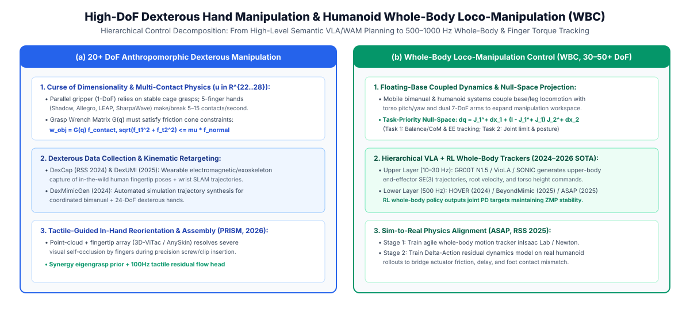

##### 1. 高自由度多指灵巧手控制：Sim-to-Real 强化学习与遥操作模仿双主线
平行二指夹爪只能执行刚性捏放，而 16–22 DoF 灵巧手支持手内重定向（In-Hand Reorientation）与多指协同卡扣按压。当前学术界在灵巧手上主要有两条成熟技术路线：
1. **视觉 Sim-to-Real 强化学习与特权蒸馏路线（Toru Lin et al., UC Berkeley, CoRL 2025, [arXiv:2502.20396](https://arxiv.org/abs/2502.20396)）**：
   在 GPU 仿真中利用特权物体状态训练双臂多指灵巧手 RL 教师策略，再通过在线蒸馏将策略迁移给仅接收真实相机视觉与本体感知的学生网络，攻克了双臂多指手在缺乏触觉传感器下的高动态接触与抓握泛化；
2. **高自由度双臂灵巧手遥操作与扩散/VLA 路线（`HATO` [arXiv:2404.16823](https://arxiv.org/abs/2404.16823)、`DexVLA` [arXiv:2502.05855](https://arxiv.org/abs/2502.05855) 与灵巧手四步后训练管线 [arXiv:2609.19666](https://arxiv.org/abs/2609.19666)）**：
   - `HATO` 构建了低成本 VR 姿态追踪与双臂灵巧手遥操作学习基线；
   - `DexVLA` 引入 1B 参数插件式扩散动作专家（Plug-In Diffusion Action Expert）与三阶段跨本体课程学习；
   - `arXiv:2609.19666` 确立了将通用 7-DoF VLA 迁移至 20+ DoF 灵巧手的**四步后训练管线**：`Stage 1 时序手部动作编解码器（Temporal Hand-Action Codec）` $\rightarrow$ `Stage 2 监督微调（SFT）` $\rightarrow$ `Stage 3 交互式纠偏（DAgger）` $\rightarrow$ `Stage 4 潜空间残差强化学习（Latent Residual RL）`。

##### 2. 人形机器人全身运动控制（Humanoid Whole-Body Control, WBC）五大代表基座
对于你同时涵盖的人形与全身操作方向，2024–2026 年人形 WBC 社区的标准基准与代表系统是以下五项工作：
1. **`HOVER`（*HOVER: Versatile Neural Whole-Body Controller for Humanoid Robots*, Tairan He, Wenli Xiao, Guanya Shi et al., CMU / NVIDIA, [arXiv:2410.21229](https://arxiv.org/abs/2410.21229)）**：
   提出**多模式策略蒸馏框架（Multi-Mode Policy Distillation）**——将根部速度跟踪、关节角跟踪、末端关键点跟踪等多种控制模式的专家策略蒸馏进同一个统一全身神经控制器（1.5M 参数，50–100Hz 运行），使高层 VLA、遥操作或导航规划器可以在不同控制模式间无缝切换；
2. **`ASAP`（*ASAP: Aligning Simulation and Real-World Physics for Learning Agile Humanoid Whole-Body Skills*, Tairan He et al., CMU / NVIDIA, RSS 2025, [arXiv:2502.01143](https://arxiv.org/abs/2502.01143)）**：
   针对全身高动态技能从仿真到真机（Unitree G1）的动力学失配难题，提出两阶段闭环：先在仿真训练全身运动跟踪策略，再采集真机 Rollout 轨迹训练一个**残差动作动力学模型（Delta-Action Model $\Delta a_\phi(s_t, a_t)$）**修补仿真器物理误差，然后在此对齐后的仿真器中微调策略，显著降低全身跟踪误差；
3. **`BeyondMimic` 与 NVIDIA GEAR `SONIC`（[arXiv:2511.07820](https://arxiv.org/abs/2511.07820)）**：
   将大规模人类动捕库（AMASS 等）全身运动先验与强化学习结合，`SONIC` 构建了具备极高运动多样性与抗推扰鲁棒性的通用人形全身基础控制器；
4. **`ExBody2`（[arXiv:2412.13196](https://arxiv.org/abs/2412.13196)）与 `HOMIE`（[arXiv:2502.13013](https://arxiv.org/abs/2502.13013)）**：
   `HOMIE` 采用解耦式上下半身强化学习（下半身自适应平衡与下蹲高度控制 + 上半身双臂灵活操作），使人形机器人能够边下蹲移动边完成复杂双臂任务；
5. **`TWIST`（CoRL 2025）与 `TWIST2`（ICRA 2026, [arXiv:2511.02832](https://arxiv.org/abs/2511.02832)）**：
   便携式无标记全身人形遥操作与第一视角全身移动操作模仿学习系统。

---

#### 专题十一（2026.07–10 最新论文追踪）：物理状态差分、流式演化记忆、对象条件引导与人类数据全身控制

**证据等级**：`[已验证事实]` arXiv 2026 年 7–10 月公开预印本（均已核对真实论文标题与机制）；`[论文报告]` `VLA-Δ`（`arXiv:2610.21306`）、`EvoMem-VLA`（`arXiv:2610.05418`）、`StreamPI`（`arXiv:2608.26067`）、`ObjDream`（`arXiv:2610.20223`）、`SAVLA`（`arXiv:2609.16641`）与 `VioLA`（`arXiv:2610.12435`）。

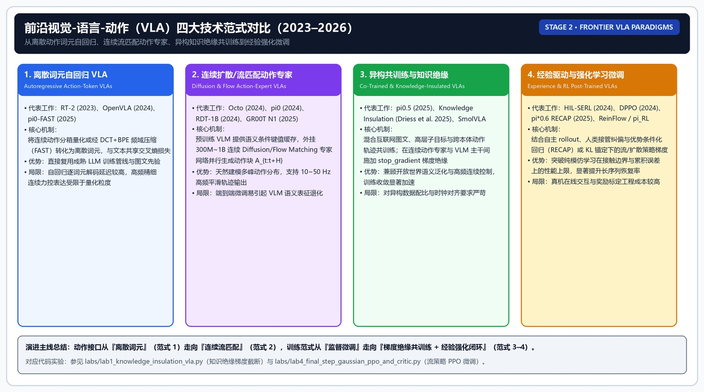

1. **`VLA-Δ`（*VLA-$\Delta$: Learning Physical State Transition for Vision-Language-Action Models*, 2026.10, [arXiv:2610.21306](https://arxiv.org/abs/2610.21306)）** ：
   针对静态 VLM 缺乏动作前后物理状态变化（State Transition）感知的问题，在训练阶段通过结构化物理状态转移监督迫使主干编码动作引发的几何与接触增量，而**在测试推理期移除辅助预测分支，以零额外推理延迟开销提升连续动作生成精度**。
2. **`EvoMem-VLA`（[arXiv:2610.05418](https://arxiv.org/abs/2610.05418)）与 `StreamPI`（[arXiv:2608.26067](https://arxiv.org/abs/2608.26067)）**：
   - `EvoMem-VLA` 构建具有方向性的状态演化增量记忆 Token，避免长时程操作中简单堆叠历史图像帧导致的注意力稀释；
   - `StreamPI` 引入指令锚定的流式时序建模与随机间隔训练，提升策略在非均匀帧率与异步通信抖动下的控制平滑性；`LaMem-VLA`（[arXiv:2607.07608](https://arxiv.org/abs/2607.07608)）探索长短期潜变量记忆融合。
3. **`ObjDream`（*ObjDream: Guiding Vision-Language-Action Models with Object-Level Understanding and Future State Prediction*, 2026.10, [arXiv:2610.20223](https://arxiv.org/abs/2610.20223)）与 `SAVLA`（[arXiv:2609.16641](https://arxiv.org/abs/2609.16641)）** ：
   - `ObjDream` 属于**视觉-语言-动作模型（VLA）**，通过引入物体级理解（Object-Level Understanding）与目标物体未来状态预测引导策略聚焦交互对象，抑制复杂背景干扰；
   - `SAVLA` 在 VLA 训练中引入空间旋转与反射群对称性约束，提升样本效率与双臂几何一致性。
4. **`VioLA`（*VioLA: Learning Generalist Humanoid Control Policies from Human Data*, 2026.10, [arXiv:2610.12435](https://arxiv.org/abs/2610.12435)）** ：
   研究如何从大规模人类运动与操作数据中学习通用人形机器人控制策略，桥接人类运动表征与人形全身执行器。

| 2026.07–10 论文 | arXiv 编号 | 真实论文标题 | 核心技术机制 |
|---|---|---|---|
| **`VLA-Δ`** | `arXiv:2610.21306` | *VLA-$\Delta$: Learning Physical State Transition for Vision-Language-Action Models* | 训练期学习物理状态转移，测试期零额外延迟开销 |
| **`ObjDream`** | `arXiv:2610.20223` | *ObjDream: Guiding Vision-Language-Action Models with Object-Level Understanding and Future State Prediction* | 物体级理解 + 未来状态预测引导 VLA 动作生成 |
| **`VioLA`** | `arXiv:2610.12435` | *VioLA: Learning Generalist Humanoid Control Policies from Human Data* | 从人类数据学习通用人形控制策略 |
| **`EvoMem-VLA`** | `arXiv:2610.05418` | *EvoMem-VLA* (State-Evolution Memory for Long-Horizon Manipulation) | 状态演化增量记忆追踪长时程任务阶段 |
| **`SAVLA`** | `arXiv:2609.16641` | *Symmetry-Aware Vision-Language-Action Models* | 空间对称性约束提升跨方位样本效率 |
| **`StreamPI`** | `arXiv:2608.26067` | *StreamPI* (Streaming Multimodal Temporal Framework) | 随机时间间隔训练适应异步视频流 |

---

#### 专题十二：具身思维链（`ECoT` / `CoT-VLA`）与无推理延迟架构（`ERVLA` & `TacitVLA`）

**证据等级**：`[已验证事实]` 论文发表与 arXiv 编号；`[论文报告]` `ECoT`（CoRL 2024）、`CoT-VLA`（CVPR 2025）、`ERVLA`（`arXiv:2606.03784`）与 `TacitVLA`（`arXiv:2610.17540`）。

##### 1. 显式具身思维链（`ECoT` & `CoT-VLA`）的收益与延迟代价
- **`ECoT`（*Embodied Chain-of-Thought Reasoning*）与 `CoT-VLA`（CVPR 2025）**：要求 VLA 在输出动作前先自回归生成子任务分解、物体边界框、末端轨迹点或未来视觉子目标帧。这虽能提升复杂语义场景下的可解释性与泛化率，但在每个控制步自回归解码数十个文本 Token 需要耗时 **300–800 ms**，导致机械臂在连续运动中途出现周期性停顿（Thinking Stall），难以直接用于高频动态接触控制。

##### 2. 消除测试期推理延迟的两条严谨路线：`ERVLA`（`arXiv:2606.03784`）与 `TacitVLA`（`arXiv:2610.17540`）
- **`ERVLA`（*Revisiting Embodied Chain-of-Thought for Generalizable Robot Manipulation*, 2026.06, [arXiv:2606.03784](https://arxiv.org/abs/2606.03784)）**：
  系统评估了具身思维链各组件的作用，指出显式 CoT 的主要收益来自训练期对多模态特征表征的辅助约束；通过协同训练与跳过测试期冗余文本解码，在 **LIBERO-Plus 基准上达到 86.9%** 的成功率，同时避免了测试期长文本自回归带来的控制延迟与误差累积。
- **`TacitVLA`（*TacitVLA: Reasoning Vision-Language-Action Models Without Reasoning Latency*, Jack Lu et al., NVIDIA, 2026.10, [arXiv:2610.17540](https://arxiv.org/abs/2610.17540)）**：
  - **核心机制（并非将文本替换为独立连续潜空间，而是基于注意力掩码解耦与异步生成）**：
    1. **训练序列与显式推理 VLA 完全相同**：训练数据依然包含完整的 `(观测, 指令, 显式文本推理序列, 动作块)`，模型同样通过标准交叉熵损失学习显式推理；
    2. **关键修改在于注意力掩码（Attention Masking）**：`TacitVLA` 在注意力矩阵中**直接掩蔽掉（Mask Out）动作专家（Action Expert）对当前步推理文本 Token 的注意力连接**！这迫使 VLM 主干在看到视觉与指令的早期隐藏状态中就必须完成隐式推理（Tacit Reasoning）并直接供给动作专家，使得测试期**无需等待推理文本生成即可立即以零文本延迟输出动作**；
    3. **记忆密集型任务中的异步文本生成**：对于需要跨时间步记录状态的历史记忆任务，`TacitVLA` 在机器人执行当前动作块的同时，在后台**异步生成推理文本（Asynchronous Reasoning Generation）**并存入历史上下文供未来步读取，从而在不阻塞实时控制环的前提下保留了显式符号记忆能力（注：边缘端推理加速、Token 剪枝与量化内容已整合至文末 **附录 A**）。

---

### 阶段 2 阅读顺序

1. **基础时间线**：先读 `RT-1`、`RT-2`、`OpenVLA`、`Octo`，理解从离散动作 Token 到连续扩散/流匹配动作专家的接口演进；
2. **$\pi$ 系列与 VLM 基座**：精读 **专题一（$\pi_0 \rightarrow \pi_{0.7}$）** 与 **专题二（`Gemma` vs `Qwen-VL`）**，掌握异构协同训练、`RECAP`、`RL Token`、上下文消歧与线性注意力基座；
3. **世界动作模型**：阅读 **专题三（WAM 与 `Fast-WAM` / `V-JEPA 2` / `DreamGen`）**，区分训练期视频协同监督、潜空间预测与合成数据生成；
4. **核心研究四专章（重中之重）**：深入研读 **核心专章 A（Flow/Diffusion VLA 的 7 条强化学习路线与高斯化步 PPO 教学示例）**、**核心专章 B（视触觉传感、`T3`/`Sparsh` 表征、`T-Rex`/`SimpleTouch`/`PACE`/`FACT`/`Spark-0` 代表工作）**、**核心专章 C（`RTC` 实时动作块执行与 `Knowledge Insulation`）** 以及 **核心专章 D（`FAVOR`/`DiVeR`/`SAFE`/`E-TTS` 验证恢复）**。

---

### 核心专章 A：Flow Matching 与 Diffusion VLA 的强化学习后训练——似然瓶颈、七大破局路线与代表性数学机制

**证据等级**：`[已验证事实]` 论文发布时间、arXiv 编号与开源代码库（如 `RLinf`、`DPPO`、`ReinFlow`）；`[论文报告]` 各方法在 LIBERO、RoboMimic、ManiSkill 与真机任务上的评测指标；`[合理推论]` 第 4 节生成式策略强化学习基础数学构件的教学拆解。

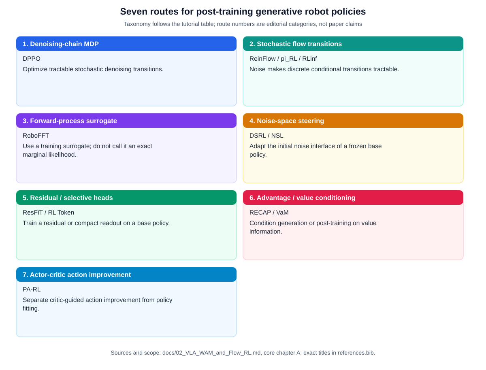

#### 1. 核心数学矛盾：为什么流匹配（Flow Matching）与扩散策略（Diffusion Policy）不能直接套用标准 PPO / SAC？
在阶段 1 第 7 章中我们看到，无论是同策略 PPO 的重要性采样比率 $\rho_t(\theta) = \frac{\pi_\theta(a_t \mid o_t)}{\pi_{\theta_{\text{old}}}(a_t \mid o_t)}$，还是异策略 SAC 的熵正则项 $-\alpha \log \pi_\theta(a_t \mid o_t)$，都依赖**单次前向即可求出的精确边缘对数概率密度 $\log \pi_\theta(a \mid o)$**。然而，以 $\pi_0$、$\pi_{0.5}$、`GR00T N1.5` 为代表的现代 VLA 动作专家普遍采用**条件流匹配（Conditional Flow Matching, CFM）**，通过求解从先验高斯噪声 $a^0 \sim \mathcal{N}(0, I)$ 到动作块 $a^1 \in \mathbb{R}^{H \times d_a}$ 的常微分方程（ODE）生成动作：
$$\frac{\mathrm{d}a^\tau}{\mathrm{d}\tau} = v_\theta(a^\tau, \tau, o_t), \quad \tau \in [0, 1], \quad a^{k+1} = a^k + \Delta\tau \cdot v_\theta(a^k, \tau_k, o_t) \quad (k=0,\dots,K-1)$$
当直接将标准 RL 应用于该生成式过程时，会遭遇**三重数学与工程障碍**：
1. **边缘对数似然 $\log \pi_\theta(a^1 \mid o_t)$ 无解析闭式解（Intractable Marginal Likelihood）**：
   根据连续归一化流（CNF）的瞬时变量替换定理（Instantaneous Change of Variables Formula）：
   $$\log \pi_\theta(a^1 \mid o_t) = \log p_0(a^0) - \int_0^1 \operatorname{Tr}\!\left( \frac{\partial v_\theta(a^\tau, \tau, o_t)}{\partial a^\tau} \right) \mathrm{d}\tau$$
   计算雅可比矩阵的迹 $\operatorname{Tr}(\nabla_a v_\theta)$ 需要对 $H \times d_a$ 维向量场求散度（精确计算需 $H\cdot d_a$ 次反向传播，Hutchinson 随机迹估计器则会引入极高方差），且确定性欧拉积分步本身是狄拉克 $\delta$ 转移，步条件概率密度退化。
2. **穿越 $K$ 步欧拉积分链的反向传播梯度不稳定性（Backpropagation Through ODE Chain Instability）**：
   若将 $K=10$ 步去噪串联为计算图并直接从终端动作 $a^1$ 向 $\theta$ 反传策略梯度，梯度必须连乘 $K$ 个时间步的雅可比矩阵 $\prod_{k=0}^{K-1} (I + \Delta\tau \nabla_a v_\theta)$，不仅显存占用膨胀 $K$ 倍，更极易引发梯度爆炸、消失或破坏预训练流场的平滑性。
3. **高维预训练主干的探索噪声与灾难性遗忘**：
   若在全参数 3B–4B VLA 上施加无约束随机探索，大步策略梯度极易冲毁视觉语言预训练表征或导致生成轨迹偏离可微流形。

#### 2. 2024–2026.10 攻克 Flow / Diffusion VLA 强化学习的七大技术路线
围绕上述三大矛盾，2024 年 9 月至 2026 年 10 月形成了**七条清晰可对标的技术路线**：

| 路线分类 | 代表论文与开源生态 | 核心数学机制 | 如何解决 $\log \pi_\theta(a\mid o)$ 与多步反传难题？ | 优势与局限边界 |
|---|---|---|---|---|
| **路线 1：去噪链展开为双层 MDP** (Denoising-Chain MDP) | **`DPPO`** (*Diffusion Policy Policy Optimization*, Allen Z. Ren et al., Princeton, [arXiv:2409.00588](https://arxiv.org/abs/2409.00588)) | 将每一步去噪 $a^{k} \rightarrow a^{k+1}$ 建模为内层高斯马尔可夫转移，构造环境步 $t$ 与去噪步 $k$ 的**双层 MDP（Two-Level MDP）** | 单步去噪转移分布为解析高斯分布 $\mathcal{N}(\mu_\theta(a^k, k, o_t), \sigma_k^2 I)$，直接计算单步 $\log p_\theta(a^{k+1}\mid a^k)$ 并在最后几步去噪上运行 PPO，无需跨越整条链求散度 | 开山之作，理论干净；但有效 MDP 长度乘以去噪步数 $K$，当 $K$ 较大时内层信度分配链变长 |
| **路线 2：可学习噪声注入与 ODE 转 SDE** (Learnable Noise / Flow-SDE) | **`ReinFlow`** (Tonghe Zhang, Chao Yu et al., Tsinghua, [arXiv:2505.22094](https://arxiv.org/abs/2505.22094)) **$\pi_{\texttt{RL}}$** (Kang Chen, Zhihao Liu et al., [arXiv:2510.25889](https://arxiv.org/abs/2510.25889)) **`RLinf`** ([arXiv:2509.15965](https://arxiv.org/abs/2509.15965), ~5.4k stars) | **`ReinFlow`**：在确定性流匹配路径上挂载小型可学习探索噪声网络 $\sigma_\psi(a^\tau, \tau, o_t)$； **$\pi_{\texttt{RL}}$**：提出 `Flow-Noise` 与 `Flow-SDE`，将确定性流 ODE 显式转化为等价边际分布的随机微分方程（SDE） | 注入高斯噪声后，离散化的欧拉-丸山（Euler-Maruyama）步具备**精确闭式高斯转移对数似然**，可直接用标准 **PPO 或 GRPO** 微调 $\pi_0$ 与 $\pi_{0.5}$ | `[论文报告]` $\pi_{\texttt{RL}}$ 在 LIBERO 四大套件上将 $\pi_0/\pi_{0.5}$ 微调至 **98.3%**，并在 ManiSkill 4,352 个任务组合上从 41.6% 提升至 **85.7%**；`RLinf` 提供了工业级高吞吐分布式训练框架 |
| **路线 3：前向加噪过程代理似然** (Forward-Process Surrogate) | **`RoboFFT`** (*RoboFFT: Finetuning generative robot policy via online reinforcement learning with forward process*, CoRL 2026, [arXiv:2609.32236](https://arxiv.org/abs/2609.32236)) | 对采样动作施加前向加噪，并用加权 score / flow matching 损失构造 PPO 式更新所需的代理策略比率（Surrogate Policy Ratio） | **完全绕开逆向多步欧拉链积分求导**，直接在随机采样的流时刻 $\tau \sim \mathcal{U}(0,1)$ 上计算 PPO/GRPO 代理目标 | 单步训练开销与普通监督流匹配（BC）完全相同，彻底消除了多步去噪 BPTT 显存与梯度震荡 |
| **路线 4：初始噪声与潜空间引导** (Latent / Noise-Space Steering) | **`DSRL`** (*Steering Your Diffusion Policy with Latent Space Reinforcement Learning*, Wagenmaker et al., Berkeley, [arXiv:2506.15799](https://arxiv.org/abs/2506.15799)) **`NSL`** (*Noise Space Learning for VLA Adaptation*, Junjie Lu et al., [arXiv:2610.13943](https://arxiv.org/abs/2610.13943)) | **100% 冻结预训练 Diffusion/Flow 策略权重 $\theta$**，把 RL 的动作空间定义为扩散/流模型的**初始高斯噪声空间 $z_0 = a^0$**（`NSL` 学习一个以上下文为条件的噪声分布，并把这一接口实例化为 PPO、SAC 与 AWR 三种算法） | 预训练流模型变成环境转移的一部分；外层轻量 RL 策略 $\pi_\psi(z_0 \mid o_t)$ 是标准高斯策略，直接用 SAC / PPO 优化 $z_0$ | 零灾难性遗忘风险、样本效率极高；但如果目标动作完全落在预训练流模型的支撑集（Support）之外，仅靠调 $z_0$ 难以凭空造出新动作 |
| **路线 5：残差策略与选择性微调头** (Residual & Selective-Head RL) | **`ResFiT`** (*Residual Off-Policy RL for Finetuning Behavior Cloning Policies*, Lars Ankile et al., [arXiv:2509.19301](https://arxiv.org/abs/2509.19301)) **`RL Token (RLT)`** ([arXiv:2604.23073](https://arxiv.org/abs/2604.23073)) | `ResFiT` 把 BC 策略当作黑盒基座，用样本高效的 off-policy RL 学习逐步残差修正；`RLT` 让 VLA 暴露紧凑的 RL token，在其上训练小型 actor-critic 头并锚定到 VLA | 梯度只流经轻量残差/读出头，单步高斯对数似然闭式可解 | 适合真机几十分钟至几小时的快速精密对齐（`RLT` 报告螺丝安装、扎带、充电器与网线插入等任务） |
| **路线 6：优势条件化监督与价值即记忆** (Advantage-Conditioned & Value Memory) | **`RECAP` ($\pi^*_{0.6}$)** ([arXiv:2511.14759](https://arxiv.org/abs/2511.14759)) **`VaM` (*Value as Memory: Online Value-Guided Post-training for General Robot Policies*)** ([arXiv:2610.22368](https://arxiv.org/abs/2610.22368)) | `RECAP` 将优势正负号 $I_t$ 作为条件输入监督流匹配；`VaM` 以近期价值预测作为任务进展记忆来条件化动作（value caching），并结合离线示范、off-policy 干预与 on-policy rollout 做真机在线 RL | `RECAP` 完全转化为纯监督流匹配损失 $\mathcal{L}_{\text{CFM}}$，无需计算 $\log \pi_\theta$；`VaM` 证实价值估计内化为模型记忆可大幅加速真机在线适应 | 训练极其稳定，天然兼容人类示范、自主 Rollout 与人工接管（DAgger）混合数据 |
| **路线 7：动作空间优化再蒸馏** (Action Optimization + Distillation) | **`PA-RL`** (*Policy Agnostic RL*) | 先用训练好的 Critic $Q_\phi(o_t, a)$ 对采样出的动作块做几步梯度上升 $a^* \leftarrow a + \eta \nabla_a Q_\phi(o_t, a)$，再用标准流匹配损失将优化后的动作 $a^*$ 蒸馏回策略网络 | 策略网络永远只受监督流匹配损失训练，完全不涉足策略梯度求导 | 解耦了策略架构与 RL 算法，但依赖 $Q_\phi(o_t, a)$ 对动作 $a$ 的局部梯度准确性 |

#### 3. 真机强化学习系统工程标杆：`HIL-SERL`、`RL-100` 与 `ConRFT`
在真实物理机械臂上跑通 RL，除了算法公式，更取决于**安全护栏、人工接管与离线-在线无缝衔接**：
- **`HIL-SERL`（Jianlan Luo et al., UC Berkeley, *Science Robotics* 2025, [arXiv:2410.21845](https://arxiv.org/abs/2410.21845)）**：确立了真机高接触装配的黄金工程栈——（1）底层运行 $1000\text{ Hz}$ 柔顺笛卡尔阻抗控制器限制最大接触力；（2）使用预训练视觉骨干 + 双回放缓冲区（50% 人类示范/接管数据 + 50% 在线策略滚动数据）；（3）人类操作员手握 SpaceMouse 监控，一旦机械臂即将卡死或偏离，随时推杆接管（Intervention），接管轨迹立刻作为高价值正样本写入示范 Buffer。在显卡插槽、USB、内存条、仪表盘装配等任务上实现 **1–2.5 小时真机训练 100% 成功率**。
- **`RL-100`（Kun Lei, Huazhe Xu et al., Tsinghua, [arXiv:2510.14830](https://arxiv.org/abs/2510.14830)）**：系统探索了如何通过模仿学习预训练与高效在线 RL 后训练协同，在真实世界多样化操作任务上逼近 100% 工业级可靠性与高吞吐节拍。
- **`ConRFT`（*Consistency Policy Reinforced Fine-Tuning*）**：在离线阶段结合 `Cal-QL` 校准价值下界与一致性扩散蒸馏损失（Consistency Loss），在真机在线阶段结合人类在环干预（HIL），仅需数十分钟真机交互即可消除离线转在线的性能深蹲。

#### 4. 教学拆解：高斯化步策略梯度、欧拉链求导界与参考分布 KL 正则（对应 `Lab 4`） `[合理推论]`
结合 `DPPO`（微调去噪链末端若干高斯转移步）与 $\pi_{\texttt{RL}}$ / `ReinFlow`（在离散欧拉步注入高斯探索噪声）的公开思路，下面用一个 $K=10$ 步欧拉积分的合成教学模型说明三项基础数学性质（可执行代码见阶段 4 **`Lab 4`**）：
1. **高斯化步的联合对数似然与重要性采样比率**：
   $$\mu_\theta\big(a^{\tau_{K-1}}, o\big) = a^{\tau_{K-1}} + \Delta\tau \cdot v_\theta\big(a^{\tau_{K-1}}, \tau_{K-1}, o\big), \quad a^1 \sim \mathcal{N}\!\left(\mu_\theta,\; \operatorname{diag}(\sigma_\psi^2)\right)$$
   给定 $a^{\tau_{K-1}}$ 时，动作块 $a^1 \in \mathbb{R}^{H \times d_a}$ 的条件转移分布是闭式的对角高斯密度。计算 PPO 重要性采样比率 $\rho(\theta) = \exp(\log \pi_{\theta} - \log \pi_{\theta_{\text{old}}})$ 时，必须对动作块的**全部时间步与动作维度求和**（联合密度）后再取指数：
   $$\log \pi_{\theta, \psi}\big(a^1 \mid a^{\tau_{K-1}}, o\big) = -\frac{1}{2} \sum_{j=0}^{H-1} \left\| \frac{a_j^1 - \mu_{\theta, j}}{\sigma_{\psi, j}} \right\|_2^2 - \sum_{j=0}^{H-1} \mathbf{1}^\top \log \sigma_{\psi, j} - C$$
   若仅保留最后若干步参与反向传播，计算图显存开销不随总步数 $K$ 线性增长，但梯度是对全链导数的有偏截断估计。
2. **全链 BPTT 的 Grönwall 界与选定反例说明**：在固定积分区间 $[0,1]$ 上，连乘 $K$ 个欧拉步雅可比矩阵 $\prod_{k}(I + \Delta\tau \nabla_a v_\theta)$ 的范数受 Grönwall 上界 $e^{L_v}$ 控制（$L_v$ 为速度场关于动作变量的 Lipschitz 常数），当 $K \to \infty$ 时收敛到连续伴随方程（Adjoint ODE）的有限解，并不会随 $K$ 无界发散；真正影响工程训练的是：$L_v$ 较大时 $e^{L_v}$ 本身可能造成显著放大、激活显存随 $K$ 线性增长，以及全链大梯度对预训练流场的扰动。
3. **参考策略 KL 正则与回合终止截断**：
   - **闭式高斯 KL 散度**：为防止在线 RL 微调偏离模仿学习参考分布 $\pi_{\theta^{\text{ref}}}$，可在同一步条件分布上添加解析高斯 KL 正则项；当两者共享协方差 $\sigma_\psi$ 时，退化为加权均方速度差：
     $$D_{\text{KL}}\big(\pi_{\theta} \,\|\, \pi_{\theta^{\text{ref}}}\big) = \frac{(\Delta\tau)^2}{2} \sum_{j=0}^{H-1} \frac{\big( v_{\theta}(a^{\tau_{K-1}}) - v_{\theta^{\text{ref}}}(a^{\tau_{K-1}}) \big)_j^2}{\sigma_{\psi, j}^2}$$
   - **标准 Bellman 回合终止掩码**：在计算时序差分目标 $y_t = r_t + \gamma (1 - d_t) V_\phi(o_{t+1})$ 时，通过终止标志 $d_t \in \{0, 1\}$ 屏蔽回合结束后的自举项。

---
