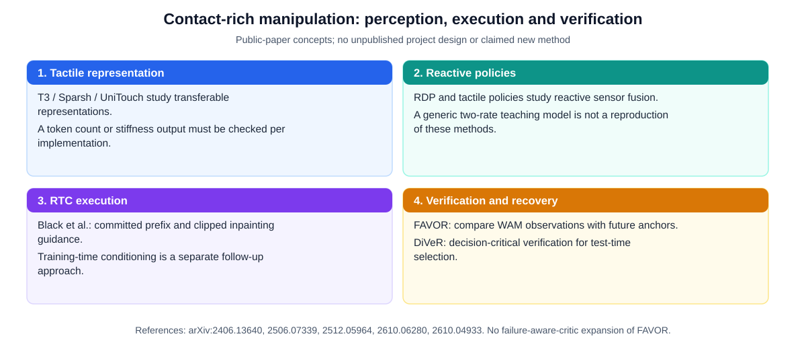

  <a href="../README.md"><b>🏠 English Survey Portal</b></a> |
  <a href="../README_zh.md"><b>🏠 中文综述门户</b></a> |
  <a href="./00_Must_Read_60_Leaderboard.md"><b>🏆 Top-60 Must-Read</b></a> |
  <a href="./01_Foundations_Compliant_Control_and_RL.md"><b>Stage 1</b></a> |
  <a href="./02_VLA_WAM_and_Flow_RL.md"><b>Stage 2A</b></a> |
  <a href="./03_Tactile_RTC_and_Verification_Recovery.md"><b>Stage 2B</b></a> |
  <a href="./04_Datasets_Scaling_Laws_and_Statistical_Eval.md"><b>Stage 3</b></a> |
  <a href="./05_Contact_Rich_Manipulation_and_Generalist_EI.md"><b>Stage 4A</b></a> |
  <a href="./06_Glossary_Templates_and_Checklists.md"><b>Stage 4B & Labs</b></a>

---

## 第二部分（下）：视触觉基础模型与策略、实时异步动作块执行 (RTC) 与在线验证恢复闭环

### 核心专章 B：视触觉传感硬件、预训练触觉表征与富接触操作策略（Tactile & Contact-Rich VLA）与架构对比分析

**证据等级**：`[已验证事实]` 传感器物理机制、公开论文与 arXiv 编号；`[论文报告]` `T3`（CoRL 2024）、`Sparsh`（CoRL 2024）、`UniTouch`（CVPR 2024）、`3D-ViTac`（CoRL 2024）、`T-Rex`（`arXiv:2606.17055`）、`SimpleTouch`（`arXiv:2610.02784`）、`$N_0$-VTLA`（`arXiv:2607.23782`）、`PACE`（`arXiv:2610.16308`, CoRL 2026）、`FACT`（`arXiv:2610.19155`）、`Spark-0`（`arXiv:2610.22342`）、`UniVTAC`（`arXiv:2602.10093`）与 `ForceBench`（`arXiv:2610.19604`），各方法的机制与数字均对照 arXiv 摘要；`[合理推论]` 各路线的适用边界与实验设计建议。

#### 1. 触觉与力感知硬件底层物理：光度立体、标记点切向滑移场与磁皮肤
为什么在紧配合插装（Peg-in-Hole，容差 $<0.2\text{ mm}$）、Snap-Fit 卡扣锁紧、USB/FPC 排线插接与线缆牵引中，即使装了双腕部相机也必须引入触觉或力觉？因为**接触一旦发生，接触界面本身永远被夹爪和工件自遮挡（100% Optical Occlusion at Contact Interface）**，且 $10\text{ N}$ 的卡阻力矩与 $0.5^\circ$ 的插针倾角在远景 RGB 图像上几乎不产生可分辨的像素变化。当前主流具身接触传感分为四大硬件路线：

| 传感器类别 | 代表硬件型号 | 物理成像与测量原理 | 核心输出物理量 | 空间/时间分辨率与优缺点 |
|---|---|---|---|---|
| **光学光度立体视触觉** (Photometric Stereo Optical Tactile) | **`GelSight Mini`**、`DIGIT`、**`ViTai GF225`**（帕西尼/戴盟/纬钛等国产高分辨视触觉指尖） | 透明弹性体凝胶（Elastomer）表面涂覆反光膜，内部红绿蓝三色（或多向）LED 照射；当物体压入凝胶时，微型 CMOS 相机根据反射光强变化通过**光度立体法（Photometric Stereo）**重建微米级表面法向量场 $\mathbf{n}(u,v)$ 并泊松积分恢复三维深度图 $\Delta z(u,v)$ | 高分辨率接触几何纹理、局部压痕深度图、接触区域轮廓与边缘 | 空间分辨率极高（$240\times 320$ 至 $640\times 480$ 像素，微米级几何细节），帧率 $30\text{–}60\text{ Hz}$；弹性体长期重摩擦易磨损 |
| **三维标记点位移与切向滑移场视触觉** (Marker-Displacement & 3D Shear/Slip Tactile) | **`Xense`（千觉）**、带黑点阵列的 `GelSight` / `GelSlim`、`TacTip` | 在弹性体表层或双层结构中嵌入高密度微标记点阵列（Marker Array）；通过光流或特征追踪实时解算每个标记点的三维位移矢量 $(\Delta u, \Delta v, \Delta w)$ | **法向压力分布 $F_n(u,v)$ + 二维切向剪切力场（Shear Force Field $\boldsymbol{\tau}_{xy}$）+ 扭转力矩 + 局部初始微滑移（Incipient Slip）** | 直接反映“插头往哪边歪了（接触力偶）”与“物体是否即将从指间滑脱”，对插孔对准与防滑抓取具有不可替代性 |
| **磁敏弹性体与压阻/气压阵列** (Magnetic & Piezoresistive Skin) | **`AnySkin`** (Bhirangi et al., CoRL 2024)、`ReSkin`、霍尔阵列触觉指尖 | 弹性硅胶内嵌微磁粉，底部三轴磁力计阵列感知形变引起的磁场通量变化，无需内部光学腔体 | 三轴连续接触力矢量分布 $(B_x, B_y, B_z)$ | 厚度极薄（可包裹灵巧手全指面与多曲率皮肤）、采样率高（$100\text{–}400\text{ Hz}$）、抗磨损且更换零校准；几何纹理分辨率低于光学式 |
| **腕部六维力/力矩与关节本体力感** (Wrist 6-Axis F/T & Joint Current) | ATI Mini45 / 坤维六维力传感器、Franka 内置关节扭矩传感器 | 应变片电桥或光学电容测量腕部法兰处的合外力与合力矩 $w_{\text{ext}} = [F_x, F_y, F_z, M_x, M_y, M_z]^\top$ | 末端等效六维合外力螺旋（Wrench，单点集中量） | 采样率极高（$500\text{–}1000\text{ Hz}$），无弹性体磨损；但只能测量合力/合力矩，**无法区分多点接触几何与指面局部微滑移** |

#### 2. 预训练触觉表征基座：`T3`、`Sparsh`、`UniTouch` 与 `3D-ViTac`
不同实验室使用的视触觉传感器（`GelSight Mini`、`DIGIT`、`ViTai GF225`、`Xense`）在照明颜色、凝胶刚度、标记点排布和畸变上差异极大。若从零训练触觉 CNN/ViT，极易在小规模真机轨迹上严重过拟合。2024–2026 年确立了三大跨传感器预训练触觉编码底座（综述详见 *Tactile-Guided Robot Learning: From Representation Learning to Foundation Models*, [arXiv:2610.20134](https://arxiv.org/abs/2610.20134)）：
1. **`T3`（*Transferable Tactile Transformers for Representation Learning Across Diverse Sensors and Tasks*, Jialiang Zhao et al., MIT CSAIL, CoRL 2024, [arXiv:2406.13640](https://arxiv.org/abs/2406.13640)）**：
   - **架构核心**：针对多款异构光学触觉传感器与多下游任务（6D 接触位姿估计、三维力预测、纹理分类、操作控制），提出具备**传感器特定编码器（Sensor-Specific Stem）+ 共享 Transformer 主干（Shared ViT Trunk）+ 任务特定解码器**的统一预训练框架，在超 300 万帧多源触觉数据上预训练。
   - **下游策略接入方式**：`[论文报告]` 后续触觉 VLA 工作（如 `SimpleTouch` [arXiv:2610.02784](https://arxiv.org/abs/2610.02784)）表明，可直接复用预训练触觉编码器提取的特征 Token 注入动作生成模块，而无需单独执行繁琐的多阶段视触觉对齐预训练。具体采用全局池化特征还是空间特征序列，需根据传感器分辨率、任务接触几何与数据规模通过消融实验确定。
2. **`Sparsh`（Carolina Higuera, Akash Sharma et al., Meta AI, CoRL 2024, [arXiv:2410.24090](https://arxiv.org/abs/2410.24090)）**：
   在包含 66 万+ 帧 `GelSight`、`GelSight Mini` 与 `DIGIT` 的触觉数据集上，系统对比了 `DINO`、掩码自编码器（`MAE`）与联合嵌入预测架构（`I-JEPA`）自监督预训练，并配套发布 `TacBench` 六大触觉理解基准（力估计、滑移检测、位姿跟踪等），证实输入双帧触觉差分 $(I_t^{\text{tac}}, I_{t-\Delta t}^{\text{tac}})$ 对捕捉动态切向滑移至关重要。
3. **`UniTouch`（Yang et al., CVPR 2024）与 `3D-ViTac`（Binghao Huang, Yunzhu Li et al., MIT / Columbia, CoRL 2024, [arXiv:2410.24091](https://arxiv.org/abs/2410.24091)）**：
   - `UniTouch` 通过可学习传感器特定 Token 将触觉表征对齐到预训练多模态视觉-语言-音频空间（ImageBind/CLIP）；
   - `3D-ViTac` 针对双臂灵巧操作，将高密度软性触觉阵列直接映射到机器人手部与物体的统一三维点云坐标系中（3D Visuo-Tactile Point Cloud），显式桥接了第三视角 3D 视觉几何与指尖局部接触力学。

#### 3. 2025–2026.10 视触觉与富接触 VLA 策略全景
截至 2026 年 10 月，视触觉/力控生成式策略的代表性工作如下。机制与数字均摘自各论文 arXiv 摘要；摘要未给出的实现细节不作断言。

| 模型 / 论文 | 发布时间与来源 | 触觉 / 力觉接口 | 核心机制（据论文摘要） | 关键实证结论（`[论文报告]`）与适用边界 |
|---|---|---|---|---|
| **`T-Rex`** (*T-Rex: Tactile-Reactive Dexterous Manipulation*) | 2026.06 Dantong Niu et al. [arXiv:2606.17055](https://arxiv.org/abs/2606.17055) | 时序触觉 VQ-VAE 编码器（Temporal Tactile VQ-VAE） | **可变速率 Mixture-of-Transformers（MoT）**：在保留既有 VLA 能力的前提下利用高频触觉信号；配套按基础运动原语采集的 100 小时触觉数据集 | 12 项需要精细力控与柔性体操作的任务上，平均成功率比最强基线高 30% 以上 |
| **`SimpleTouch`** (*SimpleTouch: Can Vision-Language-Action Models Master Contact-Rich Manipulation Without Tactile Policy Pretraining?*) | 2026.10 Chen Yang et al. [arXiv:2610.02784](https://arxiv.org/abs/2610.02784) | 冻结预训练触觉编码器的全部 Token | 在 $\pi_{0.5}$ 上增加触觉专家，用动作监督 + 多时域未来触觉潜变量预测进行**单阶段**训练，不需要额外的触觉策略预训练或单独的视触觉对齐 | 每任务 50 条示范时，UniVTAC 六项任务平均 77.5%（FTP-$\pi_{0.5}$ 45.2%、FTP-1 66.7%）；四项真机任务平均 71.3% |
| **`PACE`** (*PACE: Temporal-Role Tactile Conditioning for Chunk-Based Insertion Policies*) | 2026.10 (CoRL 2026) Zhiyuan Chen et al. [arXiv:2610.16308](https://arxiv.org/abs/2610.16308) | 共享触觉流按三种“时间角色”组织 | 持续接触状态调制动作块生成；突发接触事件修正已生成的动作块；接触后果预测在训练中塑形动作表征 | 五项真机插装任务平均 90.7%，比纯视觉与生成期触觉融合基线高 44 个百分点以上；ManipulationNet 六种几何间隙（含 0.1 mm）上 88.7% |
| **`FACT`** (*FACT: A Multimodal Force-Action-Track Foundation Model for Human-to-Robot Dexterity*) | 2026.10 Zhi Cao et al. [arXiv:2610.19155](https://arxiv.org/abs/2610.19155) | 人类触觉数据集 `EgoForce` + 机器人示范联合预训练 | **Track-Guided Coarse Planner**（联合预测动作、未来视频与视觉轨迹）+ **Force-Action Joint Refiner**（联合预测未来力并精修粗动作），面向灵巧操作 | 10 项任务、10 条机器人 + 90 条人类轨迹微调，相对 `T-Rex` 成功率提升最多 60 个百分点 |
| **`Spark-0`** (*Spark-0: Scaling Spatially Aligned Tactile Pretraining for Robot Dexterous Manipulation*) | 2026.10 Tianxing Chen et al. [arXiv:2610.22342](https://arxiv.org/abs/2610.22342) | 触觉手套接触图 + 区域力历史 / 3D taxel 状态 | 预训练时用图像空间接触图与冻结 3D 几何教师监督视觉 Token（推理时移除）；并行触觉通路调制动作专家；同一权重同时支持纯视觉与触觉条件部署；1,000 小时 `HumanTouch` 数据 | Ego Humanoid 纯视觉成功率 52.5% → 71.7%；SparkArena-Real 44.0% → 52.0%（触觉既是输入，也是可扩展的预训练监督） |
| **`$N_0$-VTLA`** & **`TacVLA`** | 2026.07 / 2026.03 [arXiv:2607.23782](https://arxiv.org/abs/2607.23782) [arXiv:2603.12665](https://arxiv.org/abs/2603.12665) | `$N_0$-VTLA`：大规模视触觉预训练 + 预测式触觉通路；`TacVLA`：**接触感知门控**，仅在检测到接触时激活触觉 Token | `$N_0$-VTLA` 另提出优势条件化离线 RL 方法 `ALTER`；`TacVLA` 在 Transformer 中联合处理视觉、语言与触觉 Token | `$N_0$-VTLA`：九项真机任务全胜，二十项仿真任务均值 63.8%（最强基线 44.0%）；`TacVLA`：拆解任务平均 +20%、箱内抓取 +60%、视觉遮挡下 2.1× |
| **`RDP` / `ImplicitRDP` / `FA-RDP`** & **`ForceVLA` / `ForceVLA2`** | 2025.03–2026.07 [arXiv:2503.02881](https://arxiv.org/abs/2503.02881) [arXiv:2512.10946](https://arxiv.org/abs/2512.10946) [arXiv:2607.28596](https://arxiv.org/abs/2607.28596) [arXiv:2603.15169](https://arxiv.org/abs/2603.15169) | 慢速视觉生成 + 高频力/触觉 | `RDP` 采用显式慢-快双层结构（RSS 2025）；`ImplicitRDP` 为端到端视觉-力扩散策略；`FA-RDP` 接触前用多步低频采样保留多模态、接触后切换单步高频采样；`ForceVLA2` 以力提示 + 跨尺度 MoE 实现力-位混合控制 | 富接触模仿学习的常用对比基线家族；`ForceVLA2` 报告在 5 项任务上比 $\pi_0$ / $\pi_{0.5}$ 分别高 48.0% / 35.0% |

#### 4. 视触觉与力控标准仿真基准：`UniVTAC` 与 `ForceBench`
真机消融（扫描延迟 $d$、融合方式、RL 超参）成本很高，难以支撑大量随机种子的统计检验。2026 年两项开源仿真基准填补了这一空白：
- **`UniVTAC`（Baijun Chen et al., 2026.02, [arXiv:2602.10093](https://arxiv.org/abs/2602.10093)）**：
  **基于仿真的视触觉数据合成平台**，支持三种常用视触觉传感器，可规模化、可控地生成接触交互数据；在此基础上提供 `UniVTAC Encoder`（在仿真合成数据上训练的视触觉编码器）与包含 8 项任务的 `UniVTAC Benchmark`。论文报告集成该编码器后基准平均成功率 +17.1%，真机实验 +25%。
- **`ForceBench`（Xuan Han et al., 2026.10, [arXiv:2610.19604](https://arxiv.org/abs/2610.19604)）**：
  在统一协议下评测**六轴腕部力**融合设计的仿真基准：8 项任务（物理属性推断、阻力相关交互、富接触装配）、1,600 条同步示范；在共享 $\pi_{0.5}$ 骨干上比较 1 个无力基线与 6 种力融合设计。`Prompt Fusion` 取得最高仿真均值 35.31%（无力基线 23.25%）；两种时序融合设计在装配类任务上**反而低于基线**；真机五项任务上 `Prompt Fusion` 与 `Dual-Path Fusion` 均为 63.00%（基线 40.00%），但只有 `Prompt Fusion` 在每项任务上都有提升。**启示**：融合方式本身就是关键变量，消融中应包含无力基线和简单融合基线，并按任务类别分别报告。

#### 5. 视触觉策略实验设计：三项必须控制的混淆变量 `[合理推论]`
1. **执行协议混淆**：如果触觉策略以更高频率重规划，而基线要等整个动作块执行完毕，增益可能来自“更短的开环步长”而不是触觉本身。应把所有方法放在同一异步执行协议下比较（例如相同推理延迟 $d$ 与执行步长 $s$ 的 `RTC`）。
2. **模态必要性**：应同时报告无力/无触觉基线、简单融合基线（如直接拼接或 `ForceBench` 中的 `Prompt Fusion`），以及“用六维 F/T 替代高分辨触觉”的消融。`ForceBench` 显示不同融合设计的收益随任务类别显著变化，因此不能只报告平均值。
3. **示范质量天花板**：若声称在线 RL 突破了模仿学习上限，需给出相同数据与交互预算下的纯 IL 对照、交互时长与人工干预次数，并按阶段 3 的 Wilson 区间 + 配对 McNemar 协议报告置信区间。

---

### 核心专章 C：实时动作块异步执行（Real-Time Chunking, `RTC`）、滚动去噪（`REACT`）与知识绝缘（`Knowledge Insulation`）

**证据等级**：`[已验证事实]` 论文发表（NeurIPS 2025 / CoRL 2026）与 `openpi` 官方开源实现；`[论文报告]` `RTC`（Kevin Black, Manuel Y. Galliker, Sergey Levine, [arXiv:2506.07339](https://arxiv.org/abs/2506.07339)）、训练期动作条件化 `RTC`（[arXiv:2512.05964](https://arxiv.org/abs/2512.05964)）、`REACT`（[arXiv:2610.12007](https://arxiv.org/abs/2610.12007), CoRL 2026 Spotlight）、`Chronos Policy`（[arXiv:2610.13929](https://arxiv.org/abs/2610.13929)）与 `Knowledge Insulation`（Danny Driess et al., [arXiv:2505.23705](https://arxiv.org/abs/2505.23705)）。

#### 1. 为什么传统“同步动作块执行（Synchronous Action Chunking）”在真机高频闭环中存在严重缺陷？
在阶段 1 中我们学过，策略在时刻 $t=0$ 接收观测 $o_0$，生成未来 $H$ 步动作块 $A^{(0)} = [a_0, a_1, \dots, a_{H-1}]$（例如在 $\Delta t = 20\text{ ms}$ 即 $50\text{ Hz}$ 控制下，$H=50$ 对应 $1\text{ s}$），并设定执行步长为 $s$（Execution Horizon, $s \le H$）。
然而，3B–5B 参数的 VLA 推理并非瞬间完成！设模型完成一次视觉编码 + 流匹配去噪所需的物理推理延迟为 $\Delta t_{\text{inf}}$，折算为底层控制步数为**推理延迟步数 $d = \lceil \Delta t_{\text{inf}} / \Delta t \rceil$**（例如在多相机或边缘端推理耗时 $160\text{ ms}$ 时，$50\text{ Hz}$ 下 $d = 8$ 步）。此时传统同步执行面临两难死局：
- **死局一（停顿等待 Stop-and-Wait）**：每执行完 $s$ 步动作，机械臂原地刹停等待 $d$ 步（$160\text{ ms}$）直到新动作块算完。这会导致机械臂每隔零点几秒就发生一次剧烈的加减速顿挫（Jerky Stalls），在动态插装或拉线中直接破坏接触稳态；
- **死局二（滞后跳变 Naive Asynchronous Switching）**：为了不停顿，提前在 $t = s - d$ 时刻用当时的旧观测 $o_{s-d}$ 启动后台推理；当 $t = s$ 时刻新动作块算好并切入时，由于新块是基于 $d$ 步前的陈旧观测独立采样的多模态轨迹，其起点与机器人刚刚实际走完的轨迹末端存在明显的**位置/速度阶跃不连续（Trajectory Discontinuity & Mode Jumping）**，引发机械臂在切换瞬间剧烈抽搐！

#### 2. `Real-Time Chunking (RTC)`：基于承诺前缀与软掩码流修复（Soft-Masked Flow Inpainting）的零停顿闭环
Physical Intelligence 团队提出的 **`RTC`（NeurIPS 2025, [arXiv:2506.07339](https://arxiv.org/abs/2506.07339)）** 针对上述矛盾给出了无需重训的推理期方案，是 Flow Matching / Diffusion VLA 异步部署中被广泛采用的基线方法：
1. **滑动时间窗与已承诺前缀（Committed Prefix $a_{0:d}$）**：
   假设当前策略在某时刻拿到最新观测并启动后台推理，由于算完这个新块需要耗费 $d$ 个控制步，在这 $d$ 步计算期间，底层控制器**必须继续执行上一动作块留下来的那 $d$ 步动作**。因此，对于正在生成的这个新动作块 $A \in \mathbb{R}^{H \times d_a}$ 而言，它的**前 $d$ 步动作 $a_{0:d}^{\text{prev}}$ 已经是“既成事实（Committed Prefix，不可更改）”**，只有后半段 **$a_{d:H}$（Uncommitted Suffix，未提交后缀）** 才是新块真正能够下发执行的自由区间！
2. **训练无关的测试期软掩码流修复（Inference-Time Soft-Masked Inpainting，`arXiv:2506.07339`）**：
   如何让新生成的后缀 $a_{d:H}$ 与已承诺前缀 $a_{0:d}^{\text{prev}}$ 在第 $d$ 步边界处平滑过渡？`RTC` 将问题建模为**流匹配轨迹修复（Flow Inpainting）**：在从 $\tau=0$ 到 $\tau=1$ 的每一步积分中，用软掩码权重 $W \in [0,1]^H$ 引导新动作块贴合上一块的剩余动作。原文的掩码为：$i<d$ 时 $W_i=1$；$d \le i < H-s$ 时 $W_i = c_i\frac{e^{c_i}-1}{e-1}$，其中 $c_i=\frac{H-s-i}{H-s-d+1}$；$i \ge H-s$ 时 $W_i=0$。引导后的速度场采用 $\Pi\text{GDM}$ 形式：
   $$\tilde{v}_\theta(a^\tau, \tau, o) = v_\theta(a^\tau, \tau, o) + \min\!\Big(\beta,\ \frac{1-\tau}{\tau\, r_\tau^2}\Big) \Big(\nabla_{a^\tau} \hat{a}^1(a^\tau)\Big)^\top \Big[ W \odot \big(a_{\text{prev}} - \hat{a}^1(a^\tau)\big) \Big], \quad r_\tau^2 = \frac{(1-\tau)^2}{\tau^2 + (1-\tau)^2}, \quad \hat{a}^1(a^\tau) = a^\tau + (1-\tau)v_\theta(a^\tau, \tau, o)$$
   端点 $\tau=0$ 的截断系数按极限定义为 $\beta$；积分使用左端点且不在 $\tau=1$ 计算该比值。其中 $\beta$ 是引导权重上限（固定超参数），用于避免 $\tau \to 0$ 时 $\frac{1-\tau}{\tau r_\tau^2}$ 发散；雅可比转置乘积 $(\nabla_{a^\tau}\hat a^1)^\top[\cdot]$ 通过一次反向传播（VJP）计算。整个过程不修改预训练权重。阶段 4 的 `Lab 2` 在一个合成线性速度场上演示了这一公式，不构成真机复现。
3. **训练期动作前缀条件化（Training-Time Action Conditioning for Efficient RTC, [arXiv:2512.05964](https://arxiv.org/abs/2512.05964)）**：
   测试期 VJP 引导会增加推理开销（论文摘要原话：inpainting introduces computational overhead that increases inference latency）。后续工作 `arXiv:2512.05964` 改为在训练阶段模拟推理延迟：随机采样延迟步数 $d$，把干净的真值前缀 $a_{0:d}^1$ 直接作为条件输入，仅对后缀 $a_{d:H}^\tau$ 施加流匹配损失：
   $$\mathcal{L}_{\text{Train-RTC}}(\theta) = \mathbb{E}_{\tau, d, a^0, a^1} \left[ \Big\| v_\theta^{\text{suffix}}\big([a_{0:d}^1,\; a_{d:H}^\tau], \tau, o_t, d\big) - (a_{d:H}^1 - a_{d:H}^0) \Big\|_2^2 \right]$$
   测试期无需任何 VJP 梯度引导，直接将上一块的已承诺前缀 $a_{0:d}^{\text{prev}}$ 塞入网络前向推理，以**零额外计算开销**实现无停顿平滑拼接！

#### 3. 2026.10 实时控制最新突破：`REACT` 滚动去噪与 `Chronos Policy` 物理连续时间
- **`REACT`（*REACT: Rolling Denoising and Dual Decoupling for Reactive Robot Control with VLA Models*, CoRL 2026 Spotlight, [arXiv:2610.12007](https://arxiv.org/abs/2610.12007)）**：
  打破了“整个动作块共享同一个流时间标量 $\tau \in [0,1]$”的传统假设，提出**滚动去噪缓冲区（Rolling Denoising Buffer）**：动作块中越靠近当前执行时刻的步具有越高的去噪成熟度（$\tau_i \to 1$），每执行一步，整个窗口向左滑动一格并在末尾补入纯高斯噪声步（$\tau_H = 0$），每次推理只需对窗口执行单步滚动去噪更新，同时配合慢速 VLM 与快速动作头的双解耦（Dual Decoupling），从根源上消除了“块边界”概念。
- **`Chronos Policy`（*Chronos Policy: Learning Robot Policies on Physical Time*, Shuran Song Group, 2026.10, [arXiv:2610.13929](https://arxiv.org/abs/2610.13929)）**：
  指出传统策略把感知与控制转换为固定速率的观测-动作序列，物理时间只隐含在序列位置中；一旦观测频率、延迟或推理耗时变化，这一假设就会失效。`Chronos Policy` 显式地以**观测采集时间戳与期望动作执行时间**为条件，并比较了时间戳嵌入与**时间感知 RoPE**（time-aware RoPE）两种方式，发现后者更鲁棒；训练时还随机化观测采样与动作块起始时刻，以覆盖部署中可能出现的多种感知/执行时序。

#### 4. `Knowledge Insulation (KI)`（知识绝缘，Danny Driess et al., [arXiv:2505.23705](https://arxiv.org/abs/2505.23705)）
当我们在预训练 VLM（如 `PaliGemma-3B`）旁边挂载一个随机初始化的连续流匹配动作专家（Flow Matching Action Expert）联合训练时，为什么直接把流匹配损失 $\mathcal{L}_{\text{CFM}}$ 的梯度反向传播进 VLM 主干会显著损害开放词汇泛化与语言指令遵循能力？
- **病理机制**：训练初期，随机初始化的连续动作专家输出高方差梯度；当这些连续回归梯度通过跨模块注意力（Cross-Attention / Shared KV-Cache）反传进 VLM 时，会迅速扭曲 VLM 预训练好的离散语义与视觉-语言对齐流形。
- **`Knowledge Insulation` 的优雅解法**：
  1. **截断连续动作专家向 VLM 的反向梯度（`stop_gradient` on Shared KV-Cache）**：在计算动作专家的跨注意力时，对来自 VLM 主干的 Key/Value 张量施加 `jax.lax.stop_gradient`（或 PyTorch 中的 `.detach()`），完全禁止连续流匹配损失污染 VLM 权重；
  2. **怎么让 VLM 主干学会提取机器人控制所需的运动特征？用离散 `FAST` 动作 Token 监督 VLM 本身！** 在训练期，让 VLM 主干自回归预测经 `FAST`（频域 DCT+BPE）压缩的离散动作 Token 序列（与文本 Token 同构，梯度极其契合 VLM 预训练分布），而连续动作专家则在 `stop_gradient` 保护下读取 VLM 的高质量隐藏状态生成 50Hz 连续轨迹。测试推理期**完全跳过 VLM 的离散 `FAST` Token 解码**，直接运行 KV-Cache 预填充 + 连续流匹配专家，兼得 VLM 的无损语义泛化、更快收敛速度与 50Hz 高精连续控制！

---

### 核心专章 D：在线验证、失败检测与闭环恢复（Verification, Failure Detection & Online Recovery）

**证据等级**：`[已验证事实]` 论文发表与 arXiv 编号；`[论文报告]` `FAVOR`（`arXiv:2610.06280`）、`DiVeR`（`arXiv:2610.04933`）、`SAFE`（NeurIPS 2025, `arXiv:2506.09937`）、`FAIL-Detect`（RSS 2025, `arXiv:2503.08558`）与 `E-TTS`（ECCV 2026, `arXiv:2606.27268`）；`[合理推论]` 运行时验证器与测试期扩展的部署权衡分析。

在长时程双臂操作（如双臂柔性线缆解缠、多步工业装配或桌面整理）中，任何开环策略的单阶段失误（抓空、线结未解开、插头未对准）如果不能被及时察觉并恢复，都会导致后续所有步骤在错误前提下空转。**“生成（Propose）$\rightarrow$ 验证（Verify）$\rightarrow$ 局部修正/恢复（Refine \& Recover）”**正成为提高具身系统可靠性的核心闭环。

#### 1. 2025–2026.10 具身验证、失败检测与在线恢复五大代表作
1. **`FAVOR`（*Future Anchored Verification and Online Recovery for World Action Models*, Zhibin Qin, Zhenxiong Tan, Xinchao Wang, NUS, 2026.10, [arXiv:2610.06280](https://arxiv.org/abs/2610.06280)）**：
   - **核心机制**：针对**世界动作模型（WAM）**“先预测未来、再从未来解码动作”的特点，FAVOR 把模型行动前预测的未来帧保留为**锚点**：`Anchor Verifier` 结合已执行动作，将每个观测与对应锚点比较，标记会破坏任务的偏离；`Anchor-Guided Recovery` 用 VLM 把被标记的锚点转写成简短的纠正指令，WAM 在加强的指令引导下执行该指令回到预期轨迹，然后继续任务。整个过程不修改策略权重。论文报告的增益较小：LIBERO 97.85% → 98.10%，LIBERO-Plus 72.60% → 72.98%。
2. **`DiVeR`（*DiVeR: Decision-Critical Verifier Learning for VLA Test-Time Scaling*, 2026.10, [arXiv:2610.04933](https://arxiv.org/abs/2610.04933)）**：
   - **核心洞察**：verifier-guided test-time scaling 通过采样多个候选动作并选出最可能成功的一个来提升 VLA。现有分类式验证器从轨迹级结果学习，却**平等对待所有访问过的状态**；而在多数状态下合理动作彼此相似、判别信号很弱，只有少数**决策关键状态（decision-critical states）**才存在会显著影响结果的不同动作。
   - **方法贡献**：`DiVeR` 用**采样动作表征的离散度**估计决策关键性，并据此对验证器训练重新加权，无需步级标注或额外环境交互；在 LIBERO、RoboCasa 与 Franka Research 3 真机上提升了任务成功率，验证器推理开销可忽略。
3. **`SAFE`（*SAFE: Multitask Failure Detection for Vision-Language-Action Models*, Qiao Gu et al., NeurIPS 2025, [arXiv:2506.09937](https://arxiv.org/abs/2506.09937)）**：
   - 发现预训练 VLA 内部的多模态隐藏层特征（Internal Hidden States）本身就已经隐式编码了丰富的任务进展与异常信号。无需额外训练庞大的外部视觉分类器，只需从 VLA 中间层提取多尺度特征训练一个极轻量的多任务失败检测探针（Failure Detection Probe），即可在跨任务、跨未见场景下实时输出校准后的失败概率分数。
4. **`FAIL-Detect`（*Can We Detect Failures Without Failure Data? Uncertainty-Aware Runtime Failure Detection for Imitation Learning Policies*, RSS 2025, [arXiv:2503.08558](https://arxiv.org/abs/2503.08558)）**：
   - 将失败检测建模为**序列化分布外（OOD）检测**，只用成功示范训练：先把策略输入/输出蒸馏为与失败相关、刻画认知不确定性的标量信号，再用**保形预测（Conformal Prediction）**给出带统计保证的报警阈值；论文发现学习得到的信号（尤其是其提出的基于流的密度估计器）总体最有效。
5. **`E-TTS`（*E-TTS: A New Embodied Test-Time Scaling Framework for Robotic Manipulation*, ECCV 2026, [arXiv:2606.27268](https://arxiv.org/abs/2606.27268)）** ：
   - **真实机制**：`E-TTS` 在测试期**联合采样候选推理轨迹（Reasoning Traces）与候选动作序列（Actions）**，利用一个结合历史上下文的**推理-动作联合验证器（History-Aware Reasoning & Action Verifier）**对候选对进行打分，并在验证置信度低于阈值时触发**反馈引导的重采样修正（Feedback-Guided Resampling）**，而非单纯的无反馈随机盲采。

| 代表工作 | 发表时间与编号 | 验证对象（Verify What?） | 恢复/重规划机制（How to Recover?） | 机制特点与对比分析 |
|---|---|---|---|---|
| **`FAVOR`** | `arXiv:2610.06280` (2026.10) | WAM 预测的未来锚点帧 vs 实际观测（结合已执行动作） | VLM 生成纠正指令，WAM 在加强指令引导下回到预期轨迹 | 以“模型自身预测的未来”作为验证锚点；仅适用于显式预测未来的 WAM，报告增益较小 |
| **`DiVeR`** | `arXiv:2610.04933` (2026.10) | 采样得到的候选动作（以动作表征离散度估计决策关键性） | Verifier-guided test-time scaling：从候选中选优 | 关键状态重加权验证器训练，无需步级标注；推理开销可忽略 |
| **`SAFE`** | `arXiv:2506.09937` (NeurIPS 2025) | VLA 内部特征（OpenVLA、$\pi_0$、$\pi_0$-FAST） | 输出单一失败概率标量，配合保形预测触发停止/回退/求助 | 跨任务泛化的失败检测器，不需要额外的外部视觉编码 |
| **`E-TTS`** | `arXiv:2606.27268` (ECCV 2026) | 历史感知的 (Reasoning, Action) 联合候选对 | 低置信度下反馈引导重采样（Feedback-Guided Resampling） | 闭环迭代精修；无需额外专家数据或重训练 |

#### 2. 运行时验证与恢复机制的工程部署边界 `[合理推论]`
1. **测试期多候选重采样的延迟与吞吐权衡**：
   以 `DiVeR` 与 `E-TTS` 为代表的测试期验证扩展（Test-Time Scaling）需要在推理阶段并行或串行生成 $N$ 条候选动作（或推理-动作对）并由验证器打分选优。在自由空间抓取或准静态任务中，数十毫秒的额外推理开销通常可以接受；但在高频动态接触任务中，候选数量 $N$ 与验证器特征提取开销必须严格受控于底层控制周期，不能脱离目标硬件延迟预算盲目增大采样规模。
2. **失败探针的报警阈值校准与误报/漏报权衡**：
   以 `SAFE` 与 `FAIL-Detect` 为代表的运行时异常检测器输出连续不确定性或失败概率标量。在真机部署时，若报警阈值设得过低，正常接触力波动容易触发频繁误停（False Positives）；若设得过高，则可能在发生不可逆卡死或滑脱后才报警（False Negatives）。因此，工程实践中通常需结合保形预测（Conformal Prediction）在验证集轨迹上标定给定显著性水平 $\alpha$ 下的分位数阈值。

---
