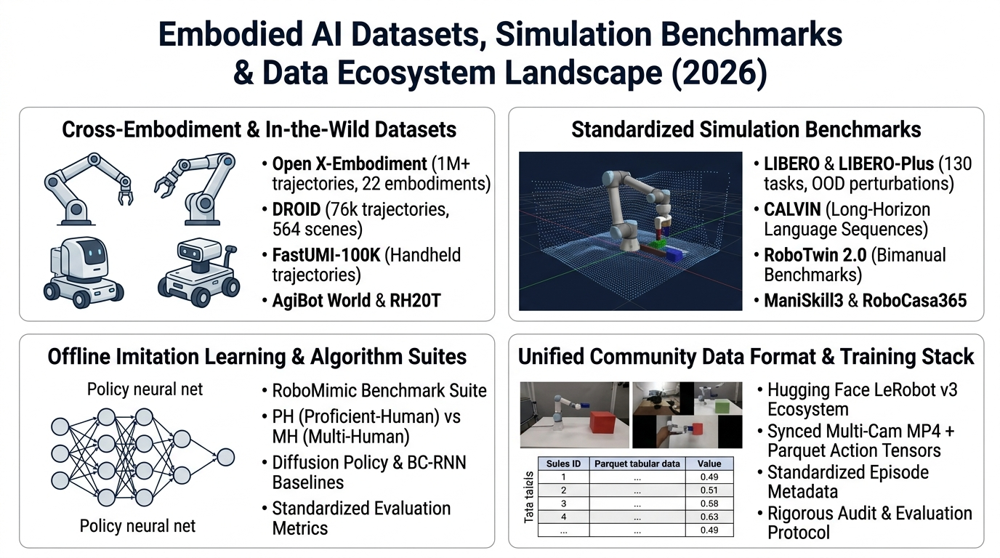
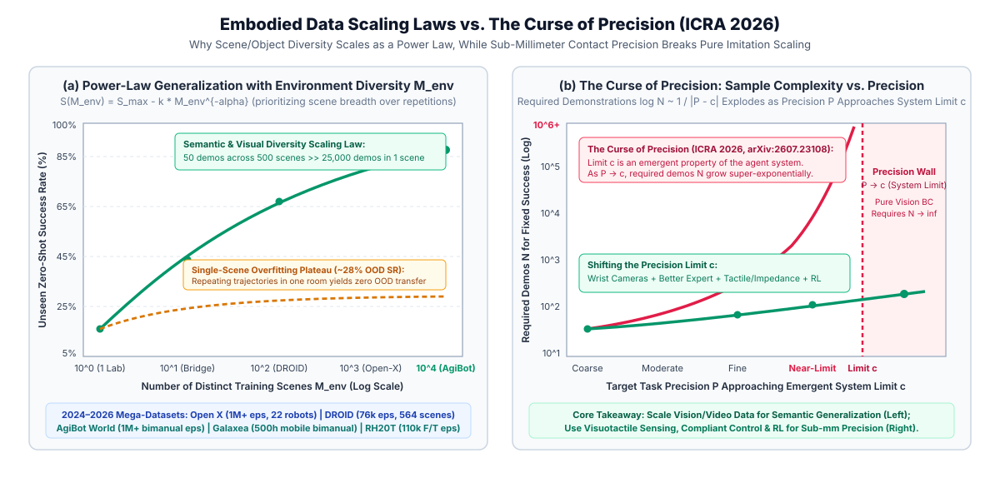
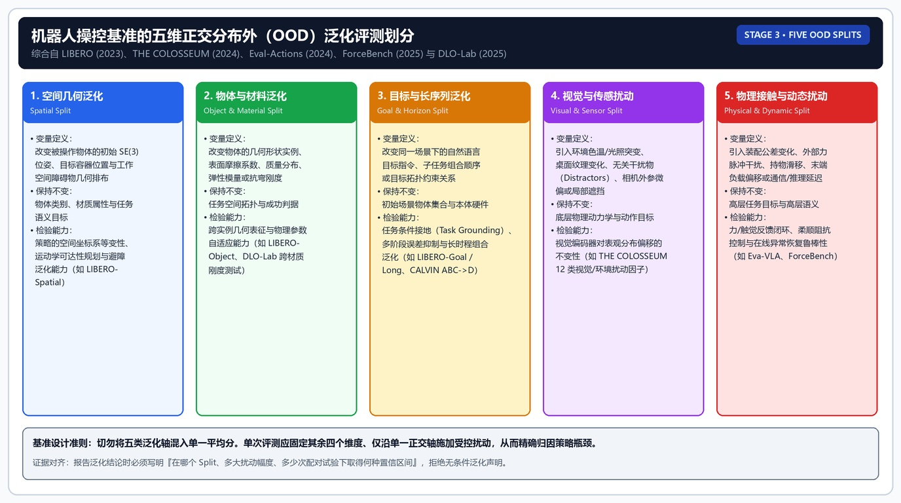

  <a href="../README.md"><b>🏠 English Survey Portal</b></a> |
  <a href="../README_zh.md"><b>🏠 中文综述门户</b></a> |
  <a href="./00_Must_Read_60_Leaderboard.md"><b>🏆 Top-60 Must-Read</b></a> |
  <a href="./01_Foundations_Compliant_Control_and_RL.md"><b>Stage 1</b></a> |
  <a href="./02_VLA_WAM_and_Flow_RL.md"><b>Stage 2A</b></a> |
  <a href="./03_Tactile_RTC_and_Verification_Recovery.md"><b>Stage 2B</b></a> |
  <a href="./04_Datasets_Scaling_Laws_and_Statistical_Eval.md"><b>Stage 3</b></a> |
  <a href="./05_Contact_Rich_Manipulation_and_Generalist_EI.md"><b>Stage 4A</b></a> |
  <a href="./06_Glossary_Templates_and_Checklists.md"><b>Stage 4B & Labs</b></a>

---

## 具身智能入门：阶段 3 数据集与 Benchmark

> [!abstract] 阶段 3 输出物
> 读完本阶段，应能把任何模型 claim 翻译成 benchmark protocol：数据来源、robot embodiment、observation、action、train/test split、success criterion、trial 数、baseline 和外推边界。对 DLO 研究，应能设计 material、topology、spatial、lighting 和 Sim-to-Real split。

> [!note] 阶段边界
> 本文件只处理数据集、Benchmark 和数据格式生态。VLA 模型时间线见 阶段 2。阅读本文件时不要把“真实数据集”“仿真 benchmark”“离线学习框架”“社区数据格式”混成同一类对象。

### 先建立分类

具身智能里常见的“数据集/Benchmark”至少分四类：

- **真实机器人数据集**：例如 Open X-Embodiment、DROID。价值是真实物理分布，成本是数据噪声、动作空间不一致和复现实验困难。
- **仿真 Benchmark**：例如 CALVIN、LIBERO、RLBench、ManiSkill。价值是可控、可重复、可大规模评测，风险是 Sim-to-Real gap。
- **离线模仿学习框架/数据入口**：例如 RoboMimic。价值是把数据、算法和复现实验组织起来。
- **数据格式与社区生态**：例如 LeRobot。价值是统一采集、存储、训练和发布流程，但它不是单个 benchmark。

判断一个条目是否适合新手，先问五个问题：

- 它是真实机器人数据，还是仿真环境？
- 它是数据集、评测 benchmark、训练框架，还是数据格式？
- 规模数字来自论文、官方项目页，还是二手博客？
- success rate 是否只在同一 benchmark、同一 protocol 内可比？
- 是否能下载数据、跑基线、复现评测？

### 总表

| 名称 | 类型 | 真实/仿真 | 已核实规模 | 最适合研究 | 新手风险 |
|---|---|---|---|---|---|
| Open X-Embodiment | 跨本体真实机器人数据集 | 真实 | 1M+ real robot trajectories，22 robot embodiments，60 datasets，34 labs | VLA 预训练、跨本体学习 | 子数据集异质性强，不能只看总量 |
| DROID | in-the-wild 真实操作数据集 | 真实 | 76k trajectories，350h，564 scenes，86 tasks，50 collectors | 真实场景泛化、分布偏移 | 不是统一 benchmark，不能直接比较所有论文分数 |
| CALVIN | 长时程语言条件仿真 benchmark | 仿真 | 官方仓库提供 D / ABC / ABCD / debug 数据下载；任务规模按 split 和版本核对 | 长任务、语言条件、连续控制 | 不要把仿真高分当真实部署能力 |
| LIBERO | 终身机器人学习 benchmark | 仿真 | 原始论文：4 suites，130 tasks；LeRobot 文档：5 suite labels 覆盖 130 tasks | lifelong learning、知识迁移 | 版本口径不同，要写清 suite 定义 |
| RLBench | 大规模视觉操作 benchmark | 仿真 | 100 hand-designed tasks；motion planner 可生成 demos | few-shot、多任务、IL/RL | generated demos 不等于人类真实示范 |
| ManiSkill | 大规模操作技能 benchmark | 仿真 | 原始 ManiSkill：约 36,000 successful trajectories，约 1.5M RGB-D/point-cloud frames | 3D 视觉、点云、LfD/RL | 版本迭代快，任务数与环境要按版本核对 |
| RoboMimic | 离线机器人学习框架与数据集入口 | 真实 + 仿真 | PH 每数据集 200 successful trajectories；MH 每数据集 300；MG 任务按 checkpoint 汇总 | BC、BC-RNN、Transformer、离线学习复现 | 它不是单一 benchmark，数据 split 复杂 |
| LeRobot | 数据格式、训练库和社区数据生态 | 真实 + 仿真 | LeRobotDataset v3 统一多模态时序、sensorimotor、multi-camera video 和 metadata | 采集、发布、训练、复现 | 不要把 LeRobot 当作一个固定数据集 |

### Open X-Embodiment

**性质**

Open X-Embodiment 是跨机构、跨机器人本体的真实机器人数据集，也是 RT-X、Octo、OpenVLA 等模型的重要背景。它更像机器人学习里的“公共语料库”，不是单个任务 benchmark。

**已验证事实**

- 官方项目页写明：数据来自 22 种机器人本体、21 个机构，覆盖 527 个技能和 160,266 个任务。
- 官方项目页还写明：Open X-Embodiment Dataset 包含 1M+ real robot trajectories，跨 22 robot embodiments。
- 数据集由 60 个既有机器人数据集汇集而成，来自 34 个机器人实验室。

**真实性判断**

这是强真实数据源，核心价值在于跨机器人、跨实验室和跨场景。但它不是一个干净同分布 benchmark：不同子数据集的相机、动作空间、语言标注、任务粒度和采集质量都不同。

**适合用来做什么**

- 训练或理解 VLA / generalist robot policy。
- 学习 RLDS 格式和跨本体动作统一。
- 研究多数据混合、数据清洗和 cross-embodiment transfer。

**不适合怎么用**

- 不适合把总轨迹数当成模型能力保证。
- 不适合直接把不同子数据集上的 success rate 横向比较。
- 不适合新手一上来就全量下载和训练。

主要来源：[Open X-Embodiment / RT-X 官方项目页](https://robotics-transformer-x.github.io/)。

### DROID

**性质**

DROID 是大规模 in-the-wild 真实机器人操作数据集。它的重点不是单一实验室的标准化桌面任务，而是多地点、多操作者、多场景的真实分布。

**已验证事实**

- 官方项目页写明：76k demonstration trajectories，约 350h interaction data。
- 数据覆盖 564 scenes、86 tasks。
- 数据由 50 data collectors 在北美、亚洲和欧洲等地点 12 个月内采集。

**真实性判断**

DROID 是真实机器人数据，适合理解 VLA 为什么需要更丰富、更分散、更接近真实世界的训练分布。但它不是一个天然公平的排行榜，更多是训练数据和真实泛化研究基础设施。

**适合用来做什么**

- 研究真实场景泛化。
- 研究多操作者遥操作数据。
- 为开放 VLA 或 diffusion/flow policy 提供真实数据微调。

**不适合怎么用**

- 不要把 DROID 上某个 policy 的指标和 CALVIN/LIBERO/RLBench 仿真指标直接比较。
- 不要忽略硬件、相机布置和 action space 对复现的影响。

主要来源：[DROID 官方项目页](https://droid-dataset.github.io/)。

### CALVIN

**性质**

CALVIN 是开放仿真 benchmark，目标是学习 long-horizon language-conditioned manipulation。它强调机器人从 onboard sensors 出发，根据自然语言完成长时程连续控制任务。

**已验证事实**

- 官方 GitHub 称 CALVIN 是 open-source simulated benchmark，用于 long-horizon language-conditioned tasks。
- CALVIN 支持多种视觉和本体观测：静态相机 RGB/Depth、夹爪相机 RGB/Depth、tactile image、末端和关节状态等。
- 官方仓库写明 continuous actions at 30Hz，并支持 absolute cartesian pose、relative cartesian displacement、joint action 等动作空间。
- 数据下载按 split 提供，例如 D、ABC、ABCD 和 debug。

**真实性判断**

CALVIN 是仿真 benchmark，不是真实机器人数据集。它的价值在于可控、可重复、适合比较长任务语言条件策略；局限是仿真物理、视觉纹理、接触误差与真实世界不同。

**适合用来做什么**

- 长时程任务序列评估。
- language-conditioned policy learning。
- 比较 ACT、diffusion policy、VLA 等方法在仿真长任务上的表现。

**不适合怎么用**

- 不要把 CALVIN high success rate 直接解释成真实机器人能成功。
- 不要在未写明 split 的情况下引用“CALVIN 规模数字”。

主要来源：[CALVIN GitHub](https://github.com/mees/calvin)。

### LIBERO

**性质**

LIBERO 是面向 lifelong robot learning 和 knowledge transfer 的仿真 benchmark。它关注机器人如何迁移 declarative knowledge、procedural knowledge 以及二者组合。

**已验证事实**

- 原始论文摘要写明：为 benchmark 创建 4 个 task suites，总计 130 tasks，并提供所有任务的高质量人类遥操作示范数据。
- LeRobot 文档当前写明：LIBERO includes five task suites covering 130 tasks，包括 `libero_spatial`、`libero_object`、`libero_goal`、`libero_90`、`libero_10`。
- LeRobot 文档默认评估说明里仍提到 four standard suites，这说明 suite 命名和接口层口径需要写清楚。

**真实性判断**

LIBERO 是仿真 benchmark，不是真实机器人数据。它的强项是任务组合、知识迁移和长期学习 protocol，而不是真实物理接触。

**适合用来做什么**

- 研究 lifelong robot learning。
- 研究任务顺序、知识迁移和模型预训练的影响。
- 做 VLA/策略模型的快速仿真评估。

**不适合怎么用**

- 不要简单写“LIBERO 有 5 个 suites”或“4 个 suites”而不说明来源。更严谨的写法是：原始论文为 4 suites / 130 tasks；当前 LeRobot 接口文档列出 5 个 suite labels / 130 tasks。
- 不要把 LIBERO 的仿真迁移结论直接外推到真实机器人。

主要来源：[LIBERO arXiv](https://arxiv.org/abs/2306.03310)，[LeRobot LIBERO 文档](https://huggingface.co/docs/lerobot/libero)。

### RLBench

**性质**

RLBench 是大规模视觉引导操作 benchmark 和学习环境，服务于 RL、imitation learning、multi-task learning、few-shot learning 和几何视觉等方向。

**已验证事实**

- 论文和官方页面描述 RLBench 提供 100 个独特的手工设计任务。
- 每个任务可通过 motion planners 和任务创建时给定的 waypoints 生成 demonstrations。
- 观测包括 proprioceptive observations 和视觉观测，视觉可包括 RGB、depth、segmentation masks、over-the-shoulder stereo camera 和 eye-in-hand monocular camera。

**真实性判断**

RLBench 是仿真 benchmark。它的优势是任务多、可扩展、可生成示范；局限是 planner demos 和仿真物理并不等价于真实人类遥操作数据。

**适合用来做什么**

- few-shot robot learning。
- imitation learning / reinforcement learning baseline。
- 多任务视觉操作和任务生成。

**不适合怎么用**

- 不要把 motion-planned demos 当作真实操作者的自然示范。
- 不要把不同论文使用的任务子集、观察模态、控制接口混在一起比较。

主要来源：[RLBench arXiv](https://arxiv.org/abs/1909.12271)，[RLBench 官方项目页](https://www.imperial.ac.uk/dyson-robotics-lab/projects/rlbench/)。

### ManiSkill

**性质**

ManiSkill 是操作技能 benchmark，强调 generalizable manipulation skill、3D 视觉、RGB-D/点云和 learning from demonstrations。

**已验证事实**

- 原始 ManiSkill 论文摘要写明：提供约 36,000 successful trajectories，约 1.5M point cloud/RGB-D frames。
- 论文说明 benchmark、simulator、environment、SDK 和 baselines 均开源。
- ManiSkill 支持从交互中学习，也支持 learning-from-demonstrations。

**真实性判断**

ManiSkill 是仿真 benchmark。它比很多早期视觉 benchmark 更重视 3D 表征和点云/RGB-D，但仍然存在 Sim-to-Real gap。

**适合用来做什么**

- 3D 视觉驱动的操作策略。
- 点云/RGB-D 表征学习。
- LfD、RL 与大规模仿真评测。

**不适合怎么用**

- 不要跨版本引用一个固定任务数或轨迹数而不说明版本。ManiSkill 后续版本迭代较快，任务集合和接口可能变化。
- 不要把仿真点云输入下的结果直接当作真实相机部署结果。

主要来源：[ManiSkill arXiv](https://arxiv.org/abs/2107.14483)。

### RoboMimic

**性质**

RoboMimic 是离线机器人学习框架和数据集集合入口，不是单个统一 benchmark。它的价值是把 demonstration datasets、算法配置、训练脚本和复现实验组织起来。

**已验证事实**

- 官方文档称 robomimic v0.1 datasets 是 large-scale, diverse collection，覆盖多个人类示范者、多种机器人操作任务，以及 both simulated and real data。
- Proficient-Human (PH) 数据由 1 个操作者采集，每个 dataset 有 200 successful trajectories。
- Multi-Human (MH) 数据由 6 个操作者采集，每个操作者 50 条，总计 300 successful trajectories，质量混合。
- Machine-Generated (MG) 数据由训练 SAC agent 后用多个 checkpoint rollout 生成；Lift 总计 1500 trajectories，Can 总计 3900 trajectories。
- Paired 数据集用于诊断混合质量人类数据，Can 任务 100 个初始化，每个 2 条示范，总计 200 demonstrations。

**真实性判断**

RoboMimic 混合真实和仿真数据。读它时必须先看 task、dataset type、hdf5 type 和 observation type。它不是“一个数字就能概括”的数据集。

**适合用来做什么**

- 离线 imitation learning。
- 比较 BC、BC-RNN、Transformer、BCQ、CQL 等方法。
- 研究示范质量、数据规模、观察模态对策略学习的影响。

**不适合怎么用**

- 不要只写“RoboMimic 有多少条轨迹”而不说明 PH/MH/MG/Paired。
- 不要忽略 robosuite 版本、数据后处理和 observation extraction 对复现的影响。

主要来源：[RoboMimic v0.1 官方文档](https://robomimic.github.io/docs/v0.4/datasets/robomimic_v0.1.html)。

### LeRobot

**性质**

LeRobot 是 Hugging Face 维护的机器人学习代码库、数据格式和社区生态。`LeRobotDataset` 是标准化机器人学习数据格式，不是单个 benchmark。

**已验证事实**

- LeRobotDataset v3 文档写明：它提供 unified access to multi-modal time-series data、sensorimotor signals、multi-camera video 和 metadata。
- v3 采用文件化存储、关系型 metadata、Hub-native streaming 和统一目录组织。
- LeRobot 文档已经把 LIBERO 等 benchmark 接到统一训练/评估流程中。

**真实性判断**

LeRobot 本身不是“真实”或“仿真”的单一数据源，而是能承载真实和仿真数据的格式与工具生态。真实性取决于具体 repo_id 对应的数据集。

**适合用来做什么**

- 录制自己的机器人数据。
- 把数据发布到 Hugging Face Hub。
- 统一训练 ACT、Diffusion Policy、SmolVLA 等策略。
- 快速加载社区数据做复现实验。

**不适合怎么用**

- 不要写“LeRobot 数据集规模是多少”而不指定具体 dataset repo。
- 不要把 LeRobot 格式的统一性误解成各数据集任务、硬件和动作空间都统一。

主要来源：[LeRobotDataset v3 文档](https://github.com/huggingface/lerobot/blob/main/docs/source/lerobot-dataset-v3.mdx)，[LeRobot LIBERO 文档](https://huggingface.co/docs/lerobot/libero)。

---

### 专题十四：机器人模仿学习数据缩放定律（Data Scaling Laws）、精度诅咒与百万级新数据底座（`AgiBot World` / `Galaxea` / `RoboMIND`）

**证据等级**：`[已验证事实]` 论文发表与开源数据集发布；`[论文报告]` *Data Scaling Laws in Imitation Learning for Robotic Manipulation*（Lin et al.）、*The Curse of Precision: A Data Scaling Law for High-Precision Robotic Manipulation*（ICRA 2026, `arXiv:2607.23108`）、智元 `AgiBot World`（Colosseo 100 万+ 真实轨迹 & `GO-1`）、星海图 `Galaxea` 与 `RoboMIND`。

在采集机器人操作数据之前，必须回答一个核心实验设计问题：**有限的真机采集预算应当分配给“单一场景的大量重复轨迹”，还是“多环境、多物体的广泛分布”？为什么高精接触任务单纯靠增加人类遥操作示范条数性价比极低？**

#### 1. 定律一：分布外泛化误差与“环境数 $\times$ 物体种类数”呈幂律下降（Power-Law Scaling）
- **数学关系（`[论文报告]`）**：在未见环境（Unseen Environments）与未见物体（Unseen Objects）上的泛化误差 $\mathcal{E}_{\text{OOD}}$，随训练集中**唯一环境数量 $N_{\text{env}}$** 与**唯一操作对象种类数 $N_{\text{obj}}$** 呈幂律下降：
  $$\mathcal{E}_{\text{OOD}}(N_{\text{env}}, N_{\text{obj}}) \propto \left( N_{\text{env}} \cdot N_{\text{obj}} \right)^{-\alpha}$$
- **单场景重复饱和现象**：固定单一场景与单一物体时，随着每配置重复轨迹数 $K$ 的增加，成功率在 **$K = 50 \sim 100$ 条示范后迅速进入边际收益递减的高原期**。实验设计应遵循 **“环境与材质多样性优先于单配置重复次数（Diversity $\gg$ Repetitions）”** 的原则。

#### 2. 定律二：*The Curse of Precision: A Data Scaling Law for High-Precision Robotic Manipulation*（精度诅咒，ICRA 2026, [arXiv:2607.23108](https://arxiv.org/abs/2607.23108)）——超指数样本复杂度定律
- **核心数学定律（`[论文报告]`）**：ICRA 2026 论文 *The Curse of Precision* 系统研究了封闭世界高精度任务（如机器人装配）中数据量与精度的关系：要达到固定成功率，**所需示范数 $N$ 随目标精度 $P$ 逼近极限 $c$ 呈超指数（Super-Exponential）增长**。论文强调 $c$ 并非任务固有的物理常数，而是**整个智能体系统（传感器、专家策略等）的涌现属性**：
  $$\log N(P) \propto \frac{1}{|P - c|} \quad \Longleftrightarrow \quad N(P) \propto \exp\!\left( \frac{\kappa}{|P - c|} \right) \quad (P \to c,\; \kappa > 0)$$
- **物理含义与工程启示**：
  1. 当目标精度要求较低（远离系统涌现极限 $c$，如允许厘米级误差的普通桌面抓放）时，$|P - c|$ 较大，$\log N(P)$ 增长平缓，增加人类遥操作示范即可平滑提升成功率；
  2. 当目标精度逼近当前智能体系统的涌现极限（$P \to c$，如亚毫米级紧配合 Peg-in-Hole、Snap-Fit 卡扣锁紧、精密端子插接）时，分母 $|P - c| \to 0$，**单纯靠在固定传感器与专家配置下堆砌示范条数，所需样本量 $N(P)$ 趋于无穷大**！
  3. **破局路径**：论文的实验表明，**改进系统组件（如增加腕部相机、使用更有效的专家）可以可测量地降低 $c$**，从而扩大可达精度范围。由此推论 `[合理推论]`：高频视触觉/力控闭环可能同样起到降低 $c$ 的作用，真机在线 RL 则可能绕开人类示范质量的限制；这两点需要在各自任务上用实验验证，而不是盲目采集数万条低精度遥操作数据。

#### 3. 2025–2026 三大百万级/多本体开源真机新数据底座

| 数据底座 / 生态 | 发布机构与时间 | 规模与模态特征（`[已验证事实] + [论文报告]`） | 核心技术贡献与配套基座模型 | 对富接触、双臂与灵巧操作的价值 |
|---|---|---|---|---|
| **`AgiBot World`** *(Colosseo)* | 智元机器人 (AgiBot) & 上海 AI Lab (2025–2026) | **1,000,000+（超 100 万条）真实机器人双臂/人形全身轨迹**，由 100+ 台同构真实机器人在家居、餐饮、工业分拣、商超、办公等 **100+ 真实物理场景** 中标准化采集；全量配备多视角 RGB-D、高精度本体与部分视触觉/六维力数据 | 改善了早期 Open X-Embodiment 各实验室相机外参不一、质量参差的问题；配套发布基于 **视言潜动作（VLLA）** 的基座模型 **`Genie Operator-1 (GO-1)`** | 包含大量双臂协同操作、柔性衣物折叠、铰接物体与工业长时程任务，适合作为双臂预训练底座 |
| **`Galaxea Open-World Dataset`** | 星海图 (Galaxea AI, 2025–2026) | 大规模同构轮式双臂移动操作（Bimanual Mobile Manipulation）真机数据集，统一相机外参、24-DoF 全身控制接口与细粒度子步骤标注 | 配套发布 **`Galaxea G0` 双系统 VLA 基座**，验证了同构移动双臂数据在长程场景中的缩放效应 | 为“移动底盘 + 升降躯干 + 双臂协同”提供标准化数据参考 |
| **`RoboMIND`** | 北京人形机器人创新中心 / 高校联合 (2025–2026) | 跨 Franka（单臂）、UR5e、AgileX ALOHA（双臂）与仿人五指灵巧手的多本体规范化数据集（数万至十万级轨迹） | **系统收录了“失败恢复与人工纠错示范轨迹（Failure-Recovery Trajectories）”**，统一多本体运动学与坐标系元数据 | 适合研究跨本体迁移以及训练具备错误自恢复（Recovery-Aware）能力的策略 |

### 阶段 3 深入分析：如何判断数据集与 Benchmark 的质量

#### 规模数字的四种口径

机器人数据规模不能只看一个数字。第一种口径是 `trajectories / episodes`，表示完整或近似完整的操作序列数量。第二种口径是 `hours`，表示真实交互时长，常用于 DROID 这类真实采集数据。第三种口径是 `tasks / skills / suites`，表示任务种类和语义覆盖。第四种口径是 `embodiments / scenes / collectors`，表示机器人、场景和采集者多样性。

这些口径不能互相替代。一个数据集可能有很多帧，但任务很少；也可能任务很多，但每个任务示范很少；也可能小时数很长，但动作重复；也可能本体很多，但动作空间统一困难。Open X 的亮点在跨本体和总轨迹，DROID 的亮点在真实场景和采集者多样，LIBERO 的亮点在任务套件和 lifelong protocol，RoboMimic 的亮点在离线学习设置和数据质量分层。写作时必须说明你引用的是哪种规模。

#### 真实数据与仿真数据的证据强度不同

真实数据的优势是接近部署分布。DROID 和 Open X 这类数据包含真实相机、真实控制、真实物体、真实失败和真实噪声。它们能帮助模型学习现实世界中不规则的场景变化。缺点是难标准化、难重置、难控制变量、难复现实验。真实数据往往更适合训练和泛化研究，不一定适合公平排行榜。

仿真 benchmark 的优势是可控和可重复。CALVIN、LIBERO、RLBench、ManiSkill 可以定义清晰任务、自动重置、批量评测和标准 success criterion。缺点是 Sim-to-Real gap，尤其在接触、摩擦、柔性物体、视觉噪声和控制延迟上。仿真结果适合比较算法机制，但不能直接替代真实机器人验证。

高质量研究通常需要二者配合：用仿真做大规模可控实验，用真实数据验证部署相关性，用失败分析解释差距。只用真实 demo 或只用仿真高分，都不足以支撑强泛化结论。

#### Dataset、Benchmark、Framework、Format 的区别

Dataset 主要回答“有什么数据可以训练或分析”。Open X 和 DROID 属于这个核心范畴。Benchmark 主要回答“如何公平评测”。CALVIN、LIBERO、RLBench、ManiSkill 更偏这个范畴。Framework 主要回答“如何组织算法、训练和复现”。RoboMimic 属于离线学习框架和数据入口。Format / ecosystem 主要回答“如何统一存储、发布和加载”。LeRobot 属于这一类。

把这四类混在一起会造成误解。比如问“LeRobot 有多少数据”是不完整问题，因为 LeRobot 是格式和生态，规模取决于具体 dataset repo。问“RoboMimic 成功率是多少”也不完整，因为它包含多个任务、数据 split 和算法设置。问“DROID 排名第几”同样不严谨，因为 DROID 更像真实数据资源，不是单一标准排行榜。

#### 评测可比性的最低条件

两个结果要可比，至少要满足任务相同、训练数据相同或清楚标注、观察模态相同、动作空间相同、评测 split 相同、成功判定相同、episode length 相同、trials 数量足够。如果这些条件不满足，比较就只能作为参考，不能作为强结论。

例如，同样在 LIBERO 上，一个方法使用 pretrained VLA，另一个从零训练；一个使用额外数据，另一个只用 benchmark 示范；一个使用状态输入，另一个只用图像；一个评估 `libero_10`，另一个评估四个 standard suites。它们的数字不能简单排榜。机器人 benchmark 的公平性比图像分类更复杂，因为输入、动作和数据都会影响结果。

#### 数据真实性不等于任务真实性

一个数据集可以是真实机器人采集，但任务仍然简化。例如桌面抓放是真实硬件，但环境可能固定、物体有限、初始状态受控。一个仿真任务也可以有真实研究价值，例如它能系统检验长时程规划、语言组合或 3D 视觉。真实性要分层：硬件真实、视觉真实、物理真实、任务真实、分布真实、评测真实。这些不总是同时成立。

写作时更严谨的表达是：DROID 在硬件、场景和采集分布上更接近真实世界；CALVIN/LIBERO 在任务 protocol 上更适合系统评测；RLBench/ManiSkill 在仿真任务多样性和可控性上有价值；RoboMimic 在离线模仿学习复现上有价值。不要用“真实/不真实”二分法结束讨论。

### 八个条目的高质量读法

#### Open X-Embodiment：读数据统一，而不是只读总量

Open X 的最大价值不是“1M+ trajectories”这个数字本身，而是跨本体、跨实验室、跨数据集的统一。它让研究者开始讨论机器人数据能否像图文语料一样被汇集和预训练。真正该读的是 RLDS 格式、任务语言、动作统一、机器人本体差异和数据混合方式。

它的风险也来自统一。统一格式不等于统一质量，统一动作近似不等于统一控制语义，统一语言字段不等于任务语义一致。Open X 适合作为 VLA 预训练语料背景，但不适合把不同子数据集指标粗暴合并。新手应把它理解为“开放机器人数据基础设施”，而不是一个普通 benchmark。

#### DROID：读真实分布，而不是读排行榜

DROID 的关键是 in-the-wild。它强调多场景、多采集者、多任务和真实世界变化，这对研究泛化非常重要。相比固定实验室数据，DROID 更能暴露真实分布中的光照、桌面布局、物体差异和操作者风格。

但 DROID 不应被当作简单排行榜。真实数据多样意味着控制变量更难，评测协议更复杂。使用 DROID 训练的模型，表现好可能来自真实场景覆盖，也可能来自任务选择、微调策略或硬件匹配。写作时要强调它是训练和泛化资源，而不是直接替代 CALVIN/LIBERO 这类仿真评测。

#### CALVIN：读长时程语言条件和连续控制

CALVIN 适合训练新手理解 long-horizon language-conditioned manipulation。它把语言指令、连续动作、视觉观察和长任务组合放在一起。读 CALVIN 时，要重点看环境 split、任务链长度、语言条件、动作频率和 success chain。它的价值在于让方法必须连续完成多个子任务，而不是单步抓放。

CALVIN 的风险是仿真边界。它可以检验长任务策略结构，但不能直接证明真实机器人长任务能力。写作时要把它放在“仿真长时程评测”位置，而不是“真实机器人泛化证据”位置。

#### LIBERO：读 lifelong protocol 和知识迁移

LIBERO 的核心不是普通任务集，而是 lifelong learning 和 knowledge transfer。它通过不同 suite 检验空间关系、物体、目标和长期任务学习。读 LIBERO 时，要关注 task suite 定义、任务顺序、是否使用预训练、是否发生 catastrophic forgetting、是否比较 forward/backward transfer。

LIBERO 的版本口径需要非常小心。原始论文是四个 suite、130 tasks；LeRobot 文档当前列出五个 suite labels 但仍覆盖 130 tasks。写作中应明确来源和版本，不要把两个口径混成一个结论。这正是阶段 3 “数据真实性核实”的意义。

#### RLBench：读任务多样性和 planner demos

RLBench 的优势是任务多、可生成示范、观察模态丰富。它适合评估 few-shot、多任务、视觉操作、IL/RL 等方法。读 RLBench 时，要看具体选了哪些任务、是否使用全部 100 个任务、示范如何生成、观察模态是什么、动作接口是什么。

它的局限是 planner-generated demos 和仿真物理。Planner demo 通常规整、可行，但不一定包含人类操作的犹豫、纠错和接触细节。仿真任务多样不等于真实世界多样。写作时应把 RLBench 当作多任务仿真环境，而不是人类真实遥操作数据集。

#### ManiSkill：读 3D 表征和技能评测

ManiSkill 的重要性在于它强调 RGB-D、点云和大规模成功轨迹，适合研究 3D 视觉操作、LfD 和 RL。读 ManiSkill 时，要确认使用的是哪个版本、哪些任务、哪些观察模态、是否使用点云、示范如何生成、评测是否与官方 protocol 一致。

ManiSkill 版本迭代较快，任务数、环境和接口可能随版本变化。写作时不要拿某个旧版本数字概括整个生态。更稳妥的表述是：原始 ManiSkill 提供约 36,000 successful trajectories 和约 1.5M RGB-D/point-cloud frames；后续版本需按具体文档核对。

#### RoboMimic：读离线学习 protocol

RoboMimic 的价值是让离线模仿学习变得可组织、可比较。它包含不同任务、不同数据质量和不同算法基线。读它时，不要只问“多少轨迹”，而要看 PH、MH、MG、Paired 等 split。PH 是熟练人类示范，MH 是多操作者混合质量，MG 是机器生成，Paired 用于质量诊断。不同 split 对算法挑战完全不同。

RoboMimic 特别适合新手理解：同一个算法在高质量示范和混合质量示范上可能表现不同；Transformer、RNN、BC、BCQ、CQL 等方法在离线机器人数据上的表现不能脱离数据质量讨论。它不是一个单一任务 benchmark，而是离线机器人学习研究工具箱。

#### LeRobot：读生态接口

LeRobot 的关键不是一个固定规模，而是统一机器人学习流程：数据采集、数据格式、模型训练、模型发布、社区复现和低成本硬件。LeRobotDataset v3 强调多模态时序数据、传感运动信号、多相机视频和元数据，这对机器人社区很重要。

新手读 LeRobot 时，最好把它当作实践入口。它可以帮助你把 ACT、Diffusion Policy、SmolVLA、LIBERO 等连接起来，也可以帮助你发布自己的数据。对博士研究来说，LeRobot 的价值在于降低“数据和训练管线”的工程成本，让你更专注于具体研究问题。

### 数据集选择决策树

#### 如果你想理解真实数据分布

优先看 DROID 和 Open X。DROID 让你理解真实场景和多采集者分布，Open X 让你理解跨本体数据统一。不要一开始就追求全量训练，先读数据说明、采集方式、任务范围、动作字段和示例轨迹。目标是理解真实数据为什么难，而不是立刻下载最大规模数据。

#### 如果你想比较长时程语言条件策略

优先看 CALVIN 和 LIBERO。CALVIN 更适合理解长任务链和语言条件控制，LIBERO 更适合理解 lifelong learning 和知识迁移。比较时必须说明 suite、split、是否使用额外预训练、是否使用相同 observation 和 action space。

#### 如果你想研究 3D 视觉和多任务仿真

优先看 RLBench 和 ManiSkill。RLBench 任务多，适合多任务和 few-shot；ManiSkill 更强调 3D 表征、RGB-D/点云和技能学习。它们适合机制验证和仿真实验，不应直接当作真实部署证据。

#### 如果你想做离线模仿学习基线

优先看 RoboMimic。它的数据 split 和算法基线能帮助你理解 BC、RNN、Transformer、offline RL 等方法在不同质量示范上的差异。RoboMimic 适合建立实验习惯：固定数据、固定评测、比较算法和消融。

#### 如果你想搭自己的学习闭环

优先看 LeRobot。它能把数据录制、格式转换、训练、评估和发布串起来。对新手来说，这比直接读最大 VLA 更实际。跑通一个小数据集和一个小模型，会让你真正理解 observation、action、episode、metadata、policy training 和 evaluation 的关系。

### 面向双臂 DLO 研究的数据启发

这些数据集对双臂 DLO 研究的启发要谨慎。Open X 和 DROID 提供真实机器人数据思路，但未必覆盖足够 DLO 拓扑和双臂接触。CALVIN、LIBERO、RLBench、ManiSkill 提供仿真评测组织方式，但刚体任务和 DLO 形变差异很大。RoboMimic 提供离线学习协议，LeRobot 提供数据格式和训练生态，这两者更容易与 DLO-Lab、WireCraft、DeformX 等柔性体基准结合使用。

如果要为 DLO 构建数据集，可以借鉴阶段 3 的口径：记录 trajectories、hours、tasks、scenes、operators、embodiments；明确 observation，包括 RGB、depth、keypoints、force、tactile、proprioception；明确 action space，包括双臂末端动作、夹爪状态、同步方式和控制频率；明确 success criterion，包括形状、拓扑、张力、插入或绕障结果；明确失败类型，包括滑脱、遮挡、打结、张力不足、双臂不同步。

这样设计出的数据集才不会只是“录了一些视频”，而是能支撑研究问题。阶段 3 的真正价值，是把公共数据集的经验转化成你自己研究的数据规范。

### 阶段 3 常见误读清单

#### 误读一：轨迹越多越好

轨迹多有帮助，但任务单一、状态重复、动作噪声大、标注粗糙时，效果会打折。数据量必须和任务多样性、质量和目标分布一起读。

#### 误读二：仿真 benchmark 分数可以直接代表真机能力

仿真分数说明方法在该仿真 protocol 下有效。真实部署还要面对感知噪声、接触误差、控制延迟、硬件限制和环境变化。仿真结果需要真机验证或明确边界。

#### 误读三：真实数据一定公平

真实数据更接近部署，但采集者、场景、硬件和任务差异会让公平比较更难。真实数据集常适合训练和泛化研究，不一定天然适合排行榜。

#### 误读四：LeRobot 是单个数据集

LeRobot 是生态和格式。具体数据规模取决于 repo。写作时应说“LeRobotDataset 格式”或“某个 LeRobot 数据集”，不要笼统写“LeRobot 有多少数据”。

#### 误读五：不同 benchmark success rate 可以横向相加

不同 benchmark 的任务、初始分布、动作空间和 success criterion 不同。跨 benchmark 比较应是定性分析，不应做简单平均排名。

### 阶段 3 数据卡模板

为了让数据集章节真正可用，每个数据集都应该写成一张数据卡，而不是一段介绍。数据卡至少包含十项：名称、性质、真实或仿真、机器人本体、传感器、动作空间、任务范围、规模口径、数据来源、开放范围、评测协议、主要局限。缺少其中任何一项，都要标注未说明或需查证。

例如写 DROID 时，不能只写 76k trajectories。还要写它是真实机器人数据，包含外部相机和腕部相机，覆盖多场景和多采集者，适合研究真实分布泛化，但不等同于标准排行榜。写 LIBERO 时，不能只写 130 tasks。还要写它是仿真 lifelong learning benchmark，原始论文和 LeRobot 文档的 suite 口径不同，评测时必须说明具体 suite。

数据卡的价值在于防止“规模崇拜”。一个规模很大的数据集，如果动作空间与你的机器人不匹配，可能不适合直接使用；一个规模较小的 benchmark，如果 protocol 清楚，反而适合做机制验证。阶段 3 的核心是学会按研究问题选择数据，而不是按数字大小选择数据。

### 阶段 3 评测协议模板

一个合格的机器人 benchmark 评测协议，应至少说明：训练数据、测试任务、初始状态采样、观察模态、动作接口、episode 最大长度、成功条件、失败条件、trials 数量、随机种子、是否人工重置、是否使用额外预训练、是否允许 task-specific fine-tuning、是否报告方差或置信区间。

如果论文只报告“success rate”，但没有这些信息，结论强度有限。真实机器人论文可能因为成本高而 trials 少，这可以理解，但必须写清。仿真 benchmark 通常更容易大规模评测，更应该报告清楚随机种子和任务 split。对于长任务，还要报告每个子任务成功率和整链成功率，否则无法判断失败集中在哪一步。

评测协议还要说明失败如何处理。失败后是否自动重置？是否允许多次尝试？是否有人类接管？是否把中途恢复算成功？是否统计超时？这些细节会显著影响结果。长任务和真实机器人评测尤其需要清楚写明。

### 版本核查规则

机器人数据集和 benchmark 经常迭代，版本核查非常重要。ManiSkill 不同版本的任务集合和接口可能变化；LIBERO 原始论文和 LeRobot 接口的 suite 口径不同；LeRobotDataset 已经发展到 v3；RoboMimic 文档中不同 dataset type 有不同轨迹数量；DROID 项目页和论文摘要可能在任务数上出现版本差异。写作时要注明“依据哪个页面、哪个版本、哪个日期核实”。

如果发现口径冲突，不要强行合并。更好的写法是：原始论文报告某口径，当前官方项目页或工具文档报告另一口径，二者可能来自版本更新或接口组织方式不同，实际使用时应以具体代码和数据下载说明为准。这种写法比选择一个数字更严谨。

版本核查还包括许可证和开放范围。数据是否可商用、是否需要申请、是否有下载限制、是否包含隐私信息、是否允许再发布，都可能影响研究使用。入门文档可以不展开法律细节，但必须提醒“开放数据”不等于任意用途。

### 自建数据集时应借鉴什么

如果后续要为双臂 DLO 或线缆操作建立自己的数据集，可以直接借鉴阶段 3 的结构。首先定义任务 suite，而不是只录随机操作。每个任务应有清晰初始状态、目标状态、成功条件和失败类型。其次定义 observation，包括外部相机、腕部相机、深度、关键点、力/力矩、触觉、本体状态。再次定义 action space，包括双臂末端位姿、相对动作、夹爪状态、同步时序和控制频率。

还要记录 metadata。包括操作者、日期、机器人、相机外参、物体配置、线缆长度、材质、障碍物、任务难度、是否成功、失败原因。没有 metadata，数据后期很难分析。对 DLO 尤其要记录形状、拓扑、张力或接触相关标签，否则模型很难学到真正关键状态。

自建数据集还应区分训练集和测试集。测试集不应只是训练场景的重复采样，应该包含未见线缆形状、未见障碍布局、未见目标孔位、未见初始缠绕程度。这样才能检验模型是否真正泛化，而不是记住采集分布。

### 数据集与模型的匹配关系

不同模型需要不同数据。BC 和 ACT 通常需要高质量示范，尤其是动作平滑、时间同步和成功轨迹。Diffusion Policy 需要足够多样的动作分布，否则生成模型只能复现单一模式。VLA 需要图像、语言和动作对齐，语言标注质量会影响泛化。高层 reasoning model 需要任务描述、状态判断和失败诊断数据。离线 RL 或纠偏方法可能需要失败、恢复和奖励信号。

因此不能拿一个数据集回答所有问题。Open X 适合通用预训练和跨本体研究，DROID 适合真实分布泛化，CALVIN/LIBERO 适合长任务和语言条件 protocol，RLBench/ManiSkill 适合仿真多任务和 3D 表征，RoboMimic 适合离线学习算法比较，LeRobot 适合组织自己的训练闭环。选择数据集时，先定研究问题，再定数据来源。

### 阶段 3 的证据强度排序

最强的数据集证据来自官方论文、项目页、GitHub、数据下载说明和实际文件结构一致。次强证据来自官方文档但未下载验证。较弱证据来自博客、二手教程或模型论文中的转述。最弱证据是社区口口相传的规模数字。阶段 3 中所有关键规模都应尽量来自官方来源。

如果规模数字很关键，最好记录来源和日期。例如 DROID 的任务数应以当前官方项目页为准，同时注意论文或旧页面可能有不同口径。LIBERO 的 suite 数应同时写原始论文和 LeRobot 当前接口。RoboMimic 的 PH/MH/MG 轨迹数要按官方文档分开写。这样后续即使版本变化，也能知道旧结论来自哪里。

### 阶段 3 最终判断标准

一个数据集或 benchmark 是否适合新手，不只看名气。适合新手的材料应满足：文档清楚、下载或接口明确、任务定义清楚、基线可运行、规模口径可靠、限制写得明白。Open X 和 DROID 适合理解真实数据问题，但上手门槛较高；CALVIN、LIBERO、RoboMimic 更适合快速理解评测和离线学习；LeRobot 适合把数据和训练流程串起来；RLBench 和 ManiSkill 适合扩展到仿真多任务和 3D 视觉。

如果目标是做研究而不是只学习，判断标准还要加一项：它能否暴露你的研究问题。研究 DLO 时，普通刚体 benchmark 只能提供方法参考，不能替代 DLO 数据；研究双臂协作时，单臂数据只能提供部分基础；研究接触恢复时，只有成功轨迹的数据不够。高质量阶段 3 文档必须让读者知道“该用什么”和“不能用它证明什么”。

### 阶段 3 本地精读实验案例库

阶段 3 如果只列数据集名称，会比阶段 2 更危险。因为数据集和 benchmark 的名字常被论文当成“证明能力”的快捷标签，但每个 benchmark 证明的能力都很有限。LIBERO 高分不等于真实机器人高分，CALVIN 长序列成功不等于 DLO 操控成功，ManiSkill 中的仿真 reward 不等于真实接触可靠，RoboMimic 的离线数据效率不等于开放语言泛化。下面用本地已精读论文建立案例库，说明每类数据集和 benchmark 应该怎样读。

#### 案例 1：LIBERO 适合检验语言条件 tabletop 操作，但不能替代真实部署

LIBERO 是阶段 3 中最容易被误用的 benchmark 之一。它的优势是任务组织清楚、语言条件明确、适合比较 VLA、模仿学习和多任务泛化。它的风险是场景仍以仿真 tabletop 为主，任务对象、动力学、接触复杂度和感知噪声远低于真实开放环境。读 LIBERO 结果时，要始终把“仿真语言条件桌面任务”写在分数旁边。

本地精读案例中，**`NS-VLA`（Zhu et al., 2026）** 报告 NS-VLA 在 LIBERO 1-shot 上平均 success rate 约 69.1，在 LIBERO-Plus 上约 79.4。这说明 neuro-symbolic 表示和 solver 可能改善少样本与组合泛化，但它不能说明真实机器人部署已经可靠。**`Libra-VLA`（Wei et al., 2026）** 进一步使用 LIBERO 和 LIBERO-Plus 检验 hybrid action space，记录的 LIBERO 平均约 97.2，LIBERO-Plus zero-shot 约 79.5，监督微调约 82.3。文献精读记录还记录 LIBERO 训练数据约 1693 个 episodes、273465 帧、10Hz，LIBERO-Plus 约 14347 个 episodes、2238036 帧、20Hz。这些数字能帮助新手理解：LIBERO 不只是一个分数表，它也包含具体数据规模、帧率和任务 protocol。

**Xiao et al. (2026, World-Env)** 也用 LIBERO 评估 VLA RL 后训练。其文献精读记录记录，在每任务 5 条演示设置下，World-Env 使 OpenVLA-OFT 平均约 79.6，而 OpenVLA-OFT 基线约 74.85，UniVLA 约 74.75，OpenVLA 约 60.7，π0 约 61.1，π0+FAST 约 55.0。这个案例说明 LIBERO 适合检验后训练方法是否在同一仿真 protocol 下带来增益。它也提醒读者：增益是否来自世界模型、反思反馈、训练预算或任务分布，需要看消融，不能只看最终平均分。

**`RC-NF`（Zhou et al., 2026）** 则把 LIBERO 扩展为异常检测场景，构建 LIBERO-Anomaly-10，包括 Gripper Open、Gripper Slippage、Spatial Misalignment 等异常。文献精读记录记录 RC-NF 平均 AUC 约 0.9309，AP 约 0.9494；GPT-5 baseline AUC 约 0.8500，AP 约 0.8507；FailDetect AUC 约 0.7181，AP 约 0.7700。这个案例显示 LIBERO 不只可用于任务成功率，也能用于运行时监控研究。但它同样不等于真实 DLO 异常，因为预定义异常、2D 点集、SAM2 分割和任务阈值都限制了外推。

所以，LIBERO 的严谨读法是：它是语言条件仿真操控 benchmark，适合做 VLA、结构化推理、后训练、异常检测和多任务泛化的可控比较；它不适合直接证明真实机器人、复杂接触、双臂 DLO 或开放世界部署。阶段 3 中应把 LIBERO 作为“方法筛选平台”，而不是“现实能力证明”。

#### 案例 2：CALVIN 强在长时程语言条件序列，但数值来源和协议必须写清

CALVIN 常用于检验语言条件长时程操作和 sequence completion。它比单步 pick-and-place 更强调任务链条、语言目标和环境状态变化，因此适合研究长时程策略、层级规划和持续执行。但 CALVIN 仍是仿真 benchmark，不能直接替代真实机器人长时程部署。

本地精读案例中，**`NS-VLA`（Zhu et al., 2026）** 报告 NS-VLA 在 CALVIN ABC->D 的 5-task success rate 约 91.2，但文献精读记录明确把这个数值标为 figure approximation。这一点非常适合教学：不是所有数字都同等可靠。论文表格中的数值、官方 benchmark leaderboard、从图中估读的柱状图、作者在正文中口头描述的提升，证据强度都不一样。阶段 3 文档如果要引用 CALVIN 分数，必须写清楚来源。

CALVIN 的另一个教学价值是提醒新手：长时程成功率往往比单任务成功率更难解释。一个模型可能前两个子任务成功，第三个失败；也可能语言理解正确但状态估计错误；也可能低层动作执行不稳导致后续任务无法开始。最终 sequence success rate 把这些失败压成一个数字，便于比较，却不便于定位问题。因此读 CALVIN 结果时，应关注 per-step success、失败位置、语言目标类型和是否使用环境状态信息。

对 DLO 研究而言，CALVIN 的启发主要在“长时程任务结构”，不是对象物理。DLO 任务也有阶段链条，例如定位端点、抓取、建立张力、绕障、插入、释放和检查。CALVIN 可以启发如何设计语言条件长任务 protocol，但不能提供柔性体形变、张力和接触状态的直接证据。在阅读或对标 DLO-Lab、WireCraft 等柔性体基准时，可以对比 CALVIN 的任务序列和分布划分思想，同时关注 DLO 专门的物理过程指标。

#### 案例 3：RLBench 适合少样本和任务多样性评测，但要看任务选择

RLBench 的优势是任务丰富、仿真可控、适合多任务学习、少样本模仿和机器人操作方法比较。它不像真实数据集那样昂贵，能快速构建重复实验。但 RLBench 的仿真性质也意味着接触、视觉噪声、动力学和真实硬件误差都被简化。读 RLBench 时，关键不是“用了 RLBench”，而是用了哪些任务、多少 demonstrations、是否使用状态信息、是否评估真实机器人迁移。

本地精读案例 **`ART`（Hartz et al., 2024）** 使用 RLBench 六个仿真任务，每个任务 5 条 demonstrations，TAPAS-GMM 的 success rate 记录为 0.90、1.00、1.00、0.95、1.00、0.75，并与 100-demo 3D Diffuser Actor 做对比。这个案例非常适合说明少样本设置的价值：如果一个方法用 5 条 demos 就能在若干 RLBench 任务中达到高成功率，它可能具备强结构先验或高效表示。但这也不能直接推出通用能力，因为任务集合只有六个，且任务难度、对象类型和成功定义都影响结论。

**`ART`（Hartz et al., 2024）** 还提供真实 Franka 任务结果：七个任务，每个任务 5 条 demonstrations，25 episodes，成功率记录为 1.00、1.00、0.96、0.96、0.92、1.00、0.96。它还记录 TAPAS-GMM inference 约 100 microseconds，而 Diffusion Policy 约 100000 microseconds。这个信息说明，某些结构化或经典方法在低延迟和小数据场景中仍很有竞争力。阶段 3 不能因为 VLA 热，就忽略这类 benchmark 对非大模型方法的价值。

RLBench 对新手的正确用法是做受控对比。比如比较同一 demonstration 数量下不同策略的样本效率，比较视觉输入与状态输入的差异，比较任务数量增加后的泛化，比较仿真成功和真实机器人迁移。错误用法是只引用一个平均成功率，然后声称方法普遍强。对 DLO 研究而言，RLBench 可启发任务多样性和少样本 protocol，但其对象多为刚体，不能替代 DLO benchmark。

#### 案例 4：ManiSkill 与 ManiSkill2/3 适合仿真控制和数据生成，但现实外推要降级

ManiSkill 系列提供了可控仿真环境、丰富操作任务和训练/评测接口，适合研究 RL、模仿学习、reward model、数据过滤和视觉控制。它的强项是规模化、可重复、任务多样，弱项是 Sim-to-Real gap。阶段 3 中应把 ManiSkill 放在“仿真训练与评测平台”，而不是“真实机器人数据集”。

**`SSDF`（Wu et al., 2025）** 的 SSDF 是一个很好的 ManiSkill2 案例。该工作处理 expert 与 imperfect demonstrations，提出 self-supervised data filtering、质量评分和加权 BC。文献精读记录记录，ManiSkill2 包含 PickCube、StackCube、PickYCB、Fill、Hang 五个任务，输入为 RGBD 与 proprioception，机器人为 Franka。表格结果记录 SSDF 在五个任务上为 85.6、88.0、50.4、29.6、28.4。该工作还做真实 Franka 五任务实验，SSDF+ACT 平均约 45，而 ACT 约 39，DP 约 35，ISW-BC 约 37，BeT 约 17；真实数据每任务 30 条成功和 70 条失败轨迹。这个案例说明 ManiSkill 可用于研究“如何从不完美数据中学习”，但真实迁移仍需要单独实验支持。

**Wu et al. (2026, Large Reward Models)** 使用 ManiSkill3 研究 Large Reward Models。文献精读记录记录，该工作从 24 个视频来源构造 reward 相关数据，包括 Open X、HOI4D、EgoDex、LIBERO、RoboCasa 等，并用 Qwen3-VL-8B LoRA 学习 reward。ManiSkill3 中 π0.5 SFT baseline 约 56.88，LRM 变体约 60.00-60.93，Env Reward 约 66.87；真实 pick-and-place 中 20 demos 加 60 rollouts，从约 38.3 提升到 51.7。这个案例适合说明：仿真 reward 学习和真实 rollouts 可以结合，但仿真 reward 结果仍不等于真实部署结论。

**`ManiSoft`（Wei et al., 2026）** 的 ManiSoft 对 DLO 方向更有启发。它不是传统 DLO benchmark，但处理软臂与柔性相关物理，使用 Elastica 与 MuJoCo，包含 4 个任务、6300 个 scene-trajectory pairs，其中 2100 clean、4200 randomized，按 4:1 划分。DP、RDT、OpenVLA-OFT 的结果显示，clean 设置中 DP 平均约 31.6，OpenVLA-OFT 约 30.4，RDT 约 9.2；randomized 设置中 DP 约 2.2，RDT 约 1.6，OpenVLA-OFT 约 27.0。文献精读记录记录的失败分析包括 proprioceptive ambiguity、obstacle compliance misuse、OpenVLA-OFT stop-moving。这个案例说明，当物体或机器人本体具有柔性时，普通刚体 benchmark 中表现好的策略可能遇到新的状态歧义和控制失败。

ManiSkill 系列因此应被写成“仿真研究平台”。它能支持大量可重复实验、数据过滤、reward learning、软体或复杂控制探索；它不能单独证明真实机器人部署，尤其不能证明 DLO、双臂和接触丰富任务。对博士新生来说，ManiSkill 的价值在于快速建立实验感，而不是替代最终真实实验。

#### 案例 5：RoboMimic 适合离线模仿学习协议，不是开放语言泛化 benchmark

RoboMimic 的定位常被误解。它不是像 Open X 那样的跨本体真实数据生态，也不是像 LIBERO 那样强调语言条件任务的 benchmark。它更像离线模仿学习与离线 RL 方法的标准化实验入口，适合比较算法在固定数据、固定任务和固定评测协议下的表现。读 RoboMimic 时，要关注数据质量、任务类型、输入模态、离线/在线阶段和统计口径。

本地精读案例 **`Aligning Preferences`（Ziakas et al., 2026）** 使用 OGBench 和 RoboMimic can/square 共 12 个任务来评估 FMQ。记录结果包括 IQM 0.91，置信区间约 [0.89, 0.93]；MVP 约 0.75，[0.73, 0.77]；QC 约 0.86，[0.84, 0.87]；12 个任务中 10 个超过 QC；在线收敛约快 2.77 倍。这个案例说明 RoboMimic 可用于检验离线数据和策略优化方法的样本效率、稳定性和泛化到在线微调的能力。

但该案例也明确有局限：没有真实机器人验证，没有高维视觉输入覆盖，也不处理开放语言指令。也就是说，RoboMimic 上的好结果不能自动说明 VLA 语言理解强，也不能说明真实机器人部署可靠。它证明的是在特定离线任务和数据协议下，某种优化或模仿方法有效。阶段 3 中应把 RoboMimic 放在“算法基准与离线学习协议”，而不是“具身通用智能评测”。

对 DLO 研究而言，RoboMimic 的可借鉴部分是数据组织和离线评测习惯。DLO 任务也可以构建 demonstration 数据，比较 BC、diffusion policy、flow matching、offline RL 或混合方法；但任务状态、成功指标和 failure labels 必须重新定义。不要把 RoboMimic 的 can/square 结果作为 DLO 能力证据。

#### 案例 6：Open X-Embodiment 是训练数据生态，不是单一 benchmark

Open X-Embodiment 在阶段 3 中必须单独强调，因为它经常被新手误认为“一个 benchmark”。更准确地说，它是跨本体机器人数据集合和数据生态，包含多个机器人、多个机构、多个任务和多个原始数据来源。它支撑了 RT-X、OpenVLA、Octo 等模型，但它本身的价值不是给一个统一排行榜，而是提供跨本体训练和研究的数据基础。

本地精读 **`Open X-Embodiment`（[arXiv:2310.08864](https://arxiv.org/abs/2310.08864)）** 记录 Open X 的口径包括 22 种机器人、21 个机构、60 个数据集、超过 100 万条轨迹、527 个技能和 160266 个任务，并使用 RLDS 组织数据。RT-1-X 和 RT-2-X 的实验说明跨本体训练能在部分设置中带来正迁移，例如 RT-1-X 在小数据域上平均 success 提升约 50%，RT-2-X emergent skills 约 3 倍提升，并包含跨 6 种机器人约 3600 次真实机器人评测。

这些事实支撑 Open X 的重要性，但也暴露数据生态的困难。不同数据集动作空间不一致，绝对/相对坐标混杂，数据质量不均，训练本体只覆盖全部本体的一部分，transfer failure criterion 不清楚，复杂接触和精密任务覆盖有限。阶段 3 必须把这些问题写清，否则读者会误以为数据一合并就能得到通用机器人能力。

Open X 对 DLO 研究的启发是数据标准化，而不是直接任务覆盖。DLO 自建数据如果想未来接入更大生态，就要从一开始记录机器人本体、相机、动作空间、控制频率、对象属性、任务语言、episode 边界和成功/失败定义。否则数据即使规模变大，也很难和其他数据互操作。

#### 案例 7：DROID 的价值是真实分布，但真实不等于干净

DROID 是真实机器人数据集，适合让新手理解真实数据为什么贵、乱、但有价值。和仿真 benchmark 相比，真实数据包含相机噪声、执行误差、环境变化、人类遥操作习惯、硬件差异和失败片段。它更接近部署分布，但也更难训练、评测和复现。

阶段 3 写 DROID 时，不应只写“真实机器人大规模数据”。要写清它适合回答什么问题：真实桌面操作数据如何采集，遥操作数据如何组织，不同环境和对象如何覆盖，真实数据如何用于预训练或微调，模型在目标真实机器人上是否需要重新适配。也要写清它不能回答什么问题：如果任务没有覆盖 DLO、双臂、力控或特定硬件，就不能作为这些任务的直接证据。

DROID 对新手最大的教育价值，是让人看到真实数据不是“更高级的仿真数据”。真实数据会有缺帧、标定误差、动作延迟、操作员偏好和任务成功定义差异。模型可能在真实数据上学到鲁棒性，也可能学到噪声和偏置。阶段 3 需要训练读者用数据卡思维看 DROID：谁采集、用什么硬件、在哪些场景、多少任务、动作是什么、成功如何定义、是否包含失败、是否能下载、是否能复现评测。

#### 案例 8：LeRobot 是数据格式和社区生态，不是单个数据集

LeRobot 常被放在数据集章节，但必须说明它更像一个数据、模型、训练和硬件生态。它把数据格式、采集脚本、训练流程、模型实现和社区共享连接起来，适合新手真正动手。它的价值不是提供一个固定 benchmark，而是降低从采集数据到训练策略的门槛。

阶段 3 中，LeRobot 应该被放在“可执行学习入口”。新手可以通过它理解 episode 如何存储，图像和动作如何同步，metadata 如何记录，policy 如何训练，checkpoint 如何评估，低成本机械臂数据如何进入统一格式。SmolVLA 与 LeRobot 的结合也说明，小模型、公开数据和低成本硬件可以形成教育闭环。

但 LeRobot 也不能被误读。使用同一格式不等于数据质量一致，能训练同一代码不等于 benchmark 可比，社区数据可下载不等于任务成功定义统一。阶段 3 应要求读者把 LeRobot 看作基础设施：它帮助收集、转换、训练和发布数据，但每个具体数据集仍要单独检查硬件、任务、动作空间和评测协议。

### 从实验案例反推 benchmark 选择

如果研究问题是 VLA 的语言条件操作泛化，优先看 LIBERO、CALVIN，再结合 OpenVLA、NS-VLA、Libra-VLA、World-Env 等案例。它们能帮助比较语言指令、任务组合和长时程执行，但真实外推要降级。如果研究问题是少样本模仿、结构化策略或任务多样性，RLBench 和相关真实 Franka 小样本实验更合适。如果研究问题是仿真控制、数据过滤、reward learning 或大规模训练，ManiSkill 系列更合适。如果研究问题是离线学习算法本身，RoboMimic 更合适。如果研究问题是开放 VLA 训练数据，Open X、DROID、LeRobot 是必须理解的数据生态。

如果研究问题是柔性物体或高接触装配，以上任何一个通用刚体基准都不能单独满足。更合理的路线是组合对照：用 Open X/DROID/LeRobot 理解数据组织和真实采集，用 LIBERO/CALVIN 理解语言任务 protocol，用 RLBench/ManiSkill 理解仿真任务设计和可重复评测，用 RoboMimic 理解离线 imitation protocol，再结合 ForceBench、DLO-Lab、WireCraft、DeformX 等领域专用基准与过程指标。阶段 3 的价值正是让新手知道“借鉴什么”和“不能替代什么”。

### 八个条目的数据卡级读法

前面的总表适合快速定位，但真正使用数据集前还要写数据卡。数据卡不是形式主义，它能防止三个常见错误：把训练数据当 benchmark，把仿真 benchmark 当真实能力，把统一格式当统一质量。下面按用户列出的八个条目逐一给出更细读法。

#### Open X-Embodiment 数据卡

Open X-Embodiment 的第一身份是跨本体真实机器人数据集合。它的关键词不是“排行榜”，而是“语料库”。对 VLA 来说，它像自然语言领域的大语料，提供多机器人、多任务、多机构的训练基础。它的重要性来自覆盖面：22 种机器人本体、21 个机构、60 个数据集、百万级真实轨迹、527 个技能和 160266 个任务。这些数字能支持“它是当前 VLA 训练生态的重要公共数据源”，不能直接支持“任何基于它训练的模型都能跨机器人泛化”。

读 Open X 时要先看子数据集，而不是只看总量。不同子集可能有不同相机位置、动作频率、语言标注、控制接口、坐标系、任务颗粒度和成功标准。某些数据适合抓取，某些适合移动操作，某些任务语言很详细，某些只有短标签。模型训练时如何采样、过滤、重加权和统一动作，会显著影响结果。若论文只写“trained on OXE”但不写 mixture、filtering、action normalization 和 target domain，就很难判断结论。

Open X 对新手最重要的训练，是让人理解“数据统一也是模型设计的一部分”。跨本体学习不只是把文件放在一个目录里，而是要把 observation、action、language、episode、metadata 和 success definition 变成模型可学习的结构。对 DLO 研究来说，可以借鉴 Open X 的数据标准化意识：即使现在只采集一种 DLO 任务，也要记录足够 metadata，以便未来和其他机器人数据合并。比如线缆长度、材料、端点类型、相机标定、双臂基座关系、动作频率、失败原因，都应成为数据卡字段。

使用 Open X 的风险是过度相信规模。百万轨迹听起来很大，但对于机器人而言，数据分布仍可能非常稀疏。大量 pick-and-place 轨迹并不能覆盖插拔、穿孔、绕障、拉紧、缠绕恢复和柔性体控制。跨本体混合还可能产生负迁移。阶段 3 文档必须告诉新手：Open X 是学习 VLA 数据生态的核心材料，但不是所有操控问题的充分数据。

#### DROID 数据卡

DROID 的第一身份是 in-the-wild 真实机器人操作数据集。它的价值在于把机器人数据从单一实验室标准桌面扩展到更多真实场景、操作者和任务。官方口径中的 76k trajectories、350h interaction data、564 scenes、86 tasks、50 collectors，说明它比许多传统实验室数据更接近真实分布。它尤其适合讨论分布多样性、真实场景噪声、多操作者遥操作和开放 VLA 微调。

读 DROID 时要特别注意“真实”不等于“干净”。真实数据会包含失败、犹豫、操作员风格差异、动作延迟、相机遮挡、环境变化、任务描述不一致和硬件误差。对于模型训练，这些因素可能提升鲁棒性，也可能引入难以控制的噪声。新手如果只把 DROID 看作“更大的真实数据”，会忽略数据清洗、质量评分、任务分组和训练/测试划分的重要性。

DROID 适合回答的问题包括：真实桌面操作数据如何采集，遥操作数据怎样存储，多个采集者如何影响策略学习，真实场景泛化是否优于单实验室数据，开放 VLA 在目标机器人上是否需要微调。它不适合回答的问题包括：某个模型是否在所有机器人上通用，仿真 benchmark 高分是否能迁移，DLO 操控是否已被覆盖。除非 DROID 子任务明确包含 DLO、双臂、力控或柔性物体，否则不能外推。

对 DLO 数据采集，DROID 的启发是“让真实世界进入数据”。DLO 任务不能只在干净桌面、固定线缆、固定光照中采集。应考虑不同线缆长度、颜色、刚度、端口位置、障碍物、遮挡和操作者策略。也应保留失败轨迹，因为 DLO 中失败状态常常比成功终点更有学习价值。DROID 让新手看到真实数据的复杂性，正好可以用来反思 DLO 数据集不应过度理想化。

#### CALVIN 数据卡

CALVIN 的第一身份是长时程语言条件仿真 benchmark。它强调机器人根据自然语言在环境中连续完成多个子任务，适合研究 language-conditioned policy、long-horizon planning、sequence evaluation 和多模态观测。官方仓库提供 D、ABC、ABCD、debug 等 split，支持静态相机、夹爪相机、深度、tactile image、末端和关节状态等观测，并支持 30Hz continuous actions。读 CALVIN 时，必须写清 split 和 observation/action 设置。

CALVIN 的优势是可控和系统。它允许研究者在同一仿真环境中比较不同方法，分析模型是否能把语言目标转化为连续动作，并评估多步任务链条中的错误累积。它对阶段 2 的结构化 VLA、层级策略和长时程评估很有帮助。它的局限是仿真物理和真实机器人差距，尤其是接触、视觉纹理、执行误差和硬件延迟。

CALVIN 的分数不能只看最终平均。长时程任务失败往往有多种来源：语言目标理解错误、对象状态估计错误、低层控制错误、前序子任务残留误差、动作频率不匹配。只报一个 5-task success rate，容易掩盖失败位置。更好的读法是同时看 per-step success、任务类型、环境 split、是否使用 privileged state、是否使用预训练视觉编码器和是否有真实机器人验证。

对 DLO 研究，CALVIN 可借鉴的是“任务链条设计”。DLO 任务可以定义类似长时程序列：识别端点、抓取端点、建立张力、沿路径移动、绕过障碍、插入端口、释放并检查。与 CALVIN 不同的是，DLO 的中间状态必须包含形状和张力，而不能只依赖对象是否到达位置。阶段 3 文档要明确：CALVIN 提供长任务 protocol 灵感，不提供 DLO 物理真实性。

#### LIBERO 数据卡

LIBERO 的第一身份是 lifelong robot learning 和 knowledge transfer 仿真 benchmark。原始论文口径是 4 个 task suites、130 tasks；LeRobot 文档列出 5 个 suite labels，包括 spatial、object、goal、90、10，总计仍覆盖 130 tasks。这个版本口径差异本身就是阶段 3 的教学点：引用数据集时必须写明来源和接口版本，不能只凭记忆写一个数字。

LIBERO 的强项是任务组合和知识迁移。spatial、object、goal 等 suite 可以帮助研究者区分空间关系、对象泛化和目标泛化。它非常适合检验 VLA 是否能利用语言和视觉信息完成多任务 tabletop 操作，也适合测试 lifelong learning 中的顺序迁移、遗忘和组合泛化。OpenVLA、NS-VLA、Libra-VLA、World-Env、RC-NF 等本地精读案例都说明，LIBERO 已经成为 VLA 方法验证的重要平台。

LIBERO 的风险是“高分幻觉”。很多模型在 LIBERO 上可以达到很高 success rate，但这不代表真实机器人可部署。仿真对象、桌面、相机、控制接口和成功定义都相对标准化。尤其是当模型在 LIBERO-90、LIBERO-10 或自定义 split 上训练/测试时，必须看任务是否见过、示范数量、是否使用额外预训练和是否进行后训练。不同论文的 LIBERO 数字不一定可直接比较。

对 DLO 研究，LIBERO 的最大启发是“把泛化拆开”。DLO benchmark 也可以设计 spatial suite、object/material suite、goal suite 和 long-horizon suite。例如 spatial suite 评估线缆相对障碍的位置泛化，material suite 评估不同刚度和长度，goal suite 评估不同终点形状或插入目标，long-horizon suite 评估绕障加插入的任务链。LIBERO 的框架值得借鉴，但指标必须从刚体成功率扩展到 DLO 状态质量。

#### RLBench 数据卡

RLBench 的第一身份是多任务仿真操作环境。它提供 100 个手工设计任务，motion planner 可生成 demonstrations，观测包括 proprioception、RGB、depth、segmentation、肩部相机和眼在手相机等。它适合研究 few-shot learning、multi-task learning、imitation learning、reinforcement learning 和视觉操作表示。

读 RLBench 时，任务子集比总任务数更重要。很多论文不会使用全部 100 个任务，而是选择若干任务做少样本或多任务实验。不同任务难度差异很大，有的偏抓取，有的偏开合，有的偏工具或复杂约束。若论文只写“evaluated on RLBench”而不列任务名称、demonstration 数量和 observation modality，就无法判断结果。

RLBench 的 demonstrations 通常由 motion planner 和 waypoints 生成，这让数据可扩展且一致，但也和人类遥操作数据不同。planner demos 可能更平滑、更规则，也可能缺少人类操作中的恢复行为和噪声。模型在 planner demos 上训练成功，不等于能处理真实操作者数据或真实硬件误差。因此 RLBench 更适合做受控算法比较，而不是直接证明真实能力。

对 DLO 研究，RLBench 的启发是任务库和示范生成机制。DLO 仿真 benchmark 也可以使用 scripted policy 或 planner 生成初始示范，用于快速比较算法。但 DLO 的 planner 不能只规划末端位姿，还要考虑线缆形状、碰撞、张力和接触。RLBench 告诉我们怎样组织多任务仿真，DLO 研究需要在物理建模和状态指标上进一步扩展。

#### ManiSkill 数据卡

ManiSkill 的第一身份是大规模仿真操作技能 benchmark。原始 ManiSkill 强调 generalizable manipulation skill、3D 视觉、RGB-D、点云和 learning from demonstrations。表中写的约 36000 successful trajectories、约 1.5M RGB-D/point-cloud frames，是理解其规模的入口；但 ManiSkill 版本迭代快，ManiSkill2、ManiSkill3 和相关扩展任务的规模、环境和指标需要按具体版本核对。

ManiSkill 适合研究三类问题。第一，视觉和几何表示如何服务操作技能，尤其是 RGB-D、点云和 3D 信息。第二，RL、imitation learning 和 demonstrations 如何结合。第三，仿真中如何构造大量可重复任务，用于 reward learning、data filtering、policy pretraining 和 benchmark 比较。本地 SSDF、Large Reward Models、ManiSoft 等案例都说明 ManiSkill 生态适合方法学实验。

ManiSkill 的风险是版本和任务混淆。论文可能写 ManiSkill、ManiSkill2、ManiSkill3 或自定义环境，任务名称、reward、success criterion、控制接口和观测模态都可能不同。不同版本之间的结果不能直接横向比较。阶段 3 文档必须要求读者记录版本、任务、控制方式、观测、训练数据和评测脚本。

对 DLO 研究，ManiSkill 的启发有两层。第一是仿真平台化：DLO 也需要可重复环境、任务随机化、自动评测和数据生成。第二是 Sim-to-Real 警惕：柔性体仿真误差往往比刚体更大，材料参数、摩擦、接触和自碰撞都可能影响结果。ManiSoft 的结果显示，软体或柔性相关任务中，策略会遇到 proprioceptive ambiguity 和 compliance misuse，这些正是 DLO 需要正面处理的问题。

#### RoboMimic 数据卡

RoboMimic 的第一身份是离线机器人学习框架与数据入口。它组织多种 demonstration 数据、算法基线和训练评测流程，适合研究 BC、BC-RNN、Transformer、离线 imitation learning 和 offline-to-online 方法。表中提到的 PH 每数据集 200 successful trajectories、MH 每数据集 300、MG 任务按 checkpoint 汇总，说明 RoboMimic 的数据 split 有层次，不能被简化成一个统一数字。

读 RoboMimic 时，要先问数据类型。PH 通常表示 proficient human，MH 表示 multi-human 或 mixed human，MG 表示 machine-generated 或由策略生成的数据口径。不同数据质量会显著影响离线学习难度。一个方法在 PH 上表现好，不代表在 noisy 或 mixed 数据上稳健；在低维状态输入上表现好，也不代表在视觉输入上表现好。

RoboMimic 的优势是复现性和算法比较。它帮助研究者在固定数据和固定任务上比较不同 policy architecture、loss、sequence modeling、data augmentation 和 offline-to-online 策略。它的局限是任务范围相对固定，语言条件和开放场景不是核心。把 RoboMimic 结果直接拿来支持 VLA 语义泛化，是不严谨的。

对 DLO 研究，RoboMimic 可作为自建数据集的工程参考。DLO demonstration 数据也可以分成 expert、mixed、failed、recovery 等 split；可以同时提供低维状态、图像、关键点、力觉和动作；可以配套 BC、diffusion policy、flow matching、offline RL 基线。真正要学的是它的实验组织方式，而不是某个 can/square 任务本身。

#### LeRobot 数据卡

LeRobot 的第一身份是数据格式、训练库和社区生态。它把 LeRobotDataset、模型实现、训练脚本、评估流程、低成本硬件和 Hugging Face 数据发布连接起来。阶段 3 中把 LeRobot 放进数据集章节，是因为它决定了新手能否从“看论文”进入“采集一条 trajectory 并训练一个 policy”。

读 LeRobot 时，应关注四件事。第一，数据格式如何存储多相机视频、状态、动作、时间戳和 metadata。第二，训练代码如何读取数据、构建 batch、做归一化和输出动作。第三，社区数据是否有清楚的任务说明、硬件说明和许可证。第四，模型和硬件接口是否适合自己的实验条件。LeRobot 的价值是把这些环节接起来。

LeRobot 的风险是“格式统一幻觉”。两个数据集即使都使用 LeRobotDataset v3，也可能来自不同机械臂、不同相机、不同动作频率和不同任务定义。格式统一只能降低工程成本，不能保证统计分布一致，也不能保证 benchmark 公平。阶段 3 文档必须强调：LeRobot 是基础设施，不是质量认证。

对 DLO 研究，LeRobot 的最大价值是快速建立本地数据闭环。可以用类似格式记录双臂图像、末端状态、夹爪状态、DLO 关键点、力觉或触觉、任务语言和成功/失败标签。未来若要训练 VLA 或 diffusion policy，统一数据格式会节省大量工程成本。相比一开始追求大规模数据，更重要的是先让每条 trajectory 可读、可检查、可复现。

### 数据规模数字的正确解释

数据规模有四种常见单位：trajectory、episode、frame、task。trajectory 或 episode 表示一次连续交互，但不同数据集的长度差异很大；frame 表示视觉或状态采样点，但高帧率会让 frame 数迅速膨胀；task 表示任务类型，但任务定义可能粗细不同；scene 表示环境或场景，但一个 scene 中可能包含多个对象和任务。新手不能把这些数字直接互相换算。

例如 DROID 的 76k trajectories 和 350h 说明真实交互规模很大，但每条 trajectory 的任务、质量和长度需要进一步看。Open X 的 1M+ trajectories 说明跨数据集合并规模大，但不同子数据集异质性强。LIBERO 的 130 tasks 说明任务组合丰富，但它仍是仿真 tabletop。ManiSkill 的 frame 数说明视觉数据规模，但仿真 frame 不等于真实图像分布。RoboMimic 的每数据集 200/300 trajectories 更像受控离线学习口径，不能和 Open X 总轨迹数直接比较。

因此，阶段 3 文档应要求所有规模数字附带单位和来源。写“数据集很大”没有意义；写“76k trajectories、350h、564 scenes、86 tasks、50 collectors，官方项目页口径”才有意义。写“LIBERO 有 130 tasks”还不够，要说明原始论文 4 suites 与当前接口 5 suite labels 的口径差异。写“ManiSkill 规模大”也不够，要说明具体版本和任务集合。

对研究设计来说，规模不是越大越好，而是要匹配问题。研究少样本学习，少量高质量 demonstrations 更重要；研究真实泛化，多场景和多操作者更重要；研究 VLA 预训练，大规模跨本体数据更重要；研究 DLO 形状控制，包含形变状态和失败恢复的数据比普通抓取轨迹更重要。阶段 3 的核心是教新手用问题选择数据，而不是用数据规模决定问题。

### Benchmark 可比性的最低条件

两个实验结果要可比，至少需要满足七个条件。第一，使用同一 benchmark 版本。第二，使用同一任务集合或明确列出任务差异。第三，训练数据预算相近，或明确比较数据效率。第四，观测模态一致，例如都用 RGB，或都用 RGB-D 加状态。第五，动作空间和控制频率一致。第六，评测试验次数和随机种子足够明确。第七，success criterion 一致。

如果这些条件不满足，仍然可以比较趋势，但不能做严格排名。例如 OpenVLA 在 BridgeData V2 上的结果不能和 LIBERO 上的 NS-VLA 结果直接排名；RLBench 5-demo 任务结果不能和 DROID 真实数据微调结果直接比较；ManiSkill3 reward learning 结果不能和 RoboMimic offline RL 结果直接合成一个“机器人算法排行榜”。不同 benchmark 的任务目标不同，比较必须回到问题。

阶段 3 写作中可以使用三种比较语气。强比较：同一 benchmark、同一任务、同一数据预算、同一评测协议下，A 优于 B。中等比较：在相似设置下，A 显示出更好的趋势，但任务或数据存在差异。弱比较：不同 benchmark 或不同任务中都显示出某类方法有潜力，只能作为启发。学术文档应尽量明确使用哪一种。

### 面向 DLO 的自建 benchmark 原则

现有八个条目都不能直接覆盖双臂 DLO，但它们共同提供了设计原则。第一，像 Open X 一样记录跨本体 metadata，即机器人型号、夹爪、相机、控制频率和动作空间。第二，像 DROID 一样重视真实采集，保留环境变化、操作者差异和失败轨迹。第三，像 CALVIN/LIBERO 一样设计语言条件任务和分布划分。第四，像 RLBench/ManiSkill 一样建立可重复仿真环境和自动评测。第五，像 RoboMimic 一样提供标准离线学习 split 和基线。第六，像 LeRobot 一样采用可共享、可训练的数据格式。

DLO benchmark 的任务不应只看最终成功。至少应包含中间状态指标：端点定位误差、线形路径偏差、张力是否在安全区间、是否发生缠绕、是否滑移、是否碰撞障碍、双臂动作是否同步、任务耗时和恢复次数。对于绕障、插入、铺设、穿孔、打结或解缠任务，最终成功率只能说明终点，不能解释过程质量。

DLO 数据还应显式记录失败类型。常见失败包括抓取端点错误、端点滑脱、线缆过松、线缆过紧、局部缠绕、遮挡导致状态估计错误、双臂路径交叉、接触点失控、插入姿态偏差和恢复动作失败。如果数据集中只有成功轨迹，模型很难学习何时恢复；如果失败没有标签，评测很难定位问题。RC-NF 和 LIBERO-Anomaly 的启发正在这里：异常检测应成为 benchmark 的组成部分。

最后，DLO benchmark 要同时包含仿真和真实。仿真适合快速生成任务、做消融和控制变量；真实数据适合检验材料、摩擦、遮挡和硬件误差。二者不能互相替代。更合理的 protocol 是先在仿真中做方法筛选，再用小规模真实任务验证关键结论，并记录 Sim-to-Real gap。阶段 3 的学习目标之一，就是让新手从一开始就避免“只有仿真高分”或“只有少量真实 demo 无法分析”的两种极端。

### 阶段 3 评测协议的写法

任何 benchmark 结果都应配一段评测协议。评测协议至少包括任务集合、训练数据、测试分布、模型输入、动作输出、控制频率、试验次数、成功标准和失败记录。没有这些信息，success rate 只是一个孤立数字。

以 LIBERO 为例，协议应写明使用哪个 suite，是 spatial、object、goal、90、10，还是原始论文四个标准 suite；训练使用多少 demonstrations，是否使用预训练 VLA，是否做后训练；测试是否包含见过对象或见过任务结构；成功率是否按 task average、suite average 或 overall average 计算。这样写之后，NS-VLA、Libra-VLA、World-Env、OpenVLA-OFT 等结果才有比较基础。

以 CALVIN 为例，协议应写明 split，例如 D、ABC、ABCD 或 ABC->D；输入是 RGB、depth、tactile、state 还是组合；动作空间是 absolute cartesian pose、relative displacement 还是 joint action；评测是单步 success、五步 sequence success 还是平均长度。若数值来自图中估读，应明确低置信，不应和表格数值并列使用。

以 RLBench 为例，协议应列出任务名称、demonstration 数量、是否使用 planner demos、相机视角、是否使用 segmentation 或 depth、是否使用 low-dimensional state。**`ART`（Hartz et al., 2024）** 的 5-demo 设置和六个任务结果有意义，正是因为任务数量和 demonstration 数量清楚。若只写“在 RLBench 上达到高成功率”，信息不足。

以 ManiSkill 为例，协议必须写版本和任务。ManiSkill、ManiSkill2、ManiSkill3 的任务、reward、接口和观测可能不同。SSDF 的 PickCube、StackCube、PickYCB、Fill、Hang 是一个明确任务集合；Large Reward Models 的 ManiSkill3 reward learning 是另一个设置；ManiSoft 又是软体相关扩展。把它们混写，会让 benchmark 失去解释力。

以 RoboMimic 为例，协议应写数据 split 和输入模态。PH、MH、MG 的数据质量不同，can、square、lift、transport 等任务难度不同，low-dimensional state 与 image-based policy 难度不同。FMQ 在 OGBench 与 RoboMimic can/square 上的结果，不能被写成所有 RoboMimic 任务都有效。

以真实数据集 Open X 和 DROID 为例，评测协议更要谨慎。它们常作为训练数据、微调数据或真实分布数据，而不一定是统一 benchmark。若论文使用其中子集，应写子集名称、机器人、本体、任务、动作空间、示范数量和测试方式。不能因为都来自 DROID 或 Open X，就假设结果可横向比较。

### 阶段 3 指标体系：success rate 之外还要看什么

Success rate 是机器人 benchmark 中最常见的指标，但它远远不够。阶段 3 应教新手建立多层指标体系。

第一层是任务终点指标。它回答任务是否完成，例如物体是否放到目标位置、抽屉是否打开、线缆是否插入端口。这一层最直观，适合跨方法比较，但容易掩盖过程质量。

第二层是过程质量指标。它回答执行是否稳定、是否碰撞、是否重复尝试、路径是否平滑、是否产生危险动作。对于 DLO，过程指标包括线形路径偏差、张力区间、接触保持、滑移次数、缠绕次数和双臂同步误差。没有过程指标，模型可能以不安全或不可复现方式偶然成功。

第三层是数据效率指标。它回答需要多少 demonstrations、多少真实 rollouts、多少仿真 samples 才能达到某个成功率。Octo 的 100-demo 微调、RLBench 的 5-demo 任务、DROID 的真实采集成本、LIBERO 的 5-demo 后训练设置，都可以放到数据效率问题中理解。对机器人研究而言，数据效率往往比最终高分更重要。

第四层是泛化指标。它回答模型是否能处理新对象、新场景、新语言、新初始状态、新机器人或新材料。LIBERO 的 suite 划分、CALVIN 的 split、Open X 的跨本体设置、DROID 的多场景真实数据，都在不同层面服务泛化评估。泛化指标必须写清“新”的定义，否则很容易被夸大。

第五层是鲁棒性和恢复指标。它回答模型遇到异常时是否能检测、停止、重试或恢复。RC-NF 的 anomaly detection、World-Env 的反思后训练、DLO 中的滑移和缠绕恢复，都属于这一层。真实机器人系统若没有恢复指标，就很难从 benchmark 走向部署。

第六层是系统指标。它回答推理延迟、控制频率、能耗、显存、硬件成本和安全约束。阶段 2 中 VLA-XPU 类工作已经说明，部署效率会影响 success rate。阶段 3 的 benchmark 也应记录这些指标，尤其是在比较大模型策略和轻量策略时。

对新手来说，最简单的做法是每次读论文都画一张指标表：终点成功率、过程质量、数据效率、泛化、鲁棒性、系统成本。某篇论文可能只覆盖其中两三项，这很正常；关键是不要把两三项误写成全部能力。

### 阶段 3 常见误读与纠正

**误读 1：真实数据集一定比仿真 benchmark 更高级。**  
纠正：真实数据更接近部署分布，但不一定更干净、更可控或更公平。DROID 和 Open X 的价值在真实多样性，CALVIN、LIBERO、RLBench、ManiSkill 的价值在可控重复。研究问题不同，选择不同。

**误读 2：仿真 benchmark 没有价值。**  
纠正：仿真 benchmark 是方法筛选、消融和可重复比较的核心工具。没有仿真，很难大规模控制变量。问题不在于仿真无用，而在于不能把仿真高分直接当真实部署能力。

**误读 3：数据规模越大越好。**  
纠正：规模必须和质量、覆盖、任务和标注一起看。1M+ trajectories 如果动作空间混乱、任务标签粗糙、目标任务缺失，未必比少量高质量目标数据更有效。DLO 中尤其如此，少量带形状和失败标签的数据可能比大量普通抓取数据更关键。

**误读 4：使用同一 benchmark 就能直接排名。**  
纠正：同一 benchmark 下也要看版本、任务子集、训练数据、观测模态、动作空间和评测次数。LIBERO 不同 suite、CALVIN 不同 split、RLBench 不同任务子集、ManiSkill 不同版本，都可能导致结果不可比。

**误读 5：LeRobot 统一格式后，数据质量就统一了。**  
纠正：格式统一降低工程门槛，但不保证数据统计分布、任务定义、硬件质量和标签一致。LeRobot 是基础设施，不是数据质量证书。

**误读 6：Open X/DROID 可以直接证明 VLA 泛化。**  
纠正：它们提供真实数据和训练基础，但模型是否泛化要看目标任务、测试协议和消融。跨本体数据能带来正迁移，也可能带来噪声和负迁移。

**误读 7：RoboMimic 结果可以代表语言条件机器人能力。**  
纠正：RoboMimic 主要服务离线模仿学习和算法复现，很多任务并不强调开放语言指令。它适合评估 policy learning，不适合直接证明 VLA 语义泛化。

**误读 8：DLO 可以先用普通刚体 benchmark 代替。**  
纠正：普通 benchmark 可以提供方法预训练、任务设计和评测组织经验，但不能代替 DLO 的形状、张力、滑移、缠绕和双臂协同指标。DLO 最终必须有专门数据和 benchmark。

### 阶段 3 的实操路线

如果新手要真正入门阶段 3，可以按四步做。

第一步，选择一个真实数据集和一个仿真 benchmark 做对照。推荐 DROID 加 LIBERO，或 Open X 子集加 RLBench。目标不是训练大模型，而是理解真实数据和仿真数据在文件结构、任务定义、动作空间和评测方式上的差异。读完后应能说清：真实数据为什么乱，仿真数据为什么可控。

第二步，下载一个小数据样本，检查 trajectory。不要急着训练。先看每个 episode 的图像、动作、状态、语言和 metadata。确认时间戳是否连续，动作单位是什么，夹爪命令如何编码，episode 何时开始和结束，成功标签在哪里。这个步骤会直接决定后面能否正确训练。

第三步，跑一个最小基线。可以是 BC、ACT、diffusion policy、OpenVLA 微调或 LeRobot 中的简单 policy。目标不是达到最高分，而是跑通数据读取、训练、评估、日志和失败可视化。只要能看到模型输出如何失败，就比只读论文更有价值。

第四步，写一页数据卡和一页评测卡。数据卡记录来源、规模、硬件、任务、观测、动作、标签、许可证、限制。评测卡记录任务、训练数据、测试分布、指标、试验次数、随机性和失败分类。这个习惯会让后续读任何 benchmark 都更清楚。

对 DLO 方向，还可以加第五步：用现有 benchmark 思路设计一个最小 DLO 任务。例如单线缆端点抓取、绕过一个障碍、插入一个孔位或保持张力移动。每个任务只需要少量数据，但必须定义过程指标和失败类型。这样阶段 3 就从阅读转入研究准备。

### 阶段 3 写作模板

每个数据集条目都可以按同一模板写，避免漏项。

**名称与类型。**  
先写它是真实数据集、仿真 benchmark、离线学习框架、数据格式生态，还是混合对象。不要把四类混在一起。

**规模与来源。**  
写官方规模数字、单位、版本和来源。例如 trajectories、hours、tasks、scenes、episodes、frames、suites。若来源之间口径不同，必须并列说明。

**观测与动作。**  
写图像、深度、点云、状态、tactile、language、proprioception 是否包含；动作是末端位姿、关节、离散 action、连续 action、夹爪命令还是其他。

**任务和 split。**  
写任务类型、训练/测试划分、是否有见过/未见对象、是否有长时程 sequence、是否有多场景或跨本体设置。

**评测指标。**  
写 success rate、sequence success、reward、AUC/AP、轨迹误差、过程指标、延迟、数据效率等。

**适用问题。**  
写它最适合研究什么，例如 VLA 预训练、真实泛化、长时程语言任务、few-shot、offline learning、reward learning、数据格式。

**不适用问题。**  
写它不能证明什么，例如真实部署、DLO、双臂、复杂接触、开放语言泛化、跨本体零样本。

**对本课题启发。**  
如果面向双臂 DLO，要写能借鉴的数据组织、任务设计、指标或工程工具，以及必须自建的部分。

使用这个模板，阶段 3 就不会变成“名称加简介”。每个条目都会变成一个可用于选题和实验设计的判断单元。

### 阶段 3 与阶段 2 的对应关系

阶段 2 中的模型几乎都依赖阶段 3 的数据和 benchmark。RT-X 依赖 Open X-Embodiment，OpenVLA 依赖 OXE 数据并在 BridgeData、Google Robot、Franka 等真实设置中评测，Octo 依赖 OXE 子集并强调微调，NS-VLA、Libra-VLA、World-Env、RC-NF 等大量 VLA 后续工作使用 LIBERO 或 CALVIN，SSDF 和 Large Reward Models 使用 ManiSkill，FMQ 使用 RoboMimic，SmolVLA 与 LeRobot 生态绑定。模型时间线和数据集时间线不是两条平行线，而是一张依赖图。

这意味着读模型论文时要主动回到数据集章节。看到 OpenVLA，就问它的 OXE mixture 是什么；看到 Octo，就问 25 个数据集如何混合；看到 Libra-VLA，就问 LIBERO 和 LIBERO-Plus 的任务与数据规模；看到 World-Env，就问真实任务数量是否足够；看到 GR00T，就问 humanoid 数据格式和动作空间；看到 SmolVLA，就问 LeRobot 社区数据质量。阶段 3 是阶段 2 的证据地基。

反过来，读数据集时也要回到模型问题。Open X 之所以重要，是因为 VLA 需要跨本体预训练；DROID 之所以重要，是因为真实分布泛化成为瓶颈；LIBERO/CALVIN 之所以流行，是因为语言条件和长任务需要可控评测；ManiSkill 之所以有价值，是因为仿真大规模训练和 reward learning 需要平台；RoboMimic 之所以仍被使用，是因为离线学习协议需要稳定基线；LeRobot 之所以重要，是因为入门和复现需要统一工程入口。

所以阶段 3 的最终目标不是背数据集，而是建立模型与证据之间的映射。任何模型能力声明，都要能落到某个数据来源、某个 benchmark、某个评测 protocol 和某个指标上。落不下去的声明，就是悬空声明。

### 阶段 3 的 DLO 研究映射

把阶段 3 映射到 DLO，可以形成一张清晰路线图。

Open X 提供跨本体数据组织经验，但缺少 DLO 专门状态。DROID 提供真实采集经验，但需要检查是否覆盖柔性线状物。CALVIN 提供长时程语言任务结构，但缺少柔性体物理。LIBERO 提供泛化 suite 设计，可以借鉴 spatial/object/goal 的拆法。RLBench 提供多任务仿真和示范生成方式。ManiSkill 提供仿真技能平台和 reward/data filtering 经验，ManiSoft 进一步提示柔性相关任务会暴露状态歧义。RoboMimic 提供离线学习和数据 split 组织方式。LeRobot 提供采集、存储、训练和分享的工程底座。

基于这张映射，DLO 数据集可以分三层建设。第一层是小规模真实 demonstration，用于真实视觉、材料和操作噪声。第二层是可控仿真 benchmark，用于任务随机化、方法筛选和消融。第三层是标准数据格式和基线库，用于让后续模型可复现。三层缺一不可：只有真实数据，难做大规模消融；只有仿真，难证明现实可用；没有格式和基线，别人无法比较。

DLO benchmark 还应引入阶段 2 的 VLA 视角。语言指令可以描述目标和约束，例如“把红色线缆绕过左侧障碍后放入槽中”；视觉模型可以定位端点和障碍；动作专家可以生成双臂连续动作；异常检测可以识别滑移和缠绕；评测协议可以记录过程质量。这样，阶段 2 和阶段 3 会合流到一个具体研究方向，而不是停在泛泛学习。

### 阶段 3 入门练习设计

阶段 3 最好配套练习，否则读者很难真正理解数据集差异。以下练习不要求一开始训练大模型，重点是建立数据和评测直觉。

**练习 1：比较一个真实数据集和一个仿真 benchmark。**  
选择 DROID 的一个公开样本和 LIBERO 或 RLBench 的一个小任务。分别记录 observation、action、episode 长度、任务语言、成功定义和 metadata。写出两者最大的三个差异。这个练习会让新手直观看到真实数据的噪声和仿真数据的规整。

**练习 2：为 Open X 子数据集写数据卡。**  
不要写整个 Open X，而是选一个子数据集。记录机器人、相机、动作空间、任务类型、示范数量、语言标注、数据许可证和适用问题。然后回答：这个子集适合训练什么，不适合证明什么。这个练习能避免“总量崇拜”。

**练习 3：复查 LIBERO suite 口径。**  
把原始论文的 4 suites 和 LeRobot 文档中的 5 suite labels 并列写出来，说明为什么两种口径都可能出现。然后选择一篇使用 LIBERO 的论文，检查它到底使用哪个 suite。这个练习能训练版本敏感性。

**练习 4：读一个 CALVIN split。**  
选择 D、ABC 或 ABC->D 口径，记录训练环境和测试环境关系。再说明 sequence success 与单步 success 的差异。这个练习能训练长时程评测意识。

**练习 5：用 RLBench 任务子集写评测协议。**  
任选三个 RLBench 任务，设计 5-demo 和 100-demo 两种设置，写明相机、状态输入、动作空间和试验次数。然后说明为什么这两个设置测试的问题不同。这个练习能训练少样本与数据效率意识。

**练习 6：区分 ManiSkill 版本。**  
找一个 ManiSkill2 任务和一个 ManiSkill3 任务，比较 reward、success criterion、观测和动作接口。写出为什么两个版本的结果不能直接排名。这个练习能训练 benchmark 版本意识。

**练习 7：把 RoboMimic 数据 split 讲清楚。**  
选择 can 或 square 任务，记录 PH、MH、MG 的含义和数据质量差异。然后说明为什么一个方法在 PH 上成功，不代表在 noisy mixed data 上成功。这个练习能训练离线学习数据质量意识。

**练习 8：用 LeRobot 设计一个最小采集计划。**  
设计 20 条简单真实机器人 demonstrations，写明相机、动作、状态、任务语言、metadata、失败标签和训练目标。这个练习能把阶段 3 从阅读转成实践。

完成这些练习后，新手会获得三个能力：能读懂数据文件，能写评测协议，能判断论文分数是否可比。这比单纯背数据集名称重要得多。

### 面向高接触与柔性体任务的数据卡字段参考（以 DLO-Lab / WireCraft / ForceBench 为例）

面向双臂协同、高接触装配与柔性体（DLO）任务，公开基准与数据集通常在标准刚体数据卡之外补充以下几类协议字段：

**基础 metadata。**  
记录采集日期、操作者、机器人型号、双臂基座关系、夹爪类型、相机型号、相机外参、控制频率、动作空间、任务名称、场景编号、对象编号和许可证。没有这些字段，数据很难复现，也很难和其他数据集比较。

**物理对象属性。**  
如 `DLO-Lab`（`arXiv:2606.04206`）与 `WireCraft`（`arXiv:2606.18097`）所示，柔性体或接插件任务需记录线缆长度、直径、材料刚度、摩擦特性、端点接插件尺寸及是否容易发生自遮挡，以便区分不同物理分布下的表现。

**观测与动作字段。**  
记录多视角 RGB、深度或三维状态表征（如粒子/中心线状态）、腕部六维力/力矩（如 `ForceBench` `arXiv:2610.19604`）、末端位姿或关节指令、控制频率与执行延迟。

**过程指标与评测划分（Splits）。**  
除二值任务成功率外，公开基准常同步统计形状偏差、接触力越界、碰撞次数与完成时间，并按空间位置、物体材质或初始形态划分分布内（ID）与分布外（OOD）测试子集。

### 阶段 3 版本核查规则

数据集和 benchmark 的版本问题非常常见。阶段 3 文档要建立固定核查流程。

第一，核查官方来源。数据规模优先引用官方项目页、官方论文、官方 GitHub、官方文档或模型库数据卡。二手博客可以帮助发现信息，但不能作为最终规模依据。

第二，核查版本号或发布时间。ManiSkill、LeRobot、LIBERO 接口和数据格式都可能更新。旧论文使用的版本和当前文档列出的版本可能不一致。引用时应写“原始论文口径”或“当前文档口径”，不要混成一个数字。

第三，核查单位。trajectory、episode、demo、frame、task、scene、skill、suite、hour 不是同一个单位。一个数据集可能 frame 数巨大但任务少，另一个任务多但 trajectory 少。写规模时必须保留单位。

第四，核查数据可得性。有些论文使用的数据公开，有些需要申请，有些只公开子集，有些只公开模型权重。数据可得性直接影响新手能否复现，也影响文档推荐程度。

第五，核查许可证和使用限制。LeRobot、Open X、DROID、GR00T 相关数据和模型可能有不同许可证。对于学术研究、商业使用、再发布和衍生数据，都要看原始许可。

第六，核查评测脚本。有数据不代表能复现 benchmark。评测脚本、环境版本、随机种子、任务配置和成功判定都必须可检查。缺少评测脚本时，结论要降级。

第七，核查硬件依赖。真实数据集和真实机器人评测常依赖具体机械臂、夹爪、相机和控制栈。没有相同硬件，不代表不能使用数据，但复现结果要谨慎解释。

这个规则会让阶段 3 文档更慢，但更可靠。对于博士入门，慢一点是值得的，因为错误的数据口径会污染后续所有模型判断。

### 阶段 3 质量审计清单

一份高质量阶段 3 文档应通过以下审计。

1. 是否把真实数据集、仿真 benchmark、离线学习框架和数据格式生态分开？
2. 是否为每个条目写明官方规模数字、单位和来源？
3. 是否标注版本口径差异，例如 LIBERO 的 4 suites 与 5 suite labels？
4. 是否说明每个条目适合研究什么、不适合证明什么？
5. 是否区分训练数据和评测 benchmark？
6. 是否避免跨 benchmark 直接排名？
7. 是否把 success rate 放回任务、机器人、数据和协议中解释？
8. 是否加入本地精读论文的实验案例，而不是只写官方简介？
9. 是否面向 DLO 写出可借鉴点和不可替代点？
10. 是否提供新手可执行练习和数据卡模板？

如果这十项都满足，阶段 3 就能作为入门材料。否则，它可能只是一个数据集目录。

### 阶段 3 如何支持后续阶段 4

阶段 4 会处理术语词典、误解清单、阅读模板和 checklist，而阶段 3 已经提供了很多术语来源。例如 trajectory、episode、task、suite、split、benchmark、dataset、teleoperation、demonstration、success rate、Sim-to-Real、offline imitation、RLDS、LeRobotDataset、cross-embodiment、lifelong learning、long-horizon manipulation、anomaly detection。这些术语如果不在阶段 3 中结合数据集解释，阶段 4 的词典就会变成抽象定义。

阶段 3 也提供误解清单的素材。比如“真实数据一定更好”“仿真结果没用”“规模越大越好”“统一格式等于统一质量”“同一 benchmark 可以直接排名”“DLO 可以由普通刚体 benchmark 替代”。这些误解都来自数据集阅读中的真实陷阱。阶段 4 应把它们整理成可复查 checklist。

因此，阶段 3 的完成标准不是把八个条目写完，而是让后续术语和 checklist 有依据。读者看完阶段 3 后，应能主动问：这是数据集还是 benchmark，真实还是仿真，规模单位是什么，任务是否覆盖我的问题，评测是否可比，是否能下载和复现，能不能支持我的结论。只要这些问题成为习惯，阶段 4 就会顺利很多。

### 数据集选择决策表

下面这张决策表比简单推荐更实用。它把研究目标、首选条目、辅助条目和主要风险放在一起。

| 研究目标 | 首选条目 | 辅助条目 | 主要风险 |
|---|---|---|---|
| VLA 预训练数据理解 | Open X-Embodiment | DROID、LeRobot | 数据异质性强，动作对齐困难 |
| 真实桌面操作泛化 | DROID | Open X、LeRobot | 真实数据噪声大，评测不一定统一 |
| 语言条件长任务 | CALVIN | LIBERO | 仿真高分不能直接外推 |
| lifelong learning 与知识迁移 | LIBERO | CALVIN | suite 口径和任务分布要写清 |
| few-shot 操作学习 | RLBench | RoboMimic | 任务子集选择影响结论 |
| 仿真 RL 与 reward learning | ManiSkill | RLBench | 版本迭代快，Sim-to-Real gap 大 |
| 离线模仿学习算法 | RoboMimic | LeRobot | 不代表开放语言泛化 |
| 低门槛数据采集和训练 | LeRobot | DROID、SmolVLA | 格式统一不等于质量统一 |
| 双臂与柔性体基准调研 | DLO-Lab、WireCraft、DeformX | RoboTwin 2.0、ManiSkill、LeRobot | 需核对各基准的物理引擎假设与真机迁移边界 |

使用这张表时，不要把“首选条目”理解成唯一选择。一个严肃研究问题通常需要多个条目组合。例如研究 VLA 在真实数据上的微调，可以用 Open X 或 DROID 理解数据来源，用 LeRobot 跑通格式，用 LIBERO 做快速仿真筛选，再用真实机器人做最终验证。

### 可比性分级

阶段 3 中，比较结果应分成四级。

**A级：严格可比。**  
同一 benchmark、同一版本、同一任务集合、同一训练数据预算、同一 observation/action、同一评测脚本和相近试验次数。此时可以写“A 在该协议下优于 B”。例如同一 LIBERO suite、同一 demonstration 数量、同一 OpenVLA-OFT 基线下比较后训练方法，若其他条件一致，就接近 A 级。

**B级：条件相近，可做趋势比较。**  
使用同一 benchmark 但任务子集、数据预算或模型输入略有差异。可以写“A 显示出更好趋势”，但要列出差异。例如两个方法都在 RLBench 上评测，但任务子集不同或 demonstrations 数不同，就属于 B 级。

**C级：同类问题，不同协议。**  
都研究语言条件操作或少样本学习，但使用不同 benchmark。可以做定性讨论，不能排名。例如 LIBERO 高分和 CALVIN 高分都说明模型可能擅长语言条件仿真任务，但不能直接比较哪个模型更强。

**D级：不可比，只能作为背景。**  
一个是真实数据集微调，一个是仿真 benchmark；一个是离线学习 can/square，一个是开放语言任务；一个是官方 demo，一个是论文 benchmark。此时只能写“提供背景或启发”，不能做性能比较。Gemini Robotics 官方 demo 与 OpenVLA 的 BridgeData V2 分数就是典型 D 级。

这个分级能保护文档不被排行榜思维污染。新手看到任何两个数字，都应先判断可比性等级，再决定能写多强的结论。

### 公开柔性体与线束基准（DLO-Lab / WireCraft / DeformX）的任务与指标组织方式

2026 年公开的柔性线缆与线束基准（如 `DLO-Lab` `arXiv:2606.04206`、`WireCraft` `arXiv:2606.18097` 与 `DeformX` `arXiv:2606.22116`）展示了如何将复杂柔性体操作拆解为标准化子任务与分层指标：

1. **代表性子任务拆解**：如 `WireCraft` 将工业线束操作划分为接插件插装（Connector Insertion）、卡夹走线（Clip Routing）与线槽压入（Channel Seating）三类标准任务；`DLO-Lab` 与 `DeformX` 则覆盖形状控制、绕障牵引与动态甩绳等场景。
2. **特权状态与视觉策略的差距分析**：公开基准实验表明，基于低维特权几何/物理状态的强化学习或轨迹优化在仿真中可取得较高成功率，而直接从多视角 RGB 图像预测动作的模仿学习或 VLA 策略在毫米级接触对准阶段仍面临显著性能落差。
3. **仿真筛选与真机验证的分工**：公开基准通常利用可微物理（Discrete Elastic Rod / Cosserat 弹性杆）或 GPU 并行仿真完成大规模算法消融，再在真机平台上针对代表性材质（如 `arXiv:2609.12634` 中的 4 类离散线缆材质）检验 Sim-to-Real 迁移效果。

---

### 核心专章 E：机器人实证评测方法论与统计严谨性（Statistical Rigor, Wilson CI, `RoboArena` & `TRI LBM`）

**证据等级**：`[已验证事实]` 统计学定理与权威评测论文；`[论文报告]` Hadas Kress-Gazit et al.（*Robot Learning as an Empirical Science: Best Practices for Policy Evaluation*, [arXiv:2409.09491](https://arxiv.org/abs/2409.09491)）、`RoboArena`（Pranav Atreya, Karl Pertsch et al., [arXiv:2506.18123](https://arxiv.org/abs/2506.18123)）与丰田研究院 `TRI LBM`（*A Careful Examination of Large Behavior Models for Multitask Dexterous Manipulation*, [arXiv:2507.05331](https://arxiv.org/abs/2507.05331)）。

在审阅具身智能论文或设计自己的真机/仿真实验时，最常被顶会审稿人（RSS / CoRL / ICRA / CVPR）一票否决的硬伤是：**“每个任务只跑 10–20 次试验（Trials），汇报一个没有置信区间的成功率百分比（如 $80\%$ vs $70\%$），就宣称新方法显著优于基线！”**

#### 1. 为什么“每条件 10–20 次试验”在统计学上毫无说服力？——二项分布置信区间与 `Wilson Score Interval`
每次机器人试验（Rollout）的结果 $Y_i \in \{0, 1\}$ 服从成功概率为 $p$ 的伯努利分布，$n$ 次独立试验的成功次数 $k = \sum_{i=1}^n Y_i \sim \operatorname{Binomial}(n, p)$，经验成功率为 $\hat{p} = k / n$。
- **为什么不能用教科书里的正态近似区间（Wald Interval $\hat{p} \pm z_{\alpha/2}\sqrt{\hat{p}(1-\hat{p})/n}$）？**
  当样本量 $n$ 较小（$n \le 50$）或成功率接近边界（如 $\hat{p} = 0.90$ 或 $\hat{p} = 1.00$）时，Wald 区间会出现严重失真（例如当 $k=n=10$ 时，Wald 95% 置信区间退化为 $[1.00, 1.00]$，完全违背常识！）。
- **黄金标准：`Wilson Score Confidence Interval`（威尔逊得分置信区间，Kress-Gazit et al. `arXiv:2409.09491` & `TRI LBM` `arXiv:2507.05331` 强制推荐）**：
  通过求解二项分布得分检验方程 $(\hat{p} - p)^2 = z^2 \frac{p(1-p)}{n}$ 的两个根，得到消除了 Wald 区间零宽度坍缩与越界问题、在小样本与极端概率下平均覆盖性能显著优于正态近似的 **Wilson 95% 得分置信区间**（注：若需在任意 $(n,p)$ 下严格保证最坏覆盖率下界 $\ge 1-\alpha$，则需采用更保守的 Clopper-Pearson 精确区间）（取 $z = z_{0.975} = 1.95996 \approx 1.96$）：
  $$\text{CI}_{\text{Wilson}}(k, n) = \frac{\hat{p} + \frac{z^2}{2n} \;\pm\; z \sqrt{\frac{\hat{p}(1-\hat{p})}{n} + \frac{z^2}{4n^2}}}{1 + \frac{z^2}{n}}$$

#### 2. 样本量（Trial Count $n$）与最小可检测提升量（MDE）速查表
下表直观展示了在不同试验次数 $n$ 下，观测到 $\hat{p}=80\%$ 时的 Wilson 95% 置信区间宽度，以及在双侧检验水平 $\alpha=0.05$、统计功效（Power）$1-\beta = 0.80$ 下区分两个策略所需的最小真实差距（MDE）：

| 每任务/每条件试验次数 $n$ | 观测成功率 $\hat{p}=80\%$ 时的 **Wilson 95% CI** | 95% CI 总宽度 | 双独立样本检出显著差异（$\alpha=0.05, \text{Power}=0.8$）所需的最小真实差距 $\Delta p$ | 学术审稿可信度评级 |
|---|---|---|---|---|
| **$n = 10$ 次** | **`[49.0%, 94.3%]`** | **45.3 pp** | $\ge 52\%$（例如 $90\%$ vs $35\%$ 才能检出显著） | ❌ **不可接受**：$80\%$ (8/10) 与 $60\%$ (6/10) 的置信区间大面积重叠，纯属随机涨落噪声 |
| **$n = 20$ 次** | **`[58.4%, 91.9%]`** | **33.5 pp** | $\ge 38\%$（例如 $85\%$ vs $47\%$） | ⚠️ **仅够初步探索**：无法支撑 $<25\%$ 的消融结论 |
| **$n = 40 \sim 50$ 次** | **`[67.0%, 88.8%]`** ($n=50$) | **21.8 pp** | **$\approx 22\% \sim 25\%$**（配合配对初始位姿可检出 $\sim 15\%$ 差距） | ✅ **顶会真机评测基准线**（`TRI LBM` / `Kress-Gazit` 推荐真机单条件 $\ge 40\text{–}50$ 次） |
| **$n = 100 \sim 200$ 次** | **`[73.9%, 84.9%]`** ($n=200$) | **11.0 pp** | **$\approx 10\% \sim 14\%$** | **高精仿真消融与聚合跨任务主表标准**（如在 5 个任务上各跑 40 次 = 聚合 200 次） |

#### 3. 四大黄金实验协议：配对初始状态、McNemar 检验、盲测交错与抗基准饱和
1. **配对初始状态控制（Paired Initial States）与 `McNemar's Test` / 分层 Bootstrap**：
   在真机评测新策略 A 与基线策略 B 时，**切勿随机隨手摆放物体测 40 次 A 再随手摆放测 40 次 B**！应在桌面上用可擦除细标点或投影仪固定 **$M=40$ 组完全相同的初始位姿序列 $\{s_0^{(1)}, \dots, s_0^{(M)}\}$**。此时样本构成二元配对数据 $(Y_{A,i}, Y_{B,i})$，消除了初始位置难易度带来的巨大组间方差！统计显著性应使用专门针对配对二元数据的 **`McNemar's Test`（仅比较“A 成 B 败 $n_{10}$”与“A 败 B 成 $n_{01}$”的不一致对：$\chi^2 = \frac{(|n_{10}-n_{01}|-1)^2}{n_{10}+n_{01}}$）** 或 **跨任务分层重采样（Hierarchical Bootstrap, 10,000 次重采样）**（完整计算脚本见阶段 4 **Lab 5**）。
2. **A/B 交错盲测协议（Interleaved & Blind A/B Rollouts，源自 `RoboArena` [arXiv:2506.18123](https://arxiv.org/abs/2506.18123) 与 `Kress-Gazit` [arXiv:2409.09491](https://arxiv.org/abs/2409.09491)）**：
   真机环境随时间会发生漂移（白昼阳光角度变化、电机发热、视触觉凝胶轻微压痕疲劳、人类摆放员在测自己方法时不自觉摆得更正）。因此：
   - **严禁“上午连跑 50 次基线，下午连跑 50 次自己方法”**；
   - **必须采用随机交错/双盲执行（Interleaved Blind Execution）**：对第 $i$ 个初始位姿，由脚本随机打乱策略调用顺序 $[ \pi_{\text{Baseline}}, \pi_{\text{Ours}} ]$ 连续测完，操作员在摆放工件时不知道当前即将运行的是哪一个策略 Checkpoint！
   - **`RoboArena`（[arXiv:2506.18123](https://arxiv.org/abs/2506.18123)）的分布式众包双盲对战范式**：像 LMSYS Chatbot Arena 一样，在多所高校真实机械臂上同步运行双盲成对比较（Pairwise Blind A/B Battles）并计算 Elo / Bradley-Terry 胜率等级分，证实成对盲测比各自实验室自报的单点成功率具有高得多的跨站点秩相关性。
3. **应对 `LIBERO` 基准饱和（Benchmark Saturation）**：
   截至 2026 年 10 月，标准 `LIBERO` 四大套件（Spatial / Object / Goal / Long）上主流模型（$\pi_{0.5}$、$\pi_{\texttt{RL}}$、`Qwen-RobotManip`、`REKI`、`UniFS`）的平均成功率均已达到 **$96.9\% \sim 98.5\%$**，完全进入天花板饱和区，任何 $<1.5\%$ 的提升都落在随机种子噪声内。因此，2026–2027 论文在仿真评测中必须转向：
   - **抗扰动与双臂高难基准**：`LIBERO-Plus`（7 维相机/光照/背景/布局强扰动）、`RoboTwin 2.0 Clean-to-Rand (Hard)`、`RoboCasa365`；
   - **富接触与视触觉专用基准**：`UniVTAC`（`arXiv:2602.10093`，Isaac Lab + `TacEx` 有限元视触觉插孔/齿轮啮合）与 `ForceBench`（`arXiv:2610.19604`）。

---
