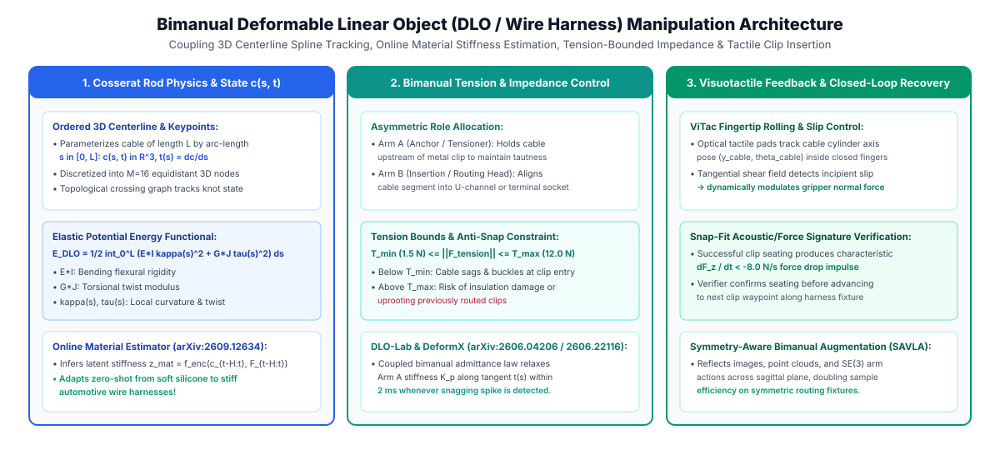
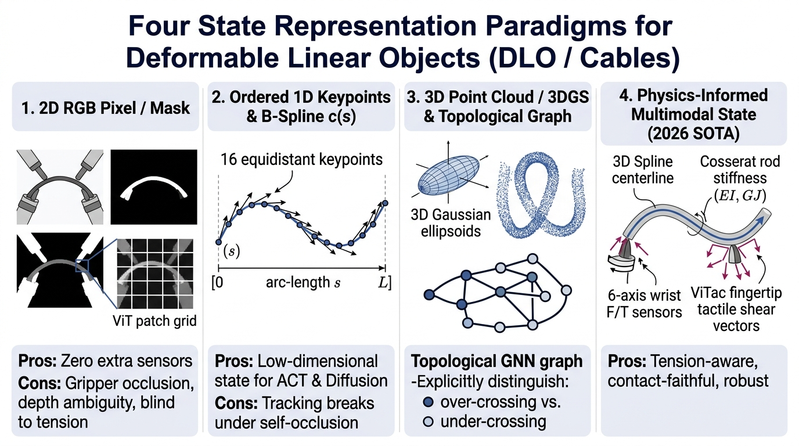
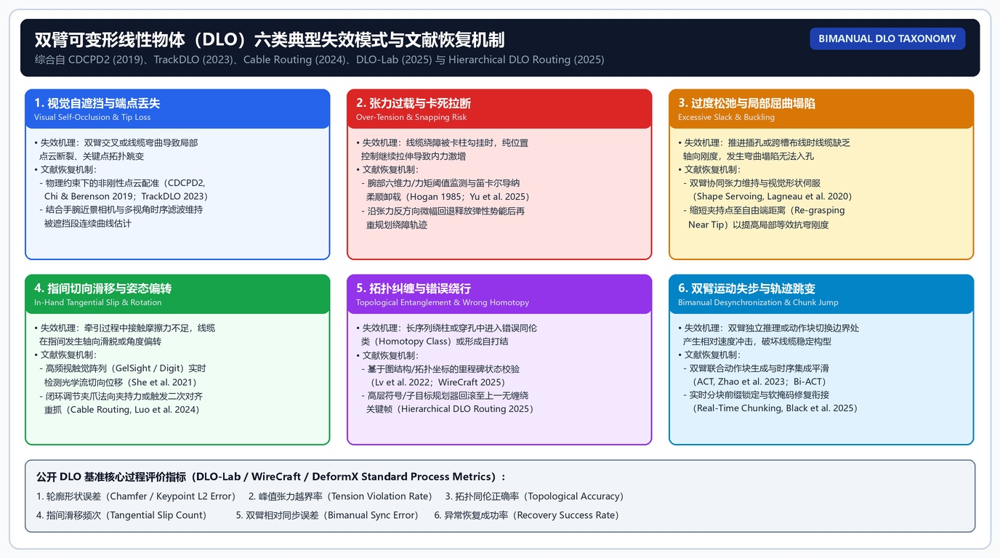
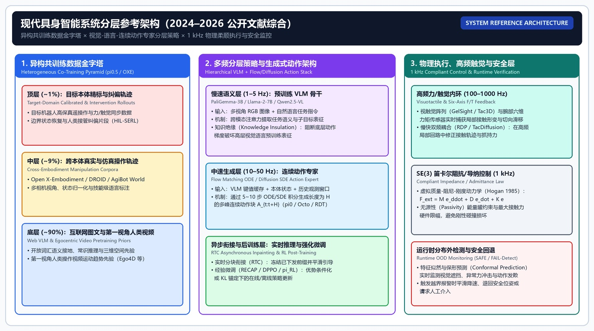
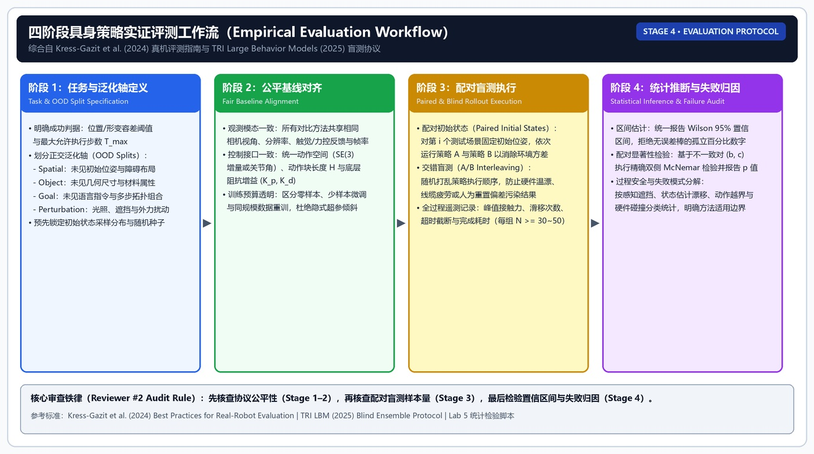

  <a href="../README.md"><b>🏠 English Survey Portal</b></a> |
  <a href="../README_zh.md"><b>🏠 中文综述门户</b></a> |
  <a href="./00_Must_Read_60_Leaderboard.md"><b>🏆 Top-60 Must-Read</b></a> |
  <a href="./01_Foundations_Compliant_Control_and_RL.md"><b>Stage 1</b></a> |
  <a href="./02_VLA_WAM_and_Flow_RL.md"><b>Stage 2A</b></a> |
  <a href="./03_Tactile_RTC_and_Verification_Recovery.md"><b>Stage 2B</b></a> |
  <a href="./04_Datasets_Scaling_Laws_and_Statistical_Eval.md"><b>Stage 3</b></a> |
  <a href="./05_Contact_Rich_Manipulation_and_Generalist_EI.md"><b>Stage 4A</b></a> |
  <a href="./06_Glossary_Templates_and_Checklists.md"><b>Stage 4B & Labs</b></a>

---

## 富接触精细操作（Contact-Rich Manipulation）、双臂 DLO 与通用具身智能研究蓝图

> [!important] 章节主线重构说明
> 本章以**富接触灵巧与精细操作（Contact-Rich Manipulation：视触觉与力控感知、生成式动作策略、在线强化学习后训练与运行时故障监测，覆盖单臂、双臂、灵巧手与人形平台）**为主干，以“紧配合插孔 / Snap-Fit 卡扣 / 接插件插拔”与“双臂柔性线缆（DLO）操作与异常处理”两类代表性任务为案例，梳理公开文献中的方法分类与评测准则。

### 1. 富接触精细操作（Contact-Rich Manipulation）分类学、物理瓶颈与过程指标体系

不同于自由空间抓放（Pick-and-Place，容差 $>1\text{ cm}$），富接触操作的核心矛盾在于**微米/毫米级几何约束下的接触动力学奇异性、100% 视觉自遮挡以及非高斯多峰恢复分布**：

| 任务家族 | 典型代表任务 | 核心物理与控制难点 | 除二值 Success Rate 外必须记录的过程物理指标 |
|---|---|---|---|
| **1. 紧配合轴孔插装** (Tight-Tolerance Peg-in-Hole / Connector Insertion) | 亚毫米间隙圆柱/矩形插销入孔、航空插头、USB-C / RJ45 / FPC 排线盲插 | 倒角接触后的两点卡阻（Two-Point Jamming）与楔死（Wedging）；末端倾角误差 $>1^\circ$ 即引发切向力矩锁死 | **峰值接触力 $\max \|F_{\text{ext}}\|$ (N)**、**力越界率（Force Violation Rate）**、接触建立到插合完成的**接触搜索耗时 $T_{\text{contact}}$ (s)** |
| **2. 弹塑性卡扣与过盈配合** (Snap-Fit & Interference Assembly) | 工业线槽卡扣按压、电池盖/外壳卡合、正时皮带张紧卡入 | 需要先施加精准法向力越过弹性势垒，再在卡入瞬间毫秒级顺应卸力防止压碎工件 | **法向力-位移特征曲线拐点（Snap-Through Peak）**、卡扣完全锁死率、过冲位移量 (mm) |
| **3. 指间防滑与手内姿态重定向** (Slip-Resistant Grasp & In-Hand Reorientation) | 光滑金属销旋转对准、薄片电路板（PCB/内存条）垂直插拔、多指拨动开关 | 接触摩擦力接近摩擦锥边界（$\|F_t\| \to \mu F_n$）引发指间微滑移（Incipient Slip）与工件倾覆 | **指尖切向滑移位移量 (mm)**、握持姿态漂移角 ($^\circ$)、重抓触发次数 |
| **4. 柔性线缆（DLO）绕障、张力控制与解缠** (Bimanual DLO Routing, Harnessing & Untangling) | 双臂绳索解缠（迭代验证-精修类方法）、工业线束多卡夹走线（`WireCraft` / `DLO-Lab`）、形状控制 | 无穷维弹性形变、过交叉/下交叉拓扑歧义、双臂闭链张力骤升拉断或松弛自缠绕 | **中心线倒角/L1 误差 (mm)**、**拓扑正确率（Topology Success）**、**张力越界率**、**双臂同步误差**、**自主验证恢复成功率（Recovery Success）** |

### 2. 富接触操作案例一：紧配合插装的实验矩阵与消融设计 `[合理推论]`

围绕紧配合插孔、Snap-Fit 卡扣与精密连接器插拔，实验矩阵设计应遵循**核心专章 A/B/C** 确立的准则：
1. **统一异步执行协议（消除动作块延迟混淆）**：所有对比方法（纯视觉 $\pi_{0.5}$、无力/触觉基线、简单融合基线、`SimpleTouch`、`PACE` 等）在相同的 `RTC` 配置（相同推理延迟 $d$ 与执行步长 $s$）下运行；
2. **模态必要性消融**：参照 `ForceBench`（`arXiv:2610.19604`）与 `UniVTAC`（`arXiv:2602.10093`）的消融规范，同时比较无力/无触觉基线、简单特征融合基线（如 `Prompt Fusion` 或状态拼接）与专用视触觉策略，并按任务类别分别报告；
3. **预训练与后训练增益解耦**：
   - 在比较不同动作头架构或感知通道时，严格固定演示数据规模、训练步数与底层阻抗控制器增益；
   - 在评估在线强化学习后训练（如 `HIL-SERL`、`DPPO`、$\pi_{\texttt{RL}}$、`RECAP`、`RL Token`）时，提供相同交互预算下的模仿学习对照与人工干预统计；
4. **统计严谨性**：每条件采用 $N \ge 40$ 组配对初始位姿 + A/B 交错盲测，全部表格报告 **Wilson 95% 置信区间** 与 **McNemar 配对检验 $p$ 值**。

---

### 3. 富接触操作案例二：双臂柔性线缆（DLO）操作与验证恢复专题

> [!warning] DLO 证据边界准则
> 没有 DLO、rope、cable、wire、hose、elastic rod 或等价线状柔性体实验的通用操作论文，只能标为 `[DLO 启发]`；只有同时包含 DLO 任务、DLO 过程指标、明确评测 split 与仿真/真机协议的工作，才可标为 `[DLO 证明]` 或 `[DLO 仿真证明]`。

#### 2026 年 DLO 直接证据与相关双臂/代理工作严格核查表

| 工作 | 来源 / 编号 | 核实后的真实机制与关键数字（`[论文报告]`） | 严格证据标签 |
|---|---|---|---|
| **DLO-Lab** | [arXiv:2606.04206](https://arxiv.org/abs/2606.04206) | 基于可微物理（Discrete Elastic Rod + Taichi autodiff + Genesis 耦合）的 DLO 仿真器与基准，覆盖 DLO 任务套件、策略基线与 VLA 微调；多数任务上基于梯度的轨迹优化或 CMA-ES 优于标准无模型 PPO/SAC；真机部分为开环 Sim-to-Real 验证 | `[DLO 仿真证明]`（真机为初步开环验证） |
| **WireCraft** | [arXiv:2606.18097](https://arxiv.org/abs/2606.18097) (CoRL 2026) | 工业线束仿真基准：涵盖 connector insertion（接插件插入）、clip routing（卡夹走线）、channel seating（线槽压入）三类任务；特权状态 PPO 在代表性设置超过 82% 成功率，而纯视觉模仿学习与 VLA 在高接触插入阶段仍暴露明显瓶颈 | `[DLO 仿真证明]` |
| **DeformX** | [arXiv:2606.22116](https://arxiv.org/abs/2606.22116) (`DeformX`) | Cosserat 弹性杆引擎与 Isaac Sim 的多速率协同仿真框架，支持网格接触与合成数据生成，在导线分割与甩绳 Sim-to-Real 任务上给出定量结果 | `[DLO 仿真证明]` |
| **Sim-grounded 双臂绳索 ACT** | Wigginghaus et al., 2026 (`Sim-grounded ACT`) | 在 96 次人类遥操作示范上严格对比相同 ACT 主干下的纯 RGB 策略与 XPBD 粒子状态策略：粒子状态策略的开环预测 L1 误差从 14.02 降至 **9.70**，推理耗时从 21.34 ms 降至 **2.95 ms** | `[DLO 证明]`（证明显式三维状态表征优于纯 RGB） |
| **Hierarchical DLO Routing** | Li et al., 2026 (`Hierarchical DLO Routing`) | VLM 高层规划器 + RL 低层插入策略的分层 DLO 布线：仿真长程布线成功率 **92%**，真实机器人评测成功率 **62.5%** | `[DLO 证明]`（仿真 + 真机） |
| **ViTac-tracing** | Zhao et al., 2026 (`ViTac-tracing`) | 视觉-触觉模仿学习统一策略执行 1D 线缆与 2D 边缘追踪，在 ABB YuMi 双臂真机上达到已见材质 **80%**、未见材质 **65%** 成功率 | `[DLO 证明]`（真机双臂视触觉） |
| **Online Material Estimation for Conditioned Diffusion Policy in Shaping DLOs** *(2026.09)* | [arXiv:2609.12634](https://arxiv.org/abs/2609.12634) |  **真实机制**：利用 **LSTM 网络读取最近 10 帧多视角图像与机器人状态，在每个时间步实时预测离散的材料类别标签（Discrete Material Label，而非连续刚度标量）** 并作为条件注入 Diffusion Policy；在 **4 种不同材质线缆、480 条真机示范** 上评测，**在线材料估计达到 60.8% 成功率，与使用真值材料标签（Ground-Truth Label）的 60.0% 持平，显著高于仅用任务条件（Task-Only）的 45.8%** | `[论文报告] + [DLO 证明]`（真机 4 材质形状控制） |
| **Harness VLA** *(2026.07)* | [arXiv:2607.08448](https://arxiv.org/abs/2607.08448) (*Harness VLA: Steering Frozen VLAs into Reliable Manipulation Primitives via Memory-Guided Agents*) |  **标题中的 "Harness" 为动词“驾驭/引导”，而非工业汽车线束（Wire Harness）！** 该工作通过引入外部记忆引导智能体（Memory-Guided Agent）驾驭冻结的预训练 VLA，将其转化为可靠的操作原语并追踪长程任务执行状态 | **`[DLO 启发]`**（通用长程记忆引导框架，无 DLO 实验，已移出 DLO 直接证明序列） |

---

### 4. 通往通用具身智能（Generalist EI）的系统架构蓝图

**证据等级**：`[合理推论]` 基于截至 2026.10 的 VLA、WAM、视触觉流匹配与在线强化学习实证规律提炼的系统架构设计。

构建面向复杂接触与长时程操作的通用具身智能系统，可归纳为四个层次的协同设计：
1. **`90 : 9 : 1` 异构数据金字塔**：
   - **底层 90%（人类操作视频与多模态图文）**：通过 `Fast-WAM`（`arXiv:2603.16666`）或 `V-JEPA 2`（`arXiv:2506.09985`）的训练期状态预测目标学习通用物理运动先验；
   - **中层 9%（跨本体机器人轨迹 + `MimicGen` / 可微物理仿真扩增数据）**：通过 $\pi_{0.7}$ 的轨迹元数据条件化（`Quality`, `Speed`）与 `Spark-0`（`arXiv:2610.22342`）“触觉作为预训练监督、推理时可选”的思路统一摄取多源轨迹；
   - **顶层 1%（目标真机富接触示范、人类在环接管与在线 RL 经验）**：通过 `HIL-SERL`、`RECAP`、`RL Token`、`DPPO` 或 $\pi_{\texttt{RL}}$ 等在线强化学习方法，尝试突破 *The Curse of Precision*（$\log N \propto \frac{1}{P-c}$）的模仿学习天花板。
2. **三频异步解耦控制层级（Tri-Frequency Control Hierarchy）**：
   - **慢速认知与验证层（`0.5–2 Hz`）**：基于 VLM 主干（结合 `Knowledge Insulation` 梯度隔离与 `MEM` 多尺度记忆）完成子任务分解，并由 `FAVOR` / `DiVeR` / `SAFE` 类验证器监控阶段进展与拓扑异常；
   - **中速动作块流生成层（`30–50 Hz`）**：采用流匹配动作专家配合 **`RTC`（Real-Time Chunking）** 软掩码前缀对齐，输出平滑连续的位姿与可变阻抗轨迹；
   - **快速视触觉精修与力控柔顺层（`50–1000 Hz`）**：以高频触觉通路做局部精修（如 `T-Rex` 的可变速率 MoT、`PACE` 的接触事件修正），底层连接 $500\text{–}1000\text{ Hz}$ 笛卡尔阻抗/导纳控制器限制峰值接触力。

在设计公开基准的泛化划分（Evaluation Splits）时，通常从以下六个正交维度考察策略鲁棒性：

**对象 split。**  
训练使用一种尺寸、颜色或刚度的目标对象，测试使用未见规格对象，以评估模型是否学到物理交互规律而非记忆特定实例。

**形状与姿态 split。**  
训练使用常规初始位姿或简单构型，测试引入显著姿态扰动、复杂交叉或局部遮挡，以评估状态估计与恢复能力。

**目标 split。**  
训练使用固定目标点或路径，测试使用新路径、新端口或新障碍布局，以评估语言目标与几何规划泛化。

**操作者与数据源 split。**  
训练使用部分操作者或合成 demonstrations，测试评估在跨操作者风格或不同采集批次下的稳定性。

**本体 split。**  
评估策略在不同夹爪或机械臂构型之间的跨本体迁移能力。

**环境 split。**  
训练使用固定光照和桌面，测试使用不同背景、遮挡和相机视角，以评估视觉鲁棒性（如 `LIBERO-Plus` 与 `Eva-VLA`）。

这些 split 延续了 `LIBERO`、`CALVIN`、`Open X`、`DROID` 与 `TRI LBM` 的评测思想，使实验结论具有清晰的分布边界。

### 从现有数据集借鉴 DLO benchmark

Open X 的借鉴点是跨本体 metadata 和数据混合；DROID 的借鉴点是真实采集和多场景多操作者；CALVIN 的借鉴点是长时程任务链和 split；LIBERO 的借鉴点是 suite 设计和知识迁移划分；RLBench 的借鉴点是任务库和 scripted demonstrations；ManiSkill 的借鉴点是仿真平台、reward、随机化和大规模数据生成；RoboMimic 的借鉴点是离线数据 split 和算法基线；LeRobot 的借鉴点是统一数据格式、训练脚本和社区发布。

但每个借鉴点都要改造。Open X 的动作统一经验要扩展到双臂相对动作；DROID 的真实采集要加入 DLO 物理 metadata；CALVIN/LIBERO 的语言任务要加入形状和张力状态；RLBench/ManiSkill 的仿真要加入柔性体动力学；RoboMimic 的 offline split 要加入失败和恢复轨迹；LeRobot 的格式要加入 DLO 曲线、关键点和力觉字段。

这就是阶段 3 最重要的结论之一：现有数据集提供方法论，不提供现成答案。对于 DLO 研究，最好的态度是系统借鉴，而不是被动等待某个通用数据集覆盖自己的问题。

### 阶段 3 扩展基准观察

本节是 2026-07-22 的增量更新，收录 2026-05-30 之后公开并完成精读核查的新 benchmark 与评测生态证据。所有条目标注 `[本地精读证据]`，数字为 `[论文报告]` 值，导出使用时需回查原文。

| 名称 | 类型 | 真实/仿真 | 本地精读要点 | 教学定位 |
|---|---|---|---|---|
| VLA-REPLICA （Huang et al., 2026） | 低成本可复现真实评测 benchmark | 真实 | 硬件成本约 1050 USD、SO-101 机械臂 + 灯箱环境、10 任务、500 示范、ID/OOD 协议；π0.5 平均成功率最高；跨环境复现结果接近原环境 | 真实评测低成本化与可复现化的样板 |
| DuoBench （2026） | 双臂操作 benchmark | 仿真 + 真实 | 面向 FR3 Duo，11 个仿真任务 + 4 个真实复刻任务、750 示范；ACT 在仿真 overall 仅 13% success，暴露 early-stage failure、并行执行与 sim-to-real 瓶颈 | 双臂 benchmark 的可复现协议样板；分数低本身就是证据 |
| RoboTwin 2.0 （[arXiv:2506.18088](https://arxiv.org/abs/2506.18088)） | 双臂数据生成器 + benchmark | 仿真（含 sim-to-real 实验） | RoboTwin-OD 物体库、closed-loop MLLM 代码生成、强域随机化、多本体评测 | 双臂仿真数据生成与鲁棒性评测的当前代表 |
| LIBERO-Plus （Fei et al., 2025） | LIBERO 鲁棒性扩展 | 仿真 | 七类扰动；当前 VLA 在 camera 与 robot initial state 扰动下显著脆弱；post-training 后总成功率 79.5%、高于 OpenVLA-OFT_m 的 67.9% | “高分 VLA 是否真的稳健”的检验工具 |
| LIBERO-Safety （Cui et al., 2026） | VLA 安全评测 benchmark | 仿真 | UBDDL 与 keypose-driven pipeline 构建 safety-critical 任务；更大规模、更多样的 safety data 可改善但不能消除 physical safety 与 semantic alignment 失效 | 把“安全”从口号变成协议的入口 |
| VLA-Arena （Zhang et al., 2026） | VLA 评测开源框架 | 仿真（含真机验证） | 以 task structure、language command、visual observation 三轴组织评测；现有 VLA 在 generalization、safety 和 visual grounding 上存在系统性退化 | 多轴系统化评测框架样板 |
| RoboBench （Luo et al., 2026） | MLLM embodied brain 评测 | QA + 仿真评估 | 五个 embodied cognition 维度、14 项能力、25 类任务、6,092 个 QA 对；用 DAG-grounded MLLM-as-world-simulator 评估长程规划可执行性 | 评“大脑”而不是评“手”的 benchmark 类型 |
| DLO-Lab / WireCraft / DeformX | DLO 专用 benchmark 与仿真框架 | 仿真（含初步 sim-to-real） | 详见“DLO 与双臂机器人研究映射总览”的 2026-06/07 新增小节 | DLO 研究首次有了专用可比协议 |

这批条目共同说明 benchmark 生态的三个走向。第一，真实评测在低成本化与可复现化（VLA-REPLICA、DuoBench）：过去“真实实验不可比”的借口正在失效，真实机器人评测应主动对齐这类公开协议。第二，评测在维度化（LIBERO-Plus 的鲁棒性、LIBERO-Safety 的安全、VLA-Arena 的三轴、RoboBench 的认知）：单一 success rate 排行的证据地位在下降，读论文时要问“它在哪个维度被测过”。第三，双臂与 DLO 在专用化（DuoBench、RoboTwin 2.0、DLO-Lab、WireCraft、DeformX）：DLO 专用 benchmark 已逐步成型，后续评测应优先与公开协议对齐口径或说明差异。`[合理推论]` 以上三个走向是从公开文献归纳的趋势判断。

### 阶段 3 的报告写法示例

下面是一个合格段落的写法。

“LIBERO 是仿真 lifelong robot learning benchmark，原始论文提供 4 个 task suites、130 tasks，当前 LeRobot 文档列出 5 个 suite labels 但仍覆盖 130 tasks。它适合评估语言条件 tabletop 操作、任务组合和知识迁移。NS-VLA、Libra-VLA、World-Env、RC-NF 等本地精读案例都使用 LIBERO 或其变体报告 VLA、后训练和异常检测结果。需要注意，LIBERO 高分只能说明该仿真协议下的能力，不能直接证明真实机器人部署，也不能证明双臂 DLO 操控。”

这个段落好在四点：先定义类型，再给规模口径，再连接本地实验案例，最后写外推边界。其他条目也应按这种方式写。

再看一个不合格段落：“LIBERO 是很重要的数据集，很多 VLA 都在上面效果很好，可以说明模型具备很强的机器人能力。”这个写法没有区分仿真和真实，没有规模口径，没有任务和协议，没有具体证据，也没有限制。阶段 3 应避免这种空泛写法。

### 阶段 3 的最终输出物

学完阶段 3，读者应能产出三份材料。第一份是数据集对照表，列出八个条目的类型、真实/仿真、规模、任务、适用问题和限制。第二份是评测协议模板，能用于阅读任意机器人论文。第三份是面向具体任务的数据协议对照表，说明哪些公开数据集可提供通用先验，哪些任务特定物理指标需要专用基准支撑。

对于高接触装配或柔性体任务，第三份材料尤其关键。它应明确：可复用 Open X/DROID 的真实数据组织经验，可复用 LIBERO/CALVIN 的语言任务和 split 思想，可复用 RLBench/ManiSkill 的仿真和任务库思想，可复用 RoboMimic 的离线学习组织，可复用 LeRobot 的工程格式；而接触力、形变状态与异常恢复则需结合 `ForceBench`、`UniVTAC`、`DLO-Lab`、`WireCraft` 等专用基准进行评估。

### 八个条目的最终判断

**Open X-Embodiment。**  
它是阶段 3 中最重要的跨本体真实机器人数据生态。它支撑 VLA 预训练和跨机器人迁移研究，但不是一个干净排行榜。对新手来说，它的价值是理解机器人基础模型为什么需要多机器人、多任务、多机构数据；对研究者来说，它的价值是理解数据混合、动作统一和元数据标准化。它不能直接证明任意任务泛化，尤其不能替代 DLO 专门数据。

**DROID。**  
它是理解真实数据分布的关键入口。它的多场景、多操作者和真实采集特征，能帮助新手摆脱仿真世界的整洁假象。它适合研究真实泛化、遥操作数据和开放 VLA 微调；不适合直接做跨论文排行榜，也不能自动覆盖双臂 DLO。读 DROID 时要把噪声当作研究对象，而不是当作可以忽略的脏数据。

**CALVIN。**  
它适合训练长时程语言条件任务意识。它的价值不是证明真实机器人能力，而是提供可控 sequence protocol。读 CALVIN 时，split、观测、动作空间和 sequence success 定义比单个分数更重要。对 DLO，它能启发多阶段任务设计，但不能提供柔性体物理。

**LIBERO。**  
它是 VLA 和 lifelong robot learning 中最常见的仿真评测平台之一。它适合检验语言条件、任务组合、知识迁移和后训练方法。读 LIBERO 要特别注意 suite 口径、训练 demonstrations、是否使用预训练和是否使用额外后训练。它的高分有方法学意义，但真实部署和 DLO 外推必须降级。

**RLBench。**  
它适合多任务仿真、few-shot 学习和 imitation/RL 方法比较。它的优势是任务多、示范可生成、实验可控；风险是任务子集差异和 planner demonstrations 与真实人类数据不同。对 DLO，它提供多任务仿真组织方式，但物理对象和指标需要重新设计。

**ManiSkill。**  
它适合仿真操作技能、3D 视觉、reward learning、data filtering 和大规模可重复实验。它的版本变化快，使用时必须写清 ManiSkill、ManiSkill2、ManiSkill3 或扩展环境。对 DLO，ManiSkill 的价值在仿真平台化和任务随机化，ManiSoft 类案例进一步提示柔性相关问题会暴露普通刚体任务看不到的失败。

**RoboMimic。**  
它是离线模仿学习和算法复现的重要框架。它帮助研究者在固定数据和固定任务下比较 BC、sequence policy、offline learning 和 offline-to-online 方法。它不是开放语言泛化 benchmark，也不是 VLA 真实部署证据。对 DLO，它可借鉴数据 split、基线组织和离线学习流程。

**LeRobot。**  
它是阶段 3 最适合新手动手的工程入口。它统一数据格式、训练脚本、社区数据和低成本硬件实践，使读者能从 trajectory 走到 policy。它不是单个 benchmark，也不保证数据质量一致。对 DLO，它可作为自建数据和训练闭环的基础设施。

这八个判断合起来，给出一个清晰结论：阶段 3 不应选一个“最好”的数据集，而应按研究目标组合工具。真实数据、仿真 benchmark、离线框架和数据生态各有位置。把它们混成一类，是新手最大的错误。

### 阶段 3 学习验收

学习阶段 3 后，可以用口头验收检验。要求读者随机抽一个条目，用两分钟回答五个问题：它是什么类型，规模口径是什么，适合研究什么，不能证明什么，对 DLO 有什么启发。如果只能说出名称和大概用途，说明还没有读懂；如果能说出规模单位、版本差异、评测 protocol 和外推边界，说明已经形成数据集判断力。

还可以做书面验收。给读者一段论文结果，例如“某方法在 LIBERO 上达到 97% success rate，在 ManiSkill3 上超过 baseline”，要求改写成严谨表述。合格答案应补充 suite、任务、训练数据、模型输入、试验次数、是否真实机器人、是否可比和不能外推到哪里。这个练习比背诵数据集定义更能检验理解。

对研究者而言，更高一级的验收是梳理公开基准的协议覆盖范围：明确哪些条目提供真实遥操作轨迹、哪些提供仿真随机化、哪些提供离线模仿基线、哪些提供分布外泛化划分。若能把现有条目清晰映射到各自的能力边界上，就说明阶段 3 的评估方法论已经内化。

### 阶段 3 的维护策略

数据集和 benchmark 会持续更新，阶段 3 文档也要维护。维护时不要每次看到新 benchmark 就追加一段简介，而要先判断它填补了哪个空缺。若新 benchmark 提供新的真实本体、新的 DLO 数据、新的双臂任务、新的异常恢复评测或更好的开放格式，就值得进入主线。若只是已有任务集合的轻微扩展，可以作为补充阅读。

维护时还要保留旧条目的历史位置。CALVIN、LIBERO、RLBench、ManiSkill、RoboMimic 即使被新 benchmark 超过，仍然是理解机器人评测生态的重要节点。Open X 和 DROID 即使数据格式更新，也仍然代表跨本体真实数据和 in-the-wild 真实数据两条主线。LeRobot 即使版本迭代，也仍然代表低门槛开放工程生态。阶段 3 的目标不是追新，而是维护概念地图。

每次更新阶段 3 时，应重新检查规模数字、链接来源、版本口径、许可证和下载可用性。特别是 LeRobot 文档、ManiSkill 版本、LIBERO suite labels、Open X 子数据集和 DROID 数据访问方式，都可能变化。若不能实时确认，就应把结论写成“按当前文档口径”或“需按使用版本核对”。这种写法不会显得犹豫，反而更严谨。

### 阶段 3 最后一条原则

数据集不是中立容器，它会塑造模型能力。一个模型在什么数据上训练，就更容易擅长什么；在什么 benchmark 上评测，就更容易被优化成什么样。Open X 鼓励跨本体泛化，DROID 鼓励真实场景鲁棒，LIBERO/CALVIN 鼓励语言条件和任务组合，RLBench/ManiSkill 鼓励仿真可控操作，RoboMimic 鼓励离线 imitation protocol，LeRobot 鼓励开放工程复现。理解这一点，才算真正读懂阶段 3。

对双臂 DLO 来说，这条原则尤其重要。如果只用普通刚体数据训练，模型就会学到普通刚体操作先验；如果只用仿真成功轨迹评测，模型就会忽略真实失败和恢复；如果只看最终成功率，模型就会忽略张力、滑移和缠绕过程。要得到适合 DLO 的模型，必须有适合 DLO 的数据和 benchmark。阶段 3 的最终结论就是：模型路线可以借鉴通用 VLA，但证据必须来自匹配任务物理的数据。

### 数据卡填写样例

下面给出三个简化样例，展示怎样把前文模板真正写成可用材料。

**样例 1：LIBERO 数据卡。**  
类型：仿真 lifelong robot learning benchmark。  
规模口径：原始论文为 4 个 task suites、130 tasks；LeRobot 文档列出 5 个 suite labels，总体仍覆盖 130 tasks。  
观测与动作：通常包含视觉、状态和机器人动作，具体输入取决于论文实现。  
适用问题：语言条件 tabletop 操作、任务组合、知识迁移、VLA 后训练、异常检测。  
本地证据：NS-VLA、Libra-VLA、World-Env、RC-NF 都在 LIBERO 或其变体中报告结果，说明它是 VLA 方法比较的重要仿真平台。  
限制：仿真环境，不能直接证明真实部署；suite 口径和训练 demonstrations 必须写清；高分不能外推到 DLO。  
DLO 启发：可借鉴 suite 划分思想，把 DLO 分成 spatial、material、goal、long-horizon 和 recovery 等 suite。

**样例 2：DROID 数据卡。**  
类型：in-the-wild 真实机器人操作数据集。  
规模口径：76k demonstration trajectories、约 350h interaction data、564 scenes、86 tasks、50 collectors。  
观测与动作：真实机器人遥操作数据，具体模态和动作接口需按官方数据说明检查。  
适用问题：真实场景泛化、多操作者数据、真实分布预训练或微调、开放 VLA 数据基础。  
限制：不是统一仿真 benchmark；数据噪声、硬件差异、相机布置和任务定义会影响训练与复现；不能和 LIBERO/CALVIN 分数直接比较。  
DLO 启发：真实采集应保留场景变化、操作者差异、失败轨迹和硬件 metadata，不能只采干净成功示范。

**样例 3：ForceBench / WireCraft 公开基准数据卡。**  
类型：富接触力感知与工业线束操作公开仿真基准（`arXiv:2610.19604` / `arXiv:2606.18097`）。  
规模口径：`ForceBench` 包含 8 项任务、1,600 条同步示范；`WireCraft` 覆盖接插件插入、卡夹走线与线槽压入三类线束任务。  
观测与动作：多视角 RGB、机器人本体状态与六维腕部力/力矩（`ForceBench`）或线束几何状态（`WireCraft`）；输出连续末端或关节控制动作。  
适用问题：力觉融合方式对比消融（如 `Prompt Fusion` vs 无力基线）、高接触装配与线束布线策略评测。  
限制：仿真接触动力学与真实过盈配合/线束摩擦仍存在 Sim-to-Real 差距，真机结论需单独验证。  
借鉴来源：统一骨干控制变量消融、按任务子类别分别统计成功率。

这三个样例说明，数据卡不是为了好看，而是为了让读者一眼看到证据边界。只要数据卡写清楚，后续模型实验就不容易夸大。

### 评测卡填写样例

**样例：比较两个 VLA 在 LIBERO 上的表现。**  
任务：LIBERO spatial/object/goal 中的指定 suite。  
训练数据：每任务 demonstrations 数量，是否使用 OXE 预训练，是否使用目标任务微调。  
模型输入：RGB、语言、状态是否使用。  
动作输出：离散 action token、连续 action head 或 hybrid action。  
评测：每任务试验次数、随机种子、success criterion、是否报告置信区间。  
失败记录：语义错误、抓取失败、放置偏差、动作重复、超时。  
结论写法：如果 protocol 一致，可以写 A 在该 LIBERO suite 上优于 B；如果训练数据或输入不同，只能写在不同设置下 A 显示出较强表现。

**样例：评估 DLO 绕障任务。**  
任务：双臂抓持线缆绕过一个障碍并放入目标槽。  
训练数据：真实 demonstrations 与仿真 demonstrations 数量分别记录，是否包含失败和恢复。  
测试 split：未见障碍位置、未见线缆长度、未见初始形状。  
模型输入：多相机图像、语言目标、DLO 关键点、双臂状态。  
动作输出：双臂连续末端动作与夹爪命令。  
指标：最终成功率、路径偏差、张力越界次数、滑移次数、缠绕次数、恢复成功率、平均完成时间。  
结论写法：如果只在仿真测试成功，应写“在该仿真 DLO protocol 下有效”；只有经过真实机器人验证，才可写“在小规模真实任务中初步有效”。

这种评测卡能强迫研究者把方法贡献和实验边界绑定。阶段 3 的训练目的，就是让新手在看到任何数字前先想评测卡。

### 阶段 3 最终一句话

阶段 3 的一句话总结是：机器人数据集和 benchmark 不是模型能力的背景板，而是能力声明的证据来源。只有把数据类型、规模口径、任务分布、评测协议、指标和限制写清楚，模型结论才有学术意义。对于具身智能新手，学会读数据，比追逐模型名字更基础；对于双臂 DLO 研究者，学会设计匹配任务物理的数据和 benchmark，比直接套用通用 VLA 更关键。

### 为什么新手阅读顺序要这样排

下面的新手阅读顺序不是按发布时间排，也不是按热门程度排，而是按认知负担排。先读 DROID，是为了让新手一开始就看到真实机器人数据的复杂性。很多人先读仿真 benchmark，会误以为机器人数据都像表格一样干净；先看 DROID，可以建立“真实数据有噪声、有操作者、有硬件、有场景”的基本感觉。

第二读 Open X-Embodiment，是为了把单个真实数据集扩展到跨本体数据生态。读完 DROID 后，读者知道真实数据复杂；读 Open X 后，读者会进一步理解不同机器人和不同实验室数据合并时，复杂性会成倍增加。这样再回到阶段 2 的 VLA 预训练，就能理解 OpenVLA、Octo、RT-X 为什么离不开数据混合问题。

第三读 CALVIN 和 LIBERO，是为了进入可控仿真 benchmark。此时读者已经知道真实数据不干净，就不会把仿真误认为现实；同时也能理解仿真为什么重要，因为它提供可重复、可比较、可控制变量的实验环境。CALVIN 强调长时程语言条件，LIBERO 强调知识迁移和任务组合，两者能共同训练 benchmark protocol 意识。

第四读 RLBench 和 ManiSkill，是为了扩展到任务库、仿真控制、few-shot、RL、reward learning 和视觉操作。它们让读者看到 benchmark 不只有语言条件 VLA，也包含更广的机器人学习方法。第五读 RoboMimic，是为了理解离线学习和 demonstration split。最后读 LeRobot，是为了把前面所有概念落到可执行工程：数据怎么存、怎么训、怎么分享、怎么接硬件。

这个顺序的最终目的，是让新手经历“真实复杂性 -> 跨本体数据 -> 可控仿真评测 -> 多任务技能平台 -> 离线学习协议 -> 工程闭环”的完整路径。按这个路径读，阶段 3 才不会碎片化。

### 阶段 3 最终验收标准

阶段 3 完成后，读者应能独立完成一次数据集审计。给定任意机器人论文，读者应能找出它用了哪些数据、哪些 benchmark、哪些训练 split、哪些评测指标，以及哪些结论不能外推。如果论文没有写清这些信息，读者应能指出缺口，而不是被最终分数说服。

读者还应能为具体机器人操控课题做数据需求规划。以高接触装配或柔性物体操控为例，应能明确回答：现有公开数据能提供哪些视觉语言先验，哪些 benchmark 能提供任务设计参考，哪些工程框架能帮助采集和训练，哪些领域特定字段需要额外标注。答案应具体到字段和指标，而不是停留在“需要更多数据”。

最后，读者应能把模型声明改写成数据声明。比如“某 VLA 泛化能力强”应改写为“该 VLA 在某数据训练、某 benchmark、某任务 split、某指标下表现强”。这种改写能力是阶段 3 的核心产出。只有具备它，后续阶段 4 的术语、误解清单和阅读模板才有实际价值。

### 阶段 3 推荐作业

为了确认阶段 3 真正学会，可以布置三项作业。

第一项作业是“八选二数据卡”。从 Open X、DROID、CALVIN、LIBERO、RLBench、ManiSkill、RoboMimic、LeRobot 中任选两个，一个真实或工程生态，一个仿真或离线 benchmark。分别写一页数据卡，必须包含类型、规模、观测、动作、任务、指标、适用问题和限制。写完后再用一段话说明二者为什么不能直接比较。

第二项作业是“论文结果审计”。选一篇使用 LIBERO、ManiSkill 或 RoboMimic 的论文，提取其中一个主结果，补齐评测协议。要求写明任务、训练数据、输入输出、基线、试验次数、指标和失败分析。如果论文没有提供某项信息，就标注为缺失，而不是自己补猜。这个作业训练证据意识。

第三项作业是“领域基准数据卡对标表”。围绕一个具体操控任务（例如刚体精密装配或柔性线缆操控），对标两个公开基准（如 ForceBench、DLO-Lab 或 WireCraft）的数据卡字段。表中至少包含观测、动作、物理状态、失败标签、split 和指标。这个作业能把阶段 3 的方法论转化为具体的基准评测分析能力。

这三项作业完成后，阶段 3 才算真正结束。因为读者不只是知道有哪些数据集，而是能审计数据、设计协议、规划自己的数据需求。对具身智能入门来说，这是比背诵名称更重要的能力。

### 阶段 3 的使用方式

如果把本文作为自学材料，建议每读一个条目就停下来做一次“证据复述”：不用看原文，用自己的话说出数据类型、规模单位、适用问题和限制。说不出来就回到该条目重读。如果把本文作为组会材料，可以让每个同学负责一个数据集，但汇报时必须回答同一组问题，这样八个条目才能横向比较。

如果把本文作为后续研究准备，最重要的是建立本地表格。表格列包括名称、类型、真实/仿真、规模、任务、输入、动作、指标、可下载性、适合问题、DLO 可借鉴点和不可替代点。每读一篇新论文，就把它用到的数据和 benchmark 加入表格。几周之后，研究者会自然形成一张证据地图，而不是只记住零散论文。

本文也可以作为写综述时的“防夸大工具”。每当想写“某模型在机器人 benchmark 上表现优异”，就回到阶段 3 检查：哪个 benchmark，什么版本，什么任务，什么数据，什么指标，是否真实机器人，是否可比。若这些问题答不出来，就应降低表述强度。这个习惯能显著提高学术写作质量。

最后要记住，数据集章节的价值不在于信息密度本身，而在于它能阻止错误结论。没有数据边界，模型章节会变成热词；没有评测协议，实验结果会变成数字装饰；没有任务匹配，DLO 研究会被普通刚体 benchmark 误导。阶段 3 的底线，就是让每一个能力判断都能回到可检查的数据来源。

只要读者养成这个习惯，后面再遇到新的数据集、新的 VLA 分数或新的机器人 demo，就不会先问“强不强”，而会先问“证据来自哪里、协议是什么、能不能支持这个结论”。这就是阶段 3 最重要的训练价值。

因此，阶段 3 不是阶段 2 的附录，而是所有模型判断的证据基础。模型能力只有落到数据和评测上，才有可讨论的学术含义；研究选题只有落到任务数据上，才有可执行的实验路径。

把这一点记住，后续无论读开放 VLA、闭源机器人系统，还是设计 DLO 实验，都能保持同一个判断标准：先看数据，再看指标，最后谈能力。

这也是阶段 3 必须写得饱满的原因：它决定整套学习规划是否有证据根基。

没有这个根基，后续术语、模型比较和研究计划都会变成空中楼阁。

因此阶段 3 的最终目标，是让每个结论都有数据来源、评测协议和任务边界。

做到这一点，具身智能入门才不会停留在资料收集，而会进入研究判断。

这也是阶段 3 对后续实验设计最直接的贡献。

后续所有模型实验，都应先通过这套数据审计。

否则结果很容易被误读。

这条原则应作为后续实验的固定前置检查：先审计数据，再运行模型，再解释结果。

### 阶段 3 经典方法如何落到 Benchmark：从模型声明回到证据协议

阶段 3 的核心任务不是列数据集名称，而是训练读者把任何模型声明翻译成评测协议。ACT、Diffusion Policy、π0/openpi、π0.5、π*0.6、π0.7、OpenVLA-OFT、RL Token、Eva-VLA、Executable Video Alignment、FAST、X-DiffVLA、ForceVLA2 等方法，看起来属于模型章节，但它们的可信度最终都要在 benchmark 和真实实验里成立。若一个文档只说“某模型能力强”，却没有说明在哪个 suite、哪个 split、多少 demonstrations、多少 rollouts、什么 success criterion、是否真实机器人、是否对等 baseline，那么这个结论就没有阶段 3 所要求的证据强度。

ACT / ALOHA 的评测重点不是大规模 benchmark 排名，而是真实双臂精细操作能否通过示范学习稳定复现。它证明的是 action chunk、CVAE、temporal ensembling 和低成本遥操作数据在若干精细双臂任务中的有效性。若把 ACT 放进阶段 3 的表格，应记录硬件类型、遥操作方式、示范数量、任务类别、动作空间、控制频率、成功判定和失败类型。ACT 适合回答“短程双臂精细模仿是否可行”，不适合直接回答“模型是否具备开放世界语义泛化”。对 DLO 来说，ACT 的 benchmark 启发是设计真实双臂任务、记录 action chunk 和同步误差，而不是证明线缆拓扑控制已经解决。

Diffusion Policy 的评测重点是多峰连续动作、receding horizon 和真实/仿真 visuomotor tasks。**`Diffusion Policy`（Chi et al., [arXiv:2303.04137](https://arxiv.org/abs/2303.04137)）** 的本地精读笔记记录了它在多个 benchmark 和任务中相对强基线的优势，也记录了 position control、动作序列生成和 receding horizon 的关键作用。阶段 3 写 Diffusion Policy 时，不应只写“扩散策略效果好”，而应写清它在哪些任务、哪些观测、哪些动作空间和哪些 baseline 下表现好。若任务是 Push-T、real robot manipulation 或仿真插入，证据边界不同。对 DLO 来说，Diffusion Policy 支持“生成式 action horizon 适合多峰局部动作”的启发，但不能替代 DLO benchmark。

3D Diffuser Actor、Tube Diffusion Policy、TacDiffusion 和 DLO routing diffusion 可以作为 benchmark 读法的扩展案例。**`3D Diffuser Actor`（Ke et al., CoRL 2024）** 在 RLBench、CALVIN 和真实多任务中展示三维场景表征与扩散动作生成的价值；**`Tube Diffusion Policy`（Xue et al., 2026）** 强调视觉触觉流式策略；**`TacDiffusion`（Wu et al., 2025）** 强调力域 diffusion 和高频控制；**`Hierarchical DLO Routing`（Li et al., 2025）** 则把 DLO routing 和 diffusion policy 连接起来。阶段 3 应用这些案例时，要问：它们使用的是 RLBench、CALVIN、Push-T、真实双臂还是专门的柔性体评测协议；评测的是成功率、轨迹质量、接触力、推理频率还是恢复能力；哪些结果能跨任务比较，哪些只能在论文内部比较。

OpenVLA 和 OpenVLA-OFT 的评测重点是开源 VLA 在 LIBERO、真实机器人或微调任务上的表现。阶段 2 关注模型结构和开放性，阶段 3 要关注评测协议：LIBERO 的 suite 是 spatial、object、goal 还是 long；demonstrations 数量是多少；是否使用 OXE 或其他预训练；动作是离散 token 还是连续控制；评测是否报告随机种子和多任务平均。OpenVLA-OFT 如果在某个 suite 上提升，说明的是该协议下微调有效；不能直接推出真实 DLO 能力。对 DLO 来说，OpenVLA 的最大价值是开源 VLA baseline 和数据/评测组织方式。

π0/openpi、π0.5、π*0.6 和 π0.7 的评测要更谨慎，因为它们同时包含官方叙事、论文结果、开源入口和真实机器人演示。π0/openpi 可以在阶段 3 被用作连续动作 VLA 的开放入口，重点看能否复现推理或微调流程。π0.5 更适合讨论开放场景和更复杂任务分布，但必须绑定具体实验。π*0.6 / RECAP 更适合讨论从 demonstrations、on-policy rollouts 和 expert interventions 中学习，benchmark 重点是任务内经验学习是否提升 specialist。π0.7 更适合讨论 steerable generalist、metadata、control modalities 和 visual subgoals，benchmark 重点是上下文变化是否真的改变行为并提升任务成功。所有 π 系列结果都应标注官方/论文/本地复现层级。

FAST 或 π0-FAST 的 benchmark 重点不是最终成功率一个数字，而是实时动作接口。一个严谨评测表应包含推理延迟、控制频率、prediction horizon、execution horizon、动作 chunk 长度、失败恢复延迟和硬件配置。如果只报告任务成功率而不报告延迟，新手无法判断方法是否能部署在真实机器人。对 DLO 来说，FAST 的评测启发是：短 chunk 可能提升闭环纠偏，长 chunk 可能提升动作连贯性；二者必须和张力越界、滑移次数、缠绕次数一起评估。

RL Token / RLT 的 benchmark 重点是在线强化学习效率和精密操作提升。**`RL Token / RLT`（Xu et al., [arXiv:2604.23073](https://arxiv.org/abs/2604.23073)）** 的文献精读记录记录了 screw installation、zip tie fastening、charger insertion、Ethernet insertion 等任务，这些任务适合检验 VLA compact readout、RL token、小型 actor-critic head 和 VLA anchoring 是否能在少量在线数据下提升表现。阶段 3 写 RL Token 时，需要记录在线交互次数、奖励定义、baseline、失败率、真实硬件风险、VLA 适配/冻结边界和 anchoring 方式。对 DLO 来说，RL Token 不能直接证明线缆能力，但它启发一种评测：固定底座模型，比较是否加入 RL token 修正对滑脱恢复、张力安全和局部路径纠偏的影响。

Eva-VLA 的 benchmark 属性最明确：它本身就是鲁棒性评测框架。它关注 VLA 在 real-world physical variations 下的失败，包括物体三维变换、光照变化和对抗贴片等。阶段 3 应把它放在“robustness benchmark”而不是“policy method”里。读者应记录扰动类型、扰动强度、任务长度、模型集合、失败率和是否存在真实物理执行。对 DLO 来说，Eva-VLA 的启发是构造 DLO physical variation suite：线缆长度、刚度、颜色、初始形状、障碍布局、光照、背景和摄像头视角都应该成为 split 变量。

Executable Video Alignment (EVA) 的 benchmark 重点不同。它不是评测 VLA 鲁棒性，而是评测 video world model 是否能产生可由机器人动作执行的未来。阶段 3 应记录它是否在 RoboTwin、真实双臂或其他环境中测试，inverse dynamics reward 如何定义，视频未来如何转成动作，评测指标是成功率、可执行性、视频一致性还是动作误差。对 DLO 来说，它启发“视频预测 + 可执行性检查”的 benchmark：生成的线缆未来形状必须通过动作可达性、碰撞、张力和拓扑检查，否则只是视觉上合理。

X-DiffVLA、ForceVLA2、π-StepNFT、OmniVLA-RL、World-Env、LaST-R1 和 Large Reward Models 应作为趋势层 benchmark 案例。**Li et al. (2026, X-DiffVLA)** 可以放在 diffusion action head 与跨形态任务评测中，**Li et al. (2026, ForceVLA2, [arXiv:2603.15169](https://arxiv.org/abs/2603.15169))** 放在 contact-rich force feedback 中，**Wang et al. (2026, $\pi$-StepNFT)** 和 **Jie et al. (2026, OmniVLA-RL)** 放在 VLA-RL 后训练中，**Xiao et al. (2026, World-Env)** 放在环境生成和训练环境改进中，**Chen et al. (2026, LaST-R1)** 放在物理推理和 RL-style 后训练中，**Wu et al. (2026, Large Reward Models)** 放在 reward model 评估中。这些论文质量高，但阶段 3 写法要统一：先说明 benchmark 名称和协议，再说明结果强在哪个设置，最后说明为什么不能外推到 DLO 或真实部署。

### Benchmark 术语解释区：名字、例子、误解与 DLO 映射

**suite**：定义是一组按共同主题组织的任务集合。例子是 LIBERO spatial/object/goal/long，或 RLBench 中一批 manipulation tasks。常见误解是 suite 等于一个任务。实际上 suite 内部可能包含多个任务、多个初始状态和多个对象。对 DLO 来说，未来 suite 可以按绕障、穿孔、插接、整理、打结恢复等类别组织。

**split**：定义是训练、验证、测试或不同泛化条件的划分。例子是训练见过的物体和测试未见物体，或训练固定线缆长度、测试新长度。常见误解是随机划分就代表泛化。机器人 benchmark 的 split 必须说明变化维度。DLO 中最重要的 split 包括未见初始形状、未见材料、未见障碍、未见目标位置和未见光照。

**episode**：定义是一次从初始状态到成功、失败或超时的完整执行。例子是机器人从桌面初始状态开始，把杯子放入盘子，直到成功或 200 步超时。常见误解是 episode 等于 demonstration。Episode 可以是专家示范，也可以是模型 rollout。DLO 中一个 episode 可能包含抓线、拉动、绕障、放置和恢复多个阶段。

**trajectory**：定义是一个 episode 中按时间记录的状态、观测、动作和奖励序列。例子是一条 300 步轨迹包含 RGB 图像、关节状态、末端动作和成功标签。常见误解是 trajectory 只指机器人路径。它还包括传感和动作日志。DLO 中 trajectory 应额外记录线缆关键点、张力、滑移、缠绕状态和双臂同步误差。

**demonstration**：定义是由专家、人类遥操作、planner 或高质量策略产生的示范轨迹。例子是 RoboMimic 中的 expert demos 或 ALOHA 中的人类双臂遥操作数据。常见误解是 demonstration 全都等价。人类示范、planner 示范、脚本生成示范和 teleoperation 示范质量不同。DLO 中示范尤其需要记录操作者、夹持点、线形变化和失败恢复。

**rollout**：定义是让策略在环境或真实机器人中实际执行一次 episode。例子是训练后在 LIBERO 环境中运行 50 次模型并统计成功率。常见误解是 rollout 只发生在仿真。真实机器人 rollout 更昂贵，也更能暴露硬件和接触问题。DLO 中 rollout 必须保存失败视频和中间状态，否则很难分析缠绕和滑脱原因。

**success rate**：定义是成功 episode 数占总 episode 数的比例。例子是 100 次 rollout 成功 78 次，success rate 为 78%。常见误解是 success rate 足够描述能力。它忽略路径质量、接触安全、恢复次数、时间和失败类型。DLO 中必须同时报告张力越界、线形偏差、缠绕次数、滑移次数和恢复成功率。

**AUC / AP**：AUC 常用于曲线下方面积，AP 常用于 detection 或 retrieval 的平均精度。在机器人 benchmark 中它们不如 success rate 常见，但在感知、目标检测、抓取候选排序或鲁棒性曲线中可能出现。常见误解是 AUC/AP 可以直接和 success rate 比。它们衡量的是不同问题。DLO 中，如果先做线缆关键点检测或状态识别，可以用 AP；若评估不同扰动强度下成功率曲线，可以用 AUC。

**OOD（out-of-distribution）**：定义是测试样本超出训练分布。例子是训练红色短线缆，测试黑色长线缆；训练固定光照，测试强反光；训练刚体抓放，测试柔性体绕障。常见误解是 OOD 只指新物体。真实机器人 OOD 可能来自材料、摩擦、相机、光照、背景、任务组合和操作者风格。DLO 是典型 OOD 密集任务。

**zero-shot**：定义是模型在目标任务上没有额外训练或示范就直接执行。例子是 VLA 未在某个具体插入任务微调，直接根据语言和观测执行。常见误解是 zero-shot 成功等于完全没见过相关数据。预训练数据可能包含相似任务或相似物体。DLO 中若训练数据没有任何柔性体操作，zero-shot DLO 成功才更强；若见过相似线缆任务，就应降低表述。

**few-shot**：定义是用少量目标任务数据进行适应。例子是每个 LIBERO 任务 5 或 10 条 demonstrations 微调。常见误解是 few-shot 数据少就一定公平。不同模型预训练数据、数据增强和调参都会影响结果。DLO 中 few-shot 很现实，因为真实示范贵；但必须报告每个任务示范数、示范质量和是否包含失败恢复。

**Sim-to-Real**：定义是从仿真训练或评测迁移到真实机器人。例子是在 ManiSkill 或 RLBench 中训练策略，再部署到 Franka 或双臂平台。常见误解是仿真成功自然会迁移。仿真和真实在传感噪声、摩擦、接触、延迟、校准和材料参数上差异很大。DLO 的 Sim-to-Real 更难，因为柔性体物理和接触历史难以精确模拟。

**real-world evaluation**：定义是在真实硬件、真实传感和真实环境中评测策略。例子是让机器人在真实桌面上执行 50 次插入任务。常见误解是真实 demo 就等于 real-world evaluation。严谨真实评测需要固定协议、试验次数、随机化、失败统计和安全记录。DLO 中真实评测应记录线缆更换、材料变化、操作次数、失败视频和硬件恢复成本。

**baseline**：定义是用于比较的参考方法。例子是 behavior cloning、ACT、Diffusion Policy、OpenVLA-OFT、π0、π0.5 或人类遥操作。常见误解是只要有 baseline 就公平。baseline 必须在同样数据、同样输入、同样动作空间和同样评测协议下比较。DLO 中若一个方法使用张力传感，另一个只用 RGB，结论必须说明输入不同。

**ablation**：定义是去掉或改变某个组件来验证其贡献。例子是去掉 temporal ensembling、去掉 force input、改变 action horizon、去掉 VLA anchoring。常见误解是 ablation 只是附加实验。对机器人论文来说，ablation 是判断机制是否真的有效的关键。DLO 中应 ablate DLO keypoints、触觉、张力、action chunk、receding horizon 和 recovery data。

**long-horizon task**：定义是需要多个子步骤连续成功的任务。例子是先拿杯子、再倒水、再放回；DLO 中可以是抓线、绕障、插入、整理。常见误解是步数长就等于 long-horizon。真正长时程还包含状态依赖、错误累积和恢复需求。CALVIN、LIBERO-long 和真实家庭任务都训练这种意识。DLO 长时程尤其容易在中间失败。

**RoboTwin / RoboCasa / LIBERO-Plus**：这些名字可以作为新 benchmark 或扩展任务的例子，但新手必须先问它们评测什么。RoboTwin 常用于双臂或更复杂仿真操作讨论，RoboCasa 常用于家庭场景仿真，LIBERO-Plus 扩展 LIBERO 类任务和评测难度。常见误解是名字越新证据越强。证据强度取决于协议、任务、数据和真实验证。对 DLO 来说，它们大多提供评测组织启发，不直接证明柔性体能力。

### DLO 专用映射：哪些 Benchmark 能借鉴，哪些不能证明

Open X-Embodiment 对 DLO 的价值主要是跨本体数据 schema 和大规模多机器人数据混合经验。它能借鉴 metadata、动作归一化、机器人本体差异处理和任务描述方式，但不能直接证明 DLO 操作，因为 Open X 的主流任务大多不是柔性体拓扑控制。若未来加入 DLO 数据，也需要单独标注线缆状态、材料和接触。

DROID 对 DLO 的价值是真实场景采集和人类示范复杂性。它能借鉴多场景、多操作者、真实传感、数据噪声和开放采集流程，但不能直接替代 DLO 数据。DLO 需要额外字段：线缆关键点、接触点、张力估计、缠绕标签、滑移事件和双臂协同状态。

CALVIN 和 LIBERO 对 DLO 的价值是 protocol，而不是物理结论。它们能借鉴语言条件、多任务 split、长时程任务组合、few-shot 和 lifelong learning 设置。它们不能证明 DLO，因为多数任务是刚体桌面操作，缺少柔性体形变和接触拓扑。DLO 可以仿照 LIBERO 设计 spatial/object/goal/topology suites，例如“未见障碍位置”“未见线缆材料”“未见目标拓扑”。

RLBench 和 ManiSkill 对 DLO 的价值是仿真任务组织、视觉模态、planner demos、RGB-D/点云和大规模实验脚本。它们可以帮助设计可控变量和多任务基线，也可以用于训练三维视觉和控制直觉。但普通 RLBench/ManiSkill success rate 不能证明 DLO 能力。DLO 仿真必须验证柔性体模型、接触、摩擦和 Sim-to-Real，而不是只把线缆当作细长刚体。

RoboMimic 对 DLO 的价值是离线模仿学习协议。它能借鉴 demonstration split、HDF5 数据组织、BC/ACT/Diffusion Policy baseline 和复现实验流程。它不能提供 DLO 物理真实性，除非数据本身包含 DLO。对 DLO 研究者来说，RoboMimic 风格最适合建立本地 DLO imitation benchmark：同一数据格式、多个 policy baseline、固定 train/test split、严格失败统计。

LeRobot 对 DLO 的价值是工程生态和数据闭环。它能借鉴数据格式、训练脚本、社区数据集和低成本硬件接口。它不能自动提供高质量 DLO benchmark，但很适合作为采集、训练和分享数据的工程底座。

真实双臂/Franka 评测对 DLO 最关键。仿真 benchmark 能提供协议，开放数据能提供格式，VLA benchmark 能提供 baseline，但最终 DLO 结论必须回到真实双臂实验。真实实验应包含固定 protocol、足够试验次数、未见 split、失败视频、恢复策略、张力/滑移/缠绕指标和硬件安全记录。没有真实实验时，只能写“仿真或协议内有效”；有小规模真实实验时，也只能写“初步真实验证”，不能写成大规模部署。

### 数据规模和实验数字的使用等级

阶段 3 写数字时应按来源等级排序。最高等级是论文表格或官方 benchmark 页面中的明确数字，因为它们通常配有任务、指标和协议。第二等级是本地精读笔记中的结构化数字，但仍要确认它来自表格、正文还是图中估读。第三等级是官方项目页或 blog 中的演示性数字，可用于描述官方宣称，不能替代独立评测。第四等级是视频 demo、社交媒体或非正式报告，只能作为观察，不应支撑强结论。

这个规则适用于所有模型。Diffusion Policy 的平均提升要看论文的 baseline 和 task set；3D Diffuser Actor 的 RLBench/CALVIN 结果要看视角、任务和数据；OpenVLA-OFT 的 LIBERO 分数要看 suite 和 demos；π0.5、π*0.6 和 π0.7 的结果要区分官方、论文和社区复现；RL Token 的精密操作结果要看在线交互次数和 reward；Eva-VLA 的失败率要看扰动范围；Executable Video Alignment 的结果要看 inverse dynamics reward 和真实执行。

对 DLO 来说，数字还要加一层任务物理解释。同样 80% success rate，如果一个方法在固定线缆、固定障碍、固定光照下完成，证据很弱；如果它在未见线缆长度、未见材料、未见障碍和真实双臂上完成，证据强得多。同样 5 厘米路径误差，在刚体抓放里可能可接受，在插线或绕障任务中可能导致失败。因此阶段 3 的数字不能脱离任务物理。

这也是为什么阶段 3 必须饱满。数据集和 benchmark 不是阶段 2 模型的附录，而是所有能力声明的证据地基。模型章节告诉我们有哪些可能接口，数据章节告诉我们这些接口在哪些任务和协议下被验证。对读者来说，学会审视 benchmark 协议是防止被模型名带偏的最有效方法。

### 阶段 3 按 Benchmark 逐项读法：每个平台到底能证明什么

读 Open X-Embodiment 时，第一问题不是“数据量有多大”，而是“不同机器人、不同动作空间、不同任务如何被统一”。Open X 能证明跨本体数据混合是 VLA 预训练的重要基础，也能说明 metadata、机器人本体描述和动作标准化为什么困难。它不能单独证明某个策略会泛化到新机器人，因为训练和测试数据可能存在重叠分布，也不能证明 DLO 能力，因为柔性体操作不是其主要证据来源。新手应从 Open X 学会三件事：数据规模要看单位，跨本体要看归一化，预训练收益要看下游评测。

读 DROID 时，第一问题是“真实数据为什么和仿真数据不同”。DROID 的价值在于真实场景、真实操作者、真实传感噪声和真实任务多样性。它能证明大规模真实机器人数据采集有可能形成社区资源，也能让新手看到数据不干净、动作不完美、场景复杂和标注成本高。它不能证明所有任务都能通过大规模真实数据自动解决。对 DLO 来说，DROID 的启发是采集流程和真实分布意识，但还需要专门处理线缆状态、双臂同步和柔性接触。

读 CALVIN 时，重点是语言条件长时程任务和任务组合。CALVIN 能训练读者理解 multi-step instruction、long-horizon rollout 和 chaining success。它适合回答“模型是否能在可控仿真环境中连续完成多个语言子任务”，不适合回答真实接触和柔性体物理问题。对 DLO 来说，可以借鉴 CALVIN 的长时程评测思路，把线缆任务拆成抓取、拉直、绕障、插入和整理多个阶段；但不能用 CALVIN 成绩证明 DLO 接触能力。

读 LIBERO 时，重点是 lifelong learning、few-shot transfer 和 suite 结构。LIBERO 的 spatial/object/goal/long 等划分非常适合训练 split 意识。一个模型在 LIBERO-spatial 强，可能说明空间泛化好；在 object 强，可能说明物体泛化好；在 long 强，才涉及更长任务组合。阶段 3 写任何 LIBERO 结果时，都必须写清 suite 名称，不能只写“在 LIBERO 上表现好”。对 DLO 来说，LIBERO 的最大启发是设计 DLO suites：DLO-spatial、DLO-material、DLO-topology、DLO-long。

读 RLBench 时，重点是多任务机器人操作和 planner demonstrations。RLBench 提供大量仿真任务和多视角观测，适合评估三维视觉、task-conditioned policy 和 imitation learning。它能证明模型在一组仿真 manipulation tasks 上的多任务学习能力，但不能自动证明真实机器人能力。对 DLO 来说，RLBench 的价值是任务组织和多视角评测脚本；局限是普通任务多数不包含真实柔性体物理。

读 ManiSkill 时，重点是大规模仿真、三维视觉、RL 和 Sim-to-Real 相关工具链。ManiSkill 能支持点云、RGB-D、物理仿真和多任务训练，也常用于新 VLA/RL 论文的 OOD 或 policy learning 评测。它能证明模型在仿真物理引擎下的控制能力，但柔性体和真实接触差异仍需警惕。对 DLO 来说，ManiSkill 可以作为自建仿真环境的参考，但 DLO 材料参数、摩擦和接触历史必须重新验证。

读 RoboMimic 时，重点是离线模仿学习协议，而不是任务规模。RoboMimic 的价值在于把 demonstrations、train/test split、baseline algorithms 和 reproducible evaluation 组织成清晰框架。ACT、Diffusion Policy 或其他 policy head 都可以在类似协议下比较。对 DLO 来说，RoboMimic 的思想最直接可迁移：建立本地 DLO-HDF5 数据、固定示范拆分、统一动作空间、跑 BC/ACT/Diffusion/OpenVLA-style baselines，并保存所有 rollout 视频。

读 LeRobot 时，重点是工程闭环。LeRobot 把数据集、训练代码、硬件接口和社区共享连接起来。它适合帮助新手从“读论文”走向“采数据、训练、评测、分享”。它不能替代严谨 benchmark，因为工程框架本身不定义任务证据。对 DLO 来说，LeRobot 可以成为采集和训练底座，但必须扩展 DLO-specific schema，例如线缆关键点、材料 metadata、接触/张力传感、失败标签和恢复动作。

读 RoboTwin、RoboCasa、LIBERO-Plus 等新 benchmark 时，重点是先读协议再读分数。RoboTwin 若用于双臂任务，应看是否真的评估双臂协同、碰撞和同步；RoboCasa 若用于家庭场景，应看任务是否只是刚体操作还是包含长时程约束；LIBERO-Plus 若提高任务难度，应看新增 split 和成功标准。对新 benchmark 的写法要保守：可以纳入趋势层，但只有当协议清楚、baseline 对等、结果可复查时，才进入核心证据表。

### 方法到 Benchmark 的对照写法

如果论文说“ACT improves fine-grained manipulation”，阶段 3 应改写为：“在真实双臂精细操作任务中，ACT 通过 action chunk、CVAE 和 temporal ensembling 改善局部动作模仿；证据来自对应真实任务协议，不支持开放世界泛化。”这句话把方法、机制、任务和边界都写出来，比单独说 ACT 强更有用。

如果论文说“Diffusion Policy outperforms baselines”，应改写为：“Diffusion Policy 在给定 visuomotor benchmark 和真实/仿真任务上，通过 conditional denoising action sequence 和 receding horizon 表现优于若干基线；结论受任务分布、动作空间、采样延迟和控制频率约束。”这样写能防止把多峰动作生成能力夸大成通用机器人智能。

如果论文说“OpenVLA-OFT performs well on LIBERO”，应改写为：“OpenVLA-OFT 在某个 LIBERO suite、指定 demonstrations 和微调协议下取得较好 success rate；它说明开放 VLA 微调在该协议内有效，但不等于真实机器人或 DLO 能力。”这里的关键词是“某个 suite”和“指定协议”。如果没有 suite 名称，句子不合格。

如果论文说“π0.5 or π0.7 generalizes”，应改写为：“π0.5/π0.7 在官方或论文设置中展示更开放任务或多上下文 steering 能力；该证据支持 generalist VLA 主线，但具体泛化范围必须由任务、场景、机器人和数据 split 限定。”这样写能同时尊重新工作质量和证据边界。

如果论文说“RL Token enables efficient online RL”，应改写为：“RL Token 在若干精密操作任务中利用 VLA compact readout、小型 actor-critic head 和 VLA anchoring 进行在线改进；它支持 VLA 表征加轻量 RL 的接口，但 reward、动作空间、探索安全和任务状态仍决定成败。”对 DLO 来说，还要加一句：该机制尚需验证是否能表示线缆拓扑和张力。

如果论文说“Eva-VLA reveals VLA brittleness”，应改写为：“Eva-VLA 在特定物理变化扰动下评估 VLA 鲁棒性，并报告模型在 object transform、illumination 或 adversarial patch 等条件下的失败；该结论支持物理变化评测的重要性，但不应简化成所有 VLA 在所有真实环境中必然脆弱。”对 DLO 来说，它支持设计 physical variation split。

如果论文说“Executable Video Alignment improves robot action from videos”，应改写为：“Executable Video Alignment 通过 inverse dynamics reward 缩小 video world model 与机器人可执行动作之间的 executability gap；它支持世界模型和行动空间对齐的方向，但视频未来是否满足 DLO 张力、拓扑和接触约束仍需额外验证。”

### 从公开基准到可复现评测协议：任务、观测、动作与泛化划分的通用规范

综合 `LIBERO`、`ManiSkill3`、`RoboTwin 2.0`、`ForceBench`、`DLO-Lab` 与 `WireCraft` 等公开基准，一套严谨的机器人操作评测协议通常需要明确以下六个要素：

1. **任务定义与初始分布**：明确初始状态采样范围、目标状态判定阈值、允许交互步数上限与安全停机条件，确保不同策略在相同的物理初始分布下接受测试。
2. **观测与环境元数据**：完整声明输入相机视角、分辨率、是否包含深度或力/触觉通道，以及物体的几何尺寸、材质刚度与摩擦属性。
3. **动作接口与控制时序**：记录动作空间（末端增量位姿、绝对位姿或关节指令）、动作块预测长度 $H$、执行步长 $s$、控制频率与异步推理延迟 $d$。
4. **分布内与分布外（ID / OOD）划分**：区分训练分布内测试（Seen）与空间位置、物体物理属性、光照背景或拓扑构型变化下的分布外测试（Unseen Splits）。
5. **分层评测指标**：同时报告二值任务成功率、物理过程指标（轨迹误差、峰值接触力、碰撞或滑移事件）以及系统运行指标（单步推理延迟、控制频率与安全触发次数）。
6. **对等基线与统计检验**：在相同数据预算与执行协议下对比代表性基线（如 BC、ACT、Diffusion Policy、开源 VLA），并按阶段 3 的统计规范报告 Wilson 95% 置信区间与配对检验结果。

### 第三阶段质量红线

第一条红线：不能把仿真分数写成真实机器人能力。RLBench、ManiSkill、CALVIN、LIBERO 都有价值，但仿真结果只能支持协议内结论。若论文没有真实机器人实验，应明确写“仿真设置下”。

第二条红线：不能把不同数据设置下的模型横向硬比。一个模型用了大规模预训练，另一个只用少量 demonstrations；一个模型有状态输入，另一个只有 RGB；一个模型有力传感，另一个没有。若输入、数据、动作空间不同，结论必须降级。

第三条红线：不能把平均成功率当作唯一能力。尤其在 DLO 中，粗暴拉动也可能偶尔成功，但会产生过力、缠绕或不可重复风险。高质量 benchmark 必须报告过程指标和失败类型。

第四条红线：不能用官方 demo 替代评测协议。π0.7、π*0.6、Gemini Robotics、GR00T 等官方展示都能帮助理解方向，但论文或正式 benchmark 才能支撑强结论。demo 可以写成“官方展示”，不能写成“已验证能力”。

第五条红线：不能把 DLO 启发写成 DLO 证明。任何没有线缆、绳索、布料或等价柔性体实验的论文，都只能为 DLO 提供接口、协议或机制启发。真正的 DLO 结论必须来自 DLO 数据和 DLO 评测。

坚持这五条红线，阶段 3 才能成为严谨入口。新手读完后，不应只知道 Open X、DROID、CALVIN、LIBERO、RLBench、ManiSkill、RoboMimic、LeRobot 这些名字，而应能判断每个 benchmark 证明什么、不能证明什么、如何迁移到自己的 DLO 研究。这个能力比记住规模数字更重要。

### 阶段 3 可直接填写的评测报告模板

第一栏写任务。任务描述必须具体到初始状态、目标状态和成功条件。不要写“整理线缆”，而要写“机器人双臂分别夹持线缆两端，将线缆绕过单个圆柱障碍并放入目标槽，最终线缆不得与障碍缠绕，目标槽内关键点误差小于阈值”。任务越具体，后续数据和指标越容易定义。

第二栏写数据来源。要区分 expert demonstration、teleoperation demonstration、scripted planner、simulation rollout、real robot rollout 和 online RL data。每类数据都要写数量单位：episodes、trajectories、hours、frames 或 robot steps。不能只写“用了大量数据”。如果是 Open X 或 DROID 风格数据，要说明是否真实机器人；如果是 LIBERO、RLBench 或 ManiSkill，要说明是否仿真；如果是本地 DLO 数据，要说明线缆材料、操作者和采集日期。

第三栏写模型输入。最少包括 RGB、depth、point cloud、robot state、language、metadata、force/torque、tactile、DLO keypoints 这些字段中哪些被使用。输入不同，模型结果不可直接比较。比如 ForceVLA2 类方法使用力信息，普通 OpenVLA baseline 只用图像和语言，两者若直接比较，必须说明前者拥有额外观测。DLO 中尤其要记录是否使用线缆关键点，因为这会显著改变任务难度。

第四栏写动作输出。要写清动作空间、频率和 horizon。ACT 输出 action chunk，Diffusion Policy 输出 denoising action sequence，FAST/π0-FAST 强调实时 chunk，π0/openpi 和 π0.7 可能使用 continuous action expert，OpenVLA 可能使用离散或经过适配的动作表示，RL Token 使用小型 actor-critic head 修正动作。没有动作输出定义，就无法判断模型是不是在解决同一个控制问题。

第五栏写训练协议。包括是否预训练、是否微调、每任务多少 demonstrations、是否使用 data augmentation、是否使用 offline RL、是否收集 on-policy rollouts、是否有 expert interventions、是否冻结 VLA backbone、是否使用 VLA anchoring。π*0.6、π-StepNFT、OmniVLA-RL、RL Token 等后训练方法尤其需要这一栏，否则读者不知道提升来自模型结构、数据量、在线交互还是奖励设计。

第六栏写评测 split。最少写 seen、unseen object 或 unseen layout。如果是 DLO，建议写 seen cable、unseen shape、unseen material、unseen obstacle、unseen topology 和 unseen lighting。Eva-VLA 类鲁棒性评测还要写物理扰动强度。没有 split，success rate 只是训练分布内结果；有清楚 split，success rate 才能支持泛化声明。

第七栏写指标。基础指标是 success rate，但必须配过程指标。对普通 manipulation，可加入 completion time、collision rate、grasp failure、placement error。对 DLO，应加入 keypoint error、path deviation、tension violation、slip count、entanglement count、recovery success、dual-arm synchronization error 和 inference latency。Executable Video Alignment 类工作还要记录 executability、inverse dynamics consistency 和 video-to-action success。

第八栏写 baseline。baseline 不应只选弱方法。至少应包含简单 BC、ACT 或 chunk-based policy、Diffusion Policy 或 flow/diffusion action head、一个开放 VLA baseline，例如 OpenVLA-OFT、openpi 或 π0 风格模型。若研究主题是 online RL，还应加入 RL Token 或其他 actor-critic 修正基线。若研究主题是鲁棒性，还应加入 Eva-VLA 风格扰动测试。baseline 越清楚，论文贡献越可信。

第九栏写失败类型。失败类型应先定义再统计。DLO 可用的失败标签包括目标理解错误、视觉关键点错误、抓线失败、滑脱、过力、缠绕、绕错方向、双臂不同步、控制器超限、超时、恢复失败。每个标签最好配视频片段和传感曲线。没有失败类型，就无法知道模型改进来自哪里，也无法决定下一步该改数据、模型还是控制器。

第十栏写可外推边界。每个实验结论后都要有一句边界。比如“该结果支持 Diffusion Policy 在固定材料 DLO 绕障任务中的局部动作生成能力，但不支持未见材料泛化”；“该结果支持 RL Token 在少量在线交互下改善插入式接触任务，但不支持无奖励设计的 DLO 任务”；“该结果支持 Eva-VLA 风格物理扰动能暴露 VLA 脆弱性，但不等于所有真实环境失败”。这栏能强制作者不把证据写过头。

用这个模板读论文，新手会发现很多论文并不是不好，而是证据只支持一部分结论。一个 LIBERO 高分论文可能非常适合证明 language-conditioned imitation learning，但不适合证明真实 DLO；一个 ManiSkill 强结果可能适合证明三维仿真控制，但不适合证明低成本双臂硬件；一个 π0.7 官方案例可能适合说明 context conditioning 趋势，但还需要独立 benchmark 才能支撑强结论。阶段 3 的训练目标，就是让读者能做这种判断。

这个模板也能直接用于组会。每个人汇报一篇论文时，只允许按十栏填写，不允许先讲模型名字。填完后再讨论方法贡献，就会自然看到哪些结论有证据、哪些字段缺失、哪些外推过强。对研究者来说，这比泛泛讲论文摘要更有训练价值，因为它把阅读变成了可复查的证据审计。

最后，阶段 3 的质量不取决于写了多少 benchmark 名称，而取决于读者能否把模型、数据、指标和边界连起来。只要能用这张模板审计 ACT、Diffusion Policy、OpenVLA-OFT、π0、π0.5、π*0.6、π0.7、RL Token、Eva-VLA 与 Executable Video Alignment 等代表工作，第三阶段就真正完成了它的任务。

### 阶段 3 判读例子：把强表述改成证据表述

原句：“某 VLA 在机器人 benchmark 上表现优异。”  
合格改写：“某 VLA 在 LIBERO-goal 的指定 demonstration 设置和 success rate 指标下优于若干 baselines；该结果支持它在该语言条件仿真 suite 内的任务泛化，但不支持真实机器人或 DLO 结论。”这个改写把 benchmark、suite、数据设置、指标和边界都写出来了。

原句：“Diffusion Policy 解决了机器人多峰动作问题。”  
合格改写：“Diffusion Policy 在若干 visuomotor manipulation 任务中通过 conditional denoising action sequence 改善多峰连续动作生成；该证据支持扩散策略作为动作生成接口，但多峰建模是否足以处理 DLO 拓扑、张力和缠绕，需要 DLO 专用 benchmark 验证。”这里保留贡献，同时拒绝过度外推。

原句：“π0.7 已经是通用机器人智能。”  
合格改写：“π0.7 的官方和论文材料支持其作为 steerable generalist model 的定位，强调语言、metadata、control modalities 和 visual subgoals 等多上下文 conditioning；但开放边界、社区复现和 DLO 适用性需要按具体任务和协议核查。”这个写法适合 2026 年的新模型，因为它承认重要性，也保留证据边界。

原句：“RL Token 可以让机器人在线学习任何精密任务。”  
合格改写：“RL Token 在本地精读记录的精密操作任务中展示了 VLA compact representation 加 actor-critic head 的在线改进潜力；它是否适用于 DLO 取决于 token 是否包含线缆状态、reward 是否表达张力和缠绕风险、探索是否安全。”这里把机制、证据和 DLO 条件分开。

原句：“Eva-VLA 说明 VLA 不可靠。”  
合格改写：“Eva-VLA 说明在特定真实物理变化扰动下，部分 VLA 可能出现明显鲁棒性问题；它支持构造物理变化 benchmark，而不是支持对所有 VLA 的笼统否定。”若讨论 DLO，应进一步写清 DLO variation 包括材料、长度、初始形状、障碍和光照。

原句：“Executable Video Alignment 让世界模型可以控制机器人。”  
合格改写：“Executable Video Alignment 通过 inverse dynamics reward 缩小 video world model 与可执行机器人动作之间的 executability gap；它支持世界模型对齐行动空间的方向，但控制能力还取决于 inverse dynamics 准确性、真实机器人验证和任务物理约束。”对 DLO 来说，还必须加入拓扑和张力检查。

这些例子说明，阶段 3 的写作能力本质上是降级能力：把过强、过宽、过热的表述降级为协议内、来源清楚、边界明确的证据表述。降级不是保守到不敢下结论，而是让结论刚好等于证据。具身智能论文更新很快，只有这种写法能长期稳定。

对新手来说，这种降级训练还有一个实际好处：它能帮助自己发现研究空白。每当一个强模型只能在刚体仿真 benchmark 中成立，而不能解释柔性体状态、真实接触或双臂同步时，这个缺口就可能变成 DLO 研究问题。阶段 3 因此不是简单的资料整理，而是在为自己的实验设计找证据缺口。

如果读者能把每篇论文都改写成这种证据表述，就已经具备了设计 benchmark 的基本能力：先确定任务，再确定数据，再确定 split 和指标，最后才比较模型。这个顺序能避免最常见的错误，即先选热门模型，再临时寻找能支持它的评测。

对 DLO 课题尤其如此。线缆任务的难点不是缺一个更响亮的模型名，而是缺能反映形变、接触、张力、失败恢复和真实部署风险的评测协议。阶段 3 把这件事讲清楚，后续模型实验才不会跑偏，也能让每个结果都有可检查依据和复现实验入口，便于长期积累和迭代更新。

因此，阶段 3 最终应产出一套能复用的证据审计习惯：每个模型先落到数据，每个数据先落到协议，每个协议再落到任务物理。

### 新手阅读顺序

1. 先读 DROID：理解真实数据为什么贵、乱、但有价值。
2. 再读 Open X-Embodiment：理解跨本体数据为什么是 VLA 的基础。
3. 第三读 CALVIN 和 LIBERO：理解语言条件长任务、终身学习和仿真评测 protocol。
4. 第四读 RLBench 和 ManiSkill：理解任务多样性、planner demos、RGB-D/点云和大规模仿真。
5. 第五读 RoboMimic：理解离线示范学习如何组织数据、算法和复现。
6. 最后读 LeRobot：把数据格式、训练代码、社区数据和低成本硬件串起来。

### 数据真实性 Checklist

读任何机器人数据集或 benchmark，都先填这张表：

| 问题 | 需要写清的答案 |
|---|---|
| 来源 | 真实机器人、仿真、planner、SAC agent、人类遥操作，还是混合？ |
| 规模 | trajectories、episodes、hours、tasks、scenes、embodiments 分别是多少？ |
| 动作 | joint、EEF pose、delta pose、velocity、gripper、action chunk，还是 token？ |
| 观测 | RGB、Depth、Point Cloud、proprioception、tactile、language 是否都有？ |
| 协议 | train/test split、task suite、success criterion、episode length 是否固定？ |
| 开放 | 数据、代码、baseline、评估脚本、leaderboard 是否开放？ |
| 可比性 | 这个指标是否只能在同一 benchmark protocol 内比较？ |
| 局限 | Sim-to-Real gap、硬件差异、标注噪声、动作空间不一致分别在哪里？ |

### 结论

阶段 3 的核心不是背数据集名字，而是建立“数据真实性意识”。真实数据更接近部署分布，但成本高、噪声大、复现难；仿真 benchmark 可控且便于比较，但不能直接代表真实机器人能力；框架和格式能降低入门门槛，但不会自动消除任务、硬件和动作空间差异。

---
