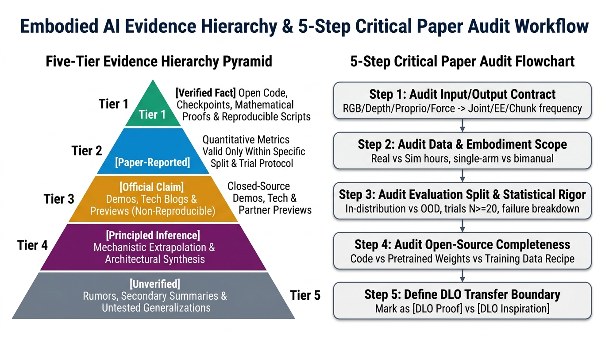
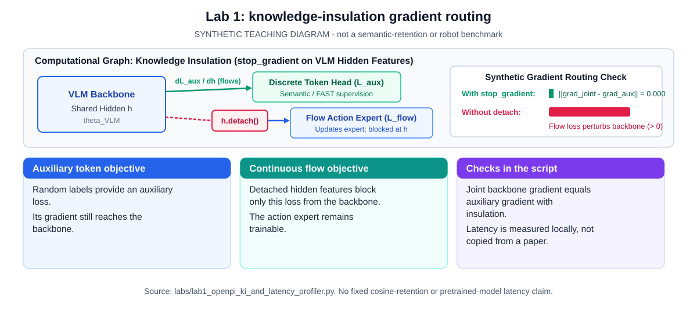
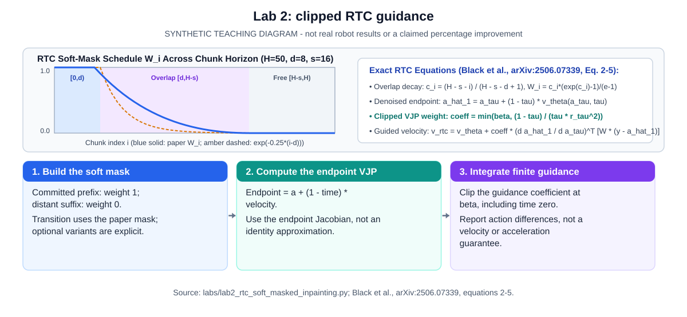
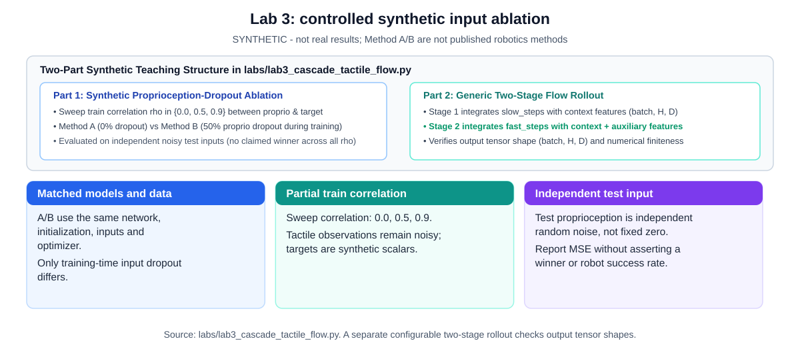
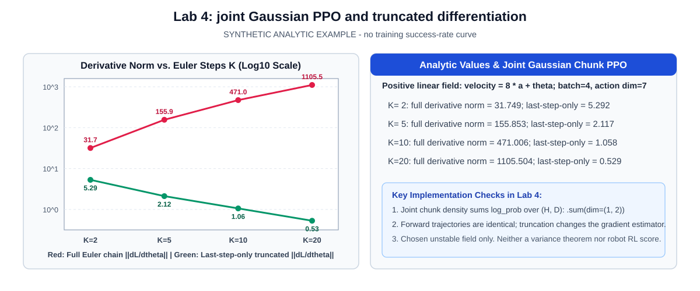
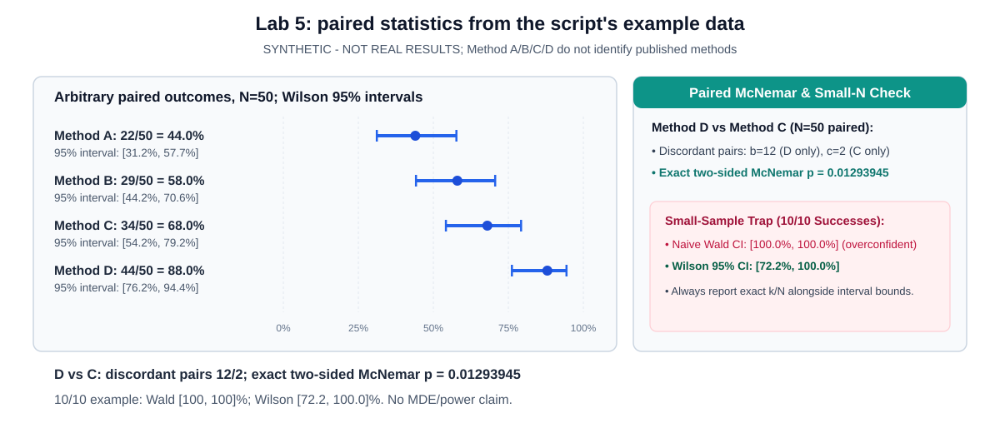
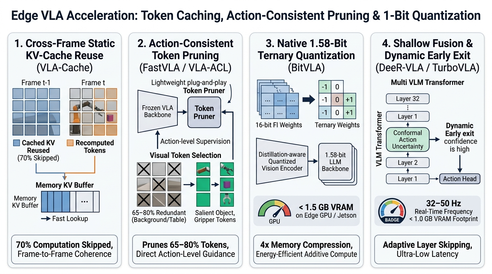
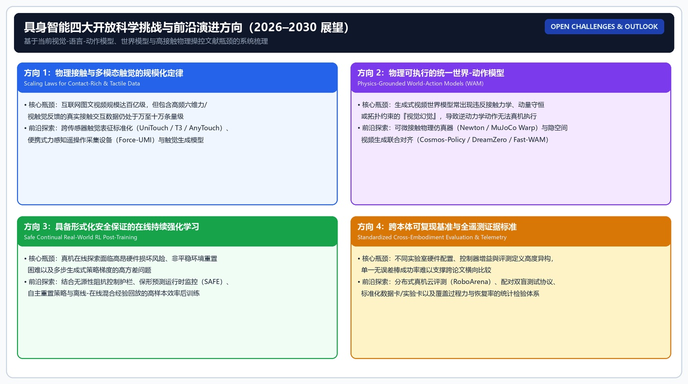

<p align="center">
  <a href="../README.md"><b>🏠 English Survey Portal</b></a> |
  <a href="../README_zh.md"><b>🏠 中文综述门户</b></a> |
  <a href="./00_Must_Read_60_Leaderboard.md"><b>🏆 Top-60 Must-Read</b></a> |
  <a href="./01_Foundations_Compliant_Control_and_RL.md"><b>Stage 1</b></a> |
  <a href="./02_VLA_WAM_and_Flow_RL.md"><b>Stage 2A</b></a> |
  <a href="./03_Tactile_RTC_and_Verification_Recovery.md"><b>Stage 2B</b></a> |
  <a href="./04_Datasets_Scaling_Laws_and_Statistical_Eval.md"><b>Stage 3</b></a> |
  <a href="./05_Contact_Rich_Manipulation_and_Generalist_EI.md"><b>Stage 4A</b></a> |
  <a href="./06_Glossary_Templates_and_Checklists.md"><b>Stage 4B & Labs</b></a>
</p>

---

## 具身智能入门：阶段 4 术语词典、误解清单、阅读模板与 Checklist

> [!abstract] 阶段 4 输出物
> 读完本阶段，应能用统一术语写论文阅读卡、Model Card、Protocol Card、DLO 实验模板和 Claims Registry；能把“模型很强”“泛化很好”“适合 DLO”这类句子改写成带证据标签和协议边界的学术表述。

> [!note] 阶段边界
> 本文件对应阶段 4：术语词典、误解清单、阅读模板与 Checklist。阶段 1 的基础概念见 阶段 1，阶段 2 的 VLA 与模型时间线见 阶段 2，阶段 3 的数据集与 Benchmark 见 阶段 3。本文件不新增模型时间线，不替代数据集核查，也不把官方 demo 写成可复现实验。

### 使用方式

阶段 4 的目标不是再堆一遍资料，而是把前三阶段变成可反复使用的研究工具。新手读完 阶段 1 后，应能判断一个方法的输入、动作、控制和闭环；读完 阶段 2 后，应能判断一个 VLA 模型的证据等级、开放边界和动作接口；读完 阶段 3 后，应能判断数据、benchmark、split 和指标能支持到哪里。本文件把这些判断压缩成四类工具：术语词典、误解清单、阅读模板和 Checklist。

使用时建议按三种场景选用。第一，读论文前先查术语词典，确认自己没有把 VLA、VLM、policy、controller、dataset、benchmark、rollout、demonstration 这类基础词混用。第二，读论文中用阅读模板逐项填写，把问题、机制、实验、数据、局限和 DLO 启发写成可复查条目。第三，读完论文后用 Checklist 审计结论，把过强表述改写成证据表述。

本文件默认一个严谨口径：模型能力必须绑定任务、数据、动作空间、评测协议和失败类型。任何绕过这些要素的说法，都只能作为启发，不能作为强结论。比如“某 VLA 很强”不是合格结论；合格结论应写成“某 VLA 在某 benchmark、某 suite、某数据设置、某成功标准下优于某些 baseline，但该结果不能直接外推到 DLO”。这就是阶段 4 的基本写作原则。

作为高接触与柔性体操控的典型案例，本文还会将术语和模板映射到双臂可变形线性物体（DLO，Deformable Linear Object，例如线缆、绳索、软管、带状物等长条柔性物体）。DLO 任务的关键难点不是单纯视觉识别，而是形变、拓扑、接触、摩擦、张力、遮挡、滑移、缠绕、双臂同步和失败恢复。任何具身智能方法若没有处理这些变量，就只能对 DLO 提供间接启发。

### 证据等级总表



| 等级 | 可写强度 | 典型来源 | 写作边界 |
|---|---|---|---|
| 已验证事实 | 可以作为正文强事实 | 原始论文、官方项目页、官方 GitHub、模型卡、Hugging Face 模型卡中的可核查字段 | 仍需写清版本、任务和协议 |
| 论文报告 | 可以写“作者报告/论文报告” | 论文摘要、实验表格、附录、明确 protocol | 不能写成社区已复现或跨实验室已确认 |
| 官方宣称 | 可以写“官方称/官方展示” | 官方博客、产品页、demo 视频、发布页 | 不能写成社区复现或独立验证 |
| 本地精读证据 | 可以作为本 vault 内部证据 | `**`RL Token / RLT`（Xu et al., [arXiv:2604.23073](https://arxiv.org/abs/2604.23073)）**`、`**`Diffusion Policy`（Chi et al., [arXiv:2303.04137](https://arxiv.org/abs/2303.04137)）**` 等精读笔记 | 对外导出时需补公开论文、arXiv、DOI 或项目页 |
| 合理推论 | 可以写“启发/可能/可作为研究问题” | 从机制和任务相似性推导 | 不能写成已经证明 |
| 尚不确定 | 必须降级 | 缺少原文、缺少协议、只有视频、只有二手说法 | 不得支撑强结论 |
| DLO 启发 | 可以写“对 DLO 有接口/协议/指标启发” | 非 DLO 方法、通用 benchmark、动作生成或后训练机制 | 不能写成 DLO 能力已证明 |
| DLO 证明 | 可以写“在该 DLO 协议下证明” | DLO/rope/cable/wire 等任务 + DLO 指标 + split + 仿真或真机协议 | 纯仿真必须标成 DLO 仿真证明，不能直接外推真机 |

这个表贯穿整个阶段 4。读 π0、π0.5、π*0.6、π0.7、RL Token、Eva-VLA、Executable Video Alignment、OpenVLA、Octo、GR00T 或 Gemini Robotics 时，都要先给结论贴证据等级。证据等级不是形式主义，而是防止把“看到过”“官方说过”“论文报告过”“本地复现过”“对 DLO 有启发”混成一类。

### 术语词典：基础系统层

**Embodied AI（具身智能）**：定义是让智能体通过身体在物理世界中感知、行动、反馈和学习。例子是机器人不只是识别桌上的杯子，还要抓起杯子并放到托盘。常见误解是把“看图回答”当作具身智能。与 DLO 的关系是：DLO 操作要求机器人在真实接触和形变中行动，最能暴露“只有视觉语义还不够”的问题。

**Agent（智能体）**：定义是能观察环境、选择动作并影响环境的主体。例子是完整机器人系统，而不是单独一个语言模型。常见误解是把 VLA 模型本身等同于 agent；实际 agent 还包括传感、控制器、安全层、任务管理和恢复逻辑。DLO 中，agent 必须同时处理双臂、线缆状态和接触反馈。

**Environment（环境）**：定义是智能体交互的外部世界，包括物体、桌面、光照、摩擦、障碍、传感噪声和人类干预。例子是线缆绕障任务中的线缆、柱子、桌面、夹爪和相机。常见误解是把环境理解成背景图。DLO 中环境还包含摩擦和接触历史，这些因素会改变线缆形状演化。

**State（状态）**：定义是描述物理系统真实情况的变量集合。例子是所有物体位姿、机器人关节状态、线缆关键点、速度、接触和张力。常见误解是以为机器人总能直接读取完整 state。真实系统通常只能得到 observation。DLO 的完整 state 很难获得，因为内部应力、接触点和遮挡形状并不总可见。

**Observation（观测）**：定义是机器人实际能测到的信息，例如 RGB、depth、point cloud、关节角、末端位姿、夹爪状态、力/力矩、触觉和历史动作。例子是多相机看到线缆，但看不到被遮挡部分。常见误解是把 observation 当成完整真相。DLO 中观测缺失是核心难点，单帧图像往往不足以判断张力和滑移。

**Action（动作）**：定义是策略输出给控制层或环境的控制信号。例子包括末端位姿增量、关节速度、夹爪开合、力目标、动作 token 或 action chunk。常见误解是把动作当作任务结果。DLO 中动作空间选择会直接影响张力和线形变化，末端位姿动作简单但不一定表达接触安全。

**Policy（策略）**：定义是从 observation 到 action 的映射。例子是看到线缆和障碍后，策略输出双臂末端移动。常见误解是 policy 等于 controller。Policy 决定做什么动作，controller 决定如何稳定执行。DLO 失败可能来自 policy 选错动作，也可能来自 controller 不够柔顺。

**Controller（控制器）**：定义是把策略动作转成电机命令、关节轨迹或力控信号的执行层。例子是阻抗控制器让夹爪在接触中柔顺移动。常见误解是有了 VLA 就不需要控制器。真实机器人永远需要控制接口、安全约束和执行监控。DLO 中 controller 决定是否过力、是否抖动、双臂是否同步。

**Closed-loop（闭环）**：定义是执行过程中持续接收反馈并修正动作。例子是线缆滑动后，机器人重新调整夹持点。常见误解是模型输入图像就一定闭环。闭环还取决于反馈频率、执行 horizon、推理延迟和恢复逻辑。DLO 中闭环非常关键，因为线缆形状会随动作实时变化。

**Open-loop（开环）**：定义是在执行一段动作时不使用最新反馈。例子是一次生成 100 步轨迹并完整执行。常见误解是开环一定不好。短时开环在稳定环境中可用，但在接触和 DLO 中风险较高。DLO 中长开环容易导致滑移、缠绕和张力越界。

**Feedback（反馈）**：定义是执行后返回给系统的信息，包括视觉变化、状态误差、力信号、成功检测和失败标签。例子是夹爪力突然变化提示线缆滑脱。常见误解是反馈只属于传统控制。VLA、Diffusion Policy、RL Token 和后训练方法也依赖反馈。DLO 的高质量反馈应包含线形、接触、张力和恢复状态。

**Task（任务）**：定义是机器人需要完成的目标和约束。例子是“把线缆绕过左侧障碍并放入槽中”。常见误解是任务只有语言指令。严谨任务还要写初始状态、目标状态、成功条件和失败条件。DLO 任务必须写清线缆材料、障碍布局、允许张力和拓扑目标。

**Skill（技能）**：定义是可复用的局部行为能力。例子是抓取、拉直、插入、绕障、放置、恢复。常见误解是把完整长任务叫一个 skill。DLO 任务通常由多个 skill 组合，单个抓取 skill 不能代表完整 DLO 能力。

**Planning（规划）**：定义是在执行前或执行中选择动作序列、子目标或路径。例子是为线缆绕障选择左绕还是右绕。常见误解是 planning 只属于传统机器人。现代 VLA 系统也常有高层 planning 或 embodied reasoning。DLO 中规划适合处理全局拓扑和路径，policy 适合处理局部动作和接触。

**Motion Planning（运动规划）**：定义是为机器人身体生成可行路径，避免碰撞并满足运动学约束。例子是双臂绕开障碍去抓线缆两端。常见误解是运动规划能解决柔性体形变。它通常处理机器人自身路径，不自动预测 DLO 形状变化。

**Task Planning（任务规划）**：定义是决定先做什么、后做什么。例子是先抓线、再拉直、再绕障、最后放入目标槽。常见误解是高层计划一定可执行。DLO 中任务计划必须和低层可行性、接触约束和失败恢复结合。

**World Model（世界模型）**：定义是预测环境如何随动作变化的模型。例子是预测双臂拉线后线缆会如何弯曲。常见误解是视频预测模型天然等于可控制模型。DLO 中世界模型必须满足可执行性、拓扑和张力约束，否则可能生成看似合理但机器人做不到的未来。

**Dynamics（动力学）**：定义是力、质量、惯性、摩擦和接触如何影响运动。例子是同样拉动动作对硬线和软线产生不同形变。常见误解是慢速任务可以忽略动力学。DLO 的形变、摩擦和张力本质上都是动力学问题。

**Kinematics（运动学）**：定义是不考虑力，只研究位置、姿态和速度关系。例子是由机械臂关节角计算夹爪位姿。常见误解是运动学足以描述操作。DLO 中运动学可以描述夹爪位置，但不能完整描述线缆形变。

**Pose（位姿）**：定义是位置加朝向。例子是夹爪到线缆接触点的 6D 位姿。常见误解是 pose 只有 xyz。DLO 中夹爪朝向会影响夹持稳定和线缆出线方向。

**Coordinate Frame（坐标系）**：定义是描述位置和方向的参考系。例子是相机坐标、机器人基座坐标、末端坐标和世界坐标。常见误解是坐标转换是小工程问题。许多抓取失败来自坐标系误差。DLO 中多相机和双臂坐标同步尤其重要。

**Calibration（标定）**：定义是确定相机、机器人、工具和世界坐标之间关系。例子是把相机中的线缆关键点转换到双臂基座坐标。常见误解是标定只在系统搭建时做一次。DLO 实验中相机移动、夹爪更换和桌面变化都可能破坏标定。

### 术语词典：学习与数据层

**Demonstration（示范）**：定义是专家完成任务的一条轨迹。例子是人通过遥操作完成一次线缆绕障。常见误解是示范一定正确且可学习。实际示范有噪声、风格差异和覆盖不足。DLO 示范必须记录初始形状、夹持点、线缆材料和失败恢复。

**Trajectory（轨迹）**：定义是按时间记录的 observation、state、action、reward 和事件序列。例子是一次 DLO 任务从抓线到放置的全部日志。常见误解是 trajectory 只指空间路径。DLO trajectory 还应包含线缆关键点、张力、滑移和缠绕标签。

**Episode（回合）**：定义是一次任务从开始到成功、失败或超时的完整执行。例子是机器人尝试一次线缆绕障。常见误解是单步动作也叫 episode。DLO 的 episode 常包含多个阶段，并可能需要恢复动作。

**Rollout（策略展开）**：定义是让当前策略在仿真或真实机器人中实际执行一个 episode。例子是训练后让 Diffusion Policy 自己完成 50 次 DLO 绕障。常见误解是 rollout 只属于 RL。模仿学习评测也需要 rollout。DLO rollout 必须保存视频和失败标签。

**Dataset（数据集）**：定义是训练或评测所用的数据集合。例子是 DROID、Open X-Embodiment、ForceBench 或 DLO-Lab。常见误解是数据集越大越好。数据质量、覆盖、动作一致性和标注更关键。高接触与柔性体数据集必须记录材料、形状、接触和失败。

**Benchmark（基准）**：定义是固定任务、数据、协议和指标，用于比较方法。例子是 LIBERO、CALVIN、RLBench、ManiSkill、RoboMimic。常见误解是 benchmark 名字等于能力结论。DLO 需要自己的 benchmark，因为普通刚体任务不能证明柔性体拓扑控制。

**Suite（任务套件）**：定义是一组按主题组织的任务。例子是 LIBERO spatial/object/goal/long。常见误解是 suite 等于单一任务。DLO 可以设计 DLO-spatial、DLO-material、DLO-topology、DLO-long 等 suite。

**Split（划分）**：定义是训练、验证、测试或泛化条件的划分。例子是训练见过的线缆材料，测试未见材料。常见误解是随机划分就代表泛化。DLO 中最重要的是 material split、topology split、obstacle split 和 lighting split。

**Success Rate（成功率）**：定义是成功 episode 占总 episode 的比例。例子是 100 次线缆插入成功 72 次。常见误解是成功率足够描述能力。DLO 中还要看路径偏差、张力越界、滑移、缠绕、恢复成功率和硬件安全。

**Metric（指标）**：定义是衡量模型表现的量化标准。例子是 success rate、completion time、keypoint error、collision rate。常见误解是所有指标同等重要。DLO 指标必须服务任务物理，不能只保留平均成功率。

**Baseline（基线）**：定义是比较用的参考方法。例子是 BC、ACT、Diffusion Policy、OpenVLA-OFT、openpi、RL Token。常见误解是有 baseline 就公平。公平比较要求数据、输入、动作空间和评测协议一致。DLO 中带力传感的方法不能和只用 RGB 的方法无条件硬比。

**Ablation（消融）**：定义是去掉或改变一个组件来验证贡献。例子是去掉 temporal ensembling、去掉 force input、改变 action horizon。常见误解是消融只是附录。DLO 中消融能说明到底是形状表示、触觉、张力、动作头还是数据覆盖在起作用。

**Behavior Cloning（行为克隆）**：定义是用专家示范监督学习 observation 到 action 的映射。例子是用遥操作 DLO 轨迹训练双臂策略。常见误解是 BC 太简单不值得做。BC 是许多复杂方法的基础基线。DLO 中 BC 容易受分布偏移影响，失败状态覆盖不足会导致滚雪球式错误。

**Imitation Learning（模仿学习）**：定义是从专家行为学习策略的统称。例子包括 BC、ACT、Diffusion Policy 的 supervised imitation 训练。常见误解是 imitation learning 只等于 BC。DLO 中模仿学习需要示范、失败恢复和高质量动作表示。

**Reinforcement Learning（RL）**：定义是通过试错和 reward 最大化长期收益。例子是 RL Token 用小型 actor-critic head 在线修正精密操作。常见误解是 RL 一定比 imitation learning 高级。DLO 中 RL 受安全探索和 reward 设计限制，不能随意在线试错。

**Offline RL（离线强化学习）**：定义是在固定历史数据上学习策略，不在线探索。例子是从成功和失败 DLO 轨迹中学习更偏向低张力路径。常见误解是离线数据足够多就能解决问题。DLO 中离线数据若缺少失败恢复，策略仍可能无法处理分布外状态。

**Online RL（在线强化学习）**：定义是在与环境交互中收集新数据并更新策略。例子是机器人多次尝试插线并用奖励改进。常见误解是 online RL 可以不顾硬件风险。DLO 中在线探索可能导致缠绕、损坏或安全停机，必须设置保护边界。

**Reward（奖励）**：定义是学习系统用来评价动作好坏的信号。例子是成功插入给正奖励，张力越界给负奖励。常见误解是 reward 很容易设计。DLO reward 需要同时表达成功、张力、安全、路径和恢复成本，否则会诱导投机行为。

**Return（回报）**：定义是一段时间内累计奖励。例子是完成线缆绕障且没有过力得到高 return。常见误解是 return 高就代表行为好。若 reward 漏掉安全，return 会误导。DLO 中 return 必须和物理指标绑定。

**Covariate Shift（协变量偏移）**：定义是策略测试时进入训练未覆盖状态。例子是模型拉线偏了一点，线缆进入未见缠绕状态。常见误解是多收成功示范就能解决。DLO 需要失败示范、恢复数据和在线纠偏机制。

**Distribution Shift（分布偏移）**：定义是训练和测试整体分布不同。例子是训练软线，测试硬线；训练明亮背景，测试暗光。常见误解是只要换物体才叫分布偏移。DLO 中材料、摩擦、初始形状、遮挡、光照都可能造成分布偏移。

**OOD（out-of-distribution）**：定义是测试样本超出训练分布。例子是未见线缆长度、未见障碍布局或未见目标拓扑。常见误解是 OOD 只指新物体。DLO 是 OOD 密集任务，必须系统设计 split。

**Generalization（泛化）**：定义是在未见条件下仍能成功。例子是在未见线缆材料上完成绕障。常见误解是同一场景换初始位置就叫强泛化。DLO 泛化需要材料、拓扑、障碍和真实环境多维检验。

**Zero-shot（零样本）**：定义是在目标任务没有额外训练或示范时直接执行。例子是 VLA 没见过某 DLO 任务却尝试完成。常见误解是 zero-shot 等于完全没见过相关数据。预训练可能包含相似任务。DLO zero-shot 结论尤其要谨慎。

**Few-shot（少样本）**：定义是用少量目标任务数据适配模型。例子是每个线缆任务 5 条示范微调。常见误解是 few-shot 一定公平。预训练数据、调参和输入模态都会影响结果。DLO few-shot 必须报告示范数量和质量。

**Sim-to-Real（仿真到真实迁移）**：定义是从仿真训练或评测迁移到真实机器人。例子是在仿真中学习线缆绕障后部署到真实双臂。常见误解是仿真成功自然会迁移。DLO 的 Sim-to-Real 特别难，因为柔性体材料、摩擦和接触历史很难仿真准确。

**Domain Randomization（域随机化）**：定义是在仿真中随机化光照、材质、位置、物体参数等以提升迁移。例子是随机线缆颜色、刚度和障碍位置。常见误解是随机越多越好。随机化必须覆盖真实变化且不破坏任务物理。DLO 中材料随机化需要物理合理。

### 术语词典：模型与动作层

**Transformer**：定义是基于 attention 的序列建模架构。例子是 RT-1、RT-2、OpenVLA、Octo 等都使用 Transformer 处理多模态 token。常见误解是 Transformer 天然懂物理。DLO 中 Transformer 可以融合视觉、语言和状态，但物理约束仍需数据、动作接口和控制层支持。

**Attention（注意力）**：定义是模型根据当前任务动态关注不同 token。例子是抓杯子时关注杯子、托盘和夹爪状态。常见误解是 attention map 等于完整解释。DLO 中 attention 关注线缆不代表模型理解张力和拓扑。

**Token（令牌）**：定义是模型处理的基本单元，可以是文字、图像 patch、动作离散单元或状态编码。例子是 OpenVLA 的 action token。常见误解是 token 只属于文本。DLO 中动作 token 若离散太粗，可能无法表达精细接触。

**Embedding（嵌入）**：定义是把输入转换成连续向量表示。例子是把语言指令、图像 patch 和机器人状态变成 latent vectors。常见误解是 embedding 一定可解释。DLO 中 latent 表示是否包含线形、接触和张力，需要实验验证。

**Latent Space（潜空间）**：定义是模型内部压缩表示空间。例子是 VLA 把视觉和语言映射到可生成动作的内部状态。常见误解是 latent space 中每个维度都有明确物理含义。DLO 中 latent 是否对拓扑敏感不能凭可视化断言。

**VLM（Vision-Language Model）**：定义是理解图像和文本的模型，输出通常是文本或表示。例子是模型指出红色杯子在右边。常见误解是 VLM 会看图就会控制机器人。DLO 中 VLM 可用于语义理解，但不能直接完成线缆操作。

**VLA（Vision-Language-Action Model）**：定义是输入视觉、语言和状态，输出机器人动作的模型。例子是 OpenVLA、RT-2、π0、Gemini Robotics 等。常见误解是 VLA 只是 VLM 加机械臂。VLA 的核心在动作接口和控制执行。DLO 中 VLA 只能作为底座或 baseline，必须加 DLO 状态和评测。

**Action Token（动作 token）**：定义是离散化后的动作符号。例子是把连续末端位移分桶后当作 token 生成。常见误解是动作 token 与文字 token 完全等价。动作 token 有物理量纲、控制频率和安全边界。DLO 中过粗动作 token 容易造成抖动或过力。

**Action Tokenization（动作离散化）**：定义是把连续动作转换成离散 token 的过程。例子是把 x/y/z 位移和夹爪开合分桶。常见误解是分桶越细越好。分桶太细会增加序列难度，太粗会损失控制精度。DLO 中需要兼顾细致接触和模型可学习性。

**Action Chunk（动作块）**：定义是一次预测未来一段动作序列。例子是 ACT 一次输出靠近、夹持、抬起的一小段动作。常见误解是 chunk 越长越好。长 chunk 降低闭环频率，短 chunk 增加推理压力。DLO 中 chunk 长度应由线缆变化速度和控制频率决定。

**ACT（Action Chunking with Transformers）**：定义是用 Transformer 预测动作块的模仿学习方法。例子是 ALOHA 双臂精细操作。常见误解是 ACT 是大语言模型机器人。ACT 的重点是 action chunk、CVAE 和 temporal ensembling。DLO 中 ACT 适合作为双臂模仿 baseline，但不自动解决线缆形变。

**ALOHA**：定义是低成本双臂遥操作和学习系统。例子是通过人类遥操作采集双臂示范。常见误解是 ALOHA 只是便宜硬件。它真正重要的是数据采集闭环。DLO 中 ALOHA 思路可用于双臂线缆示范采集，但需要适配夹爪和传感。

**CVAE（Conditional Variational Autoencoder）**：定义是在条件输入下生成多种可能输出的模型。例子是同一观测下可以从左绕或右绕障碍。常见误解是 CVAE 只是加随机性。它用于表达示范多样性。DLO 中多解路径很多，CVAE 或生成模型比单峰回归更自然。

**Temporal Ensembling（时间集成）**：定义是融合多个重叠 action chunk 对同一时刻的预测。例子是连续几个时刻预测的当前动作加权平均。常见误解是它只是普通平滑滤波。它利用 chunk 重叠减少高频抖动。DLO 中它有助于降低张力突变，但过度平滑可能影响快速纠偏。

**Diffusion Policy（扩散策略）**：定义是用条件去噪扩散生成动作序列的策略。例子是从噪声动作序列逐步生成抓取或推物轨迹。常见误解是扩散策略一定优于 ACT。扩散适合多峰连续动作，但有采样延迟。DLO 中它适合表达多种局部绕障动作，但需要状态和安全约束。

**Denoising（去噪）**：定义是从噪声样本逐步恢复结构化样本。例子是在观测条件下把随机动作变成可执行轨迹。常见误解是去噪发生在机器人已经执行之后。这里的去噪发生在模型推理内部。DLO 中执行误差仍需闭环反馈处理。

**Score（分数函数）**：定义是概率分布对样本的梯度方向，可理解为动作应朝哪里变得更像数据。例子是把突然反向的动作序列推向更平滑轨迹。常见误解是 score 是 success rate。DLO 中 score 只反映训练分布，没见过缠绕恢复就不会自动学会。

**Receding Horizon（滚动时域）**：定义是预测一段动作，只执行前几步，再重新观察和预测。例子是 Diffusion Policy 每次生成 16 步，只执行 4 步。常见误解是 receding horizon 等于完整闭环安全。DLO 中它必要但不充分，还需要滑移、张力和缠绕检测。

**Prediction Horizon（预测时域）**：定义是模型一次预测的未来动作长度。例子是预测未来 1 秒动作。常见误解是预测越长越好。DLO 中过长预测会忽略线缆快速变化，过短预测可能缺少局部意图。

**Execution Horizon（执行时域）**：定义是真正发送给控制器执行的前几步动作。例子是预测 16 步执行 4 步。常见误解是它只是工程参数。它决定闭环频率和开环风险。DLO 中执行时域通常应较短。

**Flow Matching（流匹配）**：定义是学习从简单分布到目标分布的连续速度场。例子是 π0、GR00T、SmolVLA 等使用 flow-based action head。常见误解是 flow matching 只是 diffusion 改名。二者相关但训练目标和采样特性不同。DLO 中它可能降低动作生成延迟，但仍需物理约束。

**Action Expert（动作专家）**：定义是在 VLA 中负责生成连续动作的专门模块。例子是 π0 的 flow action expert。常见误解是 action expert 只是最后线性层。它可能是 diffusion、flow 或专门 decoder。DLO 中 action expert 必须处理双臂同步和柔性体状态。

**FAST（Frequency-space Action Sequence Tokenization）**：定义是 Physical Intelligence 路线中的动作序列 tokenization/压缩方法，用 DCT 和 BPE 把 raw action chunk 压缩成更少的 dense action tokens。例子是把一段连续末端动作先转到频域，再压缩成自回归 VLA 可以预测的动作 token。常见误解是 FAST 等于“推理一定更快”。更准确地说，它可以提升动作 tokenization 与训练效率，但 π0-FAST 的 autoregressive inference 需要和 π0 flow matching decoding 分开比较。DLO 中 FAST 启发短动作块和实时闭环设计，但不能自动解决线缆状态估计、张力或拓扑约束。

**openpi**：定义是 Physical Intelligence π 系列的开放生态入口。例子是研究者通过 openpi 理解或使用 π0 风格模型接口。常见误解是 openpi 等于完整内部训练系统全部开放。在柔性体或高接触任务中，openpi 适合作为连续动作 VLA 底座，但需结合领域专用数据与评测协议。

**π0**：定义是 Physical Intelligence 提出的通用机器人 foundation model 节点，强调视觉语言和连续动作生成。例子是复杂操作中的 flow action expert。常见误解是 π0 的 demo 等于社区可复现。DLO 中 π0 主要提供动作专家和底座启发。

**π0.5**：定义是 π 系列后续节点，强调更开放场景和泛化主线。例子是官方材料中更复杂真实任务展示。常见误解是开放场景展示等于无限泛化。DLO 中它启发更丰富 split，但不直接证明柔性体能力。

**π*0.6 / RECAP**：定义是 π 系列中强调从经验学习、示范、on-policy rollout 和 expert intervention 的路线。例子是从真实任务经验中训练 specialist。常见误解是它证明 RL 后训练已经解决所有 VLA。DLO 中它启发把失败轨迹和人工恢复纳入训练。

**π0.7**：定义是 π 系列中强调 steerable generalist 和多上下文 conditioning 的新节点。例子是语言、metadata、control modalities 和 visual subgoals 共同指导模型。常见误解是 steerable 等于任何任务可控。DLO 中它启发用目标线形图、材料 metadata 和阶段子目标控制策略。

**RL Token**：定义是 VLA 经适配后暴露 compact task-relevant token 给小型 RL head 使用的接口。例子是用 actor-critic head 在线修正精密插入动作。常见误解是 RL Token 等于把 RL 直接加进大模型。DLO 中它可能用于局部在线修正，但 token 是否包含线缆拓扑和张力需要验证。

**VLA Anchoring**：定义是在线 RL 或后训练中让新策略不要偏离预训练 VLA 行为太远。例子是 RL head 修正插入动作时仍受 VLA 参考动作约束。常见误解是 anchoring 总是好。它能提高安全，也可能限制必要探索。DLO 中 anchoring 可降低危险动作，但若底座没见过 DLO 也可能限制学习。

**Eva-VLA**：定义是评估 VLA 在真实物理变化下鲁棒性的框架。例子是改变物体三维姿态、光照或贴片干扰。常见误解是 Eva-VLA 是一个新动作模型。它是评测框架。DLO 中它启发材料、初始形状、障碍、光照和相机变化的 robustness suite。

**Executable Video Alignment (EVA)**：定义是用 inverse dynamics reward 对齐 video world model 和可执行机器人动作的方向。例子是让生成的视频未来对应机器人能执行的动作。常见误解是视频看起来真实就能控制。DLO 中必须检查拓扑、碰撞和张力可执行性。

**Inverse Dynamics Model（逆动力学模型）**：定义是根据状态变化推断可能动作的模型。例子是看到线缆从直线变成绕柱状态，推断双臂末端如何移动。常见误解是 inverse dynamics 唯一且准确。DLO 中同一形变可能由多种动作造成，逆问题多解。

**Executability Gap（可执行性差距）**：定义是计划或视频看起来合理，但机器人动作无法执行之间的差距。例子是视频里线缆穿过障碍但真实不可能。常见误解是更大世界模型能自动消除差距。DLO 中可执行性必须检查碰撞、拓扑、张力和控制限制。

### 术语词典：数据集与 Benchmark 层

**Open X-Embodiment**：定义是跨机器人、多机构的真实机器人数据和 RT-X 生态。例子是多种 robot embodiments 的操作轨迹。常见误解是 Open X 能直接证明所有机器人泛化。它主要提供跨本体数据混合证据。DLO 中可借鉴 schema 和 metadata，但需要专门 DLO 数据。

**DROID**：定义是真实场景下的大规模机器人操作数据集。例子是多场景、多操作者采集的真实轨迹。常见误解是 DROID 数据大就能覆盖 DLO。DLO 需要柔性体状态和接触字段，不能只借用普通刚体数据。

**CALVIN**：定义是语言条件长时程仿真 benchmark。例子是连续完成多步桌面任务。常见误解是 CALVIN 高分代表真实机器人长任务能力。它是仿真协议。DLO 中可借鉴长时程任务链设计。

**LIBERO**：定义是 lifelong learning 和语言条件操作 benchmark。例子是 spatial、object、goal、long suites。常见误解是只写 LIBERO 平均分就足够。必须写清 suite。DLO 中可借鉴 suite 划分，设计 DLO-material、DLO-topology 等。

**RLBench**：定义是包含大量视觉 manipulation 任务的仿真 benchmark。例子是 100 个操作任务及 planner demos。常见误解是 RLBench 结果可以证明真实部署。DLO 中可借鉴多任务组织和多视角评测。

**ManiSkill**：定义是面向 3D、RL、模仿和仿真操作的 benchmark/环境生态。例子是点云、RGB-D 和多控制器任务。常见误解是 ManiSkill 物理足够真实就能替代真机。DLO 中柔性体材料和接触仍需单独验证。

**RoboMimic**：定义是离线模仿学习框架和数据协议生态。例子是用 HDF5 组织 demonstrations 并比较 BC、IRIS、Diffusion Policy 等方法。常见误解是 RoboMimic 是单一任务排行榜。DLO 中可直接借鉴数据格式和 baseline 协议。

**LeRobot**：定义是 Hugging Face 机器人数据、模型和工具生态。例子是用统一格式加载真实机器人数据并训练策略。常见误解是统一格式等于统一 benchmark。DLO 中可作为数据采集和训练底座，但必须扩展 DLO 字段。

**RoboTwin**：定义是常用于双臂或复杂仿真操作讨论的 benchmark 名称。例子是评估双臂协作任务。常见误解是双臂 benchmark 自动等于 DLO。DLO 还需要柔性体形变和拓扑。

**RoboCasa**：定义是家庭场景机器人仿真 benchmark 方向。例子是厨房或家居操作任务。常见误解是家庭场景就等于真实开放世界。DLO 中可借鉴场景复杂性，但不能证明线缆操作。

**LIBERO-Plus**：定义是 LIBERO 类评测的扩展或增强设置。例子是更复杂任务组合和更难泛化。常见误解是名字更新就证据更强。必须回到具体 suite、split 和指标。

**Real-world Evaluation（真实机器人评测）**：定义是在真实硬件和真实环境中按固定协议评测。例子是双臂 Franka 在线缆绕障上执行 50 次。常见误解是真实 demo 等于真实评测。真实评测需要次数、随机化、失败统计和安全记录。

**Simulated Evaluation（仿真评测）**：定义是在仿真环境中评测模型。例子是在 RLBench 或 ManiSkill 中运行策略。常见误解是仿真分数可直接横比真实分数。DLO 中仿真尤其需要检验材料、摩擦和接触。

**Protocol（协议）**：定义是实验如何训练、测试、计分和报告的规则。例子是每任务 10 条 demos、50 次 rollout、固定随机种子和 success criterion。常见误解是协议只是实验细节。协议决定结论强度。DLO 中协议必须写清线缆、障碍、初始状态和失败标签。

**Success Criterion（成功标准）**：定义是判定任务成功的条件。例子是线缆放入槽且关键点误差小于阈值。常见误解是人眼觉得成功就够。DLO 中成功标准要包含拓扑、张力和缠绕约束。

**Failure Mode（失败模式）**：定义是任务失败的具体类型。例子是滑脱、缠绕、过力、抓取点错误、目标误解、双臂不同步。常见误解是失败只需计为 0。DLO 中失败模式是改进模型的关键证据。

**AUC / AP**：AUC 是曲线下面积，AP 是平均精度，常用于感知或鲁棒性曲线。例子是线缆关键点检测 AP，或扰动强度下成功率 AUC。常见误解是 AUC/AP 可以和 success rate 直接比较。它们衡量不同问题。

### 术语词典：DLO 与双臂操作层

**DLO（Deformable Linear Object）**：定义是长条形可变形物体，例如线缆、绳索、软管。例子是双臂把线缆绕过障碍。常见误解是把 DLO 当作细长刚体。DLO 的形状、拓扑、摩擦和张力会随动作变化。

**Bimanual Manipulation（双臂操作）**：定义是两个机械臂协同完成任务。例子是一只手固定线缆，另一只手绕障。常见误解是双臂只是两个单臂相加。DLO 中双臂时序、相对位姿和张力分配决定成败。

**Contact-rich Manipulation（接触丰富操作）**：定义是任务成功依赖持续接触、摩擦和力。例子是插线、绕线、拉线、穿孔。常见误解是视觉定位准确就能完成接触任务。DLO 中接触反馈和柔顺控制非常重要。

**Tension（张力）**：定义是线缆被拉伸时内部受力。例子是两臂拉线过紧导致张力越界。常见误解是线缆越拉直越好。过大张力会导致滑脱、损坏或任务失败。

**Slack（松弛量）**：定义是线缆未被拉紧的余量。例子是线缆绕障时保留适当 slack 以避免过力。常见误解是 slack 是噪声。DLO 中 slack 是可控制资源。

**Entanglement（缠绕）**：定义是线缆与自身或障碍形成难以恢复的拓扑纠缠。例子是绕柱时多绕一圈。常见误解是缠绕只是路径偏差。缠绕可能改变任务拓扑，需要专门检测和恢复。

**Topology（拓扑）**：定义是形状连接和绕行关系，不只看几何位置。例子是线缆从柱子左侧还是右侧绕过属于不同拓扑。常见误解是关键点误差小就代表拓扑正确。DLO 中拓扑错误可能导致最终无法插入或整理。

**Keypoint（关键点）**：定义是用少量点描述物体或线缆形状。例子是沿线缆采样 20 个点。常见误解是关键点完整代表 DLO 状态。关键点忽略内部应力、接触和遮挡。DLO 中关键点有用但不充分。

**Shape Representation（形状表示）**：定义是描述 DLO 当前形状的方式，如关键点、曲线、点云、mask、spline、graph。例子是用 spline 拟合线缆中心线。常见误解是 RGB 图像天然包含形状表示。模型是否真正利用形状需要验证。

**Slip（滑移）**：定义是物体与夹爪或表面发生相对滑动。例子是线缆从夹爪中滑出一点。常见误解是滑移只影响抓取。DLO 中滑移会改变线形、张力和后续动作可行性。

**Occlusion（遮挡）**：定义是相机看不到部分物体。例子是线缆被夹爪、障碍或自身遮住。常见误解是多相机能完全消除遮挡。DLO 中细长物体和接触点常被遮挡。

**Force/Torque（力/力矩）**：定义是接触中测得的力和旋转力。例子是插线时力矩异常表示角度不对。常见误解是力信号只是噪声。DLO 中力/力矩可以提示张力、碰撞和滑移。

**Tactile Feedback（触觉反馈）**：定义是接触面压力、形变、滑移等局部接触信息。例子是触觉传感器检测线缆即将滑出。常见误解是触觉等于力/力矩。DLO 中触觉可补充视觉看不到的接触状态。

**Impedance Control（阻抗控制）**：定义是让机器人在接触时表现出弹簧阻尼式柔顺。例子是拉线时遇到阻力自动让步。常见误解是阻抗控制等于弱控制。DLO 中柔顺是安全接触的关键。

**Recovery（恢复）**：定义是从失败或异常状态回到可完成状态。例子是线缆滑脱后重新夹持。常见误解是高成功率模型不需要恢复。DLO 中恢复能力往往比单次成功更能体现实用性。

**Dual-arm Synchronization（双臂同步）**：定义是左右臂动作在时间和空间上的协调。例子是两臂同时拉线避免一侧过力。常见误解是两个 action 分别正确就同步正确。DLO 中不同步会造成张力突变和线形失控。

### 常见误解清单

**误解 1：VLA 等于 VLM 加机械臂。**  
纠正：VLM 主要输出文本或语义表示，VLA 必须输出动作，并接受机器人状态、动作空间和控制频率约束。例子：知道“红色杯子在右边”不等于能安全抓起杯子。DLO 中尤其明显，语言理解不能替代形状、张力和接触控制。

**误解 2：模型越新，入门价值越高。**  
纠正：入门价值取决于它是否定义了清晰问题和可复用接口。ACT、Diffusion Policy、RT-2、Open X、OpenVLA、Octo 即使不再是最新，也仍是理解动作块、生成式策略、VLA 和跨本体数据的关键节点。新手应先学谱系，再追新模型。

**误解 3：官方 demo 等于已验证能力。**  
纠正：官方 demo 只能说明官方展示过某种能力，不等于社区复现，也不等于完整评测。写 Gemini Robotics、π0.7、π*0.6 这类系统时，要区分官方宣称、论文结果、开源边界和独立验证。DLO 相关外推必须更谨慎。

**误解 4：开源仓库等于完整可复现。**  
纠正：开源要拆成代码、权重、数据、训练脚本、评测脚本、硬件配置和许可证。OpenVLA、openpi、LeRobot 等开放程度很有价值，但仍需看具体开放层。没有训练数据或完整 recipe，就不能写成完整复现。

**误解 5：success rate 可以跨 benchmark 横向比较。**  
纠正：不同 benchmark 的任务长度、成功标准、观测、动作空间、真实/仿真差异都不同。LIBERO、CALVIN、RLBench、ManiSkill、RoboMimic 和真实双臂实验不能只看一个平均成功率。DLO 中还要看张力、滑移和缠绕。

**误解 6：数据越大，泛化越强。**  
纠正：数据规模必须和覆盖范围、质量、动作一致性、任务分布和评测 split 一起看。大规模刚体操作数据不自动覆盖 DLO。DLO 需要材料、拓扑、接触和失败恢复数据。

**误解 7：仿真 benchmark 高分代表真实部署。**  
纠正：仿真能提供可控协议，但真实机器人有传感噪声、标定误差、摩擦、延迟和硬件安全问题。DLO 的 Sim-to-Real 更难，因为柔性体物理难精确模拟。仿真结果应写成协议内证据。

**误解 8：Diffusion Policy 解决了所有多峰动作。**  
纠正：Diffusion Policy 更擅长多峰连续动作生成，但仍受观测、数据、采样延迟、控制频率和安全约束限制。DLO 中多峰还包括拓扑路径和接触历史，不能只靠动作扩散解决。

**误解 9：ACT 只是早期 baseline。**  
纠正：ACT 的 action chunk、CVAE 和 temporal ensembling 是理解现代动作块、FAST 和 VLA action head 的基础。对双臂 DLO，ACT 仍是非常重要的模仿学习基线。

**误解 10：Flow Matching 只是 diffusion 的新名字。**  
纠正：二者都属于生成式建模家族，但训练目标、采样路径和部署特性不同。π0、GR00T、SmolVLA 等使用 flow-based action head 时，应写清动作生成接口，而不是笼统称为扩散。

**误解 11：RL Token 是把 RL 直接塞进大模型。**  
纠正：RL Token 更准确地说是先让 VLA 暴露 compact token，再由小型 actor-critic head 在线学习修正，并用 VLA anchoring 保持行为接近预训练分布。DLO 中它是接口启发，不是现成解法。

**误解 12：Eva-VLA 和 Executable Video Alignment 是同一件事。**  
纠正：Eva-VLA 是 VLA 物理变化鲁棒性评测；EVA / Executable Video Alignment 是用 inverse dynamics reward 对齐 video world model 和可执行动作。二者缩写相近但问题完全不同，必须写全称并保留方向提示。

**误解 13：世界模型会预测视频就能控制机器人。**  
纠正：视频未来必须可执行，且动作要满足机器人、环境和物理约束。DLO 中看似合理的视频可能违反拓扑或张力。Executable Video Alignment 的意义正是处理可执行性差距。

**误解 14：语言指令越详细，控制越可靠。**  
纠正：语言能表达任务目标，但不直接表达坐标、接触力、线缆拓扑和控制频率。DLO 可能更需要 visual subgoal、metadata、关键点和张力反馈，而不是更长 prompt。

**误解 15：三维表示天然优于二维图像。**  
纠正：3D point cloud 和 RGB-D 能提供空间结构，但也受噪声、遮挡、透明物体和标定影响。DLO 细长、可变形、易遮挡，三维表示有帮助但不充分。

**误解 16：力/触觉是锦上添花。**  
纠正：接触丰富任务中，力和触觉可能是核心观测。插入、绕线、拉线和穿孔任务都需要判断接触是否正确。DLO 中张力、滑移和过力通常只能靠视觉间接判断，容易滞后。

**误解 17：DLO 可以当普通刚体 manipulation 处理。**  
纠正：DLO 有形变、拓扑、内部应力和接触历史。同样的末端动作可能在不同线缆状态下产生不同结果。普通 pick-place benchmark 只能提供部分协议启发。

**误解 18：只要有真实机器人实验，结论就强。**  
纠正：真实实验还要看试验次数、随机化、失败统计、硬件和任务覆盖。一个漂亮 demo 不是严谨评测。DLO 真实评测需要材料、初始形状、障碍和失败恢复统计。

**误解 19：长时程任务只看最终成功。**  
纠正：长时程任务还要看中间失败、恢复、子任务成功率和错误累积。DLO 中抓线、拉直、绕障、插入每一步都可能失败，只看最终成功会隐藏瓶颈。

**误解 20：论文没有 DLO 实验也可以证明 DLO 结论。**  
纠正：没有 DLO 或等价柔性体实验，只能写“对 DLO 有启发”。可以借鉴接口、协议和指标，但不能写成已证明 DLO 能力。

### 论文阅读模板

| 字段 | 必填内容 | 不合格写法 | 合格写法 |
|---|---|---|---|
| 论文问题 | 它解决什么具体失败或瓶颈 | 提出一个新模型 | 解决多峰连续动作生成或跨本体数据统一 |
| 输入 | 图像、语言、状态、力、触觉、历史 | 输入多模态 | 输入 RGB、state、language，未使用 force |
| 输出 | 动作 token、连续动作、chunk、trajectory | 输出动作 | 输出 7DoF 末端增量和夹爪命令 |
| 动作接口 | action horizon、频率、controller | 端到端控制 | 预测 16 步，执行 4 步，接 impedance controller |
| 数据 | 数据来源、规模单位、质量 | 用大量数据 | 每任务 10 demonstrations，来自 teleoperation |
| 训练 | BC、diffusion、flow、RL、SFT | 训练模型 | 用 BC 预训练，再用 online RL 修正 |
| Benchmark | suite、split、episode 数、指标 | 在 LIBERO 上高分 | 在 LIBERO-goal 指定 demo 设置下报告 success rate |
| Baseline | 对比对象是否公平 | 优于 baseline | 与 ACT、Diffusion Policy、OpenVLA-OFT 在同数据下比较 |
| 结果 | 数字、协议和置信边界 | 效果很好 | 在该 suite 平均成功率提升 X，但真实部署未验证 |
| 局限 | 不能外推到哪里 | 未来工作 | 未测试 DLO、未报告 force、真实次数少 |
| DLO 启发 | 只写启发，不写证明 | 可用于 DLO | 可借鉴 action chunk，但需 DLO 状态和张力指标 |

使用模板时，不要急着填“贡献”。先填问题和失败模式。一个好论文不是因为名字新，而是因为它准确改变了系统链路中的某一环。例如 ACT 改变 action chunk 和时间融合，Diffusion Policy 改变动作分布建模，Open X 改变跨本体数据混合，RL Token 改变 VLA 到 online RL 的接口，Eva-VLA 改变鲁棒性评测方式。只有知道它改变哪一环，才知道它能启发 DLO 的哪一部分。

### 模型卡模板

| 字段 | 记录要求 |
|---|---|
| 模型名称 | 全称、缩写、版本、发布日期 |
| 类型 | VLM、VLA、policy、world model、benchmark method |
| 开放边界 | 代码、权重、数据、训练脚本、评测脚本、许可证 |
| 输入模态 | RGB、视频、depth、state、language、force、tactile、metadata |
| 动作表示 | 离散 token、连续动作、action chunk、diffusion、flow matching |
| 训练数据 | 数据集来源、真实/仿真、任务类型、本体范围 |
| 训练目标 | BC、SFT、diffusion loss、flow matching、RL、reward model |
| 评测协议 | benchmark、suite、split、rollout 次数、成功标准 |
| 强证据 | 论文表格或可复现结果支持的结论 |
| 弱证据 | 官方 demo、blog、图中估读或尚未复现结论 |
| DLO 启发 | 可迁移接口、不可外推边界、需要补的实验 |

例如写 π0.7，不应只写“最新 generalist”。合格模型卡要写：它是 Physical Intelligence π 系列节点，强调 steerable generalist 和 context conditioning；输入上下文可包括语言、metadata、control modalities 和 visual subgoals；证据等级以官方与论文材料为主；对 DLO 的启发是目标线形、材料 metadata 和阶段控制，但没有 DLO 实验时不能写成已解决 DLO。

例如写 RL Token，不应只写“VLA 加 RL”。合格模型卡要写：VLA 如何适配并暴露 compact RL token，小型 actor-critic head 如何在线修正动作，VLA anchoring 如何限制偏离；任务证据来自精密接触和装配类任务；对 DLO 的启发是局部在线修正和失败恢复，但需要验证 token 是否包含线缆形状、拓扑和张力。

### 数据卡模板

| 字段 | 记录要求 |
|---|---|
| 名称 | 数据集或自建数据名称 |
| 类型 | 真实数据、仿真数据、benchmark、框架、格式生态 |
| 规模单位 | episodes、trajectories、hours、frames、tasks、robots |
| 机器人本体 | Franka、ALOHA、UR5、humanoid、自定义双臂等 |
| 任务范围 | pick-place、插入、DLO、长时程、家庭任务 |
| 观测字段 | RGB、depth、state、force、tactile、keypoints |
| 动作字段 | 末端位姿、关节、速度、力、夹爪 |
| 标注字段 | 语言、成功、失败类型、阶段、metadata |
| Split | seen、unseen object、unseen layout、unseen material、unseen topology |
| 适用问题 | 训练、评测、预训练、微调、格式复用 |
| 不适用问题 | 不能证明的能力 |

DLO 数据卡必须额外记录线缆长度、直径、材料、颜色、摩擦表面、初始形状、目标拓扑、障碍参数、夹持点、张力估计和失败标签。没有这些字段，数据即使能训练普通 policy，也很难支撑 DLO 论文结论。

### Benchmark 卡模板

| 字段 | 记录要求 |
|---|---|
| Benchmark 名称 | 例如 LIBERO、CALVIN、RLBench、ManiSkill、DLO-Lab、ForceBench |
| Suite | spatial、object、goal、long、material、topology 等 |
| Episode 设置 | 初始状态、最大步数、重置规则 |
| Success Criterion | 成功判定的可执行定义 |
| Rollout 数量 | 每任务次数、随机种子、是否真机 |
| Baseline | 同协议比较的模型 |
| 输入一致性 | baseline 是否使用同样观测 |
| 动作一致性 | 是否同动作空间和 controller |
| 指标 | success rate、time、collision、DLO 指标 |
| 失败记录 | 失败类型和视频/日志是否保存 |
| 外推边界 | 结论能否到真实、DLO、未见材料 |

这个模板能防止最常见的写法错误：只写“某模型在 LIBERO 上 90%”。合格写法必须包含 suite、数据设置、rollout、baseline 和成功标准。若论文没有写清楚这些信息，应标注缺失，而不是替作者补猜。

### DLO 专用实验模板

**任务定义**：写清线缆从什么初始状态开始，目标拓扑是什么，障碍是什么，机器人能否重新抓取，是否允许人类干预。例子：“双臂夹持线缆两端，将线缆从柱子左侧绕过并放入目标槽，最终不得缠绕，关键点误差小于阈值。”

**观测字段**：至少记录多视角 RGB、机器人 state、双臂末端位姿、夹爪状态和时间戳。更强版本加入 depth、point cloud、DLO keypoints、force/torque、tactile、张力估计和接触事件。

**动作字段**：写清是末端位姿增量、关节速度、力控目标、夹爪命令还是混合动作。若比较 ACT、Diffusion Policy、openpi 或 RL Token，必须统一 controller 和动作频率。

**Split 设计**：最小应包含 seen、unseen spatial、unseen material、unseen topology。seen 证明能学会训练分布；spatial 改变障碍或目标位置；material 改变线缆长度、刚度或摩擦；topology 改变初始缠绕或绕行方向。

**指标设计**：基础是 success rate；过程指标包括 keypoint error、path deviation、tension violation、slip count、entanglement count、recovery success、dual-arm synchronization error、completion time、inference latency。

**Baseline 组合**：建议至少包括 BC、ACT、Diffusion Policy、一个开放 VLA baseline、一个加入 DLO keypoints 或 force 的变体。若研究在线适应，再加入 RL Token 或 actor-critic 修正；若研究鲁棒性，再加入 Eva-VLA 风格 physical variation。

**失败标签**：至少包括视觉识别错误、关键点错误、抓取点错误、滑脱、过力、缠绕、绕错方向、双臂不同步、碰撞、超时、恢复失败、控制器异常。每个失败标签都应能对应视频证据。

### 论文笔记模板

| 小节 | 写法 |
|---|---|
| 一句话结论 | 只写协议内结论，不写泛化口号 |
| 研究问题 | 论文解决哪个具体瓶颈 |
| 方法机制 | 用 3-5 句解释核心结构 |
| 输入输出 | 明确 observation 和 action |
| 训练数据 | 数据来源、质量、规模单位 |
| 实验协议 | benchmark、suite、split、baseline |
| 关键结果 | 写数字、任务和边界 |
| 失败与局限 | 写论文承认和自己审计发现 |
| 对 DLO 的启发 | 写可迁移接口 |
| 不能外推 | 写不能证明的结论 |
| 后续问题 | 写可做实验，不写空泛方向 |

模板中最容易被写虚的是“对 DLO 的启发”。合格写法必须具体。例如：“ACT 启发双臂 DLO 使用 action chunk 和 temporal ensembling 降低同步抖动，但需要额外 DLO keypoints 和张力指标验证。”不合格写法是：“ACT 可以用于 DLO。”前者有机制和实验需求，后者只是愿望。

### 误解改写库

**原句：某模型具备很强泛化能力。**  
合格改写：某模型在某 benchmark、某 split、某指标下表现优于某些 baseline；该结果支持该协议内泛化，但未必支持真实机器人、未见材料或 DLO 泛化。

**原句：OpenVLA 是开源版 RT-2。**  
合格改写：OpenVLA 是开放 VLA 栈的重要代表，和 RT-2 同属视觉语言到动作主线，但 backbone、训练数据、动作表示、开放范围和评测协议不同，不能简单等同。

**原句：π0.7 已经解决通用机器人操作。**  
合格改写：π0.7 官方与论文材料支持其作为 steerable generalist 的定位，展示多上下文 conditioning 能力；但社区复现、开放边界和 DLO 适用性仍需按具体协议验证。

**原句：RL Token 能让 VLA 学会所有精密任务。**  
合格改写：RL Token 提供 VLA compact representation 到小型 online RL head 的接口，并在若干精密任务中展示潜力；其效果取决于 token 信息、reward 设计、动作空间和安全探索。

**原句：Eva-VLA 证明 VLA 不可靠。**  
合格改写：Eva-VLA 说明在特定物理变化扰动下，部分 VLA 会出现鲁棒性问题；它支持构造 physical variation benchmark，而不是对所有 VLA 做笼统否定。

**原句：Executable Video Alignment 让视频模型可以控制机器人。**  
合格改写：Executable Video Alignment 用 inverse dynamics reward 缩小视频未来和可执行动作之间的差距；控制能力仍需真实动作验证和任务物理约束。

**原句：Diffusion Policy 比 ACT 更高级。**  
合格改写：Diffusion Policy 和 ACT 解决动作生成的不同问题。ACT 强调 action chunk 和时间融合，Diffusion Policy 强调多峰连续动作分布和去噪生成。具体优劣取决于任务、数据和控制频率。

**原句：DROID 数据真实，所以训练出来一定更能上真机。**  
合格改写：DROID 提供真实场景数据，有助于学习真实分布，但目标任务、机器人本体、动作空间和数据覆盖仍决定下游表现。DLO 还需要专门柔性体数据。

**原句：LIBERO 高分说明模型会长任务。**  
合格改写：LIBERO-long 或相关 suite 的高分支持该仿真协议下的长时程任务表现；真实长任务和 DLO 长任务还需要真实接触、恢复和失败链路验证。

**原句：DLO 可以直接套 VLA。**  
合格改写：VLA 可作为视觉语言和动作生成底座，但 DLO 需要额外形状表示、接触反馈、张力安全、双臂同步和 DLO 专用 benchmark。

### 阅读顺序模板

新手第一遍读论文，不要从公式开始。先读 abstract 和 introduction，找出问题和失败模式。再看 method overview，确认输入和输出。再看 experiments，确认数据、benchmark 和 baseline。最后才看细节公式和 ablation。这个顺序能防止被方法名带偏。

读 ACT 类论文时，先看任务和硬件，再看 action chunk 和 temporal ensembling，最后看任务成功和失败。读 Diffusion Policy 类论文时，先看动作分布和 receding horizon，再看 benchmark 和采样延迟。读 VLA 类论文时，先看动作表示、开放边界和数据来源，再看模型规模。读 benchmark 类论文时，先看 suite、split、success criterion 和数据格式，再看排行榜数字。

读 2026 新论文时，先判断它属于哪条主线：动作表示、VLA 后训练、RL online adaptation、world model alignment、robustness evaluation、force/tactile integration、benchmark expansion、deployment efficiency。若它没有改变主线，只是在同一 protocol 上小幅刷分，可以放入趋势层，不必写入核心学习路径。

读 DLO 相关论文时，先找四个字段：DLO shape representation、contact/tension feedback、bimanual coordination、failure recovery。如果四个字段都没有，论文即使使用机器人或 VLA，也只能对 DLO 提供间接启发。

### Checklist：读前检查

- 是否知道这篇论文属于阶段 1、阶段 2、阶段 3 还是阶段 4 的问题。
- 是否知道它是模型、数据集、benchmark、系统、控制方法还是评测框架。
- 是否知道主要证据来自论文表格、官方 demo、本地精读笔记还是二手介绍。
- 是否准备记录输入、输出、动作空间、控制频率和数据来源。
- 是否先写下自己希望从论文中回答的问题。

读前检查的作用是设定边界。比如你读 Eva-VLA，就不应期待它给出新动作 policy；读 Executable Video Alignment，就不应把它当作 VLA robustness benchmark；读 RL Token，就不应把它当作普通 token pruning。读前边界越清楚，读后误解越少。

### Checklist：方法机制检查

- 方法解决的是语义理解、动作生成、数据混合、后训练、控制执行、鲁棒性还是评测协议。
- 是否能用一句话说明核心机制。
- 是否能画出 observation 到 action 的路径。
- 是否知道动作是 token、continuous、chunk、diffusion、flow 还是 controller target。
- 是否知道模型是否依赖语言、图像、状态、力、触觉、metadata 或 visual subgoal。
- 是否知道该方法和 ACT、Diffusion Policy、OpenVLA、π 系列或 RL Token 的关系。

如果无法回答这些问题，就不要写“方法很强”。一个模型真正可理解，必须能落到接口。接口清楚后，才知道它能不能接到 DLO 系统里。

### Checklist：数据与评测检查

- 数据是真实、仿真、混合还是格式生态。
- 数据规模单位是否清楚。
- 训练数据和评测数据是否分开。
- Benchmark suite 和 split 是否清楚。
- Rollout 次数和随机种子是否清楚。
- Success criterion 是否可执行。
- Baseline 是否同数据、同输入、同动作空间。
- 是否报告失败模式，而不只是平均成功率。
- 是否有真实机器人评测。
- 是否能外推到 DLO，若不能是否明确写出。

这个 Checklist 是阶段 3 的核心工具。模型论文如果没有通过数据与评测检查，结论就必须降级。尤其是 VLA 论文，容易把数据、模型和 demo 混在一起写，必须逐项拆开。

### Checklist：DLO 适配检查

- 是否有 DLO 或等价柔性体实验。
- 是否有双臂或至少可扩展到双臂的动作空间。
- 是否表示线缆形状、关键点、曲线或拓扑。
- 是否记录张力、力/力矩、触觉或滑移。
- 是否区分材料、长度、刚度、摩擦和颜色。
- 是否设计 topology split。
- 是否报告缠绕、滑脱、过力和恢复。
- 是否有真实机器人实验，而不只是仿真。
- 是否有安全边界和失败停机机制。
- 是否有可复现实验日志和视频。

若一个方法只满足前两项，它只是普通机器人操作方法；满足前五项，才开始接近 DLO；满足大部分项，才有资格写成 DLO 证据。这个标准会显得严格，但 DLO 任务本来就比普通刚体抓放更难。

### Checklist：写作强度检查

- “证明”是否真的由实验支持。
- “泛化”是否写清 split。
- “真实”是否指真实机器人，而不是真实图像。
- “开源”是否拆分代码、权重、数据和训练脚本。
- “SOTA”是否有同协议对比。
- “鲁棒”是否有扰动类型和强度。
- “可复现”是否有完整运行条件。
- “适用于 DLO”是否有 DLO 实验或明确写成启发。
- “最新”是否有日期和来源。
- “显著提升”是否有统计或至少有清楚数值。

写作强度检查的原则是：结论强度不能超过证据强度。若证据来自官方 demo，就写“官方展示”；若证据来自论文表格，就写“论文在该协议下报告”；若证据来自本地推论，就写“启发”。这条原则能显著提高学术严谨性。

### Checklist：综述整合检查

- 是否把旧论文当作概念源头，而不是因为不新就删除。
- 是否按问题主线组织，而不是按发布时间堆列表。
- 是否区分模型、数据、benchmark、系统和控制方法。
- 是否保留证据等级。
- 是否避免把不同 benchmark 的数字硬比。
- 是否解释每个条目对 DLO 的启发和边界。
- 是否标注尚不确定的开放边界。
- 是否避免过度使用“通用”“智能”“开放世界”等空泛词。
- 是否把术语解释和论文案例连接起来。
- 是否最后形成可执行实验问题。

一篇好的综述不是材料最多，而是每个材料都有位置。RT-1、RT-2、Open X、Octo、OpenVLA、π0、π0.5、π*0.6、π0.7、RL Token、Eva-VLA、Executable Video Alignment、Diffusion Policy、ACT 都应在各自问题中出现，而不是挤在同一排行榜里。

### Checklist：机器人操作评测协议完整性检查

- 是否有明确的任务定义与初始状态采样规则。
- 是否有明确的目标判定阈值和成功/终止条件。
- 是否记录多视角视频、相机标定与机器人本体状态。
- 是否记录目标对象的几何、材质与接触属性 metadata。
- 是否记录力/触觉或接触安全约束（针对富接触任务）。
- 是否区分分布内（Seen）与分布外（Unseen Spatial / Object / Environment）评测 split。
- 是否在统一执行协议下对比代表性基线（如 BC、ACT、Diffusion Policy、开源 VLA）。
- 是否保存失败 rollout 并按预定义分类统计失败原因。
- 是否同时报告成功率、物理过程指标和系统延迟指标。
- 是否满足统计样本量要求并报告 Wilson 95% 置信区间与配对检验结果。

这个 Checklist 可用于审阅论文实验设计或核查公开基准评测流程。建议在启动大规模评测前先用这张表核对协议完整性。

### 新手自测题

1. VLM 和 VLA 的核心区别是什么？请用“输入、输出、动作接口”三项回答。
2. 为什么 action chunk 能缓解局部动作抖动？它有什么风险？
3. Diffusion Policy 为什么适合多峰动作？它为什么不自动保证安全？
4. π0/openpi 对 DLO 的启发是什么？不能外推什么？
5. RL Token 和 action tokenization 有什么区别？
6. Eva-VLA 和 Executable Video Alignment 为什么不能混写？
7. 为什么 LIBERO success rate 不能直接证明真实 DLO 能力？
8. 一个 DLO benchmark 至少应该包含哪些 split？
9. 如果模型在仿真中成功率高，但真实线缆上过力严重，应如何写结论？
10. 如何把“模型泛化能力强”改写成证据表述？

若这些问题能用自己的话回答，说明阶段 4 已经起到工具化作用。若只能背术语，说明还需要回到 阶段 1、阶段 2 和 阶段 3 重新建立上下文。


#### 阶段 4 新手自测题参考答案（10 题完整解析）

<details>
<summary><b>点击展开：阶段 4 新手自测题全部 10 题参考答案</b></summary>

1. **VLM 和 VLA 的核心区别是什么？请用“输入、输出、动作接口”三项回答。**  
   - **输入**：VLM 接收图像与文本指令；VLA 除多视角图像（主视角+腕部）与文本外，还接收机器人本体状态 $q_t$、可选的六维力/视触觉 Token 以及 `RTC` 已承诺动作前缀 $a_{0:d}$。
   - **输出**：VLM 输出自然语言文本；VLA 输出高频可执行连续动作块 $a_{t:t+H} \in \mathbb{R}^{H\times d_a}$（末端增量位姿、关节角或可变阻抗参数）。
   - **动作接口**：VLA 通过离散动作 Token（RT-2/OpenVLA）、扩散头（Octo）或独立流匹配动作专家（$\pi_0/\pi_{0.5}$）与底层实时控制器闭环交互。
2. **为什么 Action Chunk 能缓解局部动作抖动？它有什么风险？**  
   一次性预测未来 $H$ 步连续轨迹具有天然的时序平滑与跨越非马尔可夫短暂静止的能力。风险在于：（1）若开环执行整个 Chunk，中途遭遇接触卡阻或物体滑动时无法及时反应；（2）若简单异步切换而不用 `RTC` 软掩码修复，新旧块交界处会产生速度/加速度阶跃跳变。
3. **Diffusion Policy 为什么适合多峰动作？它为什么不自动保证安全？**  
   通过迭代去噪建模任意多峰条件分布 $p(a_{t:t+H}\mid o_t)$，避免了 MSE 回归在双峰之间取均值撞向障碍物。但它只是拟合示范轨迹运动学分布，并未内置接触力上限或动力学控制障碍函数（CBF），遇到几毫米几何偏差仍可能产生过大接触力。
4. **$\pi_0$/`openpi` 对富接触与 DLO 任务的启发是什么？不能外推什么？**  
   启发：提供了开源流匹配动作专家架构、`Knowledge Insulation` 梯度隔离与 `RTC` 实时动作块执行基础设施。不能外推：原版 $\pi_0/\pi_{0.5}$ 无高分辨视触觉输入与力控闭环，不能直接声称具备亚毫米盲插或线缆防拉断能力。
5. **RL Token 和 Action Tokenization 有什么区别？**  
   **Action Tokenization**（如 `FAST` 或 RT-2 256-bin）是将输出端的**连续动作轨迹编码为离散词表 Token** 以便自回归训练；而 **RL Token (`RLT`, `arXiv:2604.23073`)** 是在冻结的 VLA 内部暴露出的一个**紧凑状态表征潜向量**，供外挂的轻量 2–3 层 MLP Actor-Critic 网络读取并输出残差动作修正。
6. **`Eva-VLA` 和 `EVA / Executable Video Alignment` 为什么不能混写？**  
   `Eva-VLA`（`arXiv:2509.18953`）是评估 VLA 对物理环境变化鲁棒性的**评测基准框架**；而 `EVA`（`arXiv:2603.17808`）是让视频世界模型生成的未来画面满足机器人运动学可执行性的**对齐方法**。
7. **为什么标准 LIBERO Success Rate 不能直接证明真实富接触或 DLO 能力？**  
   （1）标准 LIBERO 四大套件在 2026 年已被刷至 $97\%\text{–}98.5\%$ 高度饱和；（2）其任务以宽松容差的刚体桌面抓放为主，仿真器未建模紧配合微米级摩擦卡死、视触觉剪切场或柔性线缆过张力断裂。
8. **一个富接触或 DLO Benchmark 至少应该包含哪些 Split？**  
   至少包含五维正交切分：**Seen（分布内）**、**Spatial（大幅度位置与倾角偏移）**、**Material/Geometry（未见线缆刚度或更严苛插孔公差）**、**Topology/Obstacle（未见绕障或结型）** 以及 **Physical Perturbation（执行中途外力推扰或光照剧变）**。
9. **如果模型在仿真中成功率高，但真实线缆或插装上过力严重，应如何写结论？**  
   应写为：“该方法在仿真几何指标上达到 $X\%$ 成功率 `[论文报告]`，但在真实物理接触中暴露出 $Y\%$ 的力/张力越界率，表明纯视觉位姿回归缺乏接触柔顺顺应，需进一步引入底层阻抗控制与视触觉闭环。”
10. **如何把“模型泛化能力强”改写成证据表述？**  
    改写模板：“在 `Benchmark/真机平台` 的 `Unseen Material/Spatial Split`（每条件 $N=50$ 次配对盲测）下，模型 A 取得了 $84.0\%$（Wilson 95% CI: $[71.5\%, 91.7\%]$）的成功率，相较基线 B 的 $62.0\%$ 提升 $+22.0\text{ pp}$（McNemar $p = 0.008 < 0.01$）`[论文报告]`。”

</details>

### 一页纸阅读卡

| 项目 | 填写 |
|---|---|
| 论文/项目 |  |
| 类型 | 模型 / 数据集 / benchmark / 控制 / 评测框架 |
| 研究问题 |  |
| 核心机制 |  |
| 输入 |  |
| 输出 |  |
| 数据 |  |
| Benchmark |  |
| Baseline |  |
| 最强证据 |  |
| 最弱环节 |  |
| DLO 启发 |  |
| 不能外推 |  |
| 下一步实验 |  |

这张卡适合组会前快速填写。填写时不要超过一页。如果一页写不清，通常说明你还没有抓住论文主线。真正读懂一篇论文，不是复述每个模块，而是能说清它改变了哪一个系统环节，以及这个改变如何被实验验证。

### 三分钟口头汇报模板

第一分钟讲问题和接口：这篇论文解决什么问题，输入是什么，输出是什么，动作如何执行。不要先讲模型名字。第二分钟讲证据：用了什么数据，在哪个 benchmark 或真实任务上评测，和哪些 baseline 比，结果支持什么。第三分钟讲边界：不能外推到哪里，对 DLO 有什么启发，需要补什么实验。

如果三分钟内只能讲“它用了 Transformer”和“结果很好”，说明阅读还停在表面。如果能讲出“它在某协议下改善某类失败，但没有证明 DLO 拓扑泛化”，说明已经达到阶段 4 的阅读目标。

### 最终综合 Checklist

- 我能解释阶段 1 的六个支点：任务、观测、动作、控制、数据、评测。
- 我能解释阶段 2 的模型谱系：RT-1、RT-2、Open X/RT-X、Octo、OpenVLA、π 系列、GR00T、Gemini Robotics。
- 我能解释阶段 3 的数据与 benchmark 边界：真实数据、仿真 benchmark、离线框架、格式生态。
- 我能用本文件术语词典解释核心名词，并给出 DLO 例子。
- 我能把强表述改写成证据表述。
- 我能为任意论文填写模型卡、数据卡和 benchmark 卡。
- 我能判断一个结果是否能外推到 DLO。
- 我能设计最小 DLO benchmark。
- 我能列出失败模式，而不是只看 success rate。
- 我能说明哪些结论是已验证事实、官方宣称、合理推论或尚不确定。

完成这张综合 Checklist 后，阶段 4 才算真正完成。它的目的不是把知识封存，而是让你之后读任何新 VLA、任何新 benchmark、任何新 DLO 论文时，都有一套稳定的审计工具。

### 与前三阶段的连接

阶段 1 给出基础坐标系：观测、动作、控制、闭环、模仿学习、ACT、Diffusion Policy。阶段 2 给出模型时间线：RT 系列、OpenVLA、Octo、π 系列、RL Token、Eva-VLA、EVA / Executable Video Alignment 和趋势论文。阶段 3 给出数据和 benchmark 证据基础：Open X、DROID、CALVIN、LIBERO、RLBench、ManiSkill、RoboMimic、LeRobot 和 DLO benchmark 映射。阶段 4 的作用是把这些内容变成可操作清单。

后续维护时，不建议把每个新模型都加进词典。只有当它改变了基础术语、动作接口、数据协议、评测方式或 DLO 研究问题时，才值得进入阶段 4。否则可以放在阶段 2 的趋势层或阶段 3 的 benchmark 案例中。这样文档不会变成新闻汇总，也能长期保持教学价值。

### 高级术语扩展：模型结构与训练

**Backbone（主干模型）**：定义是模型中负责主要特征提取和表征学习的核心网络。例子是 VLA 使用预训练 VLM 或 language model 作为 backbone，再接 action head。常见误解是 backbone 越大，机器人能力越强。机器人能力还取决于数据、动作接口、控制频率和真实评测。DLO 中，大 backbone 可能看懂语义，但若没有线缆状态和接触数据，仍不能稳定控制。

**Action Head（动作头）**：定义是把模型内部表示转换成机器人动作的模块。例子是离散 action token head、continuous regression head、diffusion head 或 flow matching action expert。常见误解是 action head 是小尾巴，不影响核心能力。实际动作头决定策略能否表达连续、平滑、双臂、接触和高频动作。DLO 中 action head 往往比语言理解更关键。

**Decoder（解码器）**：定义是从内部表示生成目标输出的网络部分。例子是 autoregressive decoder 逐 token 输出动作，或 diffusion decoder 生成动作序列。常见误解是 decoder 只用于文本。VLA 中 decoder 也可以生成动作。DLO 中 decoder 是否能生成同步双臂动作，需要单独验证。

**Autoregressive Policy（自回归策略）**：定义是按顺序一步一步生成动作或动作 token。例子是模型先生成 x 位移 token，再生成 y 位移 token，再生成夹爪 token。常见误解是自回归一定适合控制。自回归生成可能带来延迟和误差累积。DLO 中若动作维度多、频率高，自回归动作 token 可能不够稳定。

**Non-autoregressive Policy（非自回归策略）**：定义是并行或一次性生成一段动作。例子是 ACT 一次输出 action chunk，Diffusion Policy 生成 action horizon。常见误解是非自回归一定更快更好。它可能降低延迟，但也要处理多步一致性和闭环更新。DLO 中非自回归策略适合局部动作块，但执行长度必须谨慎。

**Sequence Modeling（序列建模）**：定义是处理按时间或顺序排列的数据。例子是机器人历史观测、动作轨迹、语言指令和视频帧。常见误解是序列建模只属于 NLP。机器人动作本身就是序列。DLO 中线缆形状变化需要历史信息，单帧往往不足。

**Observation History（观测历史）**：定义是策略输入的过去若干帧观测和状态。例子是过去 4 帧 RGB、state 和 action。常见误解是历史越长越好。过长历史会引入过时信息和计算负担。DLO 中观测历史能帮助判断滑移和线形趋势，但必须时间同步。

**Action History（动作历史）**：定义是过去执行过的动作序列。例子是策略知道刚刚左臂拉了 3 厘米。常见误解是当前图像足够就不需要动作历史。DLO 中同一形状可能由不同动作历史导致，内部张力不同，动作历史有助于推断隐藏状态。

**Conditioning（条件化）**：定义是用某些输入约束或引导生成过程。例子是语言、图像、state、metadata、visual subgoal 都可以作为 condition。常见误解是 conditioning 只是给模型更多信息。错误或无关条件会误导策略。DLO 中条件化可以包括目标线形、材料、允许张力和阶段目标。

**Language Conditioning（语言条件）**：定义是用自然语言指令引导策略。例子是“把线缆绕过左侧柱子”。常见误解是语言能精确定义所有物理约束。DLO 中语言很难表达张力、拓扑和局部接触，需要结构化条件补充。

**Goal Image（目标图像）**：定义是用目标状态图像指导策略。例子是给出线缆最终放置形状的图片。常见误解是目标图像等于完整动作计划。它只定义想要到达的视觉状态，不保证路径可执行。DLO 中 goal image 很有价值，但必须结合可执行性和张力约束。

**Visual Subgoal（视觉子目标）**：定义是长任务中间阶段的视觉目标。例子是先把线缆拉直，再绕过障碍，最后放入槽，每个阶段都有子目标图像。常见误解是 visual subgoal 只是漂亮提示。它可以降低长任务难度，但需要检测何时到达子目标。DLO 中 visual subgoal 可表达拓扑阶段。

**Metadata（元数据）**：定义是描述任务、环境、机器人或物体的结构化信息。例子是线缆长度、材料、机器人型号、夹爪类型、相机标定版本。常见误解是 metadata 可有可无。DLO 中材料和长度会显著改变策略，metadata 很重要。

**Prompt（提示）**：定义是给模型的语言或结构化上下文。例子是任务指令、约束说明、目标描述。常见误解是 prompt engineering 能解决物理控制问题。Prompt 只能提供语义和上下文，不能替代数据、控制和反馈。DLO 中 prompt 需要和可观测状态结合。

**Grounding（语义落地）**：定义是把语言或概念对应到感知和动作。例子是把“左边柱子”对应到图像中的柱子和机器人可达路径。常见误解是 grounding 只需检测物体。DLO 中 grounding 还包括把“绕过”对应到拓扑路径和动作序列。

**Representation Learning（表征学习）**：定义是学习适合下游任务的内部表示。例子是从图像中学习抓取相关特征。常见误解是表征好坏只看可视化。表征必须通过任务和 ablation 验证。DLO 中好表征应支持形状、接触和拓扑判断。

**Multimodal Fusion（多模态融合）**：定义是把视觉、语言、状态、力、触觉等信息合并成统一表示。例子是 VLA 同时使用图像、语言和 proprioception。常见误解是把模态拼接就叫融合。真正融合要处理时间同步、尺度差异和噪声。DLO 中视觉和力/触觉的融合尤其关键。

**Proprioception（本体感知）**：定义是机器人自身状态，如关节角、速度、末端位姿、夹爪开合。例子是机器人知道自己夹爪是否闭合。常见误解是视觉足够就不需要本体感知。DLO 中没有本体状态，很难判断双臂相对运动和夹持稳定。

**State Estimation（状态估计）**：定义是从观测推断不可直接测量的系统状态。例子是从多相机和动作历史估计线缆形状和张力。常见误解是状态估计只属于传统机器人。学习策略也隐式或显式做状态估计。DLO 中状态估计是核心瓶颈。

**Partial Observability（部分可观测）**：定义是机器人无法直接看到完整状态。例子是线缆被遮挡，内部张力不可见。常见误解是多相机能消除所有部分可观测。DLO 中接触和材料历史仍可能隐藏。策略需要历史、触觉、力或状态估计补充。

**Memory（记忆）**：定义是策略保留过去信息的能力。例子是记住线缆刚刚从哪边绕过柱子。常见误解是 Transformer 长上下文天然解决所有记忆。机器人记忆需要和时间、动作、状态对齐。DLO 中记忆对拓扑和张力推断很有用。

**Hierarchical Policy（层级策略）**：定义是把高层决策和低层控制分开。例子是高层决定“绕左侧”，低层执行具体双臂动作。常见误解是端到端模型不需要层级。真实复杂任务常需要层级结构。DLO 中拓扑规划和局部接触控制适合分层。

**Skill Library（技能库）**：定义是一组可被高层调用的技能。例子是抓线、拉直、绕障、插入、恢复。常见误解是技能库能自动开放世界泛化。技能边界和触发条件很难。DLO 中技能库可提升可解释性，但需要 robust skill termination。

**Termination（终止条件）**：定义是判断一个 skill 或 episode 是否结束的条件。例子是线缆已拉直到阈值内，进入绕障阶段。常见误解是终止条件只是成功判断。错误终止会导致后续动作失败。DLO 中阶段切换必须看形状、张力和接触。

**Success Detection（成功检测）**：定义是判断任务是否成功的模块或规则。例子是检测线缆是否在目标槽内且未缠绕。常见误解是 success detection 很容易。DLO 中成功可能需要拓扑判断，不是单个位置阈值。

**Failure Detection（失败检测）**：定义是识别异常或失败状态。例子是检测线缆滑脱、过力、缠绕或抓取失败。常见误解是失败只在 episode 结束时判断。DLO 中越早检测失败，恢复成本越低。

**Recovery Policy（恢复策略）**：定义是专门处理失败状态的策略。例子是线缆滑脱后重新抓取。常见误解是主策略足够强就不需要恢复。真实 DLO 任务中，恢复策略往往决定系统实用性。

### 高级术语扩展：后训练与反馈

**Pretraining（预训练）**：定义是在大规模通用数据上训练模型，获得基础能力。例子是 VLA 在 Open X 或其他机器人数据上预训练。常见误解是预训练越大越好。DLO 中若预训练数据没有柔性体，仍需目标数据适配。

**Fine-tuning（微调）**：定义是在目标任务数据上继续训练预训练模型。例子是用 50 条 DLO demonstrations 微调 openpi 风格策略。常见误解是微调一定便宜且稳定。DLO 数据少、失败多，微调可能过拟合。

**Post-training（后训练）**：定义是预训练后用额外信号进一步改善模型，如 RL、偏好、奖励模型、在线数据。例子是 π*0.6、π-StepNFT、RL Token 等方向。常见误解是后训练等于简单微调。后训练可能改变策略行为和安全边界。DLO 中后训练要特别注意探索风险。

**SFT（Supervised Fine-tuning）**：定义是用监督数据继续训练模型。例子是用目标任务示范训练 VLA action head。常见误解是 SFT 能解决所有部署问题。SFT 依赖示范覆盖，DLO 失败状态少时容易崩。

**Preference Learning（偏好学习）**：定义是用人类或规则偏好比较行为好坏。例子是偏好低张力、无缠绕的 DLO 轨迹。常见误解是偏好比 reward 更容易。DLO 偏好需要专家判断和可解释标准。

**Reward Model（奖励模型）**：定义是学习或定义一个模型来评价轨迹质量。例子是判断线缆是否正确绕障且张力安全。常见误解是奖励模型能替代真实评测。DLO 中奖励模型必须用真实失败和物理指标校准。

**Actor-Critic（演员-评论家）**：定义是 RL 中 actor 输出动作，critic 评价状态或动作价值。例子是 RL Token 中小型 actor-critic head 基于 compact token 学习修正。常见误解是 actor-critic 只适合仿真。真实精密任务也可用，但需要安全和样本效率。

**Policy Gradient（策略梯度）**：定义是通过估计回报梯度更新策略。例子是让策略更倾向低张力成功轨迹。常见误解是策略梯度只要有 reward 就能稳定。机器人任务中高方差、安全和样本成本都很难。DLO 中要谨慎。

**Advantage（优势）**：定义是某动作相对平均期望更好多少。例子是同样绕障，低张力路线 advantage 更高。常见误解是 advantage 是抽象数学量，和任务无关。DLO 中 advantage 设计应包含成功、张力、路径和恢复成本。

**On-policy Data（在线策略数据）**：定义是当前策略自己执行产生的数据。例子是当前 DLO 策略失败和成功 rollout。常见误解是 on-policy 数据天然比示范好。它暴露真实错误，但可能有安全成本。DLO 中需要保护机制。

**Expert Intervention（专家干预）**：定义是专家在策略执行失败或危险时接管或纠正。例子是人在线缆快缠绕时重新拉开。常见误解是干预只是人工救场。它可以成为高价值恢复数据。DLO 中 expert intervention 很适合训练 recovery。

**VLA-RL**：定义是把 VLA 与强化学习或后训练结合。例子是 RL Token、π-StepNFT、OmniVLA-RL。常见误解是 VLA-RL 已经成熟统一。不同论文的 reward、action head、benchmark 和安全设定差异很大。DLO 中 VLA-RL 仍是研究问题。

**Anchoring（锚定）**：定义是在学习新策略时约束其接近参考策略或预训练模型。例子是 VLA anchoring 限制 RL head 偏离过大。常见误解是 anchoring 总是提高安全。若参考策略对 DLO 不合适，anchoring 也会限制学习。

**Exploration（探索）**：定义是尝试未确定动作以发现更好策略。例子是在线 RL 尝试不同插入角度。常见误解是探索越多越好。真实机器人探索有成本和风险。DLO 中危险探索可能造成缠绕和硬件停机。

**Safety Layer（安全层）**：定义是策略外部或内部的约束模块，用于避免危险动作。例子是限制张力、速度、碰撞和夹爪力。常见误解是安全层会削弱智能。真实机器人必须有安全层。DLO 中安全层可防止过力和缠绕恶化。

**Constraint（约束）**：定义是动作或状态必须满足的条件。例子是线缆张力不得超过阈值，夹爪不得碰撞障碍。常见误解是约束只是规划器里的概念。学习策略也需要约束。DLO 中约束通常比普通抓放更多。

**Human-in-the-loop（人在环）**：定义是人参与数据采集、评估、干预或训练。例子是人遥操作 DLO 示范，并对失败轨迹标注偏好。常见误解是人在环降低自动化价值。对于高风险 DLO，人在环可以提高安全和数据质量。

**Curriculum Learning（课程学习）**：定义是从简单任务逐步训练到困难任务。例子是先拉直短线，再绕障，再做长线复杂拓扑。常见误解是课程只是训练技巧。DLO 中课程能显著降低学习难度。

**Data Augmentation（数据增强）**：定义是对数据做变换以增加多样性。例子是图像颜色扰动、视角扰动、轨迹噪声。常见误解是增强能替代真实覆盖。DLO 中视觉增强不能替代材料、形状和接触变化。

**Synthetic Data（合成数据）**：定义是仿真或生成模型产生的数据。例子是仿真线缆轨迹或生成目标线形。常见误解是合成数据越多越好。DLO 合成数据必须物理可信，否则会误导策略。

**Data Mixture（数据混合）**：定义是把不同来源、任务、机器人或质量的数据组合训练。例子是 Open X 多机器人数据混合。常见误解是混合数据自动提升泛化。数据比例、动作归一化和任务冲突都很关键。DLO 数据混入普通数据时要防止被淹没。

**Action Normalization（动作归一化）**：定义是把不同机器人动作映射到可共同训练的尺度或格式。例子是把不同机械臂末端位移归一化。常见误解是归一化只是数值处理。跨本体 VLA 的动作语义会因归一化改变。DLO 中双臂动作和夹爪力尤其要谨慎。

**Embodiment（本体）**：定义是机器人身体形态、自由度、末端工具和传感配置。例子是 Franka、ALOHA 双臂、humanoid。常见误解是机器人之间只差外观。不同本体动作空间、可达性和控制频率差异很大。DLO 中双臂本体能力尤其关键。

**Cross-Embodiment（跨本体）**：定义是在不同机器人之间迁移或共同训练。例子是 Open X/RT-X 尝试多机器人数据共训。常见误解是跨本体训练能自动迁移到任何机器人。DLO 中夹爪、双臂距离和传感差异会严重影响迁移。

### 高级误解案例：按论文类型审计

**案例 1：读 RT-2 时容易把 action-as-text 理解成动作自然语言化。**  
纠正：RT-2 的动作 token 是为了把机器人动作纳入 VLM 生成接口，不是说机器人只靠自然语言控制。读这类论文时要问动作 token 如何离散、如何执行、控制频率多少、闭环如何实现。对 DLO 来说，action-as-text 的启发有限，因为线缆接触需要细粒度连续动作和反馈。

**案例 2：读 OpenVLA 时容易把开放权重等同于完整开放数据。**  
纠正：OpenVLA 的开放价值很高，但仍要拆分代码、权重、数据配方、训练脚本、评测脚本和下游硬件适配。若做柔性体或高接触任务 baseline，可以使用 OpenVLA 思路，但需要适配领域数据与控制接口。不要写“OpenVLA 直接适合所有下游物理任务”，除非已经跑过相应协议。

**案例 3：读 Octo 时容易只记住 diffusion action head。**  
纠正：Octo 的教学价值还包括开放 generalist policy、数据混合、goal conditioning 和快速适配。读它时要看输入条件、动作 horizon、数据来源和评测。对 DLO 的启发是通用 policy 如何适配新任务，而不是扩散二字本身。

**案例 4：读 π0 时容易只看炫目 demo。**  
纠正：π0 的关键是 continuous action expert、flow matching 和跨任务真实操作主线。官方 demo 很重要，但写作要区分官方展示和可复现细节。DLO 研究应关注它的动作专家接口，而不是把 demo 成功外推到线缆任务。

**案例 5：读 π*0.6 时容易把“从经验学习”写成 RL 已经解决 VLA。**  
纠正：从经验学习的确是重要趋势，但任务内 specialist 提升、on-policy rollout、expert intervention 和 offline RL 都有成本和边界。DLO 中经验学习很有吸引力，因为失败和恢复很重要，但需要安全探索和失败标签。

**案例 6：读 π0.7 时容易把 steerable generalist 写成完全通用。**  
纠正：steerable 表示可由多种上下文引导，不等于任意任务可靠。DLO 可以借鉴 metadata、visual subgoal 和 control modality，但必须验证模型是否能把这些上下文转成正确线形动作。

**案例 7：读 RL Token 时容易混淆 token pruning、action tokenization 和 RL token。**  
纠正：token pruning 是减少 token 或计算，action tokenization 是动作离散化，RL Token 是给在线 RL 使用的 compact state interface。三者名字相似但机制不同。DLO 中需要的是能表达线缆状态的 RL token，而不是简单减少 token。

**案例 8：读 Eva-VLA 时容易把鲁棒性评测写成模型方法。**  
纠正：Eva-VLA 是评测框架，问题是 VLA 在真实物理变化下是否稳健。它的启发是如何构造 physical variation split。DLO 中可以设计材料、初始形状、障碍、光照和遮挡扰动。

**案例 9：读 Executable Video Alignment 时容易把视频生成能力等同于控制能力。**  
纠正：视频世界模型需要和机器人动作空间对齐。inverse dynamics reward 是一种对齐信号，但 DLO 中还需要拓扑、张力和碰撞检查。视频看起来合理不代表机器人做得到。

**案例 10：读 ForceVLA 或 TacDiffusion 时容易把 force/tactile 当附加模态。**  
纠正：接触任务中力和触觉可能是核心状态。DLO 中视觉看到线形变化往往已经滞后，力和触觉能更早提示滑移、过力和接触错误。评测必须报告传感器、频率、标定和输入公平性。

**案例 11：读 World-Env 或世界模型论文时容易认为生成环境能替代真实数据。**  
纠正：世界环境可以扩展训练分布或提供想象 rollout，但真实物理差异仍存在。DLO 中合成线缆形状若物理不可信，会让策略学到不可执行动作。世界模型必须通过真实 rollout 校准。

**案例 12：读 LaST-R1 这类 reasoning 论文时容易把推理等同于物理理解。**  
纠正：latent reasoning 或 CoT 能改善某些任务，但物理理解必须通过任务、失败和真实接触验证。DLO 中语言推理不能替代线缆状态估计和力控。

**案例 13：读 X-DiffVLA 时容易把 diffusion action head 当唯一贡献。**  
纠正：还要看 Embodied Forcing、Morphological Tree Diffusion、benchmark 设置和跨形态评测。对 DLO 的启发是连续生成式动作头和形态适配，但没有 DLO 实验时仍只能写启发。

**案例 14：读 Large Reward Models 时容易认为奖励模型能自动评价机器人行为。**  
纠正：奖励模型必须和任务物理校准。DLO 中奖励模型若只看视觉成功，可能忽略张力过大或缠绕风险。必须加入过程指标和真实失败。

**案例 15：读 Open X 时容易把跨本体数据量当作泛化保证。**  
纠正：跨本体数据混合提供强基础，但不同机器人、动作空间、任务分布和数据质量差异很大。DLO 数据若缺失，普通 OXE 不能自动补齐柔性体能力。

**案例 16：读 DROID 时容易把真实场景当作任务覆盖。**  
纠正：真实场景数据价值很高，但任务类型和本体仍有限。DLO 需要专门采集长条柔性体状态。可以借鉴 DROID 的采集流程，而不是用 DROID 结论替代 DLO 实验。

**案例 17：读 LIBERO 时容易只看平均分。**  
纠正：必须写 suite。spatial、object、goal、long 对应不同泛化问题。柔性体与接触基准（如 DLO-Lab、ForceBench）也按类似逻辑拆分子集，否则很难知道模型到底泛化到哪个物理维度。

**案例 18：读 ManiSkill 时容易忽略仿真到真实差距。**  
纠正：ManiSkill 的 3D 和大规模仿真价值很大，但柔性体与高接触物理仿真仍存在 Sim-to-Real 差距。仿真可以用于 protocol 和预训练，真实验证仍不可替代。

**案例 19：读 RoboMimic 时容易把它当旧框架。**  
纠正：RoboMimic 的离线数据组织和 baseline 比较思想仍然非常有用。领域专用数据集常借鉴其 HDF5、demonstration split 和 policy baseline 设计。

**案例 20：读 LeRobot 时容易把工程框架当 benchmark。**  
纠正：LeRobot 提供数据格式、训练和社区生态，不自动定义任务成功标准。用 LeRobot 风格管理数据时，仍需明确具体任务的 suite、split 和物理过程指标。

### 逐论文阅读样例

**ACT 阅读样例**：问题是低成本双臂硬件上如何学习精细操作。机制是 action chunk、CVAE 和 temporal ensembling。输入是视觉和状态，输出是一段动作。实验支持双臂精细任务中的模仿学习有效性。局限是任务范围和平台较固定，无法直接证明开放泛化。方法启发是建立双臂遥操作数据、用 action chunk 表达局部协同、用时间集成降低抖动。

**Diffusion Policy 阅读样例**：问题是多峰连续动作难以用单点回归表示。机制是 conditional denoising 生成 action horizon，并用 receding horizon 执行。输入是观测条件，输出是动作序列。实验支持多个 visuomotor 任务中扩散动作生成的优势。局限是采样延迟、闭环频率和接触安全。方法启发是用生成式策略表达多峰绕障或操作轨迹，并结合闭环执行控制。

**OpenVLA 阅读样例**：问题是开放 VLA 如何接近闭源 RT-2 风格路线。机制是预训练视觉语言模型与动作 token 输出结合。输入是图像和语言，输出是动作 token。实验支持开放 VLA 在若干协议中的可用性。局限是动作 tokenization、数据开放边界和真实部署适配。方法启发是作为开放视觉语言动作 baseline。

**Octo 阅读样例**：问题是开放 generalist robot policy 如何预训练和适配。机制是多数据源、多条件输入和 diffusion action decoding。输入可能包括图像、语言或 goal image，输出是动作块。实验支持通用 policy 的开放研究入口。局限是语义 reasoning 不一定最强，真实任务仍需适配。方法启发是 goal conditioning 和动作块微调。

**π0/openpi 阅读样例**：问题是通用 VLA 如何生成高频连续动作。机制是视觉语言底座连接 flow action expert。输入是视觉、语言和状态，输出是连续动作块。证据包括官方和论文材料以及 openpi 开放入口。局限是完整内部数据和所有评测边界不一定公开。方法启发是连续 action expert 和 flow head 接口设计。

**π*0.6 / RECAP 阅读样例**：问题是 VLA 如何从经验中继续改进。机制是 demonstrations、on-policy rollouts、expert interventions 和 RL-style 信号。证据支持任务内 specialist 改进主线。局限是数据采集成本、工程复杂度和外推边界。DLO 启发是收集失败和恢复轨迹，用经验学习改善局部恢复。

**RL Token 阅读样例**：问题是 online RL 如何利用 VLA compact representation 而不是从零学习。机制是 adapt/expose RL token、小型 actor-critic head 和 VLA anchoring。证据来自精密接触任务。局限是 token 表示、reward、探索安全和动作空间。DLO 启发是局部在线修正，但必须验证线缆状态是否进入 token。

**Eva-VLA 阅读样例**：问题是 VLA 在真实物理扰动下是否稳健。机制是系统改变物理条件并统计失败。证据支持 robustness benchmark 的重要性。局限是扰动范围和测试模型影响结论。DLO 启发是建立材料、形状、光照、障碍和遮挡扰动 suite。

**Executable Video Alignment 阅读样例**：问题是视频世界模型预测的未来是否可由机器人动作执行。机制是 inverse dynamics reward 对齐视频和动作。证据支持 executability gap 这一问题。局限是 inverse dynamics 准确性和物理约束。DLO 启发是把线缆未来形状预测和可执行性检查结合。

**Open X / DROID 阅读样例**：问题是机器人数据如何从单平台走向跨本体和真实场景。机制是多机器人数据混合或真实分布采集。证据支持数据生态的重要性。局限是数据异构、动作归一化和任务覆盖。DLO 启发是采集流程和 metadata schema，而不是直接 DLO 能力。

### 评分 Rubric：论文是否适合新手精读

| 维度 | 0 分 | 1 分 | 2 分 |
|---|---|---|---|
| 问题清晰度 | 不知道解决什么 | 问题存在但泛泛 | 明确对应系统瓶颈 |
| 方法可解释性 | 只有模型名 | 能复述结构 | 能解释输入到动作的机制 |
| 数据透明度 | 数据不清 | 部分说明 | 数据来源、规模、质量清楚 |
| 评测严谨性 | 只有 demo | 有 benchmark 但协议不完整 | suite、split、baseline、指标清楚 |
| 失败分析 | 不报告失败 | 简单描述 | 分类失败并对应机制 |
| 开放性 | 闭源且缺细节 | 部分开放 | 代码/权重/数据/评测边界清楚 |
| DLO 相关性 | 无关 | 间接启发 | 有柔性体、双臂或接触证据 |
| 可复现价值 | 很难复现 | 可复现部分 | 可作为本地 baseline 或模板 |

总分 0-5 分适合只做背景了解；6-10 分适合纳入综述；11-14 分适合组会精读；15-16 分适合复现或作为课题 baseline。这个 Rubric 不是评价论文绝对好坏，而是判断它对当前学习和 DLO 研究的实用价值。闭源旗舰模型可能学术影响很大，但本地复现价值低；开源 baseline 可能不是最强，但对博士实验更有用。

### 评分 Rubric：结论是否写得过强

| 原始表述 | 风险 | 降级方式 |
|---|---|---|
| 模型具备通用能力 | 范围过宽 | 写成在某任务分布下表现强 |
| 解决了真实机器人操作 | 忽略协议 | 写成在某真实设置下初步验证 |
| 泛化能力强 | split 不清 | 写明泛化到哪些对象、场景、材料 |
| 开源可复现 | 开放层混淆 | 拆分代码、权重、数据和训练脚本 |
| 适合 DLO | 缺直接证据 | 写成对 DLO 某接口有启发 |
| 鲁棒可靠 | 缺扰动测试 | 写清扰动类型和失败率 |
| 比 baseline 强 | 比较不公平 | 检查输入、数据、动作和协议 |
| 高 success rate | 指标单一 | 加过程指标和失败类型 |

写作时可以把每个结论放进这张表审计。若找不到合适降级方式，通常说明证据不足。严谨不是把所有话写弱，而是让每句话刚好等于证据。

### DLO 研究问题生成器

从 **ACT** 生成的问题：action chunk 长度如何影响双臂 DLO 同步和张力稳定？实验可以固定数据和模型结构，改变 prediction horizon 与 execution horizon，记录同步误差、张力越界和成功率。

从 **Diffusion Policy** 生成的问题：条件扩散动作是否能表达 DLO 多种绕障路径？实验可以设计左右绕、不同障碍和不同初始形状，比较单峰 BC、ACT 和 diffusion action head 的失败模式。

从 **OpenVLA/openpi** 生成的问题：开放 VLA 底座能否利用语言和视觉目标指导 DLO 局部动作？实验可以比较只有语言、语言加 keypoints、语言加 visual subgoal 三种输入。

从 **π0.7** 生成的问题：metadata 和 visual subgoal 是否能提升 DLO 泛化？实验可以把线缆材料、长度、允许张力和目标线形作为 context，测试 unseen material 和 topology split。

从 **RL Token** 生成的问题：VLA 暴露的 compact token 是否包含足够 DLO 状态供 online RL 修正？实验可以比较无 token、视觉 token、DLO keypoint token 和 force-aware token。

从 **Eva-VLA** 生成的问题：DLO 策略对物理变化是否稳健？实验可以系统改变线缆颜色、材料、长度、初始形状、障碍和光照，得到 robustness curve。

从 **Executable Video Alignment** 生成的问题：视频预测的线缆未来是否可执行？实验可以让世界模型生成目标未来，再用 inverse dynamics、仿真检查和真实 rollout 验证可执行性。

从 **ForceVLA/TacDiffusion** 生成的问题：力和触觉是否能显著改善 DLO 失败恢复？实验可以在相同视觉输入下加入 force/tactile，比较滑脱检测、张力控制和恢复成功率。

从 **RoboMimic/LeRobot** 生成的问题：如何构建可复现 DLO imitation benchmark？实验可以统一数据格式、动作字段、split、baseline 和日志保存，形成本地可持续数据资产。

### 组会审稿式问题清单

1. 这篇论文的核心问题能否用一句不含模型名的话说清？
2. 它改变的是 observation、representation、action head、training data、post-training、controller 还是 evaluation？
3. 它的 strongest evidence 来自哪里？
4. 它有没有真实机器人实验？如果有，次数和失败类型是什么？
5. 它的 benchmark 是否和 baseline 对等？
6. 它是否报告 ablation？ablation 是否支持作者机制解释？
7. 它的开放性足以支持本地复现吗？
8. 它的结论能否外推到未见对象、未见场景、未见机器人或 DLO？
9. 它没有解决的问题是什么？
10. 如果要把它接到双臂 DLO，第一步实验是什么？

组会中建议每篇论文都按这十个问题过一遍。这样讨论会从“模型很强不强”转成“证据支持什么、下一步能做什么”。对博士训练来说，这比复述论文摘要更有价值。

### 写作句式库

**强事实句式**：论文在某 benchmark、某 suite、某 split、某指标下报告了某结果。这个句式只能用于来源清楚的表格或实验。

**官方宣称句式**：官方页面展示或宣称某能力，但该结果不等同于社区独立复现。这个句式适合闭源系统和产品页。

**启发句式**：该方法尚未证明 DLO 能力，但它提供了某接口，例如 action chunk、flow action expert、RL token、physical variation benchmark 或 executable video alignment。

**限制句式**：该结果受某任务分布、某机器人本体、某动作空间、某数据规模或某评测协议限制，不能直接外推到某场景。

**研究问题句式**：如果把该机制用于 DLO，最小验证实验是固定某条件，改变某变量，观察某指标。

**保守比较句式**：在对等协议下，A 优于 B；若协议不同，只能写 A 在其设置下表现较强，不能横向断言。

**开放边界句式**：该项目开放了某些组件，但完整训练数据、recipe 或评测脚本是否开放需要单独确认。

**DLO 外推句式**：该工作对 DLO 的价值是某机制启发；真正 DLO 结论需要柔性体数据、双臂动作、张力/接触指标和真实机器人评测。

### 最小可执行学习任务

**任务 1：术语复述**。任选 20 个术语，每个用“定义、例子、误解、DLO 关系”四句话复述。若某个术语不能给出 DLO 关系，说明它还没有真正进入你的研究语境。

**任务 2：论文卡填写**。任选 ACT、Diffusion Policy、OpenVLA、π0、RL Token、Eva-VLA 中一篇，按一页纸阅读卡填写。要求不能出现“很强”“先进”“效果好”这类无协议形容词。

**任务 3：结论降级**。从任意论文摘要中找 5 个强表述，改写成证据表述。每句必须包含任务、协议或证据来源。

**任务 4：Benchmark 审计**。选择 LIBERO、CALVIN、RLBench、ManiSkill、RoboMimic 或 LeRobot，写一页卡片，说明它能证明什么、不能证明什么、如何借鉴到 DLO。

**任务 5：评测协议草图**。任选一个公开基准（如 LIBERO、ForceBench 或 WireCraft），梳理其任务定义、数据字段、split、baseline、过程指标和失败分类。不要先选模型，先核清任务和证据协议。

这些任务完成后，阶段 4 才从“读过”变成“会用”。学习材料的价值不在于保存，而在于能指导下一次阅读和下一次实验。

### 阶段 4 维护规则

第一，新增术语必须满足四要素：定义、例子、常见误解、DLO/双臂/真实机器人关系。缺少任一项，就不应进入主词典。第二，新增模型必须先进入阶段 2，只有当它改变术语或阅读模板时，才进入阶段 4。第三，新增 benchmark 必须先进入阶段 3，只有当它改变评测协议或指标时，才进入阶段 4。第四，所有“最新”措辞必须带日期或来源，能不用就不用。第五，所有 DLO 结论都必须区分启发和证明。

维护时还要避免词典膨胀。不是每个 acronym 都需要词条。词条应该帮助新手避免误解，或者帮助研究者设计实验。比如 VLA、Action Chunk、Diffusion Policy、RL Token、Eva-VLA、Executable Video Alignment 值得写，因为它们容易混淆且影响实验判断；某个只在一篇论文中出现的内部模块名，除非会反复用于后续研究，否则可以放在论文笔记里。

如果后续用户添加新的 study 文件或新阶段材料，阶段 4 应优先更新模板和 Checklist，而不是重复全文解释。模板越稳定，后续扩展越省力。术语越清楚，模型时间线越不容易失控。Checklist 越严格，论文结论越不容易被热度带偏。

### DLO 指标词典：从 success rate 拆到物理过程

**Keypoint Error（关键点误差）**：定义是预测或实际线缆关键点与目标关键点之间的距离误差。例子是线缆中心线上 20 个关键点到目标线形的平均距离。常见误解是关键点误差低就代表任务成功。若拓扑绕错，关键点局部误差可能仍不大。DLO 中关键点误差适合衡量几何形状，但不能单独衡量张力和缠绕。

**Path Deviation（路径偏差）**：定义是 DLO 实际路径与期望路径之间的偏离。例子是线缆绕柱后与目标曲线偏离 3 厘米。常见误解是路径偏差等同末端轨迹误差。DLO 路径指物体形状，不是夹爪路径。它适合评估绕障、布线和放置任务。

**Topology Error（拓扑错误）**：定义是绕行、穿越、交叉和连接关系与目标不一致。例子是线缆本应从柱子左侧绕过，却从右侧绕过。常见误解是拓扑错误可以用普通欧氏距离完全捕捉。DLO 中拓扑错误常比几何误差更致命。

**Tension Violation（张力越界）**：定义是线缆张力超过安全或任务允许范围。例子是双臂拉线时张力超过阈值。常见误解是只要没有断裂就没问题。过大张力会导致滑移、夹爪损伤、材料变形和不可重复实验。DLO 论文应报告张力越界次数或时间比例。

**Slack Ratio（松弛比例）**：定义是线缆实际长度中未被有效拉紧或未沿目标路径布置的比例。例子是放入槽后仍有大量松弛线圈。常见误解是 slack 一定不好。某些任务需要保留 slack 避免过力，关键是任务定义。DLO 中 slack 应与目标拓扑和张力一起看。

**Slip Count（滑移次数）**：定义是线缆相对夹爪或支撑面发生明显滑动的次数。例子是夹爪夹线后线缆向外滑出两次。常见误解是滑移只影响抓取成功。滑移会改变线形和张力历史。DLO 中 slip count 是过程指标，能解释最终失败。

**Entanglement Count（缠绕次数）**：定义是发生自缠绕或与障碍缠绕的事件次数。例子是线缆绕柱多绕一圈。常见误解是缠绕只要最后能解开就不算失败。缠绕会增加恢复成本和风险。DLO benchmark 应单独记录缠绕和恢复。

**Recovery Success Rate（恢复成功率）**：定义是在发生失败或异常后，系统成功恢复并继续任务的比例。例子是滑脱后重新夹持并完成任务。常见误解是高总成功率足够，不需要恢复指标。真实机器人里恢复能力决定实用性。DLO 中恢复比刚体任务更重要。

**Dual-arm Synchronization Error（双臂同步误差）**：定义是左右臂动作在时间、速度或相对位姿上的不协调程度。例子是一只手先拉，另一只手滞后导致线缆过力。常见误解是左右臂分别轨迹平滑就代表同步。DLO 中同步误差直接影响张力和形状。

**Contact Event Accuracy（接触事件准确率）**：定义是系统检测接触开始、稳定接触、滑移、碰撞等事件的准确程度。例子是检测线缆刚接触障碍而不是已经缠绕后才发现。常见误解是接触事件不需要标注。DLO 中接触事件能帮助阶段切换和恢复策略。

**Insertion Error（插入误差）**：定义是线缆、插头或柔性末端与目标孔/槽之间的几何和角度误差。例子是线缆端头偏离槽中心。常见误解是插入只看末端位置。柔性物体插入还涉及末端朝向、线体弯曲和接触力。

**Completion Time（完成时间）**：定义是完成任务所需时间。例子是一次绕障任务用 35 秒。常见误解是越快越好。DLO 中过快可能导致过力或滑移。完成时间必须和安全、成功率和路径质量一起看。

**Intervention Count（干预次数）**：定义是人类或安全系统介入次数。例子是操作者在 50 次 DLO rollout 中接管 6 次。常见误解是干预只用于调试。它是系统可靠性的指标。若论文不报告干预，真实能力可能被高估。

**Hardware Reset Cost（硬件重置成本）**：定义是每次失败后恢复设备、线缆和场景所需时间或人工成本。例子是缠绕失败后需要 3 分钟手动解线。常见误解是 reset 不属于算法评测。DLO 中 reset cost 很高，影响可扩展实验。

**Inference Latency（推理延迟）**：定义是从观测输入到动作输出的时间。例子是 diffusion 策略每次采样 80 毫秒。常见误解是离线运行成功就足够。DLO 中延迟会导致接触状态变化后仍执行旧动作。报告延迟是部署评测必要项。

**Control Frequency（控制频率）**：定义是控制器接收并执行动作命令的频率。例子是 20 Hz 末端控制。常见误解是模型推理频率等于控制频率。真实系统中可能有插值和低层控制。DLO 中控制频率影响滑移和张力稳定。

**Sensing Frequency（传感频率）**：定义是相机、力传感器、触觉或状态更新频率。例子是相机 30 Hz，力传感 1 kHz。常见误解是所有传感器同步。多模态不同频率需要对齐。DLO 中触觉和力的高频信息可能比视觉更早发现异常。

**Episode Reset Rule（回合重置规则）**：定义是每次实验开始前如何设置环境。例子是线缆初始形状由人工摆放或随机生成。常见误解是 reset 规则不影响结果。DLO 中初始形状差异很大，reset 规则必须写清。

**Human Demonstrator Variance（示范者差异）**：定义是不同操作者示范风格和质量的差异。例子是有人拉线更紧，有人保留 slack。常见误解是示范者差异只是噪声。DLO 中示范风格会影响策略学到的张力和路径偏好。

**Annotation Consistency（标注一致性）**：定义是不同标注者或不同时间对同一事件标注是否一致。例子是滑移、缠绕、成功边界是否一致。常见误解是标注只影响监督感知。DLO 失败标签和成功标准若不一致，会直接污染训练和评测。

### 决策树：读到一个新模型时怎么分类

第一步，问它是否输出机器人动作。如果不输出动作，它可能是 VLM、embodied reasoning model、world model 或 reward model，不应直接称为 VLA。比如 Gemini Robotics-ER 更偏高层 embodied reasoning，Executable Video Alignment 关注视频世界模型对齐，不能和低层动作策略混写。

第二步，若它输出动作，问动作形式是什么。离散 action token、连续末端动作、action chunk、diffusion action horizon、flow matching action expert、actor-critic correction 都是不同接口。不同接口对应不同控制频率、延迟和可表达性。DLO 中最关心的是连续性、双臂同步和接触安全。

第三步，问它用什么训练信号。若只用 demonstrations，它更接近 imitation learning；若用 rollouts、reward、advantage 或 actor-critic，它进入 RL 或后训练；若用 inverse dynamics reward，它可能是 world model alignment；若用 physical variation failure rate，它可能是 robustness evaluation。

第四步，问它证据来自哪里。论文表格、官方 demo、GitHub README、本地精读笔记、benchmark leaderboard、真实机器人视频，这些证据强度不同。强结论只能来自强证据。对 DLO 外推，除非有柔性体真实实验，否则都应降级为启发。

第五步，问它和前三阶段的哪一块相连。若改变动作表示，回到 阶段 1；若改变 VLA 时间线，回到 阶段 2；若改变 benchmark 或数据协议，回到 阶段 3；若只是新增术语或阅读规则，才放入本文件。

### 决策树：读到一个新 Benchmark 时怎么分类

第一步，判断它是真实数据集、仿真 benchmark、离线框架、工程格式生态还是鲁棒性评测。Open X 和 DROID 偏真实数据，CALVIN、LIBERO、RLBench、ManiSkill 偏仿真 benchmark，RoboMimic 偏离线学习框架，LeRobot 偏数据格式和工程生态，Eva-VLA 偏鲁棒性评测。

第二步，判断它是否定义任务成功标准。若只是数据 hub，没有固定任务和成功标准，就不能当 benchmark 直接比较。LeRobot 可以承载数据，但具体 benchmark 仍要由任务协议定义。DLO 数据也是如此，文件格式不等于评测协议。

第三步，判断它是否包含真实机器人执行。仿真 benchmark 很有价值，但真实部署结论必须另做评测。DLO 尤其不能只靠仿真，因为柔性体材料、摩擦和接触历史很难准确模拟。

第四步，判断它的 split 是否对应你的研究问题。若你研究 DLO material generalization，就必须有材料 split；若你研究 topology reasoning，就必须有 topology split；若 benchmark 只有随机初始位姿，它不能支撑这些结论。

第五步，判断它的指标是否足够。普通 success rate 对 DLO 不够。若 benchmark 没有张力、滑移、缠绕和恢复指标，只能作为初步任务成功证据。

### 决策树：什么时候可以说“适合新手入门”

第一，概念是否源头性强。ACT、Diffusion Policy、RT-2、Open X、OpenVLA、Octo、RoboMimic、LIBERO 这类工作即使不是最新，也定义了重要概念，适合入门。只在某个细分榜单小幅提升的工作，不一定适合新手主线。

第二，机制是否能讲清。新手入门材料不适合只列复杂模块名。若一个方法可以解释为 action chunk、conditional denoising、flow action expert、compact RL token 或 physical variation benchmark，就更适合教学。

第三，证据是否清楚。适合入门的论文不一定最强，但实验协议要清楚，失败和局限要能看懂。没有协议、只有 demo 的材料可以作为趋势观察，不适合作为核心入门。

第四，是否能映射到研究问题。对用户的 DLO 方向，适合入门的材料应能启发形状表示、动作生成、双臂协同、接触反馈、数据采集或 benchmark 设计。完全无关且难复现的模型，即使热门，也不应占据主线篇幅。

第五，是否与前三阶段互补。阶段 1 解决基础，阶段 2 解决模型时间线，阶段 3 解决数据证据，阶段 4 解决工具化。若一个材料只重复已有内容，不需要进入最后阶段。

### 典型论文的 DLO 外推等级

**ACT / ALOHA**：外推等级为中等偏高的接口启发。它直接涉及双臂和真实示范，但主要任务不是 DLO。可以借鉴 action chunk、temporal ensembling 和 teleoperation 数据采集；不能直接证明线缆拓扑和张力控制。

**Diffusion Policy**：外推等级为中等的动作生成启发。它适合多峰连续动作和 receding horizon，但普通任务多为刚体或简单接触。可以借鉴 diffusion action horizon；不能直接证明柔性体状态控制。

**3D Diffuser Actor / 3D Diffusion Policy**：外推等级为中等的表征启发。它们强调三维场景和动作生成，对 DLO 空间形状有帮助。但点云和 3D 表征不自动解决材料和拓扑。

**TacDiffusion / ForceVLA2**：外推等级为中等偏高的接触启发。它们把力或触觉纳入动作生成或 VLA，对 DLO 接触和张力很相关。但硬件、频率和任务设置差异仍需验证。

**OpenVLA / Octo / openpi**：外推等级为中等的系统底座启发。它们提供开放 VLA 或通用 policy 入口，可以作为 baseline 和工程框架。没有 DLO 数据时，不应写成 DLO 方法。

**π0.5 / π0.7**：外推等级为中等的上下文和泛化启发。它们强调开放任务、steering、metadata 和 visual subgoal，对 DLO 目标形状和材料条件有启发。直接证据仍需 DLO 实验。

**π*0.6 / RECAP / RL Token**：外推等级为中等偏高的后训练启发。DLO 需要失败恢复和在线适应，这些方法提供接口。但 RL 安全、reward 和 token 状态仍是关键挑战。

**Eva-VLA**：外推等级为高的评测启发。DLO 本身就是 physical variation 密集任务，可直接借鉴其评测思想。但它不提供 policy 方法。

**Executable Video Alignment**：外推等级为中等的世界模型启发。DLO 未来形状预测很重要，但视频可执行性和物理约束必须额外验证。

**LIBERO / CALVIN / RLBench / ManiSkill**：外推等级为高的 protocol 启发，低到中等的直接能力证据。它们能帮助设计 suite、split、任务链和仿真环境，但不能直接证明 DLO。

**RoboMimic / LeRobot**：外推等级为高的工程和数据组织启发。它们适合作为领域数据集构建与 baseline pipeline 的工程参考，但不自动定义具体物理任务的成功标准。

### 术语反查表：看到词时应该问什么

看到 **foundation model**，问：预训练数据是什么，是否跨机器人，是否开放权重和训练配方。  
看到 **generalist**，问：覆盖哪些任务和本体，是否有未见 split，是否只是官方展示。  
看到 **steerable**，问：通过什么上下文 steer，语言、metadata、visual subgoal 还是控制模式。  
看到 **action expert**，问：它输出什么动作，频率多少，是否连续，如何接 controller。  
看到 **flow matching**，问：采样延迟、动作 horizon、和 diffusion baseline 如何比较。  
看到 **RL token**，问：token 从哪里来，是否冻结 VLA，RL head 如何训练，reward 是什么。  
看到 **anchoring**，问：锚定到哪个策略，约束强度多少，是否限制探索。  
看到 **robustness**，问：扰动类型是什么，强度如何，是否真实物理执行。  
看到 **world model**，问：预测什么，如何转动作，是否检查可执行性。  
看到 **benchmark**，问：suite、split、success criterion 和 baseline 是否清楚。  
看到 **DLO**，问：形状、拓扑、张力、接触、滑移、双臂同步是否被记录。  
看到 **real-world**，问：真实机器人次数、随机化、失败类型和硬件配置是什么。  
看到 **open-source**，问：代码、权重、数据、训练脚本、评测脚本各开放到哪一层。  
看到 **SOTA**，问：同协议对比吗，是否有统计显著性，是否可复现。  
看到 **few-shot**，问：每任务几条示范，预训练数据是否包含相似任务。  
看到 **zero-shot**，问：目标任务是否真的未见，是否存在相似训练数据。  
看到 **long-horizon**，问：子任务链有多长，中间失败如何记录，是否有恢复。  
看到 **contact-rich**，问：是否使用 force/tactile，是否报告接触失败。  
看到 **Sim-to-Real**，问：仿真随机化、真实校准、真实 rollout 和失败差异是什么。  
看到 **DLO generalization**，问：是材料、形状、拓扑、障碍、光照还是机器人本体泛化。

### 研究日志模板

| 日期 | 论文/项目 | 类型 | 读到哪一步 | 最强证据 | 最大疑点 | DLO 启发 | 下一步 |
|---|---|---|---|---|---|---|---|
| YYYY-MM-DD |  | 模型/数据/benchmark | abstract/method/experiment/full |  |  |  |  |

研究日志不要写成长摘要。它的作用是记录判断变化。比如第一次读 RL Token 时，可能只知道它是 VLA + RL；精读后应更新为 adapt/expose RL token、compact readout、actor-critic head、VLA anchoring 和精密任务证据。这样的日志能防止几周后只记得模型名。

### 组会讨论模板

| 汇报段落 | 必须回答 |
|---|---|
| 背景 | 这篇论文接在阶段 1/2/3 哪条主线上 |
| 问题 | 它解决的具体失败是什么 |
| 方法 | 输入、输出、动作接口、训练信号是什么 |
| 证据 | 数据、benchmark、baseline、结果是什么 |
| 局限 | 哪些结论不能外推 |
| DLO | 对双臂 DLO 有什么直接或间接启发 |
| 实验 | 如果要复现，最小实验是什么 |

组会时最好不要先问“这篇论文强不强”。先问“它解决什么问题、证据是什么”。强不强是后来的判断。对于 DLO 课题，最重要的是找出哪些机制能迁移，哪些协议能借鉴，哪些缺口可以形成自己的实验。

### 写综述时的段落模板

**概念源头段**：先说明问题为什么出现，再放经典论文。比如 action chunk 的问题来自单步动作回归容易抖动和误差累积，ACT 是代表节点；多峰连续动作来自多种合理轨迹被平均，Diffusion Policy 是代表节点。

**模型发展段**：按接口而不是热度组织。比如 RT-2 代表 action-as-token 的 VLA 范式，OpenVLA 代表开放 VLA，Octo 代表开放 diffusion policy，π0 代表 flow action expert，RL Token 代表 VLA 到 online RL 的接口。

**证据边界段**：每个模型后接一句边界。比如“该结果在 LIBERO 或真实任务设置下成立，但未直接证明 DLO”。这句边界不是负面评价，而是为后续研究留出空间。

**DLO 映射段**：把通用模型映射到 DLO 变量。比如动作接口对应双臂末端动作，context conditioning 对应线缆材料和目标线形，robustness 对应物理 variation，world model alignment 对应可执行线缆未来。

**研究缺口段**：用证据缺口定义问题。比如现有通用 VLA 强在高层语义和桌面刚体动作，但在柔性体拓扑、力接触和恢复评测上仍依赖专门的领域基准（如 DLO-Lab、ForceBench）与力感知策略研究。

### 写论文相关工作时的禁句

- “某模型已经解决机器人泛化问题。”
- “某方法可以直接用于 DLO。”
- “某 benchmark 证明真实机器人能力。”
- “开源项目完全可复现原论文。”
- “成功率高说明安全可靠。”
- “加入语言后模型理解任务。”
- “加入触觉后解决接触问题。”
- “世界模型能预测未来，因此能控制。”
- “RL 后训练能自动修复所有失败。”
- “数据规模大，因此覆盖足够。”

这些句子的问题不是一定错误，而是缺少条件。改写时加入任务、协议、数据、动作和边界，才适合学术写作。

### 写论文相关工作时的推荐句

- “该工作在某协议下展示了某机制的有效性。”
- “该结果支持某方向的潜力，但开放边界和复现条件仍需区分。”
- “该方法对 DLO 的主要启发是某接口，而不是直接能力证明。”
- “该 benchmark 能提供协议参考，但不能替代真实柔性体评测。”
- “该模型的强项在某任务分布内成立，外推到未见材料仍需验证。”
- “该数据集提供真实分布，但缺少 DLO 特定状态字段。”
- “该后训练方法说明经验数据有价值，但安全探索和 reward 设计仍是关键。”
- “该鲁棒性评测提醒我们构造 physical variation split。”
- “该世界模型方向需要进一步处理 executability gap。”
- “该结果应作为 baseline 或启发，而非终局结论。”

这些句子能让综述既承认贡献，又保持边界。学术严谨不是削弱所有工作，而是让每个工作站在正确位置。

### 阶段 4 对新手的最低毕业标准

第一，能不用搜索就解释 30 个核心术语，并且每个术语都能给出机器人控制例子。第二，能读一篇 VLA 论文并填写模型卡，不遗漏动作接口和开放边界。第三，能读一篇 benchmark 论文并填写数据卡，不把数据集、benchmark 和框架混为一谈。第四，能把 5 个强表述降级成证据表述。第五，能按公开协议完成实验设计与统计显著性核查。

如果只会背模型名字，阶段 4 没完成。如果能看见一个新模型就问输入、动作、数据、协议、边界，阶段 4 才完成。

### 阶段 4 的工具化产出总结

第一份产出是术语表，可直接作为组会和论文写作的统一语言。第二份产出是阅读卡，可用于每篇论文的精读记录。第三份产出是误解清单，可用于检查综述草稿。第四份产出是评测协议模板，可用于核查实验可比性。第五份产出是评分 Rubric，可用于判断哪些论文值得复现，哪些只适合作为背景。

这些产出不依赖某个模型是否最新。模型会更新，benchmark 会扩展，但任务、观测、动作、控制、数据、评测和证据边界会长期存在。阶段 4 的目标就是把这些长期稳定的判断固化下来。

### 控制与传感补充词典

**PID Control（PID 控制）**：定义是根据比例、积分和微分误差调节控制输入。例子是让机械臂关节稳定跟踪目标角度。常见误解是 PID 过时，所以不重要。实际许多机器人低层仍依赖类似反馈控制思想。DLO 中即使用 VLA 生成高层动作，低层稳定跟踪仍离不开控制器。

**Trajectory Tracking（轨迹跟踪）**：定义是控制器让机器人沿给定轨迹运动。例子是夹爪沿规划曲线拉动线缆。常见误解是 policy 输出轨迹后就一定能跟上。真实硬件有延迟、速度限制、碰撞和力约束。DLO 中轨迹跟踪误差会改变线缆形状。

**Cartesian Control（笛卡尔空间控制）**：定义是在末端位置和姿态空间控制机器人。例子是命令夹爪向右移动 2 厘米。常见误解是笛卡尔控制比关节控制总是更直观。它需要处理逆运动学、奇异性和约束。DLO 中末端控制常用，但要考虑双臂相对运动。

**Joint Control（关节空间控制）**：定义是在机器人关节角或速度空间控制。例子是直接输出 7 个关节速度。常见误解是关节控制不适合学习策略。某些策略可以输出关节动作，但跨机器人迁移较差。DLO 中关节控制更难解释线缆接触结果。

**Velocity Control（速度控制）**：定义是输出速度命令而非目标位置。例子是夹爪以 2 cm/s 拉线。常见误解是速度控制只是位置控制的差分形式。速度控制会影响平滑性、响应和安全。DLO 中速度过快容易滑移或过力。

**Position Control（位置控制）**：定义是输出目标位置或位姿。例子是让夹爪移动到线缆关键点。常见误解是位置控制总是更稳定。接触任务中位置控制过硬可能导致过力。DLO 中位置控制需结合柔顺或力限制。

**Force Control（力控制）**：定义是控制接触力而非只控制位置。例子是保持拉线张力在安全范围内。常见误解是力控制只用于工业插装。DLO 中力控制可直接处理张力和接触安全。

**Hybrid Position/Force Control（混合位置/力控制）**：定义是在不同方向或阶段同时控制位置和力。例子是沿目标方向移动，同时限制法向接触力。常见误解是混合控制只是两个控制器相加。它需要明确任务坐标和约束。DLO 中很适合插入、绕障和拉线。

**Compliance（柔顺性）**：定义是机器人在接触中允许一定让步的能力。例子是夹爪碰到障碍时不刚性顶住。常见误解是柔顺等于不精确。柔顺能保护硬件和物体。DLO 中柔顺有助于避免过力和线缆损伤。

**Stiffness（刚度）**：定义是机器人抵抗位移偏差的程度。例子是高刚度控制使夹爪强硬跟踪目标。常见误解是刚度越高越好。接触任务中高刚度可能危险。DLO 中刚度应随接触阶段调整。

**Damping（阻尼）**：定义是抑制速度和振荡的控制因素。例子是防止夹爪拉线时来回抖动。常见误解是阻尼只是物理参数。控制器设计中的阻尼影响动作平滑。DLO 中阻尼不足会产生张力振荡。

**Admittance Control（导纳控制）**：定义是根据外力改变运动轨迹，让机器人受力后产生位移响应。例子是线缆张力变大时，夹爪自动后退。常见误解是导纳和阻抗完全一样。它们是接触控制中互补思想。DLO 中导纳控制适合张力安全。

**Force/Torque Sensor（力/力矩传感器）**：定义是测量末端或关节受力和力矩的传感器。例子是 wrist F/T sensor 检测插线阻力。常见误解是 F/T 信号太噪，不适合学习。经过滤波和同步后，它是接触任务的重要信息。DLO 中可用于张力、碰撞和滑移检测。

**Tactile Sensor（触觉传感器）**：定义是测量接触面压力、形变、剪切或滑移的传感器。例子是指尖触觉检测线缆是否在夹爪中滑动。常见误解是触觉只对灵巧手重要。夹爪 DLO 操作也能从触觉受益。

**Depth Sensor（深度传感器）**：定义是提供每个像素距离信息的传感器。例子是 RGB-D 相机获取桌面线缆点云。常见误解是深度图就是完整三维。细线缆、反光和遮挡会导致深度缺失。DLO 中深度有用但需清洗。

**Point Cloud Registration（点云配准）**：定义是把不同视角或时间的点云对齐。例子是融合多个相机看到的线缆点云。常见误解是配准只适用于刚体。DLO 是非刚体，配准更难。对 DLO，可能需要曲线匹配或关键点跟踪。

**Segmentation（分割）**：定义是从图像中分离出目标区域。例子是分割线缆 mask。常见误解是分割准确就能控制。DLO 控制还需要形状、拓扑和接触。分割是感知前置，不是策略本身。

**Keypoint Tracking（关键点跟踪）**：定义是在时间上跟踪物体关键点位置。例子是跟踪线缆中心线点。常见误解是跟踪点多就一定好。点太多会增加噪声和标注成本。DLO 中关键点应服务任务指标。

**Visual Servoing（视觉伺服）**：定义是直接用视觉误差控制机器人运动。例子是根据线缆目标图像误差调整夹爪。常见误解是视觉伺服是旧方法，不适合 VLA。它仍是闭环控制的重要思想。DLO 中视觉伺服可与 learned policy 结合。

**State Observer（状态观测器）**：定义是结合模型和测量估计系统状态的模块。例子是用视觉、力和动作历史估计线缆张力。常见误解是观测器只属于经典控制。学习系统也可显式引入 state estimator。DLO 中观测器能处理部分可观测。

**Filtering（滤波）**：定义是从噪声传感信号中提取稳定信息。例子是对力信号做低通滤波。常见误解是滤波会损失所有细节。适当滤波能提高控制稳定性。DLO 中力和触觉滤波要兼顾延迟。

**Latency Compensation（延迟补偿）**：定义是考虑感知、推理和控制延迟对动作的影响。例子是根据当前速度预测线缆下一时刻位置。常见误解是延迟只影响高速任务。DLO 接触变化快，延迟会造成过力或错过滑移。

**Clock Synchronization（时钟同步）**：定义是让相机、机器人状态、力传感和动作记录在同一时间轴上。例子是把 30 Hz 图像和 1 kHz 力信号对齐。常见误解是日志有时间戳就足够。不同设备时钟漂移会导致标签错位。DLO 中同步错误会误导学习。

### 统计与复现补充词典

**Random Seed（随机种子）**：定义是控制随机过程的初始数值。例子是仿真初始位置随机化使用固定 seed。常见误解是报告平均值就不需要 seed。缺少 seed 会降低复现性。DLO 仿真和数据 split 都应保存 seed。

**Confidence Interval（置信区间）**：定义是结果不确定性的区间估计。例子是成功率 80% 的 95% 置信区间。常见误解是单个平均值足够。机器人实验次数少时，置信区间很重要。DLO 真机实验昂贵，更应报告不确定性。

**Statistical Significance（统计显著性）**：定义是结果差异不太可能由随机波动造成。例子是两个策略在 100 次 rollout 中差异显著。常见误解是高 2% 就代表更强。DLO 中小样本真实实验要谨慎解释差异。

**Effect Size（效应量）**：定义是差异大小本身。例子是成功率提升 20 个百分点或张力越界减少一半。常见误解是显著性比效应量更重要。机器人研究中实际改进大小同样关键。

**Ablation Matrix（消融矩阵）**：定义是系统改变多个组件观察贡献。例子是是否使用 keypoints、force、history、receding horizon 的组合实验。常见误解是只去掉一个模块就足够。DLO 中机制复杂，消融矩阵能定位瓶颈。

**Protocol Drift（协议漂移）**：定义是实验过程中任务、数据、硬件或评测标准悄悄变化。例子是中途换线缆材料却仍合并统计。常见误解是小改动不影响结果。DLO 对材料和初始形状敏感，protocol drift 会严重污染结论。

**Data Leakage（数据泄漏）**：定义是测试信息进入训练过程。例子是同一条 DLO 轨迹的相邻片段同时出现在训练和测试。常见误解是机器人数据不会泄漏。轨迹分割不当很容易泄漏。DLO split 应按 episode、材料和场景划分。

**Train/Test Contamination（训练测试污染）**：定义是训练集和测试集不独立。例子是同一线缆、同一初始形状的重复演示进入两边。常见误解是随机切帧没问题。机器人时序数据必须按 episode 切分。

**Version Pinning（版本固定）**：定义是记录代码、数据、模型和环境版本。例子是固定 OpenVLA checkpoint、LIBERO 版本、控制器参数。常见误解是只要写模型名就够。VLA 和 benchmark 更新快，版本不固定很难复现。

**Hardware Configuration（硬件配置）**：定义是机器人、夹爪、相机、传感器和计算设备设置。例子是双臂 Franka、某型号夹爪、多相机位置。常见误解是硬件只是背景。硬件决定动作空间、延迟和可达性。DLO 尤其依赖夹爪和传感。

**Reproducibility（可复现性）**：定义是他人按相同条件能得到相近结果。例子是公开代码、数据、配置和评测脚本。常见误解是有代码就可复现。机器人还需要硬件、标定、控制器和数据。DLO 可复现更难，需要详细 protocol。

**Replicability（可重复性）**：定义是在独立实现或不同环境中验证结论。例子是另一个实验室用不同双臂平台验证同一 DLO 方法。常见误解是复现和重复完全一样。对于具身智能，replicability 更能说明方法稳健。

**Dataset Card（数据卡）**：定义是描述数据来源、字段、用途和限制的文档。例子是公开数据集的数据卡记录硬件、传感器和泛化 split。常见误解是数据卡只是说明书。它能防止数据被误用。高接触与柔性体任务的数据卡尤其需要完整记录物理属性。

**Model Card（模型卡）**：定义是描述模型输入、输出、训练数据、限制和使用风险的文档。例子是 VLA model card 标明支持的机器人和动作空间。常见误解是模型卡只面向产品。研究模型也应有 model card。

**Experiment Card（实验卡）**：定义是记录实验协议、配置、结果和失败的卡片。例子是每轮 DLO 实验记录线缆、障碍、seed、baseline 和失败标签。常见误解是实验卡增加负担。它能降低后期整理成本。

### 完整案例演练：把一篇 VLA 论文转成研究判断

第一步写原始摘要式理解：这篇论文提出一个 VLA，能根据图像和语言输出机器人动作，并在若干任务上表现好。这个句子太粗，不能作为研究判断。它没有说明动作形式、数据来源、评测协议和边界。

第二步拆输入输出：输入是否只有 RGB 和语言，还是包含 state、history、metadata、force；输出是 action token、continuous action、chunk、diffusion trajectory 还是 flow action。若输出是离散 token，就要问 tokenization 粒度；若输出是连续动作，就要问 controller；若输出是 chunk，就要问 horizon。

第三步拆训练数据：模型是否使用 Open X、DROID、内部数据、自建数据或仿真数据；是否包含目标任务；是否有真实机器人示范；是否包含失败和恢复。若训练数据没有 DLO，DLO 结论必须降级。

第四步拆评测协议：在哪个 benchmark、哪个 suite、多少 rollouts、什么 success criterion、哪些 baselines。若只展示 demo，结论写成官方展示；若有论文表格，写成协议内结果；若有本地复现，才写成本地验证。

第五步拆局限：是否闭源，是否缺数据，是否缺真实评测，是否只在固定场景，是否没有失败分析。局限不是附属内容，而是研究机会。对 DLO 来说，缺张力、拓扑、接触和恢复就是明确课题缺口。

第六步写 DLO 启发：不要写“该 VLA 可用于 DLO”。合格写法是：“该 VLA 的某动作接口可作为 DLO baseline；若加入 DLO keypoints、material metadata 和 tension-aware reward，可测试其在 topology split 下的表现。”这种写法能直接转成实验。

第七步写最终判断：该论文是模型主线、动作接口主线、数据主线、后训练主线还是评测主线。若它改变主线，放入正文；若只是趋势，放入附录或观察列表；若与 DLO 无直接关系，但能提供 baseline，标注复现价值。

### 完整案例演练：如何解读并对比跨任务 Benchmark 协议

第一步读 benchmark 目标。比如 LIBERO 的目标是 lifelong learning 和知识迁移，CALVIN 强调长时程语言条件，RLBench 强调多任务视觉操作，ManiSkill 强调三维仿真和机器人学习，RoboMimic 强调离线示范学习协议，而 DLO-Lab / WireCraft / DeformX 则专注于柔性线缆与可变形物体操控。不同目标不能混写。

第二步识别泛化维度划分。刚体基准（如 LIBERO）常划分为 Spatial（空间位置）、Object（物体实例）、Goal（任务目标）与 Long（长序列组合）；柔性体与接触基准（如 DLO-Lab、ForceBench）则额外考察材料刚度、拓扑约束与接触容差维度。

第三步识别不可直接跨基准迁移的部分。刚体物体的二值成功标准不能直接反映柔性体或精密装配的过程安全性；普通 pick-place 的末端位姿动作空间不能直接等价于力/阻抗控制接口；仿真环境的接触物理不能直接证明真机可靠性。

第四步核查过程指标与失败分类。除了最终 success rate，高接触与柔性体基准通常会报告轮廓/路径误差、峰值接触力/张力越界率、滑移或缠绕次数以及双臂同步误差。

第五步核查公平基线（Fair Baselines）。在阅读对比表格时，检查 BC、ACT、Diffusion Policy 与 VLA 基线是否在相同观测模态、相同控制器增益和相同数据预算下评测。

第六步写证据边界。即使在公开基准中取得高分，总结时也应明确标注任务配置、物体属性、rollout 次数和硬件平台，避免把单一协议下的结果外推为无条件通用能力。

### 完整案例演练：把实验结果改写成严谨的论文表述

原始结果可能是：“某模型成功率 85%，比 ACT 和 Diffusion Policy 都好。”这个句子不够严谨，因为没有任务、split、指标和条件。

第一版改写：“在公开基准的空间泛化子集（4 种未见障碍布局）中，该模型平均 success rate 为 85%，高于同数据、同控制器设置下的 ACT 和 Diffusion Policy。”这句已经说明了测试子集和对比公平性。

第二版补过程指标：“同时，模型的平均接触力/张力越界频率从 ACT 的 1.8 次/episode 降到 0.6 次/episode，异常缠绕次数从 0.9 降到 0.3。”这句说明性能提升伴随过程安全性的改善。

第三版补边界：“该结果支持该模型在固定材料、固定双臂平台和未见障碍布局下的绕障能力；尚不能直接外推至未见材料属性、未见目标拓扑或跨机器人本体场景。”这句防止过度外推。

第四版补失败归因：“剩余失败主要来自视觉遮挡导致的状态估计偏差和夹爪滑移，表明后续工作需进一步引入触觉反馈或闭环恢复机制。”这句把实验局限转化为清晰的学术讨论。

最终句子可以写成：“在空间泛化评测子集中，该模型在固定材料和双臂平台下对 4 种未见障碍布局取得 85% success rate，并相对 ACT 与 Diffusion Policy 显著降低力越界与缠绕次数；该结果支持其协议内绕障能力，但未证明跨材料或跨本体泛化，剩余失败主要来自重度遮挡与接触滑移。”这就是阶段 4 希望训练的严谨学术表述。

### 反向检查：从论文结论倒推缺失实验

如果论文说“泛化到新场景”，反向检查是否有新物体、新布局、新光照、新背景、新机器人和新任务组合。若只有随机初始位置，泛化结论过强。DLO 中还要检查新材料和新拓扑。

如果论文说“适合真实部署”，反向检查是否有真实机器人 rollout、失败统计、干预次数、延迟、控制频率和安全停机。若只有仿真或少量 demo，部署结论过强。

如果论文说“鲁棒”，反向检查是否系统改变扰动类型和强度。若只是任务多样，不能等同鲁棒。DLO 中鲁棒性至少应覆盖材料、形状、障碍、光照和遮挡。

如果论文说“高效学习”，反向检查数据量、交互次数、训练时间、硬件成本和人工标注。若只是模型参数少，不等于学习高效。DLO 中 reset cost 和示范成本也要算入。

如果论文说“安全”，反向检查是否报告力、碰撞、过力、失败恢复和干预。若只看最终成功，不能说明安全。DLO 中安全必须包含张力和缠绕风险。

如果论文说“可复现”，反向检查是否开放代码、权重、数据、配置、评测脚本和硬件说明。若只开放推理 demo，不能写完整复现。DLO 中还要开放或详细描述线缆、夹爪、相机和标定。

如果论文说“端到端”，反向检查是否仍依赖外部控制器、planner、success detector、segmentation 或手工 reset。端到端常指学习模块，不代表系统没有工程组件。DLO 中外部组件尤其多。

### 最终个人工作流

第一步，读论文时先检索相关概念与已有文献记录，优先复用 阶段 1、阶段 2、阶段 3 和本文件的模板。不要直接凭记忆判断新模型。第二步，把论文填成一页纸阅读卡，缺字段就标注缺失。第三步，把核心结论按证据等级重写。第四步，把对 DLO 的启发转成一个最小实验，而不是停留在“未来可用”。第五步，把术语、误解或模板的新变化回填到阶段 4。

这个工作流可以让学习和研究积累合并。每读一篇论文，不只是多一个摘要，而是多一个可比较的模型卡、数据卡或 benchmark 卡。几个月后，vault 中会自然形成一张证据地图：哪些方法改变动作接口，哪些方法改变后训练，哪些 benchmark 可以借鉴，哪些问题仍缺 DLO 证据。

### 阶段 4 最终验收

阶段 4 完成的标志不是文件够长，而是它能被用来做判断。给定任意新论文，读者应能在 15 分钟内判断它属于哪条主线；在 30 分钟内填写一页纸阅读卡；在 1 小时内写出协议内结论和 DLO 启发；在组会中用三分钟讲清问题、机制、证据和边界。若做不到，说明术语还没有内化。

给定任意新 benchmark，读者应能判断它是数据集、仿真平台、离线框架、格式生态还是评测协议；能说出它证明什么，不能证明什么；能写出迁移到 DLO 需要补哪些字段、split 和指标。若只能记住名字，阶段 3 和阶段 4 都还没完成。

给定自己的 DLO 课题，读者应能从模型主线中选择 baseline，从数据主线中选择格式，从 benchmark 主线中选择 protocol，从阶段 4 中选择术语和 Checklist，组合成可执行实验计划。这是整套五个 study 文件的最终目的。

### 易混术语最小对照表

| A | B | 关键区别 | DLO 例子 |
|---|---|---|---|
| VLM | VLA | VLM 输出文本或表示，VLA 输出动作 | 识别线缆不是绕线 |
| Policy | Controller | Policy 决策动作，controller 执行动作 | 策略决定拉线，控制器限制力 |
| Dataset | Benchmark | Dataset 是数据集合，benchmark 是评测协议 | DLO 数据不等于 DLO 排行榜 |
| Demonstration | Rollout | Demonstration 通常来自专家，rollout 来自当前策略执行 | 人遥操作绕线 vs 模型自己绕线 |
| Episode | Trajectory | Episode 是任务回合，trajectory 是时间序列记录 | 一次绕障及其完整日志 |
| State | Observation | State 是真实完整状态，observation 是可测信息 | 张力可能是隐藏 state |
| Action Token | RL Token | 前者是动作离散单元，后者是给 RL 的 compact state | 离散位移 vs VLA 内部状态 |
| Eva-VLA | Executable Video Alignment | 前者评测鲁棒性，后者对齐视频和动作 | 物理扰动评测 vs 可执行线缆未来 |
| Zero-shot | Few-shot | 零样本无目标数据，少样本有少量目标数据 | 没见过线缆 vs 5 条线缆示范 |
| Sim-to-Real | Domain Randomization | 前者是迁移目标，后者是常用训练手段 | 仿真绕线迁真机 vs 随机线缆参数 |
| Robustness | Generalization | Robustness 强调扰动稳定，generalization 强调未见条件表现 | 光照变化 vs 未见材料 |
| Long-horizon | High-frequency | 前者任务时间长，后者控制频率高 | 多阶段绕线 vs 50 Hz 拉线 |
| Action Horizon | Prediction Horizon | 常有重叠，前者强调动作序列窗口，后者强调预测未来长度 | 生成 16 步动作 |
| Execution Horizon | Control Frequency | 前者执行多少步，后者每秒执行多少次 | 执行 4 步，20 Hz 控制 |
| Tactile | Force/Torque | 触觉更局部接触，力/力矩是整体受力 | 指尖滑移 vs 腕部受力 |
| Keypoint | Topology | keypoint 是几何点，topology 是绕行关系 | 点接近但绕错柱子仍失败 |
| Success Rate | Failure Mode | 前者是成功比例，后者解释为什么失败 | 80% 成功但主要因滑移失败 |
| Open-source | Reproducible | 开源是可获得，复现是可跑出相近结果 | 有仓库不等于能复现 DLO |
| Official Claim | Verified Fact | 官方宣称来自发布方，已验证事实需可核查协议 | demo 展示 vs 论文表格 |
| Inspiration | Evidence | 启发是研究想法，证据是已被实验支持 | VLA 启发 DLO，不等于证明 DLO |

这张表适合放在阅读时旁边随时查。很多错误不是因为完全不知道概念，而是把相邻概念滑在一起。阶段 4 要训练的正是这种边界感：相邻概念可以相关，但不能互相替代。

### 典型误判审计：从错因到修正

**误判：把模型能力归因于 backbone。**  
常见写法是“模型用了更大的 VLM，所以机器人能力更强”。修正时要拆开 backbone、action head、训练数据、控制接口和评测协议。很多机器人能力提升来自数据和动作表示，而不是单纯 backbone。DLO 中，如果新模型没有线缆数据和接触反馈，大 backbone 也可能只提升语义理解。

**误判：把动作生成归因于语义理解。**  
机器人抓错物体可能是语义问题，但动作抖动、滑移、过力和缠绕不是语义问题。修正时要先分类失败：目标识别、空间定位、动作生成、控制执行、接触反馈、恢复机制。DLO 中，大量失败来自后四类。

**误判：把平均成功率当作论文全部贡献。**  
平均值会隐藏任务差异和失败类型。修正时要看分任务结果、标准差、失败模式、消融和过程指标。DLO 中，平均成功率可能掩盖某些材料完全失败或某些拓扑经常缠绕。

**误判：把数据规模当作数据质量。**  
更多 demonstrations 不一定更好。如果示范风格混乱、动作不一致、缺少失败恢复、标注不清，数据大也可能难学。DLO 数据尤其需要高质量记录线缆状态，否则模型学不到关键变量。

**误判：把仿真多样性当作真实多样性。**  
仿真可以随机很多参数，但真实世界的传感噪声、摩擦、材料和人工 reset 可能不同。修正时要问哪些随机化有物理依据，哪些真实变化未覆盖。DLO 中材料和接触历史最容易缺失。

**误判：把模型开源当作实验低成本。**  
即使代码和权重开放，机器人实验仍需要硬件、相机、标定、控制器、数据和安全流程。修正时要估算本地复现成本。DLO 还需要线缆夹具、传感和失败恢复。

**误判：把 benchmark 任务名当作任务难度。**  
同样叫 insertion，不同孔径、材料、动作空间和成功标准差异很大。修正时要读具体 protocol。DLO 任务名如 routing、threading、cable insertion 也必须拆成物理条件。

**误判：把“真实世界”当作单一等级。**  
真实世界可以是固定桌面、实验室桌面、多家庭场景、工业现场或动态人类环境。修正时要写具体真实设置。DLO 中固定桌面真实实验仍不能代表开放环境。

**误判：把 demo 失败隐藏当作模型稳定。**  
视频常展示成功片段，不展示失败和重复次数。修正时要寻找 trial count、failure cases 和 uncut videos。DLO 由于失败恢复成本高，demo 更容易高估稳定性。

**误判：把 DLO 任务简化为抓取任务。**  
抓住线缆只是开始，后面还有形状控制、绕障、插入、张力和恢复。修正时要按阶段拆指标。一个模型能抓线，不代表会布线。

**误判：把视觉目标当作物理目标。**  
目标图像可能表达最终形状，但不表达张力和接触路径。修正时要同时检查 visual subgoal 和 physical constraints。DLO 中视觉正确但张力过大仍然是失败。

**误判：把恢复能力隐含在闭环里。**  
闭环是持续反馈，恢复是从异常状态回到成功状态。修正时要单独评测 recovery success。DLO 中滑脱和缠绕常需要专门恢复策略。

**误判：把短期动作平滑当作长期任务稳定。**  
动作平滑可以降低抖动，但长任务还需要子目标、状态估计和错误恢复。修正时要同时评估局部轨迹和长时程成功。DLO 中平滑拉线不代表最终拓扑正确。

**误判：把力传感加入当作接触问题解决。**  
力信号需要标定、滤波、时间同步和策略利用。修正时要看 force ablation 和失败类型变化。DLO 中加入力传感后，如果不报告张力和滑移改善，结论仍弱。

**误判：把世界模型想象能力当作物理一致性。**  
生成未来视频可能视觉逼真，但不一定遵守碰撞、拓扑和动力学。修正时要检查 executable action、inverse dynamics 和真实 rollout。DLO 中世界模型尤其容易生成不可执行形变。

### 最终术语背诵清单

第一组：Embodied AI、Agent、Environment、State、Observation、Action、Policy、Controller、Closed-loop、Feedback。  
第二组：Demonstration、Trajectory、Episode、Rollout、Dataset、Benchmark、Suite、Split、Success Rate、Failure Mode。  
第三组：VLM、VLA、Action Token、Action Chunk、ACT、Diffusion Policy、Flow Matching、Action Expert、RL Token、VLA Anchoring。  
第四组：Open X、DROID、CALVIN、LIBERO、RLBench、ManiSkill、RoboMimic、LeRobot、Eva-VLA、Executable Video Alignment。  
第五组：DLO、Bimanual Manipulation、Topology、Tension、Slack、Slip、Entanglement、Recovery、Dual-arm Synchronization、Contact-rich Manipulation。  
第六组：Pretraining、Fine-tuning、Post-training、Online RL、Offline RL、Reward Model、Preference Learning、Expert Intervention、Safety Layer、Sim-to-Real。

这 60 个词是阶段 4 的最低词表。不是要死记硬背，而是每个词都要能说出机器人例子和 DLO 关系。只要这 60 个词能讲清楚，读 VLA、数据集、benchmark 和 DLO 论文的基础障碍会明显降低。

### 最终阅读闭环

第一步，用术语词典消除概念混淆。第二步，用阅读模板提取论文结构。第三步，用证据等级表判断结论强度。第四步，用误解清单检查自己有没有过度外推。第五步，用 DLO Checklist 生成自己的实验问题。第六步，把新发现回写到 vault 中，形成下一轮阅读的基础。

这个闭环的关键是“回写”。如果每次读论文都只停留在临时理解，知识不会积累；如果每次都把术语、证据、边界和实验问题写回文献精读记录，几个月后就会形成稳定研究地图。阶段 4 本质上就是这张地图的使用说明。

### 最终质量门槛

一个阶段 4 文件合格，至少要满足四点。第一，能独立查术语，而不是只靠前三阶段正文。第二，能指导论文阅读，而不是只做概念列表。第三，能服务 DLO 研究，而不是泛泛机器人学习。第四，能持续维护，而不是一次性材料。当前文件按这四点组织：前半是术语， 中段是误解和模板，后段是 Checklist、Rubric、决策树和 DLO 实验映射。

如果未来要继续压缩，可以把术语词典拆成表格；如果要继续扩展，可以把 DLO benchmark 模板单独拆成项目文档。但作为阶段 4 入门材料，它应该保持一个原则：每个概念都能落到例子，每个例子都能落到证据，每个证据都能落到边界，每个边界都能生成下一步实验。

### 阶段 4 实战作业包

**作业 1：术语四句卡。** 任选 15 个术语，每个写四句：定义、机器人例子、常见误解、DLO 关系。比如 Action Chunk 的四句可以是：它是一次预测未来一段动作；机器人抓杯子时可以一次预测靠近、闭爪、抬起；误解是 chunk 越长越好；DLO 中 chunk 要受线缆形状变化和张力反馈限制。这个作业能检查术语是否真的会用。

**作业 2：论文证据降级。** 任选一篇 VLA 论文，从摘要或 introduction 中找 5 个强表述，把它们改写成协议内证据表述。要求每句至少包含任务、数据或 benchmark 之一。比如“模型具有强泛化能力”要改成“模型在 LIBERO-object 的指定 few-shot 设置下优于某些 baseline，但没有真实 DLO 证据”。这个作业能训练学术写作边界。

**作业 3：模型卡填空。** 任选 OpenVLA、Octo、π0、π0.7、RL Token 或 Gemini Robotics，填写模型卡。重点不是写得长，而是不能漏掉开放边界、动作表示和评测协议。闭源模型必须写“官方宣称/演示”，不能写“已复现”。开放模型必须拆分代码、权重、数据、训练脚本和评测脚本。

**作业 4：Benchmark 拆解。** 任选 LIBERO、CALVIN、RLBench、ManiSkill、RoboMimic、LeRobot 或 DROID，写清它是数据集、benchmark、框架还是格式生态；写清它能证明什么、不能证明什么；再写一段如何迁移到 DLO。比如 LIBERO 能借鉴 suite 和 lifelong transfer，但不能证明真实线缆接触。

**作业 5：标准评测协议审计。** 任选一个公开操作基准（如 ForceBench、UniVTAC 或 WireCraft），整理其观测、动作、泛化 split、success criterion、过程指标和失败分类。不要先选最新模型；先把协议边界写清楚。

**作业 6：失败复盘。** 假设一个 DLO 模型 20 次 rollout 中失败 8 次，把失败分成视觉错误、抓取错误、滑移、张力越界、缠绕、双臂不同步、超时和恢复失败。然后写出每类失败对应下一步应改数据、模型、传感还是控制。这个作业能训练从结果到机制的反推能力。

**作业 7：三分钟汇报。** 用三分钟汇报一篇论文，第一分钟讲问题和接口，第二分钟讲证据，第三分钟讲边界和 DLO 启发。汇报中不能出现没有协议支撑的“强”“先进”“通用”“可靠”。如果必须用这些词，要立刻补上证据来源。

**作业 8：反向综述提纲。** 不从模型名写起，而从研究问题写起：动作表示、跨本体数据、VLA 后训练、鲁棒性评测、世界模型可执行性、DLO benchmark。每个问题下面放 2-3 篇代表论文。这个作业能避免综述变成时间线堆砌。

这些作业可以按周完成。第一周做术语和证据降级，第二周做模型卡和 benchmark 拆解，第三周做 DLO 实验设计和失败复盘，第四周做三分钟汇报和综述提纲。完成后，阶段 4 的内容就不只是“读过”，而是变成了实际研究能力。

### 最终审稿表：检查一段文字是否合格

| 检查项 | 不合格信号 | 合格信号 |
|---|---|---|
| 术语 | 同时混用 VLM/VLA/policy/controller | 每个词有明确含义 |
| 证据 | 只说模型很强 | 写出论文、官方、本地或推论等级 |
| 数据 | 只说大规模数据 | 写出来源、单位、真实/仿真 |
| 评测 | 只说 benchmark 高分 | 写出 suite、split、指标、baseline |
| 开放 | 只说开源 | 拆分代码、权重、数据、脚本 |
| DLO | 直接说可用于 DLO | 写成启发或给出 DLO 实验 |
| 失败 | 只报告成功率 | 报告失败类型和过程指标 |
| 外推 | 从仿真推真实 | 明确协议内结论和不可外推边界 |
| 新模型 | 只强调最新 | 写清它改变哪条主线 |
| 写作 | 形容词多 | 条件、证据和限制多 |

用这张表审稿时，不需要对每个句子都苛刻到无法写作，但核心结论必须全部通过。尤其是摘要、引言和相关工作的关键判断，不能依赖模糊形容词。对 DLO 方向，任何“可用于线缆/柔性体/双臂”的句子都必须回答：有没有 DLO 证据，若没有，具体启发是什么。

### 阶段 4 常用短句模板

“本文把该工作归入动作表示主线，因为它改变了 action head，而不是改变数据来源。”  
“该结果是官方展示，不等同于社区复现；本文只将其作为趋势证据。”  
“该 benchmark 可以借鉴 protocol，但不能证明 DLO 能力，因为它缺少柔性体形变和张力指标。”  
“该方法对 DLO 的启发在于状态表示，而不是直接策略迁移。”  
“该结论只在指定 suite 和 split 下成立，不应横向比较到其他 benchmark。”  
“该模型的开放性需要拆分讨论：代码开放、权重开放、训练数据未必开放。”  
“该实验缺少失败类型，因此无法判断提升来自感知、动作还是控制。”  
“该方法若用于 DLO，最小验证实验应包含 material split 和 topology split。”  
“该论文值得精读，因为它定义了一个可复用接口，而不是因为它是最新。”  
“该工作目前只能支撑合理推论，尚不能写成已验证事实。”

这些短句可以直接用于组会笔记和综述草稿。它们的作用是让语言自动带上边界，不让写作滑向营销式表达。

### 阶段 4 与文献知识库的配合

后续在 vault 中读论文时，建议每篇精读笔记都至少链接到本文件中的一个术语、一个误解和一个 Checklist。例如读 **`RL Token / RLT`（Xu et al., [arXiv:2604.23073](https://arxiv.org/abs/2604.23073)）** 时，可以链接 RL Token、VLA Anchoring、Online RL、DLO 适配检查；读 **`Diffusion Policy`（Chi et al., [arXiv:2303.04137](https://arxiv.org/abs/2303.04137)）** 时，可以链接 Diffusion Policy、Denoising、Receding Horizon、动作接口检查；读 **`Hierarchical DLO Routing`（Li et al., 2025）** 时，可以链接 DLO、Topology、Tension、DLO benchmark 模板。

这样做的好处是，单篇论文笔记不会孤立。每次精读都会反向强化词典和模板，词典也会反过来约束论文结论。时间久了，vault 中会形成“论文 -> 概念 -> 方法主线 -> 实验模板”的链路。对博士研究来说，这比单纯保存 PDF 和摘要更有价值。

如果后续发现某个术语在多篇论文中反复出现，但本文件没有，就按四要素加入：定义、例子、误解、DLO 关系。如果只是某篇论文的内部模块名，就留在该论文笔记里，不必扩展阶段 4。这样可以防止词典无限膨胀。

### 最终自检问答

问：为什么阶段 4 不继续写模型时间线？答：模型时间线属于阶段 2。阶段 4 只整理能跨模型复用的术语和工具。  
问：为什么阶段 4 仍然写 π0、RL Token、Eva-VLA 与 EVA / Executable Video Alignment？答：因为它们改变了动作接口、后训练接口和评测/对齐概念，已经成为术语和模板的一部分。  
问：为什么要反复写 DLO？答：双臂富接触与 DLO 操作是检验阶段 4 工具链的代表性复杂课题，研究工具必须能服务真实高接触课题，而不是停留在通用机器人入门。

---

### 核心专章 F：五个可直接运行的动手实验（5 Executable Code Labs）

**合成教学示例（SYNTHETIC — not real results）**：以下脚本不使用机器人硬件、预训练模型或真实论文的评测数据。Lab 1–3 的配图是机制示意，Lab 4 的数值来自明确的解析线性模型，Lab 5 的图直接使用脚本的合成配对记录。

#### Lab 1：知识绝缘梯度路由与本机延迟



随机标签仅模拟离散辅助目标；验证流梯度被隔离、辅助损失仍训练主干。没有预训练语义保留或真实 VLA 延迟结论。

```python
# lab1_openpi_ki_and_latency_profiler.py
# 运行方式: python labs/lab1_openpi_ki_and_latency_profiler.py
import time
import torch
import torch.nn as nn
import torch.nn.functional as F


class KnowledgeInsulatedFlowVLA(nn.Module):
    """
    演示 pi0.5 + Knowledge Insulation (Driess et al., arXiv:2505.23705):
    1. VLM 主干提取多模态 KV 特征，并受离散 FAST 动作 token 交叉熵损失监督；
    2. 连续 Flow Matching 动作专家通过 .detach() (stop_gradient) 读取 VLM 特征，
       验证连续流损失的梯度隔离；本例随机初始化，不测量预训练语义保留。
    """
    def __init__(self, d_vlm: int = 256, d_expert: int = 128, chunk_size: int = 50, action_dim: int = 14, fast_vocab: int = 512):
        super().__init__()
        self.chunk_size = chunk_size
        self.action_dim = action_dim
        self.vlm_backbone = nn.TransformerEncoder(
            nn.TransformerEncoderLayer(d_model=d_vlm, nhead=8, dim_feedforward=512, dropout=0.0, batch_first=True),
            num_layers=2,
        )
        self.fast_token_head = nn.Linear(d_vlm, fast_vocab)
        self.kv_proj = nn.Linear(d_vlm, d_expert)
        self.action_in_proj = nn.Linear(action_dim + 1, d_expert)
        self.expert_decoder = nn.TransformerDecoder(
            nn.TransformerDecoderLayer(d_model=d_expert, nhead=4, dim_feedforward=256, dropout=0.0, batch_first=True),
            num_layers=2,
        )
        self.velocity_out = nn.Linear(d_expert, action_dim)

    def encode_vlm_kv(self, obs_tokens: torch.Tensor) -> torch.Tensor:
        return self.vlm_backbone(obs_tokens)

    def predict_velocity(self, a_tau: torch.Tensor, tau: torch.Tensor, vlm_hidden: torch.Tensor, insulate_grad: bool = True) -> torch.Tensor:
        kv_source = vlm_hidden.detach() if insulate_grad else vlm_hidden
        memory = self.kv_proj(kv_source)
        tau_expand = tau.view(-1, 1, 1).expand(-1, a_tau.size(1), 1)
        x = self.action_in_proj(torch.cat([a_tau, tau_expand], dim=-1))
        h = self.expert_decoder(tgt=x, memory=memory)
        return self.velocity_out(h)

    def compute_joint_loss(
        self, obs_tokens: torch.Tensor, a_gt: torch.Tensor, fast_targets: torch.Tensor,
        insulate_grad: bool = True, fast_weight: float = 1.0,
    ) -> dict:
        B, H, D = a_gt.shape
        vlm_hidden = self.encode_vlm_kv(obs_tokens)
        fast_logits = self.fast_token_head(vlm_hidden[:, :fast_targets.size(1), :])
        loss_fast = F.cross_entropy(fast_logits.reshape(-1, fast_logits.size(-1)), fast_targets.reshape(-1))
        a0 = torch.randn_like(a_gt)
        tau = torch.rand(B, device=a_gt.device)
        tau_view = tau.view(B, 1, 1)
        a_tau = (1.0 - tau_view) * a0 + tau_view * a_gt
        u_target = a_gt - a0
        v_pred = self.predict_velocity(a_tau, tau, vlm_hidden, insulate_grad=insulate_grad)
        loss_flow = F.mse_loss(v_pred, u_target)
        return {"total_loss": fast_weight * loss_fast + loss_flow, "loss_fast": loss_fast.item(), "loss_flow": loss_flow.item()}

    @torch.no_grad()
    def sample_action_chunk(self, obs_tokens: torch.Tensor, steps: int = 10) -> tuple[torch.Tensor, dict]:
        self.eval()
        B = obs_tokens.size(0)
        if obs_tokens.is_cuda:
            torch.cuda.synchronize()
        t0 = time.perf_counter()
        vlm_hidden = self.encode_vlm_kv(obs_tokens)
        if obs_tokens.is_cuda:
            torch.cuda.synchronize()
        t_vlm = (time.perf_counter() - t0) * 1000.0

        t1 = time.perf_counter()
        a = torch.randn(B, self.chunk_size, self.action_dim, device=obs_tokens.device)
        dt = 1.0 / steps
        for k in range(steps):
            tau = torch.full((B,), k * dt, device=obs_tokens.device)
            a = a + dt * self.predict_velocity(a, tau, vlm_hidden, insulate_grad=True)
        if obs_tokens.is_cuda:
            torch.cuda.synchronize()
        t_flow = (time.perf_counter() - t1) * 1000.0
        return a, {"vlm_prefill_ms": round(t_vlm, 2), "flow_euler_ms": round(t_flow, 2), "total_ms": round(t_vlm + t_flow, 2)}


def verify_knowledge_insulation_gradients(device: str = "cpu") -> dict:
    """SYNTHETIC gradient routing check, not a pretrained VLM retention benchmark.

    Random labels stand in for a discrete auxiliary objective; no FAST tokenizer,
    pretrained language model, semantic benchmark, or robot data is loaded.
    """
    torch.manual_seed(42)
    model = KnowledgeInsulatedFlowVLA().to(device)
    obs = torch.randn(2, 16, 256, device=device)
    actions = torch.randn(2, 50, 14, device=device)
    targets = torch.randint(0, 512, (2, 8), device=device)
    parameters = tuple(model.vlm_backbone.parameters())

    def norm(grads):
        return sum(g.square().sum().item() for g in grads if g is not None) ** 0.5

    hidden = model.encode_vlm_kv(obs)
    discrete_loss = F.cross_entropy(model.fast_token_head(hidden[:, :8]).reshape(-1, 512), targets.reshape(-1))
    discrete_grads = torch.autograd.grad(discrete_loss, parameters)
    joint = model.compute_joint_loss(obs, actions, targets, insulate_grad=True, fast_weight=1.0)
    joint_grads = torch.autograd.grad(joint["total_loss"], parameters)
    assert all(torch.allclose(a, b, atol=1e-6) for a, b in zip(discrete_grads, joint_grads))

    norms = {}
    for insulated in (True, False):
        loss = model.compute_joint_loss(obs, actions, targets, insulate_grad=insulated, fast_weight=0.0)
        grads = torch.autograd.grad(loss["total_loss"], parameters, allow_unused=True)
        norms[insulated] = norm(grads)
    assert norms[True] == 0.0 and norms[False] > 0.0
    assert norm(discrete_grads) > 0.0, "The auxiliary objective must still train the backbone"
    return {"flow_to_backbone_KI": norms[True], "flow_to_backbone_no_KI": norms[False],
            "auxiliary_to_backbone": norm(discrete_grads), "joint_matches_auxiliary": True}


if __name__ == "__main__":
    torch.manual_seed(42)
    device = "cuda" if torch.cuda.is_available() else "cpu"
    model = KnowledgeInsulatedFlowVLA().to(device)
    obs = torch.randn(1, 16, 256, device=device)
    model.sample_action_chunk(obs, steps=2)  # warm-up
    chunk, timing = model.sample_action_chunk(obs, steps=10)
    assert chunk.shape == (1, 50, 14)
    print(f"[Lab 1 | SYNTHETIC, not semantic retention] {verify_knowledge_insulation_gradients(device)}")
    print(f"Local runtime only ({device}, torch {torch.__version__}): {timing}; not comparable to pretrained VLA latency")
```

---

#### Lab 2：带截断与 VJP 的 RTC 合成演示



使用论文软掩码和截断引导系数，在合成线性速度场上比较边界动作差。输出由本机运行决定，不预设改善比例，也不保证速度或加速度连续。

```python
# lab2_rtc_soft_masked_inpainting.py
# 运行方式: python labs/lab2_rtc_soft_masked_inpainting.py
import math
import torch


def build_rtc_soft_mask(
    horizon: int,
    delay_d: int,
    exec_s: int,
    decay_rate: float = 0.25,
    mode: str = "rtc_paper",
    device: str = "cpu",
) -> torch.Tensor:
    """
    构造 Real-Time Chunking (RTC) 软掩码权重 W in [0, 1]^H (Black et al., arXiv:2506.07339, Eq. 5):
    - [0, d): 已承诺前缀 (Committed Prefix)，权重 W_i = 1.0 (严格对齐上一动作块对应步)
    - [d, H - s): 过渡融合区，默认采用论文精确指数衰减 W_i = c_i * (exp(c_i) - 1) / (e - 1)，
      其中 c_i = (H - s - i) / (H - s - d + 1)；亦支持 'exp' 或 'cosine' 核对比
    - [H - s, H): 自由远期规划区，权重 W_i = 0.0
    """
    if not (0 <= delay_d <= horizon - exec_s and 0 <= exec_s < horizon):
        raise ValueError("Require 0 <= delay_d <= horizon - exec_s and 0 <= exec_s < horizon")
    if mode not in ("rtc_paper", "exp", "cosine"):
        raise ValueError("Unknown mask mode")
    w = torch.zeros(horizon, 1, device=device)
    w[:delay_d] = 1.0
    transition_end = horizon - exec_s
    span = float(transition_end - delay_d + 1)
    for i in range(delay_d, min(horizon, transition_end)):
        if mode == "rtc_paper":
            c_i = float(transition_end - i) / span
            w[i, 0] = c_i * (math.exp(c_i) - 1.0) / (math.e - 1.0)
        elif mode == "exp":
            w[i, 0] = math.exp(-decay_rate * float(i - delay_d))
        else:
            progress = (i - delay_d) / float(transition_end - delay_d)
            w[i, 0] = 0.5 * (1.0 + math.cos(math.pi * progress))
    return w


def rtc_guided_euler_rollout(
    velocity_fn,
    a_prev_shifted: torch.Tensor,
    horizon: int = 50,
    action_dim: int = 7,
    delay_d: int = 8,
    exec_s: int = 16,
    steps: int = 10,
    beta_clip: float = 5.0,
    use_rtc: bool = True,
    mask_mode: str = "rtc_paper",
) -> torch.Tensor:
    """
    执行单次 Action Chunk 生成，对比 Naive 独立采样 vs RTC 软掩码伪逆引导 (arXiv:2506.07339):
    v_RTC(a^tau, tau) = v_theta(a^tau, tau) + min(beta, (1 - tau) / (tau * r_tau^2)) * (d a1_hat / d a^tau)^T [W * (a_prev - a1_hat)]
    其中 a1_hat = a^tau + (1 - tau) * v_theta(a^tau, tau), r_tau^2 = (1 - tau)^2 / (tau^2 + (1 - tau)^2)。
    """
    if steps <= 0 or beta_clip <= 0:
        raise ValueError("steps and beta_clip must be positive")
    a = torch.randn(horizon, action_dim, device=a_prev_shifted.device, dtype=a_prev_shifted.dtype)
    dt = 1.0 / steps
    w = build_rtc_soft_mask(horizon, delay_d, exec_s, mode=mask_mode, device=a.device) if use_rtc else torch.zeros(horizon, 1, device=a.device)

    for k in range(steps):
        tau = k * dt
        if use_rtc and delay_d > 0:
            a_var = a.detach().requires_grad_(True)
            v = velocity_fn(a_var, tau)
            a1_hat = a_var + (1.0 - tau) * v
            weighted_residual = (w * (a_prev_shifted - a1_hat)).detach()
            (vjp_term,) = torch.autograd.grad(
                outputs=a1_hat, inputs=a_var, grad_outputs=weighted_residual, retain_graph=False
            )
            r_tau_sq = ((1.0 - tau) ** 2) / (tau ** 2 + (1.0 - tau) ** 2)
            guidance_scale = beta_clip if tau == 0.0 else min(beta_clip, (1.0 - tau) / (tau * r_tau_sq))
            v = v.detach() + guidance_scale * vjp_term
        else:
            v = velocity_fn(a, tau)
        a = a + dt * v

    if use_rtc and delay_d > 0:
        a[:delay_d] = a_prev_shifted[:delay_d]
    return a


if __name__ == "__main__":
    torch.manual_seed(42)
    H, D = 50, 7
    t_grid = torch.linspace(0, 1, H).unsqueeze(-1)
    a_prev_shifted = torch.sin(2 * math.pi * t_grid).repeat(1, D)
    target_new = a_prev_shifted + 0.42 + 0.12 * t_grid.repeat(1, D)
    # 合成线性速度场；终点预测的 Jacobian 非零，无真实机器人或空间耦合。
    velocity_fn = lambda a_tau, tau: (target_new - a_tau) / max(1.0 - tau + 0.15, 0.20)

    for d in [4, 8, 12]:
        torch.manual_seed(42 + d)
        chunk_naive = rtc_guided_euler_rollout(velocity_fn, a_prev_shifted, H, D, delay_d=d, exec_s=16, use_rtc=False)
        # ACT 风格 Temporal Ensembling (无流引导，仅对新旧块做指数平均，在多峰分布下易发生模式平均)
        chunk_te = 0.45 * a_prev_shifted + 0.55 * chunk_naive
        chunk_te[:d] = a_prev_shifted[:d]
        torch.manual_seed(42 + d)
        chunk_rtc = rtc_guided_euler_rollout(
            velocity_fn, a_prev_shifted, H, D, delay_d=d, exec_s=16, use_rtc=True, mask_mode="rtc_paper"
        )
        # 比较第 d 步切换边界处相对于已承诺前缀末端 a_prev_shifted[d - 1] 的单步动作跳变范数 ||a_d - a_{d-1}||_2
        jump_naive = torch.norm(chunk_naive[d] - a_prev_shifted[d - 1]).item()
        jump_te = torch.norm(chunk_te[d] - a_prev_shifted[d - 1]).item()
        jump_rtc = torch.norm(chunk_rtc[d] - a_prev_shifted[d - 1]).item()
        red_pct = (1.0 - jump_rtc / jump_naive) * 100.0
        assert torch.allclose(chunk_rtc[:d], a_prev_shifted[:d]), "Committed prefix must be strictly locked!"
        assert torch.isfinite(chunk_rtc).all(), "Guided rollout must remain finite"
        print(
            f"[Lab 2 | SYNTHETIC, not robot results] Delay d={d:2d} steps | Boundary Step Jump ||a_d - a_{{d-1}}||_2 -> "
            f"Naive: {jump_naive:.2f}, Temporal-Ensemble: {jump_te:.2f}, RTC: {jump_rtc:.2f} (-{red_pct:.1f}%)"
        )
```

---

#### Lab 3：通用两阶段流与受控输入消融



Method A/B 使用相同网络、初始化和输入，仅训练期的本体输入 dropout 不同。训练相关系数为 0、0.5、0.9；测试本体信号是独立随机变量。它不是任何真实论文或插孔实验的复现，不预设胜者。

```python
# lab3_cascade_tactile_flow.py
"""Synthetic teaching examples: a two-rate flow and a controlled input-dropout ablation.

No pretrained tactile encoder, robot experiment, or published-method reproduction.
Run: python labs/lab3_cascade_tactile_flow.py
"""
import copy
import torch
from torch import nn
from torch.nn import functional as F


class CascadeTactileFlow(nn.Module):
    """Generic two-stage flow; dimensions and integration schedule are configurable."""
    def __init__(self, horizon=12, action_dim=2, context_dim=8, tactile_dim=4):
        super().__init__()
        self.horizon = horizon
        self.action_dim = action_dim
        self.slow = nn.Sequential(nn.Linear(action_dim + context_dim + 1, 32), nn.SiLU(), nn.Linear(32, action_dim))
        self.fast = nn.Sequential(nn.Linear(action_dim + context_dim + tactile_dim + 1, 32), nn.SiLU(), nn.Linear(32, action_dim))

    def rollout(self, context, tactile, slow_steps=2, fast_steps=2):
        if slow_steps <= 0 or fast_steps <= 0:
            raise ValueError("Both stages need at least one integration step")
        batch = context.shape[0]
        a = torch.randn(batch, self.horizon, self.action_dim, device=context.device)
        total_steps = slow_steps + fast_steps
        dt = 1.0 / total_steps
        ctx = context[:, None].expand(-1, self.horizon, -1)
        tac = tactile[:, None].expand(-1, self.horizon, -1)
        for k in range(total_steps):
            tau = k * dt
            t = torch.full((batch, self.horizon, 1), tau, device=a.device)
            v = self.slow(torch.cat((a, ctx, t), -1)) if k < slow_steps else self.fast(torch.cat((a, ctx, tac, t), -1))
            a = a + dt * v
        return a


def run_synthetic_shortcut_ablation():
    """Matched networks and inputs; only training-time proprioceptive dropout differs.

    q and target have partial, adjustable correlation during training. At test time
    q is independent random noise, not a fixed zero. Results depend on this chosen
    distribution and cannot establish robot insertion success or universal ranking.
    """
    rows = []
    for rho in (0.0, 0.5, 0.9):
        torch.manual_seed(42)
        method_a = nn.Sequential(nn.Linear(2, 16), nn.SiLU(), nn.Linear(16, 1))
        method_b = copy.deepcopy(method_a)
        optimizers = [torch.optim.AdamW(model.parameters(), lr=0.01) for model in (method_a, method_b)]
        for _ in range(60):
            signal = torch.randn(64, 1)
            tactile = signal + 0.2 * torch.randn_like(signal)
            q = rho * signal + (1 - rho * rho) ** 0.5 * torch.randn_like(signal)
            inputs = torch.cat((tactile, q), -1)
            for model, optimizer, drop in zip((method_a, method_b), optimizers, (False, True)):
                model_input = inputs.clone()
                if drop:
                    model_input[:, 1:] = F.dropout(model_input[:, 1:], p=0.5, training=True)
                optimizer.zero_grad()
                F.mse_loss(model(model_input), signal).backward()
                optimizer.step()
        with torch.no_grad():
            target = torch.randn(256, 1)
            test_inputs = torch.cat((target + 0.2 * torch.randn_like(target), torch.randn_like(target)), -1)
            a = F.mse_loss(method_a(test_inputs), target).item()
            b = F.mse_loss(method_b(test_inputs), target).item()
        assert torch.isfinite(torch.tensor([a, b])).all()
        rows.append({"train_correlation": rho, "test_correlation": 0.0, "method_a_mse": a, "method_b_mse": b})
    return rows


if __name__ == "__main__":
    torch.manual_seed(42)
    model = CascadeTactileFlow(horizon=12)
    out = model.rollout(torch.randn(2, 8), torch.randn(2, 4))
    assert out.shape == (2, 12, 2) and torch.isfinite(out).all()
    print("SYNTHETIC — not real results; no published methods or robot success rates.")
    print("Two-rate rollout shape:", tuple(out.shape))
    for row in run_synthetic_shortcut_ablation():
        print(row)
```

---

#### Lab 4：联合高斯 PPO、KL 与截断梯度



动作块全部维度的 log-prob 求和形成 PPO 联合比率。线性不稳定场示例保持完整与截断求导的前向轨迹相同；该选定反例不构成普遍梯度方差定理，也没有训练成功率曲线。

```python
# lab4_final_step_gaussian_ppo_and_critic.py
# 运行方式: python labs/lab4_final_step_gaussian_ppo_and_critic.py
import math
import torch
import torch.nn as nn
import torch.nn.functional as F


def gaussian_chunk_log_prob(a_sampled: torch.Tensor, mu: torch.Tensor, std: torch.Tensor) -> torch.Tensor:
    """
    计算高斯化去噪/流匹配步在动作块 a[:, :, :] 上的闭式对角高斯联合对数似然:
    对动作块的全部时间步和动作维求和；PPO 的重要性采样比率使用联合密度，不能对维度取平均。
    """
    diff = (a_sampled - mu) / (std + 1e-8)
    log_p_per_dim = -0.5 * (diff.pow(2) + 2.0 * torch.log(std + 1e-8) + math.log(2.0 * math.pi))
    return log_p_per_dim.sum(dim=(1, 2))


def analytic_gaussian_kl(
    mu_rl: torch.Tensor,
    std_rl: torch.Tensor,
    mu_ref: torch.Tensor,
    std_ref: torch.Tensor | None = None,
) -> torch.Tensor:
    """
    计算当前策略分布 N(mu_rl, std_rl^2) 与参考分布 N(mu_ref, std_ref^2) 的闭式高斯 KL 散度:
    在动作块全部维度求和，再对 batch 求平均。std_ref=None 表示共享协方差。
    """
    s_rl = std_rl + 1e-8
    s_ref = (std_ref + 1e-8) if std_ref is not None else s_rl.detach()
    kl_per_dim = torch.log(s_ref / s_rl) + (s_rl.pow(2) + (mu_rl - mu_ref).pow(2)) / (2.0 * s_ref.pow(2)) - 0.5
    return kl_per_dim.sum(dim=(1, 2)).mean()


def compute_bellman_td_target(
    rewards: torch.Tensor,
    next_values: torch.Tensor,
    dones: torch.Tensor,
    gamma: float = 0.99,
) -> torch.Tensor:
    """
    标准单步 Bellman 时序差分 (TD) 目标:
    当回合终止 (dones == 1) 时截断对下一状态的 Value 自举。
    """
    bootstrap_mask = 1.0 - dones
    return rewards + gamma * bootstrap_mask * next_values


def gaussian_ppo_update_step(
    mu_new, std_new, mu_ref_frozen, a_actions, old_log_probs, advantages,
    v_pred, td_targets, std_ref_frozen=None, clip_eps: float = 0.2, kl_beta: float = 0.05
) -> dict:
    new_log_probs = gaussian_chunk_log_prob(a_actions, mu_new, std_new)
    ratio = torch.exp(new_log_probs - old_log_probs)
    surr1 = ratio * advantages
    surr2 = torch.clamp(ratio, 1.0 - clip_eps, 1.0 + clip_eps) * advantages
    loss_policy = -torch.min(surr1, surr2).mean()
    loss_kl = analytic_gaussian_kl(mu_new, std_new, mu_ref_frozen.detach(), std_ref=std_ref_frozen)
    loss_critic = F.smooth_l1_loss(v_pred, td_targets.detach())
    total_loss = loss_policy + kl_beta * loss_kl + 0.5 * loss_critic
    return {
        "total_loss": total_loss,
        "policy_loss": round(loss_policy.item(), 4),
        "kl_div": round(loss_kl.item(), 4),
        "critic_loss": round(loss_critic.item(), 4),
        "mean_ratio": round(ratio.mean().item(), 4),
    }


def compare_bptt_vs_truncated_grad_norm(steps_k: int = 10, stiff_lip: float = 8.0) -> tuple[float, float]:
    """
    SYNTHETIC：在线性不稳定速度场 v_theta(a) = L_v * a + theta 下，
    对比朴素 K 步欧拉 ODE 反向传播 (BPTT) 与单步截断求导的参数梯度范数:
    - Naive BPTT: 反向传播连乘 K 步雅可比 (1 + L_v * dt)^K，逼近 Grönwall 最坏界 exp(L_v)；
    - Single-Step Detach: 相同前向轨迹，只保留最后一步参数梯度；其尺度为 dt，而非普遍常数。
    这是一个选定的正斜率反例，不代表机器人接触动力学或所有流策略都不稳定。
    """
    torch.manual_seed(0)
    theta_bptt = nn.Parameter(torch.full((7,), 0.01))
    theta_trunc = nn.Parameter(torch.full((7,), 0.01))
    dt = 1.0 / steps_k

    # 1. Naive K-step ODE BPTT: 真实前向积分 a_{k+1} = a_k + dt * (L_v * a_k + theta)
    a = torch.zeros(4, 7)
    for _ in range(steps_k):
        v = stiff_lip * a + theta_bptt
        a = a + dt * v
    a.sum().backward()

    # 2. Same forward dynamics; only the backward path is truncated.
    a2 = torch.zeros(4, 7)
    for k in range(steps_k):
        if k == steps_k - 1:
            a2 = a2.detach()
        v2 = stiff_lip * a2 + theta_trunc
        a2 = a2 + dt * v2
    a2.sum().backward()
    assert torch.allclose(a, a2), "Detaching must not change the forward trajectory"
    return theta_bptt.grad.norm().item(), theta_trunc.grad.norm().item()


if __name__ == "__main__":
    torch.manual_seed(0)
    B, H, D = 8, 50, 7
    mu_ref = torch.zeros(B, H, D)
    std_ref = torch.full((B, H, D), 0.08)
    mu_rl = (torch.randn(B, H, D) * 0.01).requires_grad_(True)
    std_rl = torch.full((B, H, D), 0.08)
    a_act = (mu_ref + std_ref * torch.randn(B, H, D)).detach()
    old_lp = gaussian_chunk_log_prob(a_act, mu_ref, std_rl).detach()
    adv = torch.tensor([1.2, -0.8, 0.9, 1.5, -1.1, 0.4, 0.7, -0.5])
    rewards = torch.tensor([1.0, 0.0, 1.0, 1.0, 0.0, 0.0, 1.0, 0.0])
    next_v = torch.full((B,), 0.6)
    dones = torch.tensor([0.0, 1.0, 0.0, 0.0, 1.0, 0.0, 0.0, 0.0])

    td_tgt = compute_bellman_td_target(rewards, next_v, dones)
    v_pred = torch.full((B,), 0.5, requires_grad=True)
    stats = gaussian_ppo_update_step(
        mu_rl, std_rl, mu_ref, a_act, old_lp, adv, v_pred, td_tgt, std_ref_frozen=std_ref
    )
    stats["total_loss"].backward()

    expected_lp = torch.distributions.Normal(mu_rl, std_rl).log_prob(a_act).sum((1, 2))
    assert torch.allclose(gaussian_chunk_log_prob(a_act, mu_rl, std_rl), expected_lp, atol=1e-4)
    expected_kl = torch.distributions.kl_divergence(
        torch.distributions.Normal(mu_rl, std_rl), torch.distributions.Normal(mu_ref, std_ref)
    ).sum((1, 2)).mean()
    assert torch.allclose(analytic_gaussian_kl(mu_rl, std_rl, mu_ref, std_ref), expected_kl, atol=1e-4)

    grad_bptt, grad_trunc = compare_bptt_vs_truncated_grad_norm(steps_k=10, stiff_lip=8.0)
    assert math.isfinite(mu_rl.grad.norm().item()), "Gradient on mu_rl must be finite!"
    assert td_tgt[1].item() == 0.0, "Terminal episode flag must mask out next_value bootstrap!"
    assert grad_bptt > grad_trunc * 50.0, "Expected multi-step BPTT gradient amplification under stiff field"

    print(
        f"[Lab 4 | SYNTHETIC; no robot success rates] PPO Step Stats: { {k: v for k, v in stats.items() if k != 'total_loss'} } | "
        f"Grad norm on mu_rl: {mu_rl.grad.norm().item():.4f} | "
        f"Stiff K=10 Grad Norm (Naive BPTT: {grad_bptt:.1f} vs Single-Step Truncated: {grad_trunc:.2f})"
    )
```

---

#### Lab 5：合成配对数据上的统计计算



Method A/B/C/D 是任意合成记录，不对应真实论文方法。演示 Wilson 区间、精确 McNemar 检验、固定分层的配对 bootstrap 和区间半宽规划；分层重采样不是跨任务层级 bootstrap，也不是 MDE 功效规划。

```python
# lab5_rigorous_robot_eval_statistics.py
# 运行方式: python labs/lab5_rigorous_robot_eval_statistics.py
import math
import random


def _validate_paired_binary(paired_a: list[int], paired_b: list[int]) -> None:
    if len(paired_a) == 0 or len(paired_a) != len(paired_b):
        raise ValueError(f"Paired trial lists must be non-empty and of equal length (got {len(paired_a)} vs {len(paired_b)}).")
    if any(x not in (0, 1) for x in paired_a) or any(y not in (0, 1) for y in paired_b):
        raise ValueError("Trial outcomes must be binary integers in {0, 1}.")


def wald_ci(successes: int, total: int, z: float = 1.95996) -> tuple[float, float, float]:
    """计算传统正态近似 Wald 95% 区间（展示其在小样本或极端成功率 p_hat -> 0/1 下越界或坍缩为零宽度的缺陷）"""
    if total <= 0 or successes < 0 or successes > total:
        raise ValueError(f"Invalid counts: successes={successes}, total={total}")
    p_hat = successes / total
    half_width = z * math.sqrt(p_hat * (1.0 - p_hat) / total)
    return p_hat * 100.0, (p_hat - half_width) * 100.0, (p_hat + half_width) * 100.0


def wilson_score_ci(successes: int, total: int, z: float = 1.95996) -> tuple[float, float, float]:
    """计算二项分布成功率的 Wilson Score 95% 渐近置信区间（二次方程反演，永不越界，小样本覆盖率显著优于 Wald）"""
    if total <= 0 or successes < 0 or successes > total:
        raise ValueError(f"Invalid counts: successes={successes}, total={total}")
    p_hat = successes / total
    z2 = z * z
    denom = 1.0 + z2 / total
    center = (p_hat + z2 / (2.0 * total)) / denom
    half_width = (z * math.sqrt((p_hat * (1.0 - p_hat) + z2 / (4.0 * total)) / total)) / denom
    return p_hat * 100.0, max(0.0, (center - half_width) * 100.0), min(100.0, (center + half_width) * 100.0)


def minimum_sample_size_wilson_halfwidth(p_est: float = 0.80, target_half_width: float = 0.10, z: float = 1.95996) -> int:
    """给定预期成功率 p_est 与目标 Wilson 置信区间半宽 target_half_width，规划最小独立评测次数 N_min"""
    if not (0.0 < p_est < 1.0) or target_half_width <= 0.0:
        raise ValueError("p_est must be in (0, 1) and target_half_width > 0.")
    z2 = z * z
    for n in range(1, 100000):
        denom = 1.0 + z2 / n
        half_width = (z * math.sqrt((p_est * (1.0 - p_est) + z2 / (4.0 * n)) / n)) / denom
        if half_width <= target_half_width:
            return n
    return 100000


def mcnemar_exact_binomial_p(paired_a: list[int], paired_b: list[int]) -> tuple[int, int, float]:
    """
    计算配对初始位姿下策略 A 与策略 B 的双侧精确 McNemar 二项检验 p 值:
    n10: A 成功且 B 失败的配对数; n01: A 失败且 B 成功的配对数
    """
    _validate_paired_binary(paired_a, paired_b)
    n10 = sum(1 for a, b in zip(paired_a, paired_b) if a == 1 and b == 0)
    n01 = sum(1 for a, b in zip(paired_a, paired_b) if a == 0 and b == 1)
    n_discordant = n10 + n01
    if n_discordant == 0:
        return 0, 0, 1.0
    k = min(n10, n01)
    tail_prob = sum(math.comb(n_discordant, i) * (0.5 ** n_discordant) for i in range(k + 1))
    return n10, n01, min(1.0, 2.0 * tail_prob)


def bootstrap_paired_diff_ci(
    paired_a: list[int],
    paired_b: list[int],
    n_boot: int = 10000,
    seed: int = 42,
    strata_sizes: list[int] | None = None,
) -> tuple[float, float, float]:
    """支持分层 (Stratified) 或全局的 10,000 次配对 Bootstrap 重采样，计算差值 (A - B) 的 95% 置信区间"""
    _validate_paired_binary(paired_a, paired_b)
    rng = random.Random(seed)
    n = len(paired_a)
    diffs = [(a - b) * 100.0 for a, b in zip(paired_a, paired_b)]
    if strata_sizes is None:
        strata_sizes = [n]
    if n_boot < 40 or any(not isinstance(x, int) or x <= 0 for x in strata_sizes) or sum(strata_sizes) != n:
        raise ValueError("Use n_boot >= 40 and positive strata sizes summing to the number of trials.")

    boot_means = []
    for _ in range(n_boot):
        total_val = 0.0
        offset = 0
        for s_len in strata_sizes:
            stratum = diffs[offset:offset + s_len]
            for _ in range(s_len):
                total_val += stratum[rng.randrange(s_len)]
            offset += s_len
        boot_means.append(total_val / n)
    boot_means.sort()
    mean_diff = sum(diffs) / n
    return mean_diff, boot_means[int(0.025 * n_boot)], boot_means[int(0.975 * n_boot)]


def synthetic_trial_data() -> dict[str, list[int]]:
    """Arbitrary paired binary outcomes; not measurements of any robot or policy."""
    return {
        "Method A": [1]*22 + [0]*28,
        "Method B": [1]*29 + [0]*21,
        "Method C": [1]*34 + [0]*16,
        "Method D": [1]*32 + [0]*2 + [1]*12 + [0]*4,
    }


if __name__ == "__main__":
    # [Synthetic Evaluation Example] N = 50 组配对初始位姿（5 个子条件分层，每层 10 次）下的合成教学评测数据
    print("SYNTHETIC — not real results; A/B/C/D are arbitrary teaching labels, not published methods.")
    n_trials = 50
    strata = [10, 10, 10, 10, 10]
    trials = synthetic_trial_data()
    method_a, method_b, method_c, method_d = trials.values()

    _, wald_lo_10, wald_hi_10 = wald_ci(10, 10)
    _, wilson_lo_10, wilson_hi_10 = wilson_score_ci(10, 10)
    n_min_10pp = minimum_sample_size_wilson_halfwidth(p_est=0.80, target_half_width=0.10)
    n10_check, n01_check, p_check = mcnemar_exact_binomial_p(method_d, method_c)
    assert (n10_check, n01_check) == (12, 2) and abs(p_check - 0.012939) < 1e-4

    print(
        f"[Small-Sample Boundary Check (10/10 = 100%)] Wald 95% CI: [{wald_lo_10:.1f}%, {wald_hi_10:.1f}%] (Degenerate!) "
        f"vs Wilson 95% CI: [{wilson_lo_10:.1f}%, {wilson_hi_10:.1f}%]"
    )
    print(f"[Sample Size Planning] Minimum trials for p_est=80% with Wilson half-width <= ±10%: N_min = {n_min_10pp}")
    print("| 合成对比策略 (Synthetic Paired Protocol, N=50) | 成功率 (%) | Wilson 95% CI | vs Method D Δ (95% Stratified Boot CI) | McNemar (n10/n01, p-value) |")
    print("|---|---|---|---|---|")
    for name, arr, is_ref in [
        ("Method A (Synthetic)", method_a, False),
        ("Method B (Synthetic)", method_b, False),
        ("Method C (Synthetic)", method_c, False),
        ("**Method D (Synthetic)**", method_d, True),
    ]:
        sr, lo, hi = wilson_score_ci(sum(arr), len(arr))
        if is_ref:
            print(f"| {name} | **{sr:.1f}%** ({sum(arr)}/{len(arr)}) | `[{lo:.1f}%, {hi:.1f}%]` | Reference | — |")
        else:
            diff, d_lo, d_hi = bootstrap_paired_diff_ci(method_d, arr, strata_sizes=strata)
            n10, n01, p_val = mcnemar_exact_binomial_p(method_d, arr)
            print(f"| {name} | {sr:.1f}% ({sum(arr)}/{len(arr)}) | `[{lo:.1f}%, {hi:.1f}%]` | **+{diff:.1f} pp** (`[+{d_lo:.1f}, +{d_hi:.1f}]`) | {n10}/{n01}, **p = {p_val:.4g}** |")
```

---

## 附录 A：边缘端推理加速、Token 剪枝量化与 2027–2030 前沿展望（精简版）

> [!note] 附录定位说明
> 为保持正文聚焦于闭环控制、VLA/WAM、强化学习、视触觉富接触操作与验证恢复，本附录以高信息密度表格与精炼要点汇总边缘端推理加速工具库（`FastVLA` 与 `VLA-ACL` 已严格区分）及 2027–2030 前沿研究趋势判断。

### A.1 边缘端 VLA 推理加速、视觉 Token 剪枝与低比特量化对照表



| 加速维度 | 代表工作与 arXiv 编号 | 核心技术机制（`[已验证事实] + [论文报告]`） | 实测收益与真机部署价值 |
|---|---|---|---|
| **跨帧静态视觉 KV-Cache 复用** | **`VLA-Cache`** ([arXiv:2502.02175](https://arxiv.org/abs/2502.02175)) | 免训练动态比对相邻帧 Patch 余弦相似度与任务注意力得分，对静止背景 Patch 直接复用上一控制步缓存的 KV 张量，仅对运动区域重算注意力 | 在不降低操作成功率的前提下实现 **1.7x–2.2x 端到端推理加速** |
| **任务条件化与时序自适应视觉压缩** | **`FastVLA`** (*FastVLA: Task-Conditioned and Temporally Adaptive Visual Token Compression for Efficient Vision-Language-Action Models*, [arXiv:2610.22146](https://arxiv.org/abs/2610.22146)) | `[严格区分]` 根据当前任务语义条件与时序动态自适应分配视觉 Token 预算，在多视角视频流中动态压缩非关键帧与背景冗余 Token | 大幅削减多相机长序列输入下的视觉注意力 FLOPs |
| **动作级监督一致性视觉剪枝** | **`VLA-ACL`** (*VLA-ACL: Action-Consistent Visual Token Pruning for Efficient Vision-Language-Action Models*, [arXiv:2610.08133](https://arxiv.org/abs/2610.08133)) | `[严格区分]` 冻结 VLA 主干，以最终动作输出一致性（Action-Level Supervision）直接指导轻量级 Token 选择器，剪除 65%–80% 背景 Token 同时保留夹爪与接触边缘特征 | 避免普通 VLM 语义剪枝误删微小插孔或线缆端点的风险 |
| **1.58-Bit 三值权重量化** | **`BitVLA`** ([arXiv:2506.07530](https://arxiv.org/abs/2506.07530)) | 将语言主干权重约束为三值参数 $w \in \{-1, 0, +1\}$（BitNet b1.58），配合蒸馏感知量化训练压缩 SigLIP 视觉编码器 | 模型显存占用压至 **`< 1.4 GB`**，在 LIBERO 与真机任务上保持与全精度基线相当的成功率 |
| **浅中层直通、动态早退与保形不确定度** | **`DeeR-VLA`** ([arXiv:2411.02359](https://arxiv.org/abs/2411.02359))<br>**`TurboVLA`** ([arXiv:2607.27205](https://arxiv.org/abs/2607.27205))<br>**`FabriVLA`** ([arXiv:2607.08575](https://arxiv.org/abs/2607.08575)) | `DeeR-VLA` 在自由空间移动时于浅层触发动态早退；**`TurboVLA`** (*TurboVLA: Real-Time Vision-Language-Action Model at 32 Hz on an RTX 4090 with <1 GB VRAM*, `arXiv:2607.27205`) 利用浅中层特征直通实现 `<1 GB` 显存 32Hz 实时控制；`FabriVLA` 引入保形动作块不确定度评估动态调整执行步长 | 为单张消费级 GPU 或机载边缘计算模块运行多相机实时闭环提供轻量工程方案 |

### A.2 2027–2030 具身智能演进趋势与青年研究者选题指南 `[合理推论]`



基于 2022–2026.10 的实证演进规律，未来 3–5 年最具学术价值的四大研究主线与避坑边界总结如下：

| 维度 | ⚠️ 边际收益递减、易沦为算力消耗战的方向 | ✅ 具备长期学术壁垒与方法论护城河的方向（推荐深耕） |
|---|---|---|
| **1. 推理与控制架构** | 在实时控制环每步串行自回归解码数十个显式文本 CoT Token（引发数百毫秒停顿），或在已饱和的标准 LIBERO（$>97\%$）上微调刷分 | **无推理延迟架构 + 实时异步动作块流**：结合 `TacitVLA` 注意力掩码解耦、`RTC` 软掩码流修复、`REACT` 滚动去噪与 `Knowledge Insulation` 梯度隔离，实现零停顿高频闭环 |
| **2. 强化学习后训练** | 在缺乏似然建模或 KL 锚定的情况下对流匹配策略盲目做不稳定反传，或仅报告 $N=10$ 次无置信区间的真机探索结果 | **面向 Flow/Diffusion 的结构化高效 RL**：深耕 `DPPO`、`ReinFlow`/$\pi_{\texttt{RL}}$ 流噪声 SDE、`RoboFFT` 前向代理似然、`DSRL`/`NSL` 噪声空间引导、`RECAP` 与 `RL Token` 等代表性范式（`Lab 4`） |
| **3. 感知与富接触操作** | 在仅需标量接触阈值的简单任务上堆砌复杂触觉融合模块，且不做 `ForceBench` 无力与简单融合基线消融对比 | **跨传感器触觉预训练与分阶段力/触觉条件化**：聚焦紧配合插装、Snap-Fit 与柔性线缆操作，结合 `T3`、`Sparsh`、`SimpleTouch`、`PACE` 与 `UniVTAC` / `ForceBench` 评测体系，系统应对 *The Curse of Precision*（$\log N \propto \frac{1}{|P-c|}$） |
| **4. 验证恢复与评测科学** | 假设开环动作块一次成功，无异常检测与回退机制；真机实验无配对位姿、无盲测、无置信区间 | **决策关键验证恢复闭环 + 严密统计评测**：结合迭代验证-精修、`FAVOR`、`DiVeR` 与 `SAFE` 构建局部/全局验证恢复循环，并全面执行 $N \ge 40$ 配对盲测、Wilson 95% CI 与 McNemar 显著性检验 |

### Claims Registry（高风险结论与事实核查登记表，更新至 2026-10-18）

Claims Registry 专门登记版本时间线、参数架构、开源许可证边界及关键实证数据，所有条目均已按 2026-10-18 最新核查校准：

| Claim | Evidence Tag | Source | Scope | Task / Contact Status | Last Checked |
|---|---|---|---|---|---|
| $\pi_0$ 与 $\pi_{0.5}$ 使用 `PaliGemma-3B`（`Gemma-2B` + `400M SigLIP`）+ `300M` 动作专家（总计 ~3.3B）；**$\pi^*_{0.6}$ (`arXiv:2511.14759`) 已升级为 `Gemma 3 4B` 主干 + `860M` 动作专家（总计 ~5B）** | `[已验证事实]` | [openpi GitHub](https://github.com/Physical-Intelligence/openpi), [arXiv:2511.14759](https://arxiv.org/abs/2511.14759) | $\pi$ series architecture | `[通用基座]` | 2026-10-18 |
| $\pi_{0.7}$ (`arXiv:2604.15483`) 的视觉子目标由一个 **14B 参数混合 Transformer 图像生成/编辑模型** 每 4 秒生成，具备较高计算延迟开销，而非轻量级模块 | `[已验证事实] + [论文报告]` | [arXiv:2604.15483](https://arxiv.org/abs/2604.15483) | $\pi_{0.7}$ visual subgoal | `[通用基座]` | 2026-10-18 |
| `RL Token / RLT` (`arXiv:2604.23073`) 在冻结 VLA 上暴露紧凑 RL token 并挂载 2–3 层 MLP actor-critic（`~1M params [估算]`），在 **数分钟至数小时（15 min – 5 h）** 真机练习内大幅提升精密操作成功率并将瓶颈阶段加速最高达 $3\times$ | `[已验证事实] + [论文报告]` | [arXiv:2604.23073](https://arxiv.org/abs/2604.23073) | VLA + online RL | `[富接触直接相关]` | 2026-10-18 |
| Flow/Diffusion VLA 的强化学习微调可通过 `DPPO` (`arXiv:2409.00588`)、`ReinFlow` (`arXiv:2505.22094`)、**$\pi_{\texttt{RL}}$ (`arXiv:2510.25889`，在 LIBERO 上用 PPO/GRPO 微调 $\pi_0/\pi_{0.5}$ 达 98.3%)**、`RLinf` (`arXiv:2509.15965`)、`RoboFFT` (`arXiv:2609.32236`)、`DSRL` (`arXiv:2506.15799`)、`NSL` (`arXiv:2610.13943`)、`ResFiT` (`arXiv:2509.19301`) 与 `VaM` (`arXiv:2610.22368`) 实现 | `[已验证事实] + [论文报告]` | 对应各篇 arXiv 预印本与官方开源仓库 | Flow/Diffusion RL | `[RL 后训练]` | 2026-10-18 |
| 视触觉表征与富接触策略：`T3` (`arXiv:2406.13640`)、`Sparsh` (`arXiv:2410.24090`)、`3D-ViTac` (`arXiv:2410.24091`) 提供预训练触觉编码；`T-Rex` (`arXiv:2606.17055`)、`SimpleTouch` (`arXiv:2610.02784`)、`$N_0$-VTLA` (`arXiv:2607.23782`)、`PACE` (`arXiv:2610.16308`)、`FACT` (`arXiv:2610.19155`)、`Spark-0` (`arXiv:2610.22342`)、`UniVTAC` (`arXiv:2602.10093`) 与 `ForceBench` (`arXiv:2610.19604`) 构成富接触评测与对标体系 | `[已验证事实] + [论文报告]` | 对应各篇 arXiv 预印本 | Tactile & Contact-Rich VLA | `[视触觉对标]` | 2026-10-18 |
| `Real-Time Chunking (RTC)` (`arXiv:2506.07339` & `arXiv:2512.05964`)、`REACT` (`arXiv:2610.12007`)、`Chronos Policy` (`arXiv:2610.13929`) 与 `Knowledge Insulation` (`arXiv:2505.23705`) 解决动作块异步执行连续性与 VLM-动作专家联合训练梯度干扰问题 | `[已验证事实] + [论文报告]` | [arXiv:2506.07339](https://arxiv.org/abs/2506.07339), [arXiv:2505.23705](https://arxiv.org/abs/2505.23705) | Real-time execution & KI | `[实时执行]` | 2026-10-18 |
| 在线验证、失败检测与恢复：`FAVOR` (`arXiv:2610.06280`)、`DiVeR` (`arXiv:2610.04933`)、`SAFE` (`arXiv:2506.09937`)、`FAIL-Detect` (`arXiv:2503.08558`) 与 `E-TTS` (`arXiv:2606.27268`，联合采样推理与动作并由历史感知验证器触发反馈重采样) | `[已验证事实] + [论文报告]` | [arXiv:2610.06280](https://arxiv.org/abs/2610.06280), [arXiv:2610.04933](https://arxiv.org/abs/2610.04933), [arXiv:2606.27268](https://arxiv.org/abs/2606.27268) | Verification & Recovery | `[验证恢复]` | 2026-10-18 |
| `GR00T N1.5` ([Isaac-GR00T](https://github.com/NVIDIA/Isaac-GR00T)) 的代码与参考栈仓库（`NVIDIA/Isaac-GR00T`）为 Apache-2.0，但**部分衍生权重与资源附带 NVIDIA Open Model License 条款** | `[已验证事实]` | [Isaac-GR00T](https://github.com/NVIDIA/Isaac-GR00T) | License boundary | `[通用基座]` | 2026-10-18 |
| Google DeepMind `Gemini Robotics 1.5` (`arXiv:2510.03342`) 公开了双层具身推理与动作转换技术报告；其后续闭源模型系列**未公开发布开源权重**，且多指灵巧性仍具挑战 | `[已验证事实] + [官方宣称]` | [arXiv:2510.03342](https://arxiv.org/abs/2510.03342), [Google DeepMind Blog](https://deepmind.google/blog/) | Closed system boundary | `[官方参照]` | 2026-10-18 |
| `Qwen-RobotManip`（arXiv:2606.17846）与 `REKI`（arXiv:2610.22178）报告不同训练配方下的泛化与记忆实验；性能须按原论文协议逐项核对，本文不提供统一排名 | `[已验证事实] + [论文报告]` | [arXiv:2606.17846](https://arxiv.org/abs/2606.17846), [arXiv:2610.22178](https://arxiv.org/abs/2610.22178) | VLM backbone comparison | `[通用基座]` | 2026-10-18 |
| `Fast-WAM` (`arXiv:2603.16666`) 证明训练期视频协同训练是性能主因，测试期跳过未来视频生成保持竞争力并将推理延迟压至 ~190 ms ($>4\times$ 加速) | `[已验证事实] + [论文报告]` | [arXiv:2603.16666](https://arxiv.org/abs/2603.16666) | WAM paradigm | `[通用基座]` | 2026-10-18 |
| `TacitVLA` (`arXiv:2610.17540`) 训练序列与显式推理相同，通过**掩蔽动作专家对当前步推理文本的注意力**实现零文本等待延迟，并在记忆任务中异步生成推理文本 | `[已验证事实] + [论文报告]` | [arXiv:2610.17540](https://arxiv.org/abs/2610.17540) | Tacit reasoning VLA | `[通用基座]` | 2026-10-18 |
| *The Curse of Precision: A Data Scaling Law for High-Precision Robotic Manipulation* (ICRA 2026, `arXiv:2607.23108`) 揭示所需示范数量 $N(P)$ 随目标精度 $P$ 逼近智能体系统涌现极限 $c$（$P \to c$）呈超指数增长：$\log N(P) \propto \frac{1}{|P - c|}$ | `[已验证事实] + [论文报告]` | [arXiv:2607.23108](https://arxiv.org/abs/2607.23108) | Data scaling law | `[数据缩放]` | 2026-10-18 |
| `Harness VLA` (`arXiv:2607.08448`) 标题中的 "Harness" 意为“驾驭/引导冻结 VLA”，属通用记忆引导智能体工作（`[DLO 启发]`）；`arXiv:2609.12634` 用 10 帧 LSTM 在线预测 4 类离散线缆材料标签（在线估计 60.8% vs 真值标签 60.0% vs 仅任务 45.8%，`[DLO 证明]`） | `[已验证事实] + [论文报告]` | [arXiv:2607.08448](https://arxiv.org/abs/2607.08448), [arXiv:2609.12634](https://arxiv.org/abs/2609.12634) | DLO & Memory Agent | `[已严格区分证明与启发]` | 2026-10-18 |
