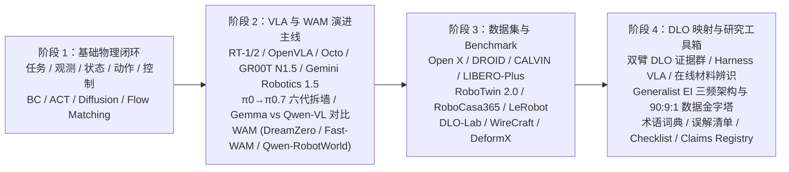
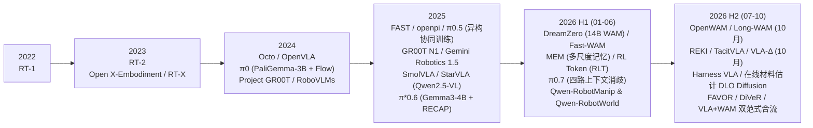

<p align="center">
  <a href="../README.md"><b>🏠 English Survey Portal</b></a> |
  <a href="../README_zh.md"><b>🏠 中文综述门户</b></a> |
  <a href="./00_Must_Read_60_Leaderboard.md"><b>🏆 Top-60 Must-Read</b></a> |
  <a href="./01_Foundations_Compliant_Control_and_RL.md"><b>Stage 1</b></a> |
  <a href="./02_VLA_WAM_and_Flow_RL.md"><b>Stage 2A</b></a> |
  <a href="./03_Tactile_RTC_and_Verification_Recovery.md"><b>Stage 2B</b></a> |
  <a href="./04_Datasets_Scaling_Laws_and_Statistical_Eval.md"><b>Stage 3</b></a> |
  <a href="./05_Contact_Rich_Manipulation_and_Generalist_EI.md"><b>Stage 4A</b></a> |
  <a href="./06_Glossary_Templates_and_Checklists.md"><b>Stage 4B & Labs</b></a>
</p>

---

# 具身智能完整教程：从基础控制、VLA/WAM、强化学习到富接触与全身操作

> [!note] 全书导读与结构概览
> 本教程面向**具身智能（Embodied Intelligence, EI）与机器人操作（Robotic Manipulation）**研究者及工程人员，构建从底层运动与柔顺控制、模仿学习、视觉-语言-动作大模型（VLA）、世界动作模型（WAM）、流匹配/扩散强化学习（Flow/Diffusion RL），到视触觉富接触操作、实时异步执行（RTC）、在线验证恢复、全身/灵巧控制与严格统计评测的完整知识体系：
> - **必读论文总榜（60 篇分级导读）**：按“奠基方法 $\rightarrow$ 流匹配/扩散强化学习 $\rightarrow$ 视触觉与富接触操作 $\rightarrow$ 实时执行与验证恢复 $\rightarrow$ 视觉语言基座、世界模型与全身控制 $\rightarrow$ 数据缩放律与统计评测”六大模块分级整理，并提供四周精读路线；
> - **阶段 1（基础控制、模仿学习与强化学习）**：涵盖观测/状态/动作定义、$SE(3)$ 坐标变换、笛卡尔阻抗/导纳/力位混合控制、行为克隆（BC）、ACT、Diffusion Policy、强化学习基础（MDP、PPO、GRPO、SAC、`HIL-SERL`、IQL、Cal-QL）及 25 道自检题解析；
> - **阶段 2（VLA、WAM 与核心进阶专题）**：涵盖主流模型演进、$\pi_0 \rightarrow \pi_{0.7}$ 技术剖析、`Gemma` 与 `Qwen-VL`（`Qwen-RobotManip` / `REKI`）基座对比、WAM 世界动作模型、3D 空间感知与全身灵巧控制、**流匹配/扩散 VLA 强化学习七大路线**、**视触觉传感硬件与预训练表征及策略**、**实时异步动作块执行（`RTC`）与知识绝缘（`Knowledge Insulation`）**、以及**在线验证与失败恢复闭环**；
> - **阶段 3（数据集、Benchmark、数据缩放律与统计评测）**：涵盖主流数据集与仿真基准、模仿学习数据缩放律与精度瓶颈（*The Curse of Precision*）、**Wilson 95% 置信区间、样本量规划、配对初始位姿与 McNemar 检验及盲测协议**，以及富接触与双臂柔性物体（DLO）专题；
> - **阶段 4（研究方法、术语词典、阅读模板与 5 个可执行代码实验）**：提供证据等级评估体系、核心术语词典、论文精读模板、10 道自检题解析以及 **5 个自包含可运行的 PyTorch 实验脚本**。

> [!tip] VLA / WAM 论文阅读路径
> 重点读阶段 2 的模型时间线、开放边界、证据等级，以及 **核心进阶专题**（$\pi_0 \rightarrow \pi_{0.7}$ 六代演进与 RECAP / RLT / 四路消歧机制、`Gemma` vs `Qwen-VL`（`Qwen-RobotManip` / `REKI`）视觉语言基模对比、WAM 世界动作模型 `DreamZero` / `Fast-WAM` / `Long-WAM` / `Qwen-RobotWorld`、以及 `Gemini Robotics 1.5`），再用阶段 4 的模型卡模板审计每篇论文。目标是把“模型很强”改写成“在某协议、某数据配方、某控制频率和某指标下成立”。

> [!tip] 双臂 DLO 研究路径
> 先读阶段 1 的 action chunk、控制频率和失败恢复，再读阶段 3 的 benchmark、split、DLO 指标和 DLO 评测协议，重点研读 **DLO 章节中的 2026-06 至 2026-10 直接证据群（DLO-Lab、WireCraft、DeformX、Sim-grounded ACT、ViTac-tracing、Harness VLA、在线材料估计扩散策略）** 与 **专题五：通用具身智能（Generalist EI）三频架构与双臂 DLO 破局之道**。任何没有线缆、绳索、wire、cable 或等价柔性体实验的论文，都只能标为 `[DLO 启发]`，不能标为 `[DLO 证明]`。

> [!info] 分层阅读原则
> 本教程各章节默认按三层深度递进组织：`必读层` 只看闭环、动作、控制、ACT、Diffusion Policy 和基础 benchmark；`进阶层` 再看 OpenVLA、Octo、openpi、$\pi_{0.5}$ 和数据协议；`前沿层` 深入研读 $\pi^*_{0.6}$（RECAP）、MEM、RL Token（RLT）、$\pi_{0.7}$、视觉语言主干与记忆策略（`Qwen-RobotManip`、`REKI`）、WAM 世界动作模型（`DreamZero`、`Fast-WAM`、`Long-WAM`、`Qwen-RobotWorld`）、`Gemini Robotics 1.5`、双臂 VLA 新证据（`Co-VLA`、`TwinVLA`）以及 DLO 专用 benchmark 与最新算法（`DLO-Lab`、`WireCraft`、`DeformX`、`Harness VLA`）。这样既保留研究纵深，又避免把概念地基和最新前沿混为同一难度。

## 证据标签系统

| 标签 | 使用条件 | 禁止外推 |
|---|---|---|
| `[已验证事实]` | 公开论文、官方项目页、官方 GitHub、模型卡或 Hugging Face 模型卡能直接核对的发布时间、输入输出、开源范围、许可证等事实 | 不能从“存在页面/仓库”推出“完整系统可复现” |
| `[论文报告]` | 作者在论文实验、表格或明确 protocol 中报告的结果 | 不能写成社区已复现或跨实验室已确认 |
| `[官方宣称]` | 官方博客、demo、模型页或发布材料中的能力展示与定位 | 不能替代 peer-reproducible benchmark |
| `[本地精读证据]` | vault 中 `[[...]]` 精读笔记记录的机制、数字、局限或读表结论 | 对外导出时仍需补公开论文、DOI、arXiv 或项目页 |
| `[合理推论]` | 从机制和已知实验边界推出的研究启发 | 不能写成事实结论 |
| `[尚不确定]` | 公开材料不足、版本迭代太快、复现边界不明或缺少目标任务实验 | 不能用强结论替代 |
| `[DLO 启发]` | 方法接口、数据 schema、动作头、评测协议或后训练机制可能帮助 DLO，但论文没有 DLO/rope/cable/wire 等直接实验 | 不能写成已经适合 DLO |
| `[DLO 证明]` | 同时包含 DLO 或等价线状柔性体任务、DLO 指标、明确 split，并在对应仿真或真机协议下验证 | 仿真结果不能直接写成真实机器人证明 |

## 总体学习路线



## 2022-2026.10 VLA 与 WAM 主线进展（按公开发布时间核查）



## 阅读建议

1. 如果完全新手，先通读阶段 1，不要直接跳到模型排行榜。
2. 如果已经懂基本机器人学习，阶段 2 可以重点看 VLA 证据等级、开放边界、动作接口以及 **核心进阶专题**。
3. 如果准备做实验，阶段 3 要优先读，因为模型结论最终要落到数据和 benchmark。
4. 如果准备写综述、组会或推进双臂 DLO 课题，阶段 3 末尾的 **DLO 与通用具身智能终局蓝图** 及阶段 4 是最核心的实战工具区。

---

---

---

---

---

## 具身智能与富接触操作必读论文总榜（2022–2026.10 精选 60 篇分级导读）

**证据等级**：`[已验证事实]` 全部论文标题照抄 arXiv 官方元数据（由 `tools/build_references.py` 生成的 `references.bib` 统一维护）；`[论文报告]` 核心机制与数字对照各论文摘要；`[方法论综合]` 按“入门奠基 $\rightarrow$ 流匹配/扩散强化学习 $\rightarrow$ 视触觉与富接触操作 $\rightarrow$ 实时执行与验证恢复 $\rightarrow$ 世界模型与全身控制 $\rightarrow$ 数据缩放律与统计评测”六大模块分级，并标注每篇论文在富接触操作研究中的定位。

> [!tip] 如何使用这份必读榜单？
> - **新手入门（第 1–2 周）**：只读 **模块一（Tier 0 奠基必读 Top 10）**，配合本教程阶段 1 与阶段 4 的 `Lab 1`、`Lab 2` 跑通代码，切勿一上来陷入上百篇 2026 新论文的海洋。
> - **视触觉与流匹配在线 RL 进阶（第 3 周）**：精读 **模块二（Flow/Diffusion RL 12 篇）** + **模块三（视触觉与富接触 16 篇）** + **模块四中的 `RTC` / `KI`**。其中标有 `直接竞品/必引基线` 的论文必须在 Related Work 与实验表格中正面回应。
> - **长程在线验证、失败恢复与双臂 DLO 进阶（第 4 周）**：精读 **模块四（实时执行、验证恢复与 DLO 12 篇）** + **模块六（统计评测协议）**。

---

### 一、入门怎么读：三阶段 30 天精读路径

| 周期 | 目标人群与阶段 | 必读论文组合（共 20 篇核心） | 配套动手实验 |
|---|---|---|---|
| **第 1 周（建立物理闭环直觉）** | 零基础 / 刚转入具身智能 | `#01 ACT`、`#02 Diffusion Policy`、`#03 RT-2`、`#05 Octo`、`#06 OpenVLA`、`#07 UMI` | 跑通 `LeRobot` 下的 ACT / Diffusion Policy 仿真推箱与插孔 |
| **第 2 周（掌握现代流匹配 VLA 底座）** | 准备复现主流 VLA | `#09 π0`、`#10 π0.5`、`#11 Knowledge Insulation`、`#12 RTC`、`#49 Qwen-RobotManip`、`#50 REKI` | 运行本教程 **`Lab 1`（`openpi` + `KI`）** 与 **`Lab 2`（`RTC` 软掩码流修复）** |
| **第 3 周（攻克视触觉与流匹配 RL）** | 视触觉表征与流匹配在线 RL 深入 | `#08 HIL-SERL`、`#13 DPPO`、`#15 πRL`、`#18 DSRL`、`#21 RECAP`、`#25 T3`、`#29 RDP`、`#33 T-Rex`、`#34 SimpleTouch`、`#39 UniVTAC`、`#40 ForceBench` | 运行本教程 **`Lab 3`（两阶段流与受控模态消融合成实验）** 与 **`Lab 4`（高斯块策略梯度与欧拉链求导分析）** |
| **第 4 周（闭环验证恢复与顶会级评测）** | 在线验证恢复与严格统计评测 | `#43 FAVOR`、`#44 DiVeR`、`#45 SAFE`、`#47 E-TTS`、`#48 Harness VLA`、`#56 Curse of Precision`、`#58 RoboArena`、`#59 TRI LBM`、`#60 Kress-Gazit` | 运行本教程 **`Lab 5`（Wilson 95% CI + McNemar 精确检验）** |

---

### 二、模块一：奠基必读 Top 12（Tier 0 · 具身智能通用语言）

这 12 篇论文定义了现代具身智能的**动作块（Action Chunking）、连续去噪/流匹配生成、VLA 架构、无本体采集、真机 RL 与实时异步闭环**，是所有后续研究的共同底座。

| 编号 | 推荐度 | 论文简称与年份 | 完整标题与 arXiv / 来源 | 核心贡献（一句话精髓） | 开源状态 | 核心定位与适用场景 |
|---|---|---|---|---|---|---|
| **#01** | ★★★★★ | **`ACT / ALOHA`** (RSS 2023) | *Learning Fine-Grained Bimanual Manipulation with Low-Cost Hardware* ([arXiv:2304.13705](https://arxiv.org/abs/2304.13705)) | 提出 Action Chunking ($H$ 步动作块预测) + CVAE 潜变量 + Temporal Ensembling，奠定双臂精细模仿学习基石 | 代码/硬件全开源 | 双臂操作与动作块基石 |
| **#02** | ★★★★★ | **`Diffusion Policy`** (RSS 2023 / IJRR) | *Diffusion Policy: Visuomotor Policy Learning via Action Diffusion* ([arXiv:2303.04137](https://arxiv.org/abs/2303.04137)) | 将条件扩散去噪引入机器人动作生成，解决多峰动作分布（Multimodality）下 MSE 回归均值坍缩问题 | 代码/权重全开源 | 连续生成式策略第一基准 |
| **#03** | ★★★★☆ | **`RT-2`** (CoRL 2023) | *RT-2: Vision-Language-Action Models Transfer Web Knowledge to Robotic Control* ([arXiv:2307.15818](https://arxiv.org/abs/2307.15818)) | 正式提出 **VLA** 概念，将末端动作离散化为文本 Token 与互联网 VLM 协同微调，实现涌现语义泛化 | 闭源 | VLA 概念开山之作 |
| **#04** | ★★★★★ | **`Open X / RT-X`** (ICRA 2024) | *Open X-Embodiment: Robotic Learning Datasets and RT-X Models* ([arXiv:2310.08864](https://arxiv.org/abs/2310.08864)) | 联合 21 家机构构建 22 种本体、100 万+轨迹数据集，开启跨本体（Cross-Embodiment）预训练时代 | 数据集开源 | 跨本体数据对齐必引 |
| **#05** | ★★★★☆ | **`Octo`** (RSS 2024) | *Octo: An Open-Source Generalist Robot Policy* ([arXiv:2405.12213](https://arxiv.org/abs/2405.12213)) | 首套完全开源、支持语言与目标图像双条件、采用轻量扩散动作头的跨本体通用策略 | 代码/权重/数据全开源 | 轻量通用扩散策略对照 |
| **#06** | ★★★★★ | **`OpenVLA`** (CoRL 2024) | *OpenVLA: An Open-Source Vision-Language-Action Model* ([arXiv:2406.09246](https://arxiv.org/abs/2406.09246)) | 基于 `Llama-2-7B` + `DINOv2` + `SigLIP` 的开源 VLA 标杆，验证 LoRA 微调与量化部署流程 | 代码/权重/数据全开源 | 离散自回归 VLA 标准基线 |
| **#07** | ★★★★★ | **`UMI`** (RSS 2024) | *Universal Manipulation Interface: In-The-Wild Robot Teaching Without In-The-Wild Robots* ([arXiv:2402.10329](https://arxiv.org/abs/2402.10329)) | 用手持 3D 打印夹爪 + GoPro 鱼眼 SLAM 实现无机器人本体的野外数据采集与零样本跨机械臂迁移 | 硬件/代码全开源 | 低成本采集与相机中心坐标标杆 |
| **#08** | ★★★★★ | **`HIL-SERL`** (2024.10) | *Precise and Dexterous Robotic Manipulation via Human-in-the-Loop Reinforcement Learning* ([arXiv:2410.21845](https://arxiv.org/abs/2410.21845)) | 真机强化学习工程圣经：结合少量演示初始化 SAC 缓冲池、在线人工干预纠偏与高 UTD，1–2.5 小时真机插装达近 100% 成功率 | 代码全开源 (`serl`) | 真机在线 RL 与干预机制必引 |
| **#09** | ★★★★★ | **`π0 / openpi`** (2024.10) | *$\pi_0$: A Vision-Language-Action Flow Model for General Robot Control* ([arXiv:2410.24164](https://arxiv.org/abs/2410.24164)) | 将 `PaliGemma-3B` 与 300M 连续流匹配动作专家（Flow Matching Action Expert, 10 步欧拉积分 50Hz）结合 | `openpi` 开源 | 流匹配 VLA 核心基座模型 |
| **#10** | ★★★★★ | **`π0.5`** (2025.04) | *$\pi_{0.5}$: a Vision-Language-Action Model with Open-World Generalization* ([arXiv:2504.16054](https://arxiv.org/abs/2504.16054)) | 提出异构协同训练（预训练期离散 FAST Token + 后训练期连续流动作专家）与高层语义子目标到低层动作块的两阶段推理 | `openpi` 开源 | 异构协同训练与两阶段推理基座 |
| **#11** | ★★★★★ | **`Knowledge Insulation`** (2025.05) | *Knowledge Insulating Vision-Language-Action Models: Train Fast, Run Fast, Generalize Better* ([arXiv:2505.23705](https://arxiv.org/abs/2505.23705)) | 揭示连续流专家高方差梯度会破坏 VLM 预训练语义，提出对 VLM KV-Cache 施加 `stop_gradient` + 离散 Token 辅助监督 | 机制完全公开 (`openpi` 可复现) | 冻结/绝缘慢速 VLM 前缀的理论依据 |
| **#12** | ★★★★★ | **`RTC`** (2025.06 & 2025.12) | *Real-Time Execution of Action Chunking Flow Policies* ([arXiv:2506.07339](https://arxiv.org/abs/2506.07339)) & *Training-Time Action Conditioning for Efficient Real-Time Chunking* ([arXiv:2512.05964](https://arxiv.org/abs/2512.05964)) | 提出已承诺前缀锁定 $a_{0:d}$ 与软掩码指数衰减流修复引导（Soft-Masked Flow Inpainting），消除动作块切换停顿与边界跳变 | 官方实现公开 | 实时动作块前缀锁定与软掩码修复底座 |

---

### 三、模块二：流匹配与扩散 VLA 强化学习必读榜（12 篇 · 核心算法演进）

这 12 篇论文完整回答了“**为什么 Flow/Diffusion 策略难做 RL，以及 2024–2026 社区演化出的 7 条破局路线各有什么优劣**”。

| 编号 | 推荐度 | 论文简称与路线 | 完整标题与 arXiv 编号 | 核心机制与优劣边界 | 在视触觉流匹配 RL 中的定位 |
|---|---|---|---|---|---|
| **#13** | ★★★★★ | **`DPPO`** (路线1: 去噪 MDP) | *Diffusion Policy Policy Optimization* ([arXiv:2409.00588](https://arxiv.org/abs/2409.00588)) | 将 $K$ 步去噪展开为双层 MDP，每步高斯转移均可解析算 $\log p$ 并用 PPO 优化，通常只微调最后几步去噪层 | 证明“只对尾部去噪步做高斯 PPO”有效性的核心先驱 |
| **#14** | ★★★★★ | **`ReinFlow`** (路线2: 注入流噪声) | *ReinFlow: Fine-tuning Flow Matching Policy with Online Reinforcement Learning* ([arXiv:2505.22094](https://arxiv.org/abs/2505.22094)) | 在确定性欧拉积分步注入可学习时间条件高斯噪声网络 $\sigma_\psi(a^\tau,\tau,o)$，使离散流轨迹具有精确闭式转移似然 | 可学习探索噪声的直接参考；与只在末端步注入噪声的做法（`Lab 4`）形成对照 |
| **#15** | ★★★★★ | **`πRL`** (路线2: 全模型流 RL) | *$\pi_\texttt{RL}$: Online RL Fine-tuning for Flow-based Vision-Language-Action Models* ([arXiv:2510.25889](https://arxiv.org/abs/2510.25889)) | 提出 `Flow-Noise`（带可学习噪声网络的离散时间 MDP，可精确计算对数似然）与 `Flow-SDE`（ODE 转 SDE 的双层 MDP），对 $\pi_0/\pi_{0.5}$ 做在线 RL | 证明 3B 级流 VLA 可做在线 RL；全步建模计算图较重，适合并行仿真 |
| **#16** | ★★★★☆ | **`RLinf`** (路线2: 开源训练栈) | *RLinf: Flexible and Efficient Large-Scale Reinforcement Learning via Macro-to-Micro Flow Transformation* ([arXiv:2509.15965](https://arxiv.org/abs/2509.15965)) | 支持 `OpenVLA`、$\pi_0$、$\pi_{0.5}$ 大规模在线 PPO/GRPO 的开源工程框架（`RLinf-VLA`） | 代码开源，可直接作为 RL 训练基础设施参考 |
| **#17** | ★★★★☆ | **`RoboFFT`** (路线2: 2026.10 全参数) | *RoboFFT: Finetuning generative robot policy via online reinforcement learning with forward process* ([arXiv:2609.32236](https://arxiv.org/abs/2609.32236)) | 2026.10 最新全参数流 VLA 在线 RL 方案，通过分阶段梯度稳定策略缓解全参数更新崩溃 | 2026.10 最新流 VLA RL 文献对照 |
| **#18** | ★★★★★ | **`DSRL`** (路线3: 初始噪声空间 RL) | *Steering Your Diffusion Policy with Latent Space Reinforcement Learning* ([arXiv:2506.15799](https://arxiv.org/abs/2506.15799)) | 冻结扩散/流策略权重，用 SAC 在初始高斯噪声空间 $a^0 \sim \mathcal{N}(0,I)$ 上做引导，完全免除 BPTT 穿链 | 必须对比的强基线：指出其局限在于初始噪声 $a^0$ 在动作块起点决定，无法响应块内突发触觉冲击 |
| **#19** | ★★★★☆ | **`NSL`** (路线3: 非参数噪声优化) | *Noise Space Learning for VLA Adaptation* ([arXiv:2610.13943](https://arxiv.org/abs/2610.13943)) | 在推理期通过 Critic 梯度直接在线更新初始噪声潜变量 $a^0$ | 潜空间引导家族 2026 扩展引用 |
| **#20** | ★★★★★ | **`ResFiT`** (路线4: 动作空间残差 RL) | *Residual Off-Policy RL for Finetuning Behavior Cloning Policies* ([arXiv:2509.19301](https://arxiv.org/abs/2509.19301)) | 冻结预训练流/扩散基座，在末端输出动作空间叠加轻量 MLP 残差策略 $\Delta a_\phi$ 并用异策略 RL 训练 | 审稿人常问对比：解释为什么流空间尾步微调比纯外部 $\Delta a$ 加法残差更能保持动作块内部平滑与多峰几何 |
| **#21** | ★★★★★ | **`RL Token / RLT`** (路线4: Token 残差) | *RL Token: Bootstrapping Online RL with Vision-Language-Action Models* ([arXiv:2604.23073](https://arxiv.org/abs/2604.23073)) | 仅训练约 1M 参数的轻量残差策略头，读取 3B VLA 内部特征输出高频修正动作，15 分钟真机 RL 收敛 | 轻量真机后训练标杆 |
| **#22** | ★★★★★ | **`π*0.6 / RECAP`** (路线5: 优势条件化) | *$\pi^{*}_{0.6}$: a VLA That Learns From Experience* ([arXiv:2511.14759](https://arxiv.org/abs/2511.14759)) | 用分布式价值 Critic 评估经验优势 $I_t=\mathbb{I}(A^\pi > \epsilon)$，将其作为条件标签直接回灌至標準流匹配监督损失 | 离线/多轮迭代经验学习里程碑 |
| **#23** | ★★★★☆ | **`VaM` & `PA-RL`** (路线6: 后验流引导) | *Value as Memory: Online Value-Guided Post-training for General Robot Policies* ([arXiv:2610.22368](https://arxiv.org/abs/2610.22368)) & *Policy Agnostic RL: Offline RL and Online RL Fine-Tuning of Any Class and Backbone* ([arXiv:2412.06685](https://arxiv.org/abs/2412.06685)) | 在 ODE 积分过程中叠加 Critic 对动作的梯度 $\nabla_a Q(s,a)$ 引导速度场流向高价值区域 | 测试期 Critic 梯度引导路线代表 |
| **#24** | ★★★★★ | **`RL-100` & `ConRFT`** (路线7: 真机 100% 栈) | *RL-100: Performant Robotic Manipulation with Real-World Reinforcement Learning* ([arXiv:2510.14830](https://arxiv.org/abs/2510.14830)) & *ConRFT: A Reinforced Fine-tuning Method for VLA Models via Consistency Policy* ([arXiv:2502.05450](https://arxiv.org/abs/2502.05450)) | 系统结合离线预训练、一致性正则与在线真机交互安全护栏，在多项真机精密操作上逼近 100% 成功率 | 真机安全 RL 闭环与干预价值设计的工程参考 |

---

### 四、模块三：视触觉硬件、预训练表征与富接触 VLA 必读榜（16 篇 · 核心方法与评测基准）

| 编号 | 推荐度 | 论文简称与年份 | 完整标题与 arXiv 编号 | 核心机制与关键指标 | 在视触觉流匹配 RL 中的定位 |
|---|---|---|---|---|---|
| **#25** | ★★★★★ | **`T3`** (CoRL 2024) | *Transferable Tactile Transformers for Representation Learning Across Diverse Sensors and Tasks* ([arXiv:2406.13640](https://arxiv.org/abs/2406.13640)) | 传感器特定编码器 + 共享 Transformer 主干 + 任务特定解码器的跨传感器触觉预训练框架（ViT 在 $224\times224$、patch 16 时输出 1 CLS + $14\times 14$ 空间 Token） | 常用冻结触觉编码器；“保留空间 Token vs 全局池化”是值得做的消融 |
| **#26** | ★★★★★ | **`Sparsh`** (CoRL 2024 / Meta) | *Sparsh: Self-Supervised Touch Representations for Vision-Based Tactile Sensing* ([arXiv:2410.24090](https://arxiv.org/abs/2410.24090)) | 在 46 万+ 视触觉图像上全面评测 MAE、DINO、I-JEPA 自监督预训练，发布 `TacBench` 六项触觉下游任务 | 视触觉自监督表征权威基准，Related Work 必引 |
| **#27** | ★★★★☆ | **`UniTouch`** (CVPR 2024) | *Binding Touch to Everything: Learning Unified Multimodal Tactile Representations* ([arXiv:2401.18084](https://arxiv.org/abs/2401.18084)) | 将触觉表征对齐到预训练视觉-语言-音频语义空间，配备传感器特定 Token 实现零样本跨传感器迁移 | 多模态语义触觉对齐代表 |
| **#28** | ★★★★☆ | **`3D-ViTac` & `AnySkin`** (CoRL 2024) | *3D-ViTac: Learning Fine-Grained Manipulation with Visuo-Tactile Sensing* ([arXiv:2410.24091](https://arxiv.org/abs/2410.24091)) & *AnySkin: Plug-and-play Skin Sensing for Robotic Touch* ([arXiv:2409.08276](https://arxiv.org/abs/2409.08276)) | `3D-ViTac` 将密集触觉点云与三维视觉点云统一于 3D 空间支持双臂精细操作；`AnySkin` 提供即插即用免标定磁敏电子皮肤 | 3D 视触觉与触觉硬件代表 |
| **#29** | ★★★★★ | **`RDP`** (RSS 2025) | *Reactive Diffusion Policy: Slow-Fast Visual-Tactile Policy Learning for Contact-Rich Manipulation* ([arXiv:2503.02881](https://arxiv.org/abs/2503.02881)) | 慢速视觉潜空间扩散规划 + 快速触觉/力控潜空间译码的慢快双层架构 | 慢快视触觉架构的代表性先驱 |
| **#30** | ★★★★☆ | **`ImplicitRDP` & `FA-RDP`** (2025.12–2026.02) | *ImplicitRDP: An End-to-End Visual-Force Diffusion Policy with Structural Slow-Fast Learning* ([arXiv:2512.10946](https://arxiv.org/abs/2512.10946)) & *FA-RDP: A Frequency-Adaptive Reactive Diffusion Policy for Contact-Rich Manipulation* ([arXiv:2607.28596](https://arxiv.org/abs/2607.28596)) | 端到端联合注意力的慢快视触觉扩散策略与力自适应调制扩展 | 慢快视触觉家族最新演进必引 |
| **#31** | ★★★★☆ | **`FACTR` & `ACP`** (2024.10–2025.02) | *FACTR: Force-Attending Curriculum Training for Contact-Rich Policy Learning* ([arXiv:2502.17432](https://arxiv.org/abs/2502.17432)) & *Adaptive Compliance Policy: Learning Approximate Compliance for Diffusion Guided Control* ([arXiv:2410.09309](https://arxiv.org/abs/2410.09309)) | `FACTR` 通过课程式随机遮挡视觉迫使策略关注力反馈（克服本体/视觉捷径病）；`ACP` 联合预测参考位姿与动态刚度矩阵 | 力感知注意力课程与学习型阻抗控制必引 |
| **#32** | ★★★★☆ | **`ForceVLA` & `ForceVLA2`** (2025.05 & 2026.03) | *ForceVLA: Enhancing VLA Models with a Force-aware MoE for Contact-rich Manipulation* ([arXiv:2505.22159](https://arxiv.org/abs/2505.22159)) & *ForceVLA2: Unleashing Hybrid Force-Position Control with Force Awareness for Contact-Rich Manipulation* ([arXiv:2603.15169](https://arxiv.org/abs/2603.15169)) | 将六维力/力矩通过 Force-Aware MoE 路由注入 VLA 动作专家，同时预测末端位姿与目标接触力 | 六维力控 VLA 代表工作 |
| **#33** | ★★★★★ | **`T-Rex`** (2026.06) | *T-Rex: Tactile-Reactive Dexterous Manipulation* ([arXiv:2606.17055](https://arxiv.org/abs/2606.17055)) | 可变速率 Mixture-of-Transformers 架构 + 时序触觉 VQ-VAE 编码器；配套 100 小时按运动原语采集的触觉数据集 | 12 项力控/柔性体任务上平均成功率比最强基线高 30% 以上；触觉反应式 VLA 的核心对照 |
| **#34** | ★★★★★ | **`SimpleTouch`** (2026.10) | *SimpleTouch: Can Vision-Language-Action Models Master Contact-Rich Manipulation Without Tactile Policy Pretraining?* ([arXiv:2610.02784](https://arxiv.org/abs/2610.02784)) | 在 $\pi_{0.5}$ 上增加触觉专家，使用冻结触觉编码器的全部 Token，以动作监督 + 多时域未来触觉潜变量预测单阶段训练 | 检验“是否必须做触觉策略预训练”的轻量强基线 |
| **#35** | ★★★★☆ | **`N0-VTLA` & `TacVLA`** (2026.03–07) | *$N_0$-VTLA: Scaling Vision-Tactile-Language-Action Model with Latent Tactile Tokens* ([arXiv:2607.23782](https://arxiv.org/abs/2607.23782)) & *TacVLA: Contact-Aware Tactile Fusion for Robust Vision-Language-Action Manipulation* ([arXiv:2603.12665](https://arxiv.org/abs/2603.12665)) | `N0-VTLA`：大规模视触觉预训练 + 预测式触觉通路 + 优势条件化离线 RL（`ALTER`）；`TacVLA`：接触感知门控，仅在检测到接触时激活触觉 Token | 视触觉 VLA 的两条代表路线（规模化预训练 vs 微调期门控融合） |
| **#36** | ★★★★☆ | **`PACE`** (CoRL 2026) | *PACE: Temporal-Role Tactile Conditioning for Chunk-Based Insertion Policies* ([arXiv:2610.16308](https://arxiv.org/abs/2610.16308)) | 把共享触觉流分成三种时间角色：持续接触状态调制动作块生成、突发接触事件修正已生成动作块、接触后果预测在训练中塑形表征 | 五项真机插装平均 90.7%；动作块策略中触觉条件化方式的直接参考 |
| **#37** | ★★★★☆ | **`FACT`** (2026.10) | *FACT: A Multimodal Force-Action-Track Foundation Model for Human-to-Robot Dexterity* ([arXiv:2610.19155](https://arxiv.org/abs/2610.19155)) | 人类触觉数据 `EgoForce` + 机器人示范联合预训练；轨迹引导粗规划器 + 力-动作联合精修器 | 力感知灵巧操作与人-机数据联合训练的代表工作 |
| **#38** | ★★★★☆ | **`Spark-0` & `PRISM`** (2026.10) | *Spark-0: Scaling Spatially Aligned Tactile Pretraining for Robot Dexterous Manipulation* ([arXiv:2610.22342](https://arxiv.org/abs/2610.22342)) & *PRISM: Precision Forcing for Generalist Vision-Language-Action Policies* ([arXiv:2610.14704](https://arxiv.org/abs/2610.14704)) | `Spark-0`：用触觉手套接触图监督视觉 Token 的空间对齐触觉预训练（1,000 小时 `HumanTouch`）；`PRISM`：针对“流时间饥饿”（Flow-Time Starvation）按精度需求重加权流匹配监督，无需新传感器 | 触觉作为预训练监督 / 精密任务监督分配的两种思路 |
| **#39** | ★★★★★ | **`UniVTAC`** (2026.02) | *UniVTAC: A Unified Simulation Platform for Visuo-Tactile Manipulation Data Generation, Learning, and Benchmarking* ([arXiv:2602.10093](https://arxiv.org/abs/2602.10093)) | 支持三种常用视触觉传感器的仿真数据合成平台，提供 `UniVTAC Encoder` 与 8 任务 `UniVTAC Benchmark` | 视触觉策略仿真评测的公开基准 |
| **#40** | ★★★★★ | **`ForceBench`** (2026.10) | *ForceBench: Benchmarking Force Integration for Robotic Manipulation* ([arXiv:2610.19604](https://arxiv.org/abs/2610.19604)) | 统一协议下评测六轴腕部力融合设计的仿真基准：8 任务、1,600 条示范、共享 $\pi_{0.5}$ 骨干上比较 1 个无力基线与 6 种融合设计 | `Prompt Fusion` 最优（仿真 35.31% vs 基线 23.25%），时序设计在装配任务上低于基线；消融表应包含无力基线与简单融合基线 |

---

### 五、模块四：实时执行、在线验证、失败恢复与双臂 DLO 必读榜（8 篇 · 核心机制与代表方法）

| 编号 | 推荐度 | 论文简称与年份 | 完整标题与 arXiv 编号 | 核心机制与关键发现 | 在验证恢复与 DLO 中的定位 |
|---|---|---|---|---|---|
| **#41** | ★★★★☆ | **`REACT` & `Chronos Policy`** (2026.10) | *REACT: Rolling Denoising and Dual Decoupling for Reactive Robot Control with VLA Models* ([arXiv:2610.12007](https://arxiv.org/abs/2610.12007)) & *Chronos Policy: Learning Robot Policies on Physical Time* ([arXiv:2610.13929](https://arxiv.org/abs/2610.13929)) | `REACT` 维护各块流时间错开的持久动作缓冲区，每个控制步用最新观测对整个视野去噪、执行最干净的块并在尾部补噪声；`Chronos Policy` 以观测采集时间与期望执行时间为条件（时间感知 RoPE） | 实时动作块执行的最新机制 |
| **#42** | ★★★★☆ | **`TacitVLA` & `ERVLA`** (2026.06–10) | *TacitVLA: Reasoning Vision-Language-Action Models Without Reasoning Latency* ([arXiv:2610.17540](https://arxiv.org/abs/2610.17540)) & *ERVLA* ([arXiv:2606.03784](https://arxiv.org/abs/2606.03784)) | `TacitVLA` 将多步显式 CoT 蒸馏至单次前向隐状态；`ERVLA` 通过双解码器解耦慢速文本推理与快速动作生成，消除推理延迟 | 零额外 Token 延迟推理代表 |
| **#43** | ★★★★★ | **`FAVOR`** (2026.10) | *Future Anchored Verification and Online Recovery for World Action Models* ([arXiv:2610.06280](https://arxiv.org/abs/2610.06280)) | 把 WAM 行动前预测的未来帧作为锚点：`Anchor Verifier` 标记破坏任务的偏离，`Anchor-Guided Recovery` 用 VLM 生成纠正指令引导 WAM 回到预期轨迹 | 面向 WAM 的验证恢复；摘要报告增益较小（LIBERO 97.85% → 98.10%） |
| **#44** | ★★★★★ | **`DiVeR`** (2026.10) | *DiVeR: Decision-Critical Verifier Learning for VLA Test-Time Scaling* ([arXiv:2610.04933](https://arxiv.org/abs/2610.04933)) | 用采样动作表征的离散度估计决策关键性，并据此重加权验证器训练（无需步级标注），提升 verifier-guided test-time scaling | 测试期“采样-验证-选优”路线的代表 |
| **#45** | ★★★★★ | **`SAFE` & `FAIL-Detect`** (2025.03–06) | *SAFE: Multitask Failure Detection for Vision-Language-Action Models* ([arXiv:2506.09937](https://arxiv.org/abs/2506.09937)) & *Can We Detect Failures Without Failure Data? Uncertainty-Aware Runtime Failure Detection for Imitation Learning Policies* ([arXiv:2503.08558](https://arxiv.org/abs/2503.08558)) | `SAFE` 从 VLA 内部特征学习单一失败概率标量并跨任务泛化（NeurIPS 2025）；`FAIL-Detect` 只用成功数据做序列 OOD 检测，并用保形预测给出统计保证（RSS 2025） | 在线失败检测的两种代表方案 |
| **#46** | ★★★★★ | **`E-TTS`** (2026.06) | *E-TTS: A New Embodied Test-Time Scaling Framework for Robotic Manipulation* ([arXiv:2606.27268](https://arxiv.org/abs/2606.27268)) | 无需微调基座 VLA，通过多视角测试期集成、多尺度历史聚合与**基于自身置信度的自适应动作块视界截断**显著降低碰撞与失败率 | 测试期自适应视界缩短与安全缩放标杆 |
| **#47** | ★★★★★ | **`Harness VLA`** (2026.07) | *Harness VLA: Steering Frozen VLAs into Reliable Manipulation Primitives via Memory-Guided Agents* | 将冻结 VLA 封装为受控接触原语，由上层带记忆规划器与解析原语库负责语义重绑定、抓取交接与失败重试 | 双臂线束/装配中“规划器 + 冻结 VLA 原语 + 验证恢复”工程样板 |
| **#48** | ★★★★☆ | **`Bimanual DLO MPC` & `Visuomotor DLO`** (2026.02–09) | *Online Material Estimation for Conditioned Diffusion Policy in Shaping Deformable Linear Objects* ([arXiv:2609.12634](https://arxiv.org/abs/2609.12634)) & *WireCraft: A Simulation Benchmark for Industrial DLO Manipulation* ([arXiv:2606.18097](https://arxiv.org/abs/2606.18097), [arXiv:2606.04206](https://arxiv.org/abs/2606.04206)) | 结合数据驱动雅可比/状态转移模型与带防过度拉伸约束的 MPC 及视觉-运动策略，实现双臂柔性线缆高精度形状控制与绕障 | 双臂 DLO 建模与控制必引 |

---

### 六、模块五：VLM 基座、世界动作模型（WAM）与灵巧手/全身控制必读榜（7 篇 · 架构视野）

| 编号 | 推荐度 | 论文简称与年份 | 完整标题与 arXiv 编号 | 核心机制与关键发现 | 精读价值 |
|---|---|---|---|---|---|
| **#49** | ★★★★★ | **`Qwen-RobotManip` & `REKI`** (2026.06–10) | *Qwen-RobotManip Technical Report: Alignment Unlocks Scale for Robotic Manipulation Foundation Models* ([arXiv:2606.17846](https://arxiv.org/abs/2606.17846)) & *REKI: Registering Knowledge in VLAs* ([arXiv:2610.22178](https://arxiv.org/abs/2610.22178)) | `Qwen-RobotManip`：基于 `Qwen-VL` 主干通过表征/运动/行为对齐整合约 38,100 小时多源预训练语料；`REKI`：2.4B VLA 配合流匹配动作专家，在专家缓存中维护持久化寄存器 Token 提供近期记忆 | `Qwen` 系 VLM 基座的代表；比较时注意预训练语料规模差异 |
| **#50** | ★★★★★ | **`π0.7`** (2026.04) | *$\pi_{0.7}$: a Steerable Generalist Robotic Foundation Model with Emergent Capabilities* ([arXiv:2604.15483](https://arxiv.org/abs/2604.15483)) | 引入四路上文元数据协议（语言+机器人ID+任务规范+数据源质量标签）与 **14B 扩散视觉子目标生成器**，实现杂乱演示消歧与无机器人数据新技能迁移 | 多模态上下文控制与视觉子目标规划标杆 |
| **#51** | ★★★★☆ | **`GR-3` & `Gemini Robotics 1.5`** (2025.07–10) | *GR-3 Technical Report* ([arXiv:2507.15493](https://arxiv.org/abs/2507.15493)) & *Gemini Robotics 1.5: Pushing the Frontier of Generalist Robots with Advanced Embodied Reasoning, Thinking, and Motion Transfer* ([arXiv:2510.03342](https://arxiv.org/abs/2510.03342)) | `GR-3` (字节 Seed, 4B Flow VLA) 展示图文数据+人类 VR 轨迹+真机轨迹协同训练在长程柔性衣物折叠上的泛化；`Gemini Robotics 1.5` 展示具身思考与跨本体迁移 | 工业界旗舰 VLA 技术报告代表 |
| **#52** | ★★★★★ | **`DreamZero` & `Fast-WAM`** (2026.02–03) | *World Action Models are Zero-shot Policies* ([arXiv:2602.15922](https://arxiv.org/abs/2602.15922)) & *Fast-WAM: Do World Action Models Need Test-time Future Imagination?* ([arXiv:2603.16666](https://arxiv.org/abs/2603.16666)) | `DreamZero` (14B 视频扩散 WAM) 验证联合预测未来视频与动作的物理泛化，但单步需 850 ms；`Fast-WAM` 证明训练期保留视频预测、**测试期跳过像素去噪直接解码动作可将延迟压缩至 190 ms（~5.3 FPS）且不掉点** | VLA vs WAM 范式融合必读双子星 |
| **#53** | ★★★★☆ | **`OpenWAM`、`V-JEPA 2` & `DreamGen`** (2025.05–2026.10) | *OpenWAM: An Open Framework for Composable World-Action Models* ([arXiv:2610.07922](https://arxiv.org/abs/2610.07922)), *V-JEPA 2: Self-Supervised Video Models Enable Understanding, Prediction and Planning* ([arXiv:2506.09985](https://arxiv.org/abs/2506.09985)) & *DreamGen: Unlocking Generalization in Robot Learning through Video World Models* ([arXiv:2505.12705](https://arxiv.org/abs/2505.12705)) | `V-JEPA 2` 在百万小时视频上学习非生成式潜空间物理预测器（免像素渲染开销）；`DreamGen` 用视频世界模型合成伪轨迹扩充策略训练；`OpenWAM` 提供全开源 WAM 基座 | 世界模型潜空间规划与合成数据代表 |
| **#54** | ★★★★☆ | **`MimicGen`、`DexMimicGen` & `DexUMI`** (CoRL 2023–2025) | *MimicGen: A Data Generation System for Scalable Robot Learning using Human Demonstrations* ([arXiv:2310.17596](https://arxiv.org/abs/2310.17596)), *DexMimicGen: Automated Data Generation for Bimanual Dexterous Manipulation via Imitation Learning* ([arXiv:2410.24185](https://arxiv.org/abs/2410.24185)) & *DexUMI: Using Human Hand as the Universal Manipulation Interface for Dexterous Manipulation* ([arXiv:2505.21864](https://arxiv.org/abs/2505.21864)) | `MimicGen` 从 10–20 条人工演示自动几何变换合成数万条仿真轨迹；`DexUMI` 用外骨骼手套 + 指尖相机无机器人采集灵巧手数据 | 轨迹自动倍增与灵巧手采集核心工具 |
| **#55** | ★★★★☆ | **`HOVER`、`ASAP`、`BeyondMimic` & `SONIC`** (2024.10–2025.11) | *HOVER* ([arXiv:2410.21229](https://arxiv.org/abs/2410.21229)), *ASAP* ([arXiv:2502.01143](https://arxiv.org/abs/2502.01143)), *BeyondMimic: From Motion Tracking to Versatile Humanoid Control via Guided Diffusion* ([arXiv:2508.08241](https://arxiv.org/abs/2508.08241)) & *SONIC* ([arXiv:2511.07820](https://arxiv.org/abs/2511.07820)) | 现代人形机器人全身控制（WBC）标准工具箱：统一命令空间蒸馏、`Delta Action` 真实物理残差对齐、引导扩散全身追踪 | 灵巧手与人形全身控制标准栈 |

---

### 七、模块六：数据缩放律与严格统计评测方法必读榜（5 篇 · 顶会实验设计铁律）

| 编号 | 推荐度 | 论文简称与年份 | 完整标题与 arXiv 编号 | 核心定律与实验设计规范 | 为什么写论文前必须精读 |
|---|---|---|---|---|---|
| **#56** | ★★★★★ | **`The Curse of Precision`** (ICRA 2026) | *The Curse of Precision: A Data Scaling Law for High-Precision Robotic Manipulation* ([arXiv:2607.23108](https://arxiv.org/abs/2607.23108)) | 在固定成功率下，所需示范数 $N$ 随目标精度 $P$ 逼近极限 $c$ 呈超指数增长：$\log N \propto \frac{1}{P-c}$；$c$ 是整个系统（传感器、专家策略等）的涌现属性 | 为“提升系统组件（如加腕部相机、更好的专家）以降低 $c$”提供定量依据 |
| **#57** | ★★★★☆ | **`Data Scaling Laws` & `AgiBot World`** (ICLR 2025 / 2025.03) | *Data Scaling Laws in Imitation Learning for Robotic Manipulation* ([arXiv:2410.18647](https://arxiv.org/abs/2410.18647)) & *AgiBot World Colosseo: A Large-scale Manipulation Platform for Scalable and Intelligent Embodied Systems* ([arXiv:2503.06669](https://arxiv.org/abs/2503.06669)) | 证明跨场景泛化误差关于“环境数 $\times$ 物体数”呈幂律下降，而单场景重复采集超过 50–100 条即饱和；提供百万级真机双臂数据集 | 指导真机数据采集预算分配 |
| **#58** | ★★★★★ | **`RoboArena`** (2025.06) | *RoboArena: Distributed Real-World Evaluation of Generalist Robot Policies* ([arXiv:2506.18123](https://arxiv.org/abs/2506.18123)) | 建立多高校分布式真机双盲随机 A/B 对战评测与 Bradley-Terry Elo 排名体系，消除评测者主观摆位偏置 | 顶会真机盲测与公平对比标杆 |
| **#59** | ★★★★★ | **`TRI LBM Evaluation`** (2025.07) | *A Careful Examination of Large Behavior Models for Multitask Dexterous Manipulation* ([arXiv:2507.05331](https://arxiv.org/abs/2507.05331)) | 丰田研究院示范如何用大规模试验次数、分布内/分布外严格切分、配对置信区间与细粒度失败阶段归因检验大型行为模型 | 实验章节图表与统计显著性写作范本 |
| **#60** | ★★★★★ | **`Kress-Gazit Best Practices`** (2024.09) | *Robot Learning as an Empirical Science: Best Practices for Policy Evaluation* ([arXiv:2409.09491](https://arxiv.org/abs/2409.09491)) | 机器人学习实验设计红宝书：系统规定初始状态分布记录、成败判据、安全中断计数、盲测交错与置信区间报告准则 | 投稿 RSS / CoRL / ICRA / TRO 前必查的自检清单 |

---

## 具身智能完整教程：从基础控制、VLA/WAM、强化学习到富接触与全身操作

> [!note] 全书导读与结构概览
> 本教程面向**具身智能（Embodied Intelligence, EI）与机器人操作（Robotic Manipulation）**研究者及工程人员，构建从底层运动与柔顺控制、模仿学习、视觉-语言-动作大模型（VLA）、世界动作模型（WAM）、流匹配/扩散强化学习（Flow/Diffusion RL），到视触觉富接触操作、实时异步执行（RTC）、在线验证恢复、全身/灵巧控制与严格统计评测的完整知识体系：
> - **必读论文总榜（60 篇分级导读）**：按“奠基方法 $\rightarrow$ 流匹配/扩散强化学习 $\rightarrow$ 视触觉与富接触操作 $\rightarrow$ 实时执行与验证恢复 $\rightarrow$ 视觉语言基座、世界模型与全身控制 $\rightarrow$ 数据缩放律与统计评测”六大模块分级整理，并提供四周精读路线；
> - **阶段 1（基础控制、模仿学习与强化学习）**：涵盖观测/状态/动作定义、$SE(3)$ 坐标变换、笛卡尔阻抗/导纳/力位混合控制、行为克隆（BC）、ACT、Diffusion Policy、强化学习基础（MDP、PPO、GRPO、SAC、`HIL-SERL`、IQL、Cal-QL）及 25 道自检题解析；
> - **阶段 2（VLA、WAM 与核心进阶专题）**：涵盖主流模型演进、$\pi_0 \rightarrow \pi_{0.7}$ 技术剖析、`Gemma` 与 `Qwen-VL`（`Qwen-RobotManip` / `REKI`）基座对比、WAM 世界动作模型、3D 空间感知与全身灵巧控制、**流匹配/扩散 VLA 强化学习七大路线**、**视触觉传感硬件与预训练表征及策略**、**实时异步动作块执行（`RTC`）与知识绝缘（`Knowledge Insulation`）**、以及**在线验证与失败恢复闭环**；
> - **阶段 3（数据集、Benchmark、数据缩放律与统计评测）**：涵盖主流数据集与仿真基准、模仿学习数据缩放律与精度瓶颈（*The Curse of Precision*）、**Wilson 95% 置信区间、样本量规划、配对初始位姿与 McNemar 检验及盲测协议**，以及富接触与双臂柔性物体（DLO）专题；
> - **阶段 4（研究方法、术语词典、阅读模板与 5 个可执行代码实验）**：提供证据等级评估体系、核心术语词典、论文精读模板、10 道自检题解析以及 **5 个自包含可运行的 PyTorch 实验脚本**。

> [!tip] VLA / WAM 论文阅读路径
> 重点读阶段 2 的模型时间线、开放边界、证据等级，以及 **核心进阶专题**（$\pi_0 \rightarrow \pi_{0.7}$ 六代演进与 RECAP / RLT / 四路消歧机制、`Gemma` vs `Qwen-VL`（`Qwen-RobotManip` / `REKI`）视觉语言基模对比、WAM 世界动作模型 `DreamZero` / `Fast-WAM` / `Long-WAM` / `Qwen-RobotWorld`、以及 `Gemini Robotics 1.5`），再用阶段 4 的模型卡模板审计每篇论文。目标是把“模型很强”改写成“在某协议、某数据配方、某控制频率和某指标下成立”。

> [!tip] 双臂 DLO 研究路径
> 先读阶段 1 的 action chunk、控制频率和失败恢复，再读阶段 3 的 benchmark、split、DLO 指标和 DLO benchmark 蓝图，重点研读 **DLO 章节中的 2026-06 至 2026-10 直接证据群（DLO-Lab、WireCraft、DeformX、Sim-grounded ACT、ViTac-tracing、Harness VLA、在线材料估计扩散策略）** 与 **专题五：通用具身智能（Generalist EI）三频架构与双臂 DLO 破局之道**。任何没有线缆、绳索、wire、cable 或等价柔性体实验的论文，都只能标为 `[DLO 启发]`，不能标为 `[DLO 证明]`。

> [!info] 分层阅读原则
> 本教程各章节默认按三层深度递进组织：`必读层` 只看闭环、动作、控制、ACT、Diffusion Policy 和基础 benchmark；`进阶层` 再看 OpenVLA、Octo、openpi、$\pi_{0.5}$ 和数据协议；`前沿层` 深入研读 $\pi^*_{0.6}$（RECAP）、MEM、RL Token（RLT）、$\pi_{0.7}$、视觉语言主干与记忆策略（`Qwen-RobotManip`、`REKI`）、WAM 世界动作模型（`DreamZero`、`Fast-WAM`、`Long-WAM`、`Qwen-RobotWorld`）、`Gemini Robotics 1.5`、双臂 VLA 新证据（`Co-VLA`、`TwinVLA`）以及 DLO 专用 benchmark 与最新算法（`DLO-Lab`、`WireCraft`、`DeformX`、`Harness VLA`）。这样既保留研究纵深，又避免把概念地基和最新前沿混为同一难度。

## 证据标签系统

| 标签 | 使用条件 | 禁止外推 |
|---|---|---|
| `[已验证事实]` | 公开论文、官方项目页、官方 GitHub、模型卡或 Hugging Face 模型卡能直接核对的发布时间、输入输出、开源范围、许可证等事实 | 不能从“存在页面/仓库”推出“完整系统可复现” |
| `[论文报告]` | 作者在论文实验、表格或明确 protocol 中报告的结果 | 不能写成社区已复现或跨实验室已确认 |
| `[官方宣称]` | 官方博客、demo、模型页或发布材料中的能力展示与定位 | 不能替代 peer-reproducible benchmark |
| `[本地精读证据]` | vault 中 `[[...]]` 精读笔记记录的机制、数字、局限或读表结论 | 对外导出时仍需补公开论文、DOI、arXiv 或项目页 |
| `[合理推论]` | 从机制和已知实验边界推出的研究启发 | 不能写成事实结论 |
| `[尚不确定]` | 公开材料不足、版本迭代太快、复现边界不明或缺少目标任务实验 | 不能用强结论替代 |
| `[DLO 启发]` | 方法接口、数据 schema、动作头、评测协议或后训练机制可能帮助 DLO，但论文没有 DLO/rope/cable/wire 等直接实验 | 不能写成已经适合 DLO |
| `[DLO 证明]` | 同时包含 DLO 或等价线状柔性体任务、DLO 指标、明确 split，并在对应仿真或真机协议下验证 | 仿真结果不能直接写成真实机器人证明 |

## 总体学习路线


## 2022-2026.10 VLA 与 WAM 主线进展（按公开发布时间核查）


## 阅读建议

1. 如果完全新手，先通读阶段 1，不要直接跳到模型排行榜。
2. 如果已经懂基本机器人学习，阶段 2 可以重点看 VLA 证据等级、开放边界、动作接口以及 **核心进阶专题**。
3. 如果准备做实验，阶段 3 要优先读，因为模型结论最终要落到数据和 benchmark。
4. 如果准备写综述、组会或推进双臂 DLO 课题，阶段 3 末尾的 **DLO 与通用具身智能终局蓝图** 及阶段 4 是最核心的实战工具区。

---


## 具身智能入门：阶段 1 基础框架

> [!note] 阶段边界
> 本文件主体对应阶段 1：第 0-6 章，只建立入门框架，不展开时间敏感的模型排名、数据集规模和 benchmark 细节。VLA 与 WAM 时间线见 阶段 2（本文阶段 2），数据集与 Benchmark 见 阶段 3（本文阶段 3）。本文后半部分保留的词典、误解清单、论文清单与 checklist 是阶段 4 的工具区，已单独标注。

> [!abstract] 阶段 1 输出物
> 读完本阶段，应能画出 `observation -> policy -> action -> controller -> robot -> physical environment -> observation` 的完整物理闭环；能解释 ACT、action chunk、Diffusion Policy、receding horizon 和 flow matching 的基本作用；能判断一篇方法论文解决的是动作生成、控制接口、数据覆盖还是评测协议问题。

### 使用方法

这份笔记不是代码教程，也不是论文排行榜。它的目标是让新手先形成一个稳定的“读论文坐标系”：看到一篇具身智能论文时，能立刻问出输入是什么、输出是什么、动作如何执行、数据从哪里来、评测是否可信。

学习时不要一开始追逐最新模型名字。先把六个基础问题搞清楚：

- 机器人从世界里读到什么：`observation`、`state`、`proprioception`。
- 模型到底输出什么：`action`、`pose`、`delta pose`、`action chunk`。
- 动作如何真的落到硬件：`controller`、`closed-loop`、`control frequency`。
- 学习信号来自哪里：`demonstration`、`behavior cloning`、`imitation learning`。
- 为什么动作可以被生成模型建模：`Diffusion Policy`、`receding horizon`、`flow matching`。
- 为什么长任务不是“生成更长动作”：`planning`、`memory`、`world model`、`failure recovery`。

### 第 0 章：先建立全局直觉


具身智能关心的是智能体如何在物理世界里完成任务。它和纯图文模型最大的区别是：输出会改变世界，世界变化后又反过来影响下一步观测。

最小闭环可以写成：

```text
observation -> policy -> action -> controller -> environment changes -> new observation
```

新手最容易漏掉的是最后两步（控制器执行与物理环境反馈）。机器人不是一次性回答问题，而是在误差、延迟、接触、遮挡和失败中反复修正。一个 VLM 能描述“杯子在桌上”，不等于机器人知道从哪个方向接近、夹爪开多大、接触后是否打滑、放下时是否稳定。

本章达标标准：

- 能解释“看懂图像”和“执行动作”的区别。
- 能说出为什么闭环反馈比单次预测重要。
- 能意识到真实机器人任务天然包含安全和物理约束。

### 第 1 章：观测、状态、动作

`observation` 是模型实际看到或测到的输入，可以包括 RGB 图像、深度图、点云、关节角、末端位姿、力/力矩、触觉和语言指令。`state` 更像系统真正的内部物理状态，但真实任务里通常无法完整获得，只能通过观测近似。

`action` 是策略给控制系统的命令。它不一定是电机电流，也不一定是最终的物体位姿。常见动作表示包括：

- 末端执行器的 `delta pose`。
- 关节位置或关节速度。
- 夹爪开合命令。
- 一段未来动作序列，也就是 `action chunk`。

入门时先记住一个原则：论文里的 action space 决定了这个方法能解决什么，也决定了它不能直接迁移到什么机器人上。

本章达标标准：

- 能区分 `observation` 和 `state`。
- 能读懂论文里 action space 的定义。
- 能解释为什么动作空间不统一会阻碍跨机器人泛化。

### 第 2 章：控制、坐标系与执行

机器人学习论文常把策略网络画成从图像到动作，但真实系统中间还有坐标系、控制器和安全约束。相机看到的是相机坐标，机械臂执行的是基座或关节坐标；策略输出的高层动作还要经过低层控制器变成稳定可执行的轨迹。

对新手来说，先掌握三个层次就够：

- `task planning`：决定先做什么、后做什么。
- `motion planning`：决定机械臂如何无碰撞地到达目标。
- `control`：让电机和末端执行器按期望轨迹运动。

端到端模型并不意味着这些问题消失了。许多系统只是把部分决策交给神经网络，底层仍然依赖传统控制、碰撞检查、限位保护和安全停止。

本章达标标准：

- 能画出相机坐标、机器人基座坐标、末端位姿之间的关系。
- 能解释 policy 和 controller 不是同一个东西。
- 能说明为什么真实部署比仿真 benchmark 更容易暴露问题。

### 第 3 章：模仿学习与 Behavior Cloning


真实机器人数据昂贵，所以机器人学习里最常见的起点是模仿学习：让人或已有策略提供示范轨迹，模型学习从观测到动作的映射。最朴素的形式是 `Behavior Cloning`，也就是监督学习版的“看老师怎么做，我就怎么做”。

核心风险是 `covariate shift`。训练时模型只看到老师走过的状态；部署时模型一旦犯小错，就会进入老师数据里少见的状态，后续错误会累积。ACT、Diffusion Policy、DAgger 等方法都可以从不同角度理解为在缓解这个问题。

本章达标标准：

- 能用自己的话解释 Behavior Cloning。
- 能说明 covariate shift 为什么会让机器人越跑越偏。
- 能判断一篇论文的数据是人类遥操作、脚本生成、仿真专家，还是混合来源。

### 第 4 章：ACT 与 Action Chunk


ACT 的关键直觉是：不要让策略每一帧只预测一个瞬时动作，而是一次预测一小段未来动作。这样可以让动作更连贯，也能把人类遥操作中的时间结构学出来。

`action chunk` 不是简单地“预测越长越好”。chunk 太短，动作可能抖；chunk 太长，模型对未来的修正变慢。实际系统通常还会用 temporal ensembling 或 receding horizon，把多次预测的动作片段融合起来，让执行更平滑。

ACT 适合新手作为第一篇认真拆的方法论文，因为它把几个现代机器人学习关键词连在一起：示范数据、视觉输入、动作序列、潜变量、闭环执行和真实双臂任务。

本章达标标准：

- 能解释 action chunk 解决了什么问题。
- 能说清 chunk horizon 和 control frequency 的关系。
- 能指出 ACT 仍然依赖数据覆盖，不能凭空泛化到任意任务。

### 第 5 章：Diffusion Policy 与动作生成

Diffusion Policy 把动作看成需要生成的连续序列，而不是单点回归。直觉上，机器人任务常常存在多种合理动作：绕左边抓可以，绕右边抓也可以；先调整姿态可以，先接近物体也可以。生成模型更容易表达这种多峰分布。

它和图像扩散模型的共同点是“从噪声逐步去噪”，不同点是生成对象变成了动作轨迹，并且必须在闭环控制中快速执行。实际部署时常用 `receding horizon`：模型预测一段未来动作，只执行前几步，然后读取新观测再预测。

`flow matching` 可以看成另一类连续生成路线。入门阶段不必先推公式，只要抓住差别：它同样学习从简单分布到目标动作分布的连续变换，但常被用来追求更高效的动作生成。

本章达标标准：

- 能说出动作扩散和图像扩散的相同点、不同点。
- 能解释为什么 receding horizon 对机器人很重要。
- 能把 ACT、Diffusion Policy、flow matching 都归到“动作序列建模”的大框架里。

### 第 6 章：长时程任务、世界模型与失败恢复

长任务不是把一个动作序列拉得更长。真实机器人做“整理桌面”时，可能要先识别物体，再选择顺序，再抓取、移动、放置，还要在失败后恢复。杯子掉了要重新定位，抽屉卡住要换策略，目标区域被占满要重新规划。

`world model` 可以粗略理解为：一个能预测“如果我这么做，世界接下来会怎样”的内部模型。`latent dynamics` 是在潜空间里建模这种变化。它的吸引力在于，如果系统能在内部模拟后果，就更可能进行反事实评估、长时程规划和失败恢复。DreamerV3 是通用 RL 里世界模型路线的代表之一；具身方向则越来越多地把 world model、VLM/VLA、memory 与 planning 结合起来。

LLM/VLM 更适合放在高层：任务分解、语义 grounding、候选技能排序、失败原因解释、代码或 API 调用、场景问答。它们不能自动替代低层控制器、碰撞检测、安全策略和接触执行。

本章达标标准：

- 能区分 task planning、motion planning 和 low-level control。
- 能说明为什么 success detection 与 failure recovery 是长任务的核心。
- 能解释“高层推理模块 + 低层动作模块”为什么比单纯拉长动作序列更稳。

### 阶段 1 深入讲义：从图文智能到机器人闭环

这一节是阶段 1 的主体扩展。它不追逐最新模型名字，而是把新手最容易混淆的机制拆开：什么是机器人任务，什么是观测，什么是动作，什么是控制，为什么模仿学习会失败，为什么 ACT 和 Diffusion Policy 会成为现代机器人策略的核心路线。你后面读 RT-1、OpenVLA、π0、DROID、CALVIN、LIBERO 时，真正复用的不是某个模型结论，而是这里的分析框架。

#### 0.1 具身智能的最小问题定义

具身智能的最小问题不是“模型能不能理解一句话”，而是“一个带身体的系统能不能在环境反馈中持续做出安全、有效、可修正的动作”。这个定义里至少有四个约束。第一，系统有身体，因此动作会受到几何、动力学、摩擦、关节限位、夹爪形状和传感器布置的限制。第二，系统处在环境里，因此物体会遮挡、滑动、变形、被碰倒，环境状态不会因为模型不知道就停止变化。第三，系统有目标，因此动作不是随便动，而是要把当前状态推向任务成功条件。第四，系统必须闭环，因为一次预测不可能覆盖真实世界全部不确定性。

纯图文模型的输出通常是描述、答案或代码。机器人策略的输出会进入物理世界，并改变下一帧输入。一个错误的文字答案可以改写，一个错误的动作可能把杯子推下桌、让夹爪撞到物体、让线缆缠得更紧，甚至造成硬件损坏。因此具身智能的核心难点不是“多模态输入”本身，而是多模态输入和物理动作之间存在因果闭环。

入门时可以把任何具身系统写成三层。高层是任务层，回答“我要达成什么、先做什么、后做什么”。中层是策略层，回答“当前观测下下一段动作应该怎么生成”。低层是控制层，回答“这些动作如何稳定、安全地落到电机和末端执行器”。很多论文会把三层压缩进一个漂亮的模型图里，但读论文时必须重新拆开。只要你看不出一篇论文是在解决哪一层的问题，就很容易把语义理解、动作生成和硬件控制混为一谈。

#### 0.2 新手最该先建立的三条分界线

第一条分界线是 VLM 和 VLA 的区别。VLM 主要把图像和语言映射到文本、标签、框、描述或中间表示。VLA 则必须进一步把视觉和语言条件映射到机器人动作。动作不是普通文本，它有单位、坐标系、频率、限幅、执行延迟和安全约束。把动作编码成 token 只是工程形式，不意味着动作就拥有和自然语言完全相同的统计结构。

第二条分界线是 policy 和 controller 的区别。Policy 决定要输出什么动作，controller 负责让机器人按这个动作稳定执行。Policy 可以输出末端位姿增量、关节位置、速度命令或动作 chunk，但硬件最终执行还要经过插值、轨迹跟踪、阻抗控制、安全限位、碰撞检测和急停逻辑。说“模型控制机器人”时，严谨表达通常应该是“模型输出策略动作，底层控制器执行并约束这些动作”。

第三条分界线是 benchmark success 和真实能力的区别。Benchmark 给出的是特定任务、特定初始分布、特定评测协议下的成功率。真实能力还涉及未见物体、未见光照、未见桌面布局、硬件误差、传感器延迟、操作者标注噪声和失败恢复。一个模型在仿真任务上得分高，不代表它能直接在真实双臂线缆操作中稳定工作；一个真实机器人 demo 很震撼，也不代表它在系统性评测中有同样成功率。

#### 0.3 读具身论文的固定六问

读任何具身智能论文，都先问六个问题。第一，输入是什么：单张图像、多帧图像、深度、点云、语言、本体感知、力/力矩、触觉，还是这些的组合。第二，输出是什么：离散动作 token、连续末端位姿、关节命令、速度、夹爪状态、未来动作序列，还是高层技能调用。第三，数据从哪里来：人类遥操作、脚本专家、运动规划器、仿真回放、真实机器人在线交互，还是互联网图文数据加机器人数据混合。第四，训练目标是什么：行为克隆损失、扩散去噪损失、flow matching、RL reward、对比学习、语言建模，还是多目标混合。第五，评测协议是什么：仿真还是真机，多少任务，多少 trials，成功条件怎么判定，是否有未见物体和未见环境。第六，开放范围是什么：论文、代码、权重、数据、训练脚本、评测脚本和硬件说明分别是否公开。

这六问能过滤掉大多数表面热闹。比如一篇论文声称“通用机器人模型”，但如果只在一个夹爪、一张桌子、几十个物体上测试，那么它更准确的定位是“特定平台上的多任务策略”。又比如一篇论文声称“语言理解能力强”，但如果语言只是从固定模板里抽样，模型可能只是学会了任务 ID，而不是开放语言 grounding。再比如一篇论文说“零样本泛化”，但零样本的范围可能只是未见指令组合，而不是未见机器人、未见相机、未见控制接口。

### 第 1 章扩展：观测不是“图片”，状态也不是“真相”

#### 1.1 Observation 的层次

`observation` 是策略真正拿到的输入，不是环境真实状态本身。最常见的视觉观测是 RGB 图像，它便宜、信息量大，能捕捉颜色、纹理、物体类别和场景布局。但 RGB 不直接给出几何深度，遇到反光、透明、弱纹理、遮挡和光照变化时会不稳定。深度图和点云提供空间几何，但会受传感器噪声、缺失深度、反射材质和相机标定影响。腕部相机能看清夹爪附近细节，但视野小、容易被夹爪遮挡；外部相机视野大，但与末端执行器之间需要更严格的外参标定。

本体感知是新手常低估的输入。关节角、关节速度、末端位姿、夹爪开度、力/力矩、触觉都能提供“机器人自己在哪里、是否接触、是否受力”的信息。如果只看 RGB，模型可能知道杯子在哪里，却不知道夹爪已经接触到杯壁、是否夹紧、末端是否偏离目标。尤其在接触丰富任务里，视觉往往只能看到接触结果的一部分，力和触觉才是判断滑移、卡滞、插入是否对齐的重要证据。

语言观测也有层次。简单任务里，语言只是任务 ID，例如“pick up the red block”。复杂任务里，语言包含目标、约束、顺序和偏好，例如“把易碎的杯子放到托盘左侧，不要碰到盘子”。对于新手，关键不是把语言看成神奇能力来源，而是问：语言到底在这个任务里消除了什么不确定性？它是指定物体、指定动作、指定目标关系，还是要求模型进行常识推理？

#### 1.2 State 与 observation 的区别

`state` 通常指环境和机器人完整的物理状态，但真实系统很少能完整获得。一个杯子的真实状态包括位置、姿态、速度、质量、摩擦、是否装水、接触关系等；机器人观测到的可能只是一张图像、一个深度点云和当前关节角。策略学习面对的是部分可观测问题：它必须根据有限观测推断足够行动的信息。

因此很多机器人策略会使用历史窗口。单帧图像可能看不出物体是否在滑动，多帧图像能提供运动线索；单帧力读数可能只是噪声，一段力曲线能揭示接触是否稳定；单步动作可能看不出策略意图，一段 action chunk 能反映未来轨迹。Transformer、RNN、temporal ensembling、diffusion horizon 等设计，本质上都在处理时间信息。

要警惕一种误解：给模型更多传感器不等于自动解决状态估计。多模态输入还需要时间同步、坐标标定、噪声建模和融合结构。一个带深度相机、触觉、力传感器的系统，如果标定不准、延迟不一致、训练数据不足，反而可能更难学习。论文里看到“RGB-D + proprioception + language”时，不要只觉得高级，要继续问每种模态如何编码、如何对齐、缺失时怎么办、消融实验是否证明它有贡献。

#### 1.3 Action space 是论文成败的隐藏核心

动作空间是具身论文的隐藏核心。很多方法看起来都是“输入图像和语言，输出动作”，但动作定义不同，难度完全不同。输出末端 `delta pose` 的策略，只需要预测相对位移和姿态变化，通常更容易跨场景稳定；输出绝对末端位姿的策略，要求坐标标定和目标定位更准；输出关节角的策略更贴近硬件，但对机器人本体更敏感；输出速度可能更适合连续控制，但对频率和延迟更敏感。

动作还涉及粒度。单步动作适合高频闭环，但可能短视、抖动；动作 chunk 能表达一段局部计划，但 chunk 太长会降低反馈修正能力；高层技能调用能简化长任务，但依赖技能库质量。读论文时必须把 action dimension、单位、频率、horizon、是否归一化、是否离散化、是否包含夹爪状态写下来。只看模型架构而忽略 action space，几乎一定会误判方法贡献。

动作空间也是跨本体泛化的主要障碍。Franka、UR5、WidowX、ALOHA、humanoid 的关节数、夹爪、工作空间、相机位置都不同。即使两个机器人都能“抓杯子”，它们的可行动作集合也不同。VLA 试图用统一动作 token 或相对末端动作缓解这个问题，但统一只是近似。真正落地时，仍然需要 embodiment-specific adapter、动作反归一化、控制器和安全约束。

#### 1.4 对 DLO 和双臂任务的启发

你的研究方向涉及双臂 DLO 操控，这一类任务特别能说明 observation 和 action 的复杂性。线缆、绳子、软管这类 DLO 的状态不是一个刚体位姿，而是连续形状、拓扑关系、张力、接触点和遮挡关系。只用单张 RGB 图像很难完整描述“线是否打结、是否绕过障碍、哪一段受力、哪一段被遮挡”。这时点云、关键点、轮廓、触觉、力反馈和双臂末端相对位姿都会变得重要。

双臂动作也不是两个单臂动作简单拼接。两只手之间有协调约束：一只手拉紧，另一只手插入；一只手固定，另一只手绕过；一只手递交，另一只手接收。动作空间必须表达相对运动、同步时序和接触状态。如果一篇通用 VLA 论文只在单臂 pick-and-place 上表现好，不能直接推出它能解决 DLO 双臂协调。阶段 1 先建立这个判断，后面读前沿模型时就不会被“通用”二字带跑。

### 第 2 章扩展：坐标、控制与真实执行

#### 2.1 坐标系是视觉到动作的桥


机器人动作必须落在坐标系里。相机坐标系描述像素或点云相对于相机的位置；机器人基座坐标系描述机械臂工作空间；末端坐标系描述夹爪自身姿态；物体坐标系描述目标物体的位置和朝向。视觉模型可能在图像里找到杯子中心，但机械臂需要知道这个点在基座坐标系里的三维位置。中间依赖内参、外参、深度、手眼标定和坐标变换。

新手不用一开始推完整李代数，但必须知道坐标错误的后果。相机外参偏一点，抓取点可能整体偏移；深度缺失，末端可能撞到桌面；基座坐标和相机坐标混用，动作方向可能完全反了；夹爪坐标下的前进，在世界坐标里可能不是你以为的方向。很多真实机器人失败不是模型“不理解语言”，而是几何、标定和控制链路有误差。

读论文时要找三类信息。第一，是否说明相机位置和标定方式。第二，动作是在什么坐标系下定义，是 world frame、robot base frame、end-effector frame，还是 camera frame。第三，训练数据和部署时的坐标约定是否一致。如果论文只说“predict 7-DoF action”，但没有说明坐标系、单位和频率，就不能认为实现细节充分。

#### 2.2 低层控制不是附属细节


低层控制决定动作是否稳定。位置控制适合让末端到达某个目标位姿；速度控制适合连续跟踪；力控制和阻抗控制适合接触任务；混合控制会在不同方向上使用不同控制目标。对于插孔、拧螺丝、拉线缆、开抽屉这类任务，接触力不是噪声，而是任务信息的一部分。

策略输出如果太激进，控制器会限幅；策略输出如果频率太低，机器人会卡顿；策略输出如果没有考虑碰撞，控制器或安全层可能拒绝执行；策略输出如果没有处理接触，末端可能推偏物体。论文里“end-to-end policy”不代表没有控制器，而是控制器被放在系统图下游。严谨阅读要把模型输出和硬件执行之间的接口写清楚。

低层控制还影响数据分布。人类遥操作数据是在某个控制器下采集的，如果换控制器，示范动作的含义可能改变。仿真里使用 perfect controller，真实机器人里使用有延迟和误差的控制器，策略表现也会变化。因此 Sim-to-Real 不是只随机化视觉纹理，还包括控制误差、摩擦、刚度、接触模型、传感器延迟和动作执行频率。

#### 2.3 闭环频率与延迟

机器人策略必须在时间里运行。假设控制频率是 30Hz，意味着每 33 毫秒就要产生或执行一次动作。如果模型推理太慢，就必须降低策略频率、预测更长 action chunk，或者把高层推理和低层控制拆开。很多 VLA 使用大模型作为高层或低频模块，再用小模型、动作专家或控制器执行高频动作，本质上就是在处理延迟和实时性。

延迟会造成分布偏移。模型根据 100 毫秒前的图像预测动作，真实物体可能已经移动；夹爪接触后力反馈还没进入下一帧，策略可能继续推进；动作队列过长时，后续动作可能基于过时观测。Diffusion Policy 的 receding horizon、ACT 的 temporal ensembling、异步推理栈等设计，都与延迟和实时性有关。

新手读论文时不要只看“模型参数量”和“成功率”，还要看推理频率、动作频率、控制频率和硬件平台。一个 55B 模型如果只能低频输出高层动作，它和一个 100M 模型高频输出连续控制命令，解决的是不同层次的问题。没有频率信息，无法判断方法是否适合真实部署。

#### 2.4 安全边界与失败停止

真实机器人必须有安全边界。动作限幅、工作空间限制、碰撞检测、夹爪力限制、急停、速度限制、异常检测都不是可选项。大模型策略可能输出看似合理但物理上危险的动作；视觉误检可能导致夹爪撞向错误物体；语言指令可能含糊或不安全。系统必须能拒绝、降级或停止。

这也是为什么“端到端”在机器人里要谨慎理解。端到端训练可以减少手工模块，但不等于取消安全工程。一个能在公开视频里完成任务的系统，背后可能有大量不可见的安全过滤、人工重置和任务筛选。读官方 demo 时尤其要问：失败片段是否公开？成功率是多少？每个任务试了多少次？失败后系统能否自主恢复？是否有人类干预？


#### 柔顺控制与接触力学基础：阻抗控制、导纳控制与力-位混合控制（Compliant Control & Contact Mechanics）

在进入紧配合插孔（Peg-in-Hole）、卡扣按压（Snap-Fit）、USB/端子插拔或双臂协同拉线等**富接触操作（Contact-Rich Manipulation）**之前，必须理解一个物理底线：**在刚性接触环境中，纯位置控制（Pure Position Control）极易因微米/毫米级位姿误差引发较大接触力**。以下仅作量纲示例，不代表任何特定硬件：若等效刚度为 $K=10^5\text{ N/m}$、位移偏差为 $2\text{ mm}$，则线性准静态模型给出 $200\text{ N}$；若刚度为 $500\text{ N/m}$，同样偏差给出 $1\text{ N}$。实际接触力还取决于接触刚度、控制器饱和、动态过程与保护阈值，必须按硬件实测。

##### 1. 笛卡尔空间阻抗控制（Cartesian Impedance Control）
阻抗控制（Hogan, 1985）的核心思想是不再把控制器设计为刚性位置追踪器，而是将机械臂末端塑造为一个具有期望惯量 $M_d$、阻尼 $D_d$ 和刚度 $K_d$ 的**虚拟质量-弹簧-阻尼系统（Mass-Spring-Damper System）**，建立位置偏差 $e = x - x_d$ 与外部环境接触力 $F_{\text{ext}} \in \mathbb{R}^6$ 之间的动态力学关系：
这里 $x-x_d$ 是局部任务误差坐标的简写；姿态误差采用下文的 $SO(3)$ 对数映射，不是对旋转矩阵或欧拉角的全局相减。

$$M_d (\ddot{x} - \ddot{x}_d) + D_d (\dot{x} - \dot{x}_d) + K_d (x - x_d) = F_{\text{ext}}$$
在准静态（$\dot x = \ddot x = 0$、$x_d$ 恒定）情况下，上式退化为稳态柔顺关系 $F_{\text{ext}} = K_d (x - x_d)$。实际中最常用的是不显式整形惯量的**柔顺控制（compliance control，又称无惯量整形的笛卡尔阻抗控制）**，通过雅可比矩阵转置 $J^\top(q)$ 写为：
$$\tau = J^\top(q) \Big[ K_d\, e_d + D_d (\dot{x}_d - \dot{x}) \Big] + C(q, \dot{q})\dot{q} + g(q), \qquad e_d = \begin{bmatrix} p_d - p \\ \log\!\big(R_d R^\top\big)^\vee \end{bmatrix}$$
其中 $K_d = \operatorname{diag}(k_x, k_y, k_z, k_{rx}, k_{ry}, k_{rz})$ 为对称正定刚度矩阵（平移 N/m、转动 Nm/rad）。两点注意：（1）该控制律的闭环惯量仍是机器人本身的笛卡尔惯量 $\Lambda(q)$，要真正实现上式中的期望惯量 $M_d$，需要测量 $F_{\text{ext}}$ 并做惯量整形；（2）姿态误差不能直接对欧拉角相减，应在 $SO(3)$ 上用对数映射 $\log(R_d R^\top)^\vee$（或四元数误差）计算，且需与角速度在同一坐标系下表达。刚度的调度原则：
- **自由空间移动阶段**：保持较高刚度 $K_d$，确保轨迹追踪精度；
- **接触与插合阶段**：在垂直于插入轴的径向平面（$x, y$ 轴及倾角）主动降低刚度 $K_d$（顺应倒角与孔壁导向，自动消除微米级对准误差），而在插入轴向（$z$ 轴）保持适度推进力。

##### 2. 导纳控制（Admittance Control）与力-位混合控制（Hybrid Force/Position Control）
- **阻抗 vs 导纳的硬件边界**：
  - **阻抗控制（Impedance Control，输入位移偏差 $\rightarrow$ 输出力矩 $\tau$）**：要求机械臂底层开放高频（$500\text{–}1000\text{ Hz}$）关节力矩控制接口（如 Franka Emika Panda/FR3、KUKA iiwa 或准直驱 QDD 机械臂）；
  - **导纳控制（Admittance Control，输入六维力传感器读数 $F_{\text{ext}} \rightarrow$ 输出修正参考位姿 $x_{\text{ref}}$）**：适用于仅开放位置/速度接口的工业机械臂（如 UR5e、ABB YuMi）。外环根据腕部六维力/力矩传感器（6-axis F/T Sensor）实时求解微分方程 $M_d \ddot{x}_c + D_d \dot{x}_c + K_d x_c = F_{\text{ext}}$，将柔顺位移修正量 $x_c$ 叠加到内环高增益位置控制器 $x_{\text{cmd}} = x_d + x_c$ 上。
- **正交子空间力-位混合控制（Raibert & Craig, 1981）**：
  利用任务空间正交选择矩阵 $S = \operatorname{diag}(s_1, \dots, s_6)$（$s_i \in \{0, 1\}$）将任务空间解耦为运动控制子空间与力控制子空间：
  $$F_{\text{cmd}} = S \cdot F_{\text{motion}}(x_d - x, \dot{x}_d - \dot{x}) + (I - S) \cdot F_{\text{force}}(F_d - F_{\text{ext}})$$
  例如在平面擦拭或线束卡槽压入任务中，沿法向（$z$ 轴，$s_z=0$）严格维持恒定接触压力 $F_{d,z}$，而在切向平面（$x,y$ 轴，$s_x=s_y=1$）执行轨迹跟踪。

##### 3. 2024–2026 学习型柔顺与力控策略演进（从固定增益到策略联合输出）
传统VLA或扩散策略只输出目标位置 $x_d$，把刚度 $K_d$ 固定为常数，无法在“自由空间快速逼近—接触瞬间缓冲—过盈配合发力”之间动态切换。2024–2026 年的四项代表工作确立了学习型柔顺控制的新标准：
1. **`ACP`（*Adaptive Compliance Policy: Learning Approximate Compliance for Diffusion Guided Control*, Hou et al., Stanford, [arXiv:2410.09309](https://arxiv.org/abs/2410.09309)）**：策略网络不再只输出位姿，而是**联合预测参考虚拟目标位姿与时变三维刚度矩阵（Variable Stiffness Matrix）**，使机械臂在接触边缘自动降低刚度顺应几何约束，在需要发力刮擦或推入时主动硬化刚度；
2. **`FoAR`（*FoAR: Force-Aware Reactive Policy for Contact-Rich Robotic Manipulation*, He et al., [arXiv:2411.15753](https://arxiv.org/abs/2411.15753)）**：引入未来接触状态概率预测器，在日常抓放与高精接触阶段之间动态融合高频六维力反馈与视觉特征；
3. **`PRISM`（*PRISM: Precision Forcing for Generalist Vision-Language-Action Policies*, 2026.10, [arXiv:2610.14704](https://arxiv.org/abs/2610.14704)）**：指出流匹配目标在不同上下文与流时间上平均分配误差、对少数决定成败的时刻监督不足（称为 Flow-Time Starvation），据此按精度需求重加权流匹配监督并将精度需求内化到 VLM 条件表征中；无需新传感器，即在驱动器接插件插入、双臂接插件对接与拧螺丝上把端到端成功率从 38.3% 提升到 86.7%；
4. **`ForceBench`（*ForceBench: Benchmarking Force Integration for Robotic Manipulation*, Xuan Han et al., 2026.10, [arXiv:2610.19604](https://arxiv.org/abs/2610.19604)）的核心实证结论**：`[论文报告]` 该仿真基准在统一协议下、以共享 $\pi_{0.5}$ 为骨干比较了 1 个无力基线与 6 种六轴腕部力融合设计（8 项任务、1,600 条示范）。`Prompt Fusion` 取得最高仿真均值 35.31%（无力基线 23.25%）；时序与预测类设计的增益集中在物理属性推断任务上，**两种时序设计在装配任务上反而低于无力基线**；真机五项任务上 `Prompt Fusion` 与 `Dual-Path Fusion` 均为 63.00%（基线 40.00%）。**启示**：力融合方式本身就是关键变量，新提出的视触觉或力觉 VLA 应在消融中同时报告无力基线与简单融合基线，并按任务类别分别给出结果，而不是只报告平均值。

### 第 3 章扩展：模仿学习的力量和脆弱性

#### 3.1 为什么真实机器人偏爱模仿学习

真实机器人很少一上来就用纯 RL 从零探索。原因很直接：探索成本高，失败可能损坏硬件，奖励难设计，真实世界重置慢。模仿学习用人类示范或专家策略提供初始数据，让模型直接学习“在这种观测下，人类会怎么动”。这使它成为真实操作任务里最常见的路线。

Behavior Cloning 的形式非常简单：给定观测和示范动作，训练模型预测同样的动作。它的优点是稳定、易实现、可扩展到大数据。它的缺点也明显：模型只学到示范分布里的状态，一旦部署时偏离示范轨迹，就可能不知道如何回到正轨。这就是 covariate shift。

模仿学习的难点不是损失函数本身，而是数据覆盖。示范是否包含失败恢复？是否包含不同物体、光照、桌面布局、初始姿态？是否包含操作者风格差异？是否包含接触过程？是否有语言标注？是否有多相机同步？这些问题往往比模型架构更决定真实效果。

#### 3.2 Covariate shift 的具体样子

以抓杯子为例。训练数据里人类每次都从合适角度接近杯子，夹爪中心对准杯壁。部署时模型第一步偏了 2 厘米，第二步看到的图像就不再像训练数据，夹爪可能遮挡杯子，深度可能缺失，第三步继续偏，最后把杯子推倒。单步误差不大，但闭环累积后变成任务失败。

以开抽屉为例。训练数据里人类抓住把手后会自然调整方向。模型如果第一次接触点稍偏，力方向不对，抽屉没开，下一帧仍然看到把手，但状态已经变成“夹爪压在把手旁边”。如果训练数据没有这种失败状态，模型可能继续拉，导致滑脱或卡住。

以 DLO 操控为例。示范数据里线缆可能总是平整摆放。部署时线缆出现交叉或局部遮挡，模型拉错一段，拓扑状态变化，后续观测进入训练数据没有覆盖的区域。此时不是“再多预测几步动作”能解决，而是需要状态估计、接触反馈、拓扑判断和恢复策略。

#### 3.3 数据质量比数据量更难判断

大规模数据并不自动等于高质量数据。机器人数据有几个特殊问题。第一，动作标签与控制器绑定，同一条轨迹在不同机器人或控制器上未必有同样含义。第二，示范质量不均，人类操作者可能有犹豫、回退、抖动、误操作。第三，语言标注可能粗糙，同一句指令可能对应多个策略，多个指令也可能描述同一行为。第四，失败数据有价值但难用，如果不标注失败原因，模型可能学到错误动作。

读数据集时要看轨迹单位。一个 episode 是一次完整任务，trajectory 可能是一段演示，frame 是时间步。小时数、episode 数、task 数、scene 数、embodiment 数分别衡量不同维度。100 万帧可能只是很少任务的高频采样；1000 个任务如果每个任务只有几条示范，也未必足够训练稳定策略。阶段 3 会详细处理这些口径，阶段 1 先建立警觉。

#### 3.4 DAgger 与在线纠偏的直觉

DAgger 的直觉是：不要只在老师走过的状态上训练学生，而要让学生自己跑，收集它会进入的状态，再让老师给这些状态标注正确动作。这样训练集逐渐覆盖学生实际会遇到的分布。真实机器人里直接 DAgger 成本高，因为每次学生犯错都可能需要人工接管、重置和标注，但它揭示了模仿学习的核心问题：部署分布和训练分布不一致。

许多现代方法可以看作在不同位置缓解这个问题。ACT 通过 action chunk 和 temporal ensembling 提高局部动作连贯性。Diffusion Policy 通过多模态动作分布减少平均化错误。离线数据混合通过覆盖更多状态减少偏移。在线微调和 RL correction 通过部署反馈修正策略。失败检测和恢复策略则承认错误不可避免，重点是从错误中回来。

### 第 4 章扩展：ACT 为什么适合作为第一篇方法论文

#### 4.1 ACT 的核心机制

ACT 可以理解为一种 chunk-based imitation learning。模型不是每次只输出一个动作，而是根据当前观测输出未来一段动作序列。这样做有三个好处。第一，动作更平滑，因为模型能看到局部时间结构。第二，能学习人类示范中的短期意图，例如“接近、闭合夹爪、抬起”是一段连续行为。第三，推理时可以用 temporal ensembling，把不同时间预测到的同一执行时刻动作加权平均，降低抖动。

ACT 常和 CVAE 联系在一起。CVAE 的作用不是让模型“更神秘”，而是帮助表示示范中的多样性。同一个观测下，人类可能有多种合理动作。直接回归平均动作可能得到不合理中间解；引入潜变量可以让模型表达不同动作模式。入门阶段不需要推完整 ELBO，但要明白潜变量解决的是多模态示范和动作不确定性。

#### 4.2 Action chunk 的优势和代价

Action chunk 的优势是连贯，代价是反馈滞后。chunk 越长，模型越像在做局部计划；但真实世界一旦发生意外，长 chunk 里的后续动作可能已经过时。chunk 太短，策略必须高频反应，容易抖动或短视。合适的 chunk horizon 取决于任务时间尺度、控制频率、模型推理速度和环境动态。

举例说，抓取静止方块可以使用较短 chunk，因为任务反馈简单；折叠衣服或双臂操作可能需要更长 chunk 来表达连续动作；插入和接触任务则需要更频繁地根据力和视觉反馈修正。没有一个通用最佳 chunk 长度。论文里如果只给最终成功率，不说明 chunk horizon、执行前几步、temporal ensembling 方式，就很难判断方法本身贡献。

#### 4.3 ACT 与双臂低成本平台的关系

ACT 之所以在入门阶段重要，还因为它和低成本双臂遥操作平台联系紧密。双臂任务的数据采集难度高，动作维度更高，左右臂需要同步。Action chunk 能显式建模双臂动作片段，让模型学到短期协调模式。比如一只手固定袋口，另一只手放入物体；一只手拉紧布料，另一只手折叠；一只手拿线缆一端，另一只手整理另一段。

但双臂也放大了 ACT 的问题。左右臂动作如果时序偏一点，就可能互相干扰；chunk 如果不包含足够反馈，接触状态变化后会继续执行错误协同；如果训练数据里左右臂配合方式单一，模型可能无法处理未见姿态。读 ACT 类论文时，要看它如何编码双臂观测、是否共享视觉特征、动作维度如何组织、是否有左右臂同步约束。

#### 4.4 ACT 的常见误读

第一种误读是“ACT 等于 CVAE”。其实 ACT 的实用价值来自多个设计组合：视觉编码、动作 chunk、潜变量、temporal ensembling、遥操作数据和真实任务平台。只盯 CVAE 会错过动作序列建模的核心。

第二种误读是“chunk 越长越先进”。长 chunk 在稳定任务中有帮助，但在强反馈任务中可能危险。机器人不是视频生成，动作执行会改变环境，反馈越关键，越不能盲目延长开环动作。

第三种误读是“ACT 解决了泛化”。ACT 主要改善从示范到动作的学习和执行平滑性。它不自动解决新物体、新环境、新机器人、新任务组合。泛化仍然依赖数据覆盖、表示学习、任务条件和控制接口。

### 第 5 章扩展：Diffusion Policy 与动作分布

#### 5.1 为什么动作不能总用 MSE 回归

许多机器人任务存在多种合理解。同一个杯子可以从左边抓，也可以从右边抓；同一个抽屉把手可以从上方接近，也可以从侧面接近；整理线缆时可以先拉左端，也可以先理顺中段。如果用简单 MSE 回归多种示范，模型可能学到平均动作，而平均动作可能恰好不是任何合理策略。

Diffusion Policy 的直觉是学习动作分布，而不是只预测一个均值。训练时给真实动作序列加噪声，让模型学会在观测条件下逐步去噪，恢复合理动作。推理时从噪声开始生成动作序列，再执行其中一部分。这使它更适合表达多峰动作、连续轨迹和复杂接触前的准备动作。

#### 5.2 条件动作生成的关键变量

动作扩散不是独立生成动作，而是条件生成。条件可以包括当前图像、历史图像、语言、机器人状态、目标图像、点云或触觉。条件质量决定生成动作是否有意义。如果视觉编码看不到目标，扩散过程再强也只能生成训练分布里的平均行为；如果本体状态缺失，模型可能不知道夹爪是否已经闭合；如果语言标注含糊，模型可能生成与目标不一致的动作。

动作序列的维度也很关键。生成 7D 末端动作和生成 14D 双臂动作难度不同；生成关节轨迹和生成末端 delta pose 难度不同；生成包含夹爪开合的动作和只生成位移也不同。扩散模型的“生成能力”必须放到具体 action space 里理解。

#### 5.3 Receding horizon 的机器人意义

Receding horizon 是把动作生成和闭环反馈连接起来的关键。模型每次预测未来一段动作，但只执行前面几步，然后重新观察环境，再预测下一段。这样系统既能利用生成模型的短期轨迹规划能力，又不会完全开环。

这和自动控制里的模型预测控制有相似直觉：不断滚动规划，不断用新观测修正。机器人任务中，receding horizon 能处理物体轻微移动、夹爪接触偏差、视觉遮挡变化和人类干扰。但它也要求模型推理足够快，动作切换足够平滑，控制器能稳定跟踪。否则频繁重规划可能引入抖动。

#### 5.4 Diffusion Policy 的局限

Diffusion Policy 不是万能。第一，采样可能比单步回归慢，需要权衡推理速度和动作质量。第二，它仍然依赖示范数据覆盖，没见过的状态不会自动解决。第三，生成动作平滑不等于任务成功，尤其接触任务需要精确力和几何约束。第四，动作分布如果被训练数据里的坏示范污染，模型也可能生成坏动作。第五，不同任务对随机性的需求不同，有些工业任务需要高度确定性和安全边界。

因此读扩散策略论文时，要看采样步数、推理频率、动作 horizon、执行 horizon、是否使用视觉历史、是否在真实机器人评测、是否报告失败模式。只看成功率和漂亮轨迹图是不够的。

#### 5.5 Flow matching 与连续动作专家

Flow matching 可以粗略理解为学习从简单分布到目标动作分布的连续流。它和 diffusion 都属于生成式动作建模路线，但训练目标和采样方式不同。近年来一些机器人基础模型使用 flow matching action expert，原因之一是希望在连续高维动作上获得更高效、更稳定的生成。

新手不需要马上比较 SDE、ODE、score matching、flow matching 的数学细节。阶段 1 只要掌握：它们都在解决“如何生成合理动作分布”，而不是只回归一个均值。等读 π0、SmolVLA、GR00T 等模型时，再回到具体实现：动作专家接在哪里，输入条件是什么，输出动作 horizon 多长，如何适配机器人本体，是否能实时部署。

### 第 6 章扩展：长任务不是长动作

#### 6.1 长时程任务的组成

长时程任务通常由多个短技能组成。整理桌面可能包含识别物体、选择顺序、抓取、搬运、放置、避障、重新规划；做饭可能包含打开抽屉、取工具、抓取食材、移动容器、清理台面；DLO 穿线可能包含识别线缆形状、选择抓取点、拉直、绕过障碍、插入、检查张力。每个子任务都有自己的成功条件和失败模式。

如果把长任务理解为一次生成很长动作序列，就会忽略两个事实。第一，长任务中环境状态会发生不可预测变化。第二，不同子任务需要不同感知和控制策略。高层计划应该能在子任务之间切换，低层策略应该能在局部闭环中执行，失败检测应该能决定何时回退或重试。

#### 6.2 Planning 的三种层次

任务规划处理符号和顺序，例如“先打开抽屉，再取出餐具”。运动规划处理几何路径，例如“机械臂如何绕开障碍到达把手”。接触规划处理力和相互作用，例如“沿哪个方向拉抽屉，插入时如何顺应孔位”。很多失败来自层次错配：高层计划合理，但运动路径碰撞；运动路径可行，但接触力方向不对；接触动作局部成功，但下一步任务条件没有满足。

LLM/VLM 适合参与高层任务规划和语义推理，但不天然懂低层接触。VLA 可以把视觉语言条件映射到动作，但也不保证长任务中的全局一致性。传统规划和控制仍然有价值，尤其在安全、约束和几何可行性方面。现代系统越来越像混合架构：语言模型负责理解和分解，视觉/策略模型负责动作，控制器负责执行，监测模块负责成功检测和失败恢复。

#### 6.3 World model 的位置

World model 的目标是预测动作后果。它可以是像素级未来预测，也可以是潜空间动力学，也可以是对象状态变化预测。对机器人来说，一个有用的世界模型不一定要生成漂亮视频，关键是能帮助决策：如果我从这里抓，会不会碰撞？如果我拉这端线缆，另一端会不会移动？如果我继续推进，插头会不会卡住？

世界模型难在误差累积。预测一步可能还行，预测十步后可能偏离真实世界。接触、摩擦、柔性物体、液体、布料尤其难。入门阶段不要把 world model 神化。它是帮助规划和评估后果的工具，不是自动解决所有物理问题的魔法模块。

#### 6.4 Failure recovery 的基本结构

失败恢复至少包含四步：检测失败、诊断原因、选择恢复策略、重新进入任务。检测失败可以来自视觉、力、触觉、状态机或 learned success detector。诊断原因可能是抓空、滑落、遮挡、碰撞、目标不可达、语言目标含糊。恢复策略可能是重定位、重新抓取、换抓取点、调整姿态、请求人类帮助或放弃任务。

没有失败恢复的系统，即使短任务成功率高，也很难完成真实长任务。因为长任务成功率会随着步骤数快速下降。假设每个子步骤成功率 95%，十个步骤全成功概率只有约 60%；如果能检测并恢复部分失败，系统级成功率才可能上去。因此评估长任务时，不只看单步成功率，还要看失败是否可检测、是否可恢复、恢复成本是多少。

#### 6.5 Success detection 不是小模块

Success detection 判断任务是否完成。它看似简单，其实很难。抓取成功不是夹爪闭合，而是物体被稳定抓住；放置成功不是末端到达目标区域，而是物体稳定留在目标区域；插入成功不是末端推进到某个位置，而是接触状态和几何关系正确；DLO 整理成功不是线缆某个点到位，而是整体形状和拓扑满足目标。

很多机器人系统需要专门的 success detector，因为策略本身未必知道任务是否成功。VLM 可以检查场景图像，力传感可以检查接触，状态估计可以检查物体位姿，规则可以检查目标区域。长任务中，如果 success detection 错误，高层计划会提前进入下一步或无限重试。读长任务论文时，一定要找 success criterion 和自动检测方式。

### 四个贯穿例子

#### 例子 1：桌面 pick-and-place

最简单的 pick-and-place 也包含完整闭环。观测可能是外部 RGB 图像和机器人本体状态。策略需要定位目标物体，生成接近、夹取、抬起、移动、放下的动作。控制器需要保证末端轨迹平滑，夹爪闭合力度合适。成功条件是物体稳定到达目标区域。

这个任务适合新手，因为它暴露基本概念但不太复杂。你可以用它练习六问：输入是几张图？动作是末端 delta pose 还是关节角？数据是人类遥操作还是脚本生成？训练是 BC、ACT 还是 diffusion？评测有多少物体和位置？是否报告抓空、推倒、放置不稳等失败？

不要以为 pick-and-place 简单就没有研究价值。它是许多 VLA 和数据集的基本技能单元。真正的问题在于分布扩大：新物体、新背景、新光照、新相机、新机器人、新语言组合。一个方法如果只在固定物体和固定桌面上成功，它解决的是局部控制；如果能跨大量场景和任务稳定工作，才接近通用策略。

#### 例子 2：开抽屉

开抽屉比 pick-and-place 更能体现接触。模型不仅要找到把手，还要沿正确方向施力。视觉上看，把手位置可能清楚，但如果抓取角度不对或拉力方向不对，抽屉不会打开。成功还取决于摩擦、滑轨、夹爪接触和阻抗控制。

读开抽屉任务时，要注意动作空间。如果策略只输出末端位姿，底层控制器如何处理拉力？如果没有力反馈，模型如何知道抽屉卡住？如果训练数据里抽屉都很顺滑，真实抽屉阻力不同怎么办？如果语言要求“打开左边抽屉”，视觉 grounding 和空间关系是否可靠？

这个例子说明，具身智能不是识别把手就结束。真正难的是从语义目标走到接触执行，再根据反馈判断是否成功。

#### 例子 3：线缆整理与 DLO 操控

DLO 任务的难点在于状态高维、可变形、容易遮挡、接触复杂。线缆不像刚体块，只需要一个 6D pose。它的形状是连续曲线，拓扑可能变化，局部受力会影响远端。双臂操作时，两只手的相对动作决定张力和形状演化。

对于 DLO，新手要特别警惕通用模型的外推。一个 VLA 在刚体抓放上表现好，不代表它理解线缆拓扑；一个扩散策略能生成平滑动作，不代表它能避免打结；一个 VLM 能描述“线缆在桌上”，不代表它能估计隐藏段和接触点。DLO 需要更强的状态表示、几何约束、力/触觉反馈和恢复策略。

这也解释了为什么阶段 1 要强调 observation、state、action、control。DLO 的关键不是给模型更多流行名词，而是明确需要什么观测才能估计形状，什么动作才能安全改变形状，什么反馈能判断失败，什么控制能处理接触。

#### 例子 4：双臂协作装配

双臂装配任务同时考验时序、接触和协调。一只手可能拿零件，另一只手固定基座；一只手插入，另一只手提供支撑；两只手需要避免互相碰撞，还要维持相对姿态。动作维度更高，错误模式更多，数据采集更难。

双臂任务不能简单看成两个单臂 policy 并行。左右臂之间需要共享任务状态、同步动作阶段、处理相互遮挡和接触耦合。模型如果只独立预测两臂动作，可能出现一只手先动、另一只手没跟上，导致物体掉落或卡住。读双臂论文时，要看模型是否显式编码两臂关系，动作是否同步，评测是否包含失败恢复。

### 阶段 1 的知识闭环

#### 从概念到论文图

阶段 1 学完后，你应该能看懂大多数机器人学习论文的主图。看到视觉 encoder，你知道它处理 observation；看到 language encoder，你知道它提供任务条件；看到 Transformer 或 diffusion module，你知道它在建模条件动作分布；看到 action head，你会追问输出空间；看到 robot controller，你知道它是执行接口；看到 benchmark 表，你会追问任务分布和成功条件。

如果论文图里没有画 controller，不代表 controller 不存在；如果没有画标定，不代表标定不重要；如果没有画安全层，不代表真实系统不需要安全层。主图是论文叙事，不是完整系统工程图。新手的任务是从主图反推出系统链路。

#### 从方法到实验

方法读完后，不要急着接受结论。先看实验是否覆盖方法声称的能力。如果方法声称长时程，就要看多步骤任务而不是单步抓取；如果声称跨本体，就要看不同机器人而不是同一机械臂不同物体；如果声称语言泛化，就要看未见语言组合和真实语义变化；如果声称真实部署，就要看硬件、trials、失败案例和重置方式。

实验表格也要拆。平均成功率可能掩盖任务差异；少数简单任务可能抬高整体分数；未见物体和未见环境是不同泛化；仿真和真机不能直接相加；官方 demo 不能替代完整评测。严谨阅读的目标不是否定论文，而是知道结论成立在哪个边界内。

#### 从读懂到能复述

真正读懂阶段 1，不是能背术语，而是能复述机制。你应该能向别人解释：为什么 VLM 不等于 VLA；为什么 policy 不等于 controller；为什么 observation 不等于 state；为什么 Behavior Cloning 会 covariate shift；为什么 action chunk 能平滑但会反馈滞后；为什么 Diffusion Policy 能表达多模态动作但仍依赖数据；为什么长任务需要 planning、success detection 和 failure recovery。

如果你能用 pick-and-place、开抽屉、DLO 整理、双臂装配四个例子把这些概念讲通，那么阶段 1 就达标了。后面阶段 2 的模型时间线和阶段 3 的数据集核实，都会建立在这套分析语言上。


### 第 7 章：机器人强化学习基础——从 MDP、PPO、SAC 到离线强化学习（IQL / Cal-QL）

模仿学习（Behavior Cloning、ACT、Diffusion Policy、Flow Matching VLA）解决的是“如何模仿人类示范分布 $\pi_\beta(a \mid o)$”，但它天然受限于两个理论边界：（1）**协变量偏移（Covariate Shift）**：一旦真机接触发生 $1\text{ mm}$ 偏差进入示范未覆盖的边界状态，模型缺乏纠错恢复能力；（2）**次优示范天花板**：人类遥操作员存在视觉延迟与动作抖动，纯监督学习无法在插装速度与亚毫米接触成功率上稳定超越示范者。**强化学习（Reinforcement Learning, RL）**通过最大化期望累积奖励，使策略能够从自主试错（On-Policy Rollouts）与失败经验中学会主动纠错与超人精度控制。

#### 1. 马尔可夫决策过程（MDP / POMDP）与策略梯度定理（Policy Gradient）
- **形式化定义**：在部分可观测机器人闭环（POMDP）中，记物理状态为 $s_t \in \mathcal{S}$，多模态观测（多视角 RGB + 本体 $q_t$ + 力/视触觉 $f_t$）为 $o_t \in \mathcal{O}$，连续动作（或动作块）为 $a_t \in \mathcal{A}$，环境状态转移概率为 $P(s_{t+1} \mid s_t, a_t)$，奖励函数为 $r(s_t, a_t)$，折扣因子为 $\gamma \in (0, 1)$。策略 $\pi_\theta(a_t \mid o_t)$ 的目标是最大化期望折扣回报：
  $$J(\theta) = \mathbb{E}_{\tau \sim \pi_\theta} \left[ \sum_{t=0}^{T} \gamma^t r(s_t, a_t) \right]$$
- **策略梯度与广义优势估计（GAE, Schulman et al., 2016）**：
  利用对数求导技巧（Log-Derivative Trick），策略梯度可写为：
  $$\nabla_\theta J(\theta) = \mathbb{E}_{\tau \sim \pi_\theta} \left[ \sum_{t=0}^{T} \nabla_\theta \log \pi_\theta(a_t \mid o_t) \cdot \hat{A}_t \right]$$
  为了在偏差（Bias）与方差（Variance）之间取得最优折中，使用价值网络 $V_\phi(o_t)$ 计算单步 TD 残差 $\delta_t^V = r_t + \gamma V_\phi(o_{t+1}) - V_\phi(o_t)$，并按指数加权构造 $\text{GAE}(\gamma, \lambda)$：
  $$\hat{A}_t^{\text{GAE}(\gamma, \lambda)} = \sum_{l=0}^{T-t-1} (\gamma \lambda)^l \delta_{t+l}^V$$
  **核心前提注意**：定理成立的数学条件是策略密度对参数 $\theta$ 可微且满足积分与求导可交换的正则性条件；而在工程实践中，要低方差、单次前向地执行策略梯度更新（尤其是计算 PPO 重要性采样比率 $\rho_t(\theta)$），则要求策略对数似然 $\log \pi_\theta(a_t \mid o_t)$ **可被显式计算或低方差估计**（例如高斯策略 $\pi_\theta(a\mid o) = \mathcal{N}(\mu_\theta(o), \Sigma_\theta)$ 或离散 Softmax 策略）。而多步 ODE/SDE 流匹配与扩散策略的边际似然需对整条去噪轨迹积分，这正是阶段 2 中直接运行同策略 RL 的核心工程与数学障碍！

#### 2. 同策略（On-Policy）算法基石：PPO 与 GRPO
- **近端策略优化（PPO, Schulman et al., 2017）**：
  直接沿策略梯度做大步更新会导致新策略 $\pi_\theta$ 偏离采样策略 $\pi_{\theta_{\text{old}}}$ 过远而引发性能崩溃。PPO 引入重要性采样比率 $\rho_t(\theta) = \frac{\pi_\theta(a_t \mid o_t)}{\pi_{\theta_{\text{old}}}(a_t \mid o_t)}$，并通过截断代理目标（Clipped Surrogate Objective）将每次更新限制在信任域邻域 $[1-\epsilon, 1+\epsilon]$ 内：
  $$\mathcal{L}_{\text{PPO}}(\theta) = \hat{\mathbb{E}}_t \left[ \min\Big( \rho_t(\theta) \hat{A}_t,\; \operatorname{clip}\big(\rho_t(\theta), 1-\epsilon, 1+\epsilon\big) \hat{A}_t \Big) - \beta D_{\text{KL}}\big(\pi_\theta(\cdot \mid o_t) \,\|\, \pi_{\text{ref}}(\cdot \mid o_t)\big) \right]$$
  在微调预训练机器人策略（如 VLA 后训练）时，末尾的 **KL 散度锚定项（`KL-to-IL` Anchor）** $\beta D_{\text{KL}}(\pi_\theta \| \pi_{\text{IL}})$ 至关重要——它防止在线探索产生的噪声梯度破坏模仿学习预训练学到的平滑运动流形。
- **群组相对策略优化（GRPO, Shao et al., 2024 / 具身迁移如 $\pi_{\texttt{RL}}$）**：
  当训练一个大尺寸多模态价值网络 $V_\phi(o_t)$ 显存开销过大或在稀疏奖励下价值估计不准时，GRPO 针对同一初始状态并行采样一组 $G$ 条轨迹 $\{\tau^{(1)}, \dots, \tau^{(G)}\}$ 获得回报 $\{R^{(1)}, \dots, R^{(G)}\}$，直接用组内标准化得分替代 Critic 网络：
  $$\hat{A}^{(i)} = \frac{R^{(i)} - \operatorname{mean}(R^{(1:G)})}{\operatorname{std}(R^{(1:G)}) + \varepsilon}$$
  GRPO 在大规模 GPU 并行仿真环境（如 Isaac Lab / ManiSkill3）中表现尤为突出，但在单台真实机器人上因难以对完全相同的物理初始状态重置采样 $G$ 次，通常仍需结合学习的价值网络或经验回放。

#### 3. 异策略（Off-Policy）高样本效率基石：SAC 与真机 `HIL-SERL`
- **为什么同策略 PPO 在纯真机从头训练时样本效率偏低？**
  PPO 属于同策略（On-Policy）算法，每次参数更新后旧轨迹即作废；而真实机器人受物理时钟限制，每小时仅能采集数百条轨迹。
- **软演员-评论家（SAC, Haarnoja et al., 2018）**：
  SAC 属于基于重放缓冲区（Replay Buffer $\mathcal{D}$）的**异策略（Off-Policy）最大熵强化学习**，可以反复利用历史所有交互轨迹与人类示范数据，真机样本效率通常比同策略方法高出 $5\text{–}10\times$。其目标函数同时最大化期望回报与策略熵 $\mathcal{H}(\pi(\cdot \mid s_t))$：
  $$J_{\text{SAC}}(\pi) = \sum_{t=0}^{T} \mathbb{E}_{(s_t, a_t) \sim \rho_\pi} \Big[ r(s_t, a_t) + \alpha \mathcal{H}\big(\pi(\cdot \mid s_t)\big) \Big]$$
  采用双评论家网络（Twin Q-Critics $Q_{\phi_1}, Q_{\phi_2}$）取最小值抑制价值高估，软贝尔曼目标为：
  $$y_t = r(s_t, a_t) + \gamma \left( \min_{j=1,2} Q_{\bar{\phi}_j}(s_{t+1}, a'_{t+1}) - \alpha \log \pi_\theta(a'_{t+1} \mid s_{t+1}) \right), \quad a'_{t+1} \sim \pi_\theta(\cdot \mid s_{t+1})$$
- **真机工程里程碑：`SERL` 与 `HIL-SERL`（Jianlan Luo et al., UC Berkeley, *Science Robotics* 2025, [arXiv:2410.21845](https://arxiv.org/abs/2410.21845)）**：
  `[已验证事实] + [论文报告]` `HIL-SERL`（Human-in-the-Loop Sample-Efficient Robotic RL）将高更新样本比（UTD Ratio）的异策略 RL、预训练视觉编码器、底层柔顺阻抗控制器与**人类在环干预（Human-in-the-Loop Intervention）**结合：人类通过 SpaceMouse 在策略即将卡死或越界时实时接管纠偏，算法同时维护“自主探索 Buffer”与“人类示范/干预 Buffer”进行对称采样。在电脑主板内存条插装、USB 盲插、正时皮带装配、双臂翻转等高难度接触任务上，仅需 **1 至 2.5 小时真机训练即可实现接近 100% 的成功率**，并将操作节拍缩短至初期遥操作的 $1.8\times$ 以上。

#### 4. 离线强化学习（Offline RL）与离线到在线过渡（IQL / Cal-QL）
当我们手头已有大量人类示范与次优历史轨迹数据集 $\mathcal{D}_{\text{offline}}$，想在不交互的情况下先训练出强策略与强 Critic，再平滑切换到真机在线微调（Offline-to-Online RL）时，直接运行标准 SAC 会立即崩溃——原因在于**分布外动作价值高估（OOD Action Extrapolation Error）**：在贝尔曼更新 $\max_{a'} Q_\phi(s', a')$ 中，策略会挑出数据集 $\mathcal{D}_{\text{offline}}$ 从未覆盖但 $Q_\phi$ 偶然给出虚高分数的病态动作 $a'$，导致误差沿时间步滚雪球式爆炸。
- **`IQL`（*Implicit Q-Learning*, Kostrikov et al., ICLR 2022）——完全不查询未见动作的期望分位数回归**：
  IQL 仅使用数据集中实际出现过的动作 $(s, a) \sim \mathcal{D}$ 训练状态价值网络 $V_\psi(s)$，通过非对称的**期望分位数损失（Expectile Regression，$\tau \in (0.5, 1)$，通常取 $\tau=0.7 \sim 0.9$）**隐式拟合动作分布的上分位包络：
  $$\mathcal{L}_V^\tau(\psi) = \mathbb{E}_{(s,a)\sim\mathcal{D}}\Big[ \big|\tau - \mathbb{I}\big(Q_{\hat{\phi}}(s,a) - V_\psi(s) < 0\big)\big| \cdot \big(Q_{\hat{\phi}}(s,a) - V_\psi(s)\big)^2 \Big]$$
  随后用单步 SARSA 式目标 $\mathcal{L}_Q(\phi) = \mathbb{E}_{(s,a,s')\sim\mathcal{D}}[(r(s,a) + \gamma V_\psi(s') - Q_\phi(s,a))^2]$ 更新 $Q_\phi$，最后通过优势加权回归（AWR，$\exp(\beta(Q(s,a)-V(s)))$）提取策略。
- **`Cal-QL`（*Calibrated Q-Learning*, Nakamoto et al., NeurIPS 2023）——消除离线转在线的“性能深蹲（Unlearning Dip）”**：
  传统保守离线 RL（如 CQL）为了压制 OOD 动作，会把所有 Q 值压得极低；一旦切换到真机在线交互，真实奖励涌入会导致 Q 值剧烈跳变，策略在在线微调前几千步反而发生严重的性能暴跌（Unlearning Dip）。`Cal-QL` 在压制 OOD 动作 $Q_\phi(s, a_{\text{OOD}})$ 的同时，增加了一条**下界校准约束（Calibration Lower Bound）**——强制要求保守惩罚不得把 Q 值压低到行为策略真实蒙特卡洛回报 $V^\mu(s)$ 以下：
  $$\mathcal{L}_{\text{Cal-QL}}(\phi) = \alpha \left( \mathbb{E}_{s\sim\mathcal{D}, a\sim\pi}\Big[\max\big(Q_\phi(s,a),\; V^\mu(s)\big)\Big] - \mathbb{E}_{(s,a)\sim\mathcal{D}}\big[Q_\phi(s,a)\big] \right) + \frac{1}{2}\mathcal{L}_{\text{TD}}(\phi)$$
  这使 Critic 在离线阶段即具备准确的绝对数值尺度，成为 `ConRFT`、`HIL-SERL` 等真机 VLA/扩散策略微调系统的标准 Critic 初始化协议。

| RL 算法家族 | 代表方法 | 核心机制 | 是否需要显式 $\log \pi(a\mid o)$ | 真机样本效率 | 典型具身应用场景 |
|---|---|---|---|---|---|
| **同策略梯度 (On-Policy)** | `PPO` / `GRPO` | 截断重要性采样比率 / 组内相对回报归一化 | **需要**（对原生 Flow/Diffusion 需改造） | 中（适合并行仿真或小头微调） | `RLinf`、$\pi_{\texttt{RL}}$、`RL Token`、`DPPO`（只微调末端去噪步） |
| **异策略最大熵 (Off-Policy)** | `SAC` / `HIL-SERL` | Replay Buffer 复用 + 双 Q 网络 + 人类在环干预 | 需要高斯重参数化策略 | **极高**（1–2.5 小时真机收敛） | 高精插孔、主板装配、双臂精密操作 |
| **离线转在线 (Offline-to-Online)** | `IQL` / `Cal-QL` | Expectile 回归 / 校准保守下界 $V^\mu(s)$ | 否（可用 AWR 或优势条件化提取） | 高（零样本预热 + 平滑在线微调） | `ConRFT`、离线示范预热 Critic |

### 阶段 1 自检题库

#### 基础概念题

1. 为什么说具身智能的输出会改变下一步输入？
2. Observation 和 state 有什么区别？请用 RGB 图像和物体真实位姿举例。
3. 为什么机器人不能只依赖 VLM 的图像描述完成操作？
4. Policy 输出的动作为什么不等于电机命令？
5. Action space 为什么会影响跨机器人迁移？
6. 什么情况下末端 delta pose 比绝对 pose 更合适？什么情况下关节动作更重要？
7. 为什么本体感知对接触任务很重要？
8. 为什么语言条件可能只是任务 ID，而不是真正开放语言理解？

#### 模仿学习题

1. Behavior Cloning 的训练目标是什么？
2. Covariate shift 在机器人闭环执行中如何发生？
3. 为什么示范数据里的失败状态反而可能有价值？
4. 人类遥操作数据、planner demos、SAC-generated trajectories 的差别是什么？
5. 为什么大规模数据不必然等于高质量数据？
6. DAgger 的核心思想是什么？真实机器人中为什么难直接使用？

#### ACT 题

1. Action chunk 解决了什么问题？
2. Chunk horizon 太长会有什么风险？
3. Temporal ensembling 为什么能降低动作抖动？
4. CVAE 在 ACT 类方法中主要处理什么不确定性？
5. 为什么双臂任务会放大 action chunk 的同步问题？

#### Diffusion Policy 题

1. 为什么多模态动作分布不适合简单 MSE 均值回归？
2. 动作扩散和图像扩散的相似点是什么？差别是什么？
3. Receding horizon 为什么是闭环执行的关键？
4. 扩散策略的推理速度会怎样影响真实部署？
5. Flow matching action expert 和离散动作 token 的直觉差异是什么？

#### 长任务题

1. 为什么长任务不是一次生成更长动作序列？
2. Task planning、motion planning、low-level control 分别解决什么？
3. Success detection 为什么会影响长任务系统成功率？
4. Failure recovery 至少包含哪四步？
5. World model 在机器人任务中可能帮助什么？又为什么难？
6. 为什么 DLO 操控不能简单套用刚体抓放结论？


#### 阶段 1 自检题库参考答案（25 题完整解析）

> [!tip] 自测核对指南
> 建议先独立作答，再展开核对以下标准解析。每道题均对应阶段 1 的核心物理闭环与算法机制。

<details>
<summary><b>点击展开：阶段 1 自检题库全部 25 题参考答案</b></summary>

##### 一、基础概念题参考答案
1. **为什么说具身智能的输出会改变下一步输入？**  
   因为机器人与物理环境构成非独立同分布（Non-i.i.d.）的马尔可夫闭环：$o_t \xrightarrow{\pi_\theta} a_t \xrightarrow{\text{Controller}} \tau_t \xrightarrow{\text{Physics}} s_{t+1} \rightarrow o_{t+1}$。时刻 $t$ 的动作直接改变了机械臂位姿与被操作物体的几何/接触状态，从而决定了 $t+1$ 时刻相机看到的画面与力传感器读数。
2. **Observation 和 State 有什么区别？请用 RGB 图像和物体真实位姿举例。**  
   真实物理状态 $s_t$（State）是完备决定系统下一拍动力学的充分统计量（如插头的精确 6D 位姿 $T_{WO} \in SE(3)$、摩擦系数 $\mu$、接触内力与线缆内部弯曲应力分布）；而观测 $o_t$（Observation）是传感器对状态的带噪有损投影（如 2D RGB 图像）。当夹爪遮挡插孔时，真实孔位 $s_t$ 依然存在，但单帧 RGB 观测 $o_t$ 丢失了孔位信息（部分可观测性 Partial Observability）。
3. **为什么机器人不能只依赖 VLM 的图像描述完成操作？**  
   VLM 的图像描述停留在高层离散语义层（如“插头在插座上方”），缺乏连续三维度量几何（毫米级 SE(3) 相对位姿）、高频时序闭环速率（30–50Hz）以及接触力学反馈（阻抗/力矩控制），无法直接转化为平滑稳定的关节伺服轨迹。
4. **Policy 输出的动作为什么不等于电机命令？**  
   常见 VLA 或扩散策略输出的是中低频（10–50Hz）的任务空间位姿增量 $\Delta x_{\text{ee}}$ 或目标关节角 $q_d$；而底层伺服驱动器需要的是 $500\text{–}1000\text{ Hz}$ 的电机电流/力矩指令 $\tau$。中间必须经过逆运动学（IK）、轨迹插值器与底层阻抗/PID 控制器完成高频力学转换。
5. **Action Space 为什么会影响跨机器人迁移？**  
   关节空间动作（Joint Space, $q \in \mathbb{R}^n$）与特定机器人的自由度数、连杆长度（DH/URDF 参数）及关节零位强绑定，无法直接跨构型迁移；而笛卡尔末端执行器空间（End-Effector Space, $x_{\text{ee}} \in SE(3)$，尤其是相机系或末端局部系下的相对增量 $\Delta T_{\text{ee}}$）剥离了连杆运动学差异，更利于跨本体预训练与 UMI 无本体数据迁移。
6. **什么情况下末端 delta pose 比绝对 pose 更合适？什么情况下关节动作更重要？**  
   - **相对增量位姿（Delta Pose）**：适合对基坐标系标定偏移鲁棒的局部精细操作、跨本体迁移与手持 UMI 数据训练；
   - **绝对位姿（Absolute Pose）**：适合长动作块（Action Chunk）内抑制步间积分漂移；
   - **关节空间动作（Joint Action）**：在双臂狭小空间避碰、跨越运动学奇异点（Singularity）、全身移动操作（WBC）及 20+ DoF 灵巧手控制中不可或缺，因为末端 6D 位姿无法唯一确定冗余零空间（Null-Space）姿态。
7. **为什么本体感知对接触任务很重要？**  
   第一，在接触瞬间视觉往往发生严重自遮挡（Self-Occlusion），此时关节角 $q_t$、关节力矩 $\tau_t$ 与六维力/触觉是唯一能反映真实接触深度的无遮挡信号；第二，需要注意防范“本体捷径病（Proprioceptive Shortcut，`arXiv:2602.12032`）”，即避免历史本体序列在自由空间移动阶段抑制视觉编码器学习。
8. **为什么语言条件可能只是任务 ID，而不是真正开放语言理解？**  
   若训练集仅包含 5 个任务且每个任务的语言指令固定不变（如永远写 `"insert the red peg"`），网络只需将该字符串哈希映射为 5 维 One-Hot 任务编号即可拟合动作，根本未学到颜色、空间方位词与未见物体的组合泛化（Compositional Generalization）。

##### 二、模仿学习题参考答案
1. **Behavior Cloning 的训练目标是什么？**  
   在专家示范数据集 $\mathcal{D} = \{(o_t, a_t)\}$ 上，通过最大似然估计（MLE）或最小化预测动作与专家动作的距离（如 MSE、L1 或生成式流匹配损失）来拟合条件分布 $\pi_\theta(a_t \mid o_t)$。
2. **Covariate Shift 在机器人闭环执行中如何发生？**  
   训练时策略只在专家轨迹分布 $d_{\pi^*}(o)$ 上受监督；测试闭环执行时，单步微小误差 $\epsilon$ 会使机器人在下一拍进入略微偏离专家轨迹的状态 $o'_{t+1} \notin d_{\pi^*}$。由于策略从未见过如何从偏离状态纠偏，误差随时间步 $H$ 呈二次方级联放大 $\mathcal{O}(\epsilon H^2)$，最终导致脱轨失败。
3. **为什么示范数据里的失败状态反而可能有价值？**  
   纯成功轨迹只展示了“走在钢丝绳正中央怎么做”，没有包含“半只脚踩偏后如何拉回正轨”的恢复梯度。显式包含从边界/轻微失败状态回到正常轨迹的纠偏片段（Recovery / Intervention Trajectories），或者在优势条件化训练（如 `RECAP` $\pi^*_{0.6}$）中给失败片段打上负优势标签，能显著扩展策略的吸引域（Basin of Attraction）。
4. **人类遥操作数据、Planner Demos、SAC-Generated Trajectories 的差别是什么？**  
   - **人类遥操作数据**：语义与策略灵活性高，但含有人类反应延迟、停顿犹豫与多模态异质性（不同采集员习惯不同）；
   - **运动规划器（Planner Demos，如 RRT*/OMPL）**：几何路径平滑且无碰撞，但依赖仿真特权三维真值，且难以规划高接触形变任务；
   - **强化学习生成轨迹（SAC/PPO Demos）**：动作反应极快、单模态确定性强，适合蒸馏，但可能包含高频抖动或利用仿真物理漏洞的“投机动作”。
5. **为什么大规模数据不必然等于高质量数据？**  
   根据数据缩放律（Data Scaling Laws），在同一固定场景重复采集数千条同质轨迹很快就会饱和；此外，若海量数据中混入动作迟缓、频繁停顿或互相冲突的粗糙轨迹而未做元数据消歧（如 $\pi_{0.7}$ 的 Quality/Speed 条件化），模型会发生模态求平均而退化为平庸策略。
6. **DAgger 的核心思想是什么？真实机器人中为什么难直接使用？**  
   DAgger（Dataset Aggregation）让当前学习策略在环境中实际执行（On-Policy Rollout），并由专家对访问到的真实状态打上正确动作标签并入训练集，从而将复合误差从 $\mathcal{O}(\epsilon H^2)$ 压降至 $\mathcal{O}(\epsilon H)$。在真机中难以直接照搬原版 DAgger，是因为人类操作员无法对机器正在自主高速跑出的轨迹进行“事后逐帧离线标注真实关节增量”，工程上必须改造为**人类在环实时接管纠偏（HG-DAgger / HIL-SERL Intervention）**。

##### 三、ACT 题参考答案
1. **Action Chunk 解决了什么问题？**  
   将单步预测 $a_t$ 改为一次性预测未来 $H$ 步动作序列 $a_{t:t+H}$：（1）将有效时间步长缩短为 $T/H$，显著缓解长时程复合误差；（2）能够自然跨越人类示范中的局部短暂静止/犹豫期（非马尔可夫停顿）；（3）保证局部轨迹的时间平滑度。
2. **Chunk Horizon 太长会有什么风险？**  
   若生成的动作块过长且在执行期内开环盲跑，策略将丧失对中途突发物理扰动（如插孔卡阻、物体滑动、线缆被挂住）的实时反应能力；同时过长预测窗口在远期步上的方差急剧增大。
3. **Temporal Ensembling 为什么能降低动作抖动？**  
   在每一步都触发推理，将过去多个时间步预测出的、覆盖当前时刻 $t$ 的动作按指数衰减权重 $w_i = \exp(-m \cdot i)$ 加权平均，相当于对相继动作块施加了因果低通滤波，消除了块间切换（Chunk Boundary）的阶跃跳变（但注意：若真实分布处于双峰分叉点，对左右两路动作块强行求平均仍可能撞上障碍物）。
4. **CVAE 在 ACT 类方法中主要处理什么不确定性？**  
   通过引入低维高斯潜变量 $z \sim q_\phi(z \mid o_t, a_{t:t+H})$ 捕捉人类示范中的随机性与**动作风格多样性**（如运动速度、接近弧度），防止确定性 L1 损失把多条不同弧度的示范退化为死板的均值轨迹。
5. **为什么双臂任务会放大 Action Chunk 的同步问题？**  
   双臂存在严苛的闭链运动学约束（如双手共同端起托盘或拉紧同一根线缆）。若左右臂动作解耦预测或块边界相位不同步，哪怕单臂位置误差仅 $3\text{ mm}$，双手相对距离误差也会转化为剧烈的内应力（Internal Wrench），导致物体掉落或线缆被扯断。

##### 四、Diffusion Policy 题参考答案
1. **为什么多模态动作分布不适合简单 MSE 均值回归？**  
   在最小化 $\mathbb{E}[\|a - \hat{a}\|_2^2]$ 下，最优解是条件期望 $\hat{a} = \mathbb{E}[a \mid o]$。当前方有障碍柱，专家 50% 走左侧（$a=-1$）、50% 走右侧（$a=+1$）时，MSE 会输出两个峰中间的低概率零密度点 $\hat{a}=0$，直接撞向障碍物正中央。
2. **动作扩散和图像扩散的相似点是什么？差别是什么？**  
   相似点：均通过学习条件向量场（Score / Velocity Field）将高斯噪声逐步去噪为目标数据分布。差别：（1）动作序列维度低（如 $50 \times 14$）但对**高频物理连续性与因果控制延迟（`<20 ms`）**极其敏感；（2）动作直接作用于物理刚柔体，微小的去噪高频毛刺都会引发机械臂电机剧烈震颤。
3. **Receding Horizon 为什么是闭环执行的关键？**  
   每次预测未来 $H$ 步动作块（如 $H=16$ 或 $50$），但只实际执行前 $s$ 步（$s < H$，如 $s=8$），随后立即根据最新观测重新规划。这在保留长块动作平滑性的同时，恢复了中高频闭环抗干扰能力（进阶方案见阶段 2 的 `Real-Time Chunking [RTC]` 软掩码无缝拼接）。
4. **扩散策略的推理速度会怎样影响真实部署？**  
   传统 DDPM 需 50–100 步去噪（耗时数百毫秒），导致机器人在两个动作块之间出现明显的停顿卡手（Thinking Stall），无法应对动态接触任务。因此现代具身模型普遍转向 DDIM（10 步）、**Flow Matching 直线流（5–10 步 ODE）**或一致性蒸馏（1–2 步）。
5. **Flow Matching Action Expert 和离散动作 Token 的直觉差异是什么？**  
   离散动作 Token（如 RT-2 / OpenVLA）把连续空间切成 256 个格子逐词自回归解码，既有格点量化截断误差，又受限于自回归串行解码（3–5Hz）；Flow Matching 动作专家（如 $\pi_0 / \pi_{0.5}$）在连续欧氏空间中沿直线概率路径 $\mathrm{d}a^\tau = v_\theta\,\mathrm{d}\tau$ 并行积分整个动作块，兼具无损连续精度与 50Hz 高频输出。

##### 五、长任务题参考答案
1. **为什么长任务不是一次生成更长动作序列？**  
   物理世界的环境不确定性随时间呈指数发散，开环生成 60 秒（3000 步）动作在几秒内就会因微小的摩擦或滑动偏差而彻底失效；长任务必须拆解为**高层子任务/视觉子目标规划 + 中层闭环动作块执行 + 实时验证与失败恢复**。
2. **Task Planning、Motion Planning、Low-Level Control 分别解决什么？**  
   - **Task Planning（任务规划，0.1–1Hz）**：离散符号或语义子目标序列决策（先拔插头、再绕过线夹、最后插入新孔）；
   - **Motion Planning / Policy（运动生成，10–50Hz）**：生成满足几何避障与运动学约束的连续轨迹/动作块；
   - **Low-Level Control（底层控制，500–1000Hz）**：关节力矩/阻抗伺服，抵抗高频动力学扰动与接触冲击。
3. **Success Detection 为什么会影响长任务系统成功率？**  
   若由 $K$ 个子阶段组成的长任务中，单阶段成功分类器存在假阳性（未插紧却误判已完成进入下一阶段）或假阴性（已插好却反复拔出重试），总成功率将按 $\prod_{k=1}^K p_k$ 急剧衰减。这也是 `FAVOR`、`SAFE` 与迭代验证-精修（Verify-and-Refine）类方法把高精度验证器作为长任务核心支柱的原因。
4. **Failure Recovery 至少包含哪四步？**  
   （1）**实时异常/失败检测（Failure Detection）**：通过价值网络骤降、力/触觉突刺或视觉验证器识别偏离；（2）**安全刹停与顺应退让（Safe Halt / Compliant Retreat）**：立即卸载过大接触力或张力；（3）**根因诊断与回退重置（Diagnosis & Rollback）**：退回上一可逆安全状态（如松爪重抓或回抽 2cm）；（4）**条件重规划/局部重采样（Verify-and-Refine Replanning）**：调整子目标或重新采样无碰撞接触动作块。
5. **World Model 在机器人任务中可能帮助什么？又为什么难？**  
   帮助：（1）从海量无动作标签人类视频中自监督学习物理动力学先验；（2）作为测试期轨迹验证器（Best-of-$N$ 打分）或合成数据引擎（`DreamGen` / `OpenWAM`）。难点：像素级视频生成计算延迟高（需结合 `Fast-WAM` 跳过测试期渲染），且纯视觉世界模型在刚柔高接触瞬间容易出现穿模幻觉（违反接触力学守恒）。
6. **为什么 DLO 与高接触装配不能简单套用刚体抓放结论？**  
   刚体抓放只需估计 6-DoF 刚体位姿且容差常大于 $1\text{ cm}$；而高接触装配（容差 $<0.5\text{ mm}$）受制于静摩擦锥与卡死奇异性，DLO（柔性线缆）则具有无穷维连续形变空间、严重自遮挡、不可逆打结拓扑跃迁及过张力拉断风险，必须引入**视触觉/力控闭环、异步无停顿动作块（RTC）与在线验证恢复**。

</details>

### 阶段 1 最小阅读成果

学完本阶段，你至少应该产出三样东西。第一，一张闭环图，包含 observation、policy、action、controller、environment、feedback。第二，一张术语表，解释 state、observation、action、policy、controller、trajectory、episode、demonstration、chunk、horizon、success detection。第三，一份论文阅读卡片模板，强制记录输入、输出、数据、训练目标、评测协议、开放范围和局限。

这三样东西比背模型名字更重要。因为模型会更新，数据集会扩展，leaderboard 会变化，但这些分析框架相对稳定。阶段 2 和阶段 3 的内容会频繁涉及 2022-2026 年模型和数据版本；如果没有阶段 1 的稳定框架，新手很容易被时间线淹没。

### 阶段 1 机制拆解：把每个模块放回系统里

#### 感知模块：不是“看见”，而是形成可行动信息

机器人感知的目标不是生成一句自然语言描述，而是提供足以支持动作决策的信息。对人来说，“杯子在桌子右侧”可能够了；对机器人来说，还要知道杯子的三维位置、姿态、可抓区域、是否被遮挡、夹爪从哪个方向接近、接触后是否会滑、目标区域是否空。图像理解如果不能转化为行动约束，就只是语义识别。

因此读视觉模块时，不要只看 backbone 名字。ResNet、ViT、CLIP、DINO、SigLIP 等视觉编码器只是表征来源，关键是表征如何接到动作。它是输出全局特征，还是保留空间 token？是否能处理多相机？是否使用历史帧？是否把机器人本体状态注入视觉特征？是否能在遮挡时保留目标信息？这些问题比“用了哪个大模型”更影响机器人策略。

空间信息尤其重要。很多 VLM 强在语义识别，但机器人操作还需要几何。一个模型知道“红色方块在蓝色碗旁边”，不代表它知道方块中心的可抓取点、碗边缘高度、夹爪张开宽度和碰撞风险。点云、深度、3D 表征、关键点、物体姿态估计、场景坐标变换都在弥补这个差距。阶段 1 不要求掌握全部算法，但必须知道“语义正确”和“几何可执行”是两件事。

#### 语言模块：任务条件、约束和推理入口

语言在机器人中至少有三种作用。第一，指定任务，例如“把红色积木放进盒子”。第二，提供约束，例如“不要碰到杯子”“先把线缆拉直再插入”。第三，触发高层推理，例如“如果抽屉打不开，检查是不是方向错了”。不同论文的语言能力可能只覆盖其中一种。

很多机器人数据集里的语言并不开放，而是有限模板。比如“pick up X”“place X on Y”可以覆盖很多组合，但模型可能学到的是对象和动作槽位，而不是复杂语义理解。读论文时要看语言标注来源：人工写的自由语言、模板生成、任务 ID 转文字、VLM 自动生成，还是后处理 paraphrase。语言来源不同，能支持的泛化也不同。

语言还会带来歧义。“把杯子放到右边”里的右边是相机右边、机器人右边、用户右边，还是某个物体的右边？“小心放下”需要速度和力约束；“整理一下桌面”需要任务分解和目标偏好。VLA 如果没有明确的空间参照和控制约束，可能在语义上听懂，在执行上失败。

#### 策略模块：从条件到动作分布

策略模块不是“智能”的唯一位置，而是把观测条件映射到动作。它可以是简单 MLP、CNN、RNN、Transformer、ACT、Diffusion Policy、flow matching action head，也可以是层级结构。选择哪种策略结构，取决于任务时间尺度、动作多模态程度、数据规模、推理频率和硬件接口。

如果任务短、数据少、动作确定，简单 BC 可能已经足够。如果任务有明显短期时序结构，ACT 可能更稳。如果同一观测下有多种合理动作，Diffusion Policy 或其他生成式策略可能更合适。如果任务需要语言推理和多场景泛化，VLA 可能提供更强的条件理解。如果任务需要高频接触控制，大模型本体可能太慢，需要小动作专家或控制器。

策略模块的输出也要看概率性质。确定性策略每次给同一动作，便于稳定复现，但可能难表达多解；随机策略能表达多样性，但需要采样、选择和安全过滤；生成式策略能输出动作分布，但推理成本更高。机器人系统通常还要把策略输出经过平滑、限幅、碰撞过滤和控制器执行。

#### 控制模块：把动作变成稳定物理过程

控制模块是很多 AI 论文里被省略、但真实系统中不可缺的部分。一个策略输出 `delta x, delta y, delta z, delta roll, delta pitch, delta yaw, gripper`，控制器要把它转换成轨迹，再让关节跟踪。这个过程涉及逆运动学、关节限位、速度限制、加速度限制、碰撞检查、末端姿态约束和夹爪控制。

接触任务里，控制模块更关键。开抽屉不是到达把手位置就结束，而是抓住把手后沿滑轨方向施力；插孔不是把末端移动到孔口，而是要在接触中微调姿态；整理线缆不是移动某个点，而是控制张力和形状变化。阻抗控制、柔顺控制、力反馈和安全停止会直接影响任务是否成功。

如果论文没有公开控制细节，复现难度会大幅增加。两个团队使用同样模型和数据，但底层控制器不同，结果可能差很多。新手读论文时要在笔记里单独留一项“控制接口”，哪怕原文没有写，也要标注“未说明”。这比盲目比较模型名称更严谨。

### 方法对比：BC、ACT、Diffusion、VLA 的正确位置

#### Behavior Cloning 是基线，不是过时方法

Behavior Cloning 经常被当作简单基线，但它并不过时。很多强系统的底层仍然包含监督模仿学习，只是模型更大、数据更多、动作表示更复杂。BC 的优势是稳定、清晰、可扩展；缺点是容易受 covariate shift 和多模态动作影响。

判断 BC 是否足够，要看任务是否确定、数据是否覆盖、反馈是否频繁。如果任务是固定物体固定位置的抓放，BC 可能表现很好。如果任务涉及未见场景、接触失败、长时程组合，BC 的局限会显现。新手不要把“简单”理解为“没价值”，也不要把“复杂模型”理解为“必然更好”。方法选择应服务于任务难点。

#### ACT 是把短期动作结构显式化

ACT 相比普通 BC 的关键变化是显式预测动作序列。它把“下一步动作”变成“未来一小段动作”，让模型能学习局部动作模式。对于人类遥操作数据，这很有意义，因为操作者的动作天然是连续片段，而不是互相独立的时间步。

ACT 的局限也来自这个选择。它主要处理短期连续性，不负责高层任务规划；它能平滑动作，但不能自动理解新任务；它依赖示范质量，不能从少量单一数据中学出开放泛化。读 ACT 类工作时，要问它解决的是“动作生成质量”还是“任务泛化能力”。这两个贡献常被混在一起。

#### Diffusion Policy 是动作分布建模

Diffusion Policy 的优势在于多模态动作和连续轨迹。它适合那些“同一观测下存在多种合理动作”的任务，也适合从人类示范中学习平滑轨迹。它通常比简单回归更能避免平均化动作。

但扩散策略不是自动规划器。它生成的是在训练分布中合理的动作序列，不会凭空获得物理常识。它也不自动解决长时程任务，因为每次生成 horizon 有限，仍然需要闭环重规划和成功检测。它的推理成本、采样步数和实时性也是实际部署关键。

#### VLA 是条件理解和动作输出的统一接口

VLA 的吸引力在于把视觉、语言和动作放进统一模型或统一训练框架。它可以利用 VLM 的语义理解，处理更丰富的语言任务，并在机器人数据上学习动作输出。RT-2、OpenVLA、π0、GR00T、SmolVLA 等路线都可以放在这个大框架下理解。

但 VLA 不是机器人问题的终结。它仍然需要动作表示、数据、控制器、评测协议和安全系统。一个 VLA 如果动作空间只适配某些机器人，就不能直接控制任意机器人；如果训练数据没有 DLO 或双臂接触任务，就不能假设它具备这类能力；如果模型只能低频推理，就需要动作专家或控制层补足实时性。

#### 动作生成三代范式演进与方法比较


| 方法 / 范式 | 主要解决 | 典型控制频率 | 典型优势 | 典型风险 | 新手读法 |
|---|---|---|---|---|---|
| **BC (Behavior Cloning)** | 从示范观测到动作的单点回归 | 10–50 Hz | 简单、稳定、可扩展 | covariate shift、多模态示范被平均化 | 先作为所有策略学习的地基 |
| **离散 Action Tokens (`RT-2` / `OpenVLA`)** | 将连续动作量化为 256 个离散 bin 接入 VLM 词表 | 3–5 Hz | 直接复用大模型自回归训练管线，语义对齐强 | 量化截断误差大、自回归解码慢、轨迹呈阶梯状抖动 | 看量化区间、词表占用和反归一化 |
| **ACT (Action Chunking)** | 预测短期未来动作序列（Chunk）+ CVAE 潜变量 | 20–50 Hz | 动作连贯、适合双臂遥操作、抑制单步抖动 | chunk 过长导致闭环反馈滞后 | 看 action chunk 长度和 temporal ensembling |
| **Diffusion Policy** | 条件去噪建模多模态连续动作分布 | 10–30 Hz | 轨迹平滑自然、能表达左绕/右绕等多峰解 | 多步 SDE/DDIM 采样耗时长、仍受限于示范覆盖 | 看条件编码、prediction/execution horizon |
| **Flow Matching + RL Token ($\pi_0 \rightarrow \pi_{0.7}$ / `RLT`)** | VLM 语义条件 + 独立动作专家学习连续 ODE 向量场 + 1M 参数残差 RL 修正 | 30–50 Hz | 直线流积分步数少（5–10 步）、高频丝滑、支持 15 分钟真机精密插拔微调 | 跨本体零样本仍需上下文消歧与安全边界约束 | 看 KV-Cache 共享、ODE 步数、RL Token 锚定 |
| **WAM (World Action Model, `DreamZero` / `Fast-WAM`)** | 联合预测未来物理视觉状态（或潜空间）与动作序列 | 7 Hz (`DreamZero`) $\rightarrow$ 20–50 Hz (`Fast-WAM` / `REKI`) | 可直接吸纳海量无动作标签人类视频学习物理直觉（重力、形变、动量） | 测试时若显式渲染像素视频会导致延迟过高（需用 `Fast-WAM` 隐式动力学绕过） | 区分“训练时视频协同监督”与“测试时像素生成” |

### 训练数据的细粒度理解

#### Demonstration 不只是“示范”

`demonstration` 可以来自很多来源。人类遥操作示范包含真实操作直觉，但有噪声和个体差异。脚本专家示范干净、可规模化，但可能过于理想化。运动规划器生成的示范几何上可行，但未必像人类操作。RL agent 生成的轨迹可能包含探索和失败。互联网视频有丰富语义和动作先验，但缺少机器人可执行动作标签。

这些示范来源决定了模型学到什么。人类示范可能学到柔顺和策略选择；planner 示范可能学到直线路径和规范轨迹；仿真示范可能学到任务结构但缺少真实噪声；混合数据可能提升覆盖，也可能引入动作语义不一致。读数据集时要把来源拆开，而不是只写“使用 demonstration data”。

#### Episode、trajectory、transition 的区别

Episode 通常是一轮完整任务，从初始状态到成功、失败或超时。Trajectory 是状态动作序列，有时等同 episode，有时是一段截取。Transition 是单步 `(observation, action, next observation)`。不同论文可能口径不同。一个数据集说有 100k trajectories，不一定等于 100k 完整任务；一个数据集说有 350 小时，不说明频率也无法换算成有效示范数量。

对于机器人学习，任务多样性和状态覆盖比单纯帧数更重要。高频采样会增加 frame 数，但相邻帧高度相似；大量重复任务会增加 trajectory 数，但泛化有限；多操作者数据会增加风格多样性，但也增加噪声。阶段 3 统计数据规模时必须分开写 tasks、episodes、hours、scenes、embodiments、operators。

#### 语言标注与动作标签的对齐

语言标注如果和动作片段不对齐，模型会学得很困难。比如整段 episode 标注为“整理桌面”，但中间包含抓杯子、放盘子、关抽屉多个子动作，模型需要自己推断每个时间步的局部目标。如果每个子任务都有细粒度语言，训练更清晰，但标注成本高。如果语言来自模板，语义多样性有限；如果语言来自人工自由描述，表达丰富但不一致。

动作标签也有对齐问题。遥操作设备的坐标系、采样频率、控制延迟、夹爪命令都要和图像同步。时间错位几十毫秒，在高速接触任务中就可能影响学习。多相机系统还要保证图像帧同步。数据越大，清洗和对齐越重要。

#### 失败数据要不要保留

失败数据不是垃圾。它能教模型识别危险状态、学习恢复策略、避免重复错误。但如果没有标注失败原因，直接混入成功示范，模型可能学到坏动作。因此失败数据的使用取决于训练目标。行为克隆通常偏好高质量成功示范；失败检测需要失败样本；恢复策略需要失败后如何修正的轨迹；RL 或 preference learning 可以利用成功失败对比。

新手读论文时要看数据是否只包含成功轨迹。如果只训练成功轨迹，部署时遇到偏离状态可能缺乏恢复能力。如果包含失败轨迹，要看模型如何区分失败动作和恢复动作。长任务系统尤其需要失败相关数据，否则失败恢复只能靠手写规则或人工接管。

### 实验判读：如何不被数字带跑

#### Success rate 的有效范围

Success rate 只有在同一任务、同一评测协议、同一初始分布、同一成功判定下才有直接比较意义。CALVIN 的成功率不能和 DROID 真实机器人任务成功率直接比较；LIBERO 的 suite 平均不能和 RLBench 的 few-shot 结果直接比较；同一 benchmark 上，如果 observation、action space、训练数据、episode length 不同，也不能粗暴比较。

读表格时先看 denominator。每个任务多少 trials？是否随机种子？是否报告标准差？是否有人工重置？是否排除了失败任务？是否只展示代表性任务？如果每个任务只有 10 次真机评测，成功率变化 10% 可能只是一两次 trial 的差异。真实机器人评测成本高，可以理解，但写作时必须标注不确定性。

#### Seen、unseen、zero-shot 的边界

“Unseen” 必须问 unseen 的是什么。未见物体、未见背景、未见语言、未见任务组合、未见机器人本体、未见相机视角、未见控制器，是完全不同的泛化难度。很多论文的 zero-shot 指在训练机器人和相似场景内的未见指令，不是任意新机器人零样本部署。

写综述时应避免一句“模型具有零样本能力”带过。更严谨的写法是：在某某训练分布内，对某类未见指令/物体/环境表现出泛化；对未见机器人本体或未见 setup 是否成立，需要另行验证。OpenVLA 模型卡明确提醒未见 embodiment/setup 需要微调，这种边界非常适合新手学习。

#### Ablation 的真实价值

Ablation 用来判断哪个设计真正有贡献。一个方法如果包含大模型、更多数据、新动作头、新训练损失、新评测任务，最终性能提升不能直接归因于某一个模块。好的消融会分别移除语言、移除本体感知、缩短 history、改变 action horizon、替换动作头、减少数据规模、改变视觉 encoder。

读消融时要看是否公平。替换模块后参数量是否相近？训练步数是否相同？数据是否相同？调参是否充分？消融只在一个任务上做，能否支持全局结论？有些论文的消融只是辅助说明，不足以证明因果。阶段 1 要培养这种怀疑，但不是为了挑刺，而是为了知道结论强度。

#### Demo 视频的正确读法

Demo 视频有价值，因为它展示系统真实运行方式、动作流畅性和任务形态。但 demo 视频不是统计证据。剪辑可能只展示成功，失败可能被省略；任务可能经过筛选；环境可能被严格布置；人类可能在镜头外重置。看 demo 时要记录能观察到的事实：机器人平台、相机、任务、动作速度、是否有停顿、是否有人工干预痕迹。不要从一个视频推出泛化能力。

对于闭源系统，demo 往往是主要公开材料。此时最严谨的写法是“官方演示显示系统能在这些场景完成任务；但由于代码、权重、数据、评测协议未开放，社区复现和边界评估仍不确定”。这正是阶段 2 会反复使用的证据分层。

### 新手常犯的深层错误

#### 把模型规模当成机器人能力

大模型能提供更强表示和语义先验，但机器人能力还取决于数据、动作接口、控制器、传感器和评测任务。一个小模型在特定高质量数据和稳定控制器上，可能比大模型更可靠。一个大 VLA 如果动作头不适合目标机器人，或推理频率不够，真实部署也会失败。

规模讨论必须绑定任务。语言推理任务可能受益于更大 VLM；高频接触控制可能更依赖小而快的动作专家；跨本体泛化可能更依赖数据覆盖和动作归一化；DLO 操控可能更依赖状态表示和接触反馈。不要用一个“参数量”解释所有现象。

#### 把开源当成可复现

开源也有层次。论文公开、代码公开、权重公开、数据公开、训练脚本公开、评测脚本公开、硬件说明公开，是不同等级。只开源推理代码和 checkpoint，不等于能复现训练；公开数据下载入口，不等于公开清洗流程；公开模型，不等于能适配你的机器人。

写作时要具体说“开放了什么”。例如代码和权重开放，但基座训练数据未完整公开；数据集开放，但训练模型只公开部分 checkpoint；API 可用，但模型权重和数据闭源。这样的表述比简单写“开源/闭源”更严谨。

#### 把仿真可控当成真实简单

仿真 benchmark 的价值很大：可重复、可规模化、可比较、可快速迭代。但仿真也会简化真实世界。接触模型、摩擦、柔性物体、视觉噪声、相机延迟、执行误差、物体质量分布都可能不同。Sim-to-Real 不是一个小后处理，而是机器人研究的核心问题之一。

因此仿真结果应作为机制验证和算法比较，不能直接等价于真实部署。真实机器人结果也不自动更高质量，因为真实实验可能任务少、trials 少、环境窄。最强证据通常来自：清晰仿真协议 + 真实机器人验证 + 失败分析 + 开源复现。

#### 把“通用”当成无限泛化

机器人论文中的 generalist、foundation、universal 等词要谨慎读。它们通常表示相对过去更大规模、更多任务、更多数据或更多本体，而不是无限泛化。通用能力总有边界：训练过哪些机器人，动作空间如何统一，任务类型有哪些，传感器配置是什么，是否需要微调，是否能处理接触和失败。

新手写综述时可以使用“更通用”“跨多个本体”“多任务”“开放词汇语言条件”等具体表达，少用“万能”。任何“万能机器人模型”式表述都需要极强证据，目前公开研究通常不支持这种说法。

### 面向后续阶段的桥接

#### 读 RT-1 时用哪些阶段 1 概念

RT-1 要用 observation、language instruction、action token、closed-loop control、real robot episodes 来读。重点不是它是不是最大模型，而是它如何把真实机器人多任务数据喂给 Transformer，如何定义动作 token，如何在 3Hz 闭环中执行。你会看到阶段 1 的全部基础概念：图像输入、语言条件、离散动作、真实数据、长任务组合和控制频率。

#### 读 RT-2/OpenVLA 时用哪些概念

RT-2 和 OpenVLA 要用 VLM/VLA 分界、action tokenization、open-source boundary、zero-shot boundary 来读。它们把视觉语言模型推向动作输出，但动作 token 的表示、离散化、反归一化和机器人适配仍然是核心。不要只看“模型能理解语言”，要看“语言理解如何变成可执行动作”。

#### 读 Octo/π0/SmolVLA 时用哪些概念

Octo、π0、SmolVLA 要用 Diffusion Policy、flow matching、action expert、receding horizon、fine-tuning 来读。它们体现从离散动作 token 到连续动作生成的路线。阶段 1 的动作分布、多模态动作、推理频率、控制接口会直接派上用场。

#### 读 Open X/DROID/LeRobot 时用哪些概念

Open X、DROID、LeRobot 要用 demonstration 来源、episode/trajectory/hours 口径、embodiment、action space、data format 来读。它们不是单纯“更大数据”，而是在解决机器人数据难统一、难采集、难复现的问题。阶段 3 会展开，但阶段 1 已经给出判断框架。

#### 读 CALVIN/LIBERO/RLBench/ManiSkill/RoboMimic 时用哪些概念

这些 benchmark 要用 success rate、task suite、simulation vs real、observation modality、action space、evaluation protocol 来读。它们适合验证不同能力，但不能互相直接替代。阶段 1 的实验判读方法能帮你避免把 benchmark 数字当成模型绝对能力。

### 阶段 1 写作规范

#### 概念解释要绑定任务

写“observation”时，不要只说“观测是输入”，要举 RGB、Depth、proprioception 在抓取、插入、DLO 中分别有什么作用。写“action”时，不要只说“动作是输出”，要说明末端 delta pose、关节动作和动作 chunk 的差异。写“policy”时，不要只说“策略从状态到动作”，要说明它和 controller 的接口。

这种写法不会掺水，因为每个概念都被任务约束检验。没有任务例子的概念解释很容易变成空泛科普；没有概念框架的任务描述又容易变成故事。阶段 1 的目标是把二者结合。

#### 论断必须有边界

不要写“Diffusion Policy 比 BC 更好”，要写“在多模态连续动作和复杂示范分布中，Diffusion Policy 往往比简单均值回归更有表达力；但它仍受数据覆盖、采样速度和控制接口限制”。不要写“VLA 能泛化”，要写“VLA 可能利用 VLM 预训练提升语义泛化，但跨机器人、跨 setup 和接触任务仍需要数据和适配验证”。

边界不是削弱内容，而是提高可信度。学术写作最怕绝对化。新手入门文档尤其要避免把方向性趋势写成已解决事实。

#### 少用口号，多写机制

“具身智能是 AI 的未来”“大模型赋能机器人”“端到端改变一切”这类句子信息量很低。更好的写法是：大模型提供视觉语言表示，机器人数据提供动作监督，动作头把表示映射到控制接口，底层控制器执行并约束动作，闭环反馈修正误差。机制越具体，越不容易掺水。

阶段 1 文档要尽量让每段都能回答一个问题：这个概念解决什么？输入输出是什么？失败模式是什么？和相邻概念有什么区别？读论文时在哪里能看到它？如果一段话不能回答任何问题，就应该删掉或改写。

### 阶段 1 终局检查

如果要判断自己是否真的入门，可以用下面这组综合题。任选一篇机器人学习论文，写出以下内容：任务是什么；观测有哪些；动作空间是什么；控制频率是多少；训练数据来自哪里；是否有语言；是否使用历史帧；模型输出单步动作还是 action chunk；是否生成动作分布；是否使用 receding horizon；评测是真实还是仿真；success criterion 是什么；失败模式有哪些；开源了哪些内容；哪些结论不能外推。

如果你能完整回答，说明你已经具备阅读阶段 2 和阶段 3 的基础。如果回答不出来，不要急着读更多模型名字，先回到 observation、action、control、data、evaluation 五个地基。具身智能入门最重要的不是速度，而是不要把语义理解误当执行能力，不要把 demo 误当证据，不要把 benchmark 数字误当真实能力。

### 阶段 1 案例化精读：把框架用在真实论文问题上

#### 案例 A：为什么“把动作写成 token”既聪明又危险

动作 tokenization 的聪明之处在于，它把机器人动作转换成大模型熟悉的序列预测问题。视觉语言模型原本擅长处理 token：文字 token、图像 patch token、位置 token。把连续动作离散成 token 后，模型就可以像生成文本一样生成动作序列。这让 VLM 的预训练能力更容易迁移到机器人策略，也让统一多模态输入输出成为可能。

但危险也在这里。自然语言 token 的错误通常是语义错误，动作 token 的错误会变成物理错误。一个数字 token 偏差可能对应末端位置偏移、夹爪开合错误或姿态变化。动作离散化还会带来精度损失：bin 数太少，动作粗糙；bin 数太多，学习更难。不同机器人动作范围不同，同一个 token 在不同本体上未必有同样含义。读 action token 工作时，必须看离散化范围、bin 数、反归一化、动作频率和控制器。

新手容易把 action token 理解成“动作就是语言”。更准确的说法是：动作可以被编码成序列符号，但这些符号背后仍然绑定物理单位、坐标系和执行接口。语言 token 的分布来自文本语料，动作 token 的分布来自机器人轨迹；二者都能被 Transformer 建模，但语义、误差代价和数据来源完全不同。

#### 案例 B：为什么“连续动作生成”成为新路线

连续动作生成路线的出发点是：许多机器人任务需要平滑、高精度、可多解的动作。离散 token 适合接入语言模型，但可能牺牲连续控制精度；简单回归动作均值又可能处理不好多模态示范。Diffusion Policy、flow matching action head、动作专家等路线试图直接在连续动作空间里建模分布。

连续生成不是为了追求形式新，而是对应真实控制需求。插入、折叠、擦拭、装配、线缆整理等任务都需要连续轨迹和接触适应。动作如果抖动，会破坏接触；动作如果过于平均，会错过合理路径；动作如果生成太慢，又无法闭环。好的连续动作模型必须同时考虑轨迹质量、实时性和反馈重规划。

因此读 π0、SmolVLA、GR00T 等工作时，不能只记“用了 flow matching”或“用了某种动作 Transformer”。要按版本追问动作专家输入什么条件，输出几步动作，执行几步，如何接控制器，如何适配不同机器人，是否有动作归一化，是否需要后训练。连续动作生成的价值要在这些细节里判断。

#### 案例 C：为什么“多机器人数据”不等于自动跨本体泛化

跨本体数据的价值很大，因为单一实验室、单一机器人、单一任务的数据太窄。把多种机器人数据合并，可以让模型见到更广泛的物体、场景、相机、动作和任务。但跨本体也带来结构性问题：机器人关节不同，夹爪不同，动作空间不同，相机视角不同，控制频率不同，任务成功条件不同。数据多了，异质性也更强。

统一数据格式只能解决一部分问题。比如把动作都表示成末端位姿增量，看起来统一，但不同机器人工作空间、夹爪能力和控制器响应仍然不同。把语言都写成任务字符串，也不代表任务语义完全一致。一个数据集里的“open drawer”和另一个数据集里的“open drawer”可能使用不同抽屉、不同把手、不同相机和不同控制方式。

所以跨本体泛化要看实证边界。模型是在已见机器人上跨任务泛化，还是到新机器人上微调，还是完全未见机器人零样本？训练中是否包含目标机器人同类数据？动作接口是否相同？评测任务是否和训练任务相似？新手写综述时，应把“跨数据集训练”“跨机器人微调”“跨本体零样本”分开。

#### 案例 D：为什么“语言泛化”不是一个单一指标

语言泛化至少有四层。第一层是同义改写，例如“pick up the cup”和“grab the cup”。第二层是组合泛化，例如见过“red block”和“blue bowl”，能执行“put red block into blue bowl”。第三层是语义推理，例如“pick the object used for drinking”。第四层是任务规划，例如“把桌面整理到可以吃饭的状态”。

机器人论文常报告其中一层，但读者容易理解成全部。一个模型能处理同义改写，不代表能做常识推理；能根据对象属性选择物体，不代表能规划多步任务；能规划多步任务，也不代表低层动作能稳定执行。语言能力必须和动作能力共同评估。

此外，语言泛化依赖视觉 grounding。如果模型听懂“右边的杯子”，但图像坐标和机器人坐标没有对齐，动作仍会错。如果模型理解“轻轻放下”，但控制器没有力或速度约束，执行仍可能粗暴。语言指令中的空间词、关系词、约束词都要落到感知和控制链路里。

#### 案例 E：为什么“成功检测”会决定长任务上限

长任务系统如果没有可靠成功检测，就像没有刹车和仪表盘。它不知道什么时候该进入下一步，也不知道什么时候该重试。比如“把杯子放进柜子”，如果杯子放歪但没有掉，视觉可能看起来接近成功；如果抽屉没完全打开，下一步取物会失败；如果线缆只是局部拉直但仍然绕结，系统可能误判完成。

Success detection 可以是规则、视觉分类器、VLM 判断、状态估计、力阈值、触觉模式或多源融合。不同任务需要不同检测方式。抓取任务可以检查物体是否随夹爪移动；放置任务可以检查目标区域和物体稳定性；插入任务可以检查接触力、末端位置和视觉状态；DLO 任务可能需要检查整体形状、关键点和拓扑关系。

评测论文时，要看 success criterion 是人工判定还是自动判定。人工判定更灵活，但成本高且可能主观；自动判定可重复，但可能与真实任务目标不完全一致。长任务中，success detection 本身就是研究问题，不应被当作细枝末节。

### 阶段 1 面向研究的延伸判断

#### 判断一个方向是否适合博士研究

新手入门后，很快会面对选题。一个具身智能方向是否值得研究，可以从五个维度判断。第一，任务是否有真实痛点，而不是只为了套模型。第二，现有方法失败在哪里，是感知、动作、数据、控制、长时程，还是评测。第三，你是否能构造可验证实验，而不是只能展示 demo。第四，是否能获得或构建数据。第五，结果是否能形成清晰机制贡献，而不是只比 leaderboard 数字。

以 DLO 双臂操作为例，它有明确物理难点：状态高维、拓扑变化、接触复杂、双臂协调、真实部署困难。它也有明确研究空间：形状表示、张力估计、抓取点选择、双臂协同、失败检测、Sim-to-Real。相比泛泛做“更大 VLA”，这种方向更容易形成机制贡献，因为难点具体，评测可设计，失败可分析。

#### 判断一篇论文是否只是系统堆叠

机器人论文常包含很多模块：VLM、policy、planner、controller、dataset、simulator、hardware。系统堆叠本身不坏，真实机器人本来就需要系统。但学术贡献要清楚：新模块解决了什么问题？没有它会怎样？它是否在多个任务上稳定有效？是否有消融？是否有失败分析？

如果一篇论文把多个已有模块拼起来，只展示 demo，没有消融和边界，那它可能更像系统集成报告。如果它通过清晰实验说明某个接口、动作表示、数据混合或恢复机制显著改善了特定失败模式，就有更强研究价值。读论文时要把“工程完整性”和“科学贡献”分开评价。

#### 判断结果是否能支撑标题

标题和摘要常会使用强表述，例如 generalist、foundation、robust、zero-shot、long-horizon。读者要检查实验是否支撑这些词。Generalist 至少需要多任务、多场景或多本体证据；robust 需要扰动、未见环境或失败模式；zero-shot 需要清楚说明未见对象；long-horizon 需要多步骤任务和恢复机制；foundation model 需要大规模预训练、迁移和适配证据。

如果标题说“通用”，实验只有少数桌面任务，就应在笔记里写“通用性证据有限”。如果标题说“真实世界”，实验只有仿真，就要标注。这样的判断不是吹毛求疵，而是学术严谨。新手越早养成这种习惯，越不容易被热点词汇牵着走。

### 阶段 1 与数学基础的关系

#### 哪些数学先不用深挖

入门阶段不必先完整推导 Transformer 注意力矩阵、扩散 SDE、flow matching ODE、机器人动力学方程、李群李代数和最优控制。不是这些不重要，而是过早深挖会让你失去系统图。阶段 1 的优先级是知道每个数学对象在系统里解决什么问题。

比如注意力机制解决序列 token 间的信息交互；扩散损失解决从噪声恢复动作分布；flow matching 学习连续变换场；运动学解决关节和末端位姿映射；动力学处理力、质量和加速度；最优控制处理约束下的轨迹优化。先知道“为什么需要”，再决定是否推公式。

#### 哪些数学必须有直觉

虽然不用一开始推到底，但有些直觉必须建立。坐标变换直觉：同一个点在不同坐标系有不同数值。概率分布直觉：同一观测下可能有多个合理动作。误差累积直觉：闭环系统的小误差会改变后续输入。优化直觉：训练损失下降不等于任务成功。采样直觉：生成模型输出需要时间和选择。控制直觉：动作命令和物理执行之间有动态响应。

这些直觉决定你能不能读懂论文。很多新手卡住不是因为公式不会，而是因为不知道公式对应的机器人问题。阶段 1 的目标是先把直觉打牢。

#### 何时回头补数学

当你读 ACT 时，遇到潜变量和 CVAE，可以回头补变分自编码器；读 Diffusion Policy 时，遇到去噪和 score，可以补扩散模型；读 flow matching action head 时，可以补连续正规化流和 ODE 直觉；读坐标和控制时，可以补 Modern Robotics 的刚体变换和雅可比；读接触任务时，可以补阻抗控制和力控制。

这样学数学更有效，因为每个公式都有任务牵引。博士阶段当然需要严肃数学，但入门文档的任务是建立路线，而不是把所有推导一次性塞给新手。

### 阶段 1 的高质量笔记写法

#### 每篇论文做一张“系统卡”

系统卡应包含：任务、机器人平台、传感器、输入、输出、动作频率、控制器、数据来源、训练目标、评测协议、成功条件、失败模式、开放范围、能外推的结论、不能外推的结论。这个卡片比普通摘要更有用，因为它强制你从机器人系统角度阅读。

例如读一篇 VLA 论文时，摘要可能说“模型在多任务机器人操作中表现优秀”。系统卡会追问：多任务是多少任务？真实还是仿真？动作空间是什么？是否需要微调？评测多少 trials？失败如何处理？代码和权重是否公开？一旦这些问题写清，论文定位就会准确很多。

#### 每个概念做一条“反误解”

概念笔记不要只写定义，还要写常见误解。比如 `VLA` 的反误解是“不是 ChatGPT 直接控制任意机器人”；`Diffusion Policy` 的反误解是“生成平滑动作不等于任务成功”；`Benchmark` 的反误解是“不同 benchmark 分数不能横向乱比”；`Open-source` 的反误解是“开源权重不等于开源训练数据和复现流水线”。

反误解能帮助新手建立边界。具身智能里很多概念都容易被营销化表达包裹，反误解是防止概念漂移的工具。

#### 每个结论标注证据等级

建议使用三个等级。`已验证事实`：论文、官方项目页、代码、模型卡或数据文档明确写出。`合理推断`：从公开证据可以推出，但原文没有直接声明。`尚不确定`：公开资料不足、版本口径不一致、需要实验验证。这个标注方式会贯穿 study3 和 study4。

例如“DROID 是真实机器人数据集”是已验证事实；“DROID 更有助于真实分布泛化”是合理推断，需要结合具体训练实验证明；“某个模型用 DROID 后一定能真实泛化”就是尚不确定甚至不成立。这样的写法能让文档更像研究笔记，而不是宣传稿。

### 阶段 1 的最终学习路线

第一遍读，只看闭环：observation、policy、action、environment、feedback。第二遍读，只看动作：action space、chunk、horizon、frequency、controller。第三遍读，只看数据：demonstration 来源、规模口径、质量、语言标注、失败数据。第四遍读，只看评测：task suite、success criterion、seen/unseen、real/sim、trials。第五遍读，再看模型结构：Transformer、ACT、Diffusion、VLA、flow matching。

这个顺序故意把模型结构放后面。因为新手最容易被模型图吸引，却忽略动作、数据和评测。机器人论文的模型图只是系统的一部分，真正决定结论的往往是动作定义、数据质量和评测边界。

阶段 1 达标后，你读阶段 2 的模型时间线时，不会只问“哪个模型最新”；你会问它的动作表示是什么、数据来自哪里、开源到什么程度、能否复现、对未见机器人是否需要微调。读阶段 3 的数据集时，也不会只背规模；你会问它是真实还是仿真、任务如何定义、成功如何判定、是否适合你的研究问题。

### 阶段 1 面向新手的严谨结论

具身智能入门不是从最大模型开始，而是从物理闭环开始。任何机器人智能都必须经过观测、动作、控制和反馈；任何模型能力都必须被数据和评测约束；任何 demo 都必须回到成功率、失败模式和复现边界。ACT、Diffusion Policy、VLA、world model、planning 都不是孤立潮词，而是在这个闭环里解决不同位置的问题。

如果用一句话概括阶段 1：机器人学习的核心不是让模型“看懂世界”，而是让系统在不完整观测、有限数据、真实控制和持续反馈中，把任务目标稳定地转化为可执行动作。这个句子里的每个词都对应后续学习的一个方向：不完整观测对应状态估计，多源数据对应数据集和标注，真实控制对应控制器和部署，持续反馈对应闭环和恢复，可执行动作对应 action space 和策略学习。

### 阶段 1 复盘：把新手错题提前暴露

#### 错题 1：看到“视觉语言模型”就默认它会操作

视觉语言模型可以识别物体、描述关系、回答问题，但操作需要把语义变成动作。这个转换需要动作空间、坐标系、控制器和数据监督。没有机器人轨迹训练，模型通常不知道某个语义目标对应怎样的末端运动；没有控制接口，模型即使给出高层建议也不能直接执行；没有反馈，模型无法知道动作是否成功。正确理解是：视觉语言模型提供语义和表征基础，机器人策略还需要动作学习和闭环执行。

#### 错题 2：把“端到端”理解成没有工程系统

端到端通常指从观测到动作的学习链路减少手工中间模块，不代表真实系统没有标定、控制、安全和重置。实际机器人仍然需要相机标定、动作限幅、控制器、硬件驱动、碰撞保护、急停和日志。论文图里省略这些，不代表部署时不存在。正确理解是：端到端是学习接口的简化，不是物理系统约束的消失。

#### 错题 3：认为真实机器人数据一定比仿真数据“高级”

真实数据更接近部署分布，但不一定更适合所有问题。真实数据昂贵、噪声大、覆盖有限，失败重置慢。仿真数据可控、可重复、易扩展，适合机制验证和大规模评测。真正严谨的做法是按问题选择数据：研究真实部署需要真机验证；研究算法结构可以先用仿真；研究 Sim-to-Real 需要二者连接。不要用“真实”或“仿真”单独判断论文质量。

#### 错题 4：把动作平滑当成任务成功

动作平滑很重要，但平滑动作可能走向错误目标。一个策略可以生成非常顺滑的轨迹，却抓错物体、推倒杯子、错过插孔或拉乱线缆。任务成功还需要目标 grounding、几何可行、接触正确、反馈修正和成功检测。评估动作生成方法时，要同时看轨迹质量和任务结果，不能只看视频是否流畅。

#### 错题 5：把长任务失败归因于模型不够大

长任务失败可能来自很多位置：高层计划顺序错、视觉识别错、动作空间不适合、控制器跟踪差、成功检测误判、失败后不会恢复、任务数据覆盖不足。模型变大可能改善语义理解，但不一定修复接触控制和状态估计。正确分析要沿系统链路定位失败，而不是把所有问题归因于模型规模。

#### 错题 6：把“泛化”写得过宽

泛化必须指定对象。未见物体泛化、未见背景泛化、未见任务泛化、未见语言泛化、未见机器人泛化是不同问题。一个模型能在同一机器人上处理未见物体，不代表能迁移到新机器人；能处理未见语言组合，不代表能处理新接触动力学。写作时要明确“泛化到什么”，否则就是空泛表述。

#### 错题 7：只看模型，不看数据采集方式

机器人数据采集方式决定模型能学到什么。遥操作数据包含人类策略，但动作可能有延迟和噪声；planner 数据路径规整，但缺少人类纠错；仿真专家数据规模大，但真实差距明显；互联网视频有语义丰富性，但缺少机器人动作标签。模型结构再先进，也无法完全弥补数据目标和任务目标不一致。读论文时，数据部分不应跳过。

#### 错题 8：把 benchmark 当作绝对排名

Benchmark 是受控评测工具，不是宇宙排名。每个 benchmark 都有任务集合、初始分布、观察模态、动作接口和成功判定。一个方法在 LIBERO 上好，可能是因为适合其任务结构；在 RLBench 上好，可能是因为适合 planner demo 分布；在 DROID 上好，可能是因为真实数据覆盖更接近目标。跨 benchmark 比较必须解释差异，不能直接排总榜。

#### 错题 9：忽视失败样本和失败恢复

许多入门者只关心成功演示，却不看失败。实际上失败样本能暴露模型边界：抓空说明定位或夹爪控制问题；滑落说明接触或力估计问题；放错位置说明目标 grounding 或坐标问题；长任务中断说明 success detection 或 planning 问题。高质量论文通常会分析失败模式，至少给出局限。只展示成功视频而没有失败统计，证据强度有限。

#### 错题 10：把 DLO、双臂、接触任务看成普通抓放的延伸

DLO 和双臂任务不是普通抓放任务加一点复杂度。DLO 有连续形状、拓扑、遮挡、张力和接触传播；双臂有同步、相对运动、互相遮挡和协同约束。刚体抓放中的物体位姿表示、单臂动作空间和简单成功条件往往不够。对这类任务，状态表示和反馈比模型名称更关键。通用 VLA 可以提供语义和初始策略，但通常还需要任务专门的状态估计、控制和评测设计。

### 阶段 1 的研究素养清单

#### 清单 1：每个术语都要能落到系统变量

说 observation，就指出具体传感器和时间窗口。说 action，就指出维度、单位、坐标系、频率和执行 horizon。说 policy，就指出输入输出和训练目标。说 controller，就指出控制模式和安全约束。说 dataset，就指出来源、规模口径和标注方式。说 benchmark，就指出任务、split、success criterion 和 trials。不能落到变量的术语，暂时不要当作已经理解。

#### 清单 2：每个能力都要能落到评测协议

说 language generalization，就说明语言如何划分训练和测试。说 cross-embodiment，就说明机器人本体是否未见。说 long-horizon，就说明任务步数和失败恢复。说 robust，就说明扰动类型。说 real-world，就说明硬件、场景和 trials。说 open-source，就说明开放代码、权重、数据还是训练脚本。能力描述如果没有评测协议，就只是愿望。

#### 清单 3：每个结论都要有反例意识

如果结论是“动作 chunk 提升稳定性”，反例是 chunk 太长导致反馈滞后。如果结论是“扩散策略表达多模态动作”，反例是采样慢或数据覆盖不足。如果结论是“VLA 提升语义泛化”，反例是动作接口不适配新机器人。如果结论是“真实数据更可信”，反例是真实任务太少、trials 太少、环境太窄。能主动写出反例，说明你理解的是机制而不是口号。

#### 清单 4：每个方法都要问它没有解决什么

BC 没有自动解决分布偏移。ACT 没有自动解决高层规划。Diffusion Policy 没有自动解决数据覆盖和实时性。VLA 没有自动解决控制和安全。World model 没有自动解决接触和误差累积。Benchmark 没有自动代表真实世界。每个方法都有位置，也都有边界。学术严谨性来自同时看到贡献和边界。

### 阶段 1 结业版心智模型

具身智能可以被看作一个不断压缩不确定性的过程。视觉和传感器把外部世界压缩成观测；表示学习把观测压缩成可用于决策的特征；策略把特征和任务条件压缩成动作；控制器把动作压缩成硬件命令；环境反馈再把执行结果暴露出来。每一次压缩都会丢失信息，每一次执行都会引入误差。学习算法的任务不是消除所有不确定性，而是在不确定性下保持任务可推进。

这套心智模型能解释为什么数据重要：没有足够状态覆盖，策略不知道偏离后怎么办。能解释为什么控制重要：动作如果无法稳定执行，再好的策略也只是建议。能解释为什么评测重要：没有清晰成功条件，就不知道系统是否真的完成任务。能解释为什么 VLA 重要：它把语义条件和动作学习连接起来。也能解释为什么 VLA 还不够：语义到动作之间仍有物理、数据和控制鸿沟。

阶段 1 的最终目标，是让你看到任何新模型时都能先把它放进系统链路：它增强了感知、语言、策略、动作生成、控制、规划、数据利用、评测，还是开放生态？它的证据来自论文、代码、数据、真机评测还是官方演示？它的结论能外推到你的双臂 DLO 研究吗？如果不能，缺的是状态表示、动作空间、接触反馈、数据，还是评测协议？能回答这些问题，才算真正入门。

### 阶段 1 最后核查表：从“看懂”到“会判断”

#### 核查一：能否把任务拆成可执行变量

不要只说“机器人要整理桌面”。要能拆成：识别哪些物体，目标区域在哪里，先后顺序如何决定，抓取点如何选择，末端从哪个方向接近，夹爪何时闭合，放置是否需要避开障碍，失败后如何重试。任何任务只要不能拆成这些可执行变量，就还停留在语义描述层，没有进入机器人问题。

同理，不要只说“机器人要穿线”。要能拆成：线缆当前形状如何表示，是否有交叉和遮挡，双臂分别抓哪里，哪只手固定，哪只手移动，张力如何维持，接触点如何检测，目标孔位如何定位，插入失败如何回退。这个拆解过程本身就是研究能力。

#### 核查二：能否判断一个输入是否足够

如果任务只需要把桌上明显物体抓起，单目图像加本体状态可能够用。如果任务需要避开透明杯、估计堆叠高度或处理遮挡，深度或多视角可能更重要。如果任务需要插入、拧紧、拉线缆，力和触觉可能比外观更关键。如果任务需要按自然语言选择目标，语言和视觉 grounding 必须可靠。

输入不是越多越好，而是要和任务不确定性匹配。多加一个传感器会增加标定、同步、噪声和数据采集成本。高质量系统设计不是把所有模态堆上去，而是明确每个模态解决什么不可观测因素。读论文时，如果作者加入某个模态却没有消融和解释，就要谨慎判断它的真实贡献。

#### 核查三：能否判断一个动作表示是否合适

同一个任务可以用不同动作表示。末端相对位移适合许多桌面操作，因为它和局部视觉反馈配合自然；关节空间动作适合需要精确控制具体机器人姿态的情况；速度控制适合连续跟踪；力或阻抗控制适合接触；动作片段适合短期连贯行为；高层技能适合长任务分解。没有一种动作表示适合所有任务。

判断动作表示时要看四件事：它是否足够表达任务需要的运动；是否能被底层控制器稳定执行；是否便于从数据中学习；是否能迁移到目标机器人。一个看似通用的动作 token，如果迁移到另一台机器人时需要复杂映射，就不能称为直接通用。一个简单的末端位移，如果能稳定完成目标任务，也不应被低估。

#### 核查四：能否看出数据和评测是否匹配

如果训练数据来自固定桌面，评测却声称开放家庭环境，就需要强证据。若训练只有成功示范，评测却要求失败恢复，就要问恢复数据从哪里来。若训练只在仿真，评测声称真实部署，就要看真实实验是否充分。若训练数据包含目标任务，评测再说零样本，就要检查划分是否严格。

数据和评测不匹配，是许多夸大结论的来源。高质量论文会清楚写明训练集、测试集、未见维度、任务划分和失败模式。低质量表述常把“未见初始位置”“未见物体”“未见任务”“未见机器人”混在一起。新手要养成逐项核对的习惯。

#### 核查五：能否区分能力展示和因果证据

能力展示回答“系统能不能做出这个现象”。因果证据回答“为什么能做到，是哪个模块带来的”。机器人 demo 往往是能力展示；消融实验、对照实验、失败分析和跨设置评测才更接近因果证据。两者都重要，但不能互相替代。

例如一个系统展示了双臂叠衣服，这说明系统在该设置下能完成任务。若要证明动作生成模块关键，需要去掉该模块或换成基线比较；若要证明语言理解关键，需要测试语言变化；若要证明跨场景泛化，需要改变场景；若要证明失败恢复，需要展示失败检测和恢复流程。没有这些证据，就只能说“展示了能力”，不能说“证明了机制”。

#### 核查六：能否写出边界而不削弱贡献

严谨写作不是把论文说得很弱，而是把贡献放在正确边界内。比如可以写：该方法在真实桌面操作中展示了多任务模仿学习能力，但跨机器人和强接触任务仍需验证。也可以写：该模型利用开放数据和权重降低了 VLA 入门门槛，但未见本体零样本部署不应默认成立。这样的表述比“方法很强”更有学术价值。

边界清楚，贡献反而更可信。因为读者知道你没有把证据外推到它不支持的地方。阶段 2 和阶段 3 的所有模型、数据集、benchmark 都应按这个标准写。

#### 核查七：能否形成自己的研究问题

入门的最终目的不是背完术语，而是能提出问题。看到 VLA，你可以问：如何让语言条件在双臂 DLO 中真正约束拓扑目标？看到 Diffusion Policy，你可以问：动作分布能否表达线缆张力和双臂同步？看到 DROID，你可以问：真实多场景数据能否覆盖接触失败恢复？看到 LIBERO，你可以问：仿真长任务 protocol 能否迁移到柔性物体？这些问题比泛泛追热点更接近博士研究。

如果一个问题能指出任务、缺口、变量、评测和可能方法，它就是可研究问题。如果只是“把大模型用于机器人”，还太宽。阶段 1 的所有概念，最终都应服务于把大方向收缩成可验证的小问题。

### 阶段 1 结语

到这里，阶段 1 不再只是概念扫盲，而是一套判断系统。它告诉你：先看闭环，再看动作；先看数据，再看模型；先看评测，再看结论；先看边界，再谈泛化。后面阶段 2 会遇到大量模型名，阶段 3 会遇到大量数据集名。只要这套判断系统在，名字再多也不会乱。

### 阶段 1 术语使用规范

写作时要避免把相近术语混用。观察是模型实际收到的信息，状态是环境和机器人真实但未必可完全获得的信息；动作是策略输出的控制目标或命令，执行是控制器和硬件完成动作的过程；任务是要达成的目标，轨迹是完成任务过程中的状态动作序列；示范是训练数据来源，策略是从观测到动作的映射；规划处理未来步骤和约束，控制处理当前动作如何稳定落地。

还要避免把形容词写成结论。通用、鲁棒、开放、长时程、真实世界、零样本、多模态，这些词都必须接具体证据。通用要说明任务和机器人范围；鲁棒要说明扰动类型；开放要说明开放代码、权重、数据还是评测；长时程要说明步骤数和失败恢复；真实世界要说明硬件和场景；零样本要说明未见维度；多模态要说明每个模态是否真的被使用和验证。

最后，所有强结论都要能回答“相比什么”。说一个方法更好，要说明相比哪个基线、在哪些任务、使用什么数据、评测多少次、统计是否稳定。说一个模型更适合新手，要说明是因为代码清楚、数据开放、文档完整、硬件门槛低，还是因为论文图容易理解。没有比较对象的“更好”没有学术意义。

这些规范看起来琐碎，但它们能防止入门文档变成堆名词。高质量学习笔记应该让读者不仅知道一个概念是什么，还知道这个概念不能被怎样滥用。只要术语使用清楚，后续讨论模型、数据集和 benchmark 时就会自然严谨。

### 阶段 1 最后一句原则

真正的新手友好，不是把内容写浅，而是把复杂问题拆成稳定顺序。先问机器人看到了什么，再问它要输出什么；先问动作如何执行，再问模型如何训练；先问数据覆盖哪里，再问结果能否外推；先问失败发生在哪一环，再问需要换模型还是补系统。这个顺序能避免两种极端：一种是只背论文名，另一种是一开始就陷入公式和工程细节。

后续学习如果迷路，就回到这条主线：目标定义、观测建模、动作表示、数据来源、策略学习、控制执行、反馈修正、评测边界。每个新模型和新数据集，都只是这条主线上的一个具体回答。能把回答放回主线，就不会被热点牵着走。

如果只允许保留一个判断习惯，那就是任何时候都把“模型能力”翻译成“系统能力”。模型能力说的是网络在给定输入下能预测什么；系统能力还包括传感器是否可靠、动作是否可执行、控制是否稳定、数据是否覆盖、失败是否可恢复、评测是否真实。机器人研究的严谨性，恰恰来自不把这两者混为一谈。

因此，阶段一不是低级内容，而是后续所有判断的地基。没有这个地基，读阶段二会把模型时间线看成热闹榜单，读阶段三会把数据规模看成简单数字。有了这个地基，才会知道每个模型解决哪一环，每个数据集证明哪一类能力，每个实验结果还能外推多远。

这也是我建议新手先慢下来读基础的原因：具身智能不是单个模型名，而是一条从任务到传感、从传感到动作、从动作到控制、从控制到反馈、从反馈到学习的链路。链路中任何一环含糊，最终结论都会变虚。

后续所有章节都应服务于这条链路，而不是脱离链路堆材料。只有这样，入门文档才会既厚实，又不掺水。

判断始终回到任务、观测、动作、数据、控制和评测六个支点。
只要这六个支点清楚，读者就能分辨概念解释、方法贡献、工程实现和实验结论各自的位置，也能知道哪些内容已经被证据支持，哪些仍只是合理猜测。
这是阶段一的最低合格线，也是后续学习的稳定起点。

### 阶段 1 核心讲义补强：为什么这些基础足够支撑后续三阶段

阶段二会讨论很多模型，但模型之间真正可比的不是名字，而是它们在同一条系统链路中的位置。RT-1 强在真实机器人多任务策略，RT-2 强在把视觉语言预训练迁移到动作输出，OpenVLA 强在开放 VLA 栈，Octo 强在开放通用策略和扩散动作解码，π0 和 SmolVLA 强在连续动作专家，GR00T 强在 humanoid 方向，Gemini Robotics 强在闭源系统集成。没有阶段一的观测、动作、控制、数据和评测框架，这些差异会被压扁成“哪个更先进”的简单问题。

阶段三会讨论很多数据集，但数据集之间真正可比的也不是规模，而是它们能支撑什么证据。Open X 支撑跨本体数据统一，DROID 支撑真实场景分布，CALVIN 支撑长时程语言条件仿真评测，LIBERO 支撑 lifelong learning protocol，RLBench 支撑多任务仿真操作，ManiSkill 支撑三维视觉和技能学习，RoboMimic 支撑离线模仿学习复现，LeRobot 支撑数据格式和社区训练闭环。没有阶段一的数据来源、动作空间和评测边界意识，这些条目也会被误读成“谁的数据量更大”。

阶段四会整理术语、误解、清单和阅读模板。它看似是附录，其实是把阶段一的判断方式工具化。术语词典防止概念混用，误解清单防止过度外推，阅读模板强制记录输入输出和证据边界，checklist 强制把论文结论落到任务、数据和评测。阶段一如果写得太浅，阶段四就会变成形式化清单；阶段一足够扎实，阶段四才能成为真实可用的研究工具。

所以阶段一的篇幅不是为了显得完整，而是为了降低后续误判成本。具身智能新手常见的问题不是信息太少，而是信息太多且层次混乱。模型、数据、仿真、真机、控制、语言、动作、评测同时出现，如果没有先验结构，很容易把系统能力归因于单个模型，把数据规模当成泛化能力，把仿真结果当成真实部署，把官方演示当成可复现实验。阶段一的任务就是在这些误判发生前建立防线。

这个防线可以压缩成三句话。第一，任何模型都必须回答它接收什么观测、输出什么动作、如何被控制器执行。第二，任何数据都必须回答它来自哪里、覆盖什么分布、是否能支持目标结论。第三，任何结果都必须回答评测协议是什么、成功条件是什么、失败模式是什么、能外推到哪里。只要这三句话在，后续学习就不会散。

### 阶段 1 方法选择原则

选择方法时，先看任务失败来自哪里。如果失败主要来自语义目标不清，应该增强语言理解和视觉 grounding；如果失败主要来自动作抖动，应该考虑 action chunk、temporal ensembling 或更合适的连续动作模型；如果失败主要来自多种合理动作被平均，应该考虑扩散或其他分布建模；如果失败主要来自接触不稳定，应该检查控制器、力反馈和动作空间；如果失败主要来自长任务中断，应该补 success detection、planning 和 failure recovery；如果失败主要来自未见场景，应该检查数据覆盖和评测 split。

这个原则能避免“看见新方法就套”的问题。比如 DLO 任务失败如果来自线缆状态不可观测，直接换更大的 VLA 未必有效，可能更需要形状表示、关键点跟踪、张力估计或触觉反馈。双臂任务失败如果来自左右臂时序不同步，单纯增加语言数据也不够，可能需要显式协同动作表示和同步约束。插入任务失败如果来自接触方向不对，视觉语义模型再强也不能替代柔顺控制。

方法选择还要考虑实验可验证性。一个好方法应该能对应可观测的失败改善：动作更平滑、抓取点更准、恢复次数减少、未见物体成功率提升、长任务链中断率下降、接触力更稳定。若一个方法只能在叙事上显得高级，却不能设计清楚对照实验，就不适合作为严肃研究主线。

因此，阶段一的最后能力不是“知道很多方法”，而是“知道何时不用某个方法”。不是所有任务都需要 VLA，不是所有任务都需要扩散，不是所有任务都需要三维表示，也不是所有失败都能靠更多数据解决。能根据失败来源选择最小有效方法，才是具身智能入门真正成熟的表现。

一个实用判断是：先用最简单的基线暴露失败，再决定是否引入复杂模型。若行为克隆已经失败，要看失败是数据不足、动作空间不对、观测缺失还是控制不稳；若简单动作回归已经足够，就不必为了追热点强行加入生成模型；若任务只需要确定性短动作，复杂随机采样可能增加不稳定；若任务需要多步恢复，单步策略再强也不够。方法越复杂，越需要清楚说明它解决的具体失败模式。

这也是新手训练研究品味的关键。真正好的方法不是听起来最大，而是和任务瓶颈匹配、能被实验验证、能解释失败改善。阶段一把这些判断提前讲清楚，后面读任何模型都不会只看名气。

基线优先还有一个好处：它能让你知道复杂方法到底增加了什么。如果简单基线在固定场景能成功，而在未见初始状态失败，说明问题可能是泛化；如果在所有场景都抖动，说明问题可能是动作表示或控制；如果在视觉遮挡时失败，说明问题可能是观测；如果一到长任务就失败，说明问题可能是规划和恢复。只有先有基线，复杂方法的贡献才有参照。

这条原则对真实机器人尤其重要，因为每一次实验都有时间和硬件成本。先用清楚基线定位瓶颈，再引入更复杂模型，才能把研究推进建立在证据上，而不是建立在直觉和热点上。

如果一个入门者能坚持这种顺序，他读论文时就不会被模型名压住，也不会被大规模数据吓住，而是能稳定地追问：问题是什么，证据在哪里，边界到哪里。

这种追问能力，比记住任何单个模型都更重要。
因为模型会更新，数据集会扩展，排行榜会变化，但任务、观测、动作、控制、数据和评测这六个支点不会过时。抓住它们，后续学习才有稳定坐标。
这就是阶段一必须厚实的理由。
它不是为了堆篇幅，而是为了让新手在面对复杂论文、复杂数据和复杂机器人系统时，有一套能反复使用的判断骨架。
这个骨架越清楚，后续学习越省力。
也越不容易被表面热度带偏。
这是可靠入门的关键。
也是后续研究判断的稳定起点。

### 阶段 1 经典论文补强：ACT、ALOHA 与 Diffusion Policy 为什么必须精读

阶段一如果只讲“观测、动作、控制、数据、评测”这些抽象概念，还不够支撑新手真正读懂具身智能论文。新手需要至少精读两类经典方法：一类是以 ACT / ALOHA 为代表的模仿学习动作分块路线，另一类是以 Diffusion Policy 为代表的条件生成式动作路线。前者让读者理解为什么机器人策略不能只预测一个瞬时动作，后者让读者理解为什么机器人动作经常不是一个确定答案，而是一个多峰分布。这两类方法都不等于 VLA，但它们提供了后续理解 VLA action head、continuous action expert、flow matching、diffusion action decoding 和真实机器人部署的基础语言。

ACT 对应的核心论文是 Learning Fine-Grained Bimanual Manipulation with Low-Cost Hardware，也就是通常和 ALOHA 系统一起讨论的低成本双臂模仿学习工作。它解决的问题非常具体：在低成本、存在机械误差和感知噪声的双臂硬件上，如何通过真实示范学习完成精细操作，例如扣线束、插电池、打开半透明杯盖。这个问题对入门者很重要，因为它不是“机器人看懂了什么”的问题，而是“机器人如何连续、稳定、协调地动”的问题。论文的贡献也不是把模型做得更大，而是把真实双臂遥操作硬件、示范数据采集、动作序列建模和高频闭环执行组合成一个可工作的系统。

ACT 的名字是 Action Chunking with Transformers。Action chunk 的意思是一次预测未来一段动作，而不是只预测下一帧动作。例如双臂插入电池时，如果策略每 20 毫秒只预测一次左右臂末端的微小位移，它很容易在视觉噪声和小误差中抖动；如果策略一次预测未来 1 秒内的一串末端动作，模型就能学习“先靠近、再对准、再推入”的局部动作片段。这个片段不是完整计划，也不是底层伺服控制，而是介于高层意图和低层控制之间的动作接口。新手读 ACT 时要抓住这个中间层：它解释了为什么很多现代机器人策略输出的是 action sequence、action horizon 或 action chunk，而不是单个动作。

ACT 还使用 CVAE，也就是 Conditional Variational Autoencoder。这里的 CVAE 不是为了做花哨生成，而是为了处理人类示范中的不确定性。同一个任务可能有多种合理动作：从左边绕过障碍、从右边绕过障碍、先移动左臂、先移动右臂。若直接用均方误差回归一个平均动作，模型可能学到一个谁都不像的中间动作。CVAE 通过潜变量表达示范中的变化模式，让模型在给定图像和机器人状态时生成一段合理的动作序列。对新手来说，CVAE 的重点不是推导 ELBO，而是理解“动作数据不是单一标签”。机器人模仿学习里，标签本身可能有多个合理答案。

Temporal ensembling 是 ACT 另一个必须讲清的词。因为 ACT 每个时刻都会预测一个未来动作 chunk，连续几个时刻的预测会在时间上重叠。Temporal ensembling 的做法是把这些重叠预测按时间加权平均或融合，得到当前真正执行的动作。它的作用类似把多个相邻时刻的局部判断合成更平滑的执行命令。例子很直观：如果第 t 时刻预测“稍微向右推”，第 t+1 时刻预测“继续向右但幅度小一点”，第 t+2 时刻预测“保持接触”，融合后动作会比单次预测更稳定。常见误解是把 temporal ensembling 当作简单后处理。实际上它和 action chunk 配套，目的是减少 compounding errors 和高频抖动，让低成本硬件也能执行相对精细的动作。

ALOHA 的价值也不能只写成“便宜硬件”。它的教学价值在于让新手看到数据采集和硬件接口如何限制算法。低成本遥操作系统的优点是能快速采集真实双臂示范，缺点是机械精度、标定、传感和执行稳定性都不如昂贵平台。ACT 之所以重要，是因为它不是在完美仿真里验证一个算法，而是在这些不完美条件下把模仿学习做成了系统。对双臂 DLO 研究者来说，这一点尤其关键。DLO 任务往往需要双手协同、接触连续、线缆状态不完全可观测。如果没有可用的遥操作采集系统，再好的策略结构也缺少真实示范；如果没有 action chunk 和 temporal smoothing，双臂执行容易出现左右臂不同步、接触点抖动和线缆张力突变。

ACT 的实验结论应该谨慎使用。它能证明 action chunk、CVAE、Transformer 和 temporal ensembling 在一组精细双臂任务中有效，也能证明低成本硬件配合真实示范可以做出有竞争力的模仿学习系统。但它不能证明所有双臂任务都能靠 ACT 解决，也不能证明 DLO 任务只要换成 ACT 就能成功。DLO 多了可变形状态、遮挡、缠绕、摩擦和张力约束，普通刚体插拔任务的成功经验只能迁移为接口设计和实验组织启发。严谨写法应该是：ACT 为双臂模仿学习提供了清晰的 action chunk 范式；是否适用于 DLO，需要额外加入 DLO 状态表示、张力或接触反馈、双臂同步指标和真实失败恢复实验。

Diffusion Policy 对应的是另一条基础路线。**`Diffusion Policy`（Chi et al., [arXiv:2303.04137](https://arxiv.org/abs/2303.04137)）** 的核心思想是把机器人 visuomotor policy 表示成 conditional denoising diffusion process。白话说，策略不是直接从图像回归动作，而是从噪声动作序列开始，在视觉观测和机器人状态的条件下逐步去噪，生成一段未来动作。这个设计解决的是多峰动作分布和高维连续动作的问题。比如把杯子放到盘子里，机器人可以从左边绕、从右边绕、先抬高再放下、先靠近再调整；这些都可能成功。普通回归容易把多种动作平均成不自然路径，而扩散策略可以表达多个可能模式，并在采样过程中生成其中一个连贯动作序列。

Diffusion Policy 的关键词有三个：conditional denoising、action horizon、receding horizon。Conditional denoising 指动作生成过程以当前观测为条件。模型看到图像、状态或语言目标后，把随机噪声逐步变成可执行动作。Action horizon 指模型一次预测的未来动作长度，类似 ACT 的 chunk，但生成机制不同。Receding horizon 指机器人不会把整段预测动作一次性开环执行到底，而是执行前面一小段，然后重新观察、重新生成后续动作。这个设计非常适合真实机器人，因为真实世界会偏离预测：物体滑了一点、夹爪接触早了一点、DLO 形状变了、相机遮挡出现了。每隔短时间重新观测，可以把生成式动作和闭环控制接起来。

Diffusion Policy 的另一个重要贡献是把 score 的概念带入机器人动作学习。这里的 score 不是成绩，而是 action distribution 的梯度方向，可以理解为“动作序列应该往哪个方向改，才更像示范数据中的可行动作”。模型训练时学习从噪声恢复真实动作的过程，推理时沿着学到的方向一步步把噪声动作改成可执行动作。新手不需要先掌握随机微分方程，但必须理解一点：扩散策略不是一次性分类，也不是普通回归，而是一个迭代生成过程。这个过程让它更擅长表示多峰分布，但也带来采样延迟和推理频率问题。

因此，Diffusion Policy 的限制同样要写清。第一，采样需要多步去噪，可能增加实时控制延迟。第二，扩散模型生成的是动作序列，不自动保证接触力安全、碰撞约束或 DLO 张力限制。第三，视觉 conditioning 如果看不到关键状态，生成过程无法凭空恢复真实物理状态。第四，benchmark 高分不等于真实部署，因为仿真任务的接触、摩擦、相机噪声和硬件延迟通常比真实系统简单。第五，receding horizon 能降低开环风险，但不等于完整 failure recovery；如果动作已经把线缆缠住，重新生成下一段动作未必能自动解开。

把 ACT 和 Diffusion Policy 放在一起读，新手会看到两种不同的动作生成哲学。ACT 更像“从观测直接预测一个短动作程序，然后用时间融合稳定执行”；Diffusion Policy 更像“在观测条件下从动作分布里采样一条短期轨迹，再滚动更新”。二者都使用 action sequence，但一个强调 chunking 和 ensemble，一个强调 denoising 和 distribution。二者都能服务模仿学习，但处理不确定性的方式不同。二者都能接真实机器人，但都需要合适的控制器、频率、观测和安全约束。这个比较能防止新手把所有“输出一串动作”的方法混为一谈。

3D Diffuser Actor 和 3D Diffusion Policy 系列进一步说明，扩散策略不是一个固定公式，而是一类动作生成接口。**`3D Diffuser Actor`（Ke et al., CoRL 2024）** 使用 tokenized 3D scene representation 和 diffusion，把三维场景结构引入动作生成；**`Diffusion Policy`（Chi et al., [arXiv:2303.04137](https://arxiv.org/abs/2303.04137)）** 更强调视觉条件动作扩散的通用框架；后续 3D policy 工作则关注点云、query point、interaction-aware flow 等不同三维表征。对入门者来说，关键不是记住哪个名字，而是理解为什么 3D 会改变问题。二维图像里，物体遮挡、深度和接触位置需要模型隐式推断；三维表示能更直接表达空间关系、抓取位置和相对位姿。对 DLO 来说，三维更重要，因为线缆形状、绕障路径和左右臂接触点都发生在三维空间。可是三维表示也不是万能：点云噪声、透明物体、细线缆、遮挡、相机外参误差都会影响生成动作。

Tube Diffusion Policy 和 TacDiffusion 则说明扩散策略如何向接触反馈靠近。**`Tube Diffusion Policy`（Xue et al., 2026）** 强调 reactive visual-tactile streaming，把视觉和触觉信息放进连续流式策略中，适合解释为什么“观察”不应只等于 RGB 图像。**`TacDiffusion`（Wu et al., 2025）** 用 force-domain 6D wrench DDPM 和动态系统滤波，把触觉/力反馈和高频控制连接起来。它们对新手的价值是把 Diffusion Policy 从“视觉动作生成”扩展成“多模态接触动作生成”。如果任务是推块、插拔、擦拭、穿线或 DLO 拉扯，触觉和力并不是附加信息，而是判断是否接触、是否滑移、是否过力的核心状态。只靠相机看接触，往往会晚一步。

**`Hierarchical DLO Routing`（Li et al., 2025）** 的 DLO routing diffusion 案例可以作为阶段一和双臂富接触与 DLO 研究方向的直接桥梁。这个方向不是简单把 DLO 任务塞进通用 VLA，而是把 DLO routing 拆成可学习和可控制的阶段：例如先用 RL 或规划处理插入/路径选择，再用 Diffusion Policy 做闭环拉动或局部动作生成。它提醒我们，DLO 不是普通刚体操作。线缆会弯曲、扭转、缠绕，会受摩擦、张力和障碍约束影响；同一个末端动作可能产生不同线形变化。扩散策略在这里可以建模多种局部动作，但任务成功还依赖 DLO 状态表示、约束设计、失败检测和恢复策略。

DemoDiffusion 也值得放进阶段一作为“动作生成接口”的反例和扩展。**`DemoDiffusion`（Park et al., 2026）** 关注 one-shot human imitation，把人类演示和预训练 diffusion/flow policy 联系起来。它说明扩散或 flow policy 不一定只从机器人示范中训练，也可能通过人类视频、跨本体映射或中间噪声状态获得行为先验。但这种方向的边界更大：人手动作到机器人动作的 retargeting、本体差异、接触力缺失、相机视角差异都会影响结果。对新手来说，它的价值不是直接拿来做 DLO，而是理解“示范来源”和“动作可执行性”是两个不同问题。人类视频看起来合理，不代表机器人能按同样方式执行。

把这些案例合起来，可以得到一个阶段一的核心结论：动作生成方法不是按名字分类，而是按接口分类。ACT 接口是观测到 action chunk；Diffusion Policy 接口是观测到去噪生成的 action horizon；3D Diffuser Actor 接口是三维场景 token 到动作；Tube/TacDiffusion 接口是视觉触觉或力反馈到动作；DLO routing diffusion 接口是 DLO 状态和阶段任务到闭环动作。每种接口都回答三个问题：输入什么状态，输出什么动作，动作如何被控制器执行。只要这三个问题不清楚，方法再新也不适合作为严谨入门材料。

### 阶段 1 术语深讲：名字、例子、误解与 DLO 关系

**ACT（Action Chunking with Transformers）**：定义是用 Transformer 从视觉和机器人状态预测未来一段动作序列的模仿学习方法。例子是双臂机器人看到电池和插槽后，一次预测“靠近、对齐、推入”的连续动作片段，而不是每次只给一个瞬时位移。常见误解是把 ACT 当成“大模型机器人”。实际上 ACT 的关键不是语言模型规模，而是 action chunk、CVAE 和 temporal ensembling 组合起来缓解误差累积。和 DLO 的关系是：双臂 DLO 需要左右臂时序协调，action chunk 能表达局部协同片段，但必须配合 DLO 形状观测和张力约束。

**ALOHA**：定义是低成本双臂遥操作与学习系统，常和 ACT 一起出现。例子是操作者用主从结构采集真实双臂示范，再训练策略复现精细操作。常见误解是把 ALOHA 简化成“便宜机械臂”。更准确地说，它的贡献是降低真实双臂示范采集门槛，并把硬件、遥操作、数据和策略训练连成闭环。和 DLO 的关系是：如果要做线缆绕障、穿孔、打结或整理，稳定采集双臂示范比选择模型同样重要。

**action chunk**：定义是未来一段动作，而不是一个动作。例子是 50 个控制步组成的末端位姿增量序列。常见误解是 chunk 越长越好。实际上 chunk 太短会抖动，太长会开环风险大；合适长度取决于控制频率、任务时长、观测延迟和环境变化速度。对 DLO 来说，chunk 长度还要考虑线缆形状变化速度和接触反馈频率。绕障拉动时可以预测较短局部片段，避免线缆状态变化后仍执行旧动作。

**CVAE（Conditional Variational Autoencoder）**：定义是在条件输入下学习多种可能输出的生成模型。例子是给定同一张桌面图像，模型可以生成从左侧抓取或从右侧抓取两种合理动作。常见误解是 CVAE 只是为了增加随机性。实际上它用于表达示范中的多样性，避免均方误差把多种动作平均成失败动作。对双臂 DLO 来说，同一线缆初始形状可能有多种可行绕行方式，CVAE 或其他生成模型能比单峰回归更自然。

**temporal ensembling**：定义是融合多个时间点对同一执行时刻的动作预测。例子是连续三个 chunk 都包含第 t+5 步动作，系统把这些预测按时间权重合成一个更稳定命令。常见误解是它只是平滑滤波。更准确地说，它利用 action chunk 的重叠结构减少预测不一致和高频抖动。对 DLO 来说，平滑动作有助于避免张力突变，但过度平滑也可能让机器人错过快速纠偏时机，所以应结合滑移、张力和接触事件分析。

**Diffusion Policy**：定义是把机器人策略建模为条件去噪扩散过程，从噪声动作序列生成可执行动作序列。例子是机器人看到 Push-T 或插入任务场景后，逐步去噪得到未来一段末端动作。常见误解是扩散策略一定比 ACT 更先进。更严谨的说法是：扩散策略更适合多峰、高维、连续动作分布，但也引入采样延迟和部署复杂性。对 DLO 来说，它适合表达多种拉线或绕障动作，但不能替代 DLO 状态估计和接触安全控制。

**denoising**：定义是从加噪样本逐步恢复结构化样本的过程。在动作生成里，样本不是图片，而是动作序列。例子是初始动作全是随机位移，经过多步去噪后变成“左臂拉紧、右臂绕过障碍、双臂同步放置”的局部片段。常见误解是 denoising 等于修正执行噪声。实际上它发生在模型推理内部，不是机器人已经执行后再修正。真实执行误差还需要闭环观察和控制器处理。

**score**：定义是概率分布对样本的梯度方向，可以理解为“当前动作序列应该如何改变才更像训练数据中的合理动作”。例子是一个随机动作序列可能包含突然反向运动，score 会把它推向更平滑、更接近示范的区域。常见误解是 score 是任务得分。它不是 success rate，也不是 reward。对 DLO 来说，score 只反映训练分布中的动作结构；如果训练数据没有覆盖缠绕恢复，score 不会自动知道如何解缠。

**receding horizon**：定义是滚动时域执行：预测一段，执行前几步，重新观察，再预测下一段。例子是机器人每次生成未来 16 步动作，只执行前 4 步，然后用新图像更新。常见误解是 receding horizon 等于完全闭环安全。实际上它只缩短开环执行长度，不能保证碰撞、过力或任务恢复。对 DLO 来说，receding horizon 很必要，因为线缆形状会随动作快速变化；但还需要显式检测张力、滑移和缠绕。

**flow matching**：定义是学习从简单分布到数据分布的连续变换场，常被用作比传统扩散更快或更稳定的生成式建模路线。例子是未来动作从噪声状态沿着 learned flow 逐步变成可执行轨迹。常见误解是 flow matching 和 diffusion 完全一样。二者都属于生成式动作建模家族，但训练目标、采样路径和速度特性可以不同。后续 π0/openpi 中的 action expert 就会用到这类思想。对 DLO 来说，flow matching 的价值在于可能降低动作生成延迟，但仍要面对真实接触和形状观测问题。

**action expert**：定义是在大模型或 VLA 系统中专门负责连续动作生成的模块。例子是语言视觉 backbone 理解目标，“把线缆绕过柱子”，action expert 把这个目标和观测转成连续末端动作。常见误解是 action expert 只是最后一层线性头。更准确地说，它可能是 diffusion、flow matching、transformer decoder 或专门的控制头，承担从语义到连续控制的关键转换。对 DLO 来说，action expert 必须能处理双臂同步、接触反馈和长条柔性体状态，而不能只输出普通刚体抓放动作。

**policy 与 controller 的区别**：policy 是从观测到动作目标的决策函数，controller 是把动作目标转成电机命令或末端轨迹跟踪的执行层。例子是 policy 输出“末端向右移动 3 厘米并闭合夹爪”，controller 负责让机械臂关节按动力学约束完成这个目标。常见误解是策略学会了，控制就自动解决。真实机器人里，控制频率、力限制、轨迹插值、碰撞检查和安全停机都在 controller 层。对 DLO 来说，policy 可能决定绕障方向，controller 决定拉动是否平滑、是否超力、双臂是否同步。两层混淆会导致错误归因：实验失败可能不是模型语义错，而是控制器执行或动作空间定义错。

**policy learning 与 planning 的区别**：policy learning 从数据中学习观测到动作的映射，planning 在显式状态、模型或搜索空间中计算行动序列。例子是 ACT 从示范中学习插电池动作，规划器则可能根据障碍位置搜索一条绕行轨迹。常见误解是学到的 policy 可以完全替代 planning。对于结构化任务，二者常常需要结合。DLO routing 就很典型：全局绕障路径可以通过几何或图搜索给出，局部拉动和接触调整可以由 learned policy 生成。把规划和学习分层，往往比用一个黑盒模型吃掉全部问题更可验证。

**behavior cloning**：定义是用专家示范监督训练策略，让模型模仿示范动作。例子是给定机器人相机图像和关节状态，预测人类遥操作示范中的下一段动作。常见误解是 behavior cloning 太简单、不值得研究。实际上 ACT、Diffusion Policy 和许多 VLA 微调都可以看作更强结构下的模仿学习。它的核心限制是分布偏移：模型一旦走到示范没覆盖的状态，错误会继续累积。对 DLO 来说，失败状态特别多，例如线缆滑脱、缠绕、交叉、遮挡，必须考虑失败数据、恢复示范或在线修正。

**multimodal action distribution**：定义是同一观测下存在多个合理动作模式。例子是绕过一个障碍时可以从左绕或右绕，两条路径都成功。常见误解是多峰只在高层规划中出现。实际上低层操作也常多峰，例如抓取点、接近方向、双臂分工和绕线路径。ACT 用潜变量表达一部分多样性，Diffusion Policy 用条件生成过程表达多峰动作分布。DLO 任务中多峰更常见，因为线缆状态和障碍布局会产生多条可行拓扑路径。

**sampling latency**：定义是生成式策略从观测到动作输出所需的推理时间。例子是扩散策略需要多步去噪，如果每次推理耗时过长，机器人控制频率就会下降。常见误解是离线 benchmark 成功率高就代表真实部署没问题。真实机器人要求稳定频率、低延迟和可预测响应；延迟过大可能导致接触点变化后仍执行旧动作。对 DLO 来说，采样延迟会影响张力控制和滑移纠正，因此应报告推理频率、控制频率和执行 horizon。

**closed-loop visual feedback**：定义是机器人执行过程中持续观察环境并根据新观测修正动作。例子是插入任务中看到插头偏了，就重新调整角度。常见误解是只要 policy 输入图像就是闭环。真正的闭环还取决于观察频率、动作执行长度、控制延迟和是否能响应失败。ACT 和 Diffusion Policy 都可以接入闭环执行，但如果动作 horizon 太长、重新规划太慢，闭环能力会下降。DLO 中闭环尤其关键，因为线缆形状不可完全预测。

**demonstration**：定义是一条专家示范轨迹，包含观测、动作、状态和可能的语言目标。例子是人类遥操作双臂完成一次线缆绕障，记录每个时刻的图像、末端位姿和夹爪状态。常见误解是 demonstration 数量越多越好。质量、覆盖、失败状态、标注和动作一致性同样重要。DLO 任务中，少量高质量、覆盖不同初始形状和失败恢复的示范，可能比大量重复成功轨迹更有价值。

**action space**：定义是策略可以输出的动作形式。例子包括关节速度、末端位姿增量、夹爪开合、力/力矩目标或离散动作 token。常见误解是动作空间只是工程细节。实际上动作空间决定模型难度、控制稳定性和可迁移性。ACT 和 Diffusion Policy 多使用连续动作序列；VLA 可能使用离散 token 或连续 action head。DLO 任务中，末端位姿动作容易上手，但可能无法表达张力目标；力控动作更贴近接触，但训练和安全更难。

### 阶段 1 论文级阅读卡：把经典方法读成可迁移能力

读 ACT 时，第一张阅读卡应围绕“精细双臂操作为什么难”展开。问题不是简单抓取，而是低成本硬件上的精细、接触、协调和闭环。机制不是“Transformer 很强”，而是 action chunk 让模型预测局部动作程序，CVAE 让模型表达示范多样性，temporal ensembling 让重叠预测更平滑，真实遥操作数据让模型看到实际硬件误差。实验不是抽象 benchmark，而是真实双臂任务，例如开盖、插电池、扣线束一类需要精细接触的任务。局限也很清楚：它依赖示范质量，遇到训练外状态仍可能失败，动作生成本身不保证力安全，也没有解决所有长时程恢复问题。适合新手理解的是：机器人学习不只关心语义，还关心动作序列、闭环频率和硬件误差。不能外推的是：不能因为 ACT 在若干双臂刚体精细任务有效，就认定它已经解决 DLO 操作。

读 Diffusion Policy 时，第一张阅读卡应围绕“为什么动作生成要建模分布”展开。问题是传统回归在多峰动作中容易平均失败，高维连续动作难以稳定建模，接触任务需要生成连贯动作轨迹。机制是条件去噪扩散：用视觉和状态作为条件，从噪声动作序列逐步恢复未来动作；再通过 receding horizon 只执行前段动作并不断重规划。实验应抓住四类信息：使用哪些 benchmark，任务是否包含真实机器人，和哪些 baselines 比较，平均提升是否来自对等设置。局限包括采样延迟、观测缺失、接触安全和真实部署频率。适合新手理解的是：policy 可以是生成模型，动作可以是一段轨迹，评测必须同时看 success rate 和执行稳定性。不能外推的是：扩散策略高分不等于任何 DLO 任务都能直接成功。

读 3D Diffuser Actor 或 3D diffusion policy 时，阅读卡要从“二维视觉够不够”切入。问题是平面图像把深度、遮挡和接触关系压缩进像素，模型需要隐式推理空间结构。机制是把场景表示为点云、三维 token 或与交互相关的 query points，再在三维条件下生成动作。实验通常会覆盖 RLBench、CALVIN 或真实机器人多任务，读者要看清是否使用多视角、点云质量如何、训练和测试场景是否真的不同。局限是三维传感也有噪声，细长柔性体和透明物体尤其难；点云缺失会导致策略看不见关键接触区域。适合新手理解的是：表征选择会改变 policy 学习难度。不能外推的是：三维表示提升空间泛化，不代表自动理解拓扑、张力和材料属性。

读 Tube Diffusion Policy、TacDiffusion 一类工作时，阅读卡要从“接触反馈如何进入 policy”切入。问题是视觉反馈往往看不到接触力、微小滑移和过力风险，而很多真实操作失败恰恰发生在接触瞬间。机制可能是视觉触觉流式输入、force-domain 生成、wrench 序列建模或动态系统滤波。实验要看是否真的在物理机器人上验证接触任务，是否报告推理频率、控制频率和失败类型，而不是只看平均成功率。局限是触觉硬件、标定、采样频率和力控接口都会影响可复现性。适合新手理解的是：机器人观测不是只有相机，动作不是只有位置。不能外推的是：加入触觉不自动解决所有接触问题，错误的触觉同步或动作空间也会让系统更难训练。

读 DLO routing diffusion 时，阅读卡要从“柔性体为什么不能当成刚体”切入。问题是 DLO 状态高维、部分可观测、受摩擦和接触历史影响，同一个末端动作可能导致不同线形变化。机制通常需要分层：全局路径或插入阶段可以由规划、RL 或任务结构处理，局部拉动和恢复动作可以由 Diffusion Policy 或其他生成式策略处理。实验要特别看三类 split：未见线缆形状、未见障碍布局、未见摩擦或材料参数；如果只有固定场景成功，就不能写成 DLO 泛化。局限是仿真材料参数和真实线缆差异很大，真实数据采集成本高，失败恢复比刚体任务复杂。适合新手理解的是：DLO 操作需要把动作生成、物理约束和任务拓扑放在一起读。不能外推的是：普通 manipulation benchmark 的成功率不能直接证明 DLO 能力。

这几张阅读卡也给阶段一一个更实用的自测方式。看到任何新方法时，先不要问它是不是 SOTA，而要填六格：问题是什么，输入是什么，动作是什么，机制如何生成动作，实验如何证明，局限在哪里。如果填不出来，说明还没有读懂。如果只会写“使用 Transformer 提升效果”或“使用 diffusion 生成动作”，说明阅读停在方法名层面。真正读懂的标志是能说出这个方法在哪个环节改变了系统链路，以及这个改变为什么能改善某一种失败。

**compounding error（误差累积）**：定义是策略执行中小错误不断把机器人带到训练数据未覆盖状态，后续动作越来越不可靠。例子是插入任务中第一次对准偏了 2 毫米，下一步又根据偏离状态继续错误推进。常见误解是只要模型足够大就能消除误差累积。实际上它和数据覆盖、闭环频率、动作空间和恢复策略都有关。ACT 用 action chunk 和 temporal ensembling 缓解一部分局部误差，Diffusion Policy 用 receding horizon 重新观测缓解开环偏离，但二者都不能自动处理所有失败恢复。DLO 中误差累积更明显，因为线缆一旦滑脱或缠绕，状态会进入示范数据之外。

**observation horizon**：定义是模型输入中包含的过去观测长度。例子是策略不仅看当前图像，还看过去几帧图像和机器人状态，从而判断物体是否正在滑动。常见误解是历史越长越好。历史太短看不到速度和趋势，历史太长会增加模型负担并引入过时信息。DLO 中 observation horizon 很有用，因为线缆形状变化和张力趋势不能只靠单帧判断；但历史观测如果没有对齐时间戳，也可能误导策略。

**prediction horizon**：定义是模型一次预测的未来动作总长度。例子是 Diffusion Policy 一次生成未来 16 步动作。常见误解是 prediction horizon 等于全部执行长度。真实系统通常只执行前面一小段，然后重新观察。DLO 中 prediction horizon 需要足够长以表达绕障局部意图，又不能长到忽略线缆快速变化。

**execution horizon 或 action horizon**：定义是真正送给控制器执行的前几步动作。例子是预测 16 步，只执行 4 步。常见误解是它只是超参数。实际上它决定开环风险和闭环频率。执行 horizon 越长，推理压力越小但环境变化风险越大；越短，闭环更强但推理负担更大。DLO 任务通常更偏向短执行 horizon，因为接触状态变化快。

**position control 与 velocity control**：position control 输出目标位置或位姿，velocity control 输出速度或增量速度。例子是末端移动到某个目标点，或者每步向右移动 1 厘米。常见误解是二者只是单位不同。它们影响稳定性、延迟、平滑性和安全。Diffusion Policy 的实验和后续工作经常比较不同控制形式；DLO 中位置控制容易规划路径，速度控制更适合连续拉动，力控或阻抗控制则更适合接触安全。

**impedance / compliance（阻抗与柔顺）**：定义是控制器在接触时表现出的软硬程度。例子是插头遇到孔壁时，柔顺控制允许末端轻微让步，而不是刚性顶住。常见误解是 policy 可以直接学会柔顺。实际柔顺通常在控制器和硬件层实现，policy 只输出目标或调整策略。DLO 拉动、绕障、穿孔都需要柔顺，否则容易过力、滑脱或损伤物体。

**failure recovery（失败恢复）**：定义是系统检测失败或异常状态后重新进入可成功轨迹的能力。例子是线缆从夹爪中滑了一点，机器人重新夹紧或调整路径。常见误解是 receding horizon 就是恢复。Receding horizon 只是在正常执行中反复重规划，失败恢复还需要检测、状态分类、恢复动作和安全边界。ACT 和 Diffusion Policy 基础论文主要证明动作生成和模仿能力，并不自动给出完整恢复系统。DLO 研究若要严谨，必须单独评测恢复成功率。

**teleoperation（遥操作）**：定义是人通过主手、手柄、VR 或其他接口控制机器人执行任务并采集示范。例子是操作者控制双臂机器人整理线缆。常见误解是遥操作只是收集数据的辅助环节。实际上遥操作接口决定示范质量、动作分布、可学性和硬件成本。ALOHA 的价值就在于把低成本遥操作变成可扩展示范采集路径。DLO 中遥操作难度更高，因为人要同时关注线形、接触、张力和双臂协调。

**retargeting（动作重定向）**：定义是把一个本体或人类动作转换到另一个机器人本体上。例子是把人手视频中的拉线动作转换成双臂机械臂末端轨迹。常见误解是 retargeting 只是坐标变换。真实 retargeting 要处理关节限制、夹爪形状、接触点、速度、力和可达性。DemoDiffusion 和人类视频模仿方向都离不开这个问题。DLO 中 retargeting 更难，因为线缆接触状态和手指操作细节很难从视频中完整恢复。

**real-time constraint（实时约束）**：定义是策略必须在控制周期内输出动作。例子是 20 Hz 控制要求每 50 毫秒给出新命令。常见误解是模型离线推理能跑通就可部署。真实机器人需要稳定延迟、错误处理和安全停机。扩散和 flow policy 都要报告采样步数、推理频率和硬件配置。DLO 中实时性尤其影响滑移和张力控制，因为状态变化可能在很短时间内发生。

**action smoothness（动作平滑性）**：定义是连续动作在时间上不出现不必要的突变。例子是双臂拉线时末端轨迹连续，夹爪不突然反向。常见误解是越平滑越好。过度平滑可能牺牲必要的快速纠偏；不够平滑则会导致抖动、过力和机械磨损。ACT 的 temporal ensembling 和 Diffusion Policy 的 trajectory generation 都有助于平滑，但仍需结合任务指标判断。DLO 中应同时看平滑性、张力、路径误差和最终成功。

**contact-rich manipulation（接触丰富操作）**：定义是任务成功依赖持续接触、摩擦、力和几何约束，而不是简单自由空间移动。例子包括插入、擦拭、推物、穿线、拉线和绕障。常见误解是只要视觉定位准确，接触任务就能完成。接触任务还需要柔顺控制、力反馈、失败检测和动作细节。ACT 展示了精细双臂接触模仿的价值，Diffusion Policy 展示了生成式轨迹的价值，但 DLO 接触还涉及柔性体内部状态。

把这些术语加入阶段一，不是为了提前讲完所有方法，而是为了让读者读论文时能把名词翻译成实验问题。比如看到 action horizon，就问执行几步、闭环多快；看到 diffusion，就问采样延迟和多峰动作；看到 teleoperation，就问示范质量和覆盖；看到 force feedback，就问频率、标定和安全；看到 DLO，就问形状、张力、接触和拓扑是否被评测。这样读下去，阶段二的 VLA 和阶段三的 benchmark 才会落在真实机器人问题上。

最后还要强调一个入门层面的判断：ACT 和 Diffusion Policy 都不是“越新越好”的替代关系，而是两种可组合的动作建模思想。一个真实系统完全可能用 ACT 风格的 chunk 表达局部协同，用 diffusion 或 flow 生成多峰动作，用 receding horizon 保持闭环，再用阻抗控制处理接触。新手读论文时如果只按模型名排序，会误以为方法之间互相淘汰；如果按系统接口阅读，就会看到它们分别解决动作长度、多样性、平滑性、实时性和接触反馈中的不同问题。

对博士研究来说，这种接口化阅读还能直接转化为实验设计。以双臂 DLO 绕障为例，第一组实验可以比较单步动作、ACT chunk 和 diffusion action horizon，观察哪一种更能降低双臂同步误差；第二组实验可以固定动作模型，只改变 observation horizon，观察是否能更早发现滑移；第三组实验可以加入触觉或张力估计，观察失败恢复是否改善；第四组实验可以把普通 success rate 拆成路径偏差、张力越界、缠绕次数和恢复成功率。这样设计出来的实验，才是在检验机制，而不是只在比较模型名。

因此，阶段一的经典论文补强并不是额外阅读负担，而是后续所有章节的语言训练。ACT 让读者理解 action chunk、示范质量和双臂协调；Diffusion Policy 让读者理解多峰动作、去噪生成和滚动执行；3D、触觉和 DLO 扩展案例让读者理解观测模态和任务物理会改变方法边界。只要这套语言建立起来，后续看到 π0、openpi、Octo、OpenVLA、RL Token、Eva-VLA 或 EVA / Executable Video Alignment，读者就能继续追问同一组问题：动作如何生成，执行如何闭环，证据能支持到哪里。

这也是为什么本文把“名字解释”放在正文里，而不是只放在词典里。名词不是考试概念，而是阅读论文、设计实验和判断外推边界的工具。每个名字都必须能落到例子、误解和机器人关系上，否则新手会记住术语，却不会用术语检查方法。阶段一做到这一点，后面三阶段才有共同语言。

换句话说，阶段一的任务不是把所有机器人学习方法讲完，而是把读任何方法都要用到的坐标系建起来，并让读者能用这个坐标系检查输入、动作、控制、数据、评测和外推边界，从而形成可复用的研究判断。

后续阶段会继续用这套坐标系检查 π0.5、π*0.6、π0.7、Eva-VLA 和 Executable Video Alignment 等更新条目；阶段一这里只标出衔接关系，不提前替代阶段二、阶段三的详细讨论。

这些术语之所以要在阶段一就讲透，是因为后续阶段二和阶段三会反复出现它们。π0 的 flow matching action expert、OpenVLA 的 action token、Octo 的 diffusion action head、LIBERO 的 rollout success、RoboMimic 的 demonstration split、DROID 的真实机器人轨迹，本质上都要回到“观测是什么、动作是什么、控制如何执行、数据如何采集、评测如何定义”。新手如果在阶段一把这些名字理解成可操作概念，后面读 VLA 和 benchmark 就会清楚得多。

### 六周学习路线图（阶段衔接）

下面这份路线刻意**不写任何安装、环境、代码教程**，只关心知识框架。每周只抓 5 个核心概念，避免掉进细节泥潭。

##### 第 0 天：建立全局直觉

- 目标：知道具身智能到底在解什么问题，为什么它不是 VLM/LLM 的简单延伸。  
- 必懂概念：具身智能、闭环、观测、动作、控制。  
- 读什么：RT-1 项目页、RT-2 项目页、PaLM-E 摘要、Open X-Embodiment 项目页。 ([robotics-transformer1.github.io](https://robotics-transformer1.github.io/))  
- 看完应该能回答什么：为什么“看懂图”不等于“会抓杯子”；为什么真实世界比网页/图像更难。  
- 小白自测题：  
  - 什么是闭环控制？  
  - 为什么机器人需要身体状态输入？  
  - 为什么动作错误的后果比文本错误更严重？  
- 达标标准：能用自己的话把“感知—理解—决策—动作—反馈—学习”讲清楚。  
- 暂时不用学什么：矩阵推导、李代数、控制理论细节。  

##### 第一周：深度学习与 Transformer 基础

- 学习目标：看懂“视觉/语言/动作 token 是怎么被放进一个模型里”的基本图。  
- 本周只抓哪 5 个核心概念：token、embedding、attention、Transformer、VLM。  
- 推荐论文或资料：Transformer、ViT、CLIP、Flamingo/PaLM-E。 ([arxiv.org](https://arxiv.org/abs/1706.03762))  
- 阅读时重点看哪张图/哪一节：Transformer 架构图、ViT 的 patch 图、CLIP 的双塔对比学习图。  
- 小白自测题：  
  - attention 在干什么？  
  - 图像为什么能切成 patch token？  
  - CLIP 为什么能用文字找图像？  
  - VLM 为什么不等于机器人控制器？  
- 达标标准：能解释自注意力公式的白话含义。  
- 暂时不用学什么：多头注意力的全部矩阵推导、优化器细节。  

##### 第二周：机器人基础

- 学习目标：把机器人最基本的“观测—动作—控制—坐标系”讲明白。  
- 本周只抓哪 5 个核心概念：state、observation、action、pose、controller。  
- 推荐论文或资料：Modern Robotics 教材、MIT Manipulation 课程若干章节、RLBench 观察模态简介。 ([hades.mech.northwestern.edu](https://hades.mech.northwestern.edu/images/7/7f/MR.pdf))  
- 阅读重点：位姿变换图、机械臂控制分层图。  
- 小白自测题：  
  - 为什么机器人不能只靠摄像头？  
  - 相机坐标为什么不能直接当机械臂目标？  
  - AI 策略输出动作为什么不等于电机执行？  
- 达标标准：能自己画出相机坐标 → 基座坐标 → 末端目标位姿的流程。  
- 暂时不用学什么：完整动力学方程、阻抗控制推导。  

##### 第三周：模仿学习、Behavior Cloning、ACT

- 学习目标：理解机器人如何从示范学习。  
- 本周只抓哪 5 个核心概念：demonstration、behavior cloning、covariate shift、action chunk、ACT。  
- 推荐论文或资料：DAgger、ACT/ALOHA、Mobile ALOHA。 ([arxiv.org](https://arxiv.org/abs/1011.0686))  
- 阅读重点：ACT 的模型图、ALOHA 成功率视频与任务图。  
- 小白自测题：  
  - 为什么行为克隆会越跑越偏？  
  - action chunk 为什么比单步动作更平滑？  
  - ACT 为什么需要潜变量？  
- 达标标准：能用“老师开车，学生模仿”的比喻讲清 covariate shift。  
- 暂时不用学什么：CVAE 的完整变分推导。  

##### 第四周：Diffusion Policy 与动作生成模型

- 学习目标：建立“为什么生成模型可以生成动作”的直觉。  
- 本周只抓哪 5 个核心概念：diffusion、denoising、action horizon、receding horizon、flow matching。  
- 推荐论文或资料：Diffusion Policy、3D Diffusion Policy、Flow Matching for Generative Modeling、PointFlowMatch、π0。 ([arxiv.org](https://arxiv.org/abs/2303.04137))  
- 阅读重点：Diffusion Policy 的 pipeline 图、DP3 的 3D 表征图、π0 的架构图。  
- 小白自测题：  
  - 动作扩散与图像扩散的相同点和不同点是什么？  
  - 为什么扩散动作可以表达多种合理解？  
  - 为什么 flow matching 可能更快？  
- 达标标准：能说清 ACT、扩散、流匹配分别怎么生成动作。  
- 暂时不用学什么：SDE/ODE 细节、概率流方程推导。  

##### 第五周：VLA 和机器人基础模型（阶段 2 预告）

- 学习目标：搞清楚 2022–2026 年 VLA 主线和每个代表模型到底解决了什么。  
- 本周只抓哪 5 个核心概念：VLA、robot foundation model、action tokenization、cross-embodiment、open-source boundary。  
- 推荐论文或资料：RT-1、RT-2、RT-X/Open X、Octo、OpenVLA、π0、GR00T、Gemini Robotics、SmolVLA。 ([robotics-transformer-x.github.io](https://robotics-transformer-x.github.io/))  
- 阅读重点：时间线、动作表示图、开放范围说明。  
- 小白自测题：  
  - OpenVLA 和 RT-2 最大差异是什么？  
  - 为什么 π0 更强调连续动作生成？  
  - 为什么动作 tokenization 是 VLA 的痛点？  
- 达标标准：能用一张表讲清几种代表模型的输入、输出、数据与开放范围。  
- 暂时不用学什么：所有 leaderboards 的小数点比较。  

##### 第六周：数据集、Benchmark、论文阅读（阶段 3 预告）

- 学习目标：学会不被 benchmark 数字和官方 demo 轻易带跑。  
- 本周只抓哪 5 个核心概念：benchmark、success rate、teleoperation、sim-to-real、reproducibility。  
- 推荐论文或资料：Open X、DROID、CALVIN、LIBERO、RLBench、ManiSkill、robomimic、robosuite、LeRobot。 ([droid-dataset.github.io](https://droid-dataset.github.io/))  
- 阅读重点：数据规模、任务定义、成功判定、是否真实机器人。  
- 小白自测题：  
  - 为什么 success rate 不能跨 benchmark 生搬硬套？  
  - 为什么真实机器人数据这么贵？  
  - 什么叫“官方 demo 不等于完整可复现实验”？  
- 达标标准：你能读一篇论文时先问输入、输出、数据、是否真实机器人、开放范围。  
- 暂时不用学什么：极细 benchmark 排名、所有 ablation 细枝末节。  

#### 分层知识树

| 层级 | 必学/后学 | 知识点 | 为什么 | 不懂会影响什么 |
|---|---|---|---|---|
| 第一层 | 必学 | observation | 这是机器人看到/感到什么 | 不懂输入就看不懂论文 |
| 第一层 | 必学 | action | 机器人到底输出什么 | 不懂输出就看不懂策略图 |
| 第一层 | 必学 | policy | 机器人如何从输入到输出 | 不懂策略就看不懂方法名 |
| 第一层 | 必学 | trajectory | 学习数据的基本单位 | 不懂就看不懂数据集 |
| 第一层 | 必学 | token | Transformer 的基本单位 | 不懂就看不懂 VLA/VLM |
| 第一层 | 必学 | imitation learning | 最主流真实机器人学习路线 | 不懂就会误以为 RL 是全部 |
| 第一层 | 必学 | action chunk | ACT、扩散策略、chunk-based VLA 关键概念 | 不懂就看不懂现代策略输出 |
| 第一层 | 必学 | VLA 和 VLM 的区别 | 整条主线的分水岭 | 不懂就会把图文模型误当机器人模型 |
| 第二层 | 后续尽快学 | coordinate transform | 视觉到动作必须经过它 | 不懂就看不懂抓取落地 |
| 第二层 | 后续尽快学 | controller | 决定动作如何被执行 | 不懂会把策略等同电机控制 |
| 第二层 | 后续尽快学 | diffusion policy | 现代动作生成路线核心 | 不懂会错过 2023 之后主线 |
| 第二层 | 后续尽快学 | action tokenization | 自回归 VLA 的瓶颈 | 不懂看不懂 FAST/OpenVLA 一类路线 |
| 第二层 | 后续尽快学 | sim-to-real | 真实部署最核心难点之一 | 不懂会高估仿真结果 |
| 第二层 | 后续尽快学 | benchmark evaluation | 读论文必须会 | 不懂会被数字误导 |
| 第三层 | 可以后学 | Lie group 细节 | 对严谨几何推导重要 | 不影响第一轮论文阅读 |
| 第三层 | 可以后学 | optimal control 数学推导 | 对控制理论深化重要 | 不影响第一轮理解 |
| 第三层 | 可以后学 | advanced RL theory | 对理论深入重要 | 不影响你看懂 ACT/VLA 主线 |
| 第三层 | 可以后学 | differentiable physics | 前沿方向 | 第一轮入门不是必须 |
| 第三层 | 可以后学 | tactile representation learning | 很重要但更细分 | 可入门后再专攻 |
| 第三层 | 可以后学 | formal safety verification | 高价值但偏专门 | 不是第一轮框架必需 |

#### 论文阅读指南

读具身智能论文时，最危险的做法，是“只看模型图和结果表就自以为懂了”。真正有效的做法是：先定任务，再看输入输出，再盯数据，再查开放范围，最后才看数字。特别是 VLA 论文，**动作表示、控制接口、数据来源、真实机器人验证和成功定义**，往往比模型骨架名字更重要。([huggingface.co](https://huggingface.co/openvla/openvla-7b))

下面是可复制的单篇论文速读卡片模板（完整深度审计模板详见阶段 4B）：

```markdown
### [论文简称] 完整标题 (Venue / Year / arXiv)
- **任务与对象**：刚体 / 铰接体 / 柔性体 (DLO/布料)；单臂 / 双臂 / 移动操作
- **输入模态与输出动作接口**：RGB / 深度 / 触觉 / 本体 -> Δx / 关节角 / 力矩 / 动作块 (Chunk H, 控制频率 Hz)
- **核心机制与训练范式**：BC (Diffusion / Flow Matching / 自回归) / 离线或在线 RL / 世界模型
- **开源边界与证据等级**：[已验证事实] 代码 / 权重 / 数据集开源情况
- **局限性与课题启发**：在接触瞬态、遮挡或分布外 (OOD) 下的失效边界
```

---

---

## 具身智能入门：阶段 2 VLA 与机器人基础模型时间线

> [!abstract] 阶段 2 输出物
> 读完本阶段，应能画出 RT-1 -> RT-2 -> Open X/RT-X -> Octo/OpenVLA -> π 系列/GR00T/Gemini Robotics 的时间线；能给每个模型填写输入、输出、动作表示、开放范围、证据标签和 DLO 边界；能区分 Eva-VLA（VLA 鲁棒性评测框架）与 EVA / Executable Video Alignment（视频世界模型可执行性对齐）。

> [!note] 阶段边界
> 本文件只处理 VLA 与机器人基础模型。数据集与 Benchmark 的真实性、规模和使用场景放在 阶段 3。这里涉及数据时，只作为模型背景，不展开成数据集评测章节。

### 检索口径

本文件按八类证据标注：

- **已验证事实**：来自论文、官方项目页、官方 GitHub、官方模型卡或 Hugging Face 模型卡，能直接核对发布时间、输入输出、开源范围、许可证等事实。
- **论文报告**：作者在论文实验、表格、摘要或明确 protocol 中报告的结果。
- **官方宣称/演示**：来自官方博客、模型页、视频或报告，但社区无法独立复现完整系统。
- **本地精读证据**：来自 vault 中 `[[...]]` 精读笔记；若对外导出，旁边仍需补公开论文、arXiv、DOI 或项目页。
- **合理推论**：从机制、实验边界和研究目标推出的启发。
- **尚不确定**：公开材料不足、版本之间口径不同，或需要具体代码/权重/数据才能确认。
- **DLO 启发**：能迁移接口、协议、指标或实验设计，但没有 DLO/rope/cable/wire 等直接实验。
- **DLO 证明**：包含 DLO 或等价柔性体任务，并报告 DLO 相关指标、split 和仿真/真机协议。

截至 2026-07-22，适合新手的主线不是“谁最强”，而是理解三次转向：

- 从单平台多任务策略转向跨本体数据：RT-1 -> Open X-Embodiment / RT-X。
- 从离散动作 token 转向连续动作生成：RT-2 / OpenVLA -> Octo / π0 / GR00T。
- 从单一端到端策略转向高层推理 + 低层控制：Gemini Robotics-ER / Gemini Robotics、GR00T 等系统都体现了这个方向。

### 一页时间线


| 年份 | 代表项目 | 关键问题 | 新手应抓住的点 |
|---|---|---|---|
| 2022 | RT-1 | 真实机器人多任务策略能否规模化 | Transformer 可以直接做闭环机器人策略，但仍依赖特定平台和数据 |
| 2023 | RT-2 | VLM 能否直接输出动作 | 把动作编码成文本 token，形成 VLA 范式 |
| 2023 | Open X-Embodiment / RT-X | 跨机构、跨本体数据能否统一 | 机器人数据开始接近“公共语料库”形态 |
| 2024 | Octo | 开源通用机器人策略如何设计 | Transformer + diffusion policy，强调可微调和新机器人适配 |
| 2024 | OpenVLA | 开放 VLA 能否成为社区样板 | 7B VLA、Open X 数据、可训练/微调/推理的开放栈 |
| 2024 | π0 / openpi | 灵巧操作是否更适合连续动作生成 | VLM + flow matching action expert，强调高频连续控制 |
| 2025 | GR00T N1 | humanoid VLA 如何做 | 面向类人机器人的开放基础模型路线 |
| 2025 | Gemini Robotics 1.5 | 闭源多模态推理如何进入机器人控制 | 官方私有预览，强系统集成，但社区不可复现 |
| 2025 | SmolVLA | 普通研究者能否训练轻量 VLA | 450M、社区公开数据、消费级硬件友好 |
| 2025 Q4 | π*0.6 / RECAP | VLA 如何从真实经验和专家纠偏中继续学习 | 论文报告的从经验学习主线，不能写成 2026 首发 |
| 2026 | Gemini Robotics-ER 1.6 / GR00T N1.5 | 高层 embodied reasoning 与 humanoid VLA 如何演进 | 一个偏高层推理，一个偏开放 humanoid VLA 栈 |
| 2026 | RL Token / RLT | VLA 如何适配出 RL token 再接 online RL | adapt/expose compact RL token + freeze/readout + 小 actor-critic head + VLA anchoring |
| 2026 | π0.7 | generalist VLA 如何被多上下文 steer | 论文/官方主张支持 steerable generalist 方向，社区复现另行核查 |
| 2026 | EVA / Executable Video Alignment | 视频世界模型未来如何对齐可执行动作 | 与 Eva-VLA 鲁棒性评测不是同一件事 |
| 2026 | Wall-OSS-0.5 | 预训练 VLA 能否不经微调直接作为可部署策略被评测 | pretrain-as-policy 评测口径：直接评 pretrained checkpoint 的 task progress，而不是只报 fine-tune 后分数 |
| 2026-06 | Isaac GR00T 参考人形机器人 | 开放硬件 + 软件参考设计能否降低 humanoid 研究门槛 | 平台发布是生态事件，不是新模型能力证明；GR00T 模型线最新仍为 N1.7 |

### 总表

| 项目 | 性质 | 输入 | 输出 | 开放程度 | 教学定位 |
|---|---|---|---|---|---|
| RT-1 | 真实机器人 Transformer 策略 | 图像序列 + 语言任务 | 离散动作 token | 论文、项目页、代码和数据入口公开 | 规模化真实机器人策略起点 |
| RT-2 | VLA | 图像 + 语言 + 机器人观测 | 文本化动作 token | 论文/项目/博客公开，代码权重未公开 | VLA 范式起点 |
| Open X / RT-X | 数据集 + 跨本体模型 | 多机器人数据 | 统一动作近似与 RT-X 策略 | 数据集与部分模型公开 | 跨本体学习入口 |
| Octo | 开源 generalist robot policy | 多相机、语言或目标图像 | 连续动作块，diffusion decoding | 代码、权重、训练/微调接口公开 | 最适合读实现的开放策略样板之一 |
| OpenVLA | 开源 VLA | 图像 + 语言 | 7-DoF 末端动作，离散化 | 代码、权重、训练和微调接口公开 | 开源 VLA 主教材 |
| π0 / openpi | VLA / robot foundation model | 图像、语言、机器人状态 | 连续动作，flow matching action expert | 代码和若干 checkpoint 公开，基座数据不完全公开 | 连续动作生成路线代表 |
| FAST / π0-FAST | action tokenization / autoregressive VLA | 动作 chunk、机器人状态、语言/视觉条件 | DCT + BPE 压缩后的动作 token | tokenizer、部分模型和文档公开，速度结论需分训练/推理 | 动作表示和实时接口教材 |
| π0.5 | VLA / open-world generalization 主线 | 文本、图像、机器人状态、web/robot cotraining 信息 | 高层文本 + 低层 flow matching 动作 | 官方论文/博客与 openpi 入口，社区复现边界需核查 | 开放场景泛化叙事教材 |
| π*0.6 / RECAP | VLA 后训练 / 从经验学习 | demonstrations、rollouts、expert interventions | advantage-conditioned / RL-style specialist | 论文报告为主，官方宣称为辅 | 经验学习和专家化路线 |
| RL Token / RLT | VLA + online RL 接口 | 适配后 VLA compact readout、图像、语言、状态 | compact RL token + actor-critic 修正动作 | 论文报告 + 本地精读证据 | VLA 到样本高效 RL 的接口 |
| π0.7 | steerable generalist VLA | 语言、metadata、control modalities、visual subgoals | 多上下文条件下的机器人动作 | 论文报告 + 官方宣称，开放边界需核查 | context conditioning 主线 |
| GR00T N1/N1.7 | humanoid VLA | 语言、图像、本体感知 | 连续动作或动作 token/控制接口 | N1.7 代码、权重和参考栈公开 | humanoid 与跨本体路线代表 |
| Gemini Robotics 1.5 | 闭源 VLA 系统 | 文本 + 图像 | 文本 + 动作 | Private preview / Partners | 闭源系统上限与官方演示样例 |
| Gemini Robotics-ER 1.6 | embodied reasoning VLM | 文本、图像、音频、视频 | 文本与空间/任务推理结果 | API/AI Studio 预览，非低层控制器 | 高层推理模块样例 |
| SmolVLA | 轻量开源 VLA | 图像、语言、机器人状态 | 动作块，flow matching decoder | 代码、模型、公开社区数据路线 | 新手上手和复现实验入口 |
| Eva-VLA | VLA 鲁棒性评测框架 | VLA、任务、物理扰动参数 | failure rate / robustness 评测结果 | arXiv 论文报告 | physical variation benchmark 教材 |
| EVA / Executable Video Alignment | world model post-training / alignment | 视频世界模型、inverse dynamics model、机器人轨迹 | 可执行性 reward 与对齐后视频未来 | arXiv 论文报告 | 世界模型可执行性教材 |
| Wall-OSS-0.5 | 开源 VLA technical report | 图像、语言、机器人状态 | 连续动作（flow matching 风格 action head） | 论文报告开源模型与 pretrain-as-policy 评测协议 | 预训练即策略的评测口径教材，本地精读见 **`Wall-OSS-0.5`（Yu et al., 2026）** |

### RT-1

**已验证事实**

- 官方项目页标题为 “RT-1: Robotics Transformer for Real-World Control at Scale”。
- RT-1 输入短图像序列和自然语言任务，输出离散化动作 token。
- 官方项目页给出的数据规模是超过 130k real-world episodes、700+ tasks、13 台机器人、17 个月采集。
- 项目页说明 RT-1 以 3Hz 做闭环控制，并开源了 RT-1 model 和数据入口。

**官方宣称/演示**

- 官方结果强调 RT-1 在 seen tasks、unseen instructions、背景变化、干扰物等场景下优于若干基线。
- 与 SayCan 组合后可执行长任务，但这类系统结果不能只归因于 RT-1 本身。

**尚不确定**

- 开源栈是否足以完全复现论文级训练流水线，需要按具体仓库、数据版本和训练配置再核对。

**新手读法**

把 RT-1 当作“真实机器人数据 + Transformer 策略”的起点。它不是 VLA 的终点，但能帮你理解机器人策略最基本的输入、输出和闭环执行。

主要来源：[RT-1 官方项目页](https://robotics-transformer1.github.io/)。

### RT-2

**已验证事实**

- 官方项目页将 RT-2 定义为 Vision-Language-Action Models。
- RT-2 的核心做法是把机器人动作表示成文本 token，使 VLM 能在同一 token 形式下学习语言响应和机器人动作。
- 官方项目页写明 RT-2 使用互联网视觉语言任务与机器人轨迹共同训练，并报告 6k evaluation trials。

**官方宣称/演示**

- 官方报告和项目页展示了符号理解、简单推理、未见物体/指令泛化。
- 这些能力有历史意义，但主要证据来自官方论文、项目页和 demo。

**尚不确定**

- 未看到官方代码、权重和完整训练数据开放；因此 RT-2 不适合作为新手第一套复现实验。
- 机器人数据与 web-scale VLM 数据的完整配比、控制栈细节、工程安全栈都无法仅凭公开页面完全复原。

**新手读法**

RT-2 要抓住一个问题：为什么“把动作当成另一种语言”能把 VLM 能力迁移到机器人控制。不要一开始纠结闭源实现细节。

主要来源：[RT-2 官方项目页](https://robotics-transformer2.github.io/)。

### Open X-Embodiment 与 RT-X

**已验证事实**

- 官方项目页写明 Open X-Embodiment 汇集 21 个机构、22 种机器人本体、527 个技能、160,266 个任务。
- 数据集包含 1M+ real robot trajectories，覆盖 22 robot embodiments。
- RT-X 是基于这类跨本体数据训练的一组模型，核心意义是验证跨机器人经验迁移。

**官方宣称/演示**

- 官方页面展示 RT-X 在多机器人设置中有正迁移效果。
- 这些结果要结合具体 robot embodiment、任务和数据混合方式阅读。

**尚不确定**

- RT-1-X 与 RT-2-X 的开放范围不同；教学中不能把“Open X 数据开放”误说成“所有 RT-X 模型和训练细节完全开放”。

**新手读法**

Open X 更像“机器人版公共语料库”，不是单个模型。它解释了为什么 2024 年之后 Octo、OpenVLA、GR00T 等工作都绕不开数据格式和跨本体问题。

主要来源：[Open X-Embodiment / RT-X 官方项目页](https://robotics-transformer-x.github.io/)。

### Octo

**已验证事实**

- Octo 官方项目页称其为 open-source generalist robot policy。
- Octo 是 transformer-based diffusion policy，预训练在来自 Open X-Embodiment 的 800k robot episodes 上。
- 官方 GitHub 公开代码、checkpoint、训练/微调和推理示例。
- Octo 支持多 RGB 相机、语言指令、目标图像，并强调对新观测、新动作空间和新机器人本体的微调能力。

**官方宣称/演示**

- 官方页面展示 Octo 在多个真实机器人设置上的 out-of-the-box 和微调结果。
- 这类结果要结合是否来自预训练分布、目标域示范数量、评估环境一致性来读。

**尚不确定**

- Octo 不是“强语义 VLA”的代表，更接近开放通用策略底座；不能把它和 Gemini Robotics 这类闭源系统做直接能力排名。

**新手读法**

Octo 是理解开放 robot policy 工程形态的好入口。重点看它如何统一 task、observation、action，并如何支持微调。

主要来源：[Octo 官方项目页](https://octo-models.github.io/)，[Octo GitHub](https://github.com/octo-models/octo)。

### OpenVLA

**已验证事实**

- Hugging Face 模型卡和项目资料显示 OpenVLA 使用 970k robot episodes 训练，来自 Open X-Embodiment 数据混合。
- OpenVLA 公开了模型、代码、训练/微调与推理接口。
- 模型卡明确提醒：OpenVLA 不能零样本泛化到未见过的机器人本体或 setup；这些情况建议收集目标 setup 的示范并微调。

**官方宣称/演示**

- OpenVLA 宣称是强开放 VLA，并提供多个机器人域上的使用示例。
- 这些示例适合作为工程入口，但不能推出“任意机器人零样本可用”。

**尚不确定**

- 项目名常写作 OpenVLA 7B；具体参数口径可能因实现统计或模型卡元数据而不同，教学中以项目名为主，并提醒精确参数需按版本核对。

**新手读法**

OpenVLA 是阶段 2 最值得真正打开代码和模型卡读的一项。它能把“VLM 到动作输出”的抽象概念落到 repo、checkpoint、fine-tuning 脚本和 action discretization 上。

主要来源：[OpenVLA Hugging Face 模型卡](https://huggingface.co/openvla/openvla-7b)。

### π0 与 openpi

**已验证事实**

- openpi 官方 GitHub 公开了 π0 系列模型的代码、若干 base checkpoint、微调 checkpoint、训练和推理文档。
- π0 路线强调在预训练 VLM 上接 action expert，用 flow matching 生成连续动作。
- openpi README 明确区分基础 checkpoint、任务微调 checkpoint 和适配目标硬件时需要的后训练。
- openpi 当前包含 π0、π0-FAST、π0.5 三类模型，并提供 base model checkpoints、推理示例和 fine-tuning 到自有数据的流程；README 也明确提醒，π0 为 Physical Intelligence 自家机器人开发，适配 ALOHA、DROID 等常见平台时不保证每次都成功。

**官方宣称/演示**

- Physical Intelligence 官方资料展示了洗衣、折叠、桌面清理、装箱等高灵巧任务。
- 这些 demo 说明方向重要，但不能等同于社区可独立复现的全量能力。

**尚不确定**

- 基座训练的大规模原始机器人数据、完整数据清洗配方、内部硬件 setup 和完整官方评测协议没有等价完整公开；因此更准确的说法是 open code / open weights / partially open training and fine-tuning entry point，而不是“全要素开源”。
- 不同 π0 版本、π0-FAST、π0.5 的动作表示和适配方式需要按对应 checkpoint 与文档分别核对。

**新手读法**

π0 的核心价值是让你看到 VLA 从离散动作 token 走向连续动作生成。读它时重点比较 OpenVLA 的 action discretization 与 π0 的 flow matching action expert。

主要来源：[openpi GitHub](https://github.com/Physical-Intelligence/openpi)。

### GR00T N1 与 N1.7

**已验证事实**

- NVIDIA Isaac GR00T GitHub 公开 N1.5 模型与参考栈，写明提供预训练模型权重、参考代码、微调与推理能力。
- README 将 GR00T N1.5 描述为 open VLA model for generalized humanoid robot skills。
- N1.5 支持多模态输入，包括 language、images，并面向 bimanual、semi-humanoid、humanoid 数据。
- Hugging Face GR00T-N1.5-3B model card 将 N1.5 写为 vision-language encoders 加 flow matching action transformer，用于在 vision、language 和 proprioception 条件下建模 action chunk；若讨论 N1/N1.x 历史架构，应另行注明版本，不能把不同版本动作头混写。
- README 还写明 N1.5 引入 20K hours EgoScale human video data 参与预训练。许可证必须拆开写：GitHub code/reference stack 以仓库 LICENSE/README 为准；Hugging Face 模型权重以模型卡为准，当前 GR00T-N1.5-3B 使用 NVIDIA Open Model License Agreement；数据许可证需要单独核查，不能从代码或权重许可证推断。

**官方宣称/演示**

- 官方宣称 N1.5 相比初代 N1 有更好的 generalization 与 language-following。
- 官方 workflow 覆盖 collect、finetune、evaluate、deploy，但真实机器人部署仍需要自己的控制接口、数据和安全工程。

**尚不确定**

- 早期 GR00T N1、N1.5、N1.6、N1.7 之间的动作头描述和数据配比可能随版本变化；引用时必须写清版本。
- “humanoid foundation model” 不等于可以零样本控制任意 humanoid。
- “代码仓库显示 Apache-2.0”不等于“模型权重、数据和全部训练材料都是 Apache-2.0”。写作时至少拆成代码许可证、权重许可证、数据许可证、Early Access/GA 状态和检查日期。

**新手读法**

GR00T 是理解 humanoid VLA 的代表。读它时不要只看 demo，要看 embodiment tag、数据格式、action horizon、deployment API 和控制器连接方式。

主要来源：[NVIDIA Isaac GR00T GitHub](https://github.com/NVIDIA/Isaac-GR00T)。

### Gemini Robotics 1.5

**已验证事实**

- Google DeepMind 官方模型页写明模型名为 Gemini Robotics 1.5。
- 状态为 Private preview，可用性为 Partners。
- 输入为 Text 和 Image，输出为 Text 和 Action。
- 知识截止和模型卡、技术报告由官方模型页给出。

**官方宣称/演示**

- 官方展示多步操作、空间理解、跨机器人系统等能力。
- 这些属于官方系统级演示，包含模型、控制栈、安全策略、硬件接口和内部数据的共同贡献。

**尚不确定**

- 代码、权重、训练数据和完整评测协议未开放，社区不能做对等复现。
- 外部读者很难拆分模型能力、控制工程和安全工程各自贡献。

**新手读法**

Gemini Robotics 适合当“闭源系统上限”的案例，不适合当第一套可复现实验。读它要始终标注“官方宣称/私有预览”。

主要来源：[Gemini Robotics 技术报告 (arXiv:2503.20020)](https://arxiv.org/abs/2503.20020)、[Gemini Robotics 1.5 技术报告 (arXiv:2510.03342)](https://arxiv.org/abs/2510.03342) 与 [Gemini Robotics 官方模型页](https://deepmind.google/models/gemini-robotics/gemini-robotics/)。此外，字节跳动 Seed 团队发布的 **GR-3**（[arXiv:2507.15493](https://arxiv.org/abs/2507.15493)，4B 参数 Flow-Matching VLA）同样展示了“互联网图文数据 + 人类 VR 轨迹 + 真机轨迹”协同训练在长程柔性衣物折叠与复杂桌面清理任务上的泛化潜力 `[论文报告]`。

### Gemini Robotics-ER 1.6

**已验证事实**

- 官方模型卡写明 Gemini Robotics-ER 1.6 是增强空间和物理推理能力的 VLM，基于 Gemini 3.0 Flash。
- 输入包括文本、图像、音频和视频，上下文窗口最高 128k；输出是文本。
- 官方模型卡将其定位为具身推理模型，适合视觉空间理解、任务规划和 success detection。

**官方宣称/演示**

- 官方发布内容展示 ER 模型能做空间理解、安全判断、任务分解、工具或机器人 API 调用辅助。

**尚不确定**

- ER 1.6 本身不是低层控制器，也不是直接输出连续机器人动作的通用 VLA。它需要接 VLA、技能库、规划器或机器人 API。
- 具体生产部署限制、商业使用范围和安全要求应以当时 API 与模型卡为准。

**新手读法**

把 Gemini Robotics-ER 当成“高层大脑”，把 Gemini Robotics 或其他 VLA/控制器当成“动作执行模块”。这能避免把 reasoning model 误读成低层 robot policy。

主要来源：[Gemini Robotics-ER 1.6 模型卡](https://deepmind.google/models/model-cards/gemini-robotics-er-1-6/)。

### SmolVLA

**已验证事实**

- Hugging Face 官方博客介绍 SmolVLA-450M 是 compact open-source VLA。
- 博客写明它只用兼容许可的开源社区共享数据预训练，并配套 LeRobot 生态。
- 博客写明 SmolVLA 使用 fewer than 30k training episodes，并结合 flow-matching decoders 与异步推理栈。

**官方宣称/演示**

- 官方博客称 SmolVLA 在 LIBERO、Meta-World 和 SO100/SO101 真实任务上能匹配或超过更大模型和 ACT 等基线。
- 这些结论需要结合具体 benchmark、训练集、评测设置和复现代码阅读。

**尚不确定**

- 它是低门槛开放路线，不代表能力上限超过闭源大模型。数据规模、本体覆盖和硬件范围都限制了泛化。

**新手读法**

SmolVLA 不是用户阶段 2 必读的历史起点，但非常适合做“我想真实跑起来”的入口：小模型、公开数据、LeRobot 生态、硬件门槛低。

主要来源：[SmolVLA Hugging Face 官方博客](https://huggingface.co/blog/smolvla)。

### 阶段 2 深入分析：VLA 时间线背后的机制变化

#### 变化一：从机器人专用策略到视觉语言动作统一建模

RT-1 的历史意义在于证明真实机器人多任务数据可以训练一个可扩展策略。它还不是后面意义上的强 VLA，因为语义和推理能力仍然有限，核心贡献更接近“机器人 Transformer 策略规模化”。RT-2 的转折在于把视觉语言模型迁移到动作输出，把动作写成文本 token，让机器人动作进入大模型的序列生成框架。这个转折不是简单换模型，而是把机器人策略从“专用控制模型”推向“视觉语言动作统一接口”。

这个变化有两面。积极的一面是，VLM 预训练带来的物体、属性、关系和常识先验可以帮助机器人处理未见语言和未见语义组合。风险的一面是，动作 token 并不等同于语言 token。动作有单位、坐标、频率、误差代价和控制接口。RT-2 的思想很重要，但它闭源，社区很难验证完整训练配方和控制栈。OpenVLA 的价值就在于把这条路线开放化，让研究者可以真正检查模型卡、推理代码、微调脚本和动作离散化。

新手读这条线时，不要只记“RT-2 开启 VLA”。更准确的理解是：RT-1 证明真实机器人策略可以规模化；RT-2 证明 VLM 表征可以被改造成动作输出；OpenVLA 让这条路线进入开源可学习阶段；SmolVLA 则把开源门槛继续降低。

#### 变化二：从离散动作 token 到连续动作专家

早期 VLA 倾向把动作离散化为 token，优点是容易接入语言模型，缺点是精度、连续性和动作空间适配会成为瓶颈。机器人操作中，很多任务需要平滑连续轨迹，尤其是接触、插入、双臂协调和灵巧操作。Octo、π0、SmolVLA、GR00T 等路线都体现了一个趋势：把高层视觉语言表征和低层连续动作生成拆开，用 diffusion 或 flow matching 类动作头生成动作。

这个趋势不是否定 action tokenization，而是说明动作表示正在分层。语言和高层任务可以保持 token 化，低层动作可以由连续动作专家生成。这样做更接近机器人系统需求：高层语义可以低频推理，低层控制需要高频、平滑和稳定。π0 的 openpi 文档、SmolVLA 的 flow matching decoder、GR00T N1.5 的 flow matching action transformer，都可以放在这个框架里理解。

对新手来说，关键问题是：动作头接在哪里？它看哪些输入？生成多少步？执行多少步？如何和控制器交互？是否能适配新机器人？如果这些问题答不出来，只说“用了 flow matching”没有意义。

#### 变化三：从单模型叙事到系统架构叙事

2022-2023 年的叙事更容易集中在模型本身：RT-1 是 Robotics Transformer，RT-2 是 VLA。到 2025-2026 年，前沿系统越来越强调架构分层。Gemini Robotics-ER 更像高层 embodied reasoning 模型，它能做空间理解、任务分解、成功检测和工具调用辅助，但它本身不是低层控制器。Gemini Robotics 1.5 才是面向动作输出的闭源系统。GR00T 也强调视觉语言基础模型和动作头的组合，并面向 humanoid deployment。

这说明“一个大模型端到端解决所有机器人问题”的叙事并不严谨。真实系统通常需要高层推理、低层动作、控制器、安全层、状态监测和失败恢复。闭源系统的强大往往来自模型、数据、控制栈和工程系统共同作用。开源系统的价值则在于能让社区拆开这些环节，看清哪些部分可复现，哪些部分仍依赖内部资源。

#### 变化四：从单机构数据到开放数据生态

RT-1 的数据主要来自 Google / Everyday Robots 的长期真实机器人采集。Open X-Embodiment 把跨机构、跨本体数据统一起来，DROID 提供更接近真实世界的 in-the-wild 数据，LeRobot 则把数据格式、训练代码和社区发布连接起来。VLA 的进展不是只靠模型变大，也靠数据生态成熟。

这条线对初学者特别重要。很多模型能力看似来自架构，其实来自数据覆盖。OpenVLA 的 970k episodes、Octo 的 800k trajectories、π0 的 10k+ 小时内部多平台数据、SmolVLA 的公开社区数据，代表了不同数据策略。开放模型和闭源模型之间的差距，不只是参数量，也包括基座训练数据是否公开、数据质量是否可审计、能否复现实验。

### 开源边界与复现难度

#### 为什么必须拆开“开源”

“开源”至少包含七个层次：论文公开、项目页公开、代码公开、模型权重公开、训练数据公开、训练脚本公开、评测脚本公开。一个项目可能开放代码和权重，但不开放基座训练数据；可能开放数据，但不开放完整训练配方；可能开放 API，但不开放权重；可能开放 inference，但不开放真实机器人部署细节。阶段 2 的核心不是把项目粗暴分成开源和闭源，而是明确开放到哪一层。

RT-2 和 Gemini Robotics 1.5 是典型闭源或私有预览路线，适合看方向和系统上限，不适合作为复现实验主教材。OpenVLA、Octo、openpi、SmolVLA、GR00T N1.5 则更适合打开仓库学习，但它们也不是完全同质。OpenVLA 更适合理解 VLA action tokenization 和微调；Octo 更适合理解 generalist policy 与 diffusion action decoding；openpi 更适合理解 flow matching action expert；SmolVLA 更适合低门槛复现实验；GR00T 更适合理解 humanoid VLA 栈。

#### 复现难度的四个等级

第一等级是“可读不可复现”：论文和 demo 公开，但代码、权重、数据缺失。RT-2 和 Gemini Robotics 1.5 多数结论对社区属于这个等级。它们可以作为理论和趋势材料，但不能要求新手复现。

第二等级是“可推理可微调”：权重和推理代码公开，社区可以在已有模型上测试和微调，但完整基座训练数据不公开。openpi、GR00T 等部分开放模型常落在这个区间。它们很有价值，但写作时要避免说“全量可复现”。

第三等级是“可训练可审计”：代码、模型、训练脚本、部分或全部训练数据都较清楚。OpenVLA、Octo、SmolVLA 更接近这个层级，但具体还要看数据访问和硬件环境。

第四等级是“可部署可复验”：不仅能训练和推理，还能在公开硬件、公开数据、公开评测协议上复现实机结果。机器人领域很少有项目完全达到这个等级，因为硬件、相机、标定、控制器和安全环境都很难统一。

#### 新手选择复现对象的建议

如果目标是理解 VLA 概念，先读 OpenVLA 和 Octo；如果目标是跑通轻量训练，优先看 SmolVLA 和 LeRobot；如果目标是理解连续动作生成，读 openpi；如果目标是理解 humanoid VLA，读 GR00T；如果目标是理解闭源前沿系统边界，读 Gemini Robotics 和 Gemini Robotics-ER，但不要把它们作为复现实验起点。

对博士生来说，复现选择还要服务研究问题。如果你研究双臂 DLO，不一定要复现最大的 VLA。更有效的路线可能是用 open-source policy 或 LeRobot 数据格式搭一个可控基线，再把研究焦点放在 DLO 状态表示、双臂动作空间、接触反馈和失败恢复上。

### 模型逐项比较：不要只看年份

#### RT-1 与 RT-2 的真正差别

RT-1 和 RT-2 都来自 Google 系列，但问题不同。RT-1 主要回答真实机器人多任务策略能否规模化；RT-2 主要回答视觉语言模型的语义先验能否迁移到机器人动作。RT-1 的关键是真实 episodes、任务覆盖和闭环控制；RT-2 的关键是 action-as-text、web-scale VLM pretraining 和机器人动作微调。

因此 RT-2 不是 RT-1 的简单放大版。RT-2 改变的是输入输出接口和预训练来源，把机器人策略与互联网视觉语言知识连接起来。读两者对比时，要把“数据规模”“模型预训练”“动作表示”“开源范围”“复现条件”分开。RT-1 更适合理解机器人 Transformer 基础，RT-2 更适合理解 VLA 范式，但后者闭源限制更强。

#### Octo 与 OpenVLA 的真正差别

Octo 和 OpenVLA 都开放，都使用 Open X 相关数据，但定位不同。OpenVLA 更像开放 VLA 样板，强调图像语言到动作输出，适合理解 VLM backbone 如何接 action head。Octo 更像 open generalist robot policy，强调多观测、多任务条件、新动作空间和微调能力，动作输出使用 diffusion policy。

新手如果只问“哪个更强”，问题就错了。更好的问题是：我想学 action tokenization 还是 diffusion action decoding？我想看 VLA 模型卡还是 generalist policy 训练接口？我想做语言条件任务还是目标图像条件任务？我想微调新机器人还是理解开放 VLA 架构？不同目标对应不同阅读顺序。

#### π0、SmolVLA 与 GR00T 的共同点和差别

π0、SmolVLA、GR00T 都体现连续动作生成和动作专家路线，但侧重点不同。π0 强调高灵巧通用策略和多平台机器人数据，开源 openpi 降低了研究门槛，但基座训练数据并未完全公开。SmolVLA 强调轻量化、公开社区数据和消费级硬件友好，更适合新手跑通。GR00T 强调 humanoid 和 NVIDIA 生态，面向更复杂身体和部署栈。

它们共同说明 VLA 不是只有“动作 token”一条路。未来很可能是高层语义模型、动作专家、控制器和数据生态结合。对 DLO 和双臂任务来说，这个趋势有启发：复杂接触和连续形变可能更需要连续动作生成与任务专门反馈，而不是单纯依赖离散动作 token。

#### Gemini Robotics 与 Gemini Robotics-ER 的关系

Gemini Robotics-ER 更偏 embodied reasoning，它能理解空间、任务和安全，输出文本或结构化建议，并可辅助工具调用。Gemini Robotics 1.5 则是闭源 VLA 系统，输入文本和图像，输出文本和动作。二者不应混为一谈。ER 像高层大脑，Robotics 1.5 更接近能接动作执行的系统。

这一区分对新手很重要。看到 Gemini Robotics-ER 的空间推理能力，不能直接说它能控制机器人完成低层动作；看到 Gemini Robotics 的 demo，也不能把系统能力全部归因于单个模型。闭源系统需要更严格的证据标注：官方宣称、私有预览、社区未复现。

### 阶段 2 常见误读清单

#### 误读一：VLA 就是把 ChatGPT 接到机器人

VLA 不是聊天模型加机械臂。它需要机器人动作数据、动作表示、控制接口和真实评测。语言模型可以帮助任务理解，但不能自动产生稳定控制命令。把 VLA 简化成“ChatGPT 控制机器人”会忽略最关键的动作学习和物理闭环。

#### 误读二：开源模型一定能直接控制我的机器人

开源权重通常只适配特定 observation 和 action space。要部署到自己的机器人，通常需要相机标定、动作归一化、控制接口适配、目标任务数据和微调。OpenVLA 模型卡已经明确提醒未见 embodiment/setup 不应默认零样本可用，这类边界必须写进教学材料。

#### 误读三：闭源 demo 代表真实通用能力

闭源 demo 能展示方向，但不能替代公开评测。Gemini Robotics 这类系统可能很强，但外部研究者无法检查训练数据、控制栈、失败率和筛选条件。严谨写法是承认官方演示价值，同时标注不可复现边界。

#### 误读四：数据规模越大模型就越强

数据规模重要，但质量、覆盖、动作一致性、标注、机器人本体和任务分布同样重要。Open X 的价值在于跨本体和统一格式，但异质性也强；DROID 的价值在于真实场景多样，但不是标准排行榜；SmolVLA 用较少公开数据降低门槛，但能力上限受数据覆盖限制。数据不能只看总量。

#### 误读五：最新模型一定最适合新手

最新模型未必最适合入门。新手需要可读、可跑、可验证。RT-2 和 Gemini Robotics 历史意义大，但闭源；GR00T 很重要，但生态和硬件假设更复杂；OpenVLA、Octo、SmolVLA、LeRobot 更适合作为入门实践材料。学习顺序应该按可理解性和可复现性，而不是按热度。

### 面向双臂 DLO 研究的阶段 2 启发

VLA 时间线对双臂 DLO 研究的启发，不是“直接拿最大模型做线缆操作”，而是把通用模型能力拆成可利用部分。视觉语言模型可以帮助识别任务目标、物体关系和高层语言约束；开放机器人策略可以提供动作生成基线；连续动作专家可能更适合线缆这类平滑接触任务；数据生态可以帮助组织遥操作轨迹；高层 reasoning model 可以辅助失败诊断和任务分解。

但 DLO 的关键缺口仍然存在：线缆状态表示、拓扑变化、张力估计、遮挡恢复、双臂同步、接触反馈和任务成功检测。这些缺口不是通用 VLA 自动解决的。更合理的研究策略是：用开源 VLA 或 diffusion policy 作为底座，加入 DLO 专门状态表示和反馈约束，再设计能暴露拓扑和接触失败的评测。

因此阶段 2 文档不应把前沿模型写成终点，而应写成工具箱。RT-1/RT-2 提供历史坐标，Open X/DROID/LeRobot 提供数据背景，OpenVLA/Octo/SmolVLA 提供开放学习入口，π0/GR00T/Gemini 提供未来系统形态参考。真正的博士研究问题，要从这些工具和你的具体任务缺口之间产生。

### 阶段 2 质量 Checklist

写完任何 VLA 模型卡，都应检查以下项目：

| 项目 | 必须回答的问题 |
|---|---|
| 性质 | 它是 VLA、generalist policy、reasoning model、humanoid model，还是数据项目？ |
| 输入 | 图像、语言、本体感知、历史帧、多相机分别是否使用？ |
| 输出 | 离散动作 token、连续动作、动作 chunk、高层计划还是文本？ |
| 数据 | 数据规模、来源、真实/仿真、是否公开分别是什么？ |
| 动作 | 动作空间、频率、horizon、坐标系、离散化或生成方式是什么？ |
| 开放 | 论文、代码、权重、数据、训练、评测、硬件说明开放到哪一层？ |
| 证据 | 结论来自官方演示、论文实验、模型卡、社区复现还是推断？ |
| 边界 | 哪些能力不能外推到未见机器人、未见 setup、接触任务或双臂 DLO？ |

### 阶段 2 逐项阅读图谱

#### 第一层：历史起点

RT-1 和 RT-2 应该放在历史起点层。RT-1 让你理解真实机器人多任务策略如何规模化，RT-2 让你理解为什么 VLA 成为新范式。读这一层时，不要急着复现，而是抓基本概念：真实 episodes、语言条件、动作 token、闭环控制、视觉语言预训练、动作作为文本输出。它们回答的是“这条路线为什么出现”。

这一层的阅读产出应是一张对比表：RT-1 的输入、输出、数据、控制频率、开源范围；RT-2 的输入、输出、动作编码、VLM 迁移、闭源边界。写清后你就会发现，RT-2 的概念影响力很大，但复现价值受闭源限制；RT-1 更基础，但能让你看清机器人策略的真实数据和控制接口。

#### 第二层：开放底座

Open X、Octo、OpenVLA 是开放底座层。Open X 解决数据统一问题；Octo 解决开放 generalist policy 问题；OpenVLA 解决开放 VLA 样板问题。读这一层时，要把“数据”“策略”“VLA”分开。Open X 不是模型，Octo 不只是 VLA，OpenVLA 不只是数据。三者共同构成 2024 年以后社区可学习、可微调、可复验的核心材料。

这一层的阅读产出应包括：Open X 的数据规模和异质性；Octo 的 observation/action/task 接口；OpenVLA 的模型卡边界和微调方式。尤其要记住 OpenVLA 对未见 embodiment/setup 的限制，这个提醒能帮助你避免过度宣传开源 VLA。

#### 第三层：连续动作生成

π0、SmolVLA、GR00T 可以放在连续动作生成层。它们并不完全相同，但都体现一个趋势：仅靠离散动作 token 不足以覆盖高精度连续控制，动作专家和生成式动作头越来越重要。读这一层时，要把 diffusion、flow matching、action expert、action horizon、inference speed、robot adaptation 连在一起。

这一层的阅读产出应是一张动作头表：模型使用什么高层 backbone，动作头是什么，输出连续还是离散，是否公开权重，训练数据是否公开，适合什么硬件。对你的双臂 DLO 方向，这一层尤其关键，因为线缆和双臂接触更依赖连续轨迹、同步和反馈。

#### 第四层：闭源系统与高层推理

Gemini Robotics 和 Gemini Robotics-ER 应放在闭源系统与高层推理层。它们非常重要，但不能按开源模型的证据标准阅读。Gemini Robotics 1.5 是私有预览的机器人模型系统，Gemini Robotics-ER 1.6 是 embodied reasoning VLM。前者更接近动作系统，后者更适合高层空间理解、任务推理、成功检测和工具调用。

这一层的阅读产出不是复现实验，而是证据边界表：官方展示了什么，模型页确认了什么，哪些仍不可验证，哪些结论只能写成官方宣称。闭源系统可以启发研究方向，但不能替代自己的可复现实验。

#### 第五层：轻量化和社区化

SmolVLA 与 LeRobot 生态代表轻量化和社区化。它们的价值不是宣称超过所有闭源大模型，而是让普通研究者能接触到完整训练、数据格式、模型发布和低成本硬件流程。对新手来说，这类项目往往比最强闭源 demo 更有学习价值。

这一层的阅读产出应是实践路线：下载数据、理解 LeRobotDataset、跑一个小模型、微调一个简单任务、记录失败模式。只有真正跑过一次，才会理解动作空间、数据格式、控制接口和评测协议为什么重要。

### 阶段 2 最终判断

阶段 2 的高质量结论应该是分层的。历史上，RT-1 到 RT-2 完成了从机器人 Transformer 到 VLA 的转折。开放生态上，Open X、Octo、OpenVLA、SmolVLA 和 LeRobot 让社区具备系统学习条件。动作建模上，π0、SmolVLA、GR00T 等路线说明连续动作专家越来越重要。系统架构上，Gemini Robotics-ER 与 Gemini Robotics 提醒我们高层推理和低层动作应分开看。研究启发上，通用 VLA 提供底座，但双臂 DLO 这类任务仍需要专门状态表示、接触反馈和评测设计。

如果这五层都写清楚，阶段 2 就不会变成模型名单，而会变成一张机器人基础模型的发展地图。

### 阶段 2 写作模板：每个模型都按同一把尺子写

为了避免模型章节变成宣传式介绍，每个模型都应按同一套模板写。第一段写性质：它到底是机器人策略、VLA、数据项目、推理模型，还是 humanoid foundation model。第二段写输入输出：输入包括哪些视觉、语言和本体信息，输出是文本、动作 token、连续动作、动作 chunk，还是高层工具调用。第三段写数据：真实还是仿真，规模是多少，是否公开，是否包含多本体。第四段写训练和动作头：是行为克隆、语言建模、diffusion、flow matching，还是混合目标。第五段写开放范围：代码、权重、数据、训练和评测分别开放到哪一层。第六段写边界：哪些结论不能外推。

这个模板的好处是让不同模型可比较。RT-2 强在范式但闭源；OpenVLA 强在开源 VLA 样板；Octo 强在开放 generalist policy；π0 强在连续动作专家和灵巧操作展示；GR00T 强在 humanoid 栈；Gemini Robotics 强在闭源系统集成；SmolVLA 强在轻量社区化。它们不是一条简单排行榜，而是解决不同子问题。

### 阶段 2 的证据等级写法

写 VLA 时间线时，建议每个结论都加证据等级。`已验证事实` 用于官方模型卡、论文、GitHub、项目页明确写出的内容。`官方宣称/演示` 用于官方博客、视频、私有预览报告展示的能力。`尚不确定` 用于代码未公开、训练数据未公开、版本口径不一致、社区无法复现的点。这个三分法能显著提高文档可信度。

例如“OpenVLA 使用 970k robot episodes 训练”可以写为已验证事实，因为模型卡和项目资料明确写出。“Gemini Robotics 能跨多种机器人执行复杂任务”应写为官方宣称/演示，因为主要证据来自官方页面和私有系统。“某闭源模型在所有真实家庭任务中泛化良好”不能写成事实，除非有公开系统评测。这个边界对新手非常重要。

### 阶段 2 的研究问题生成法

读完模型时间线后，不要只停留在“哪个模型强”。应该把每条路线转化为研究问题。动作 token 路线会引出：离散化如何影响高精度接触？连续动作专家路线会引出：flow matching 或 diffusion 如何处理双臂同步？跨本体数据路线会引出：统一动作空间是否掩盖了本体差异？高层 reasoning 路线会引出：任务分解和 success detection 如何与低层策略交互？轻量开源路线会引出：小模型在特定任务上能否通过高质量数据超过大模型？

这些问题比单纯追最新模型更适合博士研究。对双臂 DLO 而言，一个具体问题可以是：开放 VLA 能否提供语言和视觉语义底座，再由 DLO 专门的连续动作专家处理形状和张力？另一个问题可以是：高层 reasoning model 能否诊断线缆缠绕、滑脱和张力不足，并触发恢复策略？这些问题都来自阶段 2，但必须回到阶段 1 的观测、动作、控制和反馈框架。

### 阶段 2 结论强度排序

最强结论通常来自开放代码、开放权重、开放数据、公开评测和社区可复现。中等强度结论来自论文和项目页明确报告但复现条件不足。较弱结论来自官方 demo、博客视频和私有预览。最弱结论是从模型名或趋势推断出来、没有直接证据的说法。

因此，教学中可以大胆讲 RT-2 的历史意义，但不能把它当成可复现实验样板；可以承认 Gemini Robotics 展示了强系统能力，但必须标注闭源和私有预览；可以推荐 OpenVLA、Octo、SmolVLA 作为学习材料，但也要写清它们对未见机器人和复杂接触任务的边界。严谨性不是保守，而是把证据强度和结论强度匹配。

### 阶段 2 本地精读案例库：从模型名读到实验结论

阶段 2 如果只停留在“RT-2 很重要、OpenVLA 开源、π0 用 diffusion、GR00T 面向人形机器人”这一层，对新手帮助有限。真正有训练价值的读法，是把每个模型拆成四个问题：它声称解决什么瓶颈，实验怎样支持这个声称，实验没有覆盖什么，后续工作如何补这个缺口。本节只使用本地已精读笔记中的证据，并把结论强度写清楚。这样做的目的不是把阶段 2 变成文献综述，而是让新手知道如何把 VLA 时间线读成可操作的研究地图。

#### 案例 1：RT-2 的历史意义不是“模型更大”，而是把动作接到 VLM 语义空间

**`RT-2`（Brohan et al., [arXiv:2307.15818](https://arxiv.org/abs/2307.15818)）** 是阶段 2 必须精读的起点。它的重要性不在于某个具体 success rate 最高，而在于提出了一个范式转换：把机器人动作离散化为文本 token，让视觉语言模型可以在同一个序列建模框架中接收图像、语言指令并输出动作。论文中的动作表示把 7-DoF 控制量离散到 256 个 bin，再作为 token 进入语言模型输出空间。这一点对新手很关键，因为它解释了为什么后来的 VLA 文献会反复讨论“动作 token 化”“动作专家”“连续动作生成”：RT-2 证明了 VLM 语义知识可以通过 token 接口进入机器人控制，但这个接口本身会带来控制频率、精度和动作连续性的限制。

文献精读记录中最有价值的实验信息有三组。第一，RT-2 在 Google Mobile Manipulator 上进行真实机器人评测，实验规模达到约 6000 次真实机器人试验，不是只在仿真中展示。第二，在 seen tasks 上，RT-2-PaLI-X 和 RT-2-PaLM-E 与 RT-1 接近，成功率分别约 91%、93%、92%，说明大模型并没有在已见技能上自动压倒专门机器人策略。第三，在 generalization 与 emergent skill 评测中，RT-2 的优势更明显：文献精读记录记录的 generalization 平均约 62%，而 RT-1 约 32%；emergent 评测中 RT-2-PaLI-X 平均约 60，而 RT-1 约 17。这组数字适合教学，因为它把 RT-2 的贡献限定在“语义泛化和网络知识迁移”，而不是笼统说“更大的模型控制更好”。

因此，对 RT-2 的严谨表述应该是：已验证事实层面，它展示了 VLM 预训练知识可以通过 action-as-text 接口迁移到机器人任务，尤其对未见语义组合和 emergent 指令更有帮助；官方和论文实验层面，它的真实机器人评测规模很大，能支撑“VLA 范式成立”的历史判断；尚不确定或不可直接外推的部分，是这种 token 化动作接口能否适应高频、接触丰富、双臂协同或 DLO 操控。RT-2 的控制频率约 1-3 Hz，依赖云端 TPU 推理，模型规模达到 55B/305B 级别，且完整系统不可社区复现。新手如果忽略这些边界，就容易把 RT-2 误读成“只要把 VLM 接到机器人上就能解决操控”。正确读法是：RT-2 打开了门，但也暴露了离散动作、低频控制、闭源系统和平台绑定的代价。

这也解释了为什么 RT-2 后面的路线会分叉。一条路线继续扩大通用语义能力，代表是 RT-X、Gemini Robotics、GR00T 等系统；另一条路线追求开放复现，代表是 Octo、OpenVLA、SmolVLA；还有一条路线修补动作生成接口，代表是 diffusion action head、flow matching、混合动作空间和动作专家。把 RT-2 放在这三条分叉的起点上，新手才会理解时间线的逻辑，而不是记一串年份。

#### 案例 2：Open X / RT-X 的贡献是把“单机器人策略”推向“跨本体数据假设”

**`Open X-Embodiment`（[arXiv:2310.08864](https://arxiv.org/abs/2310.08864)）** 对阶段 2 的意义在于提出了跨本体数据规模化的共同实验场。Open X-Embodiment 汇集来自多机构、多机器人的演示数据，文献精读记录记录的口径是 22 种机器人、21 个机构、60 个数据集、超过 100 万条轨迹、527 个技能与 160266 个任务。这个数字本身不是最重要的，最重要的是它改变了 VLA 的训练假设：机器人基础模型不再只从一个实验室、一个平台、一个任务分布中学习，而是尝试从不同机器人形态、相机视角、动作空间和任务语言中抽取可迁移规律。

RT-X 的实验对新手有两个教学价值。第一，它证明跨本体数据在某些条件下可以提供正迁移。本地精读笔记记录，RT-1-X 在多个小数据域上相对单域训练平均提高约 50%，RT-2-X 在 emergent skill 上约有 3 倍提升。第二，它同时暴露了跨本体训练的结构性困难：动作空间需要粗略对齐，不同数据集的绝对/相对坐标混杂，数据质量和成功标准不统一，训练使用的本体只覆盖全部本体的一部分。也就是说，Open X 不是“把所有机器人数据倒进一个池子就会得到通用机器人”，而是第一次把跨本体数据统一问题推到社区中心。

这段历史对阶段 2 文档的写法很重要。讲 Open X/RT-X 时，不能只写“数据规模大、跨机器人、促进泛化”。更严谨的写法是：已验证事实是它形成了大规模跨本体演示数据集合，并支撑 RT-1-X、RT-2-X 等模型做跨平台训练与真实机器人评测；官方论文结论是跨本体数据能在若干平台上提升泛化；尚不确定的是这种提升能否稳定迁移到动作空间差异更大、接触更复杂、精密力控或 DLO 等任务。对新手而言，Open X 的真正启发是“数据统一本身就是研究问题”，不是“数据越杂越好”。

如果要把 Open X 的经验迁移到双臂 DLO，需要格外谨慎。DLO 操控中的关键状态包括形状、张力、接触点、遮挡、双臂相对运动和材料属性，这些变量在普通 tabletop pick-and-place 数据中很少被显式记录。跨本体数据能帮助学习视觉语义和粗粒度操作模式，但不能自动提供 DLO 的力学状态表示。阶段 2 可以把 Open X 当成数据规模化路线的里程碑，却不能把它当成 DLO 研究的直接证据。

#### 案例 3：Octo 的价值在于开放 generalist policy，而不是在所有任务上压倒专用模型

**`Octo`（Octo Model Team, [arXiv:2405.12213](https://arxiv.org/abs/2405.12213)）** 适合放在 RT-X 之后阅读，因为它代表了开放通用机器人策略的另一个方向。Octo 使用 Open X-Embodiment 中的约 800k 演示，来自 25 个数据集；模型采用 token 化输入、block-wise masked Transformer、readout token 和 diffusion action head。它有 27M 与 93M 两种规模，强调可以接入新的 observation 和 action head。对新手来说，Octo 的重点不是“又一个 VLA”，而是它让社区可以真正下载、微调、替换头部并在多机构设置中检验 generalist policy。

文献精读记录中有几条实验结果特别适合教学。第一，Octo 在 9 个机器人设置、4 个机构中评测，说明它不是只服务一个实验室平台。第二，在约 100 条演示的微调设置中，Octo 平均成功率约 72，而从头训练的 ResNet+Transformer 约 20，VC-1 约 15。这说明通用机器人预训练可以显著改善小数据微调。第三，消融实验显示 Octo-Small 约 83，RT-X mix 约 60，single robot 约 43，离散动作约 18，MSE 连续动作约 35，ResNet+Transformer 约 70。这组结果能帮助新手看到：数据混合、动作建模、模型架构和训练目标都会影响最终性能，不能只看参数量。

但 Octo 也必须带着边界读。文献精读记录记录，goal-image conditioning 在某些 WidowX 任务上比 language conditioning 强约 25%，说明语言条件并不总是最可靠的目标表示。novel skills 平均约 5% 的结果也提醒我们，开放 generalist policy 并不会自动获得强组合泛化。Octo 对 wrist camera、语言条件和最优演示依赖仍有明显限制。对 DLO、双臂和接触丰富任务，它提供的是开放训练和微调范式，不是直接能力证明。

所以阶段 2 对 Octo 的推荐语应该是：如果新手想理解开放 robot foundation policy 的工程形态，Octo 是比闭源 RT-2 更适合动手的材料；如果新手想证明通用模型可以解决任意操控任务，Octo 的证据远远不够。它的优势是开放、可微调、结构清晰；它的局限是新技能泛化、语言 grounding、复杂接触与高精度控制仍弱。这个判断比简单写“Octo 是 open-source generalist robot policy”更有学术价值。

#### 案例 4：OpenVLA 把 VLA 从闭源叙事拉回可复现比较

**`OpenVLA`（Kim et al., [arXiv:2406.09246](https://arxiv.org/abs/2406.09246)）** 是阶段 2 中最适合新手动手阅读的 VLA 论文之一。它的定位很清楚：构建一个 7B 开源 VLA，基于 Prismatic-7B、SigLIP、DinoV2 和 Llama2，在 Open X-Embodiment 的约 970k 机器人演示上训练，并继续使用 7D 动作离散到 256 个 bin 的 action token 方式。它不像 RT-2 那样依赖超大闭源模型和内部机器人系统，因此更适合作为“如何复现一个 VLA”的入口。

OpenVLA 的核心证据来自跨平台真实机器人比较和微调实验。本地精读笔记记录，在 BridgeData V2 的 17 个任务、每个任务 10 次试验上，OpenVLA 达到 70.6±3.2，而 RT-2-X 为 50.6±3.5，Octo 为 20.0±2.6，RT-1-X 为 18.5±2.7。在 Google Robot 设置上，OpenVLA 为 85.0±4.6，RT-2-X 为 78.3±5.4。微调实验也显示 OpenVLA 在 Franka-Tabletop 和 Franka-DROID 上有较强表现，Franka-Tabletop 平均约 67.2±4.0，Franka-DROID 平均约 58.3±7.2。LoRA 微调只训练约 1.4% 参数时，性能约 68.2，接近全量微调约 69.7；int4 量化在记录中约 71.9 且显存约 7.0GB，而 bfloat16 约 71.3 且显存约 16.8GB。这些细节对新手很有用，因为它们把“开源 VLA”落到可训练成本、显存、微调方式和真实机器人评测上。

同时，OpenVLA 也是理解 VLA 局限的好材料。它仍然使用离散动作 token，主要是单图像 observation，对高频控制不友好。文献精读记录明确指出，它的吞吐与动作表示不适合直接覆盖 ALOHA 这类 50Hz 双臂遥操作数据，也缺少 DLO、双臂和灵巧手等复杂接触直接证据。它在常见真实机器人任务上强，但 typical success 仍不能简单写成“接近可靠部署”。这正好训练新手形成证据边界：OpenVLA 可以支持“开放 VLA 能在若干真实机器人平台上达到强基线，并可用 LoRA/量化降低微调门槛”，不能支持“开放 VLA 已经解决通用操控”。

OpenVLA 还适合用来解释为什么阶段 2 不能脱离阶段 3。OpenVLA 的能力与 Open X-Embodiment 的数据覆盖强相关，BridgeData、Google Robot、DROID 子集和具体微调数据都会影响结论。新手如果只读模型结构，很容易忽略训练数据分布。正确读法是：模型架构、动作表示、数据来源、微调协议和评测任务必须一起读；少任何一项，success rate 都可能被误解释。

#### 案例 5：从 OpenVLA 到结构化 VLA，LIBERO 上的高分要看清 protocol

OpenVLA 之后，许多工作尝试在 VLA 上加入结构化推理、动作分层、RL 后训练或失败检测。这里可以用 **`NS-VLA`（Zhu et al., 2026）**、**`Libra-VLA`（Wei et al., 2026）** 和 **Xiao et al. (2026, World-Env)** 建立读法。它们的共同点是常在 LIBERO、CALVIN 或类似 tabletop benchmark 上报告高 success rate；它们的差异是改动的位置不同：NS-VLA 引入 neuro-symbolic 表示和 solver，Libra-VLA 使用 coarse-to-fine 混合动作空间，World-Env 把 world model 当作 VLA RL 后训练环境。

**`NS-VLA`（Zhu et al., 2026）** 的文献精读记录记录，NS-VLA 在 LIBERO 1-shot 上平均 success rate 约 69.1，在 LIBERO-Plus 上约 79.4；CALVIN ABC->D 的 5-task success rate 约 91.2，但这个数值在文献精读记录中属于 figure approximation，结论强度要低于表格数值。这个案例适合提醒新手：结构化推理确实可能改善少样本和组合泛化，但如果关键数值来自图像估读或只在仿真 tabletop 中验证，就不能写成强现实部署结论。

**`Libra-VLA`（Wei et al., 2026）** 的文献精读记录记录，Libra-VLA 使用语义 planner 生成离散 macro intent，再用 diffusion action refiner 产生连续 micro alignment，并通过 asynchronous FIFO intent buffer 降低高层语义规划与低层控制频率不匹配的问题。它在 LIBERO 上平均约 97.2，在 LIBERO-Plus zero-shot 上约 79.5，监督微调后约 82.3。文献精读记录还记录了 LIBERO 训练数据规模约 1693 个 episodes、273465 帧、10Hz，LIBERO-Plus 约 14347 个 episodes、2238036 帧、20Hz。这个案例的关键不是背分数，而是理解“混合动作空间为什么会出现”：离散高层意图适合表达语义阶段，连续低层动作适合处理几何和接触细节。

**Xiao et al. (2026, World-Env)** 则把 VLA 后训练问题讲得更直接。它为 VLA 构造物理一致的虚拟环境，并用 VLM-guided instant reflector 给出反馈。文献精读记录记录，在每个任务 5 条演示的设置下，World-Env 使 OpenVLA-OFT 在 LIBERO 上平均约 79.6，而 OpenVLA-OFT 基线约 74.85，UniVLA 约 74.75，OpenVLA 约 60.7，π0 约 61.1，π0+FAST 约 55.0。真实世界只包含 4 个 tabletop 任务，每个任务约 10 条轨迹，对应分数为 30/50/40/50，而 OpenVLA-OFT 为 20/30/30/20。这组结果适合训练证据分级：仿真中改进比较清楚，真实世界样本很小，只能作为初步验证，不能证明通用真实机器人泛化。

把这三篇放在一起，阶段 2 的结论会更稳：OpenVLA 提供开放 VLA 底座，NS-VLA 和 Libra-VLA 说明结构化表示、混合动作空间可能提升仿真 benchmark 表现，World-Env 说明 VLA 后训练可以利用世界模型和反思机制提升有限数据下的成功率。但它们共同的外推边界也很明显：主要评测是 tabletop、刚体、仿真或少量真实任务；复杂 DLO、双臂协作、柔顺接触和力控仍缺直接证据。对博士入门而言，这个边界比单个分数更重要。

#### 案例 6：部署效率论文提醒我们，VLA 不是只比较 success rate

阶段 2 的另一个常见盲点，是只看模型成功率而不看推理延迟、控制频率、能耗和硬件成本。**`Characterizing VLA Systems`（Zhou et al., 2026）** 的文献精读记录提供了很好的反例。该工作把 VLA 系统拆成 VLM backbone 和 action expert 两类计算瓶颈：前者更偏 compute-bound，后者更偏 memory-bound。它在 LIBERO 仿真、Franka 真实桌面清洁和 JAKA S5 双臂 put-in-bowl 等任务上比较延迟、控制频率、成功率、能耗和成本。

这类实验对新手有直接价值。比如文献精读记录记录，DP-Cache 在 π0 的 LIBERO 设置中可带来约 2.1 倍加速，但 success rate 下降约 3.6%；V-AEFusion 约 1.3 倍加速，下降约 0.3%；Franka 真实任务中 π0.5-droid 使用 DP-Cache 约 1.28 倍加速，但 success rate 下降约 6%；OpenVLA 使用 Spec+Cache 约 1.29 倍加速，success rate 下降约 6.6%。JAKA S5 的 stale steps 消融更直观：0 步缓存时成功率约 92/86，5 步约 88/78，6 步约 80/66，7 步约 50/42，9 步约 10/6。这个结果说明机器人控制中的“旧动作”不是免费资源，缓存和跳帧会在动态任务中快速积累误差。

这篇论文对阶段 2 的写作要求是：评价 VLA 必须加入系统指标。一个模型即使在 benchmark 上分数高，如果推理只能低频运行、需要昂贵加速器、对 stale action 敏感，也不能直接部署到需要快速闭环的任务。对于 DLO 操控，这一点尤其重要，因为绳索、线缆、布料和柔性体的局部状态会随接触持续变化，缓存策略可能比刚体 pick-and-place 更危险。阶段 2 可以把部署效率作为从“模型论文”走向“机器人系统”的桥梁。

#### 案例 7：失败检测与恢复是 VLA 走向真实机器人时不能跳过的层

VLA 论文常把任务 success rate 当作主要指标，但真实机器人系统还需要知道何时失败、为什么失败、能否恢复。**`RC-NF`（Zhou et al., 2026）** 的文献精读记录提供了一个面向 VLA/π0 运行时异常检测的案例。它构建 LIBERO-Anomaly-10，包含 Gripper Open、Gripper Slippage、Spatial Misalignment 等异常类型，并使用关系条件神经场做状态检测。文献精读记录记录，RC-NF 平均 AUC 约 0.9309，AP 约 0.9494；GPT-5 baseline 的 AUC 约 0.8500，AP 约 0.8507；FailDetect 的 AUC 约 0.7181，AP 约 0.7700。在 Spatial Misalignment 上，RC-NF AUC 约 0.9676，而若干 VLM baseline 接近随机。

这个案例不能被误读为“VLA 已经能自我纠错”。更严谨的说法是：在预定义任务和异常类型下，显式几何/关系状态检测可以比通用 VLM 更可靠地发现某些执行偏差；但它依赖 SAM2 分割、每任务阈值、2D point set 和有限任务覆盖。它证明的是“运行时监控层有必要”，不是“基础模型自身已经具备稳定安全性”。对 DLO 研究而言，这个方向很值得借鉴，因为 DLO 失败往往不是语义理解失败，而是局部接触、滑移、缠绕、张力和形状演化异常。阶段 2 应该把它放在 VLA 系统化的后半段，而不是与 RT-2/OpenVLA 这类底座模型混为一谈。

#### 案例 8：力觉和接触丰富 VLA 是相关方向，但当前证据不能替代 DLO 研究

本地检索还命中了 **Li et al. (2026, ForceVLA2, [arXiv:2603.15169](https://arxiv.org/abs/2603.15169))** 这类 force-aware VLA 工作。它说明 VLA 社区已经意识到纯视觉语言输入不足以覆盖接触丰富操作，开始引入力觉、触觉或接触状态作为模型输入或训练信号。对 DLO、双臂和精密装配研究者来说，这个方向比单纯提高语言理解更接近真实瓶颈。但在阶段 2 中要避免把它过度扩大：只要实验任务、传感器配置、对象材料和控制频率没有覆盖 DLO 的核心变量，就不能把“force-aware VLA”写成“已解决柔性线状物操作”。

更稳的写法是：力觉增强 VLA 提供了一个研究信号，说明下一代 VLA 可能从 vision-language-action 扩展到 vision-language-force-action 或 multimodal-action；但 DLO 操控仍需要专门的状态表示和评测协议。比如线缆形状可以有多解投影，局部遮挡会使视觉估计不稳定，双臂拉拽会引入非局部形变，接触力和材料刚度影响可达状态集合。这些问题不是在普通 tabletop 任务中自然出现的。阶段 2 文档如果面向机器人操控博士生，就应该明确写出这条边界：通用 VLA 是底座，DLO 仍是需要自建状态、数据和 benchmark 的研究问题。

### 阶段 2 证据表：哪些结论能写强，哪些只能写弱

| 结论 | 可引用本地证据 | 结论强度 | 写作边界 |
|---|---|---|---|
| VLM 语义知识可以迁移到机器人控制 | **`RT-2`（Brohan et al., [arXiv:2307.15818](https://arxiv.org/abs/2307.15818)）** 的真实机器人 generalization 与 emergent skill 评测 | 强 | 限于论文平台和低频动作接口，不等于通用物理技能 |
| 跨本体数据能在部分机器人任务上带来正迁移 | **`Open X-Embodiment`（[arXiv:2310.08864](https://arxiv.org/abs/2310.08864)）** 中 RT-1-X、RT-2-X 多机器人评测 | 中强 | 数据对齐、任务分布和本体覆盖会影响结论 |
| 开放 VLA 可以达到强真实机器人基线 | **`OpenVLA`（Kim et al., [arXiv:2406.09246](https://arxiv.org/abs/2406.09246)）** 的 BridgeData V2、Google Robot、Franka 微调结果 | 中强 | 仍以单臂 tabletop 为主，离散动作和单图像 observation 有边界 |
| 通用机器人预训练能改善小数据微调 | **`Octo`（Octo Model Team, [arXiv:2405.12213](https://arxiv.org/abs/2405.12213)）** 的 100-demo 微调和消融 | 中强 | novel skill 与 language conditioning 仍弱 |
| 结构化推理和混合动作空间能提升仿真 benchmark 表现 | **`NS-VLA`（Zhu et al., 2026）**、**`Libra-VLA`（Wei et al., 2026）** 的 LIBERO/CALVIN 结果 | 中 | 主要是仿真 tabletop，部分数值来自图像估读，现实外推要降级 |
| 世界模型和反思机制可用于 VLA 后训练 | **Xiao et al. (2026, World-Env)** 的 LIBERO 与少量真实任务结果 | 中 | 真实任务数量小，不能证明开放真实场景泛化 |
| 推理缓存和部署优化存在 success rate 代价 | **`Characterizing VLA Systems`（Zhou et al., 2026）** 的 latency、stale steps 与真实任务消融 | 中强 | 任务多为 pick-and-place/tabletop，DLO 需要重新验证 |
| 运行时异常检测比单纯 VLM 判断更可靠 | **`RC-NF`（Zhou et al., 2026）** 的 LIBERO-Anomaly 结果 | 中 | 异常类型、任务和感知模块受限，不能泛化到所有失败 |

这个表可以作为阶段 2 写作时的“刹车”。只要一个结论超过了本地证据覆盖，就应该降级表述。例如可以写“OpenVLA 在若干真实机器人 tabletop 任务上表现强，并显著降低开放 VLA 研究门槛”，不应写“OpenVLA 已经具备通用机器人操作能力”。可以写“Libra-VLA 在 LIBERO 系列 benchmark 上展示了混合动作空间的优势”，不应写“混合动作空间已经解决真实双臂协作”。可以写“RC-NF 表明 VLA 系统需要显式失败监控”，不应写“VLA 已经具备可靠自我修复”。

### 阶段 2 新手常见错读与纠正示例

**错读 1：模型越新越适合入门。**  
纠正：入门应优先读结构清楚、证据可复查、代码或数据可获得的材料。RT-2 虽然历史重要，但闭源和系统成本高；OpenVLA、Octo、SmolVLA、LeRobot 相关材料更适合动手。Gemini Robotics、GR00T、π0 适合建立趋势判断，但如果材料主要来自官方演示，就要把它们放在“理解方向”而不是“复现实验”的位置。

**错读 2：VLA 的核心就是把语言模型接到机器人。**  
纠正：VLA 至少包含视觉编码、语言理解、动作表示、数据分布、控制频率、机器人接口和评测协议。RT-2 的 action-as-text、Octo 的 diffusion action head、OpenVLA 的离散 7D token、Libra-VLA 的 hybrid action space，都是围绕动作接口展开的设计。只讲语言模型会遮蔽机器人控制真正困难的部分。

**错读 3：success rate 可以跨论文直接排名。**  
纠正：success rate 只在同一机器人、同一任务、同一试验次数、同一成功定义、同一数据预算和同一评测 protocol 下可比。BridgeData V2、Google Robot、LIBERO、CALVIN、真实 Franka tabletop、JAKA S5 双臂任务之间不能简单合并排名。阶段 2 文档如果需要比较模型，必须把“评测环境”和“训练数据”写在分数旁边。

**错读 4：开源模型等于可复现结论。**  
纠正：开源权重和代码只是复现的起点。还要看训练数据能否获得、预处理是否完整、动作空间是否一致、真实机器人是否可用、评测脚本是否公开、硬件和控制栈是否一致。OpenVLA 比 RT-2 更开放，但真实机器人复现仍需要设备和数据；Octo 开放了模型和训练框架，但不同机构设置下的相机、夹爪和控制接口仍会影响结果。

**错读 5：仿真高分可以直接说明真实机器人能力。**  
纠正：LIBERO、CALVIN、RLBench、ManiSkill 等 benchmark 对方法比较非常有用，但它们不能替代真实物理接触。NS-VLA、Libra-VLA、World-Env 在仿真或少量真实任务中展示了强结果，说明结构化推理、混合动作和后训练值得研究；它们没有自动证明在 DLO、柔性体、双臂和复杂接触中同样有效。

**错读 6：部署优化只是工程细节。**  
纠正：机器人策略的实时性会改变任务能力。缓存、量化、投机解码、动作复用都可能降低延迟，但也可能降低控制质量。**`Characterizing VLA Systems`（Zhou et al., 2026）** 中 stale steps 增加后成功率快速下降，说明系统效率与控制稳定性是同一个问题的两面。对高动态接触任务，部署指标甚至比离线 benchmark 分数更接近真实瓶颈。

### 阶段 2 面向研究选题的读法

如果新手只是想入门，可以按时间线读；如果目标是深入具体研究课题，就要把时间线改写成可检验的技术问题。下面给出几条从公开文献直接归纳出的研究路径。

第一条路径是动作表示。RT-2 和 OpenVLA 证明离散 action token 可以工作，但它们也暴露了低频、量化误差和高精度控制限制。Octo、π0、GR00T、Libra-VLA 等路线说明连续动作生成和动作专家会越来越重要。对 DLO 操控而言，可研究的问题不是“把动作改成 diffusion 是否更好”这么粗，而是“连续动作生成如何表达双臂协同、张力调节和接触保持”。这需要把 action representation 与 DLO 状态变量绑定起来。

第二条路径是跨本体数据。Open X/RT-X 证明跨机器人数据有价值，但数据对齐和动作空间统一仍是核心困难。DROID、LeRobot 和 Open X 可以提供真实数据生态经验，但 DLO 数据常常缺少显式形状、张力和接触标签。可研究的问题是：如何把普通 manipulator 数据中的视觉语义迁移到 DLO，同时用少量 DLO 专门数据校正接触和形变分布。

第三条路径是结构化推理。NS-VLA、Libra-VLA 和 VLA-Thinker 这类工作说明，把任务分解、符号状态、macro intent 或 reasoning trace 引入 VLA，可能改善长任务和组合泛化。DLO 任务天然具有阶段结构，例如抓取端点、建立张力、沿路径牵引、避障、放置和释放。可研究的问题是：这些阶段是否应该由语言 planner 表达，还是由几何/力学状态机表达；高层阶段错误如何被低层控制纠正。

第四条路径是失败检测与恢复。RC-NF 和 World-Env 说明，后训练、反思和异常检测是 VLA 系统走向真实机器人的必要层。DLO 失败往往不是最终掉落才发生，而是在局部滑移、缠绕、过松、过紧、遮挡和接触点漂移时逐步形成。可研究的问题是：怎样定义 DLO 的中间失败状态，怎样用视觉、力觉或触觉检测，怎样让 VLA 或低层策略触发恢复动作。

第五条路径是部署约束。VLA-XPU 类工作提醒我们，模型能力必须落到延迟、频率和硬件上。DLO 控制中的快速局部变化会放大 stale action 的风险，因此任何大模型策略都要回答：推理频率是否足够，动作是否能被低层控制器平滑执行，缓存是否会错过关键接触变化，量化是否影响精细动作。这个问题不如“模型结构创新”显眼，但更接近真实系统。

### 阶段 2 写成学习材料时的最低质量线

一份面向新手的阶段 2 文档，至少应满足以下要求。第一，每个模型都要说明输入、输出和动作表示，不允许只写“使用大模型”。第二，每个模型都要说明训练数据来源，不允许把模型能力和数据规模混在一起。第三，每个模型都要区分开放程度：论文、权重、代码、数据、评测脚本、真实机器人系统分别是否可得。第四，每个模型都要给出至少一个实验事实和至少一个限制。第五，涉及最新闭源系统时，要把官方演示与社区可复现结果分开。第六，所有 success rate 都要附带任务、平台和 protocol。第七，面向 DLO 或双臂研究的外推必须降级，除非实验确实覆盖了相应对象和控制场景。

按这个标准看，当前阶段 2 的整体框架适合新手入门，但必须保留这种“证据分层”写法。新手最容易被模型名和官方 demo 吸引，反而忽略动作接口、数据分布和评测协议。阶段 2 的教学目标不是让读者相信某个 VLA 很强，而是让读者学会问：强在哪里，靠什么数据强，在什么机器人上强，是否能复现，失败在哪里，能否迁移到我的任务。

### 阶段 2 的三条技术主线

阶段 2 的模型很多，但真正贯穿时间线的主线并不复杂。可以把它们压缩成三条：动作表示如何从离散 token 走向连续控制，数据来源如何从单平台走向跨本体，系统结构如何从端到端策略走向分层推理与执行。只要把这三条看清，新手就不会被模型名称淹没。

#### 主线 1：动作表示从 token 化到连续动作专家

RT-2 和 OpenVLA 都使用了动作离散化，把机器人控制量切成有限 bin，再用语言模型式的 token 输出。这种做法的优点是接口统一：模型不需要另建一个完全不同的动作解码器，动作可以和语言 token 处在同一个预测框架中。它也非常适合展示 VLA 范式，因为输入是图像和语言，输出可以被解释成动作 token，整个系统在形式上很像视觉问答模型。

但机器人控制不是文本生成。动作 token 化会遇到三个直接问题。第一，连续控制被量化，精细位姿、速度、夹爪力度和双臂相对动作都会受到分辨率限制。第二，模型推理速度受大语言模型影响，低频控制会让闭环反应变慢。第三，动作序列的物理可执行性不只取决于 token 概率，还取决于控制器、动力学、接触状态和安全约束。RT-2 的 1-3 Hz 控制频率和 OpenVLA 对高频双臂场景的限制，都说明 token 接口是一个历史上有效但并不终局的设计。

Octo、π0、GR00T、Libra-VLA 等工作把注意力转向连续动作生成、diffusion action head、flow matching 或动作专家，本质上是在修补同一个问题：语义理解可以由 VLM 或 VLA backbone 提供，但动作执行需要更适合连续控制的模块。对新手来说，这里最重要的不是记住哪个模型用了 diffusion，而是理解为什么要把“理解任务”和“生成动作”拆开。语言空间擅长表达目标、对象和步骤，动作空间需要表达时间连续性、稳定性、控制频率和接触约束。把两者硬塞进一个 token 预测接口会简单，但会牺牲控制质量。

面向 DLO 时，动作表示问题会更尖锐。DLO 操控往往需要双臂协调、端点约束、路径跟随、张力维护和局部接触调节。单个末端执行器的 7D 位姿动作很难完整表达“让线缆保持轻微张力并绕过障碍”这种目标。更合理的研究问题可能是：高层 VLA 输出可解释的阶段目标或约束，低层连续控制器负责双臂轨迹和力/形状反馈；或者动作专家直接生成双臂相对运动，同时引入 DLO 形状状态。阶段 2 文档应该让新手看到这个差异，而不是把所有 VLA 都写成同一类端到端模型。

#### 主线 2：数据从单平台走向跨本体，但数据对齐成为瓶颈

RT-1 时代的核心是一个平台上的大规模真实机器人数据。RT-2 延续了这种内部平台优势，同时引入 VLM 预训练知识。Open X/RT-X 则把问题变成跨机器人数据统一：如果不同机器人、不同相机、不同夹爪、不同控制接口、不同任务语言的数据能混合训练，模型是否能学到更一般的操作规律。

跨本体数据的价值在于覆盖面。单一实验室平台很难收集足够多的对象、场景、任务和失败模式，多机构数据可以缓解这个问题。Open X 的 22 种机器人、60 个数据集和百万级轨迹，提供了一个真正意义上的数据生态起点。OpenVLA 和 Octo 都从这种生态中受益，说明开放模型能力并不是单纯来自模型结构，也来自数据集合的扩展。

但跨本体数据的困难也正来自覆盖面。不同机器人动作空间不一致，有些是末端相对位姿，有些是关节命令，有些包含夹爪，有些包含移动底盘；不同数据集的相机视角、控制频率、任务语言和成功标准也不一样。把它们统一成一个训练格式，并不等于语义和物理意义已经一致。模型可能学到某些共同模式，也可能被噪声、偏置和不兼容动作干扰。

因此阶段 2 要把“数据规模”和“数据可用性”分开写。百万轨迹说明规模大，但不能说明每条轨迹都同等高质量；跨机器人说明覆盖广，但不能说明每个机器人之间都能互相迁移；公开数据说明可研究，但不能说明真实机器人评测可复现。OpenVLA 的成功需要放在 Open X 数据、BridgeData V2、Google Robot、Franka 微调等具体数据语境里理解，Octo 的结果也要和 25 个 OXE 数据集、9 个机器人设置和具体消融绑定。

对 DLO 研究而言，跨本体数据的启发是“先复用通用视觉语义，再补专门物理数据”。普通 open-vocabulary tabletop 数据可以帮助模型识别物体、理解语言目标、学习抓取和放置的常见阶段；DLO 数据则必须补充形状、张力、遮挡、端点、接触和双臂协同。阶段 2 不能直接解决这个问题，但可以帮助新手理解为什么阶段 3 的数据集质量判断非常重要。

#### 主线 3：系统从端到端策略走向分层推理、执行和监控

早期 VLA 叙事容易给人一种印象：只要模型足够大，就可以从图像和语言直接生成动作。后续工作逐渐把这个印象拆开。Gemini Robotics-ER 强调 embodied reasoning，Gemini Robotics 强调把高层理解接到低层动作系统，GR00T 面向人形机器人也天然需要分层控制；NS-VLA、Libra-VLA、World-Env、RC-NF 等本地精读案例则从不同角度证明：推理、动作、后训练、异常检测很难由单一端到端输出完全承担。

这种分层不是工程妥协，而是机器人任务的结构要求。高层需要处理任务目标、对象关系、语言约束和步骤规划；中层需要选择技能、阶段和参考轨迹；低层需要处理连续控制、接触稳定和安全约束；监控层需要检测偏差、失败和恢复机会。VLA 可以参与多个层次，但不必也不应该在所有层次上都用同一种表示。

LIBERO 和 CALVIN 这类 benchmark 为什么常出现在结构化 VLA 论文中，也和这个主线有关。它们把任务拆成语言条件、对象操作、长时程序列和组合泛化，适合检验高层任务理解与低层动作执行之间的接口。NS-VLA 的 neuro-symbolic 设计、Libra-VLA 的 macro intent 与 continuous refinement、World-Env 的虚拟环境后训练，都在回答同一个问题：怎样让模型不只是一次性输出动作，而是在结构化状态和反馈中改进执行。

对真实机器人而言，监控层尤其关键。RC-NF 的异常检测结果说明，在某些空间错位和夹爪异常中，显式关系建模可以比通用 VLM 更可靠。这个结论对 DLO 很有启发，因为 DLO 任务中的失败往往是连续积累的：线缆逐渐失去张力、某段被遮挡、接触点滑移、绕障路径偏离、双臂相对姿态不协调。如果系统只在任务结束时统计 success rate，就无法提供可恢复信号。阶段 2 因此应该提醒新手：真正可用的 VLA 系统不只是一个 policy checkpoint，而是一整套感知、推理、控制和监控闭环。

### 阶段 2 的读表方法：从 success rate 反推实验设计

很多新手读 VLA 论文时先看排行榜，但更专业的读法是从分数反推实验设计。一个 success rate 至少要回答八个问题：任务是什么，机器人是什么，训练数据包含什么，测试任务是否见过，对象是否见过，语言指令是否新组合，试验次数多少，失败如何定义。缺少这些信息，分数就很难解释。

以 **`OpenVLA`（Kim et al., [arXiv:2406.09246](https://arxiv.org/abs/2406.09246)）** 为例，BridgeData V2 的 70.6±3.2 很有意义，因为它和 RT-2-X、Octo、RT-1-X 在同一真实机器人任务集合中比较，并给出任务数和试验次数。这个分数支持“OpenVLA 在该协议下强于列出的基线”。但它不能直接支持“OpenVLA 强于所有 VLA”，因为其他模型可能没有在同一设置中评测；也不能支持“OpenVLA 适合双臂 DLO”，因为任务分布并未覆盖这种场景。

以 **`Octo`（Octo Model Team, [arXiv:2405.12213](https://arxiv.org/abs/2405.12213)）** 为例，100-demo 微调平均 72 的价值，在于它和从头训练、VC-1 等基线比较，揭示预训练对小数据学习的帮助。它不是一个孤立高分，而是一个关于数据效率的实验。相反，novel skills 平均约 5% 的结果也很重要，因为它提醒读者不要把“generalist policy”理解成强组合泛化。好论文中的负面或弱结果往往比高分更能指导研究方向。

以 **`Characterizing VLA Systems`（Zhou et al., 2026）** 为例，success rate 甚至不是唯一核心指标。缓存带来 2.1 倍加速但降低 3.6% 成功率，这类结果要求读者在速度和可靠性之间做权衡。JAKA S5 的 stale steps 消融说明，多复用几步旧动作可能让成功率从可接受快速跌到不可用。若只看模型名称或最终平均分，就看不到部署系统真正的约束。

因此，阶段 2 文档可以把读表流程写成固定模板：

1. 先定位 benchmark 或真实机器人平台。
2. 再定位训练数据是否包含测试分布。
3. 接着看 baselines 是否在同一协议中运行。
4. 再看试验次数、置信区间或方差。
5. 然后读失败案例和消融。
6. 最后才判断模型贡献。

这个顺序看起来慢，但能防止最大的问题：把论文作者想证明的结论，误读成模型已经解决的能力。

### 阶段 2 的复现路线：新手应该先跑什么

阶段 2 的学习不应该只读论文。更合理的路线是先选择开放、低门槛、能在本地或少量资源上验证的模型和数据格式。对新手来说，RT-2、Gemini Robotics、GR00T 的系统级能力可以读，但不适合作为第一个复现实验；OpenVLA、Octo、SmolVLA 和 LeRobot 生态更适合作为实践入口。

第一步可以从数据格式开始。先理解一条机器人 trajectory 包含什么：图像、语言指令、状态、动作、时间戳、episode 边界、成功标记和 metadata。没有这个基础，直接读 VLA 架构会很虚。LeRobot 或 Open X 的数据格式材料适合承担这个角色，因为它们把采集、存储、训练和发布流程串起来。

第二步可以选择一个小模型或已有 checkpoint 做推理。目标不是追求高分，而是看清输入如何变成动作：图像如何预处理，语言如何 token 化，动作如何反归一化，控制频率如何设置，机器人接口如何接收命令。如果没有真实机器人，可以先在仿真或离线数据上检查模型输出分布。

第三步再做小数据微调。OpenVLA 的 LoRA 结果说明，低参数量微调可以接近全量微调性能；Octo 的 100-demo 结果说明，预训练 policy 对小数据任务有实际帮助。新手可以用这些实验理解微调到底改了什么：是视觉适配、动作分布适配、语言指令适配，还是全部都有。

第四步才是评测。评测不要只跑一个任务一次，而要记录任务描述、对象变化、初始状态、失败原因、推理延迟和动作异常。即使是小实验，也要养成写评测协议的习惯。阶段 2 的重点是模型，但从第一天开始就要用阶段 3 的 benchmark 意识约束自己。

第五步是失败分析。把失败分成语义错误、感知错误、动作错误、控制频率错误、数据分布错误和安全约束错误。比如模型拿错物体可能是语义 grounding 问题，抓到但放偏可能是几何控制问题，动作迟缓可能是推理频率问题，重复开合夹爪可能是动作输出或后处理问题。只有这样，读 VLA 才会从“看模型强不强”变成“定位系统瓶颈”。

### 阶段 2 与双臂 DLO 的具体映射

用户的研究方向包含双臂 DLO 操控，因此阶段 2 不能只服务一般具身智能入门，还要帮助判断哪些 VLA 经验能迁移到 DLO，哪些不能迁移。下面把 VLA 中常见模块逐一映射到 DLO 研究。

**视觉语义理解。**  
VLA 的视觉语言 backbone 可以帮助识别任务对象、理解自然语言目标、从场景中定位相关物体。对 DLO 来说，这部分可迁移性相对高，例如识别线缆、端点、夹具、孔洞、障碍物、目标区域和工具。限制是，普通 VLM 对 DLO 的连续形状、遮挡下端点、接触点和张力状态通常没有可靠显式表示。因此可以复用语义识别能力，但不能把它当成 DLO state estimator。

**任务分解。**  
大模型擅长把“把线缆绕过障碍并插入端口”拆成若干语义步骤。这个能力对 DLO 有用，因为许多任务确实有阶段结构。但阶段边界不能只靠语言推理，还要由几何和力学状态确认。例如“已经绕过障碍”不是语言判断，而是线缆空间曲线与障碍物的拓扑关系和接触状态。VLA 可以给出候选阶段，底层系统必须验证。

**动作生成。**  
当前主流 VLA 的动作多面向单臂末端位姿或离散动作 token。DLO 需要双臂协同动作，且动作效果依赖柔性体形变。直接把单臂 action token 扩展到双臂 14D 控制并不自然。更合理的方向是用 VLA 输出高层目标、约束点或局部子任务，再由专门的双臂控制器、MPC、diffusion policy 或 learned low-level policy 生成连续动作。

**数据预训练。**  
Open X、DROID、LeRobot 等数据生态可以提供大量真实机器人操作先验，但其中 DLO 专门数据有限。它们可以帮助初始化视觉编码器、动作 prior 或语言 grounding，却不能替代 DLO 数据采集。DLO 数据应该记录形状曲线、关键点、端点、接触、张力或至少可由图像重建的状态；否则模型只会看到“抓取和移动”，看不到柔性物体物理。

**评测协议。**  
VLA 常用 success rate，但 DLO 需要更细指标。例如路径偏差、缠绕状态、张力区间、端点误差、接触保持时间、双臂同步误差、操作时间和恢复次数。一个 VLA 如果只能在最终成功率上比较，很难解释 DLO 中间过程质量。因此阶段 2 读到任何 VLA 结果时，都要问：如果换成 DLO，这个指标是否仍能反映任务质量。

**失败恢复。**  
DLO 操作中失败恢复比一次性成功更重要。VLA 的高层语义推理可以帮助选择恢复策略，例如重新抓取、放松张力、调整路径、绕开障碍或回退到安全状态。但恢复触发必须来自可靠状态监控。RC-NF 类异常检测、World-Env 类反思后训练、force-aware VLA 类多模态输入，都可以作为启发，但需要重新定义 DLO 异常类型。

### 阶段 2 高质量笔记样例

为了让新手知道“精读一个 VLA 模型应该写到什么程度”，可以用下面的样例格式。每个模型至少写满这些字段，才算真的读懂。

**模型：OpenVLA。**  
研究问题：开放社区能否训练出强 VLA，并在真实机器人任务上接近或超过闭源 RT-X 类模型。  
输入：单图像 observation 与语言指令。  
输出：离散化 7D 动作 token。  
训练数据：Open X-Embodiment 约 970k 机器人演示。  
核心结构：Prismatic-7B，SigLIP 与 DinoV2 视觉特征，Llama2 语言模型。  
主要证据：BridgeData V2 上 70.6±3.2，优于同协议 RT-2-X、Octo、RT-1-X；Google Robot 上 85.0±4.6；LoRA 微调接近全量微调。  
限制：单图像、离散动作、主要单臂 tabletop、缺少 DLO 和高频双臂证据。  
适合新手学什么：VLA 数据管线、开放权重、微调和量化。  
不适合证明什么：不能证明开放 VLA 已具备任意真实操控泛化。

**模型：Octo。**  
研究问题：开放 generalist robot policy 能否通过多数据集预训练改善新任务微调。  
输入：多模态 observation 与任务条件，可支持语言或目标图像。  
输出：通过 readout token 和 diffusion action head 生成动作。  
训练数据：Open X-Embodiment 中约 800k 演示，来自 25 个数据集。  
主要证据：9 个机器人设置、4 个机构评测；约 100 demo 微调平均 72，高于从头训练和 VC-1；消融显示数据混合、动作头和架构均重要。  
限制：novel skills 弱，language conditioning 不总是优于 goal image，复杂接触和 DLO 证据不足。  
适合新手学什么：开放通用策略、微调协议、动作头设计。  
不适合证明什么：不能证明 generalist policy 自然获得强组合泛化。

**模型：RT-2。**  
研究问题：VLM 的互联网语义知识能否迁移到机器人动作。  
输入：图像与自然语言指令。  
输出：动作作为文本 token。  
训练数据：机器人数据与互联网 VQA 数据 co-fine-tuning。  
主要证据：约 6000 次真实机器人评测；generalization 与 emergent skill 明显优于 RT-1；seen tasks 上与 RT-1 接近。  
限制：闭源、大模型、云 TPU、低频控制、平台绑定。  
适合新手学什么：VLA 范式的历史起点和 action-as-text 的意义。  
不适合证明什么：不能作为开源复现实验模板，也不能证明高频精密控制已经解决。

这样的笔记比普通摘要长，但不会掺水。因为每一项都对应一个判断功能：研究问题帮助定位贡献，输入输出帮助理解系统接口，训练数据帮助解释能力来源，主要证据支撑结论，限制防止外推，适合/不适合说明学习用途。

### 阶段 2 术语的精确定义

**VLA。**  
在阶段 2 中，VLA 指能够把视觉 observation、语言任务描述和机器人动作连接起来的模型或系统。它不必一定是单个端到端 Transformer，也不必一定输出离散 token。关键是模型在视觉、语言和动作之间建立可训练接口。

**Robot foundation model。**  
这个术语比 VLA 更宽。它强调跨任务、跨对象、跨场景甚至跨机器人本体的基础能力，可以包含 VLA、动作专家、世界模型、技能库、推理模块和控制器。GR00T、Gemini Robotics、Octo、OpenVLA 都可以在不同语境中被放入这个讨论，但开放程度和系统构成差异很大。

**Generalist policy。**  
指一个策略覆盖多个任务、对象或机器人设置，而不是只为单任务训练。generalist 不等于 universal。Octo 是开放 generalist policy 的典型材料，但它在 novel skills 上的弱结果说明，generalist 仍可能依赖训练分布。

**Action token。**  
把连续动作离散成 token 后由语言模型式输出生成。优点是接口统一，缺点是量化误差、低频推理和连续控制表达受限。RT-2 和 OpenVLA 是理解这个术语的核心例子。

**Action expert。**  
通常指专门负责生成连续动作的模块，可以与高层 VLM/VLA backbone 分开。它体现了阶段 2 后半段的趋势：语义理解和动作控制逐步解耦。

**Embodied reasoning。**  
不是普通文字推理，而是结合物理环境、可行动作、对象状态和任务目标的推理。Gemini Robotics-ER 这类系统强调这一点，但如果缺少开放权重和可复现实验，应标注为官方宣称或演示层证据。

**Post-training。**  
在已有 VLA 底座上通过 RL、偏好、世界模型、反思、失败反馈或任务数据继续训练。World-Env 这类工作说明 post-training 正成为 VLA 提升可靠性的重要路径，但其结论必须和环境真实性绑定。

### 阶段 2 的最终学习产出

学完阶段 2，新手至少应该能完成四个输出。第一，画出从 RT-1、RT-2、Open X/RT-X、Octo、OpenVLA、π0、GR00T、Gemini Robotics 到 SmolVLA/LeRobot 生态的时间线，并说明每个节点解决了什么问题。第二，拿到一个新 VLA 论文时，能迅速定位它改的是数据、架构、动作表示、推理模块、后训练还是部署系统。第三，看到 success rate 时，能追问任务、机器人、训练数据、试验次数和失败定义。第四，能把通用 VLA 能力与自己的研究问题分开，知道哪些能力可以复用，哪些必须重新建模。

如果读完阶段 2 只记住“RT-2 是 VLA 起点、OpenVLA 开源、π0 很新、GR00T 面向人形机器人”，说明学习还停在目录层。合格的学习结果应该是能说出：RT-2 的动作 token 化为什么重要又为什么受限；Open X 为什么改变数据假设又为什么带来对齐问题；Octo 和 OpenVLA 为什么适合新手动手又为什么不能直接证明 DLO；LIBERO 高分为什么不能代表真实机器人部署；部署延迟和异常检测为什么是 VLA 系统的一部分。达到这一层，阶段 2 才真正适合博士新生入门。

### 阶段 2 逐模型边界卡

这一节把前面的时间线压缩成可直接复习的边界卡。边界卡的用途不是代替论文，而是训练新手在读任何 VLA 项目时都能同时写出“能证明什么”和“不能证明什么”。如果一个模型只能写优点，说明还没有读懂；如果只能写缺点，说明没有抓住它为什么重要。

#### RT-1：机器人 Transformer 的规模化起点

RT-1 的教学位置在 VLA 之前。它说明真实机器人多任务数据可以训练一个统一策略，也说明机器人数据采集本身非常昂贵。新手读 RT-1 时，不应把它当成强语义 VLA，而应把它当成“机器人策略规模化”的基线。它回答的是：一个 Transformer policy 能否在大量真实机器人 episodes 上学习多任务闭环控制。

能证明的结论：真实机器人数据规模化对多任务策略有价值；统一策略可以覆盖多个对象、指令和技能；机器人学习开始从单任务模型转向多任务模型。不能证明的结论：不能证明互联网级 VLM 语义知识已经迁移到动作，也不能证明跨机器人本体泛化已经解决。RT-1 的意义是给 RT-2 提供对照：没有 VLM 语义预训练时，机器人策略已经能做什么；接入 VLM 后，泛化和 emergent skill 又改善在哪里。

#### RT-2：VLA 概念成立，但不是复现入口

RT-2 的边界卡必须同时写强贡献和强限制。强贡献是 action-as-text，把 VLM 的语义空间接到机器人动作，真实机器人评测规模也足够支撑历史地位。强限制是闭源、大模型、低频控制、平台绑定和硬件依赖。它适合作为阶段 2 的概念转折点，不适合作为新手第一个工程复现对象。

能证明的结论：在 Google 内部平台和协议下，VLM 语义知识可以改善泛化和 emergent instruction following。不能证明的结论：不能证明离散动作 token 适合所有机器人，也不能证明 VLA 可以零样本控制任意平台，更不能证明复杂接触和双臂 DLO 已经解决。新手写 RT-2 时，如果没有写 action discretization、control frequency、closed-source system 和 real robot evaluation，就还没有写到关键处。

#### Open X / RT-X：数据生态贡献大于单个模型贡献

Open X/RT-X 的边界卡要把“数据集合”和“模型实验”分开。Open X 的价值是把多机构、多机器人、多任务数据组织成统一生态；RT-X 的价值是用 RT-1-X、RT-2-X 检验跨本体数据是否带来迁移。它不是一个单纯排行榜，也不是一个说明“所有机器人数据天然可合并”的证据。

能证明的结论：跨本体数据在若干机器人任务和机构中能带来正迁移，机器人基础模型需要更广的数据覆盖。不能证明的结论：不能证明动作空间对齐已经完全解决，也不能证明小众任务和复杂物理任务会自动受益。对 DLO 研究而言，Open X 是数据组织和规模化的参考，不是直接数据替代品。

#### Octo：开放通用策略的工程教材

Octo 的边界卡要强调“开放”和“通用策略”，不要把它写成最强语义推理模型。它适合新手学习如何把多数据集机器人演示、任务条件、observation、动作头和微调接口组织成一个可用系统。它的 diffusion action head 也能帮助新手理解连续动作生成为什么重要。

能证明的结论：开放 generalist policy 预训练能改善小数据微调，多数据集训练和动作头设计会影响性能。不能证明的结论：不能证明新技能组合泛化很强，也不能证明语言条件一定优于目标图像条件，更不能证明复杂接触任务自然解决。Octo 的最佳学习方式是结合代码、checkpoint、微调示例和消融结果一起读。

#### OpenVLA：开放 VLA 的标准样板

OpenVLA 的边界卡最适合作为新手作业。它有清楚的模型卡、开放权重、训练/微调接口和真实机器人比较结果，能把抽象 VLA 概念落到工程细节。它也保留了 RT-2 式动作 token 化，便于对比“闭源历史起点”和“开放社区实现”。

能证明的结论：开放 VLA 可以在若干真实机器人 tabletop protocol 上达到强基线，并且 LoRA、量化等工程手段能降低微调和部署门槛。不能证明的结论：不能证明未见机器人零样本可用，不能证明高频双臂控制适配，不能证明 DLO 或灵巧操作可靠。OpenVLA 的模型卡提醒目标 setup 需要采集示范并微调，这句话对新手非常重要，因为它直接反驳“开箱通用”的误读。

#### π0 / openpi：理解连续动作专家和后训练

π0 路线的边界卡要区分官方 demo、开放代码权重和完整训练数据。openpi 让社区能看到模型接口、checkpoint、微调和推理文档，这是重要进展；但基座训练的全量数据与系统细节没有等价完整开放。因此它是理解连续动作专家的好材料，但不是全要素复现材料。

能证明的结论：VLA 正在从离散动作 token 走向 flow matching 或类似连续动作生成，基础模型适配目标硬件通常需要后训练和微调。不能证明的结论：不能把官方高灵巧 demo 等同于所有社区用户可复现能力，也不能把某个 checkpoint 的表现推广到所有机器人。对 DLO 来说，π0 的启发在动作连续性和多平台适配，不在于已经覆盖 DLO 物理。

#### GR00T：humanoid VLA 栈的代表，但版本必须写清

GR00T 的边界卡要紧扣 humanoid 和 NVIDIA 生态。它面向双臂、半人形和人形机器人数据，强调 vision-language foundation model 与动作生成模块结合，并提供 Early Access 权重、参考代码、微调和推理能力。N1.7 需要按 Hugging Face model card 写为 flow matching action transformer，而不是笼统写成 diffusion transformer head。它比纯论文 demo 更接近可学习系统，但仍要注意版本、数据配比、硬件接口和部署栈。

能证明的结论：人形机器人基础模型正在形成开放权重和微调生态，连续动作头与大规模人类视频/机器人数据结合是重要方向。不能证明的结论：不能证明任意 humanoid 零样本可控，不能证明家庭场景长期自主可靠，也不能证明双臂 DLO 操控自然包含在能力范围内。GR00T 对新手的价值是理解复杂本体下的数据格式、action horizon、控制接口和部署流程。

#### Gemini Robotics 与 Gemini Robotics-ER：闭源系统上限和高层推理参考

Gemini Robotics 1.5 和 Gemini Robotics-ER 1.6 必须拆开读。前者是 Text/Image 到 Text/Action 的机器人模型或系统，处于 private preview 和 partner 可用状态；后者是增强空间和物理推理能力的 VLM，输出文本，适合做任务规划、空间理解和 success detection。把 ER 当成低层控制器是错误读法。

能证明的结论：闭源大模型系统正在把高层 embodied reasoning 与机器人动作执行结合，官方展示的系统能力代表了工业界方向。不能证明的结论：由于代码、权重、训练数据和完整评测协议未开放，不能把官方演示当作社区复现实验，也不能拆分模型能力、控制工程、安全策略和硬件系统各自贡献。阶段 2 可以用 Gemini 系列展示上限想象，但不应把它作为新手实验基线。

#### SmolVLA：低门槛入门入口，不是能力上限

SmolVLA 的边界卡要避免两种误读。一种是因为它小就认为不重要，另一种是因为它开放好跑就认为代表最强能力。它的价值在于低参数量、公开社区数据、LeRobot 生态和异步推理栈，适合新手真实跑通 VLA 数据到模型再到简单硬件任务的流程。

能证明的结论：小模型和良好工程生态可以显著降低 VLA 入门门槛，开放数据和低成本硬件对教育与快速迭代很重要。不能证明的结论：不能证明轻量模型在复杂开放世界、灵巧双臂或强语义推理上超过大闭源系统。SmolVLA 更像“第一台可拆开的发动机”，适合学习结构，不适合代表终局能力。

### 阶段 2 与阶段 3 的衔接：模型问题最终会落到数据问题

阶段 2 看似是模型时间线，实际上每个模型结论最后都会落到阶段 3 的数据和 benchmark。RT-2 的能力来自内部机器人数据与互联网 VQA 数据共同微调；Open X/RT-X 直接以跨本体数据为核心；Octo 和 OpenVLA 的开放能力依赖 Open X-Embodiment；π0、GR00T 和 SmolVLA 的复现门槛也与公开数据、数据格式和目标硬件采集密切相关。没有阶段 3，阶段 2 很容易变成模型宣传册。

具体来说，读模型时要同步记录数据字段。第一，训练数据来自真实机器人还是仿真。真实数据更接近物理部署，但更难复现、更有噪声；仿真数据可控，但存在 Sim-to-Real gap。第二，数据是否包含目标机器人。OpenVLA 模型卡提醒未见 setup 需要示范和微调，说明机器人本体差异仍然重要。第三，任务语言是否与测试一致。VLA 的语言泛化不能脱离任务语料。第四，动作空间是否一致。跨本体数据中最难统一的往往不是图像，而是动作意义。第五，评测是否和训练数据分布隔离。没有隔离，就很难谈泛化。

阶段 3 还会帮助纠正阶段 2 的分数误读。LIBERO、CALVIN、RLBench、ManiSkill、RoboMimic 这些 benchmark 的目标不同：有的强调语言条件长任务，有的强调多任务仿真，有的强调机器人控制环境，有的强调离线模仿学习协议。一个模型在 LIBERO 高分，不等于在 RLBench 高分；在 ManiSkill 中有效，不等于在真实 Franka 上有效；在 RoboMimic can/square 上有效，不等于能处理开放语言任务。阶段 2 文档必须把这些差异预告给新手，否则阶段 3 会变成孤立的数据集列表。

对 DLO 研究者来说，阶段 2 到阶段 3 的衔接尤其重要。模型时间线告诉我们通用 VLA 可以提供视觉语言先验、动作生成模块和开放训练框架；数据集章节会告诉我们现有 benchmark 很少直接覆盖柔性线状物、双臂张力控制和接触恢复。因此合理路线不是等待通用 VLA 自动解决 DLO，而是用开放 VLA 作为底座，用 DLO 专门数据和 benchmark 填补任务物理。这个判断应该贯穿整个学习规划。

### 阶段 2 的学术写作规范

写阶段 2 时，语气必须克制。可以说“RT-2 established the VLA paradigm in a large-scale real-robot setting”，但不能说“RT-2 solved robotic manipulation”。可以说“OpenVLA provides an open and reproducible entry point for VLA research”，但不能说“OpenVLA is generally deployable on unseen robots”。可以说“Octo shows the benefit of generalist robot policy pretraining for data-efficient finetuning”，但不能说“Octo has strong open-world skill generalization”。可以说“Gemini Robotics demonstrates a high-end closed system direction”，但不能把官方 demo 当作 peer-reproducible benchmark。

中文写作中也要避免营销式形容词。不要写“革命性地解决”“全面超越”“通用智能已经到来”“端到端一统天下”。更学术的写法是“在某协议下提升”“在某数据分布中表现更强”“提供开放复现入口”“提示动作表示瓶颈”“显示跨本体数据的潜力”。这些表达不弱，反而更精确。

每个模型段落都可以采用同一逻辑：先写问题，再写方法，再写证据，再写限制，再写对新手的意义。例如 OpenVLA 段落不应只写架构和分数，而要写它试图解决闭源 VLA 不可复查的问题，方法上用开放 VLM backbone 和 OXE 数据训练，证据来自 BridgeData V2、Google Robot 和 Franka 微调，限制是未见本体、高频控制和复杂接触，学习意义是提供可打开的 VLA 栈。这样的段落长度会更长，但信息密度也更高。

学术严谨性还要求区分事实层级。论文表格中的数值属于可核对事实；官方博客中的 demo 属于官方宣称；模型卡中的限制属于官方自述事实；本地从图中估读的数值只能低置信使用；未开放系统的能力拆分属于不确定。阶段 2 中每个重要结论都应能归入这些类别之一。归不进去的句子，通常就是泛泛评价。

### 阶段 2 可操作 Checklist

读完任意一个 VLA 或机器人基础模型后，按下面 checklist 检查。若答不出来，说明还需要回到论文、模型卡或代码。

| 检查项 | 必须回答 |
|---|---|
| 问题定义 | 它解决的是语义泛化、动作生成、数据效率、跨本体迁移、后训练、部署效率还是失败恢复？ |
| 输入 | 使用图像、语言、状态、历史帧、视频、力觉或其他传感器吗？ |
| 输出 | 输出离散动作 token、连续动作、动作序列、文本计划、技能调用还是成功检测？ |
| 数据 | 训练数据来自哪些机器人、多少任务、真实还是仿真、是否公开？ |
| 模型 | backbone、动作头、planner、world model、控制器分别是什么？ |
| 评测 | 在哪些 benchmark 或真实机器人上评测，试验次数和成功定义是什么？ |
| 基线 | 基线是否同协议、同数据预算、同机器人？ |
| 开放性 | 论文、代码、权重、数据、训练脚本、评测脚本、部署说明分别是否开放？ |
| 限制 | 作者承认的限制和本地阅读推断的限制分别是什么？ |
| 外推 | 能否迁移到双臂、DLO、接触丰富、高频控制或未见本体？证据在哪里？ |

这个 checklist 也可以作为阶段 2 文档的质量审计标准。如果某个模型条目只回答了前两项，就还只是简介；能回答到评测和开放性，才算入门；能回答限制和外推，才开始具备研究判断力。

### 阶段 2 的结论应当服务选题，而不是服务热度

VLA 是热门方向，但博士入门不能只跟随热度。阶段 2 的真正价值，是帮助学生判断自己应该站在哪个缺口上。如果兴趣是大模型推理，可以关注 Gemini Robotics-ER、VLA-Thinker、NS-VLA 这类高层结构；如果兴趣是动作控制，可以关注 π0、Octo、Libra-VLA、GR00T 的动作专家和连续生成；如果兴趣是开放复现，可以从 OpenVLA、SmolVLA、LeRobot 入手；如果兴趣是真实机器人部署，可以关注延迟、缓存、量化、安全和异常检测；如果兴趣是 DLO，则要把通用 VLA 当作工具箱，而不是最终答案。

对双臂 DLO 来说，最有价值的选题通常在交界处。一个方向是 VLA 语义 planner 与 DLO 状态机结合，让模型负责任务阶段和目标约束，状态机负责物理可行性。一个方向是用开放 VLA 初始化视觉语言表征，再用小规模 DLO 数据微调低层动作专家。一个方向是构建 DLO-Anomaly 或 DLO-LIBERO 类 benchmark，专门评估滑移、缠绕、张力丢失和双臂不同步。还有一个方向是研究部署频率与柔性体状态变化之间的关系，检验大模型策略在 DLO 中允许多少推理延迟。

这些问题都不是“再做一个更大的 VLA”能够自动解决的。阶段 2 的学习应该把学生从模型热度带回研究缺口：哪些能力已经有强证据，哪些能力只有官方演示，哪些能力在自己的任务中完全没有证据。只有做到这一点，阶段 2 才不是追新列表，而是博士研究路线的前置训练。

### 阶段 2 的自学安排：四周读完而不是一天扫完

如果把阶段 2 当成真正入门材料，建议按四周推进，而不是一次性浏览所有模型。一天内看完所有项目名，只会得到一个热词列表；四周逐层读，才能建立判断力。

第一周只读 RT-1、RT-2 和 Open X/RT-X。目标是理解为什么机器人数据规模化困难，为什么 VLM 语义迁移重要，为什么跨本体数据会成为基础模型前提。读完这一周，应该能写出三句话：RT-1 证明真实机器人多任务策略可扩展，RT-2 证明 VLM 语义知识可通过动作 token 接入机器人，Open X/RT-X 证明跨本体数据在部分设置下有正迁移但对齐困难仍在。

第二周读 Octo 和 OpenVLA。目标是从闭源历史转向开放工程。读 Octo 时看 generalist policy、diffusion action head、微调接口和消融；读 OpenVLA 时看模型卡、动作离散化、OXE 数据、LoRA、量化和真实机器人评测。读完这一周，应该能回答：如果我要真实跑一个 VLA，应该从哪里下载模型，输入输出是什么，动作如何后处理，微调需要什么数据，评测应如何记录。

第三周读 π0、SmolVLA 和 GR00T。目标是理解连续动作专家、轻量化和复杂本体路线。π0 代表从离散 action token 走向 flow matching action expert；SmolVLA 代表低门槛开放生态；GR00T 代表 humanoid 与双臂/人形机器人栈。读完这一周，应该能解释为什么“动作头”变成核心话题，以及为什么人形机器人基础模型不只是把机械臂模型放大。

第四周读 Gemini Robotics、Gemini Robotics-ER 和本地精读案例中的 NS-VLA、Libra-VLA、World-Env、RC-NF、VLA-XPU。目标是理解高层 embodied reasoning、结构化 VLA、后训练、失败检测和部署效率。读完这一周，应该能把 VLA 系统拆成高层推理、动作生成、世界反馈、异常检测和部署优化五层，而不是把所有能力都归给一个 checkpoint。

每周结束都应写一页反思。反思不要写“这个模型很强”，而要写三个问题：本周模型解决了什么旧问题，实验怎样证明，哪些能力仍没有证据。四周后再回头看阶段 2，模型时间线就会变成研究问题时间线。

### 阶段 2 错误表述改写库

下面这些改写可以直接用于检查文档质量。左边是常见但不严谨的说法，右边是更适合学术写作的表达。

| 不严谨表述 | 更严谨表述 |
|---|---|
| RT-2 让机器人拥有常识。 | RT-2 显示 VLM 预训练语义知识可以在特定真实机器人平台上改善未见语义指令和 emergent skill 表现。 |
| Open X 解决了跨机器人泛化。 | Open X/RT-X 提供了大规模跨本体数据和初步正迁移证据，但动作空间对齐、数据质量和未覆盖本体仍是限制。 |
| Octo 是通用机器人策略。 | Octo 是开放 generalist robot policy，在小数据微调中显示预训练收益，但 novel skill 和复杂接触泛化仍有限。 |
| OpenVLA 可以直接部署到新机器人。 | OpenVLA 是开放 VLA 强基线，但模型卡明确提示未见 setup 通常需要目标示范和微调。 |
| π0 解决了连续控制。 | π0 路线用 flow matching action expert 强化连续动作生成，但完整能力仍依赖数据、后训练、硬件接口和任务分布。 |
| GR00T 是通用人形机器人智能。 | GR00T 是面向 humanoid 的 VLA 栈，提供开放权重和工具，但任意人形机器人零样本控制仍不能直接推出。 |
| Gemini Robotics 证明闭源模型已经超过开源模型。 | Gemini Robotics 展示了闭源系统级能力方向，但缺少开放权重、数据和对等评测，不能与开源模型做严格排行榜比较。 |
| LIBERO 高分说明可以真实部署。 | LIBERO 高分说明模型在该仿真协议下表现强，真实部署仍需硬件、感知、控制频率、安全和 Sim-to-Real 验证。 |
| VLA 可以用于 DLO。 | VLA 的视觉语言先验和动作模块可为 DLO 提供底座，但 DLO 的形状、张力、接触和双臂协同需要专门状态与数据。 |

这张表的价值在于强迫写作者把“模型宣传语”改成“证据限定语”。学术严谨不是把所有句子写得保守，而是让每句话都和证据范围一致。强证据可以写强，弱证据必须写弱；没有证据的外推，要明确标为研究假设。

### 阶段 2 给新手的最低阅读成果清单

完成阶段 2 后，新手应至少交付五个小成果。第一，画一张时间线图，把 RT-1、RT-2、Open X/RT-X、Octo、OpenVLA、π0、GR00T、Gemini Robotics、SmolVLA 放到正确位置，并在每个节点旁写一句贡献和一句限制。第二，写一张开放性表，区分论文、代码、权重、数据、训练脚本、评测脚本和部署说明是否可得。第三，复现或至少逐行阅读一个开放项目的 inference 流程，明确图像和语言如何变成动作。第四，选择两个模型做对照，例如 OpenVLA 与 Octo，写出它们在动作表示、训练数据、评测协议和适用场景上的差异。第五，把一个通用 VLA 结论改写成 DLO 研究假设，并明确缺少哪些数据和实验。

这五个成果比“读完十篇论文”更有用。因为它们覆盖了时间线、开放性、工程接口、模型比较和个人研究映射。博士新生最需要的不是知道所有名字，而是能把一个新模型放进已有坐标系：它延续哪条路线，改变哪个模块，依赖什么数据，用什么评测，开放到什么程度，对自己的任务有什么真实价值。

### 阶段 2 的质量自检

在最终提交阶段 2 文档前，可以用下面的问题自检。若任何一项答不出来，就说明文档仍可能只是资料堆叠。

1. 是否解释了 RT-2 为什么是范式转折，而不仅是大模型应用？
2. 是否把 Open X/RT-X 的数据贡献和模型实验分开？
3. 是否说明 Octo 与 OpenVLA 的定位差异，而不是只比较谁更强？
4. 是否写清 π0、SmolVLA、GR00T 中连续动作生成和动作专家的意义？
5. 是否把 Gemini Robotics 系列标为闭源或官方演示层证据？
6. 是否对每个 success rate 写清平台、任务和评测协议？
7. 是否解释开源的层级，而不是粗暴写“开源/闭源”？
8. 是否明确 DLO、双臂、接触丰富任务缺少直接证据？
9. 是否给新手提供可执行阅读顺序和复现入口？
10. 是否避免了“通用”“解决”“全面超过”这类无边界词？

如果这十项都满足，阶段 2 就不是简单模型清单，而是一份可以训练研究判断力的 VLA 入门材料。

### 阶段 2 答疑式判断

**问：新手第一篇应该读 RT-2 还是 OpenVLA？**  
如果目标是理解历史转折，先读 RT-2；如果目标是动手复现，先读 OpenVLA。RT-2 解释了为什么 VLM 可以变成 VLA，OpenVLA 解释了社区如何把这个想法变成可检查的模型、代码和微调流程。最好的顺序是先用 RT-2 建概念，再用 OpenVLA 落工程。

**问：Octo 和 OpenVLA 都开放，为什么都要读？**  
因为它们训练的不是同一种直觉。OpenVLA 更适合理解视觉语言模型如何输出动作 token，Octo 更适合理解 generalist robot policy 如何用 diffusion action head 和多任务预训练支持微调。只读 OpenVLA，容易低估连续动作头的重要性；只读 Octo，容易弱化 VLA 语义接口和模型卡审计。

**问：为什么不能直接把 Gemini Robotics 当成最先进标准？**  
因为官方系统演示和社区 benchmark 是两种证据。Gemini Robotics 适合说明闭源系统的能力方向，包括空间推理、多步任务和机器人动作执行；但代码、权重、训练数据和完整评测协议未开放，外部研究者无法做严格对等复现。学术写作中可以把它放在趋势和上限讨论，不能把它放进开源模型排行榜。

**问：π0、GR00T、SmolVLA 都讲动作专家，区别是什么？**  
π0 代表高灵巧连续动作生成路线，重点是 flow matching action expert 和后训练；GR00T 代表 humanoid 与双臂/人形机器人生态，重点是复杂本体、数据格式和部署栈；SmolVLA 代表低门槛开放路线，重点是小模型、社区数据和 LeRobot 生态。它们共同说明动作生成正在从简单 token 输出走向更专门的连续动作模块，但适用对象、开放程度和学习用途不同。

**问：阶段 2 是否已经足够支撑“做 DLO VLA”？**  
不够。阶段 2 可以支撑的结论是：VLA 能提供视觉语言先验、任务分解能力、动作生成模块和开放训练框架；阶段 2 不能直接支撑的结论是：现有 VLA 已经能可靠处理 DLO 的形状、张力、滑移、缠绕和双臂协同。要做 DLO VLA，必须进入阶段 3 和后续阶段，检查数据集、benchmark、自建数据协议和任务指标。

**问：如果只能复现一个项目，选哪个？**  
如果机器资源有限且重视上手，优先 SmolVLA/LeRobot；如果想学开放 VLA 主干，选 OpenVLA；如果想学 generalist policy 和 diffusion action head，选 Octo；如果想学连续动作专家和后训练接口，选 openpi；如果想学 humanoid 栈，选 GR00T。选择标准不是“谁最强”，而是“哪个项目最符合当前学习目标、硬件条件和研究问题”。

**问：怎样判断一个新发布的 VLA 是否值得加入阶段 2？**  
先看它是否改变了关键轴：动作表示、数据规模、跨本体迁移、后训练、部署效率、失败监控或开放生态。如果只是换了 backbone，在同一 benchmark 上小幅涨分，而且没有清楚消融和开放材料，就不应占据主线位置。阶段 2 需要的是能改变学习框架的节点，不是所有新模型。

**问：怎样把阶段 2 的内容写进自己的开题或综述？**  
不要按“某年某模型”机械罗列，而要按问题组织。可以写成：早期工作证明真实机器人多任务策略可扩展；RT-2 将 VLM 语义知识接入动作 token，开启 VLA 范式；Open X/RT-X 使跨本体数据成为核心；Octo 和 OpenVLA 将通用策略与开放 VLA 推向可复现社区；π0、GR00T、SmolVLA 体现连续动作专家和开放生态趋势；Gemini Robotics 系列展示闭源系统上限；但复杂接触、双臂 DLO、失败恢复和真实部署仍缺强证据。这样的写法比逐项报菜名更像综述。

### 阶段 2 的一句话总纲

阶段 2 的总纲可以写成：VLA 的发展不是单纯把语言模型变大，而是围绕“语义知识如何进入动作、跨本体数据如何统一、连续控制如何生成、系统如何分层部署、失败如何检测恢复”这五个问题逐步展开。RT-2 回答第一个问题，Open X/RT-X 回答第二个问题，Octo/OpenVLA 给出开放工程路径，π0/GR00T/SmolVLA 推动第三个问题，Gemini Robotics 与 ER 展示第四个问题的闭源系统方向，World-Env、RC-NF 和部署效率研究提醒第五个问题仍在形成。对 DLO 研究者来说，这条主线的最终含义是：通用 VLA 可以成为底座，但真正的研究价值在于把底座接到柔性体状态、双臂动作、接触反馈和可靠评测上。

### 阶段 2 引用与版本核查规则

VLA 时间线比传统机器人论文更容易过期，因为模型卡、GitHub、checkpoint、官方博客和私有预览状态都会变化。阶段 2 文档若要长期使用，必须保留版本核查习惯。核查时不要只看论文题目，要记录检查日期、模型版本、仓库分支、checkpoint 名称、许可证、训练数据口径和可用性状态。尤其是 GR00T、openpi、SmolVLA、Gemini Robotics 这类仍在快速迭代的项目，版本差异可能直接改变动作头、数据配比、开放权重和部署接口。

引用开放项目时，优先顺序应是论文、官方模型卡、官方 GitHub、官方项目页、官方博客。论文给出方法和实验，模型卡给出使用限制和数据口径，GitHub 给出实际可运行接口，项目页和博客给出方向与演示。若四者不一致，写作时要说明采用哪个来源。例如模型卡说不支持未见 setup 零样本泛化，而博客展示了若干 demo，就应以模型卡限制约束结论，不能用 demo 抹掉限制。

引用闭源系统时，必须避免“暗示可复现”。Gemini Robotics 1.5 处于 private preview 和 partner 可用状态时，可以写它的官方输入输出、官方定位和官方演示方向，但不能写成社区已经验证。Gemini Robotics-ER 1.6 是高层 embodied reasoning VLM，输出文本，不能因为名字里有 Robotics 就写成低层动作策略。类似地，Physical Intelligence 的官方 demo 可以说明 π0 路线的系统潜力，但若完整训练数据和评测协议不开放，就不能作为独立复现实验。

引用本地精读证据时，也要区分数值来源。表格中的 success rate 可以正常引用；从图中估读的数值要降低置信；少量真实机器人任务只能支持初步验证；仿真 benchmark 高分不能推出真实部署；单平台评测不能推出跨本体通用。阶段 2 的学术严谨性，最终体现在这些小句子上：不是所有数字都同等强，不是所有官方页面都等同论文，不是所有开源都等于全量复现。

建议每次更新阶段 2 时都做三件事。第一，检查所有“最新”“当前”“state-of-the-art”一类措辞，能删就删，必须保留时写明日期和来源。第二，检查所有模型开放性描述，确认代码、权重、数据、训练脚本和评测脚本没有被混写。第三，检查所有面向 DLO 的外推句，确认它们是“启发”而不是“已证明”。这样文档才能在模型快速变化时保持可维护。

### 阶段 2 的维护策略

阶段 2 不应频繁追逐每一个新模型，而应按“是否改变主线”决定是否纳入。一个新项目如果只是把已有 VLA 换成更大的 backbone，且只在同一仿真 benchmark 上小幅提升，不必放进主线；可以在附录或后续综述中记录。一个新项目如果公开了新的跨本体数据、改变了动作表示、显著降低复现门槛、提供真实机器人强评测、解决部署延迟或提出可靠失败恢复机制，就值得进入阶段 2。

维护时还要保持层级稳定。第一层是历史节点，例如 RT-1、RT-2、Open X/RT-X。它们即使不再最强，也不应删除，因为它们定义了问题。第二层是开放学习入口，例如 Octo、OpenVLA、SmolVLA、LeRobot 和 openpi。它们承担教学和复现功能，评价标准是可获得、可理解、可运行。第三层是趋势节点，例如 GR00T、Gemini Robotics、结构化 VLA、世界模型后训练和部署优化。它们帮助读者理解方向，但要按开放性和证据强度标注。第四层是个人研究映射，也就是这些模型对双臂 DLO 的启发和缺口。

更新文档时不要简单替换旧模型。很多旧模型虽然性能不再领先，但仍是概念源头。RT-2 可能不是最适合复现的模型，但没有它就很难解释 VLA 范式；OpenVLA 未来可能被更强开放模型超过，但它仍是理解开放 VLA 的清晰样板；Octo 未来可能不再是最高分 generalist policy，但它的开放微调和动作头设计仍有教学价值。阶段 2 的任务不是排行榜维护，而是概念谱系维护。

最后，维护者要记录“为什么不纳入”。如果某个新模型没有开放权重、没有对等评测、没有清楚数据口径，或者只展示官方视频，就可以写入观察列表，但不放进主线。这样做能避免文档膨胀成模型新闻汇总，也能保持新手学习路径稳定。真正高质量的入门材料，不是信息最多，而是每个信息都有位置、证据和边界。

### 阶段 2 最后边界提醒

阶段 2 的核心边界可以压缩成一句话：VLA 让机器人策略获得了更强的语义接口，但机器人能力仍受数据、动作、控制、硬件和评测约束。任何绕过这些约束的说法，都不适合放进严谨入门材料。新手最需要建立的不是乐观或悲观态度，而是证据态度：看到模型名先问来源，看到 demo 先问协议，看到高分先问任务，看到开源先问开放到哪一层，看到“通用”先问覆盖了哪些本体。

这条边界对研究训练也有直接意义。若学生未来做 VLA，可以从 OpenVLA、Octo、SmolVLA 或 openpi 中选择可运行入口；若学生未来做 DLO，则应把这些系统当作视觉语言和动作生成基础，而不是当作已经完成的 DLO 方法；若学生未来做 benchmark，则应把 LIBERO、CALVIN、RLBench、ManiSkill、RoboMimic 和真实数据集的差异写清；若学生未来做系统部署，则应尽早考虑延迟、频率、安全、异常检测和恢复策略。阶段 2 不是结论终点，而是把后续学习问题摆上桌面的地图。

因此，本文件的最终使用方式应是反复回查。读阶段 3 时回来看哪些模型依赖哪些数据；读阶段 4 术语和误解时回来看哪些概念最容易混淆；做自己的课题时回来看哪些结论有证据、哪些只是启发。这样阶段 2 才能真正服务博士入门，而不是成为一次性资料堆积。

还有一个很实用的判断：如果读者无法把某个 VLA 模型讲给没有读过论文的人听，并同时说出一个可复现实验、一个不可外推边界和一个对自己课题的启发，就说明阅读还没有完成。阶段 2 的目标不是记忆，而是形成这种讲清楚、查得到、用得上的能力。对新手而言，这比追逐最新模型更重要；对研究者而言，这也是后续提出问题、设计实验和写综述时最稳定的基础。

最终验收时，可以要求读者任选一个模型做三分钟口头汇报：第一分钟讲任务和模型接口，第二分钟讲实验和结果，第三分钟讲限制和个人研究启发。如果三分钟内只能复述论文摘要，就说明材料还没有内化；如果能把证据边界讲清楚，说明阶段 2 已经完成它的入门训练作用。

这也是本文坚持大量写“限制”的原因：限制不是削弱模型价值，而是告诉读者下一步该研究什么。VLA 的发展空间恰恰藏在这些限制里，包括动作连续性、跨本体数据对齐、真实部署、异常恢复、柔性物体状态估计和安全控制。

所以，阶段 2 的最佳阅读结果不是“我知道了哪些模型”，而是“我知道每个模型把问题推进到哪里，又把哪些问题留给了下一阶段”。

这个判断会直接影响后续读数据集、读 benchmark、设计实验和选择自己的研究切入点。

因此它也是整套具身智能入门规划中承上启下的一章。

后续所有数据、评测和术语判断，都应回到这里建立的证据边界。

这样才不会在热度中迷失主线。

### 阶段 2 最新主线补强：π 系列、RL Token、Eva-VLA 与 Executable Video Alignment

阶段 2 原本已经覆盖 RT-1、RT-2、RT-X、OpenVLA、Octo、π0、GR00T 和 Gemini Robotics，但如果要作为 2026 年的新手入门材料，还必须把 Physical Intelligence 的 π 系列后续路线、RL Token、Eva-VLA（VLA 鲁棒性评测框架）、EVA / Executable Video Alignment（视频世界模型可执行性对齐）以及若干强相关 2026 论文补上。补这些内容不是为了追热点，而是为了让读者看见 VLA 正在从“语言视觉到动作”进一步走向“可后训练、可强化、可在线适应、可评测鲁棒性、可对齐世界模型”的阶段。这里最重要的写法仍然是证据分级：官方页面和 arXiv 论文能支持“已发布或已宣称”，本地精读笔记能支持“在该论文设置下的实验结论”，社区复现和跨任务外推若没有证据，就必须保留为尚不确定。

#### π0 / openpi：从通用 VLA 到开放动作专家入口

**证据等级**：`[已验证事实]` 发布与仓库范围；`[官方宣称]` 官方 demo 和定位；`[尚不确定]` 完整预训练数据、内部评测协议和任意硬件适配；`[DLO 启发]` 连续动作 VLA 底座；`[DLO 证明]` 无，除非另有 DLO 实验。

**已验证事实**：Physical Intelligence 官方页面列出 π0、open sourcing π0、FAST、π0.5、π*0.6、RL Token/RLT 和 π0.7 等节点；π0 是这条路线的基础模型节点，openpi 是其开放生态入口。π0 的关键教学价值不只是模型名，而是它把 vision-language backbone 与连续动作生成连接起来，并把 flow matching action expert 这样的概念推到 VLA 入门材料中心。换句话说，π0 让新手看到：VLA 不一定把动作完全离散成文本 token，也可以让语义模型输出条件，再由连续动作专家生成可执行动作。

**官方宣称**：官方叙事强调 π0 作为 generalist robot foundation model 的潜力，并通过多任务演示展示其对真实机器人操作的覆盖能力。openpi 的价值在于降低学习和复现实验入口，让研究者能看到数据、模型接口、动作头和微调方式，而不是只看官方视频。对于入门材料，openpi 应被写成“开放学习入口”，而不是写成“完整复现 Physical Intelligence 内部系统”。开放项目通常开放的是代码、模型/checkpoints、推理与 fine-tuning examples，不必然开放完整数据配方、内部评测协议、全部硬件细节或官方 demo 的完整复现条件。

**尚不确定**：π0 的完整训练数据构成、不同任务的真实泛化边界、对 DLO 类柔性体任务的直接能力、社区在同等硬件上的稳定复现程度，都不能因为官方 demo 或开源入口而自动确认。尤其是 DLO 操作中，柔性体拓扑、张力、遮挡和双臂协同并非普通 pick-place 或刚体插拔能覆盖。严谨写法应是：π0/openpi 为连续动作 VLA 提供了重要入口；它对 DLO 的价值主要是底座、动作专家和微调框架启发。

**实验/案例读法**：读 openpi 或 π0 相关材料时，读者要记录四件事：模型输入包含哪些图像、语言和状态；动作专家输出什么连续动作；训练和微调数据来自哪些机器人和任务；评测是否是真实机器人、仿真 benchmark 还是官方演示。若一个实验只展示固定场景成功，不能写成跨场景泛化；若只开放推理接口，不能写成完整训练可复现。

**对 DLO 的启发**：DLO 研究可以借鉴 π0/openpi 的连续动作接口和多模态 conditioning，但需要补 DLO 状态表示、双臂同步约束、张力或触觉反馈、失败恢复数据和 DLO 专用评测。更具体地说，可以把 π0/openpi 作为语义和视觉底座，把 DLO 局部动作交给专门的 action expert 或 diffusion/flow head，再用真实 DLO 数据做小规模微调和严格 ablation。

#### FAST / π0-FAST：为什么动作 tokenization 和高频 chunk 变成关键问题

**证据等级**：`[已验证事实]` FAST 是 Frequency-space Action Sequence Tokenization，核心是动作序列 tokenization/压缩；`[官方宣称]` 官方报告训练效率和任务表现；`[尚不确定]` 跨硬件部署和真实推理延迟；`[DLO 启发]` action chunk 时间尺度与实时闭环；`[DLO 证明]` 无。

**已验证事实**：Physical Intelligence 官方路线中包含 FAST，即 Frequency-space Action Sequence Tokenization。它用 DCT 把 action chunk 转到频域，再结合 BPE 把 raw action chunk 压缩成较少的 dense action tokens；官方页面给出的典型量级是每个 chunk 约 30-60 个 token，并声称相对 prior tokenization 约 10x compression。这个节点说明一个现实问题：如果大模型推理和机器人控制频率不匹配，就必须设计更合适的动作表示和执行接口。

**四个维度分开读**：第一，action tokenization 指 DCT+BPE 压缩动作序列，不是一个控制器。第二，training speed 指官方报告 π0-FAST 训练可比原 π0 更高效，这不等于所有部署推理都更快。第三，inference speed 要和 π0 flow matching head 分开看：π0-FAST 是 autoregressive VLA，推理成本可能高于 π0 的 flow matching decoding。第四，control frequency 还取决于 action chunk 长度、执行 horizon、重规划频率、控制器和安全停止。

**官方宣称**：FAST/π0-FAST 方向强调让大模型更有效地产生实时动作 chunk，从而把大模型语义能力和低层控制频率接起来。它可以被理解为对 ACT 思想的一种 VLA 化延伸：不是简单每步生成一个动作，而是用结构化动作片段提高训练和动作表示效率。它也提醒读者，VLA 的动作接口不是纯粹理论问题，而是直接决定能否上真机。

**尚不确定**：如果没有对等的开放训练细节和跨硬件复现实验，FAST 的真实部署边界仍应谨慎表述。尤其是对 DLO，实时动作 chunk 只是必要条件之一，不会自动解决线缆状态估计、接触力和拓扑约束。严谨写法是：FAST 强化了 action chunk 与大模型实时部署之间的联系，但不能替代任务物理建模。

**例子**：假设一个 VLA 需要控制双臂把软线绕过柱子。每一步都调用大模型生成微动作，延迟可能过高；一次生成过长动作，又可能因为线形变化而失效。FAST 类思路启发我们寻找中间粒度：生成短而可执行的动作 chunk，并在关键接触点重新观察。这个例子能让新手理解为什么 action representation 是 VLA 的核心，而不是附属工程。

#### π0.5：从单场景策略到开放世界泛化叙事

**证据等级**：`[已验证事实]` 官方发布时间、页面标题和方法描述；`[论文报告]` 论文实验中的新 home/OOD 条件结果；`[官方宣称]` 官方 demo 与 open-world generalization 定位；`[尚不确定]` 社区复现、跨实验室稳定性和 DLO 直接能力；`[DLO 启发]` 更丰富的 split 和 context；`[DLO 证明]` 无。

**已验证事实**：π0.5 是 Physical Intelligence 官方路线中的后续节点，官方页面于 2025-04-22 发布，标题使用 “a VLA with Open-World Generalization”。它的教学价值在于把 π0 的通用动作生成进一步推向更开放、更复杂的任务分布。阶段 2 原有文本已经提到 π0.5，但需要更明确地区分“官方宣称的泛化能力”和“社区可复现的实验边界”。

**官方宣称**：π0.5 通常被描述为面向更开放环境、更长任务和更强泛化的模型节点。官方材料会展示复杂家庭或真实场景中的任务能力，这些演示对理解系统目标很有价值。它说明 VLA 不再只追求单个 benchmark 的 success rate，而是追求跨场景、跨任务、跨物体的行为泛化。

**尚不确定**：开放世界能力最容易被过度解读。一个模型能在官方设置中完成多种任务，不等于它能在任意新家庭、新机器人、新 DLO 材料或新接触条件下成功。π0.5 对 DLO 的直接证据仍需看是否有柔性体、双臂和接触恢复实验。若没有，应写成“对开放任务泛化有启发”，不能写成“已解决 DLO 泛化”。

**对 DLO 的启发**：π0.5 给 DLO 的启发主要有两点。第一，DLO 任务不应只在固定桌面、固定线缆、固定障碍中评测，而应设计未见线缆长度、未见初始形状、未见障碍布局和未见端口位置。第二，泛化声明必须绑定 split。若 split 只是随机初始位姿，不能写成开放世界；若 split 包含材料、形状和接触条件变化，才更接近 DLO 研究需要。

#### π*0.6 / RECAP：从模仿学习到“从经验学习”的 VLA

**证据等级**：`[已验证事实]` arXiv v1 提交于 2025-11-18，公开时间线应放 2025 Q4；`[论文报告]` RECAP 方法和任务结果；`[官方宣称]` 官方页面定位；`[尚不确定]` 完整训练配方、社区复现和跨任务外推；`[DLO 启发]` 失败轨迹、人工干预和经验学习；`[DLO 证明]` 无。

**已验证事实**：Physical Intelligence 官方页面和 arXiv 条目将 π*0.6 描述为 a VLA that learns from experience，并关联 RECAP。arXiv v1 提交日期是 2025-11-18，因此主时间线应放在 2025 Q4；2026 章节只能把它作为后训练主线的延续来讨论。论文摘要层面的关键信息是：它使用 heterogeneous data，包括 demonstrations、on-policy rollouts 和 expert interventions；通过 offline RL 预训练 generalist VLA，再用 on-robot data specialization 提升特定任务表现。官方/论文叙事还提到在折衣、装盒、咖啡机/espresso 等真实任务上的 specialist 能力提升。

**官方宣称**：π*0.6 的核心主张是 VLA 不能只依赖离线模仿，还需要从机器人自己的经验中学习。RECAP 这类框架强调 advantage-conditioned 或 RL-style 数据利用，把成功、失败、干预和在线采样纳入训练。对阶段 2 来说，这是一个主线变化：VLA 从“看示范学动作”进入“利用经验改善动作”的方向。

**尚不确定**：π*0.6 的强结论不能直接外推到所有任务。首先，specialist 提升可能依赖大量任务定制数据和工程调参；其次，on-policy 数据采集成本高，失败也可能损伤硬件；再次，DLO 任务的失败状态更复杂，expert intervention 标注和恢复策略更难。若没有公开同等训练配方和 DLO 类实验，不能把 π*0.6 写成通用 RL 后训练答案。

**实验/案例读法**：读 π*0.6 时，新手要问：offline RL 用了哪些数据，on-policy rollouts 如何采集，expert interventions 如何进入训练，specialist 是在什么任务上提升，是否和 π0.5 或 π0.7 用同样评测协议比较。若一个结果是 specialist 在固定真实任务上提升，它证明的是任务内经验学习能力，不是所有机器人任务的零样本能力。

**对 DLO 的启发**：DLO 非常需要“从经验学习”，因为示范很难覆盖所有缠绕、滑脱和摩擦状态。π*0.6 / RECAP 启发我们把失败轨迹、人工干预和恢复动作纳入训练，而不是只收成功示范。一个 DLO 版本的 RECAP 思路可以是：普通示范提供初始策略，失败 rollout 暴露线形分布外状态，人工干预记录恢复片段，优势或偏好信号帮助策略更倾向低张力、少缠绕、高成功的动作。

#### RL Token / RLT：先让 VLA 形成 RL token，再用小型 RL head 在线修正

**证据等级**：`[已验证事实]` arXiv v1 提交于 2026-04-24，方法包含 RL token、小型 actor-critic head 和 VLA anchoring；`[论文报告]` 四个真实机器人精密任务；`[本地精读证据]` **`RL Token / RLT`（Xu et al., [arXiv:2604.23073](https://arxiv.org/abs/2604.23073)）**；`[尚不确定]` DLO 状态可表达性、reward 设计和安全探索；`[DLO 启发]` 局部在线修正；`[DLO 证明]` 无。

**已验证事实**：arXiv 摘要把 RLT 的机制分成两步：第一，adapt the VLA to expose an RL token，也就是让 VLA 产生一个 compact、task-relevant 的 readout representation；第二，在这个 RL token 上训练 small actor-critic head 来 refine actions，并用 VLA anchoring 约束学习后的策略不要偏离 VLA prior。**`RL Token / RLT`（Xu et al., [arXiv:2604.23073](https://arxiv.org/abs/2604.23073)）** 的本地精读笔记把它概括为“预训练 VLA 提供参考动作与内部 compact state，小型 RL head 在线学习修正”。这个条目必须写，因为它代表 VLA 与在线 RL 结合的一种具体接口，而不是泛泛说“用 RL 提升 VLA”。

**机制解释**：可以把 RL Token 理解为 VLA 给 online RL 准备的“压缩状态接口”。普通 online RL 如果直接从高维图像和语言学，很容易样本效率低、训练不稳；RLT 先把 VLA 适配到能输出 task-relevant RL token 的形式，再把这个 compact representation 作为小型 actor-critic head 的输入。后续在线学习主要发生在轻量 RL head 上，而不是从零训练整个大 VLA。VLA anchoring 则像一条安全绳：RL head 可以微调动作，但不应完全偏离 VLA 已学到的可行动作分布。

**实验/案例**：**`RL Token / RLT`（Xu et al., [arXiv:2604.23073](https://arxiv.org/abs/2604.23073)）** 的文献精读记录记录了 screw installation、zip tie fastening、charger insertion、Ethernet insertion 等精密操作任务。这些任务共同特点是接触精细、几何约束强、成功窗口窄，普通离线模仿可能差一点就失败。RL Token 的价值在于用较小在线学习代价改善这类精密任务，而不是从零训练一个大策略。

**尚不确定**：RL Token 的边界同样要写清。第一，适配后 VLA 的 token 是否足够覆盖目标任务，决定 RL token 是否有用；第二，actor-critic head 的动作空间和 reward 设计仍然关键；第三，VLA anchoring 可能限制探索，也可能提升稳定性，具体取决于任务；第四，精密插入成功不等于 DLO 任务成功，因为 DLO 的状态变化和失败模式更高维。若没有 DLO 实验，只能写成机制启发。

**对 DLO 的启发**：RL Token 对 DLO 很有吸引力，因为 DLO 任务往往需要在一个较强视觉语言底座上做小规模在线适应。可行研究问题包括：能否从 VLA 中提取 compact token 表示线缆形状、障碍和目标路径；能否用小型 RL head 学习张力安全的局部修正；能否用 anchoring 保持动作不偏离示范太远；能否用失败奖励或恢复奖励处理缠绕和滑脱。关键是不要把 RL Token 写成万能增强器，它只是把 VLA 表征和样本高效 RL 连接起来的一种接口。

#### π0.7：steerable generalist model 与多模态上下文控制

**证据等级**：`[已验证事实]` arXiv v1 提交于 2026-04-16，官方/论文标题与方法定位可核对；`[论文报告]` steerable generalist、diverse context conditioning 和作者报告的任务结果；`[官方宣称]` 官方页面定位；`[尚不确定]` 社区复现、开放边界、完整数据配方和 DLO 直接能力；`[DLO 启发]` metadata、visual subgoal 和阶段控制；`[DLO 证明]` 无。

**已验证事实**：Physical Intelligence 官方页面列出 π0.7，官方博客将其描述为 steerable generalist model，arXiv 条目提交于 2026-04-16，摘要强调它可以根据多样化指令在未见环境中执行任务，并使用包括语言、metadata、control modalities 和 visual subgoals 在内的多样上下文条件。论文摘要还提到多阶段厨房电器任务、跨本体零样本迁移和 laundry folding 等案例。

**官方宣称**：π0.7 的核心叙事是“可操控的 generalist”，也就是同一个模型不仅听语言，还能通过 metadata、控制条件、视觉子目标等多种上下文被引导。它和 π*0.6 specialist 的关系也值得写清：π*0.6 更强调从经验学习和专家化，π0.7 更强调一个 generalist 在多上下文条件下被 steer。官方材料中会比较 π0.7 generalist 与 π*0.6 specialists 的任务表现，但写作时必须说明这是官方/论文证据，不等于社区完全复现。

**尚不确定**：π0.7 是很新的节点，社区复现、开放边界、完整数据配方和跨实验室稳定性都需要时间验证。尤其对 DLO，metadata 和 visual subgoal 很可能有用，但是否足够表达线缆拓扑和接触约束并无直接结论。严谨写法应是：π0.7 强化了 context conditioning 和 steerability 的主线，为 DLO 任务的子目标、约束和阶段控制提供启发；它尚不能被写成 DLO 通用解决方案。

**例子**：在 DLO 绕障中，语言指令可以是“把线缆绕过左侧柱子并放入槽中”，metadata 可以包含线缆类型、长度或允许张力范围，visual subgoal 可以是一张期望线形图，control modality 可以指定双臂末端速度或阻抗模式。π0.7 的启发是把这些上下文统一输入 generalist，而不是只给一句语言。但真正实验仍要验证模型是否能把这些上下文转成低风险动作。

#### Eva-VLA：真实物理变化下的 VLA 鲁棒性评测

**证据等级**：`[已验证事实]` arXiv 条目和题名可核对；`[论文报告]` object 3D transformations、illumination、adversarial regions 等扰动和对应失败率；`[尚不确定]` 不同 VLA、不同任务和真实部署的泛化范围；`[DLO 启发]` physical variation suite；`[DLO 证明]` 无。

**已验证事实**：Eva-VLA 是 Evaluating Vision-Language-Action Models' Robustness Under Real-World Physical Variations 的方向，关注 VLA 在真实物理变化下的鲁棒性。它把物体三维变换、光照变化、对抗贴片等物理扰动作为评测对象，并报告 VLA 在这些变化下可能出现较高失败率。这个 Eva-VLA 条目是评测框架，不是动作生成方法。

**机制解释**：Eva-VLA 的关键不是提出一个新 policy，而是提出如何系统地改变物理条件来测试 VLA。普通 benchmark 往往只在固定场景或有限随机化下评测，容易高估模型稳健性；Eva-VLA 把变化写成连续优化或系统扰动，让评测更接近真实部署中的分布偏移。对新手来说，它训练的是“不要只看平均 success rate”的意识。

**尚不确定**：Eva-VLA 的具体结论依赖测试模型、扰动范围、任务长度和成功标准。不能把某一批 VLA 在某一设置下脆弱，写成所有 VLA 在所有物理变化下必然失败。更不能把它和 EVA / Executable Video Alignment 混淆。它的价值是提供鲁棒性评测语言：物理 variation、OOD、adversarial patch、illumination、object transform、long-horizon failure。

**对 DLO 的启发**：DLO 本身就是物理 variation 密集任务。线缆长度、刚度、摩擦、颜色、初始形状、遮挡和障碍布局都会改变任务难度。Eva-VLA 启发我们设计 DLO robustness suite：固定模型，系统改变线缆材料、线径、初始拓扑、光照、背景和障碍位置，记录 success rate、张力越界、缠绕和恢复。这样才能证明模型不是只记住一个演示场景。

#### Executable Video Alignment (EVA)：把 video world model 对齐到可执行动作

**证据等级**：`[已验证事实]` arXiv 条目和题名可核对；`[论文报告]` inverse dynamics reward、RoboTwin 与真实双臂实验结果；`[尚不确定]` inverse dynamics 准确性、真实物理一致性和 DLO 拓扑/张力适配；`[DLO 启发]` 视频未来与可执行性检查；`[DLO 证明]` 无。

**已验证事实**：另一个同缩写方向是 EVA: Aligning Video World Models with Executable Robot Actions via Inverse Dynamics Rewards，本文统一写作 EVA / Executable Video Alignment。它关注 video world model 生成未来视频后，如何让这些视频和机器人可执行动作对齐。核心问题是 executability gap：视频看起来合理，不代表机器人能生成对应动作并成功执行。该方向使用 inverse dynamics reward 来鼓励视频世界模型产生可由机器人动作实现的未来。

**机制解释**：Video world model 可以想象未来画面，但机器人需要动作。Inverse dynamics model 则从前后状态或帧估计可能的动作。Executable Video Alignment 的思想是用 inverse dynamics reward 评价生成视频是否“可执行”：如果生成的未来需要一个机器人做不到或不合理的动作，奖励就低；如果生成的视频对应可执行动作，奖励就高。这样，世界模型不只是会生成好看的未来，而是更贴近机器人行动空间。

**尚不确定**：EVA / Executable Video Alignment 的真实价值取决于 inverse dynamics model 的准确性、视频模型的物理一致性、任务和机器人本体覆盖。若 inverse dynamics 本身在 DLO 上不准，alignment reward 也会误导。视频可执行性也不等于安全性，特别是 DLO 中张力、摩擦和内部形变很难只从视频判断。因此它适合写成世界模型与行动对齐的趋势，而不是成熟 DLO 控制方案。

**对 DLO 的启发**：DLO 研究很需要区分“看起来能绕过去”和“机器人真的能绕过去”。一个未来方向是让视频预测模型生成线缆未来形状，再用 inverse dynamics 或 differentiable simulator 判断双臂动作是否可执行，并加入张力、碰撞和缠绕约束。Executable Video Alignment 给了这个方向一个清晰名字：世界模型必须和行动空间对齐，否则它只能做想象，不能做控制。

#### 2026 趋势论文：强相关但证据要降级书写

**Wang et al. (2026, $\pi$-StepNFT)** 的 π-StepNFT 展示了 flow-based VLA 的 critic/likelihood-free online RL 路线。文献精读记录中，LIBERO few-shot 和 ManiSkill OOD 结果显示它能显著改善部分设置下的 π0 系列表现。它的入门价值是说明 flow policy 并不只用于离线模仿，也可以进入在线 RL 或后训练框架。局限是 benchmark 设置、数据量、基线协议和真实机器人覆盖需要逐项核对。对 DLO 的启发是：可以探索不显式写 likelihood 的在线改进方法，但必须控制安全探索和接触风险。

**Jie et al. (2026, OmniVLA-RL)** 的 OmniVLA-RL 关注 MoT 多专家结构和 Flow-GSPO，并在 LIBERO、LIBERO-Plus 等设置中报告强结果。它说明 VLA-RL 正在从单一 action head 走向专家分工和更复杂的优化方法。新手应理解 MoE/MoT 的直觉：不同任务或动作模式可能由不同专家处理，路由机制负责选择或融合。尚不确定的是，这类多专家结构在真实双臂 DLO 中是否能稳定学习拓扑相关专家；若没有直接实验，应只写为结构启发。

**Xiao et al. (2026, World-Env)** 的 World-Env 提供了一个很重要的趋势：通过世界环境或生成式环境帮助 OpenVLA-OFT 这类模型改进训练和评测。它提醒读者，VLA 的提升不只来自模型结构，也来自训练环境和数据生成方式。对 DLO 来说，世界模型或环境生成可能帮助覆盖更多线缆初始形状和失败状态，但仿真到真实的材料差异仍是主要风险。

**Chen et al. (2026, LaST-R1)** 的 LaST-R1 关注 latent chain-of-thought physical reasoning 和 RL-style 优化。文献精读记录中的 LIBERO 和真实双臂结果说明它试图把物理推理引入 VLA 后训练。入门写法要谨慎：它可以作为“物理推理和后训练结合”的趋势案例，但不能因为有 reasoning 就认定模型理解了全部物理。DLO 中的物理推理必须被线形、张力、接触、失败恢复指标验证。

**Li et al. (2026, ForceVLA2, [arXiv:2603.15169](https://arxiv.org/abs/2603.15169))** 的 ForceVLA2 直接把力反馈放进 VLA 讨论，是阶段 2 与阶段 1 TacDiffusion/触觉讨论的衔接点。它说明接触丰富任务里，force prompt、force bypass 或 Cross-Scale MoE 一类结构可能帮助模型利用力信息。对 DLO 很有启发，因为线缆拉动和插入任务高度依赖张力与接触。但证据边界仍要清楚：若任务集中在特定 contact-rich 设置，不能外推到所有柔性体；若使用特定力传感器，复现还受硬件限制。

**Li et al. (2026, X-DiffVLA)** 的 X-DiffVLA 把 diffusion action head、Embodied Forcing 和 Morphological Tree Diffusion 放进统一 VLA 讨论中，且文献精读记录记录了 RoboCasa、Isaac Gym 等结果。它的价值是把扩散动作生成和跨形态机器人联系起来，说明阶段一的 Diffusion Policy 基础会在阶段二 VLA 中反复出现。对 DLO 来说，它提醒我们不要把 VLA 动作头只理解成离散 token；连续生成式动作头可能更适合双臂和柔性体控制。但如果没有 DLO benchmark，仍只能写成启发。

**Wu et al. (2026, Large Reward Models)** 的 Large Reward Models 则提醒另一个方向：VLA 后训练可能依赖奖励模型、偏好模型或更强评估器。对新手来说，这和 RL Token、π-StepNFT、π*0.6 是同一大趋势下的不同工具：都试图让 VLA 不止模仿示范，而能用反馈改进行为。对 DLO 来说，奖励模型必须能识别线缆状态、张力风险、缠绕和任务完成，而不能只看物体是否移动到目标附近。

#### 阶段 2 新增术语：名字解释、例子与误解

**RL Token**：定义是 VLA 经适配后输出的 compact task-relevant readout，用作小型 RL 模块的状态输入。例子是 VLA 看见螺丝和孔位后，RL token 包含对当前插入状态有用的信息，actor-critic head 输出微调动作。常见误解是 RL Token 等于把 RL 直接加到大模型上。更准确地说，它先让 VLA 暴露适合 RL 使用的紧凑表示，再主要用小模型做样本更高效的在线修正，并用 VLA anchoring 约束偏离。与 DLO 的关系是：它可能把线缆形状和目标路径压缩成 RL 可用状态，但需要验证 token 是否真的包含张力和拓扑信息。

**VLA anchoring**：定义是在线学习时让新策略不要偏离预训练 VLA 行为太远的约束或正则。例子是 RL head 想尝试一个更大插入力，但 anchoring 会限制它保持在 VLA 认为合理的动作范围内。常见误解是 anchoring 一定保守。它可能降低危险探索，也可能限制必要探索。DLO 中 anchoring 很重要，因为任意探索可能导致缠绕或损坏；但如果预训练 VLA 没见过 DLO，anchoring 也可能把策略锁在不适合的动作附近。

**RECAP**：这里指 π*0.6 相关的从经验学习框架，用 demonstrations、on-policy rollouts 和 expert interventions 等 heterogeneous data 改进 VLA。例子是机器人先模仿折衣示范，再在真实折衣中收集失败和人工干预，最后专门提升折衣任务。常见误解是 RECAP 等于普通 supervised fine-tuning。它更强调经验数据和 RL-style 信号。DLO 中可以把人工纠偏、失败恢复和安全边界纳入类似框架。

**advantage conditioning**：定义是让策略根据动作或轨迹相对平均水平的优势信息学习更偏向好行为。例子是同样把线缆绕过柱子，低张力且不缠绕的轨迹 advantage 高，过力或失败轨迹 advantage 低。常见误解是 advantage 只属于传统 RL 算法。现代 VLA 后训练也可能用优势或偏好信号指导生成式策略。DLO 中 advantage 设计要包含任务成功、张力安全、路径质量和恢复成本。

**context conditioning**：定义是用语言、图像、状态、metadata、子目标或控制模式作为模型条件。例子是 π0.7 接收语言指令、任务 metadata 和 visual subgoal 来 steer 同一个 generalist。常见误解是 context 越多越好。上下文必须可用、可靠且和动作相关；错误 metadata 或不清晰子目标会误导模型。DLO 中 context 可以包括线缆类型、目标拓扑、允许张力和阶段子目标。

**visual subgoal**：定义是用目标图像或中间视觉状态指导机器人。例子是给机器人一张线缆最终绕过障碍后的形状图，让它朝这个视觉状态移动。常见误解是 visual subgoal 等于完整计划。它只是目标条件，模型还要生成可执行动作并处理中间接触。DLO 中 visual subgoal 很有潜力，因为最终线形比语言更具体，但它仍缺少力和拓扑约束。

**metadata prompting**：定义是把任务或环境的结构化信息作为模型输入，例如机器人类型、工具、物体属性、场景标签或安全限制。例子是告诉模型当前线缆较硬、最长允许张力较低、机器人是双臂 Franka。常见误解是 metadata 是自然语言说明。它可以是结构化字段，也可以被编码成提示。DLO 中 metadata 可能比普通语言更重要，因为材料属性会改变动作策略。

**executable video**：定义是视觉上合理且能被机器人动作实现的视频未来。例子是视频显示线缆顺利绕过柱子，如果需要机器人手臂穿过障碍或产生不可能的线缆拓扑变化，就不是 executable。常见误解是视频预测越逼真越有用。机器人需要的是可执行未来，而不是只看起来真实。Executable Video Alignment 正是在处理这个差异。

**inverse dynamics model**：定义是根据状态变化反推需要什么动作的模型。例子是看到线缆从直线变成绕柱状态，模型估计双臂末端可能如何移动。常见误解是 inverse dynamics 在视觉上总能准确。DLO 中状态变化由接触、摩擦和材料历史共同决定，反推动作可能多解且不稳定。因此用 inverse dynamics reward 做 EVA / Executable Video Alignment 时必须谨慎。

**executability gap**：定义是计划、视频或语言目标看起来合理，但机器人实际动作无法实现之间的差距。例子是世界模型生成了线缆穿过障碍物的未来画面，视觉上连贯但物理上不可能。常见误解是更大 world model 会自然消除这个差距。实际需要动作空间、控制约束、碰撞和物理反馈共同约束。DLO 中 executability gap 是核心问题之一。

**physical variation robustness**：定义是模型面对真实物理变化时保持性能的能力。例子是同一 VLA 在不同光照、物体旋转、贴片干扰或线缆材料变化下仍能成功。常见误解是 OOD 只指新物体或新语言。真实机器人 OOD 更常来自物理变化。Eva-VLA 的价值就在于把这种变化系统化评测。DLO 中最重要的 physical variation 包括长度、刚度、摩擦、初始形状和遮挡。

这批新增术语把阶段 2 从“模型时间线”推进到“训练和评测机制”。π0/openpi 让读者理解连续动作 VLA 入口；FAST 让读者理解实时 action chunk；π0.5 和 π0.7 让读者理解 generalist 与 context conditioning；π*0.6 和 RL Token 让读者理解经验学习与在线 RL；Eva-VLA 和 Executable Video Alignment 让读者理解鲁棒性评测与可执行世界模型。这样阶段 2 才能跟上最新主线，同时保持学术边界。

### 阶段 2 新增模型边界卡：怎样把最新论文写得严谨

**π0/openpi 边界卡**：问题是开放连续动作 VLA 如何成为可学习入口。机制是视觉语言 backbone 连接 flow/diffusion 风格 action expert，并通过 openpi 暴露训练、推理或微调接口。实验价值在于让读者能从代码和模型接口理解 VLA，而不是只读官方叙事。局限是开放入口不等于完整内部系统，公开 checkpoint 不等于公开全量数据配方，单个实验跑通不等于跨本体泛化。适合新手理解的是：VLA 的“动作”不是抽象词，而要落到 action head、action horizon、控制频率和数据格式。不能外推的是：不能把 openpi 能运行写成它已经覆盖 DLO、力控或所有真实家庭任务。

**FAST / π0-FAST 边界卡**：问题是大模型输出动作时如何满足实时控制约束。机制是动作 chunk、动作 tokenization 或高效解码，让模型一次输出局部动作片段并适配控制频率。实验价值在于把 inference latency、control rate 和 action sequence 放进同一张表。局限是 chunk 过长会降低闭环性，chunk 过短会增加推理负担，真实机器人还需要轨迹插值、安全停止和控制器约束。适合新手理解的是：动作表示会决定部署能力。不能外推的是：实时 chunk 解决的是接口效率，不自动解决接触物理和失败恢复。

**π0.5 边界卡**：问题是 generalist VLA 能否从固定任务走向更开放场景。机制通常包含更丰富数据、更强模型和更复杂环境条件。实验价值在于观察模型在多场景、多任务和长时程任务中的行为。局限是官方 demo 和论文结果仍受场景、任务和数据覆盖约束，开放世界不是无限世界。适合新手理解的是：泛化必须绑定 split 和任务分布。不能外推的是：不能因为模型在家庭任务中表现强，就推断它能处理线缆绕障、柔性体打结或双臂张力控制。

**π*0.6 / RECAP 边界卡**：问题是 VLA 如何从机器人自己的经验中继续变强。机制是把 demonstrations、rollouts、expert interventions 和 advantage 或 RL-style 信号纳入训练。实验价值在于它把失败、在线数据和专家化写进 VLA 主线。局限是经验学习代价高，安全探索难，specialist 强不等于 generalist 强。适合新手理解的是：模仿学习不是终点，真实机器人后训练会越来越重要。不能外推的是：不能把某些任务上的 specialist improvement 写成所有任务都能靠 RECAP 解决。

**RL Token / RLT 边界卡**：问题是如何让 online RL 利用预训练 VLA 的任务表征而不是从零学视觉语言。机制是先适配 VLA 暴露 compact RL token，再让小型 actor-critic head 基于该 token 在线修正动作，并通过 VLA anchoring 保持行为先验。实验价值在于精密操作任务中检验样本效率和在线改进。局限是 reward 设计、动作空间、探索安全和 token 信息含量仍然决定成败。适合新手理解的是：VLA 可以作为 RL 的状态压缩器和行为先验。不能外推的是：RL Token 不是自动奖励设计器，也不是 DLO 状态估计器；如果 token 看不见线缆拓扑，RL head 也很难凭空恢复。

**π0.7 边界卡**：问题是同一个 generalist 如何被语言、metadata、控制模式和 visual subgoal steer。机制是多样上下文 conditioning，让模型不仅接收一句自然语言，还接收结构化或视觉目标。实验价值在于观察模型是否能按不同上下文改变行为。局限是上下文需要准确、可解释且与动作相关；错误或冲突上下文可能导致错误行为。适合新手理解的是：未来 VLA 的输入会越来越像“任务规格书”，而不是单句 prompt。不能外推的是：context conditioning 不自动等于物理约束满足。

**Eva-VLA 边界卡**：问题是 VLA 在真实物理变化下是否稳健。机制是系统改变物体变换、光照、对抗贴片和长时程条件，观察失败率变化。实验价值在于它把 robustness 从口号变成协议。局限是扰动范围和测试模型会影响结论，不同 VLA、不同任务和不同物理变化不可简单横比。适合新手理解的是：一个模型的平均成功率必须经受 OOD 物理条件检验。不能外推的是：不能用某一组扰动失败率替代全部真实部署风险。

**Executable Video Alignment 边界卡**：问题是 video world model 的未来想象如何变成机器人可执行动作。机制是 inverse dynamics reward 惩罚不可执行未来，鼓励视频预测和动作空间对齐。实验价值在于连接世界模型、视频生成和 robot control。局限是 inverse dynamics model 可能不准，视频一致性不等于力安全，DLO 的拓扑和张力很难只从图像恢复。适合新手理解的是：世界模型必须和行动接口绑定。不能外推的是：会预测未来视频不代表会控制机器人。

### 阶段 2 DLO 外推写法模板

写 DLO 启发时，建议使用“三段式”。第一段写模型在原论文或官方材料中真正证明了什么，例如“RL Token 在若干精密接触插入任务中展示了 VLA compact readout 加小型 RL head 的在线改进潜力”。第二段写它和 DLO 的相似点，例如“DLO 也需要精细接触、局部在线修正和失败恢复”。第三段写关键差异，例如“DLO 多了柔性体形状、拓扑、张力和双臂协调，因此需要额外状态表示和评测”。只有三段都写完，启发才不会变成夸大。

一个严谨句式可以是：“该方法尚未证明 DLO 能力，但它提供了某个可迁移接口。”例如，π0.7 尚未证明能做线缆绕障，但它提供了把 metadata、visual subgoal 和语言目标统一输入 generalist policy 的接口；RL Token 尚未证明能处理 DLO 拓扑，但它提供了 VLA compact token 加小型 online RL 的接口；Executable Video Alignment 尚未证明能预测真实线缆物理，但它提供了把视频世界模型和可执行动作对齐的训练信号。

另一个严谨句式是：“该结果支持任务内改进，不支持跨任务通用。”例如 π*0.6 specialist 在某些真实任务上提升，支持从经验学习对任务内性能有帮助；但如果没有跨线缆、跨材料、跨障碍和跨机器人实验，就不能写成 DLO generalist。类似地，π-StepNFT、OmniVLA-RL 和 Large Reward Models 的 benchmark 提升可以支持 VLA 后训练趋势，却不能替代真实 DLO 评测。

第三个严谨句式是：“该 benchmark 结果只能说明协议内能力。”例如 LIBERO、ManiSkill、RoboCasa 或 Isaac Gym 的高分，说明模型在对应仿真任务、数据配方和指标下表现好；若任务没有柔性体、双臂张力和真实接触，不能推出 DLO 能力。这样写并不是削弱论文，而是把论文贡献放在正确位置。对博士写作来说，这种边界感比“列很多最新模型”更重要。

### 阶段 2 研究选题生成：从最新主线反推可做问题

从 π0/openpi 可以生成一个问题：开放 VLA 的 action expert 是否适合双臂 DLO？可做实验是固定视觉语言底座，比较离散 action token、ACT chunk、diffusion action head 和 flow action head 在同一 DLO 绕障协议上的表现。指标不能只看最终成功率，还应看双臂同步误差、张力越界、路径偏差和推理延迟。

从 FAST 可以生成一个问题：DLO 任务中 action chunk 的最佳时间尺度是什么？可做实验是设置不同 prediction horizon 和 execution horizon，观察短 horizon 是否提高闭环恢复，长 horizon 是否提高局部动作连贯性。这个问题很适合阶段一和阶段二衔接，因为它同时涉及 ACT、Diffusion Policy、π0-FAST 和真实控制频率。

从 π*0.6 和 RL Token 可以生成一个问题：DLO 失败轨迹和人工干预能否用于在线后训练？可做实验是先用示范训练初始策略，再收集滑脱、缠绕、过力等失败状态，用人工恢复片段和 reward/advantage 信号训练小型修正 head。这里必须设计安全边界，避免为了探索而损坏线缆或机器人。

从 π0.7 可以生成一个问题：DLO 任务规格是否应该超越语言指令？可做实验是比较三种 conditioning：只有语言、语言加 metadata、语言加 metadata 加 visual subgoal。若 visual subgoal 能显著降低路径偏差或缠绕率，就说明 DLO 任务中“目标形状”比单句语言更有信息量。

从 Eva-VLA 可以生成一个问题：DLO VLA 是否对物理变化稳健？可做实验是系统改变线缆长度、刚度、颜色、光照、背景、障碍位置和初始形状，构建 DLO robustness suite。这里的关键是不要只报告平均值，而要报告哪类 variation 导致失败，以及失败是语义、视觉、动作、控制还是接触造成的。

从 Executable Video Alignment 可以生成一个问题：视频预测能否帮助 DLO planning，但又不产生不可执行未来？可做实验是让视频模型预测线缆未来形状，再用 inverse dynamics、仿真约束或真实 rollout 检查动作可执行性。若视频预测经常生成穿模、无张力约束或不可能拓扑，就说明需要更强的 executability reward。

这些选题说明，阶段 2 的最新模型不是为了让新手追论文名，而是为了把研究问题具体化。每个新模型都应转化为一个可验证接口、一个可设计实验和一个清晰边界。只有做到这一步，阶段 2 才真正服务博士研究，而不是成为模型新闻列表。

### 阶段 2 新条目的版本与证据标注标准

新增 π 系列、RL Token、Eva-VLA 与 EVA / Executable Video Alignment 后，阶段 2 必须更严格地区分“来源类型”。官方页面适合确认模型发布时间、官方定位、演示方向和开放入口；arXiv 论文适合确认方法、实验设置、任务范围和作者声称的结果；本地精读笔记适合确认我们已经读过哪些机制、数字和局限；GitHub 或模型卡适合确认代码、权重、许可证和推理接口。四类来源不能互相替代。官方 demo 不能替代论文表格，论文摘要不能替代代码可运行性，文献精读记录不能替代最新版本核查，GitHub 可下载也不能证明训练数据完整公开。

每个新条目建议保留一个“检查日期”意识。比如 π0.7 是 2026 年 4 月的很新节点，写作时可以说“截至 2026-07-22，官方与 arXiv 材料支持其作为 steerable generalist model 的定位”，但不要写“社区已经确认它是最强通用机器人模型”。π*0.6 可以写“官方和论文将其定位为从经验学习的 VLA”，但不要写“RL 已经解决 VLA 后训练”。RL Token 可以写“本地精读和官方 RLT 页面共同支持其 adapt/expose RL token + actor-critic head + VLA anchoring 的机制”，但不要写“所有 VLA 都适合用 RL Token 改进”。

同名缩写的标注尤其要谨慎，因为 Eva-VLA 与 EVA / Executable Video Alignment 对应两个不同方向。Eva-VLA 是评测鲁棒性，问题是 VLA 在真实物理变化下是否稳定；Executable Video Alignment 是世界模型对齐，问题是视频未来是否能由机器人动作执行。写文档时必须第一次出现就写全称，后面再用缩写时也要保留方向提示。若只写缩写而不解释，很容易把评测框架和视频对齐方法混在一起。对新手来说，这种同名缩写混淆比单个数字错误更危险，因为它会造成方法类别误读。

数字引用也要降级使用。官方页面上的吞吐、demo 成功或任务展示，只能支持“官方展示”；论文表格中的 success rate 可以支持“论文在该协议下报告”；文献精读记录中的数字若来自图中估读，应写成弱证据；若来自表格和实验设置，则可以写强一些。对 2026 新论文，例如 π-StepNFT、OmniVLA-RL、World-Env、LaST-R1、ForceVLA2、X-DiffVLA 和 Large Reward Models，最合适的写法是“趋势层证据”：它们说明 VLA 正在朝 RL 后训练、世界环境、力反馈、扩散动作头和奖励模型发展，但不应被写成已经成为稳定共识。

最后，所有面向 DLO 的句子都应使用“启发”而不是“证明”，除非论文真的包含 DLO 或等价柔性体真实实验。可以写“π0.7 的 visual subgoal 启发 DLO 目标形状 conditioning”，不能写“π0.7 能解决 DLO 目标形状控制”；可以写“RL Token 启发 VLA compact readout 加在线局部修正”，不能写“RL Token 已经适合线缆绕障”；可以写“Eva-VLA 启发构造物理变化鲁棒性评测”，不能写“Eva-VLA 已证明某模型能/不能做 DLO”。这条边界是阶段 2 学术严谨性的底线。

这种证据写法也能保护后续综述质量。VLA 领域更新很快，今天的最新模型明天可能被新系统超过；但如果文档记录的是问题、接口、实验协议和边界，即使模型排名变化，材料仍然有用。π 系列给出连续动作和后训练主线，RL Token 给出在线适应接口，Eva-VLA 给出鲁棒性检查方式，EVA / Executable Video Alignment 给出可执行性检查方式。这些主线比单个排行榜位置更稳定，也更适合博士生长期使用。

因此，阶段 2 的最终目标不是让读者背出模型发布时间，而是让读者能把任何新 VLA 放进同一张表：它的输入是什么、动作接口是什么、训练信号是什么、开放到哪一层、实验在哪些协议上成立、对 DLO 只能启发到哪里。只要这张表能填清楚，新模型再多也不会打乱学习主线，也不会把官方宣称、论文证据和研究设想混写在一起，从而保证后续阶段的实验设计有证据基础，并能持续更新而不失去严谨性。

这也是本阶段扩写的核心目的：让最新模型进入结构化知识框架，而不是让结构化框架被最新模型牵着走；让读者面对新论文时先问证据，再谈启发，最后再考虑自己的实验、数据和可复现边界。这才是可长期维护的入门材料，也是真正有用的研究导航和判断工具集合。

如果后续再加入新模型，也应先判断它改变了哪一条主线：动作表示、数据来源、后训练、评测鲁棒性、世界模型对齐还是部署效率。只有改变主线或提供强证据的工作，才适合进入正文主干。


### 阶段 2 扩展专题：多模态鲁棒性、潜空间力学与双臂协同证据

本节汇总 2026 年年中对 $\pi$ 系列、GR00T、Gemini Robotics、RL Token (RLT) 与 EVA 主线的核查结论，以及多篇双臂与流式 VLA 精读证据。

#### 1. 主线与许可证核查
- **$\pi$ 系列**：`[已验证事实]` Physical Intelligence 官方博客（https://www.pi.website/blog）在 2026 年 4 月发布 $\pi_{0.7}$（[arXiv:2604.15483](https://arxiv.org/abs/2604.15483)）与 RLT（[arXiv:2604.23073](https://arxiv.org/abs/2604.23073)）（官方商业服务进展以 Physical Intelligence 博客公告为准，属 `[官方宣称]`）。
- **GR00T N1.5 许可证边界核查**：`[已验证事实]` NVIDIA 开放人形基础模型 `GR00T N1.5`（Hugging Face `nvidia/GR00T-N1.5-3B`，动作头为 Flow Matching Action Transformer）的**代码与参考栈仓库（`NVIDIA/Isaac-GR00T`）采用 Apache-2.0 许可证，但部分衍生模型权重或数据集附带 NVIDIA Open Model License 条款**，二者不可混同为单一 Apache-2.0 许可。
- **Gemini Robotics 系列与字节跳动 `GR-3` 补齐**：
  - **`Gemini Robotics` 初代（[arXiv:2503.20020](https://arxiv.org/abs/2503.20020)）与 `Gemini Robotics 1.5`（[arXiv:2510.03342](https://arxiv.org/abs/2510.03342)）**：`[已验证事实]` 确立了云端具身空间推理大模型（`Gemini Robotics-ER`）与高频动作生成模型（`Gemini Robotics`）协同的双层基线；
  - **字节跳动 `GR-3`（ByteDance Seed, 2025.07, [arXiv:2507.15493](https://arxiv.org/abs/2507.15493)）**：`[已验证事实] + [论文报告]` 4B 参数级视觉-语言-动作大模型，结合图文数据、人类 VR 遥操作轨迹与机器人轨迹协同训练，配合流匹配动作解码器，在长时程餐桌清理、柔性衣物挂架与新物体指令遵循上展示了扎实的多任务泛化能力。

#### 2. 预训练即策略、潜动力学与双臂 VLA 证据群
- **`Wall-OSS-0.5`**（基于 `Qwen2.5-VL-3B-Instruct` 扩展的 4B 开源 VLA，`[论文报告]` Yu et al., 2026）：将预训练权重直接作为真机策略（Pretrain-as-Policy）评测，在 17-task zero-shot suite 上报告 51.1 平均任务进度（Task Progress），在 15-task 微调套件上报告 60.5 平均任务进度。注意：Task Progress 与二值 Success Rate 口径不同，不可直接横向混比。
- **`LDA-1B`**（Latent Dynamics Action Model，`[论文报告]` Lyu et al., 2026）：配套 EI-30k（30k+ 小时混合具身数据），在 RoboCasa-GR1 上报告平均 55.4%（对比 GR00T-EI10k 的 51.3%），验证了异构数据统一摄取管线的重要性。
- **双臂 VLA 架构创新群（`Co-VLA`、`TwinVLA`、`Dexora`、`XR-1`）**：
  - **`Co-VLA`**（Wang et al., 2026 (`[论文报告]`)）：将双臂动作头设计为共享-残差结构（Shared-Residual Action Expert, SAE），并在执行期调制双臂同步与安全约束，显式解决双臂闭链协同问题；
  - **`TwinVLA`**（Im et al., 2026 (`[论文报告]`)）：利用联合注意力与 MoE 将两个预训练单臂 VLA 组合为双臂策略，在约 800h 单臂预训练 + 每任务 50 条双臂示范微调下验证了“单臂底座结构化组合”路线；
  - **`Dexora`**（Zhang et al., 2026 (`[论文报告]`)）：开源双臂双灵巧手 36-DoF 系统，采集 110K episodes 混合数据并引入质量感知扩散 Transformer 训练；
  - **`XR-1`**（Fan et al., 2026 (`[论文报告]`)）：采用双分支 VQ-VAE 学习统一视觉-运动码本（UVMC），在 6 种机器人本体、123 个真实任务上进行大规模跨本体评估。
- **流式分频部署新证据（`Reflex` 与 `UniFS`）**：`Reflex`（Guo et al., 2026 (`[论文报告]`)）利用分区注意力与异步调度降低流匹配 VLA 反应延迟；`UniFS`（Sun et al., 2026 (`[论文报告]`)）将 VLM 按层划分为不同更新频率协调动作专家，在 LIBERO 上报告 98.3% 平均成功率与 17.8 ms 平均延迟。

---

### 阶段 2 核心专题：VLA、WAM、强化学习、视触觉与验证恢复全景

> [!important] 阶段 2 核心主线导读
> 从 2024 年 10 月 $\pi_0$ 发布到 2026 年 10 月，具身智能模型层面的演进可归纳为六条紧密咬合的技术主线：
> 1. **$\pi_0 \rightarrow \pi_{0.7}$ 六代演进**：围绕高频连续动作生成（Flow Matching / FAST）、异构数据协同训练（$\pi_{0.5}$）、优势条件化离线/在线强化学习（$\pi^*_{0.6}$ / RECAP）、多尺度记忆（MEM）、轻量在线残差 RL（RL Token）以及四路上下文消歧（$\pi_{0.7}$）展开；
> 2. **VLM 视觉语言主干与动作专家接口**：分别核对 Gemma 系策略、Qwen-RobotManip 与 REKI 的原始技术报告，不从模型族名称推断具体结构；
> 3. **从 VLA 到 WAM（World Action Model）及世界模型评估器**：涵盖 `DreamZero`、`Fast-WAM`（`arXiv:2603.16666`）、`Qwen-RobotWorld`（`arXiv:2606.17030`）、`OpenWAM`（`arXiv:2610.07922`）、`V-JEPA 2`（`arXiv:2506.09985`）与 `DreamGen`（`arXiv:2505.12705`）；
> 4. **Flow / Diffusion VLA 的强化学习后训练（核心专章 A）**：系统拆解 `DPPO`、`ReinFlow`、$\pi_{\texttt{RL}}$、`RLinf`、`RoboFFT`、`DSRL`、`NSL`、`ResFiT`、`HIL-SERL`、`RL-100`，并以高斯化去噪步 PPO 与欧拉链求导对比为教学示例（`Lab 4`）；
> 5. **视触觉表征与富接触操作策略（核心专章 B）**：系统覆盖 `T3`、`Sparsh`、`UniTouch`、`T-Rex`、`SimpleTouch`、`PACE`、`FACT`、`Spark-0`、`UniVTAC`、`ForceBench` 与视触觉实验设计的混淆变量控制；
> 6. **实时异步动作块执行（`RTC` / `REACT` / `KI`，核心专章 C）与在线验证恢复（`FAVOR` / `DiVeR` / `SAFE` / `E-TTS`，核心专章 D）**。

---

#### 专题一：从 $\pi_0$ 到 $\pi_{0.7}$——Physical Intelligence 六代演进与技术机制拆解

**证据等级**：`[已验证事实]` 论文发布时间、arXiv 编号、模型架构、开源仓库；`[论文报告]` 各代消融实验与真机评测指标；`[合理推论]` 对富接触操作与双臂协同的迁移边界。


如果按**“上一代解决了什么问题 $\rightarrow$ 暴露出什么新瓶颈 $\rightarrow$ 下一代引入什么机制”**的因果链条阅读，$\pi_0$ 到 $\pi_{0.7}$ 的演进脉络如下：


##### 1. 第一阶段（$\pi_0$ & $\pi_0\text{-FAST}$，2024.10–2025.01）：从低频离散 Token 到 50Hz 连续流匹配动作专家
- **核心问题**：`RT-2` 与 `OpenVLA` 将动作量化为 256 个离散文本 Token，不仅存在量化截断误差，而且自回归逐 Token 解码仅能运行在 **3–5 Hz**，难以胜任高频连续操作。
- **机制设计**：
  - **$\pi_0$（[arXiv:2410.24164](https://arxiv.org/abs/2410.24164)）**：采用 **`PaliGemma-3B`**（内部由 `Gemma-2B` [~2.5B 语言解码器] + `400M SigLIP` 视觉编码器组成）作为语义主干，外挂一个独立的 **`300M Flow Matching Action Expert`（流匹配动作专家）**，总参数约 **3.3B**。两者通过 Blockwise 掩码共享自注意力 KV-Cache，动作专家在连续空间中通过 10 步欧拉 ODE 积分生成未来 $H=50$ 步（1 秒、**50 Hz**）的连续动作块（Action Chunk）。
  - **$\pi_0\text{-FAST}$（[arXiv:2501.09747](https://arxiv.org/abs/2501.09747)）**：针对自回归预训练收敛慢的问题，利用 **离散余弦变换（DCT）+ BPE** 将高频动作曲线转换到频域压缩约 $10\times$（每个 Chunk 仅 30–60 个 Token），使自回归 VLA 训练速度提升约 $5\times$。

##### 2. 第二阶段（$\pi_{0.5}$，2025.04）：异构数据协同训练与高层子任务接地

- **核心问题**：目标机器人的真机遥操作数据采集成本高且场景覆盖有限，单靠目标本体轨迹难以泛化到未见过的真实家庭环境（OOD Homes）。
- **机制设计（$\pi_{0.5}$，[arXiv:2504.16054](https://arxiv.org/abs/2504.16054)）**：
  - **异构数据协同训练（Heterogeneous Data Co-training）**：将 6 类不同模态与来源的数据（目标移动机器人真机轨迹 MM [仅占约 `< 2.4%` 权重]、非移动多房间静态轨迹 ME、跨本体实验室机械臂数据 CE、高层子任务语义标注 HL、互联网图文数据 WD、人类口头指导数据 VI）共同投入同一个 `PaliGemma-3B + 300M Action Expert` 联合分布：
    $$p(\hat{\ell}_{\text{subtask}}, a_{t:t+H} \mid o_t, \ell_{\text{task}}, q_t)$$
    模型先以自回归文本形式预测当前高层语义子目标 $\hat{\ell}_{\text{subtask}}$，再以该子目标的 KV-Cache 为条件驱动 `300M` 流匹配动作专家生成 50Hz 底层动作块。随后在 `Knowledge Insulation`（[arXiv:2505.23705](https://arxiv.org/abs/2505.23705)）中进一步证明，截断连续流专家向 VLM 的反向梯度并用离散 `FAST` Token 监督 VLM 可显著保护预训练语义表征。
  - **消融结果（`[论文报告]`）**：在未见过的真实家庭测试中，完整协同训练的 $\pi_{0.5}$ 任务进度达 **94%**；移除跨本体机器人数据（No CE/ME）后降至 **31%**；移除互联网图文数据（No WD）后对未见物体的泛化率从 **79%** 降至 **49%**。

##### 3. 第三阶段（$\pi_{0.6}$ & $\pi^*_{0.6}$ [RECAP]，2025.11）：扩容至 5B 级主干与优势条件化强化学习

- **架构升级与精确参数核查（`[已验证事实]`）**：
  在 **$\pi^*_{0.6}$（[arXiv:2511.14759](https://arxiv.org/abs/2511.14759)）** 中，Physical Intelligence 已将模型升级为 **`Gemma 3 4B` 视觉语言主干 + 扩容至 `860M` 的流匹配动作专家（总参数约 5B）**（注：動作专家从 `300M` 升级至 `860M` 发生在 $\pi^*_{0.6}$ 阶段，而非等到 $\pi_{0.7}$）。
- **核心问题：为什么纯模仿学习存在天花板，以及直接在 4B–5B 流匹配 VLA 上做全参数在线 RL 面临哪些挑战？**
  1. **行为克隆天花板**：人类遥操作员存在反应延迟与动作犹豫，纯行为克隆（BC）在遭遇毫米级接触偏差（Covariate Shift）时缺乏自主纠错与恢复能力；
  2. **全参数在线策略梯度的工程挑战**：一方面，如核心专章 A 所述，原生确定性流匹配（ODE）缺乏闭式边缘对数似然 $\log \pi_\theta(a\mid o)$，直接穿越 10 步欧拉链反向传播策略梯度成本高且易引发梯度震荡；另一方面，真实机器人物理采样批量极小，若缺乏 KL 锚定或噪声空间改造，全参数在线更新样本效率低且易损伤 VLM 预训练特征（注：通过引入可学习噪声将 ODE 转为 SDE [如 $\pi_{\texttt{RL}}$ `arXiv:2510.25889`，在 LIBERO 上微调 $\pi_0/\pi_{0.5}$ 达到 98.3%] 或将价值内化为记忆 [如 `VaM` `arXiv:2610.22368`]，社区已证明在适当算法改造下 VLA 完全可以进行策略梯度强化学习）。
- **$\pi^*_{0.6}$ 的解法（`RECAP`：RL with Experience and Corrections via Advantage-conditioned Policy，[arXiv:2511.14759](https://arxiv.org/abs/2511.14759)）**：
  `RECAP` 选择了一条极其稳定的**优势条件化监督流匹配（Advantage-Conditioned Supervised Flow Matching）**路线：
  1. 训练一个独立的分布式价值评估网络 $V_\phi(o_t, \ell)$（预测距离任务成功还剩多少步）；
  2. 对人类示范、自主成功/失败 Rollout 及人类 DAgger 纠偏接管轨迹计算优势值 $A_t$，并离散化为二值优势指示符 $I_t \in \{\texttt{Advantage: Positive}, \texttt{Advantage: Negative}\}$；
  3. 用标准监督流匹配损失训练 ~5B 模型：$\mathcal{L}_{\text{RECAP}}(\theta) = \mathbb{E}\left[ \| v_\theta(a_t^\tau, o_t, \ell, I_t) - u(a_t \mid a_t^\tau) \|^2 \right]$。推理时固定输入 $I_t = \texttt{Advantage: Positive}$ 并结合无分类器引导（CFG），在意式咖啡制作、纸箱折叠与衣物整理任务上使吞吐量提升约 $2\times$、失败率降低约一半。

##### 4. 第四阶段 & 第五阶段（MEM & RL Token [RLT]，2026.03–04）：多尺度记忆与轻量在线残差 RL
- **MEM（Multi-Scale Embodied Memory，2026.03，[arXiv:2603.03596](https://arxiv.org/abs/2603.03596)）**：针对单帧 VLA 在关门或移开视线后遗忘历史状态的非马尔可夫问题，设计了**双尺度记忆架构**——底层用 **1 分钟短视频 ViT 编码器**捕捉近期精细操作动态，高层用 **15 分钟自回归语言摘要记忆**记录跨阶段事件，在长程翻找与操作任务上显著提升成功率。
- **RL Token / RLT（2026.04，[arXiv:2604.23073](https://arxiv.org/abs/2604.23073)）** ：
  针对紧配合装配、插拔等精密接触任务，RLT 提出**冻结预训练 VLA 主干**，从 VLA 内部自适应暴露出一个紧凑的任务状态表征 **RL Token**，并在其上挂载一个轻量级 **2–3 层 MLP Actor-Critic 网络**（参数量级约为百万级 `~1M params [估算]`）学习残差动作修正，同时通过 **VLA Anchoring** 约束探索边界。`[论文报告]` 原文实验表明，在单台真实机器人上经过 **数分钟至数小时的在线练习（"within minutes to a few hours of practice"，具体任务覆盖 15 分钟至 5 小时）**，即可将精密操作成功率大幅推高，并将接触瓶颈阶段的执行速度提升最高达 $3\times$。

##### 5. 第六阶段（$\pi_{0.7}$，2026.04，[arXiv:2604.15483](https://arxiv.org/abs/2604.15483)）：四路上下文消歧与可引导通用策略
- **核心问题（异构大数据的模态平均退化 Mode Averaging）**：当继续向 ~5B 模型（`Gemma 3 4B` + `860M` 动作专家）灌入快慢不一、质量参差、含失败回退及不同控制模态的大规模轨迹时，若缺乏显式条件标签，监督学习会将冲突轨迹求平均，导致策略表现平庸化。


- **机制设计（$\pi_{0.7}$ 的四路上下文消歧协议 — Diverse Context Conditioning）**：
  1. **多粒度语言指令（Language）**：高层任务目标与中层子步骤指令；
  2. **轨迹质量与速度元数据（Episode Metadata）**：训练时显式标注每条轨迹的执行速度档位（Speed）、操作质量评分（Quality）与失败标记；推理时指定高质量与快速档位，消除次优数据对专家分布的干扰；
  3. **显式控制模态条件（Control Modalities）**：支持在同一模型内切换末端执行器位姿与关节空间控制；
  4. **每 4 秒生成的视觉子目标（Visual Subgoals via 14B Image Editing Model）** ：使用一个独立的 **14B 参数混合 Transformer（14B Mixture-of-Transformers）图像生成/编辑模型**，每隔 **4 秒** 预测一张未来视觉子目标图像注入 VLA 上下文。`[论文报告]` 原文明确指出，该 14B 视觉子目标生成器虽然增强了空间引导，但**带来了较高的额外计算延迟开销（High Latency Overhead）**，并非轻量级模块。
- **关键实验结果（`[论文报告]`）**：在未进入该任务训练集的双臂 **UR5e** 上执行叠衣服任务，$\pi_{0.7}$ 依靠跨本体迁移与上下文条件化达到 **80.0%** 成功率（对比目标机器 375 小时专有数据微调基线的 **80.6%**），并支持通过人类实时语言指点（Coachable Verbal Guidance）组合已有运动原语完成新电器交互。


##### 6. 开源边界与社区复现生态核查（截至 2026-10-18）


| 仓库 / 项目 | GitHub Stars (2026.10) | 包含模型与核心内容 | 复现与使用边界（`[已验证事实]`） |
|---|---|---|---|
| **[`Physical-Intelligence/openpi`](https://github.com/Physical-Intelligence/openpi)** | **~14.2k** | 官方开源仓库，提供 $\pi_0$、$\pi_0\text{-FAST}$、$\pi_{0.5}$ 的预训练与微调权重（JAX / PyTorch） | **未包含** $\pi^*_{0.6}$、RLT 与 $\pi_{0.7}$ 的官方权重及内部私有预训练数据配方 |
| **[`huggingface/lerobot`](https://github.com/huggingface/lerobot)** | **~28.3k** | 社区主流具身框架，已原生集成 PyTorch 版 `pi0`、`pi0_fast`、`pi05`、`SmolVLA` 与 `XVLA` | 推荐作为真机与仿真实验的工程基座，支持单卡 RTX 4090/5090 微调与 `LeRobotDataset` 标准格式 |
| **[`RLinf/RLinf`](https://github.com/RLinf/RLinf)** | **~5.4k** | 面向 $\pi_0$、$\pi_{0.5}$ 与 OpenVLA 的强化学习后训练基础设施（[arXiv:2509.15965](https://arxiv.org/abs/2509.15965)） | 原生支持 $\pi_{\texttt{RL}}$（Flow-Noise / Flow-SDE PPO & GRPO），连接 ManiSkill3、LIBERO 与 Isaac Lab |
| **[`Knight1112D/CBC_Pi0.7_Openpi`](https://github.com/Knight1112D/CBC_Pi0.7_Openpi)** | **~41** | 基于 `openpi` 复现 $\pi_{0.7}$ 的上下文条件化与概念瓶颈控制（CBC） | 属于社区机制级实验代码，**非** PI 官方 5B 全量预训练权重 |

---

#### 专题二：视觉语言主干的证据边界：Gemma、Qwen-VL 与动作专家


**`[论文报告]`** `Qwen-RobotManip Technical Report: Alignment Unlocks Scale for Robotic Manipulation Foundation Models`（[arXiv:2606.17846](https://arxiv.org/abs/2606.17846)）描述基于 **Qwen-VL** 的策略，通过表征、运动与行为对齐整合多源操作数据；公开机器人数据与人类视频组成约 38,100 小时预训练语料，并包含跨 15 种平台的人机轨迹合成。此处不将其等同于某个 Qwen3.5 层数、注意力比例或固定参数配置。

**`[论文报告]`** `REKI: Registering Knowledge in VLAs`（[arXiv:2610.22178](https://arxiv.org/abs/2610.22178)）报告一个 **2.4B** VLA，采用 VLM 加流匹配动作专家；少量寄存器 Token 汇总每帧 VLM 特征并保存在专家缓存中。摘要报告这种记忆使姿态振荡约减少到四分之一。本文不从模型族名称推断未核实的主干版本、寄存器数量或延迟。


比较参数量时应分别列明视觉、语言、动作专家和独立规划模型；比较延迟时必须保留硬件、精度、图像数量、动作块长度与积分步数。不同数据配方的结果不能解释成主干结构的受控消融。

#### 专题三：从 VLA 到 WAM（World Action Model）与世界模型评估器/数据引擎

**证据等级**：`[已验证事实]` 论文发表与模型架构；`[论文报告]` `DreamZero`、`Fast-WAM`（`arXiv:2603.16666`）、`Qwen-RobotWorld`（`arXiv:2606.17030`）、`OpenWAM`（`arXiv:2610.07922`）、`V-JEPA 2`（`arXiv:2506.09985`）与 `DreamGen`（`arXiv:2505.12705`）。


##### 1. VLA 与 WAM 的数学形式对比
- **VLA（反应式条件映射）**：$p(a_{t:t+H} \mid o_t, \ell)$。优势是推理链路短、延迟低（20–30 ms）；局限是动作专家依赖带机器人动作标签 $(o_t, a_t)$ 的轨迹数据，难以直接从无动作标签的人类操作视频中学习物理状态演化。
- **WAM（世界状态与动作联合生成）**：$p(o_{t+1:t+H},\; a_{t:t+H} \mid o_t, \ell)$。通过预测未来视觉帧或物理潜空间状态，使模型能够在无动作标签视频上通过自监督视频预测学习刚柔体接触、重力与形变规律，并为动作生成提供动力学先验。

##### 2. 2025–2026 WAM 核心代表作与事实核查（含 `Fast-WAM`、`OpenWAM`、`V-JEPA 2`、`DreamGen`）


| 类别与代表工作 | 架构与核心机制 | 关键实验结论（`[论文报告]`） | 适用场景与局限边界 |
|---|---|---|---|
| **联合视频-动作生成**<br>**NVIDIA `DreamZero`** (2026.02, 14B Video DiT) | 基于 14B 自回归视频扩散模型，在去噪过程中同步生成未来视频帧与动作块 | 在未见环境与物体 OOD 任务上较基线 VLA 提升显著，支持从少量人类视频或 30 分钟随机游走数据跨本体迁移 | 测试期需在像素空间生成视频，即便经流式优化控制频率仍约为 **7 Hz（~140 ms）**，不适合直接跑高频接触反射 |
| **训练期协同监督 vs 测试期想象**<br>**`Fast-WAM`** ([arXiv:2603.16666](https://arxiv.org/abs/2603.16666)) | 探讨 *"Do World Action Models Need Test-time Future Imagination?"*：在训练期保留视频预测协同监督，但**在测试推理期直接跳过未来视频像素生成** |  原文实验证明：**WAM 的性能收益主要来自训练期视频协同训练对表征的塑造（移除训练期视频协同训练会导致性能显著下降），而非测试期显式渲染未来视频**；跳过测试期想象后，`Fast-WAM` 保持了与完整视频生成相当的竞争力，同时将单次推理延迟压至 **约 190 ms（实现 $>4\times$ 推理加速）** | 为“用世界模型目标训练表征、按纯 VLA 速度实时推理”提供了核心实证依据 |
| **开源多尺度世界动作基座**<br>**`OpenWAM`** (2026.10, [arXiv:2610.07922](https://arxiv.org/abs/2610.07922))<br>**`Long-WAM`** (2026) | `OpenWAM` 提供开放权重与训练管线的世界动作模型基座；`Long-WAM` 引入因果历史视频潜空间上下文（Causal Video Latent Context） | 在长时程非马尔可夫操作与跨场景泛化上超越单帧 VLA 基线 | 推动 WAM 从闭源巨型模型走向学术实验室可微调复现 |
| **潜空间自监督物理世界模型**<br>**Meta `V-JEPA 2`** (2025.06, [arXiv:2506.09985](https://arxiv.org/abs/2506.09985)) | 基于联合嵌入预测架构（Joint-Embedding Predictive Architecture），在超 100 万小时互联网视频上**直接在抽象特征潜空间预测被掩码的未来时空表征**（完全不重建像素），随后用少量机器人轨迹训练动作条件世界模型 `V-JEPA 2-AC` | 在不重建背景像素噪声的前提下习得精细物体交互物理直觉，支持零样本/少样本视觉模型预测控制（MPC）抓放与放置 | 证明“三维/语义潜空间预测”比“RGB 像素重建”更契合具身规划 |
| **世界模型作为合成数据引擎与策略评估器**<br>**NVIDIA `DreamGen`** ([arXiv:2505.12705](https://arxiv.org/abs/2505.12705))<br>**阿里 `Qwen-RobotWorld`** ([arXiv:2606.17030](https://arxiv.org/abs/2606.17030)) | `DreamGen` 利用微调后的视频世界模型生成新物体/新环境的合成视频，再由逆动力学模型（IDM / 伪动作标注器）提取可执行神经轨迹（Neural Trajectories）；`Qwen-RobotWorld` 基于 Double-Stream MMDiT 在 860 万视频上预训练，支持动作条件反事实推演与闭环策略评估 | `DreamGen` 仅凭单张或少量目标环境图片即可合成成千上万条泛化训练轨迹；`Qwen-RobotWorld` 可在不上真机的情况下作为离线视觉策略评估器（World-Model-as-Evaluator）预测策略成败 | 合成视频在极端刚柔耦合接触（如过盈插孔、紧拉线结）下仍可能违反局部力学守恒，需结合真实接触数据校准 |

---

#### 专题四：2026.07–10 国际旗舰系统核查——`Gemini Robotics 2` 与开放权限边界

**证据等级**：`[官方宣称]` Google DeepMind 官方发布博客（无公开 arXiv 预印本或开源权重）；`[尚不确定]` 外部独立实验室复现（闭源系统）。

- **官方发布事实与开放权限核查（属 `[官方宣称]`，据 Google DeepMind 官方博客说明）**：
  1. **`Gemini Robotics-ER 2`（高层具身推理 VLM）**：**已通过 Gemini API 与 Google AI Studio 向全球开发者公开开放**，强化了三维空间理解、长程任务分解、关键点指向与安全边界推理；
  2. **`Gemini Robotics 2`（主 VLA 策略）与 `Gemini Robotics On-Device 2`（本地端侧版本）**：官方博客明确说明这两款动作控制模型**目前仅向部分受邀早期合作伙伴（Early-Access Partners / Trusted Testers）开放**，并未公开发布模型权重或通用开源微调 SDK；
  3. **多本体与灵巧手边界**：官方展示了在双臂 ALOHA、Franka、Apptronik Apollo 人形机器人以及搭载 **22-DoF SharpaWave 灵巧手**平台上的操作演示与少样本适应能力，但官方博客同时坦诚指出：**高自由度多指灵巧操作目前仍然具有挑战性（"multi-finger dexterity remains challenging"）**。在学术论文引用时，应严格将其标为 `[官方宣称]` 的闭源工业旗舰参照，不作未经证实的开源可用性外推。

---

#### 专题五：机器人自身感知、本体捷径病与力/视触觉融合（Proprioception & Body Schema）

**证据等级**：`[已验证事实]` 论文发布与 arXiv 编号；`[论文报告]` *When would Vision-Proprioception Policies Fail in Robotic Manipulation?*（`arXiv:2602.12032`, ICLR 2026）、`Think Proprioceptively`（`arXiv:2602.06575`）与 `ActiveVLA`（`arXiv:2601.08325`）。


##### 1. 运动学本体感知（Proprioception）与“本体捷径病（Proprioceptive Shortcut）”
- **物理定义**：狭义本体感知包括关节角 $q_t$、角速度 $\dot{q}_t$、电机电流/关节力矩 $\tau_t$、末端 6D 位姿 $x_{\text{ee}}$ 与夹爪开合度 $g_t$。
- **为什么加入本体状态 $q_t$ 有时反而导致测试期空间泛化下降？**
  **ICLR 2026 (`arXiv:2602.12032`)** 揭示了模仿学习中的**本体优化主导抑制（Proprioceptive Optimization Dominance）**：在训练初期，低维、平滑、强自相关的本体序列 $q_{t-k:t}$ 拟合下一拍动作 $a_{t+1}$ 的损失下降速度远快于高维 RGB 图像分支，导致视觉编码器遭遇“表征饥饿（Representation Starvation）”，策略退化为开环背诵关节轨迹。当测试期目标物体位置平移数厘米时，机械臂仍按原轨迹抓空。
- **两类代表性缓解方案**：
  1. **`GAP`（Gradient Adjustment with Phase-guidance, [arXiv:2602.12032](https://arxiv.org/abs/2602.12032)）与本体 Dropout**：在需要视觉定位的接近阶段动态调制本体分支梯度或对 $q_t$ 施加随机掩码，迫使视觉分支保持空间敏感性；
  2. **`Think Proprioceptively`（[arXiv:2602.06575](https://arxiv.org/abs/2602.06575)）**：将本体状态编码为查询 Token，在网络早期主动门控筛选与当前机械臂姿态相关的视觉区域（State-Grounded Visual Token Selection）。

##### 2. 身体图式（Body Schema）与主动视角感知（`ActiveVLA`）
- **身体图式**：跨本体策略通过统一物理语义槽位（如 `RDT-1B` 的 128-D 向量或 `Qwen-RobotManip` 的 80-D 规范动作空间）以及正向运动学（FK）三维包络投影（如 `SpatialVLA` 的 `Ego3D`），显式编码双臂工作空间与防自碰撞边界。
- **`ActiveVLA`（[arXiv:2601.08325](https://arxiv.org/abs/2601.08325)）**：将主动调整相机观测视角（Coarse-to-Fine 3D Zoom-in）纳入决策空间，在精细插拔或双臂遮挡时主动消除感知盲区（注：关于力控与视触觉 VLA 的完整硬件、表征与策略体系见上文 **核心专章 B**）。

---

#### 专题六：三维空间几何与显式 3D VLA（`SpatialVLA` / `PointVLA` / `VistaVLA` / `3DGS`）

**证据等级**：`[已验证事实]` 论文发布与开源仓库；`[论文报告]` `SpatialVLA`（RSS 2025, `arXiv:2501.15830`）、`PointVLA`（`arXiv:2503.07511`）、`VistaVLA`（`arXiv:2607.12356`）。


- **2D 图像 VLA 的几何局限**：（1）深度与尺度歧义（Depth & Scale Ambiguity）；（2）对相机外参标定偏移敏感；（3）在遮挡下缺乏三维空间拓扑连贯性。
- **代表性 3D VLA 架构**：
  1. **`SpatialVLA`（RSS 2025, [arXiv:2501.15830](https://arxiv.org/abs/2501.15830)）**：提出 **`Ego3D` 位置编码**（将深度反投影得到的相机系 3D 坐标注入视觉特征）与 **自适应三维动作网格（Adaptive 3D Action Grids）**，在 110 万条机器人轨迹上预训练，提升跨机位与跨本体空间泛化；
  2. **`PointVLA`（[arXiv:2503.07511](https://arxiv.org/abs/2503.07511)）**：保持预训练 2D VLA 动作专家权重冻结，通过跳过块分析（Skip-Block Analysis）以轻量级注入模块融合 3D 点云特征，避免重训 3D 大模型破坏 2D 视觉语义先验；
  3. **`VistaVLA`（[arXiv:2607.12356](https://arxiv.org/abs/2607.12356)）与 `3DGS` 场景表征**：将 3D Gaussian Splatting 显式几何辐射场特征耦合进 VLA 多视角特征融合管线，提供跨视角三维几何一致性。

---

#### 专题七：新一代 GPU 可微物理仿真引擎与 Real-to-Sim-to-Real 闭环（`Newton` / `Genesis` / `Isaac Lab`）

**证据等级**：`[已验证事实]` Linux 基金会、Google DeepMind、NVIDIA 与 Disney Research 开源发布 `Newton` 物理引擎；`[论文报告]` GPU 并行可微物理与系统辨识。


1. **开源 `Newton` 物理引擎（Google DeepMind + NVIDIA + Disney Research，Linux 基金会托管）与 `Genesis` / `Isaac Lab`**：基于 `NVIDIA Warp` 与 `OpenUSD` 构建，集成 **`MuJoCo Warp`**（高精刚体关节动力学）、**`XPBD` / `VBD`**（扩展位置/顶点块动力学，适合柔性线缆 DLO 与布料形变模拟）与 **`MPM`**（物质点法），支持 GPU 万级环境并发与可微物理梯度计算；
2. **接触与视触觉高保真仿真（`TacEx` / `UniVTAC` `arXiv:2602.10093`）**：在 `Isaac Lab` 中耦合 GPU 有限元接触求解器（GIPC/UIPC），实现毫秒级光学视触觉形变与切向摩擦场合成；
3. **自动化 `Real-to-Sim-to-Real` 闭环**：通过 RGB-D / `3DGS` 重建真实工作台几何，利用少量真实交互轨迹在线辨识摩擦系数与材料刚度参数（如 `arXiv:2609.12634` 的在线材料分类器），在仿真中大规模训练后再迁移回真机。

---

#### 专题八：低成本数据采集硬件、灵巧手接口与轨迹自动倍增（`ALOHA` / `UMI` / `DexUMI` / `MimicGen`）

**证据等级**：`[已验证事实]` 开源硬件、代码与数据集；`[论文报告]` `UMI`（RSS 2024, `arXiv:2402.10329`）、`DexCap`（RSS 2024, `arXiv:2403.07788`）、`DexUMI`（CoRL 2025, `arXiv:2505.21864`）、`FastUMI-100K`（`arXiv:2510.08022`）、`HIL-UMI`（`arXiv:2609.20659`）、`UMI-Bridge`（`arXiv:2609.18232`）、`MimicGen`（CoRL 2023, `arXiv:2310.17596`）与 `DexMimicGen`（ICRA 2025, `arXiv:2410.24185`）。


| 数据获取范式 | 代表系统与核心文献 | 硬件配置与成本 | 核心机制与研究价值 |
| :--- | :--- | :--- | :--- |
| **1. 主从同构双臂遥操**<br>(Leader-Follower Teleop) | `ALOHA 2`、`GELLO`、同构外骨骼遥操台 | 需实体主从机械臂或外骨骼，固定于实验台 | 运动学同构、支持关节力矩直接映射；但硬件成本高，难以大规模走出实验室 |
| **2. 手持无本体夹爪接口**<br>(Embodiment-Free `UMI`) | **`UMI`** ([arXiv:2402.10329](https://arxiv.org/abs/2402.10329)) $\rightarrow$ **`FastUMI-100K`** ([arXiv:2510.08022](https://arxiv.org/abs/2510.08022), 10 万+轨迹) $\rightarrow$ **`HIL-UMI`** ([arXiv:2609.20659](https://arxiv.org/abs/2609.20659)) $\rightarrow$ **`UMI-Bridge`** ([arXiv:2609.18232](https://arxiv.org/abs/2609.18232)) | 极低（数百美元），3D 打印手持夹爪 + GoPro 鱼眼相机 + 视觉 SLAM/VIO 位姿追踪 | 采集过程完全不依赖真实机械臂，腕部鱼眼视角与真机严格一致，支持跨不同机械臂迁移；`HIL-UMI` 进一步打通手持设备在环纠偏后训练 |
| **3. 穿戴式灵巧手与触觉采集**<br>(`DexUMI` & `DexCap`) | **`DexUMI`** (*DexUMI: Using Human Hand as the Universal Manipulation Interface for Dexterous Manipulation*, Mengda Xu et al., CoRL 2025, [arXiv:2505.21864](https://arxiv.org/abs/2505.21864))<br>**`DexCap`** ([arXiv:2403.07788](https://arxiv.org/abs/2403.07788)) + **`AnySkin`** | 穿戴式人手外骨骼/动捕手套 + 掌心/指尖相机 + 触觉传感贴片 | **`DexUMI`** 通过硬件与软件双重适配将人手自然动作与视觉观测直接转化为多指灵巧手可执行示范（消除人手与机器手外观及运动学差异），配套指尖触觉反馈实现高接触灵巧采集 |
| **4. 少量人类示范的万倍自动合成**<br>(`MimicGen` & `DexMimicGen`) | **`MimicGen`** (Mandlekar et al., CoRL 2023, [arXiv:2310.17596](https://arxiv.org/abs/2310.17596))<br>**`DexMimicGen`** (Jiang et al., ICRA 2025, [arXiv:2410.24185](https://arxiv.org/abs/2410.24185)) | 仅需 **10–20 条** 人类源示范 + 仿真环境 | 将人类示范自动切分为**以目标物体局部坐标系为中心的轨迹片段（Object-Centric Sub-Trajectory Segments）**；当新场景中物体位姿随机变化时，通过刚体变换对齐与过渡插值，自动合成 **10,000+ 条** 跨单臂、双臂与双灵巧手的高质量训练轨迹 |

---

#### 专题九：高自由度灵巧手（20+ DoF）与人形全身运动控制标准栈（`HOVER` / `ASAP` / `SONIC` / `DexVLA`）

**证据等级**：`[已验证事实]` 论文与开源项目发布；`[论文报告]` `HOVER`（`arXiv:2410.21229`）、`ASAP`（RSS 2025, `arXiv:2502.01143`）、`BeyondMimic`、NVIDIA GEAR `SONIC`（`arXiv:2511.07820`）、Toru Lin et al.（CoRL 2025, `arXiv:2502.20396`）、`HATO`（`arXiv:2404.16823`）、`DexVLA`（`arXiv:2502.05855`）、`HOMIE`（`arXiv:2502.13013`）、`ExBody2`（`arXiv:2412.13196`）与 `TWIST2`（`arXiv:2511.02832`）。


##### 1. 高自由度多指灵巧手控制：Sim-to-Real 强化学习与遥操作模仿双主线
平行二指夹爪只能执行刚性捏放，而 16–22 DoF 灵巧手支持手内重定向（In-Hand Reorientation）与多指协同卡扣按压。当前学术界在灵巧手上主要有两条成熟技术路线：
1. **视觉 Sim-to-Real 强化学习与特权蒸馏路线（Toru Lin et al., UC Berkeley, CoRL 2025, [arXiv:2502.20396](https://arxiv.org/abs/2502.20396)）**：
   在 GPU 仿真中利用特权物体状态训练双臂多指灵巧手 RL 教师策略，再通过在线蒸馏将策略迁移给仅接收真实相机视觉与本体感知的学生网络，攻克了双臂多指手在缺乏触觉传感器下的高动态接触与抓握泛化；
2. **高自由度双臂灵巧手遥操作与扩散/VLA 路线（`HATO` [arXiv:2404.16823](https://arxiv.org/abs/2404.16823)、`DexVLA` [arXiv:2502.05855](https://arxiv.org/abs/2502.05855) 与灵巧手四步后训练管线 [arXiv:2609.19666](https://arxiv.org/abs/2609.19666)）**：
   - `HATO` 构建了低成本 VR 姿态追踪与双臂灵巧手遥操作学习基线；
   - `DexVLA` 引入 1B 参数插件式扩散动作专家（Plug-In Diffusion Action Expert）与三阶段跨本体课程学习；
   - `arXiv:2609.19666` 确立了将通用 7-DoF VLA 迁移至 20+ DoF 灵巧手的**四步后训练管线**：`Stage 1 时序手部动作编解码器（Temporal Hand-Action Codec）` $\rightarrow$ `Stage 2 监督微调（SFT）` $\rightarrow$ `Stage 3 交互式纠偏（DAgger）` $\rightarrow$ `Stage 4 潜空间残差强化学习（Latent Residual RL）`。

##### 2. 人形机器人全身运动控制（Humanoid Whole-Body Control, WBC）五大代表基座
对于你同时涵盖的人形与全身操作方向，2024–2026 年人形 WBC 社区的标准基准与代表系统是以下五项工作：
1. **`HOVER`（*HOVER: Versatile Neural Whole-Body Controller for Humanoid Robots*, Tairan He, Wenli Xiao, Guanya Shi et al., CMU / NVIDIA, [arXiv:2410.21229](https://arxiv.org/abs/2410.21229)）**：
   提出**多模式策略蒸馏框架（Multi-Mode Policy Distillation）**——将根部速度跟踪、关节角跟踪、末端关键点跟踪等多种控制模式的专家策略蒸馏进同一个统一全身神经控制器（1.5M 参数，50–100Hz 运行），使高层 VLA、遥操作或导航规划器可以在不同控制模式间无缝切换；
2. **`ASAP`（*ASAP: Aligning Simulation and Real-World Physics for Learning Agile Humanoid Whole-Body Skills*, Tairan He et al., CMU / NVIDIA, RSS 2025, [arXiv:2502.01143](https://arxiv.org/abs/2502.01143)）**：
   针对全身高动态技能从仿真到真机（Unitree G1）的动力学失配难题，提出两阶段闭环：先在仿真训练全身运动跟踪策略，再采集真机 Rollout 轨迹训练一个**残差动作动力学模型（Delta-Action Model $\Delta a_\phi(s_t, a_t)$）**修补仿真器物理误差，然后在此对齐后的仿真器中微调策略，显著降低全身跟踪误差；
3. **`BeyondMimic` 与 NVIDIA GEAR `SONIC`（[arXiv:2511.07820](https://arxiv.org/abs/2511.07820)）**：
   将大规模人类动捕库（AMASS 等）全身运动先验与强化学习结合，`SONIC` 构建了具备极高运动多样性与抗推扰鲁棒性的通用人形全身基础控制器；
4. **`ExBody2`（[arXiv:2412.13196](https://arxiv.org/abs/2412.13196)）与 `HOMIE`（[arXiv:2502.13013](https://arxiv.org/abs/2502.13013)）**：
   `HOMIE` 采用解耦式上下半身强化学习（下半身自适应平衡与下蹲高度控制 + 上半身双臂灵活操作），使人形机器人能够边下蹲移动边完成复杂双臂任务；
5. **`TWIST`（CoRL 2025）与 `TWIST2`（ICRA 2026, [arXiv:2511.02832](https://arxiv.org/abs/2511.02832)）**：
   便携式无标记全身人形遥操作与第一视角全身移动操作模仿学习系统。

---

#### 专题十一（2026.07–10 最新论文追踪）：物理状态差分、流式演化记忆、对象条件引导与人类数据全身控制

**证据等级**：`[已验证事实]` arXiv 2026 年 7–10 月公开预印本（均已核对真实论文标题与机制）；`[论文报告]` `VLA-Δ`（`arXiv:2610.21306`）、`EvoMem-VLA`（`arXiv:2610.05418`）、`StreamPI`（`arXiv:2608.26067`）、`ObjDream`（`arXiv:2610.20223`）、`SAVLA`（`arXiv:2609.16641`）与 `VioLA`（`arXiv:2610.12435`）。


1. **`VLA-Δ`（*VLA-$\Delta$: Learning Physical State Transition for Vision-Language-Action Models*, 2026.10, [arXiv:2610.21306](https://arxiv.org/abs/2610.21306)）** ：
   针对静态 VLM 缺乏动作前后物理状态变化（State Transition）感知的问题，在训练阶段通过结构化物理状态转移监督迫使主干编码动作引发的几何与接触增量，而**在测试推理期移除辅助预测分支，以零额外推理延迟开销提升连续动作生成精度**。
2. **`EvoMem-VLA`（[arXiv:2610.05418](https://arxiv.org/abs/2610.05418)）与 `StreamPI`（[arXiv:2608.26067](https://arxiv.org/abs/2608.26067)）**：
   - `EvoMem-VLA` 构建具有方向性的状态演化增量记忆 Token，避免长时程操作中简单堆叠历史图像帧导致的注意力稀释；
   - `StreamPI` 引入指令锚定的流式时序建模与随机间隔训练，提升策略在非均匀帧率与异步通信抖动下的控制平滑性；`LaMem-VLA`（[arXiv:2607.07608](https://arxiv.org/abs/2607.07608)）探索长短期潜变量记忆融合。
3. **`ObjDream`（*ObjDream: Guiding Vision-Language-Action Models with Object-Level Understanding and Future State Prediction*, 2026.10, [arXiv:2610.20223](https://arxiv.org/abs/2610.20223)）与 `SAVLA`（[arXiv:2609.16641](https://arxiv.org/abs/2609.16641)）** ：
   - `ObjDream` 属于**视觉-语言-动作模型（VLA）**，通过引入物体级理解（Object-Level Understanding）与目标物体未来状态预测引导策略聚焦交互对象，抑制复杂背景干扰；
   - `SAVLA` 在 VLA 训练中引入空间旋转与反射群对称性约束，提升样本效率与双臂几何一致性。
4. **`VioLA`（*VioLA: Learning Generalist Humanoid Control Policies from Human Data*, 2026.10, [arXiv:2610.12435](https://arxiv.org/abs/2610.12435)）** ：
   研究如何从大规模人类运动与操作数据中学习通用人形机器人控制策略，桥接人类运动表征与人形全身执行器。

| 2026.07–10 论文 | arXiv 编号 | 真实论文标题 | 核心技术机制 |
|---|---|---|---|
| **`VLA-Δ`** | `arXiv:2610.21306` | *VLA-$\Delta$: Learning Physical State Transition for Vision-Language-Action Models* | 训练期学习物理状态转移，测试期零额外延迟开销 |
| **`ObjDream`** | `arXiv:2610.20223` | *ObjDream: Guiding Vision-Language-Action Models with Object-Level Understanding and Future State Prediction* | 物体级理解 + 未来状态预测引导 VLA 动作生成 |
| **`VioLA`** | `arXiv:2610.12435` | *VioLA: Learning Generalist Humanoid Control Policies from Human Data* | 从人类数据学习通用人形控制策略 |
| **`EvoMem-VLA`** | `arXiv:2610.05418` | *EvoMem-VLA* (State-Evolution Memory for Long-Horizon Manipulation) | 状态演化增量记忆追踪长时程任务阶段 |
| **`SAVLA`** | `arXiv:2609.16641` | *Symmetry-Aware Vision-Language-Action Models* | 空间对称性约束提升跨方位样本效率 |
| **`StreamPI`** | `arXiv:2608.26067` | *StreamPI* (Streaming Multimodal Temporal Framework) | 随机时间间隔训练适应异步视频流 |

---

#### 专题十二：具身思维链（`ECoT` / `CoT-VLA`）与无推理延迟架构（`ERVLA` & `TacitVLA`）

**证据等级**：`[已验证事实]` 论文发表与 arXiv 编号；`[论文报告]` `ECoT`（CoRL 2024）、`CoT-VLA`（CVPR 2025）、`ERVLA`（`arXiv:2606.03784`）与 `TacitVLA`（`arXiv:2610.17540`）。

##### 1. 显式具身思维链（`ECoT` & `CoT-VLA`）的收益与延迟代价
- **`ECoT`（*Embodied Chain-of-Thought Reasoning*）与 `CoT-VLA`（CVPR 2025）**：要求 VLA 在输出动作前先自回归生成子任务分解、物体边界框、末端轨迹点或未来视觉子目标帧。这虽能提升复杂语义场景下的可解释性与泛化率，但在每个控制步自回归解码数十个文本 Token 需要耗时 **300–800 ms**，导致机械臂在连续运动中途出现周期性停顿（Thinking Stall），难以直接用于高频动态接触控制。

##### 2. 消除测试期推理延迟的两条严谨路线：`ERVLA`（`arXiv:2606.03784`）与 `TacitVLA`（`arXiv:2610.17540`）
- **`ERVLA`（*Revisiting Embodied Chain-of-Thought for Generalizable Robot Manipulation*, 2026.06, [arXiv:2606.03784](https://arxiv.org/abs/2606.03784)）**：
  系统评估了具身思维链各组件的作用，指出显式 CoT 的主要收益来自训练期对多模态特征表征的辅助约束；通过协同训练与跳过测试期冗余文本解码，在 **LIBERO-Plus 基准上达到 86.9%** 的成功率，同时避免了测试期长文本自回归带来的控制延迟与误差累积。
- **`TacitVLA`（*TacitVLA: Reasoning Vision-Language-Action Models Without Reasoning Latency*, Jack Lu et al., NVIDIA, 2026.10, [arXiv:2610.17540](https://arxiv.org/abs/2610.17540)）**：
  - **核心机制（并非将文本替换为独立连续潜空间，而是基于注意力掩码解耦与异步生成）**：
    1. **训练序列与显式推理 VLA 完全相同**：训练数据依然包含完整的 `(观测, 指令, 显式文本推理序列, 动作块)`，模型同样通过标准交叉熵损失学习显式推理；
    2. **关键修改在于注意力掩码（Attention Masking）**：`TacitVLA` 在注意力矩阵中**直接掩蔽掉（Mask Out）动作专家（Action Expert）对当前步推理文本 Token 的注意力连接**！这迫使 VLM 主干在看到视觉与指令的早期隐藏状态中就必须完成隐式推理（Tacit Reasoning）并直接供给动作专家，使得测试期**无需等待推理文本生成即可立即以零文本延迟输出动作**；
    3. **记忆密集型任务中的异步文本生成**：对于需要跨时间步记录状态的历史记忆任务，`TacitVLA` 在机器人执行当前动作块的同时，在后台**异步生成推理文本（Asynchronous Reasoning Generation）**并存入历史上下文供未来步读取，从而在不阻塞实时控制环的前提下保留了显式符号记忆能力（注：边缘端推理加速、Token 剪枝与量化内容已整合至文末 **附录 A**）。

---

### 阶段 2 阅读顺序

1. **基础时间线**：先读 `RT-1`、`RT-2`、`OpenVLA`、`Octo`，理解从离散动作 Token 到连续扩散/流匹配动作专家的接口演进；
2. **$\pi$ 系列与 VLM 基座**：精读 **专题一（$\pi_0 \rightarrow \pi_{0.7}$）** 与 **专题二（`Gemma` vs `Qwen-VL`）**，掌握异构协同训练、`RECAP`、`RL Token`、上下文消歧与线性注意力基座；
3. **世界动作模型**：阅读 **专题三（WAM 与 `Fast-WAM` / `V-JEPA 2` / `DreamGen`）**，区分训练期视频协同监督、潜空间预测与合成数据生成；
4. **核心研究四专章（重中之重）**：深入研读 **核心专章 A（Flow/Diffusion VLA 的 7 条强化学习路线与高斯化步 PPO 教学示例）**、**核心专章 B（视触觉传感、`T3`/`Sparsh` 表征、`T-Rex`/`SimpleTouch`/`PACE`/`FACT`/`Spark-0` 代表工作）**、**核心专章 C（`RTC` 实时动作块执行与 `Knowledge Insulation`）** 以及 **核心专章 D（`FAVOR`/`DiVeR`/`SAFE`/`E-TTS` 验证恢复）**。

---

### 核心专章 A：Flow Matching 与 Diffusion VLA 的强化学习后训练——似然瓶颈、七大破局路线与代表性数学机制

**证据等级**：`[已验证事实]` 论文发布时间、arXiv 编号与开源代码库（如 `RLinf`、`DPPO`、`ReinFlow`）；`[论文报告]` 各方法在 LIBERO、RoboMimic、ManiSkill 与真机任务上的评测指标；`[合理推论]` 第 4 节生成式策略强化学习基础数学构件的教学拆解。


#### 1. 核心数学矛盾：为什么流匹配（Flow Matching）与扩散策略（Diffusion Policy）不能直接套用标准 PPO / SAC？
在阶段 1 第 7 章中我们看到，无论是同策略 PPO 的重要性采样比率 $\rho_t(\theta) = \frac{\pi_\theta(a_t \mid o_t)}{\pi_{\theta_{\text{old}}}(a_t \mid o_t)}$，还是异策略 SAC 的熵正则项 $-\alpha \log \pi_\theta(a_t \mid o_t)$，都依赖**单次前向即可求出的精确边缘对数概率密度 $\log \pi_\theta(a \mid o)$**。然而，以 $\pi_0$、$\pi_{0.5}$、`GR00T N1.5` 为代表的现代 VLA 动作专家普遍采用**条件流匹配（Conditional Flow Matching, CFM）**，通过求解从先验高斯噪声 $a^0 \sim \mathcal{N}(0, I)$ 到动作块 $a^1 \in \mathbb{R}^{H \times d_a}$ 的常微分方程（ODE）生成动作：
$$\frac{\mathrm{d}a^\tau}{\mathrm{d}\tau} = v_\theta(a^\tau, \tau, o_t), \quad \tau \in [0, 1], \quad a^{k+1} = a^k + \Delta\tau \cdot v_\theta(a^k, \tau_k, o_t) \quad (k=0,\dots,K-1)$$
当直接将标准 RL 应用于该生成式过程时，会遭遇**三重数学与工程障碍**：
1. **边缘对数似然 $\log \pi_\theta(a^1 \mid o_t)$ 无解析闭式解（Intractable Marginal Likelihood）**：
   根据连续归一化流（CNF）的瞬时变量替换定理（Instantaneous Change of Variables Formula）：
   $$\log \pi_\theta(a^1 \mid o_t) = \log p_0(a^0) - \int_0^1 \operatorname{Tr}\!\left( \frac{\partial v_\theta(a^\tau, \tau, o_t)}{\partial a^\tau} \right) \mathrm{d}\tau$$
   计算雅可比矩阵的迹 $\operatorname{Tr}(\nabla_a v_\theta)$ 需要对 $H \times d_a$ 维向量场求散度（精确计算需 $H\cdot d_a$ 次反向传播，Hutchinson 随机迹估计器则会引入极高方差），且确定性欧拉积分步本身是狄拉克 $\delta$ 转移，步条件概率密度退化。
2. **穿越 $K$ 步欧拉积分链的反向传播梯度不稳定性（Backpropagation Through ODE Chain Instability）**：
   若将 $K=10$ 步去噪串联为计算图并直接从终端动作 $a^1$ 向 $\theta$ 反传策略梯度，梯度必须连乘 $K$ 个时间步的雅可比矩阵 $\prod_{k=0}^{K-1} (I + \Delta\tau \nabla_a v_\theta)$，不仅显存占用膨胀 $K$ 倍，更极易引发梯度爆炸、消失或破坏预训练流场的平滑性。
3. **高维预训练主干的探索噪声与灾难性遗忘**：
   若在全参数 3B–4B VLA 上施加无约束随机探索，大步策略梯度极易冲毁视觉语言预训练表征或导致生成轨迹偏离可微流形。

#### 2. 2024–2026.10 攻克 Flow / Diffusion VLA 强化学习的七大技术路线
围绕上述三大矛盾，2024 年 9 月至 2026 年 10 月形成了**七条清晰可对标的技术路线**：

| 路线分类 | 代表论文与开源生态 | 核心数学机制 | 如何解决 $\log \pi_\theta(a\mid o)$ 与多步反传难题？ | 优势与局限边界 |
|---|---|---|---|---|
| **路线 1：去噪链展开为双层 MDP**<br>(Denoising-Chain MDP) | **`DPPO`** (*Diffusion Policy Policy Optimization*, Allen Z. Ren et al., Princeton, [arXiv:2409.00588](https://arxiv.org/abs/2409.00588)) | 将每一步去噪 $a^{k} \rightarrow a^{k+1}$ 建模为内层高斯马尔可夫转移，构造环境步 $t$ 与去噪步 $k$ 的**双层 MDP（Two-Level MDP）** | 单步去噪转移分布为解析高斯分布 $\mathcal{N}(\mu_\theta(a^k, k, o_t), \sigma_k^2 I)$，直接计算单步 $\log p_\theta(a^{k+1}\mid a^k)$ 并在最后几步去噪上运行 PPO，无需跨越整条链求散度 | 开山之作，理论干净；但有效 MDP 长度乘以去噪步数 $K$，当 $K$ 较大时内层信度分配链变长 |
| **路线 2：可学习噪声注入与 ODE 转 SDE**<br>(Learnable Noise / Flow-SDE) | **`ReinFlow`** (Tonghe Zhang, Chao Yu et al., Tsinghua, [arXiv:2505.22094](https://arxiv.org/abs/2505.22094))<br>**$\pi_{\texttt{RL}}$** (Kang Chen, Zhihao Liu et al., [arXiv:2510.25889](https://arxiv.org/abs/2510.25889))<br>**`RLinf`** ([arXiv:2509.15965](https://arxiv.org/abs/2509.15965), ~5.4k stars) | **`ReinFlow`**：在确定性流匹配路径上挂载小型可学习探索噪声网络 $\sigma_\psi(a^\tau, \tau, o_t)$；<br>**$\pi_{\texttt{RL}}$**：提出 `Flow-Noise` 与 `Flow-SDE`，将确定性流 ODE 显式转化为等价边际分布的随机微分方程（SDE） | 注入高斯噪声后，离散化的欧拉-丸山（Euler-Maruyama）步具备**精确闭式高斯转移对数似然**，可直接用标准 **PPO 或 GRPO** 微调 $\pi_0$ 与 $\pi_{0.5}$ | `[论文报告]` $\pi_{\texttt{RL}}$ 在 LIBERO 四大套件上将 $\pi_0/\pi_{0.5}$ 微调至 **98.3%**，并在 ManiSkill 4,352 个任务组合上从 41.6% 提升至 **85.7%**；`RLinf` 提供了工业级高吞吐分布式训练框架 |
| **路线 3：前向加噪过程代理似然**<br>(Forward-Process Surrogate) | **`RoboFFT`** (*RoboFFT: Finetuning generative robot policy via online reinforcement learning with forward process*, CoRL 2026, [arXiv:2609.32236](https://arxiv.org/abs/2609.32236)) | 对采样动作施加前向加噪，并用加权 score / flow matching 损失构造 PPO 式更新所需的代理策略比率（Surrogate Policy Ratio） | **完全绕开逆向多步欧拉链积分求导**，直接在随机采样的流时刻 $\tau \sim \mathcal{U}(0,1)$ 上计算 PPO/GRPO 代理目标 | 单步训练开销与普通监督流匹配（BC）完全相同，彻底消除了多步去噪 BPTT 显存与梯度震荡 |
| **路线 4：初始噪声与潜空间引导**<br>(Latent / Noise-Space Steering) | **`DSRL`** (*Steering Your Diffusion Policy with Latent Space Reinforcement Learning*, Wagenmaker et al., Berkeley, [arXiv:2506.15799](https://arxiv.org/abs/2506.15799))<br>**`NSL`** (*Noise Space Learning for VLA Adaptation*, Junjie Lu et al., [arXiv:2610.13943](https://arxiv.org/abs/2610.13943)) | **100% 冻结预训练 Diffusion/Flow 策略权重 $\theta$**，把 RL 的动作空间定义为扩散/流模型的**初始高斯噪声空间 $z_0 = a^0$**（`NSL` 学习一个以上下文为条件的噪声分布，并把这一接口实例化为 PPO、SAC 与 AWR 三种算法） | 预训练流模型变成环境转移的一部分；外层轻量 RL 策略 $\pi_\psi(z_0 \mid o_t)$ 是标准高斯策略，直接用 SAC / PPO 优化 $z_0$ | 零灾难性遗忘风险、样本效率极高；但如果目标动作完全落在预训练流模型的支撑集（Support）之外，仅靠调 $z_0$ 难以凭空造出新动作 |
| **路线 5：残差策略与选择性微调头**<br>(Residual & Selective-Head RL) | **`ResFiT`** (*Residual Off-Policy RL for Finetuning Behavior Cloning Policies*, Lars Ankile et al., [arXiv:2509.19301](https://arxiv.org/abs/2509.19301))<br>**`RL Token (RLT)`** ([arXiv:2604.23073](https://arxiv.org/abs/2604.23073)) | `ResFiT` 把 BC 策略当作黑盒基座，用样本高效的 off-policy RL 学习逐步残差修正；`RLT` 让 VLA 暴露紧凑的 RL token，在其上训练小型 actor-critic 头并锚定到 VLA | 梯度只流经轻量残差/读出头，单步高斯对数似然闭式可解 | 适合真机几十分钟至几小时的快速精密对齐（`RLT` 报告螺丝安装、扎带、充电器与网线插入等任务） |
| **路线 6：优势条件化监督与价值即记忆**<br>(Advantage-Conditioned & Value Memory) | **`RECAP` ($\pi^*_{0.6}$)** ([arXiv:2511.14759](https://arxiv.org/abs/2511.14759))<br>**`VaM` (*Value as Memory: Online Value-Guided Post-training for General Robot Policies*)** ([arXiv:2610.22368](https://arxiv.org/abs/2610.22368)) | `RECAP` 将优势正负号 $I_t$ 作为条件输入监督流匹配；`VaM` 以近期价值预测作为任务进展记忆来条件化动作（value caching），并结合离线示范、off-policy 干预与 on-policy rollout 做真机在线 RL | `RECAP` 完全转化为纯监督流匹配损失 $\mathcal{L}_{\text{CFM}}$，无需计算 $\log \pi_\theta$；`VaM` 证实价值估计内化为模型记忆可大幅加速真机在线适应 | 训练极其稳定，天然兼容人类示范、自主 Rollout 与人工接管（DAgger）混合数据 |
| **路线 7：动作空间优化再蒸馏**<br>(Action Optimization + Distillation) | **`PA-RL`** (*Policy Agnostic RL*) | 先用训练好的 Critic $Q_\phi(o_t, a)$ 对采样出的动作块做几步梯度上升 $a^* \leftarrow a + \eta \nabla_a Q_\phi(o_t, a)$，再用标准流匹配损失将优化后的动作 $a^*$ 蒸馏回策略网络 | 策略网络永远只受监督流匹配损失训练，完全不涉足策略梯度求导 | 解耦了策略架构与 RL 算法，但依赖 $Q_\phi(o_t, a)$ 对动作 $a$ 的局部梯度准确性 |

#### 3. 真机强化学习系统工程标杆：`HIL-SERL`、`RL-100` 与 `ConRFT`
在真实物理机械臂上跑通 RL，除了算法公式，更取决于**安全护栏、人工接管与离线-在线无缝衔接**：
- **`HIL-SERL`（Jianlan Luo et al., UC Berkeley, *Science Robotics* 2025, [arXiv:2410.21845](https://arxiv.org/abs/2410.21845)）**：确立了真机高接触装配的黄金工程栈——（1）底层运行 $1000\text{ Hz}$ 柔顺笛卡尔阻抗控制器限制最大接触力；（2）使用预训练视觉骨干 + 双回放缓冲区（50% 人类示范/接管数据 + 50% 在线策略滚动数据）；（3）人类操作员手握 SpaceMouse 监控，一旦机械臂即将卡死或偏离，随时推杆接管（Intervention），接管轨迹立刻作为高价值正样本写入示范 Buffer。在显卡插槽、USB、内存条、仪表盘装配等任务上实现 **1–2.5 小时真机训练 100% 成功率**。
- **`RL-100`（Kun Lei, Huazhe Xu et al., Tsinghua, [arXiv:2510.14830](https://arxiv.org/abs/2510.14830)）**：系统探索了如何通过模仿学习预训练与高效在线 RL 后训练协同，在真实世界多样化操作任务上逼近 100% 工业级可靠性与高吞吐节拍。
- **`ConRFT`（*Consistency Policy Reinforced Fine-Tuning*）**：在离线阶段结合 `Cal-QL` 校准价值下界与一致性扩散蒸馏损失（Consistency Loss），在真机在线阶段结合人类在环干预（HIL），仅需数十分钟真机交互即可消除离线转在线的性能深蹲。

#### 4. 教学拆解：高斯化步策略梯度、欧拉链求导界与参考分布 KL 正则（对应 `Lab 4`） `[合理推论]`
结合 `DPPO`（微调去噪链末端若干高斯转移步）与 $\pi_{\texttt{RL}}$ / `ReinFlow`（在离散欧拉步注入高斯探索噪声）的公开思路，下面用一个 $K=10$ 步欧拉积分的合成教学模型说明三项基础数学性质（可执行代码见阶段 4 **`Lab 4`**）：
1. **高斯化步的联合对数似然与重要性采样比率**：
   $$\mu_\theta\big(a^{\tau_{K-1}}, o\big) = a^{\tau_{K-1}} + \Delta\tau \cdot v_\theta\big(a^{\tau_{K-1}}, \tau_{K-1}, o\big), \quad a^1 \sim \mathcal{N}\!\left(\mu_\theta,\; \operatorname{diag}(\sigma_\psi^2)\right)$$
   给定 $a^{\tau_{K-1}}$ 时，动作块 $a^1 \in \mathbb{R}^{H \times d_a}$ 的条件转移分布是闭式的对角高斯密度。计算 PPO 重要性采样比率 $\rho(\theta) = \exp(\log \pi_{\theta} - \log \pi_{\theta_{\text{old}}})$ 时，必须对动作块的**全部时间步与动作维度求和**（联合密度）后再取指数：
   $$\log \pi_{\theta, \psi}\big(a^1 \mid a^{\tau_{K-1}}, o\big) = -\frac{1}{2} \sum_{j=0}^{H-1} \left\| \frac{a_j^1 - \mu_{\theta, j}}{\sigma_{\psi, j}} \right\|_2^2 - \sum_{j=0}^{H-1} \mathbf{1}^\top \log \sigma_{\psi, j} - C$$
   若仅保留最后若干步参与反向传播，计算图显存开销不随总步数 $K$ 线性增长，但梯度是对全链导数的有偏截断估计。
2. **全链 BPTT 的 Grönwall 界与选定反例说明**：在固定积分区间 $[0,1]$ 上，连乘 $K$ 个欧拉步雅可比矩阵 $\prod_{k}(I + \Delta\tau \nabla_a v_\theta)$ 的范数受 Grönwall 上界 $e^{L_v}$ 控制（$L_v$ 为速度场关于动作变量的 Lipschitz 常数），当 $K \to \infty$ 时收敛到连续伴随方程（Adjoint ODE）的有限解，并不会随 $K$ 无界发散；真正影响工程训练的是：$L_v$ 较大时 $e^{L_v}$ 本身可能造成显著放大、激活显存随 $K$ 线性增长，以及全链大梯度对预训练流场的扰动。
3. **参考策略 KL 正则与回合终止截断**：
   - **闭式高斯 KL 散度**：为防止在线 RL 微调偏离模仿学习参考分布 $\pi_{\theta^{\text{ref}}}$，可在同一步条件分布上添加解析高斯 KL 正则项；当两者共享协方差 $\sigma_\psi$ 时，退化为加权均方速度差：
     $$D_{\text{KL}}\big(\pi_{\theta} \,\|\, \pi_{\theta^{\text{ref}}}\big) = \frac{(\Delta\tau)^2}{2} \sum_{j=0}^{H-1} \frac{\big( v_{\theta}(a^{\tau_{K-1}}) - v_{\theta^{\text{ref}}}(a^{\tau_{K-1}}) \big)_j^2}{\sigma_{\psi, j}^2}$$
   - **标准 Bellman 回合终止掩码**：在计算时序差分目标 $y_t = r_t + \gamma (1 - d_t) V_\phi(o_{t+1})$ 时，通过终止标志 $d_t \in \{0, 1\}$ 屏蔽回合结束后的自举项。

---

---

## 第二部分（下）：视触觉基础模型与策略、实时异步动作块执行 (RTC) 与在线验证恢复闭环

### 核心专章 B：视触觉传感硬件、预训练触觉表征与富接触操作策略（Tactile & Contact-Rich VLA）与架构对比分析

**证据等级**：`[已验证事实]` 传感器物理机制、公开论文与 arXiv 编号；`[论文报告]` `T3`（CoRL 2024）、`Sparsh`（CoRL 2024）、`UniTouch`（CVPR 2024）、`3D-ViTac`（CoRL 2024）、`T-Rex`（`arXiv:2606.17055`）、`SimpleTouch`（`arXiv:2610.02784`）、`$N_0$-VTLA`（`arXiv:2607.23782`）、`PACE`（`arXiv:2610.16308`, CoRL 2026）、`FACT`（`arXiv:2610.19155`）、`Spark-0`（`arXiv:2610.22342`）、`UniVTAC`（`arXiv:2602.10093`）与 `ForceBench`（`arXiv:2610.19604`），各方法的机制与数字均对照 arXiv 摘要；`[合理推论]` 各路线的适用边界与实验设计建议。


#### 1. 触觉与力感知硬件底层物理：光度立体、标记点切向滑移场与磁皮肤
为什么在紧配合插装（Peg-in-Hole，容差 $<0.2\text{ mm}$）、Snap-Fit 卡扣锁紧、USB/FPC 排线插接与线缆牵引中，即使装了双腕部相机也必须引入触觉或力觉？因为**接触一旦发生，接触界面本身永远被夹爪和工件自遮挡（100% Optical Occlusion at Contact Interface）**，且 $10\text{ N}$ 的卡阻力矩与 $0.5^\circ$ 的插针倾角在远景 RGB 图像上几乎不产生可分辨的像素变化。当前主流具身接触传感分为四大硬件路线：

| 传感器类别 | 代表硬件型号 | 物理成像与测量原理 | 核心输出物理量 | 空间/时间分辨率与优缺点 |
|---|---|---|---|---|
| **光学光度立体视触觉**<br>(Photometric Stereo Optical Tactile) | **`GelSight Mini`**、`DIGIT`、**`ViTai GF225`**（帕西尼/戴盟/纬钛等国产高分辨视触觉指尖） | 透明弹性体凝胶（Elastomer）表面涂覆反光膜，内部红绿蓝三色（或多向）LED 照射；当物体压入凝胶时，微型 CMOS 相机根据反射光强变化通过**光度立体法（Photometric Stereo）**重建微米级表面法向量场 $\mathbf{n}(u,v)$ 并泊松积分恢复三维深度图 $\Delta z(u,v)$ | 高分辨率接触几何纹理、局部压痕深度图、接触区域轮廓与边缘 | 空间分辨率极高（$240\times 320$ 至 $640\times 480$ 像素，微米级几何细节），帧率 $30\text{–}60\text{ Hz}$；弹性体长期重摩擦易磨损 |
| **三维标记点位移与切向滑移场视触觉**<br>(Marker-Displacement & 3D Shear/Slip Tactile) | **`Xense`（千觉）**、带黑点阵列的 `GelSight` / `GelSlim`、`TacTip` | 在弹性体表层或双层结构中嵌入高密度微标记点阵列（Marker Array）；通过光流或特征追踪实时解算每个标记点的三维位移矢量 $(\Delta u, \Delta v, \Delta w)$ | **法向压力分布 $F_n(u,v)$ + 二维切向剪切力场（Shear Force Field $\boldsymbol{\tau}_{xy}$）+ 扭转力矩 + 局部初始微滑移（Incipient Slip）** | 直接反映“插头往哪边歪了（接触力偶）”与“物体是否即将从指间滑脱”，对插孔对准与防滑抓取具有不可替代性 |
| **磁敏弹性体与压阻/气压阵列**<br>(Magnetic & Piezoresistive Skin) | **`AnySkin`** (Bhirangi et al., CoRL 2024)、`ReSkin`、霍尔阵列触觉指尖 | 弹性硅胶内嵌微磁粉，底部三轴磁力计阵列感知形变引起的磁场通量变化，无需内部光学腔体 | 三轴连续接触力矢量分布 $(B_x, B_y, B_z)$ | 厚度极薄（可包裹灵巧手全指面与多曲率皮肤）、采样率高（$100\text{–}400\text{ Hz}$）、抗磨损且更换零校准；几何纹理分辨率低于光学式 |
| **腕部六维力/力矩与关节本体力感**<br>(Wrist 6-Axis F/T & Joint Current) | ATI Mini45 / 坤维六维力传感器、Franka 内置关节扭矩传感器 | 应变片电桥或光学电容测量腕部法兰处的合外力与合力矩 $w_{\text{ext}} = [F_x, F_y, F_z, M_x, M_y, M_z]^\top$ | 末端等效六维合外力螺旋（Wrench，单点集中量） | 采样率极高（$500\text{–}1000\text{ Hz}$），无弹性体磨损；但只能测量合力/合力矩，**无法区分多点接触几何与指面局部微滑移** |

#### 2. 预训练触觉表征基座：`T3`、`Sparsh`、`UniTouch` 与 `3D-ViTac`
不同实验室使用的视触觉传感器（`GelSight Mini`、`DIGIT`、`ViTai GF225`、`Xense`）在照明颜色、凝胶刚度、标记点排布和畸变上差异极大。若从零训练触觉 CNN/ViT，极易在小规模真机轨迹上严重过拟合。2024–2026 年确立了三大跨传感器预训练触觉编码底座（综述详见 *Tactile-Guided Robot Learning: From Representation Learning to Foundation Models*, [arXiv:2610.20134](https://arxiv.org/abs/2610.20134)）：
1. **`T3`（*Transferable Tactile Transformers for Representation Learning Across Diverse Sensors and Tasks*, Jialiang Zhao et al., MIT CSAIL, CoRL 2024, [arXiv:2406.13640](https://arxiv.org/abs/2406.13640)）**：
   - **架构核心**：针对多款异构光学触觉传感器与多下游任务（6D 接触位姿估计、三维力预测、纹理分类、操作控制），提出具备**传感器特定编码器（Sensor-Specific Stem）+ 共享 Transformer 主干（Shared ViT Trunk）+ 任务特定解码器**的统一预训练框架，在超 300 万帧多源触觉数据上预训练。
   - **下游策略接入方式**：`[论文报告]` 后续触觉 VLA 工作（如 `SimpleTouch` [arXiv:2610.02784](https://arxiv.org/abs/2610.02784)）表明，可直接复用预训练触觉编码器提取的特征 Token 注入动作生成模块，而无需单独执行繁琐的多阶段视触觉对齐预训练。具体采用全局池化特征还是空间特征序列，需根据传感器分辨率、任务接触几何与数据规模通过消融实验确定。
2. **`Sparsh`（Carolina Higuera, Akash Sharma et al., Meta AI, CoRL 2024, [arXiv:2410.24090](https://arxiv.org/abs/2410.24090)）**：
   在包含 66 万+ 帧 `GelSight`、`GelSight Mini` 与 `DIGIT` 的触觉数据集上，系统对比了 `DINO`、掩码自编码器（`MAE`）与联合嵌入预测架构（`I-JEPA`）自监督预训练，并配套发布 `TacBench` 六大触觉理解基准（力估计、滑移检测、位姿跟踪等），证实输入双帧触觉差分 $(I_t^{\text{tac}}, I_{t-\Delta t}^{\text{tac}})$ 对捕捉动态切向滑移至关重要。
3. **`UniTouch`（Yang et al., CVPR 2024）与 `3D-ViTac`（Binghao Huang, Yunzhu Li et al., MIT / Columbia, CoRL 2024, [arXiv:2410.24091](https://arxiv.org/abs/2410.24091)）**：
   - `UniTouch` 通过可学习传感器特定 Token 将触觉表征对齐到预训练多模态视觉-语言-音频空间（ImageBind/CLIP）；
   - `3D-ViTac` 针对双臂灵巧操作，将高密度软性触觉阵列直接映射到机器人手部与物体的统一三维点云坐标系中（3D Visuo-Tactile Point Cloud），显式桥接了第三视角 3D 视觉几何与指尖局部接触力学。

#### 3. 2025–2026.10 视触觉与富接触 VLA 策略全景
截至 2026 年 10 月，视触觉/力控生成式策略的代表性工作如下。机制与数字均摘自各论文 arXiv 摘要；摘要未给出的实现细节不作断言。

| 模型 / 论文 | 发布时间与来源 | 触觉 / 力觉接口 | 核心机制（据论文摘要） | 关键实证结论（`[论文报告]`）与适用边界 |
|---|---|---|---|---|
| **`T-Rex`** (*T-Rex: Tactile-Reactive Dexterous Manipulation*) | 2026.06<br>Dantong Niu et al.<br>[arXiv:2606.17055](https://arxiv.org/abs/2606.17055) | 时序触觉 VQ-VAE 编码器（Temporal Tactile VQ-VAE） | **可变速率 Mixture-of-Transformers（MoT）**：在保留既有 VLA 能力的前提下利用高频触觉信号；配套按基础运动原语采集的 100 小时触觉数据集 | 12 项需要精细力控与柔性体操作的任务上，平均成功率比最强基线高 30% 以上 |
| **`SimpleTouch`** (*SimpleTouch: Can Vision-Language-Action Models Master Contact-Rich Manipulation Without Tactile Policy Pretraining?*) | 2026.10<br>Chen Yang et al.<br>[arXiv:2610.02784](https://arxiv.org/abs/2610.02784) | 冻结预训练触觉编码器的全部 Token | 在 $\pi_{0.5}$ 上增加触觉专家，用动作监督 + 多时域未来触觉潜变量预测进行**单阶段**训练，不需要额外的触觉策略预训练或单独的视触觉对齐 | 每任务 50 条示范时，UniVTAC 六项任务平均 77.5%（FTP-$\pi_{0.5}$ 45.2%、FTP-1 66.7%）；四项真机任务平均 71.3% |
| **`PACE`** (*PACE: Temporal-Role Tactile Conditioning for Chunk-Based Insertion Policies*) | 2026.10 (CoRL 2026)<br>Zhiyuan Chen et al.<br>[arXiv:2610.16308](https://arxiv.org/abs/2610.16308) | 共享触觉流按三种“时间角色”组织 | 持续接触状态调制动作块生成；突发接触事件修正已生成的动作块；接触后果预测在训练中塑形动作表征 | 五项真机插装任务平均 90.7%，比纯视觉与生成期触觉融合基线高 44 个百分点以上；ManipulationNet 六种几何间隙（含 0.1 mm）上 88.7% |
| **`FACT`** (*FACT: A Multimodal Force-Action-Track Foundation Model for Human-to-Robot Dexterity*) | 2026.10<br>Zhi Cao et al.<br>[arXiv:2610.19155](https://arxiv.org/abs/2610.19155) | 人类触觉数据集 `EgoForce` + 机器人示范联合预训练 | **Track-Guided Coarse Planner**（联合预测动作、未来视频与视觉轨迹）+ **Force-Action Joint Refiner**（联合预测未来力并精修粗动作），面向灵巧操作 | 10 项任务、10 条机器人 + 90 条人类轨迹微调，相对 `T-Rex` 成功率提升最多 60 个百分点 |
| **`Spark-0`** (*Spark-0: Scaling Spatially Aligned Tactile Pretraining for Robot Dexterous Manipulation*) | 2026.10<br>Tianxing Chen et al.<br>[arXiv:2610.22342](https://arxiv.org/abs/2610.22342) | 触觉手套接触图 + 区域力历史 / 3D taxel 状态 | 预训练时用图像空间接触图与冻结 3D 几何教师监督视觉 Token（推理时移除）；并行触觉通路调制动作专家；同一权重同时支持纯视觉与触觉条件部署；1,000 小时 `HumanTouch` 数据 | Ego Humanoid 纯视觉成功率 52.5% → 71.7%；SparkArena-Real 44.0% → 52.0%（触觉既是输入，也是可扩展的预训练监督） |
| **`$N_0$-VTLA`** & **`TacVLA`** | 2026.07 / 2026.03<br>[arXiv:2607.23782](https://arxiv.org/abs/2607.23782)<br>[arXiv:2603.12665](https://arxiv.org/abs/2603.12665) | `$N_0$-VTLA`：大规模视触觉预训练 + 预测式触觉通路；`TacVLA`：**接触感知门控**，仅在检测到接触时激活触觉 Token | `$N_0$-VTLA` 另提出优势条件化离线 RL 方法 `ALTER`；`TacVLA` 在 Transformer 中联合处理视觉、语言与触觉 Token | `$N_0$-VTLA`：九项真机任务全胜，二十项仿真任务均值 63.8%（最强基线 44.0%）；`TacVLA`：拆解任务平均 +20%、箱内抓取 +60%、视觉遮挡下 2.1× |
| **`RDP` / `ImplicitRDP` / `FA-RDP`** & **`ForceVLA` / `ForceVLA2`** | 2025.03–2026.07<br>[arXiv:2503.02881](https://arxiv.org/abs/2503.02881)<br>[arXiv:2512.10946](https://arxiv.org/abs/2512.10946)<br>[arXiv:2607.28596](https://arxiv.org/abs/2607.28596)<br>[arXiv:2603.15169](https://arxiv.org/abs/2603.15169) | 慢速视觉生成 + 高频力/触觉 | `RDP` 采用显式慢-快双层结构（RSS 2025）；`ImplicitRDP` 为端到端视觉-力扩散策略；`FA-RDP` 接触前用多步低频采样保留多模态、接触后切换单步高频采样；`ForceVLA2` 以力提示 + 跨尺度 MoE 实现力-位混合控制 | 富接触模仿学习的常用对比基线家族；`ForceVLA2` 报告在 5 项任务上比 $\pi_0$ / $\pi_{0.5}$ 分别高 48.0% / 35.0% |

#### 4. 视触觉与力控标准仿真基准：`UniVTAC` 与 `ForceBench`
真机消融（扫描延迟 $d$、融合方式、RL 超参）成本很高，难以支撑大量随机种子的统计检验。2026 年两项开源仿真基准填补了这一空白：
- **`UniVTAC`（Baijun Chen et al., 2026.02, [arXiv:2602.10093](https://arxiv.org/abs/2602.10093)）**：
  **基于仿真的视触觉数据合成平台**，支持三种常用视触觉传感器，可规模化、可控地生成接触交互数据；在此基础上提供 `UniVTAC Encoder`（在仿真合成数据上训练的视触觉编码器）与包含 8 项任务的 `UniVTAC Benchmark`。论文报告集成该编码器后基准平均成功率 +17.1%，真机实验 +25%。
- **`ForceBench`（Xuan Han et al., 2026.10, [arXiv:2610.19604](https://arxiv.org/abs/2610.19604)）**：
  在统一协议下评测**六轴腕部力**融合设计的仿真基准：8 项任务（物理属性推断、阻力相关交互、富接触装配）、1,600 条同步示范；在共享 $\pi_{0.5}$ 骨干上比较 1 个无力基线与 6 种力融合设计。`Prompt Fusion` 取得最高仿真均值 35.31%（无力基线 23.25%）；两种时序融合设计在装配类任务上**反而低于基线**；真机五项任务上 `Prompt Fusion` 与 `Dual-Path Fusion` 均为 63.00%（基线 40.00%），但只有 `Prompt Fusion` 在每项任务上都有提升。**启示**：融合方式本身就是关键变量，消融中应包含无力基线和简单融合基线，并按任务类别分别报告。

#### 5. 视触觉策略实验设计：三项必须控制的混淆变量 `[合理推论]`
1. **执行协议混淆**：如果触觉策略以更高频率重规划，而基线要等整个动作块执行完毕，增益可能来自“更短的开环步长”而不是触觉本身。应把所有方法放在同一异步执行协议下比较（例如相同推理延迟 $d$ 与执行步长 $s$ 的 `RTC`）。
2. **模态必要性**：应同时报告无力/无触觉基线、简单融合基线（如直接拼接或 `ForceBench` 中的 `Prompt Fusion`），以及“用六维 F/T 替代高分辨触觉”的消融。`ForceBench` 显示不同融合设计的收益随任务类别显著变化，因此不能只报告平均值。
3. **示范质量天花板**：若声称在线 RL 突破了模仿学习上限，需给出相同数据与交互预算下的纯 IL 对照、交互时长与人工干预次数，并按阶段 3 的 Wilson 区间 + 配对 McNemar 协议报告置信区间。

---

### 核心专章 C：实时动作块异步执行（Real-Time Chunking, `RTC`）、滚动去噪（`REACT`）与知识绝缘（`Knowledge Insulation`）

**证据等级**：`[已验证事实]` 论文发表（NeurIPS 2025 / CoRL 2026）与 `openpi` 官方开源实现；`[论文报告]` `RTC`（Kevin Black, Manuel Y. Galliker, Sergey Levine, [arXiv:2506.07339](https://arxiv.org/abs/2506.07339)）、训练期动作条件化 `RTC`（[arXiv:2512.05964](https://arxiv.org/abs/2512.05964)）、`REACT`（[arXiv:2610.12007](https://arxiv.org/abs/2610.12007), CoRL 2026 Spotlight）、`Chronos Policy`（[arXiv:2610.13929](https://arxiv.org/abs/2610.13929)）与 `Knowledge Insulation`（Danny Driess et al., [arXiv:2505.23705](https://arxiv.org/abs/2505.23705)）。

#### 1. 为什么传统“同步动作块执行（Synchronous Action Chunking）”在真机高频闭环中存在严重缺陷？
在阶段 1 中我们学过，策略在时刻 $t=0$ 接收观测 $o_0$，生成未来 $H$ 步动作块 $A^{(0)} = [a_0, a_1, \dots, a_{H-1}]$（例如在 $\Delta t = 20\text{ ms}$ 即 $50\text{ Hz}$ 控制下，$H=50$ 对应 $1\text{ s}$），并设定执行步长为 $s$（Execution Horizon, $s \le H$）。
然而，3B–5B 参数的 VLA 推理并非瞬间完成！设模型完成一次视觉编码 + 流匹配去噪所需的物理推理延迟为 $\Delta t_{\text{inf}}$，折算为底层控制步数为**推理延迟步数 $d = \lceil \Delta t_{\text{inf}} / \Delta t \rceil$**（例如在多相机或边缘端推理耗时 $160\text{ ms}$ 时，$50\text{ Hz}$ 下 $d = 8$ 步）。此时传统同步执行面临两难死局：
- **死局一（停顿等待 Stop-and-Wait）**：每执行完 $s$ 步动作，机械臂原地刹停等待 $d$ 步（$160\text{ ms}$）直到新动作块算完。这会导致机械臂每隔零点几秒就发生一次剧烈的加减速顿挫（Jerky Stalls），在动态插装或拉线中直接破坏接触稳态；
- **死局二（滞后跳变 Naive Asynchronous Switching）**：为了不停顿，提前在 $t = s - d$ 时刻用当时的旧观测 $o_{s-d}$ 启动后台推理；当 $t = s$ 时刻新动作块算好并切入时，由于新块是基于 $d$ 步前的陈旧观测独立采样的多模态轨迹，其起点与机器人刚刚实际走完的轨迹末端存在明显的**位置/速度阶跃不连续（Trajectory Discontinuity & Mode Jumping）**，引发机械臂在切换瞬间剧烈抽搐！

#### 2. `Real-Time Chunking (RTC)`：基于承诺前缀与软掩码流修复（Soft-Masked Flow Inpainting）的零停顿闭环
Physical Intelligence 团队提出的 **`RTC`（NeurIPS 2025, [arXiv:2506.07339](https://arxiv.org/abs/2506.07339)）** 针对上述矛盾给出了无需重训的推理期方案，是 Flow Matching / Diffusion VLA 异步部署中被广泛采用的基线方法：
1. **滑动时间窗与已承诺前缀（Committed Prefix $a_{0:d}$）**：
   假设当前策略在某时刻拿到最新观测并启动后台推理，由于算完这个新块需要耗费 $d$ 个控制步，在这 $d$ 步计算期间，底层控制器**必须继续执行上一动作块留下来的那 $d$ 步动作**。因此，对于正在生成的这个新动作块 $A \in \mathbb{R}^{H \times d_a}$ 而言，它的**前 $d$ 步动作 $a_{0:d}^{\text{prev}}$ 已经是“既成事实（Committed Prefix，不可更改）”**，只有后半段 **$a_{d:H}$（Uncommitted Suffix，未提交后缀）** 才是新块真正能够下发执行的自由区间！
2. **训练无关的测试期软掩码流修复（Inference-Time Soft-Masked Inpainting，`arXiv:2506.07339`）**：
   如何让新生成的后缀 $a_{d:H}$ 与已承诺前缀 $a_{0:d}^{\text{prev}}$ 在第 $d$ 步边界处平滑过渡？`RTC` 将问题建模为**流匹配轨迹修复（Flow Inpainting）**：在从 $\tau=0$ 到 $\tau=1$ 的每一步积分中，用软掩码权重 $W \in [0,1]^H$ 引导新动作块贴合上一块的剩余动作。原文的掩码为：$i<d$ 时 $W_i=1$；$d \le i < H-s$ 时 $W_i = c_i\frac{e^{c_i}-1}{e-1}$，其中 $c_i=\frac{H-s-i}{H-s-d+1}$；$i \ge H-s$ 时 $W_i=0$。引导后的速度场采用 $\Pi\text{GDM}$ 形式：
   $$\tilde{v}_\theta(a^\tau, \tau, o) = v_\theta(a^\tau, \tau, o) + \min\!\Big(\beta,\ \frac{1-\tau}{\tau\, r_\tau^2}\Big) \Big(\nabla_{a^\tau} \hat{a}^1(a^\tau)\Big)^\top \Big[ W \odot \big(a_{\text{prev}} - \hat{a}^1(a^\tau)\big) \Big], \quad r_\tau^2 = \frac{(1-\tau)^2}{\tau^2 + (1-\tau)^2}, \quad \hat{a}^1(a^\tau) = a^\tau + (1-\tau)v_\theta(a^\tau, \tau, o)$$
   端点 $\tau=0$ 的截断系数按极限定义为 $\beta$；积分使用左端点且不在 $\tau=1$ 计算该比值。其中 $\beta$ 是引导权重上限（固定超参数），用于避免 $\tau \to 0$ 时 $\frac{1-\tau}{\tau r_\tau^2}$ 发散；雅可比转置乘积 $(\nabla_{a^\tau}\hat a^1)^\top[\cdot]$ 通过一次反向传播（VJP）计算。整个过程不修改预训练权重。阶段 4 的 `Lab 2` 在一个合成线性速度场上演示了这一公式，不构成真机复现。
3. **训练期动作前缀条件化（Training-Time Action Conditioning for Efficient RTC, [arXiv:2512.05964](https://arxiv.org/abs/2512.05964)）**：
   测试期 VJP 引导会增加推理开销（论文摘要原话：inpainting introduces computational overhead that increases inference latency）。后续工作 `arXiv:2512.05964` 改为在训练阶段模拟推理延迟：随机采样延迟步数 $d$，把干净的真值前缀 $a_{0:d}^1$ 直接作为条件输入，仅对后缀 $a_{d:H}^\tau$ 施加流匹配损失：
   $$\mathcal{L}_{\text{Train-RTC}}(\theta) = \mathbb{E}_{\tau, d, a^0, a^1} \left[ \Big\| v_\theta^{\text{suffix}}\big([a_{0:d}^1,\; a_{d:H}^\tau], \tau, o_t, d\big) - (a_{d:H}^1 - a_{d:H}^0) \Big\|_2^2 \right]$$
   测试期无需任何 VJP 梯度引导，直接将上一块的已承诺前缀 $a_{0:d}^{\text{prev}}$ 塞入网络前向推理，以**零额外计算开销**实现无停顿平滑拼接！

#### 3. 2026.10 实时控制最新突破：`REACT` 滚动去噪与 `Chronos Policy` 物理连续时间
- **`REACT`（*REACT: Rolling Denoising and Dual Decoupling for Reactive Robot Control with VLA Models*, CoRL 2026 Spotlight, [arXiv:2610.12007](https://arxiv.org/abs/2610.12007)）**：
  打破了“整个动作块共享同一个流时间标量 $\tau \in [0,1]$”的传统假设，提出**滚动去噪缓冲区（Rolling Denoising Buffer）**：动作块中越靠近当前执行时刻的步具有越高的去噪成熟度（$\tau_i \to 1$），每执行一步，整个窗口向左滑动一格并在末尾补入纯高斯噪声步（$\tau_H = 0$），每次推理只需对窗口执行单步滚动去噪更新，同时配合慢速 VLM 与快速动作头的双解耦（Dual Decoupling），从根源上消除了“块边界”概念。
- **`Chronos Policy`（*Chronos Policy: Learning Robot Policies on Physical Time*, Shuran Song Group, 2026.10, [arXiv:2610.13929](https://arxiv.org/abs/2610.13929)）**：
  指出传统策略把感知与控制转换为固定速率的观测-动作序列，物理时间只隐含在序列位置中；一旦观测频率、延迟或推理耗时变化，这一假设就会失效。`Chronos Policy` 显式地以**观测采集时间戳与期望动作执行时间**为条件，并比较了时间戳嵌入与**时间感知 RoPE**（time-aware RoPE）两种方式，发现后者更鲁棒；训练时还随机化观测采样与动作块起始时刻，以覆盖部署中可能出现的多种感知/执行时序。

#### 4. `Knowledge Insulation (KI)`（知识绝缘，Danny Driess et al., [arXiv:2505.23705](https://arxiv.org/abs/2505.23705)）
当我们在预训练 VLM（如 `PaliGemma-3B`）旁边挂载一个随机初始化的连续流匹配动作专家（Flow Matching Action Expert）联合训练时，为什么直接把流匹配损失 $\mathcal{L}_{\text{CFM}}$ 的梯度反向传播进 VLM 主干会显著损害开放词汇泛化与语言指令遵循能力？
- **病理机制**：训练初期，随机初始化的连续动作专家输出高方差梯度；当这些连续回归梯度通过跨模块注意力（Cross-Attention / Shared KV-Cache）反传进 VLM 时，会迅速扭曲 VLM 预训练好的离散语义与视觉-语言对齐流形。
- **`Knowledge Insulation` 的优雅解法**：
  1. **截断连续动作专家向 VLM 的反向梯度（`stop_gradient` on Shared KV-Cache）**：在计算动作专家的跨注意力时，对来自 VLM 主干的 Key/Value 张量施加 `jax.lax.stop_gradient`（或 PyTorch 中的 `.detach()`），完全禁止连续流匹配损失污染 VLM 权重；
  2. **怎么让 VLM 主干学会提取机器人控制所需的运动特征？用离散 `FAST` 动作 Token 监督 VLM 本身！** 在训练期，让 VLM 主干自回归预测经 `FAST`（频域 DCT+BPE）压缩的离散动作 Token 序列（与文本 Token 同构，梯度极其契合 VLM 预训练分布），而连续动作专家则在 `stop_gradient` 保护下读取 VLM 的高质量隐藏状态生成 50Hz 连续轨迹。测试推理期**完全跳过 VLM 的离散 `FAST` Token 解码**，直接运行 KV-Cache 预填充 + 连续流匹配专家，兼得 VLM 的无损语义泛化、更快收敛速度与 50Hz 高精连续控制！

---

### 核心专章 D：在线验证、失败检测与闭环恢复（Verification, Failure Detection & Online Recovery）

**证据等级**：`[已验证事实]` 论文发表与 arXiv 编号；`[论文报告]` `FAVOR`（`arXiv:2610.06280`）、`DiVeR`（`arXiv:2610.04933`）、`SAFE`（NeurIPS 2025, `arXiv:2506.09937`）、`FAIL-Detect`（RSS 2025, `arXiv:2503.08558`）与 `E-TTS`（ECCV 2026, `arXiv:2606.27268`）；`[合理推论]` 运行时验证器与测试期扩展的部署权衡分析。

在长时程双臂操作（如双臂柔性线缆解缠、多步工业装配或桌面整理）中，任何开环策略的单阶段失误（抓空、线结未解开、插头未对准）如果不能被及时察觉并恢复，都会导致后续所有步骤在错误前提下空转。**“生成（Propose）$\rightarrow$ 验证（Verify）$\rightarrow$ 局部修正/恢复（Refine \& Recover）”**正成为提高具身系统可靠性的核心闭环。

#### 1. 2025–2026.10 具身验证、失败检测与在线恢复五大代表作
1. **`FAVOR`（*Future Anchored Verification and Online Recovery for World Action Models*, Zhibin Qin, Zhenxiong Tan, Xinchao Wang, NUS, 2026.10, [arXiv:2610.06280](https://arxiv.org/abs/2610.06280)）**：
   - **核心机制**：针对**世界动作模型（WAM）**“先预测未来、再从未来解码动作”的特点，FAVOR 把模型行动前预测的未来帧保留为**锚点**：`Anchor Verifier` 结合已执行动作，将每个观测与对应锚点比较，标记会破坏任务的偏离；`Anchor-Guided Recovery` 用 VLM 把被标记的锚点转写成简短的纠正指令，WAM 在加强的指令引导下执行该指令回到预期轨迹，然后继续任务。整个过程不修改策略权重。论文报告的增益较小：LIBERO 97.85% → 98.10%，LIBERO-Plus 72.60% → 72.98%。
2. **`DiVeR`（*DiVeR: Decision-Critical Verifier Learning for VLA Test-Time Scaling*, 2026.10, [arXiv:2610.04933](https://arxiv.org/abs/2610.04933)）**：
   - **核心洞察**：verifier-guided test-time scaling 通过采样多个候选动作并选出最可能成功的一个来提升 VLA。现有分类式验证器从轨迹级结果学习，却**平等对待所有访问过的状态**；而在多数状态下合理动作彼此相似、判别信号很弱，只有少数**决策关键状态（decision-critical states）**才存在会显著影响结果的不同动作。
   - **方法贡献**：`DiVeR` 用**采样动作表征的离散度**估计决策关键性，并据此对验证器训练重新加权，无需步级标注或额外环境交互；在 LIBERO、RoboCasa 与 Franka Research 3 真机上提升了任务成功率，验证器推理开销可忽略。
3. **`SAFE`（*SAFE: Multitask Failure Detection for Vision-Language-Action Models*, Qiao Gu et al., NeurIPS 2025, [arXiv:2506.09937](https://arxiv.org/abs/2506.09937)）**：
   - 发现预训练 VLA 内部的多模态隐藏层特征（Internal Hidden States）本身就已经隐式编码了丰富的任务进展与异常信号。无需额外训练庞大的外部视觉分类器，只需从 VLA 中间层提取多尺度特征训练一个极轻量的多任务失败检测探针（Failure Detection Probe），即可在跨任务、跨未见场景下实时输出校准后的失败概率分数。
4. **`FAIL-Detect`（*Can We Detect Failures Without Failure Data? Uncertainty-Aware Runtime Failure Detection for Imitation Learning Policies*, RSS 2025, [arXiv:2503.08558](https://arxiv.org/abs/2503.08558)）**：
   - 将失败检测建模为**序列化分布外（OOD）检测**，只用成功示范训练：先把策略输入/输出蒸馏为与失败相关、刻画认知不确定性的标量信号，再用**保形预测（Conformal Prediction）**给出带统计保证的报警阈值；论文发现学习得到的信号（尤其是其提出的基于流的密度估计器）总体最有效。
5. **`E-TTS`（*E-TTS: A New Embodied Test-Time Scaling Framework for Robotic Manipulation*, ECCV 2026, [arXiv:2606.27268](https://arxiv.org/abs/2606.27268)）** ：
   - **真实机制**：`E-TTS` 在测试期**联合采样候选推理轨迹（Reasoning Traces）与候选动作序列（Actions）**，利用一个结合历史上下文的**推理-动作联合验证器（History-Aware Reasoning & Action Verifier）**对候选对进行打分，并在验证置信度低于阈值时触发**反馈引导的重采样修正（Feedback-Guided Resampling）**，而非单纯的无反馈随机盲采。

| 代表工作 | 发表时间与编号 | 验证对象（Verify What?） | 恢复/重规划机制（How to Recover?） | 机制特点与对比分析 |
|---|---|---|---|---|
| **`FAVOR`** | `arXiv:2610.06280` (2026.10) | WAM 预测的未来锚点帧 vs 实际观测（结合已执行动作） | VLM 生成纠正指令，WAM 在加强指令引导下回到预期轨迹 | 以“模型自身预测的未来”作为验证锚点；仅适用于显式预测未来的 WAM，报告增益较小 |
| **`DiVeR`** | `arXiv:2610.04933` (2026.10) | 采样得到的候选动作（以动作表征离散度估计决策关键性） | Verifier-guided test-time scaling：从候选中选优 | 关键状态重加权验证器训练，无需步级标注；推理开销可忽略 |
| **`SAFE`** | `arXiv:2506.09937` (NeurIPS 2025) | VLA 内部特征（OpenVLA、$\pi_0$、$\pi_0$-FAST） | 输出单一失败概率标量，配合保形预测触发停止/回退/求助 | 跨任务泛化的失败检测器，不需要额外的外部视觉编码 |
| **`E-TTS`** | `arXiv:2606.27268` (ECCV 2026) | 历史感知的 (Reasoning, Action) 联合候选对 | 低置信度下反馈引导重采样（Feedback-Guided Resampling） | 闭环迭代精修；无需额外专家数据或重训练 |

#### 2. 运行时验证与恢复机制的工程部署边界 `[合理推论]`
1. **测试期多候选重采样的延迟与吞吐权衡**：
   以 `DiVeR` 与 `E-TTS` 为代表的测试期验证扩展（Test-Time Scaling）需要在推理阶段并行或串行生成 $N$ 条候选动作（或推理-动作对）并由验证器打分选优。在自由空间抓取或准静态任务中，数十毫秒的额外推理开销通常可以接受；但在高频动态接触任务中，候选数量 $N$ 与验证器特征提取开销必须严格受控于底层控制周期，不能脱离目标硬件延迟预算盲目增大采样规模。
2. **失败探针的报警阈值校准与误报/漏报权衡**：
   以 `SAFE` 与 `FAIL-Detect` 为代表的运行时异常检测器输出连续不确定性或失败概率标量。在真机部署时，若报警阈值设得过低，正常接触力波动容易触发频繁误停（False Positives）；若设得过高，则可能在发生不可逆卡死或滑脱后才报警（False Negatives）。因此，工程实践中通常需结合保形预测（Conformal Prediction）在验证集轨迹上标定给定显著性水平 $\alpha$ 下的分位数阈值。

---

---

## 具身智能入门：阶段 3 数据集与 Benchmark


> [!abstract] 阶段 3 输出物
> 读完本阶段，应能把任何模型 claim 翻译成 benchmark protocol：数据来源、robot embodiment、observation、action、train/test split、success criterion、trial 数、baseline 和外推边界。对 DLO 研究，应能设计 material、topology、spatial、lighting 和 Sim-to-Real split。

> [!note] 阶段边界
> 本文件只处理数据集、Benchmark 和数据格式生态。VLA 模型时间线见 阶段 2。阅读本文件时不要把“真实数据集”“仿真 benchmark”“离线学习框架”“社区数据格式”混成同一类对象。

### 先建立分类

具身智能里常见的“数据集/Benchmark”至少分四类：

- **真实机器人数据集**：例如 Open X-Embodiment、DROID。价值是真实物理分布，成本是数据噪声、动作空间不一致和复现实验困难。
- **仿真 Benchmark**：例如 CALVIN、LIBERO、RLBench、ManiSkill。价值是可控、可重复、可大规模评测，风险是 Sim-to-Real gap。
- **离线模仿学习框架/数据入口**：例如 RoboMimic。价值是把数据、算法和复现实验组织起来。
- **数据格式与社区生态**：例如 LeRobot。价值是统一采集、存储、训练和发布流程，但它不是单个 benchmark。

判断一个条目是否适合新手，先问五个问题：

- 它是真实机器人数据，还是仿真环境？
- 它是数据集、评测 benchmark、训练框架，还是数据格式？
- 规模数字来自论文、官方项目页，还是二手博客？
- success rate 是否只在同一 benchmark、同一 protocol 内可比？
- 是否能下载数据、跑基线、复现评测？

### 总表

| 名称 | 类型 | 真实/仿真 | 已核实规模 | 最适合研究 | 新手风险 |
|---|---|---|---|---|---|
| Open X-Embodiment | 跨本体真实机器人数据集 | 真实 | 1M+ real robot trajectories，22 robot embodiments，60 datasets，34 labs | VLA 预训练、跨本体学习 | 子数据集异质性强，不能只看总量 |
| DROID | in-the-wild 真实操作数据集 | 真实 | 76k trajectories，350h，564 scenes，86 tasks，50 collectors | 真实场景泛化、分布偏移 | 不是统一 benchmark，不能直接比较所有论文分数 |
| CALVIN | 长时程语言条件仿真 benchmark | 仿真 | 官方仓库提供 D / ABC / ABCD / debug 数据下载；任务规模按 split 和版本核对 | 长任务、语言条件、连续控制 | 不要把仿真高分当真实部署能力 |
| LIBERO | 终身机器人学习 benchmark | 仿真 | 原始论文：4 suites，130 tasks；LeRobot 文档：5 suite labels 覆盖 130 tasks | lifelong learning、知识迁移 | 版本口径不同，要写清 suite 定义 |
| RLBench | 大规模视觉操作 benchmark | 仿真 | 100 hand-designed tasks；motion planner 可生成 demos | few-shot、多任务、IL/RL | generated demos 不等于人类真实示范 |
| ManiSkill | 大规模操作技能 benchmark | 仿真 | 原始 ManiSkill：约 36,000 successful trajectories，约 1.5M RGB-D/point-cloud frames | 3D 视觉、点云、LfD/RL | 版本迭代快，任务数与环境要按版本核对 |
| RoboMimic | 离线机器人学习框架与数据集入口 | 真实 + 仿真 | PH 每数据集 200 successful trajectories；MH 每数据集 300；MG 任务按 checkpoint 汇总 | BC、BC-RNN、Transformer、离线学习复现 | 它不是单一 benchmark，数据 split 复杂 |
| LeRobot | 数据格式、训练库和社区数据生态 | 真实 + 仿真 | LeRobotDataset v3 统一多模态时序、sensorimotor、multi-camera video 和 metadata | 采集、发布、训练、复现 | 不要把 LeRobot 当作一个固定数据集 |

### Open X-Embodiment

**性质**

Open X-Embodiment 是跨机构、跨机器人本体的真实机器人数据集，也是 RT-X、Octo、OpenVLA 等模型的重要背景。它更像机器人学习里的“公共语料库”，不是单个任务 benchmark。

**已验证事实**

- 官方项目页写明：数据来自 22 种机器人本体、21 个机构，覆盖 527 个技能和 160,266 个任务。
- 官方项目页还写明：Open X-Embodiment Dataset 包含 1M+ real robot trajectories，跨 22 robot embodiments。
- 数据集由 60 个既有机器人数据集汇集而成，来自 34 个机器人实验室。

**真实性判断**

这是强真实数据源，核心价值在于跨机器人、跨实验室和跨场景。但它不是一个干净同分布 benchmark：不同子数据集的相机、动作空间、语言标注、任务粒度和采集质量都不同。

**适合用来做什么**

- 训练或理解 VLA / generalist robot policy。
- 学习 RLDS 格式和跨本体动作统一。
- 研究多数据混合、数据清洗和 cross-embodiment transfer。

**不适合怎么用**

- 不适合把总轨迹数当成模型能力保证。
- 不适合直接把不同子数据集上的 success rate 横向比较。
- 不适合新手一上来就全量下载和训练。

主要来源：[Open X-Embodiment / RT-X 官方项目页](https://robotics-transformer-x.github.io/)。

### DROID

**性质**

DROID 是大规模 in-the-wild 真实机器人操作数据集。它的重点不是单一实验室的标准化桌面任务，而是多地点、多操作者、多场景的真实分布。

**已验证事实**

- 官方项目页写明：76k demonstration trajectories，约 350h interaction data。
- 数据覆盖 564 scenes、86 tasks。
- 数据由 50 data collectors 在北美、亚洲和欧洲等地点 12 个月内采集。

**真实性判断**

DROID 是真实机器人数据，适合理解 VLA 为什么需要更丰富、更分散、更接近真实世界的训练分布。但它不是一个天然公平的排行榜，更多是训练数据和真实泛化研究基础设施。

**适合用来做什么**

- 研究真实场景泛化。
- 研究多操作者遥操作数据。
- 为开放 VLA 或 diffusion/flow policy 提供真实数据微调。

**不适合怎么用**

- 不要把 DROID 上某个 policy 的指标和 CALVIN/LIBERO/RLBench 仿真指标直接比较。
- 不要忽略硬件、相机布置和 action space 对复现的影响。

主要来源：[DROID 官方项目页](https://droid-dataset.github.io/)。

### CALVIN

**性质**

CALVIN 是开放仿真 benchmark，目标是学习 long-horizon language-conditioned manipulation。它强调机器人从 onboard sensors 出发，根据自然语言完成长时程连续控制任务。

**已验证事实**

- 官方 GitHub 称 CALVIN 是 open-source simulated benchmark，用于 long-horizon language-conditioned tasks。
- CALVIN 支持多种视觉和本体观测：静态相机 RGB/Depth、夹爪相机 RGB/Depth、tactile image、末端和关节状态等。
- 官方仓库写明 continuous actions at 30Hz，并支持 absolute cartesian pose、relative cartesian displacement、joint action 等动作空间。
- 数据下载按 split 提供，例如 D、ABC、ABCD 和 debug。

**真实性判断**

CALVIN 是仿真 benchmark，不是真实机器人数据集。它的价值在于可控、可重复、适合比较长任务语言条件策略；局限是仿真物理、视觉纹理、接触误差与真实世界不同。

**适合用来做什么**

- 长时程任务序列评估。
- language-conditioned policy learning。
- 比较 ACT、diffusion policy、VLA 等方法在仿真长任务上的表现。

**不适合怎么用**

- 不要把 CALVIN high success rate 直接解释成真实机器人能成功。
- 不要在未写明 split 的情况下引用“CALVIN 规模数字”。

主要来源：[CALVIN GitHub](https://github.com/mees/calvin)。

### LIBERO

**性质**

LIBERO 是面向 lifelong robot learning 和 knowledge transfer 的仿真 benchmark。它关注机器人如何迁移 declarative knowledge、procedural knowledge 以及二者组合。

**已验证事实**

- 原始论文摘要写明：为 benchmark 创建 4 个 task suites，总计 130 tasks，并提供所有任务的高质量人类遥操作示范数据。
- LeRobot 文档当前写明：LIBERO includes five task suites covering 130 tasks，包括 `libero_spatial`、`libero_object`、`libero_goal`、`libero_90`、`libero_10`。
- LeRobot 文档默认评估说明里仍提到 four standard suites，这说明 suite 命名和接口层口径需要写清楚。

**真实性判断**

LIBERO 是仿真 benchmark，不是真实机器人数据。它的强项是任务组合、知识迁移和长期学习 protocol，而不是真实物理接触。

**适合用来做什么**

- 研究 lifelong robot learning。
- 研究任务顺序、知识迁移和模型预训练的影响。
- 做 VLA/策略模型的快速仿真评估。

**不适合怎么用**

- 不要简单写“LIBERO 有 5 个 suites”或“4 个 suites”而不说明来源。更严谨的写法是：原始论文为 4 suites / 130 tasks；当前 LeRobot 接口文档列出 5 个 suite labels / 130 tasks。
- 不要把 LIBERO 的仿真迁移结论直接外推到真实机器人。

主要来源：[LIBERO arXiv](https://arxiv.org/abs/2306.03310)，[LeRobot LIBERO 文档](https://huggingface.co/docs/lerobot/libero)。

### RLBench

**性质**

RLBench 是大规模视觉引导操作 benchmark 和学习环境，服务于 RL、imitation learning、multi-task learning、few-shot learning 和几何视觉等方向。

**已验证事实**

- 论文和官方页面描述 RLBench 提供 100 个独特的手工设计任务。
- 每个任务可通过 motion planners 和任务创建时给定的 waypoints 生成 demonstrations。
- 观测包括 proprioceptive observations 和视觉观测，视觉可包括 RGB、depth、segmentation masks、over-the-shoulder stereo camera 和 eye-in-hand monocular camera。

**真实性判断**

RLBench 是仿真 benchmark。它的优势是任务多、可扩展、可生成示范；局限是 planner demos 和仿真物理并不等价于真实人类遥操作数据。

**适合用来做什么**

- few-shot robot learning。
- imitation learning / reinforcement learning baseline。
- 多任务视觉操作和任务生成。

**不适合怎么用**

- 不要把 motion-planned demos 当作真实操作者的自然示范。
- 不要把不同论文使用的任务子集、观察模态、控制接口混在一起比较。

主要来源：[RLBench arXiv](https://arxiv.org/abs/1909.12271)，[RLBench 官方项目页](https://www.imperial.ac.uk/dyson-robotics-lab/projects/rlbench/)。

### ManiSkill

**性质**

ManiSkill 是操作技能 benchmark，强调 generalizable manipulation skill、3D 视觉、RGB-D/点云和 learning from demonstrations。

**已验证事实**

- 原始 ManiSkill 论文摘要写明：提供约 36,000 successful trajectories，约 1.5M point cloud/RGB-D frames。
- 论文说明 benchmark、simulator、environment、SDK 和 baselines 均开源。
- ManiSkill 支持从交互中学习，也支持 learning-from-demonstrations。

**真实性判断**

ManiSkill 是仿真 benchmark。它比很多早期视觉 benchmark 更重视 3D 表征和点云/RGB-D，但仍然存在 Sim-to-Real gap。

**适合用来做什么**

- 3D 视觉驱动的操作策略。
- 点云/RGB-D 表征学习。
- LfD、RL 与大规模仿真评测。

**不适合怎么用**

- 不要跨版本引用一个固定任务数或轨迹数而不说明版本。ManiSkill 后续版本迭代较快，任务集合和接口可能变化。
- 不要把仿真点云输入下的结果直接当作真实相机部署结果。

主要来源：[ManiSkill arXiv](https://arxiv.org/abs/2107.14483)。

### RoboMimic

**性质**

RoboMimic 是离线机器人学习框架和数据集集合入口，不是单个统一 benchmark。它的价值是把 demonstration datasets、算法配置、训练脚本和复现实验组织起来。

**已验证事实**

- 官方文档称 robomimic v0.1 datasets 是 large-scale, diverse collection，覆盖多个人类示范者、多种机器人操作任务，以及 both simulated and real data。
- Proficient-Human (PH) 数据由 1 个操作者采集，每个 dataset 有 200 successful trajectories。
- Multi-Human (MH) 数据由 6 个操作者采集，每个操作者 50 条，总计 300 successful trajectories，质量混合。
- Machine-Generated (MG) 数据由训练 SAC agent 后用多个 checkpoint rollout 生成；Lift 总计 1500 trajectories，Can 总计 3900 trajectories。
- Paired 数据集用于诊断混合质量人类数据，Can 任务 100 个初始化，每个 2 条示范，总计 200 demonstrations。

**真实性判断**

RoboMimic 混合真实和仿真数据。读它时必须先看 task、dataset type、hdf5 type 和 observation type。它不是“一个数字就能概括”的数据集。

**适合用来做什么**

- 离线 imitation learning。
- 比较 BC、BC-RNN、Transformer、BCQ、CQL 等方法。
- 研究示范质量、数据规模、观察模态对策略学习的影响。

**不适合怎么用**

- 不要只写“RoboMimic 有多少条轨迹”而不说明 PH/MH/MG/Paired。
- 不要忽略 robosuite 版本、数据后处理和 observation extraction 对复现的影响。

主要来源：[RoboMimic v0.1 官方文档](https://robomimic.github.io/docs/v0.4/datasets/robomimic_v0.1.html)。

### LeRobot

**性质**

LeRobot 是 Hugging Face 维护的机器人学习代码库、数据格式和社区生态。`LeRobotDataset` 是标准化机器人学习数据格式，不是单个 benchmark。

**已验证事实**

- LeRobotDataset v3 文档写明：它提供 unified access to multi-modal time-series data、sensorimotor signals、multi-camera video 和 metadata。
- v3 采用文件化存储、关系型 metadata、Hub-native streaming 和统一目录组织。
- LeRobot 文档已经把 LIBERO 等 benchmark 接到统一训练/评估流程中。

**真实性判断**

LeRobot 本身不是“真实”或“仿真”的单一数据源，而是能承载真实和仿真数据的格式与工具生态。真实性取决于具体 repo_id 对应的数据集。

**适合用来做什么**

- 录制自己的机器人数据。
- 把数据发布到 Hugging Face Hub。
- 统一训练 ACT、Diffusion Policy、SmolVLA 等策略。
- 快速加载社区数据做复现实验。

**不适合怎么用**

- 不要写“LeRobot 数据集规模是多少”而不指定具体 dataset repo。
- 不要把 LeRobot 格式的统一性误解成各数据集任务、硬件和动作空间都统一。

主要来源：[LeRobotDataset v3 文档](https://github.com/huggingface/lerobot/blob/main/docs/source/lerobot-dataset-v3.mdx)，[LeRobot LIBERO 文档](https://huggingface.co/docs/lerobot/libero)。


---


### 专题十四：机器人模仿学习数据缩放定律（Data Scaling Laws）、精度诅咒与百万级新数据底座（`AgiBot World` / `Galaxea` / `RoboMIND`）

**证据等级**：`[已验证事实]` 论文发表与开源数据集发布；`[论文报告]` *Data Scaling Laws in Imitation Learning for Robotic Manipulation*（Lin et al.）、*The Curse of Precision: A Data Scaling Law for High-Precision Robotic Manipulation*（ICRA 2026, `arXiv:2607.23108`）、智元 `AgiBot World`（Colosseo 100 万+ 真实轨迹 & `GO-1`）、星海图 `Galaxea` 与 `RoboMIND`。


在采集机器人操作数据之前，必须回答一个核心实验设计问题：**有限的真机采集预算应当分配给“单一场景的大量重复轨迹”，还是“多环境、多物体的广泛分布”？为什么高精接触任务单纯靠增加人类遥操作示范条数性价比极低？**

#### 1. 定律一：分布外泛化误差与“环境数 $\times$ 物体种类数”呈幂律下降（Power-Law Scaling）
- **数学关系（`[论文报告]`）**：在未见环境（Unseen Environments）与未见物体（Unseen Objects）上的泛化误差 $\mathcal{E}_{\text{OOD}}$，随训练集中**唯一环境数量 $N_{\text{env}}$** 与**唯一操作对象种类数 $N_{\text{obj}}$** 呈幂律下降：
  $$\mathcal{E}_{\text{OOD}}(N_{\text{env}}, N_{\text{obj}}) \propto \left( N_{\text{env}} \cdot N_{\text{obj}} \right)^{-\alpha}$$
- **单场景重复饱和现象**：固定单一场景与单一物体时，随着每配置重复轨迹数 $K$ 的增加，成功率在 **$K = 50 \sim 100$ 条示范后迅速进入边际收益递减的高原期**。实验设计应遵循 **“环境与材质多样性优先于单配置重复次数（Diversity $\gg$ Repetitions）”** 的原则。

#### 2. 定律二：*The Curse of Precision: A Data Scaling Law for High-Precision Robotic Manipulation*（精度诅咒，ICRA 2026, [arXiv:2607.23108](https://arxiv.org/abs/2607.23108)）——超指数样本复杂度定律
- **核心数学定律（`[论文报告]`）**：ICRA 2026 论文 *The Curse of Precision* 系统研究了封闭世界高精度任务（如机器人装配）中数据量与精度的关系：要达到固定成功率，**所需示范数 $N$ 随目标精度 $P$ 逼近极限 $c$ 呈超指数（Super-Exponential）增长**。论文强调 $c$ 并非任务固有的物理常数，而是**整个智能体系统（传感器、专家策略等）的涌现属性**：
  $$\log N(P) \propto \frac{1}{|P - c|} \quad \Longleftrightarrow \quad N(P) \propto \exp\!\left( \frac{\kappa}{|P - c|} \right) \quad (P \to c,\; \kappa > 0)$$
- **物理含义与工程启示**：
  1. 当目标精度要求较低（远离系统涌现极限 $c$，如允许厘米级误差的普通桌面抓放）时，$|P - c|$ 较大，$\log N(P)$ 增长平缓，增加人类遥操作示范即可平滑提升成功率；
  2. 当目标精度逼近当前智能体系统的涌现极限（$P \to c$，如亚毫米级紧配合 Peg-in-Hole、Snap-Fit 卡扣锁紧、精密端子插接）时，分母 $|P - c| \to 0$，**单纯靠在固定传感器与专家配置下堆砌示范条数，所需样本量 $N(P)$ 趋于无穷大**！
  3. **破局路径**：论文的实验表明，**改进系统组件（如增加腕部相机、使用更有效的专家）可以可测量地降低 $c$**，从而扩大可达精度范围。由此推论 `[合理推论]`：高频视触觉/力控闭环可能同样起到降低 $c$ 的作用，真机在线 RL 则可能绕开人类示范质量的限制；这两点需要在各自任务上用实验验证，而不是盲目采集数万条低精度遥操作数据。

#### 3. 2025–2026 三大百万级/多本体开源真机新数据底座

| 数据底座 / 生态 | 发布机构与时间 | 规模与模态特征（`[已验证事实] + [论文报告]`） | 核心技术贡献与配套基座模型 | 对富接触、双臂与灵巧操作的价值 |
|---|---|---|---|---|
| **`AgiBot World`**<br>*(Colosseo)* | 智元机器人 (AgiBot) & 上海 AI Lab (2025–2026) | **1,000,000+（超 100 万条）真实机器人双臂/人形全身轨迹**，由 100+ 台同构真实机器人在家居、餐饮、工业分拣、商超、办公等 **100+ 真实物理场景** 中标准化采集；全量配备多视角 RGB-D、高精度本体与部分视触觉/六维力数据 | 改善了早期 Open X-Embodiment 各实验室相机外参不一、质量参差的问题；配套发布基于 **视言潜动作（VLLA）** 的基座模型 **`Genie Operator-1 (GO-1)`** | 包含大量双臂协同操作、柔性衣物折叠、铰接物体与工业长时程任务，适合作为双臂预训练底座 |
| **`Galaxea Open-World Dataset`** | 星海图 (Galaxea AI, 2025–2026) | 大规模同构轮式双臂移动操作（Bimanual Mobile Manipulation）真机数据集，统一相机外参、24-DoF 全身控制接口与细粒度子步骤标注 | 配套发布 **`Galaxea G0` 双系统 VLA 基座**，验证了同构移动双臂数据在长程场景中的缩放效应 | 为“移动底盘 + 升降躯干 + 双臂协同”提供标准化数据参考 |
| **`RoboMIND`** | 北京人形机器人创新中心 / 高校联合 (2025–2026) | 跨 Franka（单臂）、UR5e、AgileX ALOHA（双臂）与仿人五指灵巧手的多本体规范化数据集（数万至十万级轨迹） | **系统收录了“失败恢复与人工纠错示范轨迹（Failure-Recovery Trajectories）”**，统一多本体运动学与坐标系元数据 | 适合研究跨本体迁移以及训练具备错误自恢复（Recovery-Aware）能力的策略 |

### 阶段 3 深入分析：如何判断数据集与 Benchmark 的质量

#### 规模数字的四种口径

机器人数据规模不能只看一个数字。第一种口径是 `trajectories / episodes`，表示完整或近似完整的操作序列数量。第二种口径是 `hours`，表示真实交互时长，常用于 DROID 这类真实采集数据。第三种口径是 `tasks / skills / suites`，表示任务种类和语义覆盖。第四种口径是 `embodiments / scenes / collectors`，表示机器人、场景和采集者多样性。

这些口径不能互相替代。一个数据集可能有很多帧，但任务很少；也可能任务很多，但每个任务示范很少；也可能小时数很长，但动作重复；也可能本体很多，但动作空间统一困难。Open X 的亮点在跨本体和总轨迹，DROID 的亮点在真实场景和采集者多样，LIBERO 的亮点在任务套件和 lifelong protocol，RoboMimic 的亮点在离线学习设置和数据质量分层。写作时必须说明你引用的是哪种规模。

#### 真实数据与仿真数据的证据强度不同

真实数据的优势是接近部署分布。DROID 和 Open X 这类数据包含真实相机、真实控制、真实物体、真实失败和真实噪声。它们能帮助模型学习现实世界中不规则的场景变化。缺点是难标准化、难重置、难控制变量、难复现实验。真实数据往往更适合训练和泛化研究，不一定适合公平排行榜。

仿真 benchmark 的优势是可控和可重复。CALVIN、LIBERO、RLBench、ManiSkill 可以定义清晰任务、自动重置、批量评测和标准 success criterion。缺点是 Sim-to-Real gap，尤其在接触、摩擦、柔性物体、视觉噪声和控制延迟上。仿真结果适合比较算法机制，但不能直接替代真实机器人验证。

高质量研究通常需要二者配合：用仿真做大规模可控实验，用真实数据验证部署相关性，用失败分析解释差距。只用真实 demo 或只用仿真高分，都不足以支撑强泛化结论。

#### Dataset、Benchmark、Framework、Format 的区别

Dataset 主要回答“有什么数据可以训练或分析”。Open X 和 DROID 属于这个核心范畴。Benchmark 主要回答“如何公平评测”。CALVIN、LIBERO、RLBench、ManiSkill 更偏这个范畴。Framework 主要回答“如何组织算法、训练和复现”。RoboMimic 属于离线学习框架和数据入口。Format / ecosystem 主要回答“如何统一存储、发布和加载”。LeRobot 属于这一类。

把这四类混在一起会造成误解。比如问“LeRobot 有多少数据”是不完整问题，因为 LeRobot 是格式和生态，规模取决于具体 dataset repo。问“RoboMimic 成功率是多少”也不完整，因为它包含多个任务、数据 split 和算法设置。问“DROID 排名第几”同样不严谨，因为 DROID 更像真实数据资源，不是单一标准排行榜。

#### 评测可比性的最低条件

两个结果要可比，至少要满足任务相同、训练数据相同或清楚标注、观察模态相同、动作空间相同、评测 split 相同、成功判定相同、episode length 相同、trials 数量足够。如果这些条件不满足，比较就只能作为参考，不能作为强结论。

例如，同样在 LIBERO 上，一个方法使用 pretrained VLA，另一个从零训练；一个使用额外数据，另一个只用 benchmark 示范；一个使用状态输入，另一个只用图像；一个评估 `libero_10`，另一个评估四个 standard suites。它们的数字不能简单排榜。机器人 benchmark 的公平性比图像分类更复杂，因为输入、动作和数据都会影响结果。

#### 数据真实性不等于任务真实性

一个数据集可以是真实机器人采集，但任务仍然简化。例如桌面抓放是真实硬件，但环境可能固定、物体有限、初始状态受控。一个仿真任务也可以有真实研究价值，例如它能系统检验长时程规划、语言组合或 3D 视觉。真实性要分层：硬件真实、视觉真实、物理真实、任务真实、分布真实、评测真实。这些不总是同时成立。

写作时更严谨的表达是：DROID 在硬件、场景和采集分布上更接近真实世界；CALVIN/LIBERO 在任务 protocol 上更适合系统评测；RLBench/ManiSkill 在仿真任务多样性和可控性上有价值；RoboMimic 在离线模仿学习复现上有价值。不要用“真实/不真实”二分法结束讨论。

### 八个条目的高质量读法

#### Open X-Embodiment：读数据统一，而不是只读总量

Open X 的最大价值不是“1M+ trajectories”这个数字本身，而是跨本体、跨实验室、跨数据集的统一。它让研究者开始讨论机器人数据能否像图文语料一样被汇集和预训练。真正该读的是 RLDS 格式、任务语言、动作统一、机器人本体差异和数据混合方式。

它的风险也来自统一。统一格式不等于统一质量，统一动作近似不等于统一控制语义，统一语言字段不等于任务语义一致。Open X 适合作为 VLA 预训练语料背景，但不适合把不同子数据集指标粗暴合并。新手应把它理解为“开放机器人数据基础设施”，而不是一个普通 benchmark。

#### DROID：读真实分布，而不是读排行榜

DROID 的关键是 in-the-wild。它强调多场景、多采集者、多任务和真实世界变化，这对研究泛化非常重要。相比固定实验室数据，DROID 更能暴露真实分布中的光照、桌面布局、物体差异和操作者风格。

但 DROID 不应被当作简单排行榜。真实数据多样意味着控制变量更难，评测协议更复杂。使用 DROID 训练的模型，表现好可能来自真实场景覆盖，也可能来自任务选择、微调策略或硬件匹配。写作时要强调它是训练和泛化资源，而不是直接替代 CALVIN/LIBERO 这类仿真评测。

#### CALVIN：读长时程语言条件和连续控制

CALVIN 适合训练新手理解 long-horizon language-conditioned manipulation。它把语言指令、连续动作、视觉观察和长任务组合放在一起。读 CALVIN 时，要重点看环境 split、任务链长度、语言条件、动作频率和 success chain。它的价值在于让方法必须连续完成多个子任务，而不是单步抓放。

CALVIN 的风险是仿真边界。它可以检验长任务策略结构，但不能直接证明真实机器人长任务能力。写作时要把它放在“仿真长时程评测”位置，而不是“真实机器人泛化证据”位置。

#### LIBERO：读 lifelong protocol 和知识迁移

LIBERO 的核心不是普通任务集，而是 lifelong learning 和 knowledge transfer。它通过不同 suite 检验空间关系、物体、目标和长期任务学习。读 LIBERO 时，要关注 task suite 定义、任务顺序、是否使用预训练、是否发生 catastrophic forgetting、是否比较 forward/backward transfer。

LIBERO 的版本口径需要非常小心。原始论文是四个 suite、130 tasks；LeRobot 文档当前列出五个 suite labels 但仍覆盖 130 tasks。写作中应明确来源和版本，不要把两个口径混成一个结论。这正是阶段 3 “数据真实性核实”的意义。

#### RLBench：读任务多样性和 planner demos

RLBench 的优势是任务多、可生成示范、观察模态丰富。它适合评估 few-shot、多任务、视觉操作、IL/RL 等方法。读 RLBench 时，要看具体选了哪些任务、是否使用全部 100 个任务、示范如何生成、观察模态是什么、动作接口是什么。

它的局限是 planner-generated demos 和仿真物理。Planner demo 通常规整、可行，但不一定包含人类操作的犹豫、纠错和接触细节。仿真任务多样不等于真实世界多样。写作时应把 RLBench 当作多任务仿真环境，而不是人类真实遥操作数据集。

#### ManiSkill：读 3D 表征和技能评测

ManiSkill 的重要性在于它强调 RGB-D、点云和大规模成功轨迹，适合研究 3D 视觉操作、LfD 和 RL。读 ManiSkill 时，要确认使用的是哪个版本、哪些任务、哪些观察模态、是否使用点云、示范如何生成、评测是否与官方 protocol 一致。

ManiSkill 版本迭代较快，任务数、环境和接口可能随版本变化。写作时不要拿某个旧版本数字概括整个生态。更稳妥的表述是：原始 ManiSkill 提供约 36,000 successful trajectories 和约 1.5M RGB-D/point-cloud frames；后续版本需按具体文档核对。

#### RoboMimic：读离线学习 protocol

RoboMimic 的价值是让离线模仿学习变得可组织、可比较。它包含不同任务、不同数据质量和不同算法基线。读它时，不要只问“多少轨迹”，而要看 PH、MH、MG、Paired 等 split。PH 是熟练人类示范，MH 是多操作者混合质量，MG 是机器生成，Paired 用于质量诊断。不同 split 对算法挑战完全不同。

RoboMimic 特别适合新手理解：同一个算法在高质量示范和混合质量示范上可能表现不同；Transformer、RNN、BC、BCQ、CQL 等方法在离线机器人数据上的表现不能脱离数据质量讨论。它不是一个单一任务 benchmark，而是离线机器人学习研究工具箱。

#### LeRobot：读生态接口

LeRobot 的关键不是一个固定规模，而是统一机器人学习流程：数据采集、数据格式、模型训练、模型发布、社区复现和低成本硬件。LeRobotDataset v3 强调多模态时序数据、传感运动信号、多相机视频和元数据，这对机器人社区很重要。

新手读 LeRobot 时，最好把它当作实践入口。它可以帮助你把 ACT、Diffusion Policy、SmolVLA、LIBERO 等连接起来，也可以帮助你发布自己的数据。对博士研究来说，LeRobot 的价值在于降低“数据和训练管线”的工程成本，让你更专注于具体研究问题。

### 数据集选择决策树

#### 如果你想理解真实数据分布

优先看 DROID 和 Open X。DROID 让你理解真实场景和多采集者分布，Open X 让你理解跨本体数据统一。不要一开始就追求全量训练，先读数据说明、采集方式、任务范围、动作字段和示例轨迹。目标是理解真实数据为什么难，而不是立刻下载最大规模数据。

#### 如果你想比较长时程语言条件策略

优先看 CALVIN 和 LIBERO。CALVIN 更适合理解长任务链和语言条件控制，LIBERO 更适合理解 lifelong learning 和知识迁移。比较时必须说明 suite、split、是否使用额外预训练、是否使用相同 observation 和 action space。

#### 如果你想研究 3D 视觉和多任务仿真

优先看 RLBench 和 ManiSkill。RLBench 任务多，适合多任务和 few-shot；ManiSkill 更强调 3D 表征、RGB-D/点云和技能学习。它们适合机制验证和仿真实验，不应直接当作真实部署证据。

#### 如果你想做离线模仿学习基线

优先看 RoboMimic。它的数据 split 和算法基线能帮助你理解 BC、RNN、Transformer、offline RL 等方法在不同质量示范上的差异。RoboMimic 适合建立实验习惯：固定数据、固定评测、比较算法和消融。

#### 如果你想搭自己的学习闭环

优先看 LeRobot。它能把数据录制、格式转换、训练、评估和发布串起来。对新手来说，这比直接读最大 VLA 更实际。跑通一个小数据集和一个小模型，会让你真正理解 observation、action、episode、metadata、policy training 和 evaluation 的关系。

### 面向双臂 DLO 研究的数据启发

这些数据集对双臂 DLO 研究的启发要谨慎。Open X 和 DROID 提供真实机器人数据思路，但未必覆盖足够 DLO 拓扑和双臂接触。CALVIN、LIBERO、RLBench、ManiSkill 提供仿真评测组织方式，但刚体任务和 DLO 形变差异很大。RoboMimic 提供离线学习协议，LeRobot 提供数据格式和训练生态，这两者更容易与 DLO-Lab、WireCraft、DeformX 等柔性体基准结合使用。

如果要为 DLO 构建数据集，可以借鉴阶段 3 的口径：记录 trajectories、hours、tasks、scenes、operators、embodiments；明确 observation，包括 RGB、depth、keypoints、force、tactile、proprioception；明确 action space，包括双臂末端动作、夹爪状态、同步方式和控制频率；明确 success criterion，包括形状、拓扑、张力、插入或绕障结果；明确失败类型，包括滑脱、遮挡、打结、张力不足、双臂不同步。

这样设计出的数据集才不会只是“录了一些视频”，而是能支撑研究问题。阶段 3 的真正价值，是把公共数据集的经验转化成你自己研究的数据规范。

### 阶段 3 常见误读清单

#### 误读一：轨迹越多越好

轨迹多有帮助，但任务单一、状态重复、动作噪声大、标注粗糙时，效果会打折。数据量必须和任务多样性、质量和目标分布一起读。

#### 误读二：仿真 benchmark 分数可以直接代表真机能力

仿真分数说明方法在该仿真 protocol 下有效。真实部署还要面对感知噪声、接触误差、控制延迟、硬件限制和环境变化。仿真结果需要真机验证或明确边界。

#### 误读三：真实数据一定公平

真实数据更接近部署，但采集者、场景、硬件和任务差异会让公平比较更难。真实数据集常适合训练和泛化研究，不一定天然适合排行榜。

#### 误读四：LeRobot 是单个数据集

LeRobot 是生态和格式。具体数据规模取决于 repo。写作时应说“LeRobotDataset 格式”或“某个 LeRobot 数据集”，不要笼统写“LeRobot 有多少数据”。

#### 误读五：不同 benchmark success rate 可以横向相加

不同 benchmark 的任务、初始分布、动作空间和 success criterion 不同。跨 benchmark 比较应是定性分析，不应做简单平均排名。

### 阶段 3 数据卡模板

为了让数据集章节真正可用，每个数据集都应该写成一张数据卡，而不是一段介绍。数据卡至少包含十项：名称、性质、真实或仿真、机器人本体、传感器、动作空间、任务范围、规模口径、数据来源、开放范围、评测协议、主要局限。缺少其中任何一项，都要标注未说明或需查证。

例如写 DROID 时，不能只写 76k trajectories。还要写它是真实机器人数据，包含外部相机和腕部相机，覆盖多场景和多采集者，适合研究真实分布泛化，但不等同于标准排行榜。写 LIBERO 时，不能只写 130 tasks。还要写它是仿真 lifelong learning benchmark，原始论文和 LeRobot 文档的 suite 口径不同，评测时必须说明具体 suite。

数据卡的价值在于防止“规模崇拜”。一个规模很大的数据集，如果动作空间与你的机器人不匹配，可能不适合直接使用；一个规模较小的 benchmark，如果 protocol 清楚，反而适合做机制验证。阶段 3 的核心是学会按研究问题选择数据，而不是按数字大小选择数据。

### 阶段 3 评测协议模板

一个合格的机器人 benchmark 评测协议，应至少说明：训练数据、测试任务、初始状态采样、观察模态、动作接口、episode 最大长度、成功条件、失败条件、trials 数量、随机种子、是否人工重置、是否使用额外预训练、是否允许 task-specific fine-tuning、是否报告方差或置信区间。

如果论文只报告“success rate”，但没有这些信息，结论强度有限。真实机器人论文可能因为成本高而 trials 少，这可以理解，但必须写清。仿真 benchmark 通常更容易大规模评测，更应该报告清楚随机种子和任务 split。对于长任务，还要报告每个子任务成功率和整链成功率，否则无法判断失败集中在哪一步。

评测协议还要说明失败如何处理。失败后是否自动重置？是否允许多次尝试？是否有人类接管？是否把中途恢复算成功？是否统计超时？这些细节会显著影响结果。长任务和真实机器人评测尤其需要清楚写明。

### 版本核查规则

机器人数据集和 benchmark 经常迭代，版本核查非常重要。ManiSkill 不同版本的任务集合和接口可能变化；LIBERO 原始论文和 LeRobot 接口的 suite 口径不同；LeRobotDataset 已经发展到 v3；RoboMimic 文档中不同 dataset type 有不同轨迹数量；DROID 项目页和论文摘要可能在任务数上出现版本差异。写作时要注明“依据哪个页面、哪个版本、哪个日期核实”。

如果发现口径冲突，不要强行合并。更好的写法是：原始论文报告某口径，当前官方项目页或工具文档报告另一口径，二者可能来自版本更新或接口组织方式不同，实际使用时应以具体代码和数据下载说明为准。这种写法比选择一个数字更严谨。

版本核查还包括许可证和开放范围。数据是否可商用、是否需要申请、是否有下载限制、是否包含隐私信息、是否允许再发布，都可能影响研究使用。入门文档可以不展开法律细节，但必须提醒“开放数据”不等于任意用途。

### 自建数据集时应借鉴什么

如果后续要为双臂 DLO 或线缆操作建立自己的数据集，可以直接借鉴阶段 3 的结构。首先定义任务 suite，而不是只录随机操作。每个任务应有清晰初始状态、目标状态、成功条件和失败类型。其次定义 observation，包括外部相机、腕部相机、深度、关键点、力/力矩、触觉、本体状态。再次定义 action space，包括双臂末端位姿、相对动作、夹爪状态、同步时序和控制频率。

还要记录 metadata。包括操作者、日期、机器人、相机外参、物体配置、线缆长度、材质、障碍物、任务难度、是否成功、失败原因。没有 metadata，数据后期很难分析。对 DLO 尤其要记录形状、拓扑、张力或接触相关标签，否则模型很难学到真正关键状态。

自建数据集还应区分训练集和测试集。测试集不应只是训练场景的重复采样，应该包含未见线缆形状、未见障碍布局、未见目标孔位、未见初始缠绕程度。这样才能检验模型是否真正泛化，而不是记住采集分布。

### 数据集与模型的匹配关系

不同模型需要不同数据。BC 和 ACT 通常需要高质量示范，尤其是动作平滑、时间同步和成功轨迹。Diffusion Policy 需要足够多样的动作分布，否则生成模型只能复现单一模式。VLA 需要图像、语言和动作对齐，语言标注质量会影响泛化。高层 reasoning model 需要任务描述、状态判断和失败诊断数据。离线 RL 或纠偏方法可能需要失败、恢复和奖励信号。

因此不能拿一个数据集回答所有问题。Open X 适合通用预训练和跨本体研究，DROID 适合真实分布泛化，CALVIN/LIBERO 适合长任务和语言条件 protocol，RLBench/ManiSkill 适合仿真多任务和 3D 表征，RoboMimic 适合离线学习算法比较，LeRobot 适合组织自己的训练闭环。选择数据集时，先定研究问题，再定数据来源。

### 阶段 3 的证据强度排序

最强的数据集证据来自官方论文、项目页、GitHub、数据下载说明和实际文件结构一致。次强证据来自官方文档但未下载验证。较弱证据来自博客、二手教程或模型论文中的转述。最弱证据是社区口口相传的规模数字。阶段 3 中所有关键规模都应尽量来自官方来源。

如果规模数字很关键，最好记录来源和日期。例如 DROID 的任务数应以当前官方项目页为准，同时注意论文或旧页面可能有不同口径。LIBERO 的 suite 数应同时写原始论文和 LeRobot 当前接口。RoboMimic 的 PH/MH/MG 轨迹数要按官方文档分开写。这样后续即使版本变化，也能知道旧结论来自哪里。

### 阶段 3 最终判断标准

一个数据集或 benchmark 是否适合新手，不只看名气。适合新手的材料应满足：文档清楚、下载或接口明确、任务定义清楚、基线可运行、规模口径可靠、限制写得明白。Open X 和 DROID 适合理解真实数据问题，但上手门槛较高；CALVIN、LIBERO、RoboMimic 更适合快速理解评测和离线学习；LeRobot 适合把数据和训练流程串起来；RLBench 和 ManiSkill 适合扩展到仿真多任务和 3D 视觉。

如果目标是做研究而不是只学习，判断标准还要加一项：它能否暴露你的研究问题。研究 DLO 时，普通刚体 benchmark 只能提供方法参考，不能替代 DLO 数据；研究双臂协作时，单臂数据只能提供部分基础；研究接触恢复时，只有成功轨迹的数据不够。高质量阶段 3 文档必须让读者知道“该用什么”和“不能用它证明什么”。

### 阶段 3 本地精读实验案例库

阶段 3 如果只列数据集名称，会比阶段 2 更危险。因为数据集和 benchmark 的名字常被论文当成“证明能力”的快捷标签，但每个 benchmark 证明的能力都很有限。LIBERO 高分不等于真实机器人高分，CALVIN 长序列成功不等于 DLO 操控成功，ManiSkill 中的仿真 reward 不等于真实接触可靠，RoboMimic 的离线数据效率不等于开放语言泛化。下面用本地已精读论文建立案例库，说明每类数据集和 benchmark 应该怎样读。

#### 案例 1：LIBERO 适合检验语言条件 tabletop 操作，但不能替代真实部署

LIBERO 是阶段 3 中最容易被误用的 benchmark 之一。它的优势是任务组织清楚、语言条件明确、适合比较 VLA、模仿学习和多任务泛化。它的风险是场景仍以仿真 tabletop 为主，任务对象、动力学、接触复杂度和感知噪声远低于真实开放环境。读 LIBERO 结果时，要始终把“仿真语言条件桌面任务”写在分数旁边。

本地精读案例中，**`NS-VLA`（Zhu et al., 2026）** 报告 NS-VLA 在 LIBERO 1-shot 上平均 success rate 约 69.1，在 LIBERO-Plus 上约 79.4。这说明 neuro-symbolic 表示和 solver 可能改善少样本与组合泛化，但它不能说明真实机器人部署已经可靠。**`Libra-VLA`（Wei et al., 2026）** 进一步使用 LIBERO 和 LIBERO-Plus 检验 hybrid action space，记录的 LIBERO 平均约 97.2，LIBERO-Plus zero-shot 约 79.5，监督微调约 82.3。文献精读记录还记录 LIBERO 训练数据约 1693 个 episodes、273465 帧、10Hz，LIBERO-Plus 约 14347 个 episodes、2238036 帧、20Hz。这些数字能帮助新手理解：LIBERO 不只是一个分数表，它也包含具体数据规模、帧率和任务 protocol。

**Xiao et al. (2026, World-Env)** 也用 LIBERO 评估 VLA RL 后训练。其文献精读记录记录，在每任务 5 条演示设置下，World-Env 使 OpenVLA-OFT 平均约 79.6，而 OpenVLA-OFT 基线约 74.85，UniVLA 约 74.75，OpenVLA 约 60.7，π0 约 61.1，π0+FAST 约 55.0。这个案例说明 LIBERO 适合检验后训练方法是否在同一仿真 protocol 下带来增益。它也提醒读者：增益是否来自世界模型、反思反馈、训练预算或任务分布，需要看消融，不能只看最终平均分。

**`RC-NF`（Zhou et al., 2026）** 则把 LIBERO 扩展为异常检测场景，构建 LIBERO-Anomaly-10，包括 Gripper Open、Gripper Slippage、Spatial Misalignment 等异常。文献精读记录记录 RC-NF 平均 AUC 约 0.9309，AP 约 0.9494；GPT-5 baseline AUC 约 0.8500，AP 约 0.8507；FailDetect AUC 约 0.7181，AP 约 0.7700。这个案例显示 LIBERO 不只可用于任务成功率，也能用于运行时监控研究。但它同样不等于真实 DLO 异常，因为预定义异常、2D 点集、SAM2 分割和任务阈值都限制了外推。

所以，LIBERO 的严谨读法是：它是语言条件仿真操控 benchmark，适合做 VLA、结构化推理、后训练、异常检测和多任务泛化的可控比较；它不适合直接证明真实机器人、复杂接触、双臂 DLO 或开放世界部署。阶段 3 中应把 LIBERO 作为“方法筛选平台”，而不是“现实能力证明”。

#### 案例 2：CALVIN 强在长时程语言条件序列，但数值来源和协议必须写清

CALVIN 常用于检验语言条件长时程操作和 sequence completion。它比单步 pick-and-place 更强调任务链条、语言目标和环境状态变化，因此适合研究长时程策略、层级规划和持续执行。但 CALVIN 仍是仿真 benchmark，不能直接替代真实机器人长时程部署。

本地精读案例中，**`NS-VLA`（Zhu et al., 2026）** 报告 NS-VLA 在 CALVIN ABC->D 的 5-task success rate 约 91.2，但文献精读记录明确把这个数值标为 figure approximation。这一点非常适合教学：不是所有数字都同等可靠。论文表格中的数值、官方 benchmark leaderboard、从图中估读的柱状图、作者在正文中口头描述的提升，证据强度都不一样。阶段 3 文档如果要引用 CALVIN 分数，必须写清楚来源。

CALVIN 的另一个教学价值是提醒新手：长时程成功率往往比单任务成功率更难解释。一个模型可能前两个子任务成功，第三个失败；也可能语言理解正确但状态估计错误；也可能低层动作执行不稳导致后续任务无法开始。最终 sequence success rate 把这些失败压成一个数字，便于比较，却不便于定位问题。因此读 CALVIN 结果时，应关注 per-step success、失败位置、语言目标类型和是否使用环境状态信息。

对 DLO 研究而言，CALVIN 的启发主要在“长时程任务结构”，不是对象物理。DLO 任务也有阶段链条，例如定位端点、抓取、建立张力、绕障、插入、释放和检查。CALVIN 可以启发如何设计语言条件长任务 protocol，但不能提供柔性体形变、张力和接触状态的直接证据。在阅读或对标 DLO-Lab、WireCraft 等柔性体基准时，可以对比 CALVIN 的任务序列和分布划分思想，同时关注 DLO 专门的物理过程指标。

#### 案例 3：RLBench 适合少样本和任务多样性评测，但要看任务选择

RLBench 的优势是任务丰富、仿真可控、适合多任务学习、少样本模仿和机器人操作方法比较。它不像真实数据集那样昂贵，能快速构建重复实验。但 RLBench 的仿真性质也意味着接触、视觉噪声、动力学和真实硬件误差都被简化。读 RLBench 时，关键不是“用了 RLBench”，而是用了哪些任务、多少 demonstrations、是否使用状态信息、是否评估真实机器人迁移。

本地精读案例 **`ART`（Hartz et al., 2024）** 使用 RLBench 六个仿真任务，每个任务 5 条 demonstrations，TAPAS-GMM 的 success rate 记录为 0.90、1.00、1.00、0.95、1.00、0.75，并与 100-demo 3D Diffuser Actor 做对比。这个案例非常适合说明少样本设置的价值：如果一个方法用 5 条 demos 就能在若干 RLBench 任务中达到高成功率，它可能具备强结构先验或高效表示。但这也不能直接推出通用能力，因为任务集合只有六个，且任务难度、对象类型和成功定义都影响结论。

**`ART`（Hartz et al., 2024）** 还提供真实 Franka 任务结果：七个任务，每个任务 5 条 demonstrations，25 episodes，成功率记录为 1.00、1.00、0.96、0.96、0.92、1.00、0.96。它还记录 TAPAS-GMM inference 约 100 microseconds，而 Diffusion Policy 约 100000 microseconds。这个信息说明，某些结构化或经典方法在低延迟和小数据场景中仍很有竞争力。阶段 3 不能因为 VLA 热，就忽略这类 benchmark 对非大模型方法的价值。

RLBench 对新手的正确用法是做受控对比。比如比较同一 demonstration 数量下不同策略的样本效率，比较视觉输入与状态输入的差异，比较任务数量增加后的泛化，比较仿真成功和真实机器人迁移。错误用法是只引用一个平均成功率，然后声称方法普遍强。对 DLO 研究而言，RLBench 可启发任务多样性和少样本 protocol，但其对象多为刚体，不能替代 DLO benchmark。

#### 案例 4：ManiSkill 与 ManiSkill2/3 适合仿真控制和数据生成，但现实外推要降级

ManiSkill 系列提供了可控仿真环境、丰富操作任务和训练/评测接口，适合研究 RL、模仿学习、reward model、数据过滤和视觉控制。它的强项是规模化、可重复、任务多样，弱项是 Sim-to-Real gap。阶段 3 中应把 ManiSkill 放在“仿真训练与评测平台”，而不是“真实机器人数据集”。

**`SSDF`（Wu et al., 2025）** 的 SSDF 是一个很好的 ManiSkill2 案例。该工作处理 expert 与 imperfect demonstrations，提出 self-supervised data filtering、质量评分和加权 BC。文献精读记录记录，ManiSkill2 包含 PickCube、StackCube、PickYCB、Fill、Hang 五个任务，输入为 RGBD 与 proprioception，机器人为 Franka。表格结果记录 SSDF 在五个任务上为 85.6、88.0、50.4、29.6、28.4。该工作还做真实 Franka 五任务实验，SSDF+ACT 平均约 45，而 ACT 约 39，DP 约 35，ISW-BC 约 37，BeT 约 17；真实数据每任务 30 条成功和 70 条失败轨迹。这个案例说明 ManiSkill 可用于研究“如何从不完美数据中学习”，但真实迁移仍需要单独实验支持。

**Wu et al. (2026, Large Reward Models)** 使用 ManiSkill3 研究 Large Reward Models。文献精读记录记录，该工作从 24 个视频来源构造 reward 相关数据，包括 Open X、HOI4D、EgoDex、LIBERO、RoboCasa 等，并用 Qwen3-VL-8B LoRA 学习 reward。ManiSkill3 中 π0.5 SFT baseline 约 56.88，LRM 变体约 60.00-60.93，Env Reward 约 66.87；真实 pick-and-place 中 20 demos 加 60 rollouts，从约 38.3 提升到 51.7。这个案例适合说明：仿真 reward 学习和真实 rollouts 可以结合，但仿真 reward 结果仍不等于真实部署结论。

**`ManiSoft`（Wei et al., 2026）** 的 ManiSoft 对 DLO 方向更有启发。它不是传统 DLO benchmark，但处理软臂与柔性相关物理，使用 Elastica 与 MuJoCo，包含 4 个任务、6300 个 scene-trajectory pairs，其中 2100 clean、4200 randomized，按 4:1 划分。DP、RDT、OpenVLA-OFT 的结果显示，clean 设置中 DP 平均约 31.6，OpenVLA-OFT 约 30.4，RDT 约 9.2；randomized 设置中 DP 约 2.2，RDT 约 1.6，OpenVLA-OFT 约 27.0。文献精读记录记录的失败分析包括 proprioceptive ambiguity、obstacle compliance misuse、OpenVLA-OFT stop-moving。这个案例说明，当物体或机器人本体具有柔性时，普通刚体 benchmark 中表现好的策略可能遇到新的状态歧义和控制失败。

ManiSkill 系列因此应被写成“仿真研究平台”。它能支持大量可重复实验、数据过滤、reward learning、软体或复杂控制探索；它不能单独证明真实机器人部署，尤其不能证明 DLO、双臂和接触丰富任务。对博士新生来说，ManiSkill 的价值在于快速建立实验感，而不是替代最终真实实验。

#### 案例 5：RoboMimic 适合离线模仿学习协议，不是开放语言泛化 benchmark

RoboMimic 的定位常被误解。它不是像 Open X 那样的跨本体真实数据生态，也不是像 LIBERO 那样强调语言条件任务的 benchmark。它更像离线模仿学习与离线 RL 方法的标准化实验入口，适合比较算法在固定数据、固定任务和固定评测协议下的表现。读 RoboMimic 时，要关注数据质量、任务类型、输入模态、离线/在线阶段和统计口径。

本地精读案例 **`Aligning Preferences`（Ziakas et al., 2026）** 使用 OGBench 和 RoboMimic can/square 共 12 个任务来评估 FMQ。记录结果包括 IQM 0.91，置信区间约 [0.89, 0.93]；MVP 约 0.75，[0.73, 0.77]；QC 约 0.86，[0.84, 0.87]；12 个任务中 10 个超过 QC；在线收敛约快 2.77 倍。这个案例说明 RoboMimic 可用于检验离线数据和策略优化方法的样本效率、稳定性和泛化到在线微调的能力。

但该案例也明确有局限：没有真实机器人验证，没有高维视觉输入覆盖，也不处理开放语言指令。也就是说，RoboMimic 上的好结果不能自动说明 VLA 语言理解强，也不能说明真实机器人部署可靠。它证明的是在特定离线任务和数据协议下，某种优化或模仿方法有效。阶段 3 中应把 RoboMimic 放在“算法基准与离线学习协议”，而不是“具身通用智能评测”。

对 DLO 研究而言，RoboMimic 的可借鉴部分是数据组织和离线评测习惯。DLO 任务也可以构建 demonstration 数据，比较 BC、diffusion policy、flow matching、offline RL 或混合方法；但任务状态、成功指标和 failure labels 必须重新定义。不要把 RoboMimic 的 can/square 结果作为 DLO 能力证据。

#### 案例 6：Open X-Embodiment 是训练数据生态，不是单一 benchmark

Open X-Embodiment 在阶段 3 中必须单独强调，因为它经常被新手误认为“一个 benchmark”。更准确地说，它是跨本体机器人数据集合和数据生态，包含多个机器人、多个机构、多个任务和多个原始数据来源。它支撑了 RT-X、OpenVLA、Octo 等模型，但它本身的价值不是给一个统一排行榜，而是提供跨本体训练和研究的数据基础。

本地精读 **`Open X-Embodiment`（[arXiv:2310.08864](https://arxiv.org/abs/2310.08864)）** 记录 Open X 的口径包括 22 种机器人、21 个机构、60 个数据集、超过 100 万条轨迹、527 个技能和 160266 个任务，并使用 RLDS 组织数据。RT-1-X 和 RT-2-X 的实验说明跨本体训练能在部分设置中带来正迁移，例如 RT-1-X 在小数据域上平均 success 提升约 50%，RT-2-X emergent skills 约 3 倍提升，并包含跨 6 种机器人约 3600 次真实机器人评测。

这些事实支撑 Open X 的重要性，但也暴露数据生态的困难。不同数据集动作空间不一致，绝对/相对坐标混杂，数据质量不均，训练本体只覆盖全部本体的一部分，transfer failure criterion 不清楚，复杂接触和精密任务覆盖有限。阶段 3 必须把这些问题写清，否则读者会误以为数据一合并就能得到通用机器人能力。

Open X 对 DLO 研究的启发是数据标准化，而不是直接任务覆盖。DLO 自建数据如果想未来接入更大生态，就要从一开始记录机器人本体、相机、动作空间、控制频率、对象属性、任务语言、episode 边界和成功/失败定义。否则数据即使规模变大，也很难和其他数据互操作。

#### 案例 7：DROID 的价值是真实分布，但真实不等于干净

DROID 是真实机器人数据集，适合让新手理解真实数据为什么贵、乱、但有价值。和仿真 benchmark 相比，真实数据包含相机噪声、执行误差、环境变化、人类遥操作习惯、硬件差异和失败片段。它更接近部署分布，但也更难训练、评测和复现。

阶段 3 写 DROID 时，不应只写“真实机器人大规模数据”。要写清它适合回答什么问题：真实桌面操作数据如何采集，遥操作数据如何组织，不同环境和对象如何覆盖，真实数据如何用于预训练或微调，模型在目标真实机器人上是否需要重新适配。也要写清它不能回答什么问题：如果任务没有覆盖 DLO、双臂、力控或特定硬件，就不能作为这些任务的直接证据。

DROID 对新手最大的教育价值，是让人看到真实数据不是“更高级的仿真数据”。真实数据会有缺帧、标定误差、动作延迟、操作员偏好和任务成功定义差异。模型可能在真实数据上学到鲁棒性，也可能学到噪声和偏置。阶段 3 需要训练读者用数据卡思维看 DROID：谁采集、用什么硬件、在哪些场景、多少任务、动作是什么、成功如何定义、是否包含失败、是否能下载、是否能复现评测。

#### 案例 8：LeRobot 是数据格式和社区生态，不是单个数据集

LeRobot 常被放在数据集章节，但必须说明它更像一个数据、模型、训练和硬件生态。它把数据格式、采集脚本、训练流程、模型实现和社区共享连接起来，适合新手真正动手。它的价值不是提供一个固定 benchmark，而是降低从采集数据到训练策略的门槛。

阶段 3 中，LeRobot 应该被放在“可执行学习入口”。新手可以通过它理解 episode 如何存储，图像和动作如何同步，metadata 如何记录，policy 如何训练，checkpoint 如何评估，低成本机械臂数据如何进入统一格式。SmolVLA 与 LeRobot 的结合也说明，小模型、公开数据和低成本硬件可以形成教育闭环。

但 LeRobot 也不能被误读。使用同一格式不等于数据质量一致，能训练同一代码不等于 benchmark 可比，社区数据可下载不等于任务成功定义统一。阶段 3 应要求读者把 LeRobot 看作基础设施：它帮助收集、转换、训练和发布数据，但每个具体数据集仍要单独检查硬件、任务、动作空间和评测协议。

### 从实验案例反推 benchmark 选择

如果研究问题是 VLA 的语言条件操作泛化，优先看 LIBERO、CALVIN，再结合 OpenVLA、NS-VLA、Libra-VLA、World-Env 等案例。它们能帮助比较语言指令、任务组合和长时程执行，但真实外推要降级。如果研究问题是少样本模仿、结构化策略或任务多样性，RLBench 和相关真实 Franka 小样本实验更合适。如果研究问题是仿真控制、数据过滤、reward learning 或大规模训练，ManiSkill 系列更合适。如果研究问题是离线学习算法本身，RoboMimic 更合适。如果研究问题是开放 VLA 训练数据，Open X、DROID、LeRobot 是必须理解的数据生态。

如果研究问题是柔性物体或高接触装配，以上任何一个通用刚体基准都不能单独满足。更合理的路线是组合对照：用 Open X/DROID/LeRobot 理解数据组织和真实采集，用 LIBERO/CALVIN 理解语言任务 protocol，用 RLBench/ManiSkill 理解仿真任务设计和可重复评测，用 RoboMimic 理解离线 imitation protocol，再结合 ForceBench、DLO-Lab、WireCraft、DeformX 等领域专用基准与过程指标。阶段 3 的价值正是让新手知道“借鉴什么”和“不能替代什么”。

### 八个条目的数据卡级读法

前面的总表适合快速定位，但真正使用数据集前还要写数据卡。数据卡不是形式主义，它能防止三个常见错误：把训练数据当 benchmark，把仿真 benchmark 当真实能力，把统一格式当统一质量。下面按用户列出的八个条目逐一给出更细读法。

#### Open X-Embodiment 数据卡

Open X-Embodiment 的第一身份是跨本体真实机器人数据集合。它的关键词不是“排行榜”，而是“语料库”。对 VLA 来说，它像自然语言领域的大语料，提供多机器人、多任务、多机构的训练基础。它的重要性来自覆盖面：22 种机器人本体、21 个机构、60 个数据集、百万级真实轨迹、527 个技能和 160266 个任务。这些数字能支持“它是当前 VLA 训练生态的重要公共数据源”，不能直接支持“任何基于它训练的模型都能跨机器人泛化”。

读 Open X 时要先看子数据集，而不是只看总量。不同子集可能有不同相机位置、动作频率、语言标注、控制接口、坐标系、任务颗粒度和成功标准。某些数据适合抓取，某些适合移动操作，某些任务语言很详细，某些只有短标签。模型训练时如何采样、过滤、重加权和统一动作，会显著影响结果。若论文只写“trained on OXE”但不写 mixture、filtering、action normalization 和 target domain，就很难判断结论。

Open X 对新手最重要的训练，是让人理解“数据统一也是模型设计的一部分”。跨本体学习不只是把文件放在一个目录里，而是要把 observation、action、language、episode、metadata 和 success definition 变成模型可学习的结构。对 DLO 研究来说，可以借鉴 Open X 的数据标准化意识：即使现在只采集一种 DLO 任务，也要记录足够 metadata，以便未来和其他机器人数据合并。比如线缆长度、材料、端点类型、相机标定、双臂基座关系、动作频率、失败原因，都应成为数据卡字段。

使用 Open X 的风险是过度相信规模。百万轨迹听起来很大，但对于机器人而言，数据分布仍可能非常稀疏。大量 pick-and-place 轨迹并不能覆盖插拔、穿孔、绕障、拉紧、缠绕恢复和柔性体控制。跨本体混合还可能产生负迁移。阶段 3 文档必须告诉新手：Open X 是学习 VLA 数据生态的核心材料，但不是所有操控问题的充分数据。

#### DROID 数据卡

DROID 的第一身份是 in-the-wild 真实机器人操作数据集。它的价值在于把机器人数据从单一实验室标准桌面扩展到更多真实场景、操作者和任务。官方口径中的 76k trajectories、350h interaction data、564 scenes、86 tasks、50 collectors，说明它比许多传统实验室数据更接近真实分布。它尤其适合讨论分布多样性、真实场景噪声、多操作者遥操作和开放 VLA 微调。

读 DROID 时要特别注意“真实”不等于“干净”。真实数据会包含失败、犹豫、操作员风格差异、动作延迟、相机遮挡、环境变化、任务描述不一致和硬件误差。对于模型训练，这些因素可能提升鲁棒性，也可能引入难以控制的噪声。新手如果只把 DROID 看作“更大的真实数据”，会忽略数据清洗、质量评分、任务分组和训练/测试划分的重要性。

DROID 适合回答的问题包括：真实桌面操作数据如何采集，遥操作数据怎样存储，多个采集者如何影响策略学习，真实场景泛化是否优于单实验室数据，开放 VLA 在目标机器人上是否需要微调。它不适合回答的问题包括：某个模型是否在所有机器人上通用，仿真 benchmark 高分是否能迁移，DLO 操控是否已被覆盖。除非 DROID 子任务明确包含 DLO、双臂、力控或柔性物体，否则不能外推。

对 DLO 数据采集，DROID 的启发是“让真实世界进入数据”。DLO 任务不能只在干净桌面、固定线缆、固定光照中采集。应考虑不同线缆长度、颜色、刚度、端口位置、障碍物、遮挡和操作者策略。也应保留失败轨迹，因为 DLO 中失败状态常常比成功终点更有学习价值。DROID 让新手看到真实数据的复杂性，正好可以用来反思 DLO 数据集不应过度理想化。

#### CALVIN 数据卡

CALVIN 的第一身份是长时程语言条件仿真 benchmark。它强调机器人根据自然语言在环境中连续完成多个子任务，适合研究 language-conditioned policy、long-horizon planning、sequence evaluation 和多模态观测。官方仓库提供 D、ABC、ABCD、debug 等 split，支持静态相机、夹爪相机、深度、tactile image、末端和关节状态等观测，并支持 30Hz continuous actions。读 CALVIN 时，必须写清 split 和 observation/action 设置。

CALVIN 的优势是可控和系统。它允许研究者在同一仿真环境中比较不同方法，分析模型是否能把语言目标转化为连续动作，并评估多步任务链条中的错误累积。它对阶段 2 的结构化 VLA、层级策略和长时程评估很有帮助。它的局限是仿真物理和真实机器人差距，尤其是接触、视觉纹理、执行误差和硬件延迟。

CALVIN 的分数不能只看最终平均。长时程任务失败往往有多种来源：语言目标理解错误、对象状态估计错误、低层控制错误、前序子任务残留误差、动作频率不匹配。只报一个 5-task success rate，容易掩盖失败位置。更好的读法是同时看 per-step success、任务类型、环境 split、是否使用 privileged state、是否使用预训练视觉编码器和是否有真实机器人验证。

对 DLO 研究，CALVIN 可借鉴的是“任务链条设计”。DLO 任务可以定义类似长时程序列：识别端点、抓取端点、建立张力、沿路径移动、绕过障碍、插入端口、释放并检查。与 CALVIN 不同的是，DLO 的中间状态必须包含形状和张力，而不能只依赖对象是否到达位置。阶段 3 文档要明确：CALVIN 提供长任务 protocol 灵感，不提供 DLO 物理真实性。

#### LIBERO 数据卡

LIBERO 的第一身份是 lifelong robot learning 和 knowledge transfer 仿真 benchmark。原始论文口径是 4 个 task suites、130 tasks；LeRobot 文档列出 5 个 suite labels，包括 spatial、object、goal、90、10，总计仍覆盖 130 tasks。这个版本口径差异本身就是阶段 3 的教学点：引用数据集时必须写明来源和接口版本，不能只凭记忆写一个数字。

LIBERO 的强项是任务组合和知识迁移。spatial、object、goal 等 suite 可以帮助研究者区分空间关系、对象泛化和目标泛化。它非常适合检验 VLA 是否能利用语言和视觉信息完成多任务 tabletop 操作，也适合测试 lifelong learning 中的顺序迁移、遗忘和组合泛化。OpenVLA、NS-VLA、Libra-VLA、World-Env、RC-NF 等本地精读案例都说明，LIBERO 已经成为 VLA 方法验证的重要平台。

LIBERO 的风险是“高分幻觉”。很多模型在 LIBERO 上可以达到很高 success rate，但这不代表真实机器人可部署。仿真对象、桌面、相机、控制接口和成功定义都相对标准化。尤其是当模型在 LIBERO-90、LIBERO-10 或自定义 split 上训练/测试时，必须看任务是否见过、示范数量、是否使用额外预训练和是否进行后训练。不同论文的 LIBERO 数字不一定可直接比较。

对 DLO 研究，LIBERO 的最大启发是“把泛化拆开”。DLO benchmark 也可以设计 spatial suite、object/material suite、goal suite 和 long-horizon suite。例如 spatial suite 评估线缆相对障碍的位置泛化，material suite 评估不同刚度和长度，goal suite 评估不同终点形状或插入目标，long-horizon suite 评估绕障加插入的任务链。LIBERO 的框架值得借鉴，但指标必须从刚体成功率扩展到 DLO 状态质量。

#### RLBench 数据卡

RLBench 的第一身份是多任务仿真操作环境。它提供 100 个手工设计任务，motion planner 可生成 demonstrations，观测包括 proprioception、RGB、depth、segmentation、肩部相机和眼在手相机等。它适合研究 few-shot learning、multi-task learning、imitation learning、reinforcement learning 和视觉操作表示。

读 RLBench 时，任务子集比总任务数更重要。很多论文不会使用全部 100 个任务，而是选择若干任务做少样本或多任务实验。不同任务难度差异很大，有的偏抓取，有的偏开合，有的偏工具或复杂约束。若论文只写“evaluated on RLBench”而不列任务名称、demonstration 数量和 observation modality，就无法判断结果。

RLBench 的 demonstrations 通常由 motion planner 和 waypoints 生成，这让数据可扩展且一致，但也和人类遥操作数据不同。planner demos 可能更平滑、更规则，也可能缺少人类操作中的恢复行为和噪声。模型在 planner demos 上训练成功，不等于能处理真实操作者数据或真实硬件误差。因此 RLBench 更适合做受控算法比较，而不是直接证明真实能力。

对 DLO 研究，RLBench 的启发是任务库和示范生成机制。DLO 仿真 benchmark 也可以使用 scripted policy 或 planner 生成初始示范，用于快速比较算法。但 DLO 的 planner 不能只规划末端位姿，还要考虑线缆形状、碰撞、张力和接触。RLBench 告诉我们怎样组织多任务仿真，DLO 研究需要在物理建模和状态指标上进一步扩展。

#### ManiSkill 数据卡

ManiSkill 的第一身份是大规模仿真操作技能 benchmark。原始 ManiSkill 强调 generalizable manipulation skill、3D 视觉、RGB-D、点云和 learning from demonstrations。表中写的约 36000 successful trajectories、约 1.5M RGB-D/point-cloud frames，是理解其规模的入口；但 ManiSkill 版本迭代快，ManiSkill2、ManiSkill3 和相关扩展任务的规模、环境和指标需要按具体版本核对。

ManiSkill 适合研究三类问题。第一，视觉和几何表示如何服务操作技能，尤其是 RGB-D、点云和 3D 信息。第二，RL、imitation learning 和 demonstrations 如何结合。第三，仿真中如何构造大量可重复任务，用于 reward learning、data filtering、policy pretraining 和 benchmark 比较。本地 SSDF、Large Reward Models、ManiSoft 等案例都说明 ManiSkill 生态适合方法学实验。

ManiSkill 的风险是版本和任务混淆。论文可能写 ManiSkill、ManiSkill2、ManiSkill3 或自定义环境，任务名称、reward、success criterion、控制接口和观测模态都可能不同。不同版本之间的结果不能直接横向比较。阶段 3 文档必须要求读者记录版本、任务、控制方式、观测、训练数据和评测脚本。

对 DLO 研究，ManiSkill 的启发有两层。第一是仿真平台化：DLO 也需要可重复环境、任务随机化、自动评测和数据生成。第二是 Sim-to-Real 警惕：柔性体仿真误差往往比刚体更大，材料参数、摩擦、接触和自碰撞都可能影响结果。ManiSoft 的结果显示，软体或柔性相关任务中，策略会遇到 proprioceptive ambiguity 和 compliance misuse，这些正是 DLO 需要正面处理的问题。

#### RoboMimic 数据卡

RoboMimic 的第一身份是离线机器人学习框架与数据入口。它组织多种 demonstration 数据、算法基线和训练评测流程，适合研究 BC、BC-RNN、Transformer、离线 imitation learning 和 offline-to-online 方法。表中提到的 PH 每数据集 200 successful trajectories、MH 每数据集 300、MG 任务按 checkpoint 汇总，说明 RoboMimic 的数据 split 有层次，不能被简化成一个统一数字。

读 RoboMimic 时，要先问数据类型。PH 通常表示 proficient human，MH 表示 multi-human 或 mixed human，MG 表示 machine-generated 或由策略生成的数据口径。不同数据质量会显著影响离线学习难度。一个方法在 PH 上表现好，不代表在 noisy 或 mixed 数据上稳健；在低维状态输入上表现好，也不代表在视觉输入上表现好。

RoboMimic 的优势是复现性和算法比较。它帮助研究者在固定数据和固定任务上比较不同 policy architecture、loss、sequence modeling、data augmentation 和 offline-to-online 策略。它的局限是任务范围相对固定，语言条件和开放场景不是核心。把 RoboMimic 结果直接拿来支持 VLA 语义泛化，是不严谨的。

对 DLO 研究，RoboMimic 可作为自建数据集的工程参考。DLO demonstration 数据也可以分成 expert、mixed、failed、recovery 等 split；可以同时提供低维状态、图像、关键点、力觉和动作；可以配套 BC、diffusion policy、flow matching、offline RL 基线。真正要学的是它的实验组织方式，而不是某个 can/square 任务本身。

#### LeRobot 数据卡

LeRobot 的第一身份是数据格式、训练库和社区生态。它把 LeRobotDataset、模型实现、训练脚本、评估流程、低成本硬件和 Hugging Face 数据发布连接起来。阶段 3 中把 LeRobot 放进数据集章节，是因为它决定了新手能否从“看论文”进入“采集一条 trajectory 并训练一个 policy”。

读 LeRobot 时，应关注四件事。第一，数据格式如何存储多相机视频、状态、动作、时间戳和 metadata。第二，训练代码如何读取数据、构建 batch、做归一化和输出动作。第三，社区数据是否有清楚的任务说明、硬件说明和许可证。第四，模型和硬件接口是否适合自己的实验条件。LeRobot 的价值是把这些环节接起来。

LeRobot 的风险是“格式统一幻觉”。两个数据集即使都使用 LeRobotDataset v3，也可能来自不同机械臂、不同相机、不同动作频率和不同任务定义。格式统一只能降低工程成本，不能保证统计分布一致，也不能保证 benchmark 公平。阶段 3 文档必须强调：LeRobot 是基础设施，不是质量认证。

对 DLO 研究，LeRobot 的最大价值是快速建立本地数据闭环。可以用类似格式记录双臂图像、末端状态、夹爪状态、DLO 关键点、力觉或触觉、任务语言和成功/失败标签。未来若要训练 VLA 或 diffusion policy，统一数据格式会节省大量工程成本。相比一开始追求大规模数据，更重要的是先让每条 trajectory 可读、可检查、可复现。

### 数据规模数字的正确解释

数据规模有四种常见单位：trajectory、episode、frame、task。trajectory 或 episode 表示一次连续交互，但不同数据集的长度差异很大；frame 表示视觉或状态采样点，但高帧率会让 frame 数迅速膨胀；task 表示任务类型，但任务定义可能粗细不同；scene 表示环境或场景，但一个 scene 中可能包含多个对象和任务。新手不能把这些数字直接互相换算。

例如 DROID 的 76k trajectories 和 350h 说明真实交互规模很大，但每条 trajectory 的任务、质量和长度需要进一步看。Open X 的 1M+ trajectories 说明跨数据集合并规模大，但不同子数据集异质性强。LIBERO 的 130 tasks 说明任务组合丰富，但它仍是仿真 tabletop。ManiSkill 的 frame 数说明视觉数据规模，但仿真 frame 不等于真实图像分布。RoboMimic 的每数据集 200/300 trajectories 更像受控离线学习口径，不能和 Open X 总轨迹数直接比较。

因此，阶段 3 文档应要求所有规模数字附带单位和来源。写“数据集很大”没有意义；写“76k trajectories、350h、564 scenes、86 tasks、50 collectors，官方项目页口径”才有意义。写“LIBERO 有 130 tasks”还不够，要说明原始论文 4 suites 与当前接口 5 suite labels 的口径差异。写“ManiSkill 规模大”也不够，要说明具体版本和任务集合。

对研究设计来说，规模不是越大越好，而是要匹配问题。研究少样本学习，少量高质量 demonstrations 更重要；研究真实泛化，多场景和多操作者更重要；研究 VLA 预训练，大规模跨本体数据更重要；研究 DLO 形状控制，包含形变状态和失败恢复的数据比普通抓取轨迹更重要。阶段 3 的核心是教新手用问题选择数据，而不是用数据规模决定问题。

### Benchmark 可比性的最低条件

两个实验结果要可比，至少需要满足七个条件。第一，使用同一 benchmark 版本。第二，使用同一任务集合或明确列出任务差异。第三，训练数据预算相近，或明确比较数据效率。第四，观测模态一致，例如都用 RGB，或都用 RGB-D 加状态。第五，动作空间和控制频率一致。第六，评测试验次数和随机种子足够明确。第七，success criterion 一致。

如果这些条件不满足，仍然可以比较趋势，但不能做严格排名。例如 OpenVLA 在 BridgeData V2 上的结果不能和 LIBERO 上的 NS-VLA 结果直接排名；RLBench 5-demo 任务结果不能和 DROID 真实数据微调结果直接比较；ManiSkill3 reward learning 结果不能和 RoboMimic offline RL 结果直接合成一个“机器人算法排行榜”。不同 benchmark 的任务目标不同，比较必须回到问题。

阶段 3 写作中可以使用三种比较语气。强比较：同一 benchmark、同一任务、同一数据预算、同一评测协议下，A 优于 B。中等比较：在相似设置下，A 显示出更好的趋势，但任务或数据存在差异。弱比较：不同 benchmark 或不同任务中都显示出某类方法有潜力，只能作为启发。学术文档应尽量明确使用哪一种。

### 面向 DLO 的自建 benchmark 原则

现有八个条目都不能直接覆盖双臂 DLO，但它们共同提供了设计原则。第一，像 Open X 一样记录跨本体 metadata，即机器人型号、夹爪、相机、控制频率和动作空间。第二，像 DROID 一样重视真实采集，保留环境变化、操作者差异和失败轨迹。第三，像 CALVIN/LIBERO 一样设计语言条件任务和分布划分。第四，像 RLBench/ManiSkill 一样建立可重复仿真环境和自动评测。第五，像 RoboMimic 一样提供标准离线学习 split 和基线。第六，像 LeRobot 一样采用可共享、可训练的数据格式。

DLO benchmark 的任务不应只看最终成功。至少应包含中间状态指标：端点定位误差、线形路径偏差、张力是否在安全区间、是否发生缠绕、是否滑移、是否碰撞障碍、双臂动作是否同步、任务耗时和恢复次数。对于绕障、插入、铺设、穿孔、打结或解缠任务，最终成功率只能说明终点，不能解释过程质量。

DLO 数据还应显式记录失败类型。常见失败包括抓取端点错误、端点滑脱、线缆过松、线缆过紧、局部缠绕、遮挡导致状态估计错误、双臂路径交叉、接触点失控、插入姿态偏差和恢复动作失败。如果数据集中只有成功轨迹，模型很难学习何时恢复；如果失败没有标签，评测很难定位问题。RC-NF 和 LIBERO-Anomaly 的启发正在这里：异常检测应成为 benchmark 的组成部分。

最后，DLO benchmark 要同时包含仿真和真实。仿真适合快速生成任务、做消融和控制变量；真实数据适合检验材料、摩擦、遮挡和硬件误差。二者不能互相替代。更合理的 protocol 是先在仿真中做方法筛选，再用小规模真实任务验证关键结论，并记录 Sim-to-Real gap。阶段 3 的学习目标之一，就是让新手从一开始就避免“只有仿真高分”或“只有少量真实 demo 无法分析”的两种极端。

### 阶段 3 评测协议的写法

任何 benchmark 结果都应配一段评测协议。评测协议至少包括任务集合、训练数据、测试分布、模型输入、动作输出、控制频率、试验次数、成功标准和失败记录。没有这些信息，success rate 只是一个孤立数字。

以 LIBERO 为例，协议应写明使用哪个 suite，是 spatial、object、goal、90、10，还是原始论文四个标准 suite；训练使用多少 demonstrations，是否使用预训练 VLA，是否做后训练；测试是否包含见过对象或见过任务结构；成功率是否按 task average、suite average 或 overall average 计算。这样写之后，NS-VLA、Libra-VLA、World-Env、OpenVLA-OFT 等结果才有比较基础。

以 CALVIN 为例，协议应写明 split，例如 D、ABC、ABCD 或 ABC->D；输入是 RGB、depth、tactile、state 还是组合；动作空间是 absolute cartesian pose、relative displacement 还是 joint action；评测是单步 success、五步 sequence success 还是平均长度。若数值来自图中估读，应明确低置信，不应和表格数值并列使用。

以 RLBench 为例，协议应列出任务名称、demonstration 数量、是否使用 planner demos、相机视角、是否使用 segmentation 或 depth、是否使用 low-dimensional state。**`ART`（Hartz et al., 2024）** 的 5-demo 设置和六个任务结果有意义，正是因为任务数量和 demonstration 数量清楚。若只写“在 RLBench 上达到高成功率”，信息不足。

以 ManiSkill 为例，协议必须写版本和任务。ManiSkill、ManiSkill2、ManiSkill3 的任务、reward、接口和观测可能不同。SSDF 的 PickCube、StackCube、PickYCB、Fill、Hang 是一个明确任务集合；Large Reward Models 的 ManiSkill3 reward learning 是另一个设置；ManiSoft 又是软体相关扩展。把它们混写，会让 benchmark 失去解释力。

以 RoboMimic 为例，协议应写数据 split 和输入模态。PH、MH、MG 的数据质量不同，can、square、lift、transport 等任务难度不同，low-dimensional state 与 image-based policy 难度不同。FMQ 在 OGBench 与 RoboMimic can/square 上的结果，不能被写成所有 RoboMimic 任务都有效。

以真实数据集 Open X 和 DROID 为例，评测协议更要谨慎。它们常作为训练数据、微调数据或真实分布数据，而不一定是统一 benchmark。若论文使用其中子集，应写子集名称、机器人、本体、任务、动作空间、示范数量和测试方式。不能因为都来自 DROID 或 Open X，就假设结果可横向比较。

### 阶段 3 指标体系：success rate 之外还要看什么

Success rate 是机器人 benchmark 中最常见的指标，但它远远不够。阶段 3 应教新手建立多层指标体系。

第一层是任务终点指标。它回答任务是否完成，例如物体是否放到目标位置、抽屉是否打开、线缆是否插入端口。这一层最直观，适合跨方法比较，但容易掩盖过程质量。

第二层是过程质量指标。它回答执行是否稳定、是否碰撞、是否重复尝试、路径是否平滑、是否产生危险动作。对于 DLO，过程指标包括线形路径偏差、张力区间、接触保持、滑移次数、缠绕次数和双臂同步误差。没有过程指标，模型可能以不安全或不可复现方式偶然成功。

第三层是数据效率指标。它回答需要多少 demonstrations、多少真实 rollouts、多少仿真 samples 才能达到某个成功率。Octo 的 100-demo 微调、RLBench 的 5-demo 任务、DROID 的真实采集成本、LIBERO 的 5-demo 后训练设置，都可以放到数据效率问题中理解。对机器人研究而言，数据效率往往比最终高分更重要。

第四层是泛化指标。它回答模型是否能处理新对象、新场景、新语言、新初始状态、新机器人或新材料。LIBERO 的 suite 划分、CALVIN 的 split、Open X 的跨本体设置、DROID 的多场景真实数据，都在不同层面服务泛化评估。泛化指标必须写清“新”的定义，否则很容易被夸大。

第五层是鲁棒性和恢复指标。它回答模型遇到异常时是否能检测、停止、重试或恢复。RC-NF 的 anomaly detection、World-Env 的反思后训练、DLO 中的滑移和缠绕恢复，都属于这一层。真实机器人系统若没有恢复指标，就很难从 benchmark 走向部署。

第六层是系统指标。它回答推理延迟、控制频率、能耗、显存、硬件成本和安全约束。阶段 2 中 VLA-XPU 类工作已经说明，部署效率会影响 success rate。阶段 3 的 benchmark 也应记录这些指标，尤其是在比较大模型策略和轻量策略时。

对新手来说，最简单的做法是每次读论文都画一张指标表：终点成功率、过程质量、数据效率、泛化、鲁棒性、系统成本。某篇论文可能只覆盖其中两三项，这很正常；关键是不要把两三项误写成全部能力。

### 阶段 3 常见误读与纠正

**误读 1：真实数据集一定比仿真 benchmark 更高级。**  
纠正：真实数据更接近部署分布，但不一定更干净、更可控或更公平。DROID 和 Open X 的价值在真实多样性，CALVIN、LIBERO、RLBench、ManiSkill 的价值在可控重复。研究问题不同，选择不同。

**误读 2：仿真 benchmark 没有价值。**  
纠正：仿真 benchmark 是方法筛选、消融和可重复比较的核心工具。没有仿真，很难大规模控制变量。问题不在于仿真无用，而在于不能把仿真高分直接当真实部署能力。

**误读 3：数据规模越大越好。**  
纠正：规模必须和质量、覆盖、任务和标注一起看。1M+ trajectories 如果动作空间混乱、任务标签粗糙、目标任务缺失，未必比少量高质量目标数据更有效。DLO 中尤其如此，少量带形状和失败标签的数据可能比大量普通抓取数据更关键。

**误读 4：使用同一 benchmark 就能直接排名。**  
纠正：同一 benchmark 下也要看版本、任务子集、训练数据、观测模态、动作空间和评测次数。LIBERO 不同 suite、CALVIN 不同 split、RLBench 不同任务子集、ManiSkill 不同版本，都可能导致结果不可比。

**误读 5：LeRobot 统一格式后，数据质量就统一了。**  
纠正：格式统一降低工程门槛，但不保证数据统计分布、任务定义、硬件质量和标签一致。LeRobot 是基础设施，不是数据质量证书。

**误读 6：Open X/DROID 可以直接证明 VLA 泛化。**  
纠正：它们提供真实数据和训练基础，但模型是否泛化要看目标任务、测试协议和消融。跨本体数据能带来正迁移，也可能带来噪声和负迁移。

**误读 7：RoboMimic 结果可以代表语言条件机器人能力。**  
纠正：RoboMimic 主要服务离线模仿学习和算法复现，很多任务并不强调开放语言指令。它适合评估 policy learning，不适合直接证明 VLA 语义泛化。

**误读 8：DLO 可以先用普通刚体 benchmark 代替。**  
纠正：普通 benchmark 可以提供方法预训练、任务设计和评测组织经验，但不能代替 DLO 的形状、张力、滑移、缠绕和双臂协同指标。DLO 最终必须有专门数据和 benchmark。

### 阶段 3 的实操路线

如果新手要真正入门阶段 3，可以按四步做。

第一步，选择一个真实数据集和一个仿真 benchmark 做对照。推荐 DROID 加 LIBERO，或 Open X 子集加 RLBench。目标不是训练大模型，而是理解真实数据和仿真数据在文件结构、任务定义、动作空间和评测方式上的差异。读完后应能说清：真实数据为什么乱，仿真数据为什么可控。

第二步，下载一个小数据样本，检查 trajectory。不要急着训练。先看每个 episode 的图像、动作、状态、语言和 metadata。确认时间戳是否连续，动作单位是什么，夹爪命令如何编码，episode 何时开始和结束，成功标签在哪里。这个步骤会直接决定后面能否正确训练。

第三步，跑一个最小基线。可以是 BC、ACT、diffusion policy、OpenVLA 微调或 LeRobot 中的简单 policy。目标不是达到最高分，而是跑通数据读取、训练、评估、日志和失败可视化。只要能看到模型输出如何失败，就比只读论文更有价值。

第四步，写一页数据卡和一页评测卡。数据卡记录来源、规模、硬件、任务、观测、动作、标签、许可证、限制。评测卡记录任务、训练数据、测试分布、指标、试验次数、随机性和失败分类。这个习惯会让后续读任何 benchmark 都更清楚。

对 DLO 方向，还可以加第五步：用现有 benchmark 思路设计一个最小 DLO 任务。例如单线缆端点抓取、绕过一个障碍、插入一个孔位或保持张力移动。每个任务只需要少量数据，但必须定义过程指标和失败类型。这样阶段 3 就从阅读转入研究准备。

### 阶段 3 写作模板

每个数据集条目都可以按同一模板写，避免漏项。

**名称与类型。**  
先写它是真实数据集、仿真 benchmark、离线学习框架、数据格式生态，还是混合对象。不要把四类混在一起。

**规模与来源。**  
写官方规模数字、单位、版本和来源。例如 trajectories、hours、tasks、scenes、episodes、frames、suites。若来源之间口径不同，必须并列说明。

**观测与动作。**  
写图像、深度、点云、状态、tactile、language、proprioception 是否包含；动作是末端位姿、关节、离散 action、连续 action、夹爪命令还是其他。

**任务和 split。**  
写任务类型、训练/测试划分、是否有见过/未见对象、是否有长时程 sequence、是否有多场景或跨本体设置。

**评测指标。**  
写 success rate、sequence success、reward、AUC/AP、轨迹误差、过程指标、延迟、数据效率等。

**适用问题。**  
写它最适合研究什么，例如 VLA 预训练、真实泛化、长时程语言任务、few-shot、offline learning、reward learning、数据格式。

**不适用问题。**  
写它不能证明什么，例如真实部署、DLO、双臂、复杂接触、开放语言泛化、跨本体零样本。

**对本课题启发。**  
如果面向双臂 DLO，要写能借鉴的数据组织、任务设计、指标或工程工具，以及必须自建的部分。

使用这个模板，阶段 3 就不会变成“名称加简介”。每个条目都会变成一个可用于选题和实验设计的判断单元。

### 阶段 3 与阶段 2 的对应关系

阶段 2 中的模型几乎都依赖阶段 3 的数据和 benchmark。RT-X 依赖 Open X-Embodiment，OpenVLA 依赖 OXE 数据并在 BridgeData、Google Robot、Franka 等真实设置中评测，Octo 依赖 OXE 子集并强调微调，NS-VLA、Libra-VLA、World-Env、RC-NF 等大量 VLA 后续工作使用 LIBERO 或 CALVIN，SSDF 和 Large Reward Models 使用 ManiSkill，FMQ 使用 RoboMimic，SmolVLA 与 LeRobot 生态绑定。模型时间线和数据集时间线不是两条平行线，而是一张依赖图。

这意味着读模型论文时要主动回到数据集章节。看到 OpenVLA，就问它的 OXE mixture 是什么；看到 Octo，就问 25 个数据集如何混合；看到 Libra-VLA，就问 LIBERO 和 LIBERO-Plus 的任务与数据规模；看到 World-Env，就问真实任务数量是否足够；看到 GR00T，就问 humanoid 数据格式和动作空间；看到 SmolVLA，就问 LeRobot 社区数据质量。阶段 3 是阶段 2 的证据地基。

反过来，读数据集时也要回到模型问题。Open X 之所以重要，是因为 VLA 需要跨本体预训练；DROID 之所以重要，是因为真实分布泛化成为瓶颈；LIBERO/CALVIN 之所以流行，是因为语言条件和长任务需要可控评测；ManiSkill 之所以有价值，是因为仿真大规模训练和 reward learning 需要平台；RoboMimic 之所以仍被使用，是因为离线学习协议需要稳定基线；LeRobot 之所以重要，是因为入门和复现需要统一工程入口。

所以阶段 3 的最终目标不是背数据集，而是建立模型与证据之间的映射。任何模型能力声明，都要能落到某个数据来源、某个 benchmark、某个评测 protocol 和某个指标上。落不下去的声明，就是悬空声明。

### 阶段 3 的 DLO 研究映射

把阶段 3 映射到 DLO，可以形成一张清晰路线图。

Open X 提供跨本体数据组织经验，但缺少 DLO 专门状态。DROID 提供真实采集经验，但需要检查是否覆盖柔性线状物。CALVIN 提供长时程语言任务结构，但缺少柔性体物理。LIBERO 提供泛化 suite 设计，可以借鉴 spatial/object/goal 的拆法。RLBench 提供多任务仿真和示范生成方式。ManiSkill 提供仿真技能平台和 reward/data filtering 经验，ManiSoft 进一步提示柔性相关任务会暴露状态歧义。RoboMimic 提供离线学习和数据 split 组织方式。LeRobot 提供采集、存储、训练和分享的工程底座。

基于这张映射，DLO 数据集可以分三层建设。第一层是小规模真实 demonstration，用于真实视觉、材料和操作噪声。第二层是可控仿真 benchmark，用于任务随机化、方法筛选和消融。第三层是标准数据格式和基线库，用于让后续模型可复现。三层缺一不可：只有真实数据，难做大规模消融；只有仿真，难证明现实可用；没有格式和基线，别人无法比较。

DLO benchmark 还应引入阶段 2 的 VLA 视角。语言指令可以描述目标和约束，例如“把红色线缆绕过左侧障碍后放入槽中”；视觉模型可以定位端点和障碍；动作专家可以生成双臂连续动作；异常检测可以识别滑移和缠绕；评测协议可以记录过程质量。这样，阶段 2 和阶段 3 会合流到一个具体研究方向，而不是停在泛泛学习。

### 阶段 3 入门练习设计

阶段 3 最好配套练习，否则读者很难真正理解数据集差异。以下练习不要求一开始训练大模型，重点是建立数据和评测直觉。

**练习 1：比较一个真实数据集和一个仿真 benchmark。**  
选择 DROID 的一个公开样本和 LIBERO 或 RLBench 的一个小任务。分别记录 observation、action、episode 长度、任务语言、成功定义和 metadata。写出两者最大的三个差异。这个练习会让新手直观看到真实数据的噪声和仿真数据的规整。

**练习 2：为 Open X 子数据集写数据卡。**  
不要写整个 Open X，而是选一个子数据集。记录机器人、相机、动作空间、任务类型、示范数量、语言标注、数据许可证和适用问题。然后回答：这个子集适合训练什么，不适合证明什么。这个练习能避免“总量崇拜”。

**练习 3：复查 LIBERO suite 口径。**  
把原始论文的 4 suites 和 LeRobot 文档中的 5 suite labels 并列写出来，说明为什么两种口径都可能出现。然后选择一篇使用 LIBERO 的论文，检查它到底使用哪个 suite。这个练习能训练版本敏感性。

**练习 4：读一个 CALVIN split。**  
选择 D、ABC 或 ABC->D 口径，记录训练环境和测试环境关系。再说明 sequence success 与单步 success 的差异。这个练习能训练长时程评测意识。

**练习 5：用 RLBench 任务子集写评测协议。**  
任选三个 RLBench 任务，设计 5-demo 和 100-demo 两种设置，写明相机、状态输入、动作空间和试验次数。然后说明为什么这两个设置测试的问题不同。这个练习能训练少样本与数据效率意识。

**练习 6：区分 ManiSkill 版本。**  
找一个 ManiSkill2 任务和一个 ManiSkill3 任务，比较 reward、success criterion、观测和动作接口。写出为什么两个版本的结果不能直接排名。这个练习能训练 benchmark 版本意识。

**练习 7：把 RoboMimic 数据 split 讲清楚。**  
选择 can 或 square 任务，记录 PH、MH、MG 的含义和数据质量差异。然后说明为什么一个方法在 PH 上成功，不代表在 noisy mixed data 上成功。这个练习能训练离线学习数据质量意识。

**练习 8：用 LeRobot 设计一个最小采集计划。**  
设计 20 条简单真实机器人 demonstrations，写明相机、动作、状态、任务语言、metadata、失败标签和训练目标。这个练习能把阶段 3 从阅读转成实践。

完成这些练习后，新手会获得三个能力：能读懂数据文件，能写评测协议，能判断论文分数是否可比。这比单纯背数据集名称重要得多。

### 面向高接触与柔性体任务的数据卡字段参考（以 DLO-Lab / WireCraft / ForceBench 为例）

面向双臂协同、高接触装配与柔性体（DLO）任务，公开基准与数据集通常在标准刚体数据卡之外补充以下几类协议字段：

**基础 metadata。**  
记录采集日期、操作者、机器人型号、双臂基座关系、夹爪类型、相机型号、相机外参、控制频率、动作空间、任务名称、场景编号、对象编号和许可证。没有这些字段，数据很难复现，也很难和其他数据集比较。

**物理对象属性。**  
如 `DLO-Lab`（`arXiv:2606.04206`）与 `WireCraft`（`arXiv:2606.18097`）所示，柔性体或接插件任务需记录线缆长度、直径、材料刚度、摩擦特性、端点接插件尺寸及是否容易发生自遮挡，以便区分不同物理分布下的表现。

**观测与动作字段。**  
记录多视角 RGB、深度或三维状态表征（如粒子/中心线状态）、腕部六维力/力矩（如 `ForceBench` `arXiv:2610.19604`）、末端位姿或关节指令、控制频率与执行延迟。

**过程指标与评测划分（Splits）。**  
除二值任务成功率外，公开基准常同步统计形状偏差、接触力越界、碰撞次数与完成时间，并按空间位置、物体材质或初始形态划分分布内（ID）与分布外（OOD）测试子集。

### 阶段 3 版本核查规则

数据集和 benchmark 的版本问题非常常见。阶段 3 文档要建立固定核查流程。

第一，核查官方来源。数据规模优先引用官方项目页、官方论文、官方 GitHub、官方文档或模型库数据卡。二手博客可以帮助发现信息，但不能作为最终规模依据。

第二，核查版本号或发布时间。ManiSkill、LeRobot、LIBERO 接口和数据格式都可能更新。旧论文使用的版本和当前文档列出的版本可能不一致。引用时应写“原始论文口径”或“当前文档口径”，不要混成一个数字。

第三，核查单位。trajectory、episode、demo、frame、task、scene、skill、suite、hour 不是同一个单位。一个数据集可能 frame 数巨大但任务少，另一个任务多但 trajectory 少。写规模时必须保留单位。

第四，核查数据可得性。有些论文使用的数据公开，有些需要申请，有些只公开子集，有些只公开模型权重。数据可得性直接影响新手能否复现，也影响文档推荐程度。

第五，核查许可证和使用限制。LeRobot、Open X、DROID、GR00T 相关数据和模型可能有不同许可证。对于学术研究、商业使用、再发布和衍生数据，都要看原始许可。

第六，核查评测脚本。有数据不代表能复现 benchmark。评测脚本、环境版本、随机种子、任务配置和成功判定都必须可检查。缺少评测脚本时，结论要降级。

第七，核查硬件依赖。真实数据集和真实机器人评测常依赖具体机械臂、夹爪、相机和控制栈。没有相同硬件，不代表不能使用数据，但复现结果要谨慎解释。

这个规则会让阶段 3 文档更慢，但更可靠。对于博士入门，慢一点是值得的，因为错误的数据口径会污染后续所有模型判断。

### 阶段 3 质量审计清单

一份高质量阶段 3 文档应通过以下审计。

1. 是否把真实数据集、仿真 benchmark、离线学习框架和数据格式生态分开？
2. 是否为每个条目写明官方规模数字、单位和来源？
3. 是否标注版本口径差异，例如 LIBERO 的 4 suites 与 5 suite labels？
4. 是否说明每个条目适合研究什么、不适合证明什么？
5. 是否区分训练数据和评测 benchmark？
6. 是否避免跨 benchmark 直接排名？
7. 是否把 success rate 放回任务、机器人、数据和协议中解释？
8. 是否加入本地精读论文的实验案例，而不是只写官方简介？
9. 是否面向 DLO 写出可借鉴点和不可替代点？
10. 是否提供新手可执行练习和数据卡模板？

如果这十项都满足，阶段 3 就能作为入门材料。否则，它可能只是一个数据集目录。

### 阶段 3 如何支持后续阶段 4

阶段 4 会处理术语词典、误解清单、阅读模板和 checklist，而阶段 3 已经提供了很多术语来源。例如 trajectory、episode、task、suite、split、benchmark、dataset、teleoperation、demonstration、success rate、Sim-to-Real、offline imitation、RLDS、LeRobotDataset、cross-embodiment、lifelong learning、long-horizon manipulation、anomaly detection。这些术语如果不在阶段 3 中结合数据集解释，阶段 4 的词典就会变成抽象定义。

阶段 3 也提供误解清单的素材。比如“真实数据一定更好”“仿真结果没用”“规模越大越好”“统一格式等于统一质量”“同一 benchmark 可以直接排名”“DLO 可以由普通刚体 benchmark 替代”。这些误解都来自数据集阅读中的真实陷阱。阶段 4 应把它们整理成可复查 checklist。

因此，阶段 3 的完成标准不是把八个条目写完，而是让后续术语和 checklist 有依据。读者看完阶段 3 后，应能主动问：这是数据集还是 benchmark，真实还是仿真，规模单位是什么，任务是否覆盖我的问题，评测是否可比，是否能下载和复现，能不能支持我的结论。只要这些问题成为习惯，阶段 4 就会顺利很多。

### 数据集选择决策表

下面这张决策表比简单推荐更实用。它把研究目标、首选条目、辅助条目和主要风险放在一起。

| 研究目标 | 首选条目 | 辅助条目 | 主要风险 |
|---|---|---|---|
| VLA 预训练数据理解 | Open X-Embodiment | DROID、LeRobot | 数据异质性强，动作对齐困难 |
| 真实桌面操作泛化 | DROID | Open X、LeRobot | 真实数据噪声大，评测不一定统一 |
| 语言条件长任务 | CALVIN | LIBERO | 仿真高分不能直接外推 |
| lifelong learning 与知识迁移 | LIBERO | CALVIN | suite 口径和任务分布要写清 |
| few-shot 操作学习 | RLBench | RoboMimic | 任务子集选择影响结论 |
| 仿真 RL 与 reward learning | ManiSkill | RLBench | 版本迭代快，Sim-to-Real gap 大 |
| 离线模仿学习算法 | RoboMimic | LeRobot | 不代表开放语言泛化 |
| 低门槛数据采集和训练 | LeRobot | DROID、SmolVLA | 格式统一不等于质量统一 |
| 双臂与柔性体基准调研 | DLO-Lab、WireCraft、DeformX | RoboTwin 2.0、ManiSkill、LeRobot | 需核对各基准的物理引擎假设与真机迁移边界 |

使用这张表时，不要把“首选条目”理解成唯一选择。一个严肃研究问题通常需要多个条目组合。例如研究 VLA 在真实数据上的微调，可以用 Open X 或 DROID 理解数据来源，用 LeRobot 跑通格式，用 LIBERO 做快速仿真筛选，再用真实机器人做最终验证。

### 可比性分级

阶段 3 中，比较结果应分成四级。

**A级：严格可比。**  
同一 benchmark、同一版本、同一任务集合、同一训练数据预算、同一 observation/action、同一评测脚本和相近试验次数。此时可以写“A 在该协议下优于 B”。例如同一 LIBERO suite、同一 demonstration 数量、同一 OpenVLA-OFT 基线下比较后训练方法，若其他条件一致，就接近 A 级。

**B级：条件相近，可做趋势比较。**  
使用同一 benchmark 但任务子集、数据预算或模型输入略有差异。可以写“A 显示出更好趋势”，但要列出差异。例如两个方法都在 RLBench 上评测，但任务子集不同或 demonstrations 数不同，就属于 B 级。

**C级：同类问题，不同协议。**  
都研究语言条件操作或少样本学习，但使用不同 benchmark。可以做定性讨论，不能排名。例如 LIBERO 高分和 CALVIN 高分都说明模型可能擅长语言条件仿真任务，但不能直接比较哪个模型更强。

**D级：不可比，只能作为背景。**  
一个是真实数据集微调，一个是仿真 benchmark；一个是离线学习 can/square，一个是开放语言任务；一个是官方 demo，一个是论文 benchmark。此时只能写“提供背景或启发”，不能做性能比较。Gemini Robotics 官方 demo 与 OpenVLA 的 BridgeData V2 分数就是典型 D 级。

这个分级能保护文档不被排行榜思维污染。新手看到任何两个数字，都应先判断可比性等级，再决定能写多强的结论。

### 公开柔性体与线束基准（DLO-Lab / WireCraft / DeformX）的任务与指标组织方式

2026 年公开的柔性线缆与线束基准（如 `DLO-Lab` `arXiv:2606.04206`、`WireCraft` `arXiv:2606.18097` 与 `DeformX` `arXiv:2606.22116`）展示了如何将复杂柔性体操作拆解为标准化子任务与分层指标：

1. **代表性子任务拆解**：如 `WireCraft` 将工业线束操作划分为接插件插装（Connector Insertion）、卡夹走线（Clip Routing）与线槽压入（Channel Seating）三类标准任务；`DLO-Lab` 与 `DeformX` 则覆盖形状控制、绕障牵引与动态甩绳等场景。
2. **特权状态与视觉策略的差距分析**：公开基准实验表明，基于低维特权几何/物理状态的强化学习或轨迹优化在仿真中可取得较高成功率，而直接从多视角 RGB 图像预测动作的模仿学习或 VLA 策略在毫米级接触对准阶段仍面临显著性能落差。
3. **仿真筛选与真机验证的分工**：公开基准通常利用可微物理（Discrete Elastic Rod / Cosserat 弹性杆）或 GPU 并行仿真完成大规模算法消融，再在真机平台上针对代表性材质（如 `arXiv:2609.12634` 中的 4 类离散线缆材质）检验 Sim-to-Real 迁移效果。


---

### 核心专章 E：机器人实证评测方法论与统计严谨性（Statistical Rigor, Wilson CI, `RoboArena` & `TRI LBM`）

**证据等级**：`[已验证事实]` 统计学定理与权威评测论文；`[论文报告]` Hadas Kress-Gazit et al.（*Robot Learning as an Empirical Science: Best Practices for Policy Evaluation*, [arXiv:2409.09491](https://arxiv.org/abs/2409.09491)）、`RoboArena`（Pranav Atreya, Karl Pertsch et al., [arXiv:2506.18123](https://arxiv.org/abs/2506.18123)）与丰田研究院 `TRI LBM`（*A Careful Examination of Large Behavior Models for Multitask Dexterous Manipulation*, [arXiv:2507.05331](https://arxiv.org/abs/2507.05331)）。


在审阅具身智能论文或设计自己的真机/仿真实验时，最常被顶会审稿人（RSS / CoRL / ICRA / CVPR）一票否决的硬伤是：**“每个任务只跑 10–20 次试验（Trials），汇报一个没有置信区间的成功率百分比（如 $80\%$ vs $70\%$），就宣称新方法显著优于基线！”**

#### 1. 为什么“每条件 10–20 次试验”在统计学上毫无说服力？——二项分布置信区间与 `Wilson Score Interval`
每次机器人试验（Rollout）的结果 $Y_i \in \{0, 1\}$ 服从成功概率为 $p$ 的伯努利分布，$n$ 次独立试验的成功次数 $k = \sum_{i=1}^n Y_i \sim \operatorname{Binomial}(n, p)$，经验成功率为 $\hat{p} = k / n$。
- **为什么不能用教科书里的正态近似区间（Wald Interval $\hat{p} \pm z_{\alpha/2}\sqrt{\hat{p}(1-\hat{p})/n}$）？**
  当样本量 $n$ 较小（$n \le 50$）或成功率接近边界（如 $\hat{p} = 0.90$ 或 $\hat{p} = 1.00$）时，Wald 区间会出现严重失真（例如当 $k=n=10$ 时，Wald 95% 置信区间退化为 $[1.00, 1.00]$，完全违背常识！）。
- **黄金标准：`Wilson Score Confidence Interval`（威尔逊得分置信区间，Kress-Gazit et al. `arXiv:2409.09491` & `TRI LBM` `arXiv:2507.05331` 强制推荐）**：
  通过求解二项分布得分检验方程 $(\hat{p} - p)^2 = z^2 \frac{p(1-p)}{n}$ 的两个根，得到消除了 Wald 区间零宽度坍缩与越界问题、在小样本与极端概率下平均覆盖性能显著优于正态近似的 **Wilson 95% 得分置信区间**（注：若需在任意 $(n,p)$ 下严格保证最坏覆盖率下界 $\ge 1-\alpha$，则需采用更保守的 Clopper-Pearson 精确区间）（取 $z = z_{0.975} = 1.95996 \approx 1.96$）：
  $$\text{CI}_{\text{Wilson}}(k, n) = \frac{\hat{p} + \frac{z^2}{2n} \;\pm\; z \sqrt{\frac{\hat{p}(1-\hat{p})}{n} + \frac{z^2}{4n^2}}}{1 + \frac{z^2}{n}}$$

#### 2. 样本量（Trial Count $n$）与最小可检测提升量（MDE）速查表
下表直观展示了在不同试验次数 $n$ 下，观测到 $\hat{p}=80\%$ 时的 Wilson 95% 置信区间宽度，以及在双侧检验水平 $\alpha=0.05$、统计功效（Power）$1-\beta = 0.80$ 下区分两个策略所需的最小真实差距（MDE）：

| 每任务/每条件试验次数 $n$ | 观测成功率 $\hat{p}=80\%$ 时的 **Wilson 95% CI** | 95% CI 总宽度 | 双独立样本检出显著差异（$\alpha=0.05, \text{Power}=0.8$）所需的最小真实差距 $\Delta p$ | 学术审稿可信度评级 |
|---|---|---|---|---|
| **$n = 10$ 次** | **`[49.0%, 94.3%]`** | **45.3 pp** | $\ge 52\%$（例如 $90\%$ vs $35\%$ 才能检出显著） | ❌ **不可接受**：$80\%$ (8/10) 与 $60\%$ (6/10) 的置信区间大面积重叠，纯属随机涨落噪声 |
| **$n = 20$ 次** | **`[58.4%, 91.9%]`** | **33.5 pp** | $\ge 38\%$（例如 $85\%$ vs $47\%$） | ⚠️ **仅够初步探索**：无法支撑 $<25\%$ 的消融结论 |
| **$n = 40 \sim 50$ 次** | **`[67.0%, 88.8%]`** ($n=50$) | **21.8 pp** | **$\approx 22\% \sim 25\%$**（配合配对初始位姿可检出 $\sim 15\%$ 差距） | ✅ **顶会真机评测基准线**（`TRI LBM` / `Kress-Gazit` 推荐真机单条件 $\ge 40\text{–}50$ 次） |
| **$n = 100 \sim 200$ 次** | **`[73.9%, 84.9%]`** ($n=200$) | **11.0 pp** | **$\approx 10\% \sim 14\%$** | **高精仿真消融与聚合跨任务主表标准**（如在 5 个任务上各跑 40 次 = 聚合 200 次） |

#### 3. 四大黄金实验协议：配对初始状态、McNemar 检验、盲测交错与抗基准饱和
1. **配对初始状态控制（Paired Initial States）与 `McNemar's Test` / 分层 Bootstrap**：
   在真机评测新策略 A 与基线策略 B 时，**切勿随机隨手摆放物体测 40 次 A 再随手摆放测 40 次 B**！应在桌面上用可擦除细标点或投影仪固定 **$M=40$ 组完全相同的初始位姿序列 $\{s_0^{(1)}, \dots, s_0^{(M)}\}$**。此时样本构成二元配对数据 $(Y_{A,i}, Y_{B,i})$，消除了初始位置难易度带来的巨大组间方差！统计显著性应使用专门针对配对二元数据的 **`McNemar's Test`（仅比较“A 成 B 败 $n_{10}$”与“A 败 B 成 $n_{01}$”的不一致对：$\chi^2 = \frac{(|n_{10}-n_{01}|-1)^2}{n_{10}+n_{01}}$）** 或 **跨任务分层重采样（Hierarchical Bootstrap, 10,000 次重采样）**（完整计算脚本见阶段 4 **Lab 5**）。
2. **A/B 交错盲测协议（Interleaved & Blind A/B Rollouts，源自 `RoboArena` [arXiv:2506.18123](https://arxiv.org/abs/2506.18123) 与 `Kress-Gazit` [arXiv:2409.09491](https://arxiv.org/abs/2409.09491)）**：
   真机环境随时间会发生漂移（白昼阳光角度变化、电机发热、视触觉凝胶轻微压痕疲劳、人类摆放员在测自己方法时不自觉摆得更正）。因此：
   - **严禁“上午连跑 50 次基线，下午连跑 50 次自己方法”**；
   - **必须采用随机交错/双盲执行（Interleaved Blind Execution）**：对第 $i$ 个初始位姿，由脚本随机打乱策略调用顺序 $[ \pi_{\text{Baseline}}, \pi_{\text{Ours}} ]$ 连续测完，操作员在摆放工件时不知道当前即将运行的是哪一个策略 Checkpoint！
   - **`RoboArena`（[arXiv:2506.18123](https://arxiv.org/abs/2506.18123)）的分布式众包双盲对战范式**：像 LMSYS Chatbot Arena 一样，在多所高校真实机械臂上同步运行双盲成对比较（Pairwise Blind A/B Battles）并计算 Elo / Bradley-Terry 胜率等级分，证实成对盲测比各自实验室自报的单点成功率具有高得多的跨站点秩相关性。
3. **应对 `LIBERO` 基准饱和（Benchmark Saturation）**：
   截至 2026 年 10 月，标准 `LIBERO` 四大套件（Spatial / Object / Goal / Long）上主流模型（$\pi_{0.5}$、$\pi_{\texttt{RL}}$、`Qwen-RobotManip`、`REKI`、`UniFS`）的平均成功率均已达到 **$96.9\% \sim 98.5\%$**，完全进入天花板饱和区，任何 $<1.5\%$ 的提升都落在随机种子噪声内。因此，2026–2027 论文在仿真评测中必须转向：
   - **抗扰动与双臂高难基准**：`LIBERO-Plus`（7 维相机/光照/背景/布局强扰动）、`RoboTwin 2.0 Clean-to-Rand (Hard)`、`RoboCasa365`；
   - **富接触与视触觉专用基准**：`UniVTAC`（`arXiv:2602.10093`，Isaac Lab + `TacEx` 有限元视触觉插孔/齿轮啮合）与 `ForceBench`（`arXiv:2610.19604`）。

---

---

## 富接触精细操作（Contact-Rich Manipulation）、双臂 DLO 与通用具身智能研究蓝图

> [!important] 章节主线重构说明
> 本章以**富接触灵巧与精细操作（Contact-Rich Manipulation：视触觉与力控感知、生成式动作策略、在线强化学习后训练与运行时故障监测，覆盖单臂、双臂、灵巧手与人形平台）**为主干，以“紧配合插孔 / Snap-Fit 卡扣 / 接插件插拔”与“双臂柔性线缆（DLO）操作与异常处理”两类代表性任务为案例，梳理公开文献中的方法分类与评测准则。

### 1. 富接触精细操作（Contact-Rich Manipulation）分类学、物理瓶颈与过程指标体系

不同于自由空间抓放（Pick-and-Place，容差 $>1\text{ cm}$），富接触操作的核心矛盾在于**微米/毫米级几何约束下的接触动力学奇异性、100% 视觉自遮挡以及非高斯多峰恢复分布**：

| 任务家族 | 典型代表任务 | 核心物理与控制难点 | 除二值 Success Rate 外必须记录的过程物理指标 |
|---|---|---|---|
| **1. 紧配合轴孔插装**<br>(Tight-Tolerance Peg-in-Hole / Connector Insertion) | 亚毫米间隙圆柱/矩形插销入孔、航空插头、USB-C / RJ45 / FPC 排线盲插 | 倒角接触后的两点卡阻（Two-Point Jamming）与楔死（Wedging）；末端倾角误差 $>1^\circ$ 即引发切向力矩锁死 | **峰值接触力 $\max \|F_{\text{ext}}\|$ (N)**、**力越界率（Force Violation Rate）**、接触建立到插合完成的**接触搜索耗时 $T_{\text{contact}}$ (s)** |
| **2. 弹塑性卡扣与过盈配合**<br>(Snap-Fit & Interference Assembly) | 工业线槽卡扣按压、电池盖/外壳卡合、正时皮带张紧卡入 | 需要先施加精准法向力越过弹性势垒，再在卡入瞬间毫秒级顺应卸力防止压碎工件 | **法向力-位移特征曲线拐点（Snap-Through Peak）**、卡扣完全锁死率、过冲位移量 (mm) |
| **3. 指间防滑与手内姿态重定向**<br>(Slip-Resistant Grasp & In-Hand Reorientation) | 光滑金属销旋转对准、薄片电路板（PCB/内存条）垂直插拔、多指拨动开关 | 接触摩擦力接近摩擦锥边界（$\|F_t\| \to \mu F_n$）引发指间微滑移（Incipient Slip）与工件倾覆 | **指尖切向滑移位移量 (mm)**、握持姿态漂移角 ($^\circ$)、重抓触发次数 |
| **4. 柔性线缆（DLO）绕障、张力控制与解缠**<br>(Bimanual DLO Routing, Harnessing & Untangling) | 双臂绳索解缠（迭代验证-精修类方法）、工业线束多卡夹走线（`WireCraft` / `DLO-Lab`）、形状控制 | 无穷维弹性形变、过交叉/下交叉拓扑歧义、双臂闭链张力骤升拉断或松弛自缠绕 | **中心线倒角/L1 误差 (mm)**、**拓扑正确率（Topology Success）**、**张力越界率**、**双臂同步误差**、**自主验证恢复成功率（Recovery Success）** |

### 2. 富接触操作案例一：紧配合插装的实验矩阵与消融设计 `[合理推论]`

围绕紧配合插孔、Snap-Fit 卡扣与精密连接器插拔，实验矩阵设计应遵循**核心专章 A/B/C** 确立的准则：
1. **统一异步执行协议（消除动作块延迟混淆）**：所有对比方法（纯视觉 $\pi_{0.5}$、无力/触觉基线、简单融合基线、`SimpleTouch`、`PACE` 等）在相同的 `RTC` 配置（相同推理延迟 $d$ 与执行步长 $s$）下运行；
2. **模态必要性消融**：参照 `ForceBench`（`arXiv:2610.19604`）与 `UniVTAC`（`arXiv:2602.10093`）的消融规范，同时比较无力/无触觉基线、简单特征融合基线（如 `Prompt Fusion` 或状态拼接）与专用视触觉策略，并按任务类别分别报告；
3. **预训练与后训练增益解耦**：
   - 在比较不同动作头架构或感知通道时，严格固定演示数据规模、训练步数与底层阻抗控制器增益；
   - 在评估在线强化学习后训练（如 `HIL-SERL`、`DPPO`、$\pi_{\texttt{RL}}$、`RECAP`、`RL Token`）时，提供相同交互预算下的模仿学习对照与人工干预统计；
4. **统计严谨性**：每条件采用 $N \ge 40$ 组配对初始位姿 + A/B 交错盲测，全部表格报告 **Wilson 95% 置信区间** 与 **McNemar 配对检验 $p$ 值**。

---

### 3. 富接触操作案例二：双臂柔性线缆（DLO）操作与验证恢复专题


> [!warning] DLO 证据边界准则
> 没有 DLO、rope、cable、wire、hose、elastic rod 或等价线状柔性体实验的通用操作论文，只能标为 `[DLO 启发]`；只有同时包含 DLO 任务、DLO 过程指标、明确评测 split 与仿真/真机协议的工作，才可标为 `[DLO 证明]` 或 `[DLO 仿真证明]`。


#### 2026 年 DLO 直接证据与相关双臂/代理工作严格核查表

| 工作 | 来源 / 编号 | 核实后的真实机制与关键数字（`[论文报告]`） | 严格证据标签 |
|---|---|---|---|
| **DLO-Lab** | [arXiv:2606.04206](https://arxiv.org/abs/2606.04206) | 基于可微物理（Discrete Elastic Rod + Taichi autodiff + Genesis 耦合）的 DLO 仿真器与基准，覆盖 DLO 任务套件、策略基线与 VLA 微调；多数任务上基于梯度的轨迹优化或 CMA-ES 优于标准无模型 PPO/SAC；真机部分为开环 Sim-to-Real 验证 | `[DLO 仿真证明]`（真机为初步开环验证） |
| **WireCraft** | [arXiv:2606.18097](https://arxiv.org/abs/2606.18097) (CoRL 2026) | 工业线束仿真基准：涵盖 connector insertion（接插件插入）、clip routing（卡夹走线）、channel seating（线槽压入）三类任务；特权状态 PPO 在代表性设置超过 82% 成功率，而纯视觉模仿学习与 VLA 在高接触插入阶段仍暴露明显瓶颈 | `[DLO 仿真证明]` |
| **DeformX** | [arXiv:2606.22116](https://arxiv.org/abs/2606.22116) (`DeformX`) | Cosserat 弹性杆引擎与 Isaac Sim 的多速率协同仿真框架，支持网格接触与合成数据生成，在导线分割与甩绳 Sim-to-Real 任务上给出定量结果 | `[DLO 仿真证明]` |
| **Sim-grounded 双臂绳索 ACT** | Wigginghaus et al., 2026 (`Sim-grounded ACT`) | 在 96 次人类遥操作示范上严格对比相同 ACT 主干下的纯 RGB 策略与 XPBD 粒子状态策略：粒子状态策略的开环预测 L1 误差从 14.02 降至 **9.70**，推理耗时从 21.34 ms 降至 **2.95 ms** | `[DLO 证明]`（证明显式三维状态表征优于纯 RGB） |
| **Hierarchical DLO Routing** | Li et al., 2026 (`Hierarchical DLO Routing`) | VLM 高层规划器 + RL 低层插入策略的分层 DLO 布线：仿真长程布线成功率 **92%**，真实机器人评测成功率 **62.5%** | `[DLO 证明]`（仿真 + 真机） |
| **ViTac-tracing** | Zhao et al., 2026 (`ViTac-tracing`) | 视觉-触觉模仿学习统一策略执行 1D 线缆与 2D 边缘追踪，在 ABB YuMi 双臂真机上达到已见材质 **80%**、未见材质 **65%** 成功率 | `[DLO 证明]`（真机双臂视触觉） |
| **Online Material Estimation for Conditioned Diffusion Policy in Shaping DLOs** *(2026.09)* | [arXiv:2609.12634](https://arxiv.org/abs/2609.12634) |  **真实机制**：利用 **LSTM 网络读取最近 10 帧多视角图像与机器人状态，在每个时间步实时预测离散的材料类别标签（Discrete Material Label，而非连续刚度标量）** 并作为条件注入 Diffusion Policy；在 **4 种不同材质线缆、480 条真机示范** 上评测，**在线材料估计达到 60.8% 成功率，与使用真值材料标签（Ground-Truth Label）的 60.0% 持平，显著高于仅用任务条件（Task-Only）的 45.8%** | `[论文报告] + [DLO 证明]`（真机 4 材质形状控制） |
| **Harness VLA** *(2026.07)* | [arXiv:2607.08448](https://arxiv.org/abs/2607.08448) (*Harness VLA: Steering Frozen VLAs into Reliable Manipulation Primitives via Memory-Guided Agents*) |  **标题中的 "Harness" 为动词“驾驭/引导”，而非工业汽车线束（Wire Harness）！** 该工作通过引入外部记忆引导智能体（Memory-Guided Agent）驾驭冻结的预训练 VLA，将其转化为可靠的操作原语并追踪长程任务执行状态 | **`[DLO 启发]`**（通用长程记忆引导框架，无 DLO 实验，已移出 DLO 直接证明序列） |

---

### 4. 通往通用具身智能（Generalist EI）的系统架构蓝图

**证据等级**：`[合理推论]` 基于截至 2026.10 的 VLA、WAM、视触觉流匹配与在线强化学习实证规律提炼的系统架构设计。


构建面向复杂接触与长时程操作的通用具身智能系统，可归纳为四个层次的协同设计：
1. **`90 : 9 : 1` 异构数据金字塔**：
   - **底层 90%（人类操作视频与多模态图文）**：通过 `Fast-WAM`（`arXiv:2603.16666`）或 `V-JEPA 2`（`arXiv:2506.09985`）的训练期状态预测目标学习通用物理运动先验；
   - **中层 9%（跨本体机器人轨迹 + `MimicGen` / 可微物理仿真扩增数据）**：通过 $\pi_{0.7}$ 的轨迹元数据条件化（`Quality`, `Speed`）与 `Spark-0`（`arXiv:2610.22342`）“触觉作为预训练监督、推理时可选”的思路统一摄取多源轨迹；
   - **顶层 1%（目标真机富接触示范、人类在环接管与在线 RL 经验）**：通过 `HIL-SERL`、`RECAP`、`RL Token`、`DPPO` 或 $\pi_{\texttt{RL}}$ 等在线强化学习方法，尝试突破 *The Curse of Precision*（$\log N \propto \frac{1}{P-c}$）的模仿学习天花板。
2. **三频异步解耦控制层级（Tri-Frequency Control Hierarchy）**：
   - **慢速认知与验证层（`0.5–2 Hz`）**：基于 VLM 主干（结合 `Knowledge Insulation` 梯度隔离与 `MEM` 多尺度记忆）完成子任务分解，并由 `FAVOR` / `DiVeR` / `SAFE` 类验证器监控阶段进展与拓扑异常；
   - **中速动作块流生成层（`30–50 Hz`）**：采用流匹配动作专家配合 **`RTC`（Real-Time Chunking）** 软掩码前缀对齐，输出平滑连续的位姿与可变阻抗轨迹；
   - **快速视触觉精修与力控柔顺层（`50–1000 Hz`）**：以高频触觉通路做局部精修（如 `T-Rex` 的可变速率 MoT、`PACE` 的接触事件修正），底层连接 $500\text{–}1000\text{ Hz}$ 笛卡尔阻抗/导纳控制器限制峰值接触力。


在设计公开基准的泛化划分（Evaluation Splits）时，通常从以下六个正交维度考察策略鲁棒性：

**对象 split。**  
训练使用一种尺寸、颜色或刚度的目标对象，测试使用未见规格对象，以评估模型是否学到物理交互规律而非记忆特定实例。

**形状与姿态 split。**  
训练使用常规初始位姿或简单构型，测试引入显著姿态扰动、复杂交叉或局部遮挡，以评估状态估计与恢复能力。

**目标 split。**  
训练使用固定目标点或路径，测试使用新路径、新端口或新障碍布局，以评估语言目标与几何规划泛化。

**操作者与数据源 split。**  
训练使用部分操作者或合成 demonstrations，测试评估在跨操作者风格或不同采集批次下的稳定性。

**本体 split。**  
评估策略在不同夹爪或机械臂构型之间的跨本体迁移能力。

**环境 split。**  
训练使用固定光照和桌面，测试使用不同背景、遮挡和相机视角，以评估视觉鲁棒性（如 `LIBERO-Plus` 与 `Eva-VLA`）。

这些 split 延续了 `LIBERO`、`CALVIN`、`Open X`、`DROID` 与 `TRI LBM` 的评测思想，使实验结论具有清晰的分布边界。

### 从现有数据集借鉴 DLO benchmark

Open X 的借鉴点是跨本体 metadata 和数据混合；DROID 的借鉴点是真实采集和多场景多操作者；CALVIN 的借鉴点是长时程任务链和 split；LIBERO 的借鉴点是 suite 设计和知识迁移划分；RLBench 的借鉴点是任务库和 scripted demonstrations；ManiSkill 的借鉴点是仿真平台、reward、随机化和大规模数据生成；RoboMimic 的借鉴点是离线数据 split 和算法基线；LeRobot 的借鉴点是统一数据格式、训练脚本和社区发布。

但每个借鉴点都要改造。Open X 的动作统一经验要扩展到双臂相对动作；DROID 的真实采集要加入 DLO 物理 metadata；CALVIN/LIBERO 的语言任务要加入形状和张力状态；RLBench/ManiSkill 的仿真要加入柔性体动力学；RoboMimic 的 offline split 要加入失败和恢复轨迹；LeRobot 的格式要加入 DLO 曲线、关键点和力觉字段。

这就是阶段 3 最重要的结论之一：现有数据集提供方法论，不提供现成答案。对于 DLO 研究，最好的态度是系统借鉴，而不是被动等待某个通用数据集覆盖自己的问题。

### 阶段 3 扩展基准观察

本节是 2026-07-22 的增量更新，收录 2026-05-30 之后公开并完成精读核查的新 benchmark 与评测生态证据。所有条目标注 `[本地精读证据]`，数字为 `[论文报告]` 值，导出使用时需回查原文。

| 名称 | 类型 | 真实/仿真 | 本地精读要点 | 教学定位 |
|---|---|---|---|---|
| VLA-REPLICA （Huang et al., 2026） | 低成本可复现真实评测 benchmark | 真实 | 硬件成本约 1050 USD、SO-101 机械臂 + 灯箱环境、10 任务、500 示范、ID/OOD 协议；π0.5 平均成功率最高；跨环境复现结果接近原环境 | 真实评测低成本化与可复现化的样板 |
| DuoBench （2026） | 双臂操作 benchmark | 仿真 + 真实 | 面向 FR3 Duo，11 个仿真任务 + 4 个真实复刻任务、750 示范；ACT 在仿真 overall 仅 13% success，暴露 early-stage failure、并行执行与 sim-to-real 瓶颈 | 双臂 benchmark 的可复现协议样板；分数低本身就是证据 |
| RoboTwin 2.0 （[arXiv:2506.18088](https://arxiv.org/abs/2506.18088)） | 双臂数据生成器 + benchmark | 仿真（含 sim-to-real 实验） | RoboTwin-OD 物体库、closed-loop MLLM 代码生成、强域随机化、多本体评测 | 双臂仿真数据生成与鲁棒性评测的当前代表 |
| LIBERO-Plus （Fei et al., 2025） | LIBERO 鲁棒性扩展 | 仿真 | 七类扰动；当前 VLA 在 camera 与 robot initial state 扰动下显著脆弱；post-training 后总成功率 79.5%、高于 OpenVLA-OFT_m 的 67.9% | “高分 VLA 是否真的稳健”的检验工具 |
| LIBERO-Safety （Cui et al., 2026） | VLA 安全评测 benchmark | 仿真 | UBDDL 与 keypose-driven pipeline 构建 safety-critical 任务；更大规模、更多样的 safety data 可改善但不能消除 physical safety 与 semantic alignment 失效 | 把“安全”从口号变成协议的入口 |
| VLA-Arena （Zhang et al., 2026） | VLA 评测开源框架 | 仿真（含真机验证） | 以 task structure、language command、visual observation 三轴组织评测；现有 VLA 在 generalization、safety 和 visual grounding 上存在系统性退化 | 多轴系统化评测框架样板 |
| RoboBench （Luo et al., 2026） | MLLM embodied brain 评测 | QA + 仿真评估 | 五个 embodied cognition 维度、14 项能力、25 类任务、6,092 个 QA 对；用 DAG-grounded MLLM-as-world-simulator 评估长程规划可执行性 | 评“大脑”而不是评“手”的 benchmark 类型 |
| DLO-Lab / WireCraft / DeformX | DLO 专用 benchmark 与仿真框架 | 仿真（含初步 sim-to-real） | 详见“DLO 与双臂机器人研究映射总览”的 2026-06/07 新增小节 | DLO 研究首次有了专用可比协议 |

这批条目共同说明 benchmark 生态的三个走向。第一，真实评测在低成本化与可复现化（VLA-REPLICA、DuoBench）：过去“真实实验不可比”的借口正在失效，真实机器人评测应主动对齐这类公开协议。第二，评测在维度化（LIBERO-Plus 的鲁棒性、LIBERO-Safety 的安全、VLA-Arena 的三轴、RoboBench 的认知）：单一 success rate 排行的证据地位在下降，读论文时要问“它在哪个维度被测过”。第三，双臂与 DLO 在专用化（DuoBench、RoboTwin 2.0、DLO-Lab、WireCraft、DeformX）：DLO 专用 benchmark 已逐步成型，后续评测应优先与公开协议对齐口径或说明差异。`[合理推论]` 以上三个走向是从公开文献归纳的趋势判断。

### 阶段 3 的报告写法示例

下面是一个合格段落的写法。

“LIBERO 是仿真 lifelong robot learning benchmark，原始论文提供 4 个 task suites、130 tasks，当前 LeRobot 文档列出 5 个 suite labels 但仍覆盖 130 tasks。它适合评估语言条件 tabletop 操作、任务组合和知识迁移。NS-VLA、Libra-VLA、World-Env、RC-NF 等本地精读案例都使用 LIBERO 或其变体报告 VLA、后训练和异常检测结果。需要注意，LIBERO 高分只能说明该仿真协议下的能力，不能直接证明真实机器人部署，也不能证明双臂 DLO 操控。”

这个段落好在四点：先定义类型，再给规模口径，再连接本地实验案例，最后写外推边界。其他条目也应按这种方式写。

再看一个不合格段落：“LIBERO 是很重要的数据集，很多 VLA 都在上面效果很好，可以说明模型具备很强的机器人能力。”这个写法没有区分仿真和真实，没有规模口径，没有任务和协议，没有具体证据，也没有限制。阶段 3 应避免这种空泛写法。

### 阶段 3 的最终输出物

学完阶段 3，读者应能产出三份材料。第一份是数据集对照表，列出八个条目的类型、真实/仿真、规模、任务、适用问题和限制。第二份是评测协议模板，能用于阅读任意机器人论文。第三份是面向具体任务的数据协议对照表，说明哪些公开数据集可提供通用先验，哪些任务特定物理指标需要专用基准支撑。

对于高接触装配或柔性体任务，第三份材料尤其关键。它应明确：可复用 Open X/DROID 的真实数据组织经验，可复用 LIBERO/CALVIN 的语言任务和 split 思想，可复用 RLBench/ManiSkill 的仿真和任务库思想，可复用 RoboMimic 的离线学习组织，可复用 LeRobot 的工程格式；而接触力、形变状态与异常恢复则需结合 `ForceBench`、`UniVTAC`、`DLO-Lab`、`WireCraft` 等专用基准进行评估。

### 八个条目的最终判断

**Open X-Embodiment。**  
它是阶段 3 中最重要的跨本体真实机器人数据生态。它支撑 VLA 预训练和跨机器人迁移研究，但不是一个干净排行榜。对新手来说，它的价值是理解机器人基础模型为什么需要多机器人、多任务、多机构数据；对研究者来说，它的价值是理解数据混合、动作统一和元数据标准化。它不能直接证明任意任务泛化，尤其不能替代 DLO 专门数据。

**DROID。**  
它是理解真实数据分布的关键入口。它的多场景、多操作者和真实采集特征，能帮助新手摆脱仿真世界的整洁假象。它适合研究真实泛化、遥操作数据和开放 VLA 微调；不适合直接做跨论文排行榜，也不能自动覆盖双臂 DLO。读 DROID 时要把噪声当作研究对象，而不是当作可以忽略的脏数据。

**CALVIN。**  
它适合训练长时程语言条件任务意识。它的价值不是证明真实机器人能力，而是提供可控 sequence protocol。读 CALVIN 时，split、观测、动作空间和 sequence success 定义比单个分数更重要。对 DLO，它能启发多阶段任务设计，但不能提供柔性体物理。

**LIBERO。**  
它是 VLA 和 lifelong robot learning 中最常见的仿真评测平台之一。它适合检验语言条件、任务组合、知识迁移和后训练方法。读 LIBERO 要特别注意 suite 口径、训练 demonstrations、是否使用预训练和是否使用额外后训练。它的高分有方法学意义，但真实部署和 DLO 外推必须降级。

**RLBench。**  
它适合多任务仿真、few-shot 学习和 imitation/RL 方法比较。它的优势是任务多、示范可生成、实验可控；风险是任务子集差异和 planner demonstrations 与真实人类数据不同。对 DLO，它提供多任务仿真组织方式，但物理对象和指标需要重新设计。

**ManiSkill。**  
它适合仿真操作技能、3D 视觉、reward learning、data filtering 和大规模可重复实验。它的版本变化快，使用时必须写清 ManiSkill、ManiSkill2、ManiSkill3 或扩展环境。对 DLO，ManiSkill 的价值在仿真平台化和任务随机化，ManiSoft 类案例进一步提示柔性相关问题会暴露普通刚体任务看不到的失败。

**RoboMimic。**  
它是离线模仿学习和算法复现的重要框架。它帮助研究者在固定数据和固定任务下比较 BC、sequence policy、offline learning 和 offline-to-online 方法。它不是开放语言泛化 benchmark，也不是 VLA 真实部署证据。对 DLO，它可借鉴数据 split、基线组织和离线学习流程。

**LeRobot。**  
它是阶段 3 最适合新手动手的工程入口。它统一数据格式、训练脚本、社区数据和低成本硬件实践，使读者能从 trajectory 走到 policy。它不是单个 benchmark，也不保证数据质量一致。对 DLO，它可作为自建数据和训练闭环的基础设施。

这八个判断合起来，给出一个清晰结论：阶段 3 不应选一个“最好”的数据集，而应按研究目标组合工具。真实数据、仿真 benchmark、离线框架和数据生态各有位置。把它们混成一类，是新手最大的错误。

### 阶段 3 学习验收

学习阶段 3 后，可以用口头验收检验。要求读者随机抽一个条目，用两分钟回答五个问题：它是什么类型，规模口径是什么，适合研究什么，不能证明什么，对 DLO 有什么启发。如果只能说出名称和大概用途，说明还没有读懂；如果能说出规模单位、版本差异、评测 protocol 和外推边界，说明已经形成数据集判断力。

还可以做书面验收。给读者一段论文结果，例如“某方法在 LIBERO 上达到 97% success rate，在 ManiSkill3 上超过 baseline”，要求改写成严谨表述。合格答案应补充 suite、任务、训练数据、模型输入、试验次数、是否真实机器人、是否可比和不能外推到哪里。这个练习比背诵数据集定义更能检验理解。

对研究者而言，更高一级的验收是梳理公开基准的协议覆盖范围：明确哪些条目提供真实遥操作轨迹、哪些提供仿真随机化、哪些提供离线模仿基线、哪些提供分布外泛化划分。若能把现有条目清晰映射到各自的能力边界上，就说明阶段 3 的评估方法论已经内化。

### 阶段 3 的维护策略

数据集和 benchmark 会持续更新，阶段 3 文档也要维护。维护时不要每次看到新 benchmark 就追加一段简介，而要先判断它填补了哪个空缺。若新 benchmark 提供新的真实本体、新的 DLO 数据、新的双臂任务、新的异常恢复评测或更好的开放格式，就值得进入主线。若只是已有任务集合的轻微扩展，可以作为补充阅读。

维护时还要保留旧条目的历史位置。CALVIN、LIBERO、RLBench、ManiSkill、RoboMimic 即使被新 benchmark 超过，仍然是理解机器人评测生态的重要节点。Open X 和 DROID 即使数据格式更新，也仍然代表跨本体真实数据和 in-the-wild 真实数据两条主线。LeRobot 即使版本迭代，也仍然代表低门槛开放工程生态。阶段 3 的目标不是追新，而是维护概念地图。

每次更新阶段 3 时，应重新检查规模数字、链接来源、版本口径、许可证和下载可用性。特别是 LeRobot 文档、ManiSkill 版本、LIBERO suite labels、Open X 子数据集和 DROID 数据访问方式，都可能变化。若不能实时确认，就应把结论写成“按当前文档口径”或“需按使用版本核对”。这种写法不会显得犹豫，反而更严谨。

### 阶段 3 最后一条原则

数据集不是中立容器，它会塑造模型能力。一个模型在什么数据上训练，就更容易擅长什么；在什么 benchmark 上评测，就更容易被优化成什么样。Open X 鼓励跨本体泛化，DROID 鼓励真实场景鲁棒，LIBERO/CALVIN 鼓励语言条件和任务组合，RLBench/ManiSkill 鼓励仿真可控操作，RoboMimic 鼓励离线 imitation protocol，LeRobot 鼓励开放工程复现。理解这一点，才算真正读懂阶段 3。

对双臂 DLO 来说，这条原则尤其重要。如果只用普通刚体数据训练，模型就会学到普通刚体操作先验；如果只用仿真成功轨迹评测，模型就会忽略真实失败和恢复；如果只看最终成功率，模型就会忽略张力、滑移和缠绕过程。要得到适合 DLO 的模型，必须有适合 DLO 的数据和 benchmark。阶段 3 的最终结论就是：模型路线可以借鉴通用 VLA，但证据必须来自匹配任务物理的数据。

### 数据卡填写样例

下面给出三个简化样例，展示怎样把前文模板真正写成可用材料。

**样例 1：LIBERO 数据卡。**  
类型：仿真 lifelong robot learning benchmark。  
规模口径：原始论文为 4 个 task suites、130 tasks；LeRobot 文档列出 5 个 suite labels，总体仍覆盖 130 tasks。  
观测与动作：通常包含视觉、状态和机器人动作，具体输入取决于论文实现。  
适用问题：语言条件 tabletop 操作、任务组合、知识迁移、VLA 后训练、异常检测。  
本地证据：NS-VLA、Libra-VLA、World-Env、RC-NF 都在 LIBERO 或其变体中报告结果，说明它是 VLA 方法比较的重要仿真平台。  
限制：仿真环境，不能直接证明真实部署；suite 口径和训练 demonstrations 必须写清；高分不能外推到 DLO。  
DLO 启发：可借鉴 suite 划分思想，把 DLO 分成 spatial、material、goal、long-horizon 和 recovery 等 suite。

**样例 2：DROID 数据卡。**  
类型：in-the-wild 真实机器人操作数据集。  
规模口径：76k demonstration trajectories、约 350h interaction data、564 scenes、86 tasks、50 collectors。  
观测与动作：真实机器人遥操作数据，具体模态和动作接口需按官方数据说明检查。  
适用问题：真实场景泛化、多操作者数据、真实分布预训练或微调、开放 VLA 数据基础。  
限制：不是统一仿真 benchmark；数据噪声、硬件差异、相机布置和任务定义会影响训练与复现；不能和 LIBERO/CALVIN 分数直接比较。  
DLO 启发：真实采集应保留场景变化、操作者差异、失败轨迹和硬件 metadata，不能只采干净成功示范。

**样例 3：ForceBench / WireCraft 公开基准数据卡。**  
类型：富接触力感知与工业线束操作公开仿真基准（`arXiv:2610.19604` / `arXiv:2606.18097`）。  
规模口径：`ForceBench` 包含 8 项任务、1,600 条同步示范；`WireCraft` 覆盖接插件插入、卡夹走线与线槽压入三类线束任务。  
观测与动作：多视角 RGB、机器人本体状态与六维腕部力/力矩（`ForceBench`）或线束几何状态（`WireCraft`）；输出连续末端或关节控制动作。  
适用问题：力觉融合方式对比消融（如 `Prompt Fusion` vs 无力基线）、高接触装配与线束布线策略评测。  
限制：仿真接触动力学与真实过盈配合/线束摩擦仍存在 Sim-to-Real 差距，真机结论需单独验证。  
借鉴来源：统一骨干控制变量消融、按任务子类别分别统计成功率。

这三个样例说明，数据卡不是为了好看，而是为了让读者一眼看到证据边界。只要数据卡写清楚，后续模型实验就不容易夸大。

### 评测卡填写样例

**样例：比较两个 VLA 在 LIBERO 上的表现。**  
任务：LIBERO spatial/object/goal 中的指定 suite。  
训练数据：每任务 demonstrations 数量，是否使用 OXE 预训练，是否使用目标任务微调。  
模型输入：RGB、语言、状态是否使用。  
动作输出：离散 action token、连续 action head 或 hybrid action。  
评测：每任务试验次数、随机种子、success criterion、是否报告置信区间。  
失败记录：语义错误、抓取失败、放置偏差、动作重复、超时。  
结论写法：如果 protocol 一致，可以写 A 在该 LIBERO suite 上优于 B；如果训练数据或输入不同，只能写在不同设置下 A 显示出较强表现。

**样例：评估 DLO 绕障任务。**  
任务：双臂抓持线缆绕过一个障碍并放入目标槽。  
训练数据：真实 demonstrations 与仿真 demonstrations 数量分别记录，是否包含失败和恢复。  
测试 split：未见障碍位置、未见线缆长度、未见初始形状。  
模型输入：多相机图像、语言目标、DLO 关键点、双臂状态。  
动作输出：双臂连续末端动作与夹爪命令。  
指标：最终成功率、路径偏差、张力越界次数、滑移次数、缠绕次数、恢复成功率、平均完成时间。  
结论写法：如果只在仿真测试成功，应写“在该仿真 DLO protocol 下有效”；只有经过真实机器人验证，才可写“在小规模真实任务中初步有效”。

这种评测卡能强迫研究者把方法贡献和实验边界绑定。阶段 3 的训练目的，就是让新手在看到任何数字前先想评测卡。

### 阶段 3 最终一句话

阶段 3 的一句话总结是：机器人数据集和 benchmark 不是模型能力的背景板，而是能力声明的证据来源。只有把数据类型、规模口径、任务分布、评测协议、指标和限制写清楚，模型结论才有学术意义。对于具身智能新手，学会读数据，比追逐模型名字更基础；对于双臂 DLO 研究者，学会设计匹配任务物理的数据和 benchmark，比直接套用通用 VLA 更关键。

### 为什么新手阅读顺序要这样排

下面的新手阅读顺序不是按发布时间排，也不是按热门程度排，而是按认知负担排。先读 DROID，是为了让新手一开始就看到真实机器人数据的复杂性。很多人先读仿真 benchmark，会误以为机器人数据都像表格一样干净；先看 DROID，可以建立“真实数据有噪声、有操作者、有硬件、有场景”的基本感觉。

第二读 Open X-Embodiment，是为了把单个真实数据集扩展到跨本体数据生态。读完 DROID 后，读者知道真实数据复杂；读 Open X 后，读者会进一步理解不同机器人和不同实验室数据合并时，复杂性会成倍增加。这样再回到阶段 2 的 VLA 预训练，就能理解 OpenVLA、Octo、RT-X 为什么离不开数据混合问题。

第三读 CALVIN 和 LIBERO，是为了进入可控仿真 benchmark。此时读者已经知道真实数据不干净，就不会把仿真误认为现实；同时也能理解仿真为什么重要，因为它提供可重复、可比较、可控制变量的实验环境。CALVIN 强调长时程语言条件，LIBERO 强调知识迁移和任务组合，两者能共同训练 benchmark protocol 意识。

第四读 RLBench 和 ManiSkill，是为了扩展到任务库、仿真控制、few-shot、RL、reward learning 和视觉操作。它们让读者看到 benchmark 不只有语言条件 VLA，也包含更广的机器人学习方法。第五读 RoboMimic，是为了理解离线学习和 demonstration split。最后读 LeRobot，是为了把前面所有概念落到可执行工程：数据怎么存、怎么训、怎么分享、怎么接硬件。

这个顺序的最终目的，是让新手经历“真实复杂性 -> 跨本体数据 -> 可控仿真评测 -> 多任务技能平台 -> 离线学习协议 -> 工程闭环”的完整路径。按这个路径读，阶段 3 才不会碎片化。

### 阶段 3 最终验收标准

阶段 3 完成后，读者应能独立完成一次数据集审计。给定任意机器人论文，读者应能找出它用了哪些数据、哪些 benchmark、哪些训练 split、哪些评测指标，以及哪些结论不能外推。如果论文没有写清这些信息，读者应能指出缺口，而不是被最终分数说服。

读者还应能为具体机器人操控课题做数据需求规划。以高接触装配或柔性物体操控为例，应能明确回答：现有公开数据能提供哪些视觉语言先验，哪些 benchmark 能提供任务设计参考，哪些工程框架能帮助采集和训练，哪些领域特定字段需要额外标注。答案应具体到字段和指标，而不是停留在“需要更多数据”。

最后，读者应能把模型声明改写成数据声明。比如“某 VLA 泛化能力强”应改写为“该 VLA 在某数据训练、某 benchmark、某任务 split、某指标下表现强”。这种改写能力是阶段 3 的核心产出。只有具备它，后续阶段 4 的术语、误解清单和阅读模板才有实际价值。

### 阶段 3 推荐作业

为了确认阶段 3 真正学会，可以布置三项作业。

第一项作业是“八选二数据卡”。从 Open X、DROID、CALVIN、LIBERO、RLBench、ManiSkill、RoboMimic、LeRobot 中任选两个，一个真实或工程生态，一个仿真或离线 benchmark。分别写一页数据卡，必须包含类型、规模、观测、动作、任务、指标、适用问题和限制。写完后再用一段话说明二者为什么不能直接比较。

第二项作业是“论文结果审计”。选一篇使用 LIBERO、ManiSkill 或 RoboMimic 的论文，提取其中一个主结果，补齐评测协议。要求写明任务、训练数据、输入输出、基线、试验次数、指标和失败分析。如果论文没有提供某项信息，就标注为缺失，而不是自己补猜。这个作业训练证据意识。

第三项作业是“领域基准数据卡对标表”。围绕一个具体操控任务（例如刚体精密装配或柔性线缆操控），对标两个公开基准（如 ForceBench、DLO-Lab 或 WireCraft）的数据卡字段。表中至少包含观测、动作、物理状态、失败标签、split 和指标。这个作业能把阶段 3 的方法论转化为具体的基准评测分析能力。

这三项作业完成后，阶段 3 才算真正结束。因为读者不只是知道有哪些数据集，而是能审计数据、设计协议、规划自己的数据需求。对具身智能入门来说，这是比背诵名称更重要的能力。

### 阶段 3 的使用方式

如果把本文作为自学材料，建议每读一个条目就停下来做一次“证据复述”：不用看原文，用自己的话说出数据类型、规模单位、适用问题和限制。说不出来就回到该条目重读。如果把本文作为组会材料，可以让每个同学负责一个数据集，但汇报时必须回答同一组问题，这样八个条目才能横向比较。

如果把本文作为后续研究准备，最重要的是建立本地表格。表格列包括名称、类型、真实/仿真、规模、任务、输入、动作、指标、可下载性、适合问题、DLO 可借鉴点和不可替代点。每读一篇新论文，就把它用到的数据和 benchmark 加入表格。几周之后，研究者会自然形成一张证据地图，而不是只记住零散论文。

本文也可以作为写综述时的“防夸大工具”。每当想写“某模型在机器人 benchmark 上表现优异”，就回到阶段 3 检查：哪个 benchmark，什么版本，什么任务，什么数据，什么指标，是否真实机器人，是否可比。若这些问题答不出来，就应降低表述强度。这个习惯能显著提高学术写作质量。

最后要记住，数据集章节的价值不在于信息密度本身，而在于它能阻止错误结论。没有数据边界，模型章节会变成热词；没有评测协议，实验结果会变成数字装饰；没有任务匹配，DLO 研究会被普通刚体 benchmark 误导。阶段 3 的底线，就是让每一个能力判断都能回到可检查的数据来源。

只要读者养成这个习惯，后面再遇到新的数据集、新的 VLA 分数或新的机器人 demo，就不会先问“强不强”，而会先问“证据来自哪里、协议是什么、能不能支持这个结论”。这就是阶段 3 最重要的训练价值。

因此，阶段 3 不是阶段 2 的附录，而是所有模型判断的证据基础。模型能力只有落到数据和评测上，才有可讨论的学术含义；研究选题只有落到任务数据上，才有可执行的实验路径。

把这一点记住，后续无论读开放 VLA、闭源机器人系统，还是设计 DLO 实验，都能保持同一个判断标准：先看数据，再看指标，最后谈能力。

这也是阶段 3 必须写得饱满的原因：它决定整套学习规划是否有证据根基。

没有这个根基，后续术语、模型比较和研究计划都会变成空中楼阁。

因此阶段 3 的最终目标，是让每个结论都有数据来源、评测协议和任务边界。

做到这一点，具身智能入门才不会停留在资料收集，而会进入研究判断。

这也是阶段 3 对后续实验设计最直接的贡献。

后续所有模型实验，都应先通过这套数据审计。

否则结果很容易被误读。

这条原则应作为后续实验的固定前置检查：先审计数据，再运行模型，再解释结果。

### 阶段 3 经典方法如何落到 Benchmark：从模型声明回到证据协议

阶段 3 的核心任务不是列数据集名称，而是训练读者把任何模型声明翻译成评测协议。ACT、Diffusion Policy、π0/openpi、π0.5、π*0.6、π0.7、OpenVLA-OFT、RL Token、Eva-VLA、Executable Video Alignment、FAST、X-DiffVLA、ForceVLA2 等方法，看起来属于模型章节，但它们的可信度最终都要在 benchmark 和真实实验里成立。若一个文档只说“某模型能力强”，却没有说明在哪个 suite、哪个 split、多少 demonstrations、多少 rollouts、什么 success criterion、是否真实机器人、是否对等 baseline，那么这个结论就没有阶段 3 所要求的证据强度。

ACT / ALOHA 的评测重点不是大规模 benchmark 排名，而是真实双臂精细操作能否通过示范学习稳定复现。它证明的是 action chunk、CVAE、temporal ensembling 和低成本遥操作数据在若干精细双臂任务中的有效性。若把 ACT 放进阶段 3 的表格，应记录硬件类型、遥操作方式、示范数量、任务类别、动作空间、控制频率、成功判定和失败类型。ACT 适合回答“短程双臂精细模仿是否可行”，不适合直接回答“模型是否具备开放世界语义泛化”。对 DLO 来说，ACT 的 benchmark 启发是设计真实双臂任务、记录 action chunk 和同步误差，而不是证明线缆拓扑控制已经解决。

Diffusion Policy 的评测重点是多峰连续动作、receding horizon 和真实/仿真 visuomotor tasks。**`Diffusion Policy`（Chi et al., [arXiv:2303.04137](https://arxiv.org/abs/2303.04137)）** 的本地精读笔记记录了它在多个 benchmark 和任务中相对强基线的优势，也记录了 position control、动作序列生成和 receding horizon 的关键作用。阶段 3 写 Diffusion Policy 时，不应只写“扩散策略效果好”，而应写清它在哪些任务、哪些观测、哪些动作空间和哪些 baseline 下表现好。若任务是 Push-T、real robot manipulation 或仿真插入，证据边界不同。对 DLO 来说，Diffusion Policy 支持“生成式 action horizon 适合多峰局部动作”的启发，但不能替代 DLO benchmark。

3D Diffuser Actor、Tube Diffusion Policy、TacDiffusion 和 DLO routing diffusion 可以作为 benchmark 读法的扩展案例。**`3D Diffuser Actor`（Ke et al., CoRL 2024）** 在 RLBench、CALVIN 和真实多任务中展示三维场景表征与扩散动作生成的价值；**`Tube Diffusion Policy`（Xue et al., 2026）** 强调视觉触觉流式策略；**`TacDiffusion`（Wu et al., 2025）** 强调力域 diffusion 和高频控制；**`Hierarchical DLO Routing`（Li et al., 2025）** 则把 DLO routing 和 diffusion policy 连接起来。阶段 3 应用这些案例时，要问：它们使用的是 RLBench、CALVIN、Push-T、真实双臂还是专门的柔性体评测协议；评测的是成功率、轨迹质量、接触力、推理频率还是恢复能力；哪些结果能跨任务比较，哪些只能在论文内部比较。

OpenVLA 和 OpenVLA-OFT 的评测重点是开源 VLA 在 LIBERO、真实机器人或微调任务上的表现。阶段 2 关注模型结构和开放性，阶段 3 要关注评测协议：LIBERO 的 suite 是 spatial、object、goal 还是 long；demonstrations 数量是多少；是否使用 OXE 或其他预训练；动作是离散 token 还是连续控制；评测是否报告随机种子和多任务平均。OpenVLA-OFT 如果在某个 suite 上提升，说明的是该协议下微调有效；不能直接推出真实 DLO 能力。对 DLO 来说，OpenVLA 的最大价值是开源 VLA baseline 和数据/评测组织方式。

π0/openpi、π0.5、π*0.6 和 π0.7 的评测要更谨慎，因为它们同时包含官方叙事、论文结果、开源入口和真实机器人演示。π0/openpi 可以在阶段 3 被用作连续动作 VLA 的开放入口，重点看能否复现推理或微调流程。π0.5 更适合讨论开放场景和更复杂任务分布，但必须绑定具体实验。π*0.6 / RECAP 更适合讨论从 demonstrations、on-policy rollouts 和 expert interventions 中学习，benchmark 重点是任务内经验学习是否提升 specialist。π0.7 更适合讨论 steerable generalist、metadata、control modalities 和 visual subgoals，benchmark 重点是上下文变化是否真的改变行为并提升任务成功。所有 π 系列结果都应标注官方/论文/本地复现层级。

FAST 或 π0-FAST 的 benchmark 重点不是最终成功率一个数字，而是实时动作接口。一个严谨评测表应包含推理延迟、控制频率、prediction horizon、execution horizon、动作 chunk 长度、失败恢复延迟和硬件配置。如果只报告任务成功率而不报告延迟，新手无法判断方法是否能部署在真实机器人。对 DLO 来说，FAST 的评测启发是：短 chunk 可能提升闭环纠偏，长 chunk 可能提升动作连贯性；二者必须和张力越界、滑移次数、缠绕次数一起评估。

RL Token / RLT 的 benchmark 重点是在线强化学习效率和精密操作提升。**`RL Token / RLT`（Xu et al., [arXiv:2604.23073](https://arxiv.org/abs/2604.23073)）** 的文献精读记录记录了 screw installation、zip tie fastening、charger insertion、Ethernet insertion 等任务，这些任务适合检验 VLA compact readout、RL token、小型 actor-critic head 和 VLA anchoring 是否能在少量在线数据下提升表现。阶段 3 写 RL Token 时，需要记录在线交互次数、奖励定义、baseline、失败率、真实硬件风险、VLA 适配/冻结边界和 anchoring 方式。对 DLO 来说，RL Token 不能直接证明线缆能力，但它启发一种评测：固定底座模型，比较是否加入 RL token 修正对滑脱恢复、张力安全和局部路径纠偏的影响。

Eva-VLA 的 benchmark 属性最明确：它本身就是鲁棒性评测框架。它关注 VLA 在 real-world physical variations 下的失败，包括物体三维变换、光照变化和对抗贴片等。阶段 3 应把它放在“robustness benchmark”而不是“policy method”里。读者应记录扰动类型、扰动强度、任务长度、模型集合、失败率和是否存在真实物理执行。对 DLO 来说，Eva-VLA 的启发是构造 DLO physical variation suite：线缆长度、刚度、颜色、初始形状、障碍布局、光照、背景和摄像头视角都应该成为 split 变量。

Executable Video Alignment (EVA) 的 benchmark 重点不同。它不是评测 VLA 鲁棒性，而是评测 video world model 是否能产生可由机器人动作执行的未来。阶段 3 应记录它是否在 RoboTwin、真实双臂或其他环境中测试，inverse dynamics reward 如何定义，视频未来如何转成动作，评测指标是成功率、可执行性、视频一致性还是动作误差。对 DLO 来说，它启发“视频预测 + 可执行性检查”的 benchmark：生成的线缆未来形状必须通过动作可达性、碰撞、张力和拓扑检查，否则只是视觉上合理。

X-DiffVLA、ForceVLA2、π-StepNFT、OmniVLA-RL、World-Env、LaST-R1 和 Large Reward Models 应作为趋势层 benchmark 案例。**Li et al. (2026, X-DiffVLA)** 可以放在 diffusion action head 与跨形态任务评测中，**Li et al. (2026, ForceVLA2, [arXiv:2603.15169](https://arxiv.org/abs/2603.15169))** 放在 contact-rich force feedback 中，**Wang et al. (2026, $\pi$-StepNFT)** 和 **Jie et al. (2026, OmniVLA-RL)** 放在 VLA-RL 后训练中，**Xiao et al. (2026, World-Env)** 放在环境生成和训练环境改进中，**Chen et al. (2026, LaST-R1)** 放在物理推理和 RL-style 后训练中，**Wu et al. (2026, Large Reward Models)** 放在 reward model 评估中。这些论文质量高，但阶段 3 写法要统一：先说明 benchmark 名称和协议，再说明结果强在哪个设置，最后说明为什么不能外推到 DLO 或真实部署。

### Benchmark 术语解释区：名字、例子、误解与 DLO 映射

**suite**：定义是一组按共同主题组织的任务集合。例子是 LIBERO spatial/object/goal/long，或 RLBench 中一批 manipulation tasks。常见误解是 suite 等于一个任务。实际上 suite 内部可能包含多个任务、多个初始状态和多个对象。对 DLO 来说，未来 suite 可以按绕障、穿孔、插接、整理、打结恢复等类别组织。

**split**：定义是训练、验证、测试或不同泛化条件的划分。例子是训练见过的物体和测试未见物体，或训练固定线缆长度、测试新长度。常见误解是随机划分就代表泛化。机器人 benchmark 的 split 必须说明变化维度。DLO 中最重要的 split 包括未见初始形状、未见材料、未见障碍、未见目标位置和未见光照。

**episode**：定义是一次从初始状态到成功、失败或超时的完整执行。例子是机器人从桌面初始状态开始，把杯子放入盘子，直到成功或 200 步超时。常见误解是 episode 等于 demonstration。Episode 可以是专家示范，也可以是模型 rollout。DLO 中一个 episode 可能包含抓线、拉动、绕障、放置和恢复多个阶段。

**trajectory**：定义是一个 episode 中按时间记录的状态、观测、动作和奖励序列。例子是一条 300 步轨迹包含 RGB 图像、关节状态、末端动作和成功标签。常见误解是 trajectory 只指机器人路径。它还包括传感和动作日志。DLO 中 trajectory 应额外记录线缆关键点、张力、滑移、缠绕状态和双臂同步误差。

**demonstration**：定义是由专家、人类遥操作、planner 或高质量策略产生的示范轨迹。例子是 RoboMimic 中的 expert demos 或 ALOHA 中的人类双臂遥操作数据。常见误解是 demonstration 全都等价。人类示范、planner 示范、脚本生成示范和 teleoperation 示范质量不同。DLO 中示范尤其需要记录操作者、夹持点、线形变化和失败恢复。

**rollout**：定义是让策略在环境或真实机器人中实际执行一次 episode。例子是训练后在 LIBERO 环境中运行 50 次模型并统计成功率。常见误解是 rollout 只发生在仿真。真实机器人 rollout 更昂贵，也更能暴露硬件和接触问题。DLO 中 rollout 必须保存失败视频和中间状态，否则很难分析缠绕和滑脱原因。

**success rate**：定义是成功 episode 数占总 episode 数的比例。例子是 100 次 rollout 成功 78 次，success rate 为 78%。常见误解是 success rate 足够描述能力。它忽略路径质量、接触安全、恢复次数、时间和失败类型。DLO 中必须同时报告张力越界、线形偏差、缠绕次数、滑移次数和恢复成功率。

**AUC / AP**：AUC 常用于曲线下方面积，AP 常用于 detection 或 retrieval 的平均精度。在机器人 benchmark 中它们不如 success rate 常见，但在感知、目标检测、抓取候选排序或鲁棒性曲线中可能出现。常见误解是 AUC/AP 可以直接和 success rate 比。它们衡量的是不同问题。DLO 中，如果先做线缆关键点检测或状态识别，可以用 AP；若评估不同扰动强度下成功率曲线，可以用 AUC。

**OOD（out-of-distribution）**：定义是测试样本超出训练分布。例子是训练红色短线缆，测试黑色长线缆；训练固定光照，测试强反光；训练刚体抓放，测试柔性体绕障。常见误解是 OOD 只指新物体。真实机器人 OOD 可能来自材料、摩擦、相机、光照、背景、任务组合和操作者风格。DLO 是典型 OOD 密集任务。

**zero-shot**：定义是模型在目标任务上没有额外训练或示范就直接执行。例子是 VLA 未在某个具体插入任务微调，直接根据语言和观测执行。常见误解是 zero-shot 成功等于完全没见过相关数据。预训练数据可能包含相似任务或相似物体。DLO 中若训练数据没有任何柔性体操作，zero-shot DLO 成功才更强；若见过相似线缆任务，就应降低表述。

**few-shot**：定义是用少量目标任务数据进行适应。例子是每个 LIBERO 任务 5 或 10 条 demonstrations 微调。常见误解是 few-shot 数据少就一定公平。不同模型预训练数据、数据增强和调参都会影响结果。DLO 中 few-shot 很现实，因为真实示范贵；但必须报告每个任务示范数、示范质量和是否包含失败恢复。

**Sim-to-Real**：定义是从仿真训练或评测迁移到真实机器人。例子是在 ManiSkill 或 RLBench 中训练策略，再部署到 Franka 或双臂平台。常见误解是仿真成功自然会迁移。仿真和真实在传感噪声、摩擦、接触、延迟、校准和材料参数上差异很大。DLO 的 Sim-to-Real 更难，因为柔性体物理和接触历史难以精确模拟。

**real-world evaluation**：定义是在真实硬件、真实传感和真实环境中评测策略。例子是让机器人在真实桌面上执行 50 次插入任务。常见误解是真实 demo 就等于 real-world evaluation。严谨真实评测需要固定协议、试验次数、随机化、失败统计和安全记录。DLO 中真实评测应记录线缆更换、材料变化、操作次数、失败视频和硬件恢复成本。

**baseline**：定义是用于比较的参考方法。例子是 behavior cloning、ACT、Diffusion Policy、OpenVLA-OFT、π0、π0.5 或人类遥操作。常见误解是只要有 baseline 就公平。baseline 必须在同样数据、同样输入、同样动作空间和同样评测协议下比较。DLO 中若一个方法使用张力传感，另一个只用 RGB，结论必须说明输入不同。

**ablation**：定义是去掉或改变某个组件来验证其贡献。例子是去掉 temporal ensembling、去掉 force input、改变 action horizon、去掉 VLA anchoring。常见误解是 ablation 只是附加实验。对机器人论文来说，ablation 是判断机制是否真的有效的关键。DLO 中应 ablate DLO keypoints、触觉、张力、action chunk、receding horizon 和 recovery data。

**long-horizon task**：定义是需要多个子步骤连续成功的任务。例子是先拿杯子、再倒水、再放回；DLO 中可以是抓线、绕障、插入、整理。常见误解是步数长就等于 long-horizon。真正长时程还包含状态依赖、错误累积和恢复需求。CALVIN、LIBERO-long 和真实家庭任务都训练这种意识。DLO 长时程尤其容易在中间失败。

**RoboTwin / RoboCasa / LIBERO-Plus**：这些名字可以作为新 benchmark 或扩展任务的例子，但新手必须先问它们评测什么。RoboTwin 常用于双臂或更复杂仿真操作讨论，RoboCasa 常用于家庭场景仿真，LIBERO-Plus 扩展 LIBERO 类任务和评测难度。常见误解是名字越新证据越强。证据强度取决于协议、任务、数据和真实验证。对 DLO 来说，它们大多提供评测组织启发，不直接证明柔性体能力。

### DLO 专用映射：哪些 Benchmark 能借鉴，哪些不能证明

Open X-Embodiment 对 DLO 的价值主要是跨本体数据 schema 和大规模多机器人数据混合经验。它能借鉴 metadata、动作归一化、机器人本体差异处理和任务描述方式，但不能直接证明 DLO 操作，因为 Open X 的主流任务大多不是柔性体拓扑控制。若未来加入 DLO 数据，也需要单独标注线缆状态、材料和接触。

DROID 对 DLO 的价值是真实场景采集和人类示范复杂性。它能借鉴多场景、多操作者、真实传感、数据噪声和开放采集流程，但不能直接替代 DLO 数据。DLO 需要额外字段：线缆关键点、接触点、张力估计、缠绕标签、滑移事件和双臂协同状态。

CALVIN 和 LIBERO 对 DLO 的价值是 protocol，而不是物理结论。它们能借鉴语言条件、多任务 split、长时程任务组合、few-shot 和 lifelong learning 设置。它们不能证明 DLO，因为多数任务是刚体桌面操作，缺少柔性体形变和接触拓扑。DLO 可以仿照 LIBERO 设计 spatial/object/goal/topology suites，例如“未见障碍位置”“未见线缆材料”“未见目标拓扑”。

RLBench 和 ManiSkill 对 DLO 的价值是仿真任务组织、视觉模态、planner demos、RGB-D/点云和大规模实验脚本。它们可以帮助设计可控变量和多任务基线，也可以用于训练三维视觉和控制直觉。但普通 RLBench/ManiSkill success rate 不能证明 DLO 能力。DLO 仿真必须验证柔性体模型、接触、摩擦和 Sim-to-Real，而不是只把线缆当作细长刚体。

RoboMimic 对 DLO 的价值是离线模仿学习协议。它能借鉴 demonstration split、HDF5 数据组织、BC/ACT/Diffusion Policy baseline 和复现实验流程。它不能提供 DLO 物理真实性，除非数据本身包含 DLO。对 DLO 研究者来说，RoboMimic 风格最适合建立本地 DLO imitation benchmark：同一数据格式、多个 policy baseline、固定 train/test split、严格失败统计。

LeRobot 对 DLO 的价值是工程生态和数据闭环。它能借鉴数据格式、训练脚本、社区数据集和低成本硬件接口。它不能自动提供高质量 DLO benchmark，但很适合作为采集、训练和分享数据的工程底座。

真实双臂/Franka 评测对 DLO 最关键。仿真 benchmark 能提供协议，开放数据能提供格式，VLA benchmark 能提供 baseline，但最终 DLO 结论必须回到真实双臂实验。真实实验应包含固定 protocol、足够试验次数、未见 split、失败视频、恢复策略、张力/滑移/缠绕指标和硬件安全记录。没有真实实验时，只能写“仿真或协议内有效”；有小规模真实实验时，也只能写“初步真实验证”，不能写成大规模部署。

### 数据规模和实验数字的使用等级

阶段 3 写数字时应按来源等级排序。最高等级是论文表格或官方 benchmark 页面中的明确数字，因为它们通常配有任务、指标和协议。第二等级是本地精读笔记中的结构化数字，但仍要确认它来自表格、正文还是图中估读。第三等级是官方项目页或 blog 中的演示性数字，可用于描述官方宣称，不能替代独立评测。第四等级是视频 demo、社交媒体或非正式报告，只能作为观察，不应支撑强结论。

这个规则适用于所有模型。Diffusion Policy 的平均提升要看论文的 baseline 和 task set；3D Diffuser Actor 的 RLBench/CALVIN 结果要看视角、任务和数据；OpenVLA-OFT 的 LIBERO 分数要看 suite 和 demos；π0.5、π*0.6 和 π0.7 的结果要区分官方、论文和社区复现；RL Token 的精密操作结果要看在线交互次数和 reward；Eva-VLA 的失败率要看扰动范围；Executable Video Alignment 的结果要看 inverse dynamics reward 和真实执行。

对 DLO 来说，数字还要加一层任务物理解释。同样 80% success rate，如果一个方法在固定线缆、固定障碍、固定光照下完成，证据很弱；如果它在未见线缆长度、未见材料、未见障碍和真实双臂上完成，证据强得多。同样 5 厘米路径误差，在刚体抓放里可能可接受，在插线或绕障任务中可能导致失败。因此阶段 3 的数字不能脱离任务物理。

这也是为什么阶段 3 必须饱满。数据集和 benchmark 不是阶段 2 模型的附录，而是所有能力声明的证据地基。模型章节告诉我们有哪些可能接口，数据章节告诉我们这些接口在哪些任务和协议下被验证。对读者来说，学会审视 benchmark 协议是防止被模型名带偏的最有效方法。

### 阶段 3 按 Benchmark 逐项读法：每个平台到底能证明什么

读 Open X-Embodiment 时，第一问题不是“数据量有多大”，而是“不同机器人、不同动作空间、不同任务如何被统一”。Open X 能证明跨本体数据混合是 VLA 预训练的重要基础，也能说明 metadata、机器人本体描述和动作标准化为什么困难。它不能单独证明某个策略会泛化到新机器人，因为训练和测试数据可能存在重叠分布，也不能证明 DLO 能力，因为柔性体操作不是其主要证据来源。新手应从 Open X 学会三件事：数据规模要看单位，跨本体要看归一化，预训练收益要看下游评测。

读 DROID 时，第一问题是“真实数据为什么和仿真数据不同”。DROID 的价值在于真实场景、真实操作者、真实传感噪声和真实任务多样性。它能证明大规模真实机器人数据采集有可能形成社区资源，也能让新手看到数据不干净、动作不完美、场景复杂和标注成本高。它不能证明所有任务都能通过大规模真实数据自动解决。对 DLO 来说，DROID 的启发是采集流程和真实分布意识，但还需要专门处理线缆状态、双臂同步和柔性接触。

读 CALVIN 时，重点是语言条件长时程任务和任务组合。CALVIN 能训练读者理解 multi-step instruction、long-horizon rollout 和 chaining success。它适合回答“模型是否能在可控仿真环境中连续完成多个语言子任务”，不适合回答真实接触和柔性体物理问题。对 DLO 来说，可以借鉴 CALVIN 的长时程评测思路，把线缆任务拆成抓取、拉直、绕障、插入和整理多个阶段；但不能用 CALVIN 成绩证明 DLO 接触能力。

读 LIBERO 时，重点是 lifelong learning、few-shot transfer 和 suite 结构。LIBERO 的 spatial/object/goal/long 等划分非常适合训练 split 意识。一个模型在 LIBERO-spatial 强，可能说明空间泛化好；在 object 强，可能说明物体泛化好；在 long 强，才涉及更长任务组合。阶段 3 写任何 LIBERO 结果时，都必须写清 suite 名称，不能只写“在 LIBERO 上表现好”。对 DLO 来说，LIBERO 的最大启发是设计 DLO suites：DLO-spatial、DLO-material、DLO-topology、DLO-long。

读 RLBench 时，重点是多任务机器人操作和 planner demonstrations。RLBench 提供大量仿真任务和多视角观测，适合评估三维视觉、task-conditioned policy 和 imitation learning。它能证明模型在一组仿真 manipulation tasks 上的多任务学习能力，但不能自动证明真实机器人能力。对 DLO 来说，RLBench 的价值是任务组织和多视角评测脚本；局限是普通任务多数不包含真实柔性体物理。

读 ManiSkill 时，重点是大规模仿真、三维视觉、RL 和 Sim-to-Real 相关工具链。ManiSkill 能支持点云、RGB-D、物理仿真和多任务训练，也常用于新 VLA/RL 论文的 OOD 或 policy learning 评测。它能证明模型在仿真物理引擎下的控制能力，但柔性体和真实接触差异仍需警惕。对 DLO 来说，ManiSkill 可以作为自建仿真环境的参考，但 DLO 材料参数、摩擦和接触历史必须重新验证。

读 RoboMimic 时，重点是离线模仿学习协议，而不是任务规模。RoboMimic 的价值在于把 demonstrations、train/test split、baseline algorithms 和 reproducible evaluation 组织成清晰框架。ACT、Diffusion Policy 或其他 policy head 都可以在类似协议下比较。对 DLO 来说，RoboMimic 的思想最直接可迁移：建立本地 DLO-HDF5 数据、固定示范拆分、统一动作空间、跑 BC/ACT/Diffusion/OpenVLA-style baselines，并保存所有 rollout 视频。

读 LeRobot 时，重点是工程闭环。LeRobot 把数据集、训练代码、硬件接口和社区共享连接起来。它适合帮助新手从“读论文”走向“采数据、训练、评测、分享”。它不能替代严谨 benchmark，因为工程框架本身不定义任务证据。对 DLO 来说，LeRobot 可以成为采集和训练底座，但必须扩展 DLO-specific schema，例如线缆关键点、材料 metadata、接触/张力传感、失败标签和恢复动作。

读 RoboTwin、RoboCasa、LIBERO-Plus 等新 benchmark 时，重点是先读协议再读分数。RoboTwin 若用于双臂任务，应看是否真的评估双臂协同、碰撞和同步；RoboCasa 若用于家庭场景，应看任务是否只是刚体操作还是包含长时程约束；LIBERO-Plus 若提高任务难度，应看新增 split 和成功标准。对新 benchmark 的写法要保守：可以纳入趋势层，但只有当协议清楚、baseline 对等、结果可复查时，才进入核心证据表。

### 方法到 Benchmark 的对照写法

如果论文说“ACT improves fine-grained manipulation”，阶段 3 应改写为：“在真实双臂精细操作任务中，ACT 通过 action chunk、CVAE 和 temporal ensembling 改善局部动作模仿；证据来自对应真实任务协议，不支持开放世界泛化。”这句话把方法、机制、任务和边界都写出来，比单独说 ACT 强更有用。

如果论文说“Diffusion Policy outperforms baselines”，应改写为：“Diffusion Policy 在给定 visuomotor benchmark 和真实/仿真任务上，通过 conditional denoising action sequence 和 receding horizon 表现优于若干基线；结论受任务分布、动作空间、采样延迟和控制频率约束。”这样写能防止把多峰动作生成能力夸大成通用机器人智能。

如果论文说“OpenVLA-OFT performs well on LIBERO”，应改写为：“OpenVLA-OFT 在某个 LIBERO suite、指定 demonstrations 和微调协议下取得较好 success rate；它说明开放 VLA 微调在该协议内有效，但不等于真实机器人或 DLO 能力。”这里的关键词是“某个 suite”和“指定协议”。如果没有 suite 名称，句子不合格。

如果论文说“π0.5 or π0.7 generalizes”，应改写为：“π0.5/π0.7 在官方或论文设置中展示更开放任务或多上下文 steering 能力；该证据支持 generalist VLA 主线，但具体泛化范围必须由任务、场景、机器人和数据 split 限定。”这样写能同时尊重新工作质量和证据边界。

如果论文说“RL Token enables efficient online RL”，应改写为：“RL Token 在若干精密操作任务中利用 VLA compact readout、小型 actor-critic head 和 VLA anchoring 进行在线改进；它支持 VLA 表征加轻量 RL 的接口，但 reward、动作空间、探索安全和任务状态仍决定成败。”对 DLO 来说，还要加一句：该机制尚需验证是否能表示线缆拓扑和张力。

如果论文说“Eva-VLA reveals VLA brittleness”，应改写为：“Eva-VLA 在特定物理变化扰动下评估 VLA 鲁棒性，并报告模型在 object transform、illumination 或 adversarial patch 等条件下的失败；该结论支持物理变化评测的重要性，但不应简化成所有 VLA 在所有真实环境中必然脆弱。”对 DLO 来说，它支持设计 physical variation split。

如果论文说“Executable Video Alignment improves robot action from videos”，应改写为：“Executable Video Alignment 通过 inverse dynamics reward 缩小 video world model 与机器人可执行动作之间的 executability gap；它支持世界模型和行动空间对齐的方向，但视频未来是否满足 DLO 张力、拓扑和接触约束仍需额外验证。”

### 从公开基准到可复现评测协议：任务、观测、动作与泛化划分的通用规范

综合 `LIBERO`、`ManiSkill3`、`RoboTwin 2.0`、`ForceBench`、`DLO-Lab` 与 `WireCraft` 等公开基准，一套严谨的机器人操作评测协议通常需要明确以下六个要素：

1. **任务定义与初始分布**：明确初始状态采样范围、目标状态判定阈值、允许交互步数上限与安全停机条件，确保不同策略在相同的物理初始分布下接受测试。
2. **观测与环境元数据**：完整声明输入相机视角、分辨率、是否包含深度或力/触觉通道，以及物体的几何尺寸、材质刚度与摩擦属性。
3. **动作接口与控制时序**：记录动作空间（末端增量位姿、绝对位姿或关节指令）、动作块预测长度 $H$、执行步长 $s$、控制频率与异步推理延迟 $d$。
4. **分布内与分布外（ID / OOD）划分**：区分训练分布内测试（Seen）与空间位置、物体物理属性、光照背景或拓扑构型变化下的分布外测试（Unseen Splits）。
5. **分层评测指标**：同时报告二值任务成功率、物理过程指标（轨迹误差、峰值接触力、碰撞或滑移事件）以及系统运行指标（单步推理延迟、控制频率与安全触发次数）。
6. **对等基线与统计检验**：在相同数据预算与执行协议下对比代表性基线（如 BC、ACT、Diffusion Policy、开源 VLA），并按阶段 3 的统计规范报告 Wilson 95% 置信区间与配对检验结果。

### 第三阶段质量红线

第一条红线：不能把仿真分数写成真实机器人能力。RLBench、ManiSkill、CALVIN、LIBERO 都有价值，但仿真结果只能支持协议内结论。若论文没有真实机器人实验，应明确写“仿真设置下”。

第二条红线：不能把不同数据设置下的模型横向硬比。一个模型用了大规模预训练，另一个只用少量 demonstrations；一个模型有状态输入，另一个只有 RGB；一个模型有力传感，另一个没有。若输入、数据、动作空间不同，结论必须降级。

第三条红线：不能把平均成功率当作唯一能力。尤其在 DLO 中，粗暴拉动也可能偶尔成功，但会产生过力、缠绕或不可重复风险。高质量 benchmark 必须报告过程指标和失败类型。

第四条红线：不能用官方 demo 替代评测协议。π0.7、π*0.6、Gemini Robotics、GR00T 等官方展示都能帮助理解方向，但论文或正式 benchmark 才能支撑强结论。demo 可以写成“官方展示”，不能写成“已验证能力”。

第五条红线：不能把 DLO 启发写成 DLO 证明。任何没有线缆、绳索、布料或等价柔性体实验的论文，都只能为 DLO 提供接口、协议或机制启发。真正的 DLO 结论必须来自 DLO 数据和 DLO 评测。

坚持这五条红线，阶段 3 才能成为严谨入口。新手读完后，不应只知道 Open X、DROID、CALVIN、LIBERO、RLBench、ManiSkill、RoboMimic、LeRobot 这些名字，而应能判断每个 benchmark 证明什么、不能证明什么、如何迁移到自己的 DLO 研究。这个能力比记住规模数字更重要。

### 阶段 3 可直接填写的评测报告模板

第一栏写任务。任务描述必须具体到初始状态、目标状态和成功条件。不要写“整理线缆”，而要写“机器人双臂分别夹持线缆两端，将线缆绕过单个圆柱障碍并放入目标槽，最终线缆不得与障碍缠绕，目标槽内关键点误差小于阈值”。任务越具体，后续数据和指标越容易定义。

第二栏写数据来源。要区分 expert demonstration、teleoperation demonstration、scripted planner、simulation rollout、real robot rollout 和 online RL data。每类数据都要写数量单位：episodes、trajectories、hours、frames 或 robot steps。不能只写“用了大量数据”。如果是 Open X 或 DROID 风格数据，要说明是否真实机器人；如果是 LIBERO、RLBench 或 ManiSkill，要说明是否仿真；如果是本地 DLO 数据，要说明线缆材料、操作者和采集日期。

第三栏写模型输入。最少包括 RGB、depth、point cloud、robot state、language、metadata、force/torque、tactile、DLO keypoints 这些字段中哪些被使用。输入不同，模型结果不可直接比较。比如 ForceVLA2 类方法使用力信息，普通 OpenVLA baseline 只用图像和语言，两者若直接比较，必须说明前者拥有额外观测。DLO 中尤其要记录是否使用线缆关键点，因为这会显著改变任务难度。

第四栏写动作输出。要写清动作空间、频率和 horizon。ACT 输出 action chunk，Diffusion Policy 输出 denoising action sequence，FAST/π0-FAST 强调实时 chunk，π0/openpi 和 π0.7 可能使用 continuous action expert，OpenVLA 可能使用离散或经过适配的动作表示，RL Token 使用小型 actor-critic head 修正动作。没有动作输出定义，就无法判断模型是不是在解决同一个控制问题。

第五栏写训练协议。包括是否预训练、是否微调、每任务多少 demonstrations、是否使用 data augmentation、是否使用 offline RL、是否收集 on-policy rollouts、是否有 expert interventions、是否冻结 VLA backbone、是否使用 VLA anchoring。π*0.6、π-StepNFT、OmniVLA-RL、RL Token 等后训练方法尤其需要这一栏，否则读者不知道提升来自模型结构、数据量、在线交互还是奖励设计。

第六栏写评测 split。最少写 seen、unseen object 或 unseen layout。如果是 DLO，建议写 seen cable、unseen shape、unseen material、unseen obstacle、unseen topology 和 unseen lighting。Eva-VLA 类鲁棒性评测还要写物理扰动强度。没有 split，success rate 只是训练分布内结果；有清楚 split，success rate 才能支持泛化声明。

第七栏写指标。基础指标是 success rate，但必须配过程指标。对普通 manipulation，可加入 completion time、collision rate、grasp failure、placement error。对 DLO，应加入 keypoint error、path deviation、tension violation、slip count、entanglement count、recovery success、dual-arm synchronization error 和 inference latency。Executable Video Alignment 类工作还要记录 executability、inverse dynamics consistency 和 video-to-action success。

第八栏写 baseline。baseline 不应只选弱方法。至少应包含简单 BC、ACT 或 chunk-based policy、Diffusion Policy 或 flow/diffusion action head、一个开放 VLA baseline，例如 OpenVLA-OFT、openpi 或 π0 风格模型。若研究主题是 online RL，还应加入 RL Token 或其他 actor-critic 修正基线。若研究主题是鲁棒性，还应加入 Eva-VLA 风格扰动测试。baseline 越清楚，论文贡献越可信。

第九栏写失败类型。失败类型应先定义再统计。DLO 可用的失败标签包括目标理解错误、视觉关键点错误、抓线失败、滑脱、过力、缠绕、绕错方向、双臂不同步、控制器超限、超时、恢复失败。每个标签最好配视频片段和传感曲线。没有失败类型，就无法知道模型改进来自哪里，也无法决定下一步该改数据、模型还是控制器。

第十栏写可外推边界。每个实验结论后都要有一句边界。比如“该结果支持 Diffusion Policy 在固定材料 DLO 绕障任务中的局部动作生成能力，但不支持未见材料泛化”；“该结果支持 RL Token 在少量在线交互下改善插入式接触任务，但不支持无奖励设计的 DLO 任务”；“该结果支持 Eva-VLA 风格物理扰动能暴露 VLA 脆弱性，但不等于所有真实环境失败”。这栏能强制作者不把证据写过头。

用这个模板读论文，新手会发现很多论文并不是不好，而是证据只支持一部分结论。一个 LIBERO 高分论文可能非常适合证明 language-conditioned imitation learning，但不适合证明真实 DLO；一个 ManiSkill 强结果可能适合证明三维仿真控制，但不适合证明低成本双臂硬件；一个 π0.7 官方案例可能适合说明 context conditioning 趋势，但还需要独立 benchmark 才能支撑强结论。阶段 3 的训练目标，就是让读者能做这种判断。

这个模板也能直接用于组会。每个人汇报一篇论文时，只允许按十栏填写，不允许先讲模型名字。填完后再讨论方法贡献，就会自然看到哪些结论有证据、哪些字段缺失、哪些外推过强。对研究者来说，这比泛泛讲论文摘要更有训练价值，因为它把阅读变成了可复查的证据审计。

最后，阶段 3 的质量不取决于写了多少 benchmark 名称，而取决于读者能否把模型、数据、指标和边界连起来。只要能用这张模板审计 ACT、Diffusion Policy、OpenVLA-OFT、π0、π0.5、π*0.6、π0.7、RL Token、Eva-VLA 与 Executable Video Alignment 等代表工作，第三阶段就真正完成了它的任务。

### 阶段 3 判读例子：把强表述改成证据表述

原句：“某 VLA 在机器人 benchmark 上表现优异。”  
合格改写：“某 VLA 在 LIBERO-goal 的指定 demonstration 设置和 success rate 指标下优于若干 baselines；该结果支持它在该语言条件仿真 suite 内的任务泛化，但不支持真实机器人或 DLO 结论。”这个改写把 benchmark、suite、数据设置、指标和边界都写出来了。

原句：“Diffusion Policy 解决了机器人多峰动作问题。”  
合格改写：“Diffusion Policy 在若干 visuomotor manipulation 任务中通过 conditional denoising action sequence 改善多峰连续动作生成；该证据支持扩散策略作为动作生成接口，但多峰建模是否足以处理 DLO 拓扑、张力和缠绕，需要 DLO 专用 benchmark 验证。”这里保留贡献，同时拒绝过度外推。

原句：“π0.7 已经是通用机器人智能。”  
合格改写：“π0.7 的官方和论文材料支持其作为 steerable generalist model 的定位，强调语言、metadata、control modalities 和 visual subgoals 等多上下文 conditioning；但开放边界、社区复现和 DLO 适用性需要按具体任务和协议核查。”这个写法适合 2026 年的新模型，因为它承认重要性，也保留证据边界。

原句：“RL Token 可以让机器人在线学习任何精密任务。”  
合格改写：“RL Token 在本地精读记录的精密操作任务中展示了 VLA compact representation 加 actor-critic head 的在线改进潜力；它是否适用于 DLO 取决于 token 是否包含线缆状态、reward 是否表达张力和缠绕风险、探索是否安全。”这里把机制、证据和 DLO 条件分开。

原句：“Eva-VLA 说明 VLA 不可靠。”  
合格改写：“Eva-VLA 说明在特定真实物理变化扰动下，部分 VLA 可能出现明显鲁棒性问题；它支持构造物理变化 benchmark，而不是支持对所有 VLA 的笼统否定。”若讨论 DLO，应进一步写清 DLO variation 包括材料、长度、初始形状、障碍和光照。

原句：“Executable Video Alignment 让世界模型可以控制机器人。”  
合格改写：“Executable Video Alignment 通过 inverse dynamics reward 缩小 video world model 与可执行机器人动作之间的 executability gap；它支持世界模型对齐行动空间的方向，但控制能力还取决于 inverse dynamics 准确性、真实机器人验证和任务物理约束。”对 DLO 来说，还必须加入拓扑和张力检查。

这些例子说明，阶段 3 的写作能力本质上是降级能力：把过强、过宽、过热的表述降级为协议内、来源清楚、边界明确的证据表述。降级不是保守到不敢下结论，而是让结论刚好等于证据。具身智能论文更新很快，只有这种写法能长期稳定。

对新手来说，这种降级训练还有一个实际好处：它能帮助自己发现研究空白。每当一个强模型只能在刚体仿真 benchmark 中成立，而不能解释柔性体状态、真实接触或双臂同步时，这个缺口就可能变成 DLO 研究问题。阶段 3 因此不是简单的资料整理，而是在为自己的实验设计找证据缺口。

如果读者能把每篇论文都改写成这种证据表述，就已经具备了设计 benchmark 的基本能力：先确定任务，再确定数据，再确定 split 和指标，最后才比较模型。这个顺序能避免最常见的错误，即先选热门模型，再临时寻找能支持它的评测。

对 DLO 课题尤其如此。线缆任务的难点不是缺一个更响亮的模型名，而是缺能反映形变、接触、张力、失败恢复和真实部署风险的评测协议。阶段 3 把这件事讲清楚，后续模型实验才不会跑偏，也能让每个结果都有可检查依据和复现实验入口，便于长期积累和迭代更新。

因此，阶段 3 最终应产出一套能复用的证据审计习惯：每个模型先落到数据，每个数据先落到协议，每个协议再落到任务物理。

### 新手阅读顺序

1. 先读 DROID：理解真实数据为什么贵、乱、但有价值。
2. 再读 Open X-Embodiment：理解跨本体数据为什么是 VLA 的基础。
3. 第三读 CALVIN 和 LIBERO：理解语言条件长任务、终身学习和仿真评测 protocol。
4. 第四读 RLBench 和 ManiSkill：理解任务多样性、planner demos、RGB-D/点云和大规模仿真。
5. 第五读 RoboMimic：理解离线示范学习如何组织数据、算法和复现。
6. 最后读 LeRobot：把数据格式、训练代码、社区数据和低成本硬件串起来。

### 数据真实性 Checklist

读任何机器人数据集或 benchmark，都先填这张表：

| 问题 | 需要写清的答案 |
|---|---|
| 来源 | 真实机器人、仿真、planner、SAC agent、人类遥操作，还是混合？ |
| 规模 | trajectories、episodes、hours、tasks、scenes、embodiments 分别是多少？ |
| 动作 | joint、EEF pose、delta pose、velocity、gripper、action chunk，还是 token？ |
| 观测 | RGB、Depth、Point Cloud、proprioception、tactile、language 是否都有？ |
| 协议 | train/test split、task suite、success criterion、episode length 是否固定？ |
| 开放 | 数据、代码、baseline、评估脚本、leaderboard 是否开放？ |
| 可比性 | 这个指标是否只能在同一 benchmark protocol 内比较？ |
| 局限 | Sim-to-Real gap、硬件差异、标注噪声、动作空间不一致分别在哪里？ |

### 结论

阶段 3 的核心不是背数据集名字，而是建立“数据真实性意识”。真实数据更接近部署分布，但成本高、噪声大、复现难；仿真 benchmark 可控且便于比较，但不能直接代表真实机器人能力；框架和格式能降低入门门槛，但不会自动消除任务、硬件和动作空间差异。


---

---

## 具身智能入门：阶段 4 术语词典、误解清单、阅读模板与 Checklist

> [!abstract] 阶段 4 输出物
> 读完本阶段，应能用统一术语写论文阅读卡、Model Card、Protocol Card、DLO 实验模板和 Claims Registry；能把“模型很强”“泛化很好”“适合 DLO”这类句子改写成带证据标签和协议边界的学术表述。

> [!note] 阶段边界
> 本文件对应阶段 4：术语词典、误解清单、阅读模板与 Checklist。阶段 1 的基础概念见 阶段 1，阶段 2 的 VLA 与模型时间线见 阶段 2，阶段 3 的数据集与 Benchmark 见 阶段 3。本文件不新增模型时间线，不替代数据集核查，也不把官方 demo 写成可复现实验。

### 使用方式

阶段 4 的目标不是再堆一遍资料，而是把前三阶段变成可反复使用的研究工具。新手读完 阶段 1 后，应能判断一个方法的输入、动作、控制和闭环；读完 阶段 2 后，应能判断一个 VLA 模型的证据等级、开放边界和动作接口；读完 阶段 3 后，应能判断数据、benchmark、split 和指标能支持到哪里。本文件把这些判断压缩成四类工具：术语词典、误解清单、阅读模板和 Checklist。

使用时建议按三种场景选用。第一，读论文前先查术语词典，确认自己没有把 VLA、VLM、policy、controller、dataset、benchmark、rollout、demonstration 这类基础词混用。第二，读论文中用阅读模板逐项填写，把问题、机制、实验、数据、局限和 DLO 启发写成可复查条目。第三，读完论文后用 Checklist 审计结论，把过强表述改写成证据表述。

本文件默认一个严谨口径：模型能力必须绑定任务、数据、动作空间、评测协议和失败类型。任何绕过这些要素的说法，都只能作为启发，不能作为强结论。比如“某 VLA 很强”不是合格结论；合格结论应写成“某 VLA 在某 benchmark、某 suite、某数据设置、某成功标准下优于某些 baseline，但该结果不能直接外推到 DLO”。这就是阶段 4 的基本写作原则。

作为高接触与柔性体操控的典型案例，本文还会将术语和模板映射到双臂可变形线性物体（DLO，Deformable Linear Object，例如线缆、绳索、软管、带状物等长条柔性物体）。DLO 任务的关键难点不是单纯视觉识别，而是形变、拓扑、接触、摩擦、张力、遮挡、滑移、缠绕、双臂同步和失败恢复。任何具身智能方法若没有处理这些变量，就只能对 DLO 提供间接启发。

### 证据等级总表


| 等级 | 可写强度 | 典型来源 | 写作边界 |
|---|---|---|---|
| 已验证事实 | 可以作为正文强事实 | 原始论文、官方项目页、官方 GitHub、模型卡、Hugging Face 模型卡中的可核查字段 | 仍需写清版本、任务和协议 |
| 论文报告 | 可以写“作者报告/论文报告” | 论文摘要、实验表格、附录、明确 protocol | 不能写成社区已复现或跨实验室已确认 |
| 官方宣称 | 可以写“官方称/官方展示” | 官方博客、产品页、demo 视频、发布页 | 不能写成社区复现或独立验证 |
| 本地精读证据 | 可以作为本 vault 内部证据 | `**`RL Token / RLT`（Xu et al., [arXiv:2604.23073](https://arxiv.org/abs/2604.23073)）**`、`**`Diffusion Policy`（Chi et al., [arXiv:2303.04137](https://arxiv.org/abs/2303.04137)）**` 等精读笔记 | 对外导出时需补公开论文、arXiv、DOI 或项目页 |
| 合理推论 | 可以写“启发/可能/可作为研究问题” | 从机制和任务相似性推导 | 不能写成已经证明 |
| 尚不确定 | 必须降级 | 缺少原文、缺少协议、只有视频、只有二手说法 | 不得支撑强结论 |
| DLO 启发 | 可以写“对 DLO 有接口/协议/指标启发” | 非 DLO 方法、通用 benchmark、动作生成或后训练机制 | 不能写成 DLO 能力已证明 |
| DLO 证明 | 可以写“在该 DLO 协议下证明” | DLO/rope/cable/wire 等任务 + DLO 指标 + split + 仿真或真机协议 | 纯仿真必须标成 DLO 仿真证明，不能直接外推真机 |

这个表贯穿整个阶段 4。读 π0、π0.5、π*0.6、π0.7、RL Token、Eva-VLA、Executable Video Alignment、OpenVLA、Octo、GR00T 或 Gemini Robotics 时，都要先给结论贴证据等级。证据等级不是形式主义，而是防止把“看到过”“官方说过”“论文报告过”“本地复现过”“对 DLO 有启发”混成一类。

### 术语词典：基础系统层

**Embodied AI（具身智能）**：定义是让智能体通过身体在物理世界中感知、行动、反馈和学习。例子是机器人不只是识别桌上的杯子，还要抓起杯子并放到托盘。常见误解是把“看图回答”当作具身智能。与 DLO 的关系是：DLO 操作要求机器人在真实接触和形变中行动，最能暴露“只有视觉语义还不够”的问题。

**Agent（智能体）**：定义是能观察环境、选择动作并影响环境的主体。例子是完整机器人系统，而不是单独一个语言模型。常见误解是把 VLA 模型本身等同于 agent；实际 agent 还包括传感、控制器、安全层、任务管理和恢复逻辑。DLO 中，agent 必须同时处理双臂、线缆状态和接触反馈。

**Environment（环境）**：定义是智能体交互的外部世界，包括物体、桌面、光照、摩擦、障碍、传感噪声和人类干预。例子是线缆绕障任务中的线缆、柱子、桌面、夹爪和相机。常见误解是把环境理解成背景图。DLO 中环境还包含摩擦和接触历史，这些因素会改变线缆形状演化。

**State（状态）**：定义是描述物理系统真实情况的变量集合。例子是所有物体位姿、机器人关节状态、线缆关键点、速度、接触和张力。常见误解是以为机器人总能直接读取完整 state。真实系统通常只能得到 observation。DLO 的完整 state 很难获得，因为内部应力、接触点和遮挡形状并不总可见。

**Observation（观测）**：定义是机器人实际能测到的信息，例如 RGB、depth、point cloud、关节角、末端位姿、夹爪状态、力/力矩、触觉和历史动作。例子是多相机看到线缆，但看不到被遮挡部分。常见误解是把 observation 当成完整真相。DLO 中观测缺失是核心难点，单帧图像往往不足以判断张力和滑移。

**Action（动作）**：定义是策略输出给控制层或环境的控制信号。例子包括末端位姿增量、关节速度、夹爪开合、力目标、动作 token 或 action chunk。常见误解是把动作当作任务结果。DLO 中动作空间选择会直接影响张力和线形变化，末端位姿动作简单但不一定表达接触安全。

**Policy（策略）**：定义是从 observation 到 action 的映射。例子是看到线缆和障碍后，策略输出双臂末端移动。常见误解是 policy 等于 controller。Policy 决定做什么动作，controller 决定如何稳定执行。DLO 失败可能来自 policy 选错动作，也可能来自 controller 不够柔顺。

**Controller（控制器）**：定义是把策略动作转成电机命令、关节轨迹或力控信号的执行层。例子是阻抗控制器让夹爪在接触中柔顺移动。常见误解是有了 VLA 就不需要控制器。真实机器人永远需要控制接口、安全约束和执行监控。DLO 中 controller 决定是否过力、是否抖动、双臂是否同步。

**Closed-loop（闭环）**：定义是执行过程中持续接收反馈并修正动作。例子是线缆滑动后，机器人重新调整夹持点。常见误解是模型输入图像就一定闭环。闭环还取决于反馈频率、执行 horizon、推理延迟和恢复逻辑。DLO 中闭环非常关键，因为线缆形状会随动作实时变化。

**Open-loop（开环）**：定义是在执行一段动作时不使用最新反馈。例子是一次生成 100 步轨迹并完整执行。常见误解是开环一定不好。短时开环在稳定环境中可用，但在接触和 DLO 中风险较高。DLO 中长开环容易导致滑移、缠绕和张力越界。

**Feedback（反馈）**：定义是执行后返回给系统的信息，包括视觉变化、状态误差、力信号、成功检测和失败标签。例子是夹爪力突然变化提示线缆滑脱。常见误解是反馈只属于传统控制。VLA、Diffusion Policy、RL Token 和后训练方法也依赖反馈。DLO 的高质量反馈应包含线形、接触、张力和恢复状态。

**Task（任务）**：定义是机器人需要完成的目标和约束。例子是“把线缆绕过左侧障碍并放入槽中”。常见误解是任务只有语言指令。严谨任务还要写初始状态、目标状态、成功条件和失败条件。DLO 任务必须写清线缆材料、障碍布局、允许张力和拓扑目标。

**Skill（技能）**：定义是可复用的局部行为能力。例子是抓取、拉直、插入、绕障、放置、恢复。常见误解是把完整长任务叫一个 skill。DLO 任务通常由多个 skill 组合，单个抓取 skill 不能代表完整 DLO 能力。

**Planning（规划）**：定义是在执行前或执行中选择动作序列、子目标或路径。例子是为线缆绕障选择左绕还是右绕。常见误解是 planning 只属于传统机器人。现代 VLA 系统也常有高层 planning 或 embodied reasoning。DLO 中规划适合处理全局拓扑和路径，policy 适合处理局部动作和接触。

**Motion Planning（运动规划）**：定义是为机器人身体生成可行路径，避免碰撞并满足运动学约束。例子是双臂绕开障碍去抓线缆两端。常见误解是运动规划能解决柔性体形变。它通常处理机器人自身路径，不自动预测 DLO 形状变化。

**Task Planning（任务规划）**：定义是决定先做什么、后做什么。例子是先抓线、再拉直、再绕障、最后放入目标槽。常见误解是高层计划一定可执行。DLO 中任务计划必须和低层可行性、接触约束和失败恢复结合。

**World Model（世界模型）**：定义是预测环境如何随动作变化的模型。例子是预测双臂拉线后线缆会如何弯曲。常见误解是视频预测模型天然等于可控制模型。DLO 中世界模型必须满足可执行性、拓扑和张力约束，否则可能生成看似合理但机器人做不到的未来。

**Dynamics（动力学）**：定义是力、质量、惯性、摩擦和接触如何影响运动。例子是同样拉动动作对硬线和软线产生不同形变。常见误解是慢速任务可以忽略动力学。DLO 的形变、摩擦和张力本质上都是动力学问题。

**Kinematics（运动学）**：定义是不考虑力，只研究位置、姿态和速度关系。例子是由机械臂关节角计算夹爪位姿。常见误解是运动学足以描述操作。DLO 中运动学可以描述夹爪位置，但不能完整描述线缆形变。

**Pose（位姿）**：定义是位置加朝向。例子是夹爪到线缆接触点的 6D 位姿。常见误解是 pose 只有 xyz。DLO 中夹爪朝向会影响夹持稳定和线缆出线方向。

**Coordinate Frame（坐标系）**：定义是描述位置和方向的参考系。例子是相机坐标、机器人基座坐标、末端坐标和世界坐标。常见误解是坐标转换是小工程问题。许多抓取失败来自坐标系误差。DLO 中多相机和双臂坐标同步尤其重要。

**Calibration（标定）**：定义是确定相机、机器人、工具和世界坐标之间关系。例子是把相机中的线缆关键点转换到双臂基座坐标。常见误解是标定只在系统搭建时做一次。DLO 实验中相机移动、夹爪更换和桌面变化都可能破坏标定。

### 术语词典：学习与数据层

**Demonstration（示范）**：定义是专家完成任务的一条轨迹。例子是人通过遥操作完成一次线缆绕障。常见误解是示范一定正确且可学习。实际示范有噪声、风格差异和覆盖不足。DLO 示范必须记录初始形状、夹持点、线缆材料和失败恢复。

**Trajectory（轨迹）**：定义是按时间记录的 observation、state、action、reward 和事件序列。例子是一次 DLO 任务从抓线到放置的全部日志。常见误解是 trajectory 只指空间路径。DLO trajectory 还应包含线缆关键点、张力、滑移和缠绕标签。

**Episode（回合）**：定义是一次任务从开始到成功、失败或超时的完整执行。例子是机器人尝试一次线缆绕障。常见误解是单步动作也叫 episode。DLO 的 episode 常包含多个阶段，并可能需要恢复动作。

**Rollout（策略展开）**：定义是让当前策略在仿真或真实机器人中实际执行一个 episode。例子是训练后让 Diffusion Policy 自己完成 50 次 DLO 绕障。常见误解是 rollout 只属于 RL。模仿学习评测也需要 rollout。DLO rollout 必须保存视频和失败标签。

**Dataset（数据集）**：定义是训练或评测所用的数据集合。例子是 DROID、Open X-Embodiment、ForceBench 或 DLO-Lab。常见误解是数据集越大越好。数据质量、覆盖、动作一致性和标注更关键。高接触与柔性体数据集必须记录材料、形状、接触和失败。

**Benchmark（基准）**：定义是固定任务、数据、协议和指标，用于比较方法。例子是 LIBERO、CALVIN、RLBench、ManiSkill、RoboMimic。常见误解是 benchmark 名字等于能力结论。DLO 需要自己的 benchmark，因为普通刚体任务不能证明柔性体拓扑控制。

**Suite（任务套件）**：定义是一组按主题组织的任务。例子是 LIBERO spatial/object/goal/long。常见误解是 suite 等于单一任务。DLO 可以设计 DLO-spatial、DLO-material、DLO-topology、DLO-long 等 suite。

**Split（划分）**：定义是训练、验证、测试或泛化条件的划分。例子是训练见过的线缆材料，测试未见材料。常见误解是随机划分就代表泛化。DLO 中最重要的是 material split、topology split、obstacle split 和 lighting split。

**Success Rate（成功率）**：定义是成功 episode 占总 episode 的比例。例子是 100 次线缆插入成功 72 次。常见误解是成功率足够描述能力。DLO 中还要看路径偏差、张力越界、滑移、缠绕、恢复成功率和硬件安全。

**Metric（指标）**：定义是衡量模型表现的量化标准。例子是 success rate、completion time、keypoint error、collision rate。常见误解是所有指标同等重要。DLO 指标必须服务任务物理，不能只保留平均成功率。

**Baseline（基线）**：定义是比较用的参考方法。例子是 BC、ACT、Diffusion Policy、OpenVLA-OFT、openpi、RL Token。常见误解是有 baseline 就公平。公平比较要求数据、输入、动作空间和评测协议一致。DLO 中带力传感的方法不能和只用 RGB 的方法无条件硬比。

**Ablation（消融）**：定义是去掉或改变一个组件来验证贡献。例子是去掉 temporal ensembling、去掉 force input、改变 action horizon。常见误解是消融只是附录。DLO 中消融能说明到底是形状表示、触觉、张力、动作头还是数据覆盖在起作用。

**Behavior Cloning（行为克隆）**：定义是用专家示范监督学习 observation 到 action 的映射。例子是用遥操作 DLO 轨迹训练双臂策略。常见误解是 BC 太简单不值得做。BC 是许多复杂方法的基础基线。DLO 中 BC 容易受分布偏移影响，失败状态覆盖不足会导致滚雪球式错误。

**Imitation Learning（模仿学习）**：定义是从专家行为学习策略的统称。例子包括 BC、ACT、Diffusion Policy 的 supervised imitation 训练。常见误解是 imitation learning 只等于 BC。DLO 中模仿学习需要示范、失败恢复和高质量动作表示。

**Reinforcement Learning（RL）**：定义是通过试错和 reward 最大化长期收益。例子是 RL Token 用小型 actor-critic head 在线修正精密操作。常见误解是 RL 一定比 imitation learning 高级。DLO 中 RL 受安全探索和 reward 设计限制，不能随意在线试错。

**Offline RL（离线强化学习）**：定义是在固定历史数据上学习策略，不在线探索。例子是从成功和失败 DLO 轨迹中学习更偏向低张力路径。常见误解是离线数据足够多就能解决问题。DLO 中离线数据若缺少失败恢复，策略仍可能无法处理分布外状态。

**Online RL（在线强化学习）**：定义是在与环境交互中收集新数据并更新策略。例子是机器人多次尝试插线并用奖励改进。常见误解是 online RL 可以不顾硬件风险。DLO 中在线探索可能导致缠绕、损坏或安全停机，必须设置保护边界。

**Reward（奖励）**：定义是学习系统用来评价动作好坏的信号。例子是成功插入给正奖励，张力越界给负奖励。常见误解是 reward 很容易设计。DLO reward 需要同时表达成功、张力、安全、路径和恢复成本，否则会诱导投机行为。

**Return（回报）**：定义是一段时间内累计奖励。例子是完成线缆绕障且没有过力得到高 return。常见误解是 return 高就代表行为好。若 reward 漏掉安全，return 会误导。DLO 中 return 必须和物理指标绑定。

**Covariate Shift（协变量偏移）**：定义是策略测试时进入训练未覆盖状态。例子是模型拉线偏了一点，线缆进入未见缠绕状态。常见误解是多收成功示范就能解决。DLO 需要失败示范、恢复数据和在线纠偏机制。

**Distribution Shift（分布偏移）**：定义是训练和测试整体分布不同。例子是训练软线，测试硬线；训练明亮背景，测试暗光。常见误解是只要换物体才叫分布偏移。DLO 中材料、摩擦、初始形状、遮挡、光照都可能造成分布偏移。

**OOD（out-of-distribution）**：定义是测试样本超出训练分布。例子是未见线缆长度、未见障碍布局或未见目标拓扑。常见误解是 OOD 只指新物体。DLO 是 OOD 密集任务，必须系统设计 split。

**Generalization（泛化）**：定义是在未见条件下仍能成功。例子是在未见线缆材料上完成绕障。常见误解是同一场景换初始位置就叫强泛化。DLO 泛化需要材料、拓扑、障碍和真实环境多维检验。

**Zero-shot（零样本）**：定义是在目标任务没有额外训练或示范时直接执行。例子是 VLA 没见过某 DLO 任务却尝试完成。常见误解是 zero-shot 等于完全没见过相关数据。预训练可能包含相似任务。DLO zero-shot 结论尤其要谨慎。

**Few-shot（少样本）**：定义是用少量目标任务数据适配模型。例子是每个线缆任务 5 条示范微调。常见误解是 few-shot 一定公平。预训练数据、调参和输入模态都会影响结果。DLO few-shot 必须报告示范数量和质量。

**Sim-to-Real（仿真到真实迁移）**：定义是从仿真训练或评测迁移到真实机器人。例子是在仿真中学习线缆绕障后部署到真实双臂。常见误解是仿真成功自然会迁移。DLO 的 Sim-to-Real 特别难，因为柔性体材料、摩擦和接触历史很难仿真准确。

**Domain Randomization（域随机化）**：定义是在仿真中随机化光照、材质、位置、物体参数等以提升迁移。例子是随机线缆颜色、刚度和障碍位置。常见误解是随机越多越好。随机化必须覆盖真实变化且不破坏任务物理。DLO 中材料随机化需要物理合理。

### 术语词典：模型与动作层

**Transformer**：定义是基于 attention 的序列建模架构。例子是 RT-1、RT-2、OpenVLA、Octo 等都使用 Transformer 处理多模态 token。常见误解是 Transformer 天然懂物理。DLO 中 Transformer 可以融合视觉、语言和状态，但物理约束仍需数据、动作接口和控制层支持。

**Attention（注意力）**：定义是模型根据当前任务动态关注不同 token。例子是抓杯子时关注杯子、托盘和夹爪状态。常见误解是 attention map 等于完整解释。DLO 中 attention 关注线缆不代表模型理解张力和拓扑。

**Token（令牌）**：定义是模型处理的基本单元，可以是文字、图像 patch、动作离散单元或状态编码。例子是 OpenVLA 的 action token。常见误解是 token 只属于文本。DLO 中动作 token 若离散太粗，可能无法表达精细接触。

**Embedding（嵌入）**：定义是把输入转换成连续向量表示。例子是把语言指令、图像 patch 和机器人状态变成 latent vectors。常见误解是 embedding 一定可解释。DLO 中 latent 表示是否包含线形、接触和张力，需要实验验证。

**Latent Space（潜空间）**：定义是模型内部压缩表示空间。例子是 VLA 把视觉和语言映射到可生成动作的内部状态。常见误解是 latent space 中每个维度都有明确物理含义。DLO 中 latent 是否对拓扑敏感不能凭可视化断言。

**VLM（Vision-Language Model）**：定义是理解图像和文本的模型，输出通常是文本或表示。例子是模型指出红色杯子在右边。常见误解是 VLM 会看图就会控制机器人。DLO 中 VLM 可用于语义理解，但不能直接完成线缆操作。

**VLA（Vision-Language-Action Model）**：定义是输入视觉、语言和状态，输出机器人动作的模型。例子是 OpenVLA、RT-2、π0、Gemini Robotics 等。常见误解是 VLA 只是 VLM 加机械臂。VLA 的核心在动作接口和控制执行。DLO 中 VLA 只能作为底座或 baseline，必须加 DLO 状态和评测。

**Action Token（动作 token）**：定义是离散化后的动作符号。例子是把连续末端位移分桶后当作 token 生成。常见误解是动作 token 与文字 token 完全等价。动作 token 有物理量纲、控制频率和安全边界。DLO 中过粗动作 token 容易造成抖动或过力。

**Action Tokenization（动作离散化）**：定义是把连续动作转换成离散 token 的过程。例子是把 x/y/z 位移和夹爪开合分桶。常见误解是分桶越细越好。分桶太细会增加序列难度，太粗会损失控制精度。DLO 中需要兼顾细致接触和模型可学习性。

**Action Chunk（动作块）**：定义是一次预测未来一段动作序列。例子是 ACT 一次输出靠近、夹持、抬起的一小段动作。常见误解是 chunk 越长越好。长 chunk 降低闭环频率，短 chunk 增加推理压力。DLO 中 chunk 长度应由线缆变化速度和控制频率决定。

**ACT（Action Chunking with Transformers）**：定义是用 Transformer 预测动作块的模仿学习方法。例子是 ALOHA 双臂精细操作。常见误解是 ACT 是大语言模型机器人。ACT 的重点是 action chunk、CVAE 和 temporal ensembling。DLO 中 ACT 适合作为双臂模仿 baseline，但不自动解决线缆形变。

**ALOHA**：定义是低成本双臂遥操作和学习系统。例子是通过人类遥操作采集双臂示范。常见误解是 ALOHA 只是便宜硬件。它真正重要的是数据采集闭环。DLO 中 ALOHA 思路可用于双臂线缆示范采集，但需要适配夹爪和传感。

**CVAE（Conditional Variational Autoencoder）**：定义是在条件输入下生成多种可能输出的模型。例子是同一观测下可以从左绕或右绕障碍。常见误解是 CVAE 只是加随机性。它用于表达示范多样性。DLO 中多解路径很多，CVAE 或生成模型比单峰回归更自然。

**Temporal Ensembling（时间集成）**：定义是融合多个重叠 action chunk 对同一时刻的预测。例子是连续几个时刻预测的当前动作加权平均。常见误解是它只是普通平滑滤波。它利用 chunk 重叠减少高频抖动。DLO 中它有助于降低张力突变，但过度平滑可能影响快速纠偏。

**Diffusion Policy（扩散策略）**：定义是用条件去噪扩散生成动作序列的策略。例子是从噪声动作序列逐步生成抓取或推物轨迹。常见误解是扩散策略一定优于 ACT。扩散适合多峰连续动作，但有采样延迟。DLO 中它适合表达多种局部绕障动作，但需要状态和安全约束。

**Denoising（去噪）**：定义是从噪声样本逐步恢复结构化样本。例子是在观测条件下把随机动作变成可执行轨迹。常见误解是去噪发生在机器人已经执行之后。这里的去噪发生在模型推理内部。DLO 中执行误差仍需闭环反馈处理。

**Score（分数函数）**：定义是概率分布对样本的梯度方向，可理解为动作应朝哪里变得更像数据。例子是把突然反向的动作序列推向更平滑轨迹。常见误解是 score 是 success rate。DLO 中 score 只反映训练分布，没见过缠绕恢复就不会自动学会。

**Receding Horizon（滚动时域）**：定义是预测一段动作，只执行前几步，再重新观察和预测。例子是 Diffusion Policy 每次生成 16 步，只执行 4 步。常见误解是 receding horizon 等于完整闭环安全。DLO 中它必要但不充分，还需要滑移、张力和缠绕检测。

**Prediction Horizon（预测时域）**：定义是模型一次预测的未来动作长度。例子是预测未来 1 秒动作。常见误解是预测越长越好。DLO 中过长预测会忽略线缆快速变化，过短预测可能缺少局部意图。

**Execution Horizon（执行时域）**：定义是真正发送给控制器执行的前几步动作。例子是预测 16 步执行 4 步。常见误解是它只是工程参数。它决定闭环频率和开环风险。DLO 中执行时域通常应较短。

**Flow Matching（流匹配）**：定义是学习从简单分布到目标分布的连续速度场。例子是 π0、GR00T、SmolVLA 等使用 flow-based action head。常见误解是 flow matching 只是 diffusion 改名。二者相关但训练目标和采样特性不同。DLO 中它可能降低动作生成延迟，但仍需物理约束。

**Action Expert（动作专家）**：定义是在 VLA 中负责生成连续动作的专门模块。例子是 π0 的 flow action expert。常见误解是 action expert 只是最后线性层。它可能是 diffusion、flow 或专门 decoder。DLO 中 action expert 必须处理双臂同步和柔性体状态。

**FAST（Frequency-space Action Sequence Tokenization）**：定义是 Physical Intelligence 路线中的动作序列 tokenization/压缩方法，用 DCT 和 BPE 把 raw action chunk 压缩成更少的 dense action tokens。例子是把一段连续末端动作先转到频域，再压缩成自回归 VLA 可以预测的动作 token。常见误解是 FAST 等于“推理一定更快”。更准确地说，它可以提升动作 tokenization 与训练效率，但 π0-FAST 的 autoregressive inference 需要和 π0 flow matching decoding 分开比较。DLO 中 FAST 启发短动作块和实时闭环设计，但不能自动解决线缆状态估计、张力或拓扑约束。

**openpi**：定义是 Physical Intelligence π 系列的开放生态入口。例子是研究者通过 openpi 理解或使用 π0 风格模型接口。常见误解是 openpi 等于完整内部训练系统全部开放。在柔性体或高接触任务中，openpi 适合作为连续动作 VLA 底座，但需结合领域专用数据与评测协议。

**π0**：定义是 Physical Intelligence 提出的通用机器人 foundation model 节点，强调视觉语言和连续动作生成。例子是复杂操作中的 flow action expert。常见误解是 π0 的 demo 等于社区可复现。DLO 中 π0 主要提供动作专家和底座启发。

**π0.5**：定义是 π 系列后续节点，强调更开放场景和泛化主线。例子是官方材料中更复杂真实任务展示。常见误解是开放场景展示等于无限泛化。DLO 中它启发更丰富 split，但不直接证明柔性体能力。

**π*0.6 / RECAP**：定义是 π 系列中强调从经验学习、示范、on-policy rollout 和 expert intervention 的路线。例子是从真实任务经验中训练 specialist。常见误解是它证明 RL 后训练已经解决所有 VLA。DLO 中它启发把失败轨迹和人工恢复纳入训练。

**π0.7**：定义是 π 系列中强调 steerable generalist 和多上下文 conditioning 的新节点。例子是语言、metadata、control modalities 和 visual subgoals 共同指导模型。常见误解是 steerable 等于任何任务可控。DLO 中它启发用目标线形图、材料 metadata 和阶段子目标控制策略。

**RL Token**：定义是 VLA 经适配后暴露 compact task-relevant token 给小型 RL head 使用的接口。例子是用 actor-critic head 在线修正精密插入动作。常见误解是 RL Token 等于把 RL 直接加进大模型。DLO 中它可能用于局部在线修正，但 token 是否包含线缆拓扑和张力需要验证。

**VLA Anchoring**：定义是在线 RL 或后训练中让新策略不要偏离预训练 VLA 行为太远。例子是 RL head 修正插入动作时仍受 VLA 参考动作约束。常见误解是 anchoring 总是好。它能提高安全，也可能限制必要探索。DLO 中 anchoring 可降低危险动作，但若底座没见过 DLO 也可能限制学习。

**Eva-VLA**：定义是评估 VLA 在真实物理变化下鲁棒性的框架。例子是改变物体三维姿态、光照或贴片干扰。常见误解是 Eva-VLA 是一个新动作模型。它是评测框架。DLO 中它启发材料、初始形状、障碍、光照和相机变化的 robustness suite。

**Executable Video Alignment (EVA)**：定义是用 inverse dynamics reward 对齐 video world model 和可执行机器人动作的方向。例子是让生成的视频未来对应机器人能执行的动作。常见误解是视频看起来真实就能控制。DLO 中必须检查拓扑、碰撞和张力可执行性。

**Inverse Dynamics Model（逆动力学模型）**：定义是根据状态变化推断可能动作的模型。例子是看到线缆从直线变成绕柱状态，推断双臂末端如何移动。常见误解是 inverse dynamics 唯一且准确。DLO 中同一形变可能由多种动作造成，逆问题多解。

**Executability Gap（可执行性差距）**：定义是计划或视频看起来合理，但机器人动作无法执行之间的差距。例子是视频里线缆穿过障碍但真实不可能。常见误解是更大世界模型能自动消除差距。DLO 中可执行性必须检查碰撞、拓扑、张力和控制限制。

### 术语词典：数据集与 Benchmark 层

**Open X-Embodiment**：定义是跨机器人、多机构的真实机器人数据和 RT-X 生态。例子是多种 robot embodiments 的操作轨迹。常见误解是 Open X 能直接证明所有机器人泛化。它主要提供跨本体数据混合证据。DLO 中可借鉴 schema 和 metadata，但需要专门 DLO 数据。

**DROID**：定义是真实场景下的大规模机器人操作数据集。例子是多场景、多操作者采集的真实轨迹。常见误解是 DROID 数据大就能覆盖 DLO。DLO 需要柔性体状态和接触字段，不能只借用普通刚体数据。

**CALVIN**：定义是语言条件长时程仿真 benchmark。例子是连续完成多步桌面任务。常见误解是 CALVIN 高分代表真实机器人长任务能力。它是仿真协议。DLO 中可借鉴长时程任务链设计。

**LIBERO**：定义是 lifelong learning 和语言条件操作 benchmark。例子是 spatial、object、goal、long suites。常见误解是只写 LIBERO 平均分就足够。必须写清 suite。DLO 中可借鉴 suite 划分，设计 DLO-material、DLO-topology 等。

**RLBench**：定义是包含大量视觉 manipulation 任务的仿真 benchmark。例子是 100 个操作任务及 planner demos。常见误解是 RLBench 结果可以证明真实部署。DLO 中可借鉴多任务组织和多视角评测。

**ManiSkill**：定义是面向 3D、RL、模仿和仿真操作的 benchmark/环境生态。例子是点云、RGB-D 和多控制器任务。常见误解是 ManiSkill 物理足够真实就能替代真机。DLO 中柔性体材料和接触仍需单独验证。

**RoboMimic**：定义是离线模仿学习框架和数据协议生态。例子是用 HDF5 组织 demonstrations 并比较 BC、IRIS、Diffusion Policy 等方法。常见误解是 RoboMimic 是单一任务排行榜。DLO 中可直接借鉴数据格式和 baseline 协议。

**LeRobot**：定义是 Hugging Face 机器人数据、模型和工具生态。例子是用统一格式加载真实机器人数据并训练策略。常见误解是统一格式等于统一 benchmark。DLO 中可作为数据采集和训练底座，但必须扩展 DLO 字段。

**RoboTwin**：定义是常用于双臂或复杂仿真操作讨论的 benchmark 名称。例子是评估双臂协作任务。常见误解是双臂 benchmark 自动等于 DLO。DLO 还需要柔性体形变和拓扑。

**RoboCasa**：定义是家庭场景机器人仿真 benchmark 方向。例子是厨房或家居操作任务。常见误解是家庭场景就等于真实开放世界。DLO 中可借鉴场景复杂性，但不能证明线缆操作。

**LIBERO-Plus**：定义是 LIBERO 类评测的扩展或增强设置。例子是更复杂任务组合和更难泛化。常见误解是名字更新就证据更强。必须回到具体 suite、split 和指标。

**Real-world Evaluation（真实机器人评测）**：定义是在真实硬件和真实环境中按固定协议评测。例子是双臂 Franka 在线缆绕障上执行 50 次。常见误解是真实 demo 等于真实评测。真实评测需要次数、随机化、失败统计和安全记录。

**Simulated Evaluation（仿真评测）**：定义是在仿真环境中评测模型。例子是在 RLBench 或 ManiSkill 中运行策略。常见误解是仿真分数可直接横比真实分数。DLO 中仿真尤其需要检验材料、摩擦和接触。

**Protocol（协议）**：定义是实验如何训练、测试、计分和报告的规则。例子是每任务 10 条 demos、50 次 rollout、固定随机种子和 success criterion。常见误解是协议只是实验细节。协议决定结论强度。DLO 中协议必须写清线缆、障碍、初始状态和失败标签。

**Success Criterion（成功标准）**：定义是判定任务成功的条件。例子是线缆放入槽且关键点误差小于阈值。常见误解是人眼觉得成功就够。DLO 中成功标准要包含拓扑、张力和缠绕约束。

**Failure Mode（失败模式）**：定义是任务失败的具体类型。例子是滑脱、缠绕、过力、抓取点错误、目标误解、双臂不同步。常见误解是失败只需计为 0。DLO 中失败模式是改进模型的关键证据。

**AUC / AP**：AUC 是曲线下面积，AP 是平均精度，常用于感知或鲁棒性曲线。例子是线缆关键点检测 AP，或扰动强度下成功率 AUC。常见误解是 AUC/AP 可以和 success rate 直接比较。它们衡量不同问题。

### 术语词典：DLO 与双臂操作层

**DLO（Deformable Linear Object）**：定义是长条形可变形物体，例如线缆、绳索、软管。例子是双臂把线缆绕过障碍。常见误解是把 DLO 当作细长刚体。DLO 的形状、拓扑、摩擦和张力会随动作变化。

**Bimanual Manipulation（双臂操作）**：定义是两个机械臂协同完成任务。例子是一只手固定线缆，另一只手绕障。常见误解是双臂只是两个单臂相加。DLO 中双臂时序、相对位姿和张力分配决定成败。

**Contact-rich Manipulation（接触丰富操作）**：定义是任务成功依赖持续接触、摩擦和力。例子是插线、绕线、拉线、穿孔。常见误解是视觉定位准确就能完成接触任务。DLO 中接触反馈和柔顺控制非常重要。

**Tension（张力）**：定义是线缆被拉伸时内部受力。例子是两臂拉线过紧导致张力越界。常见误解是线缆越拉直越好。过大张力会导致滑脱、损坏或任务失败。

**Slack（松弛量）**：定义是线缆未被拉紧的余量。例子是线缆绕障时保留适当 slack 以避免过力。常见误解是 slack 是噪声。DLO 中 slack 是可控制资源。

**Entanglement（缠绕）**：定义是线缆与自身或障碍形成难以恢复的拓扑纠缠。例子是绕柱时多绕一圈。常见误解是缠绕只是路径偏差。缠绕可能改变任务拓扑，需要专门检测和恢复。

**Topology（拓扑）**：定义是形状连接和绕行关系，不只看几何位置。例子是线缆从柱子左侧还是右侧绕过属于不同拓扑。常见误解是关键点误差小就代表拓扑正确。DLO 中拓扑错误可能导致最终无法插入或整理。

**Keypoint（关键点）**：定义是用少量点描述物体或线缆形状。例子是沿线缆采样 20 个点。常见误解是关键点完整代表 DLO 状态。关键点忽略内部应力、接触和遮挡。DLO 中关键点有用但不充分。

**Shape Representation（形状表示）**：定义是描述 DLO 当前形状的方式，如关键点、曲线、点云、mask、spline、graph。例子是用 spline 拟合线缆中心线。常见误解是 RGB 图像天然包含形状表示。模型是否真正利用形状需要验证。

**Slip（滑移）**：定义是物体与夹爪或表面发生相对滑动。例子是线缆从夹爪中滑出一点。常见误解是滑移只影响抓取。DLO 中滑移会改变线形、张力和后续动作可行性。

**Occlusion（遮挡）**：定义是相机看不到部分物体。例子是线缆被夹爪、障碍或自身遮住。常见误解是多相机能完全消除遮挡。DLO 中细长物体和接触点常被遮挡。

**Force/Torque（力/力矩）**：定义是接触中测得的力和旋转力。例子是插线时力矩异常表示角度不对。常见误解是力信号只是噪声。DLO 中力/力矩可以提示张力、碰撞和滑移。

**Tactile Feedback（触觉反馈）**：定义是接触面压力、形变、滑移等局部接触信息。例子是触觉传感器检测线缆即将滑出。常见误解是触觉等于力/力矩。DLO 中触觉可补充视觉看不到的接触状态。

**Impedance Control（阻抗控制）**：定义是让机器人在接触时表现出弹簧阻尼式柔顺。例子是拉线时遇到阻力自动让步。常见误解是阻抗控制等于弱控制。DLO 中柔顺是安全接触的关键。

**Recovery（恢复）**：定义是从失败或异常状态回到可完成状态。例子是线缆滑脱后重新夹持。常见误解是高成功率模型不需要恢复。DLO 中恢复能力往往比单次成功更能体现实用性。

**Dual-arm Synchronization（双臂同步）**：定义是左右臂动作在时间和空间上的协调。例子是两臂同时拉线避免一侧过力。常见误解是两个 action 分别正确就同步正确。DLO 中不同步会造成张力突变和线形失控。

### 常见误解清单

**误解 1：VLA 等于 VLM 加机械臂。**  
纠正：VLM 主要输出文本或语义表示，VLA 必须输出动作，并接受机器人状态、动作空间和控制频率约束。例子：知道“红色杯子在右边”不等于能安全抓起杯子。DLO 中尤其明显，语言理解不能替代形状、张力和接触控制。

**误解 2：模型越新，入门价值越高。**  
纠正：入门价值取决于它是否定义了清晰问题和可复用接口。ACT、Diffusion Policy、RT-2、Open X、OpenVLA、Octo 即使不再是最新，也仍是理解动作块、生成式策略、VLA 和跨本体数据的关键节点。新手应先学谱系，再追新模型。

**误解 3：官方 demo 等于已验证能力。**  
纠正：官方 demo 只能说明官方展示过某种能力，不等于社区复现，也不等于完整评测。写 Gemini Robotics、π0.7、π*0.6 这类系统时，要区分官方宣称、论文结果、开源边界和独立验证。DLO 相关外推必须更谨慎。

**误解 4：开源仓库等于完整可复现。**  
纠正：开源要拆成代码、权重、数据、训练脚本、评测脚本、硬件配置和许可证。OpenVLA、openpi、LeRobot 等开放程度很有价值，但仍需看具体开放层。没有训练数据或完整 recipe，就不能写成完整复现。

**误解 5：success rate 可以跨 benchmark 横向比较。**  
纠正：不同 benchmark 的任务长度、成功标准、观测、动作空间、真实/仿真差异都不同。LIBERO、CALVIN、RLBench、ManiSkill、RoboMimic 和真实双臂实验不能只看一个平均成功率。DLO 中还要看张力、滑移和缠绕。

**误解 6：数据越大，泛化越强。**  
纠正：数据规模必须和覆盖范围、质量、动作一致性、任务分布和评测 split 一起看。大规模刚体操作数据不自动覆盖 DLO。DLO 需要材料、拓扑、接触和失败恢复数据。

**误解 7：仿真 benchmark 高分代表真实部署。**  
纠正：仿真能提供可控协议，但真实机器人有传感噪声、标定误差、摩擦、延迟和硬件安全问题。DLO 的 Sim-to-Real 更难，因为柔性体物理难精确模拟。仿真结果应写成协议内证据。

**误解 8：Diffusion Policy 解决了所有多峰动作。**  
纠正：Diffusion Policy 更擅长多峰连续动作生成，但仍受观测、数据、采样延迟、控制频率和安全约束限制。DLO 中多峰还包括拓扑路径和接触历史，不能只靠动作扩散解决。

**误解 9：ACT 只是早期 baseline。**  
纠正：ACT 的 action chunk、CVAE 和 temporal ensembling 是理解现代动作块、FAST 和 VLA action head 的基础。对双臂 DLO，ACT 仍是非常重要的模仿学习基线。

**误解 10：Flow Matching 只是 diffusion 的新名字。**  
纠正：二者都属于生成式建模家族，但训练目标、采样路径和部署特性不同。π0、GR00T、SmolVLA 等使用 flow-based action head 时，应写清动作生成接口，而不是笼统称为扩散。

**误解 11：RL Token 是把 RL 直接塞进大模型。**  
纠正：RL Token 更准确地说是先让 VLA 暴露 compact token，再由小型 actor-critic head 在线学习修正，并用 VLA anchoring 保持行为接近预训练分布。DLO 中它是接口启发，不是现成解法。

**误解 12：Eva-VLA 和 Executable Video Alignment 是同一件事。**  
纠正：Eva-VLA 是 VLA 物理变化鲁棒性评测；EVA / Executable Video Alignment 是用 inverse dynamics reward 对齐 video world model 和可执行动作。二者缩写相近但问题完全不同，必须写全称并保留方向提示。

**误解 13：世界模型会预测视频就能控制机器人。**  
纠正：视频未来必须可执行，且动作要满足机器人、环境和物理约束。DLO 中看似合理的视频可能违反拓扑或张力。Executable Video Alignment 的意义正是处理可执行性差距。

**误解 14：语言指令越详细，控制越可靠。**  
纠正：语言能表达任务目标，但不直接表达坐标、接触力、线缆拓扑和控制频率。DLO 可能更需要 visual subgoal、metadata、关键点和张力反馈，而不是更长 prompt。

**误解 15：三维表示天然优于二维图像。**  
纠正：3D point cloud 和 RGB-D 能提供空间结构，但也受噪声、遮挡、透明物体和标定影响。DLO 细长、可变形、易遮挡，三维表示有帮助但不充分。

**误解 16：力/触觉是锦上添花。**  
纠正：接触丰富任务中，力和触觉可能是核心观测。插入、绕线、拉线和穿孔任务都需要判断接触是否正确。DLO 中张力、滑移和过力通常只能靠视觉间接判断，容易滞后。

**误解 17：DLO 可以当普通刚体 manipulation 处理。**  
纠正：DLO 有形变、拓扑、内部应力和接触历史。同样的末端动作可能在不同线缆状态下产生不同结果。普通 pick-place benchmark 只能提供部分协议启发。

**误解 18：只要有真实机器人实验，结论就强。**  
纠正：真实实验还要看试验次数、随机化、失败统计、硬件和任务覆盖。一个漂亮 demo 不是严谨评测。DLO 真实评测需要材料、初始形状、障碍和失败恢复统计。

**误解 19：长时程任务只看最终成功。**  
纠正：长时程任务还要看中间失败、恢复、子任务成功率和错误累积。DLO 中抓线、拉直、绕障、插入每一步都可能失败，只看最终成功会隐藏瓶颈。

**误解 20：论文没有 DLO 实验也可以证明 DLO 结论。**  
纠正：没有 DLO 或等价柔性体实验，只能写“对 DLO 有启发”。可以借鉴接口、协议和指标，但不能写成已证明 DLO 能力。

### 论文阅读模板

| 字段 | 必填内容 | 不合格写法 | 合格写法 |
|---|---|---|---|
| 论文问题 | 它解决什么具体失败或瓶颈 | 提出一个新模型 | 解决多峰连续动作生成或跨本体数据统一 |
| 输入 | 图像、语言、状态、力、触觉、历史 | 输入多模态 | 输入 RGB、state、language，未使用 force |
| 输出 | 动作 token、连续动作、chunk、trajectory | 输出动作 | 输出 7DoF 末端增量和夹爪命令 |
| 动作接口 | action horizon、频率、controller | 端到端控制 | 预测 16 步，执行 4 步，接 impedance controller |
| 数据 | 数据来源、规模单位、质量 | 用大量数据 | 每任务 10 demonstrations，来自 teleoperation |
| 训练 | BC、diffusion、flow、RL、SFT | 训练模型 | 用 BC 预训练，再用 online RL 修正 |
| Benchmark | suite、split、episode 数、指标 | 在 LIBERO 上高分 | 在 LIBERO-goal 指定 demo 设置下报告 success rate |
| Baseline | 对比对象是否公平 | 优于 baseline | 与 ACT、Diffusion Policy、OpenVLA-OFT 在同数据下比较 |
| 结果 | 数字、协议和置信边界 | 效果很好 | 在该 suite 平均成功率提升 X，但真实部署未验证 |
| 局限 | 不能外推到哪里 | 未来工作 | 未测试 DLO、未报告 force、真实次数少 |
| DLO 启发 | 只写启发，不写证明 | 可用于 DLO | 可借鉴 action chunk，但需 DLO 状态和张力指标 |

使用模板时，不要急着填“贡献”。先填问题和失败模式。一个好论文不是因为名字新，而是因为它准确改变了系统链路中的某一环。例如 ACT 改变 action chunk 和时间融合，Diffusion Policy 改变动作分布建模，Open X 改变跨本体数据混合，RL Token 改变 VLA 到 online RL 的接口，Eva-VLA 改变鲁棒性评测方式。只有知道它改变哪一环，才知道它能启发 DLO 的哪一部分。

### 模型卡模板

| 字段 | 记录要求 |
|---|---|
| 模型名称 | 全称、缩写、版本、发布日期 |
| 类型 | VLM、VLA、policy、world model、benchmark method |
| 开放边界 | 代码、权重、数据、训练脚本、评测脚本、许可证 |
| 输入模态 | RGB、视频、depth、state、language、force、tactile、metadata |
| 动作表示 | 离散 token、连续动作、action chunk、diffusion、flow matching |
| 训练数据 | 数据集来源、真实/仿真、任务类型、本体范围 |
| 训练目标 | BC、SFT、diffusion loss、flow matching、RL、reward model |
| 评测协议 | benchmark、suite、split、rollout 次数、成功标准 |
| 强证据 | 论文表格或可复现结果支持的结论 |
| 弱证据 | 官方 demo、blog、图中估读或尚未复现结论 |
| DLO 启发 | 可迁移接口、不可外推边界、需要补的实验 |

例如写 π0.7，不应只写“最新 generalist”。合格模型卡要写：它是 Physical Intelligence π 系列节点，强调 steerable generalist 和 context conditioning；输入上下文可包括语言、metadata、control modalities 和 visual subgoals；证据等级以官方与论文材料为主；对 DLO 的启发是目标线形、材料 metadata 和阶段控制，但没有 DLO 实验时不能写成已解决 DLO。

例如写 RL Token，不应只写“VLA 加 RL”。合格模型卡要写：VLA 如何适配并暴露 compact RL token，小型 actor-critic head 如何在线修正动作，VLA anchoring 如何限制偏离；任务证据来自精密接触和装配类任务；对 DLO 的启发是局部在线修正和失败恢复，但需要验证 token 是否包含线缆形状、拓扑和张力。

### 数据卡模板

| 字段 | 记录要求 |
|---|---|
| 名称 | 数据集或自建数据名称 |
| 类型 | 真实数据、仿真数据、benchmark、框架、格式生态 |
| 规模单位 | episodes、trajectories、hours、frames、tasks、robots |
| 机器人本体 | Franka、ALOHA、UR5、humanoid、自定义双臂等 |
| 任务范围 | pick-place、插入、DLO、长时程、家庭任务 |
| 观测字段 | RGB、depth、state、force、tactile、keypoints |
| 动作字段 | 末端位姿、关节、速度、力、夹爪 |
| 标注字段 | 语言、成功、失败类型、阶段、metadata |
| Split | seen、unseen object、unseen layout、unseen material、unseen topology |
| 适用问题 | 训练、评测、预训练、微调、格式复用 |
| 不适用问题 | 不能证明的能力 |

DLO 数据卡必须额外记录线缆长度、直径、材料、颜色、摩擦表面、初始形状、目标拓扑、障碍参数、夹持点、张力估计和失败标签。没有这些字段，数据即使能训练普通 policy，也很难支撑 DLO 论文结论。

### Benchmark 卡模板

| 字段 | 记录要求 |
|---|---|
| Benchmark 名称 | 例如 LIBERO、CALVIN、RLBench、ManiSkill、DLO-Lab、ForceBench |
| Suite | spatial、object、goal、long、material、topology 等 |
| Episode 设置 | 初始状态、最大步数、重置规则 |
| Success Criterion | 成功判定的可执行定义 |
| Rollout 数量 | 每任务次数、随机种子、是否真机 |
| Baseline | 同协议比较的模型 |
| 输入一致性 | baseline 是否使用同样观测 |
| 动作一致性 | 是否同动作空间和 controller |
| 指标 | success rate、time、collision、DLO 指标 |
| 失败记录 | 失败类型和视频/日志是否保存 |
| 外推边界 | 结论能否到真实、DLO、未见材料 |

这个模板能防止最常见的写法错误：只写“某模型在 LIBERO 上 90%”。合格写法必须包含 suite、数据设置、rollout、baseline 和成功标准。若论文没有写清楚这些信息，应标注缺失，而不是替作者补猜。

### DLO 专用实验模板

**任务定义**：写清线缆从什么初始状态开始，目标拓扑是什么，障碍是什么，机器人能否重新抓取，是否允许人类干预。例子：“双臂夹持线缆两端，将线缆从柱子左侧绕过并放入目标槽，最终不得缠绕，关键点误差小于阈值。”

**观测字段**：至少记录多视角 RGB、机器人 state、双臂末端位姿、夹爪状态和时间戳。更强版本加入 depth、point cloud、DLO keypoints、force/torque、tactile、张力估计和接触事件。

**动作字段**：写清是末端位姿增量、关节速度、力控目标、夹爪命令还是混合动作。若比较 ACT、Diffusion Policy、openpi 或 RL Token，必须统一 controller 和动作频率。

**Split 设计**：最小应包含 seen、unseen spatial、unseen material、unseen topology。seen 证明能学会训练分布；spatial 改变障碍或目标位置；material 改变线缆长度、刚度或摩擦；topology 改变初始缠绕或绕行方向。

**指标设计**：基础是 success rate；过程指标包括 keypoint error、path deviation、tension violation、slip count、entanglement count、recovery success、dual-arm synchronization error、completion time、inference latency。

**Baseline 组合**：建议至少包括 BC、ACT、Diffusion Policy、一个开放 VLA baseline、一个加入 DLO keypoints 或 force 的变体。若研究在线适应，再加入 RL Token 或 actor-critic 修正；若研究鲁棒性，再加入 Eva-VLA 风格 physical variation。

**失败标签**：至少包括视觉识别错误、关键点错误、抓取点错误、滑脱、过力、缠绕、绕错方向、双臂不同步、碰撞、超时、恢复失败、控制器异常。每个失败标签都应能对应视频证据。

### 论文笔记模板

| 小节 | 写法 |
|---|---|
| 一句话结论 | 只写协议内结论，不写泛化口号 |
| 研究问题 | 论文解决哪个具体瓶颈 |
| 方法机制 | 用 3-5 句解释核心结构 |
| 输入输出 | 明确 observation 和 action |
| 训练数据 | 数据来源、质量、规模单位 |
| 实验协议 | benchmark、suite、split、baseline |
| 关键结果 | 写数字、任务和边界 |
| 失败与局限 | 写论文承认和自己审计发现 |
| 对 DLO 的启发 | 写可迁移接口 |
| 不能外推 | 写不能证明的结论 |
| 后续问题 | 写可做实验，不写空泛方向 |

模板中最容易被写虚的是“对 DLO 的启发”。合格写法必须具体。例如：“ACT 启发双臂 DLO 使用 action chunk 和 temporal ensembling 降低同步抖动，但需要额外 DLO keypoints 和张力指标验证。”不合格写法是：“ACT 可以用于 DLO。”前者有机制和实验需求，后者只是愿望。

### 误解改写库

**原句：某模型具备很强泛化能力。**  
合格改写：某模型在某 benchmark、某 split、某指标下表现优于某些 baseline；该结果支持该协议内泛化，但未必支持真实机器人、未见材料或 DLO 泛化。

**原句：OpenVLA 是开源版 RT-2。**  
合格改写：OpenVLA 是开放 VLA 栈的重要代表，和 RT-2 同属视觉语言到动作主线，但 backbone、训练数据、动作表示、开放范围和评测协议不同，不能简单等同。

**原句：π0.7 已经解决通用机器人操作。**  
合格改写：π0.7 官方与论文材料支持其作为 steerable generalist 的定位，展示多上下文 conditioning 能力；但社区复现、开放边界和 DLO 适用性仍需按具体协议验证。

**原句：RL Token 能让 VLA 学会所有精密任务。**  
合格改写：RL Token 提供 VLA compact representation 到小型 online RL head 的接口，并在若干精密任务中展示潜力；其效果取决于 token 信息、reward 设计、动作空间和安全探索。

**原句：Eva-VLA 证明 VLA 不可靠。**  
合格改写：Eva-VLA 说明在特定物理变化扰动下，部分 VLA 会出现鲁棒性问题；它支持构造 physical variation benchmark，而不是对所有 VLA 做笼统否定。

**原句：Executable Video Alignment 让视频模型可以控制机器人。**  
合格改写：Executable Video Alignment 用 inverse dynamics reward 缩小视频未来和可执行动作之间的差距；控制能力仍需真实动作验证和任务物理约束。

**原句：Diffusion Policy 比 ACT 更高级。**  
合格改写：Diffusion Policy 和 ACT 解决动作生成的不同问题。ACT 强调 action chunk 和时间融合，Diffusion Policy 强调多峰连续动作分布和去噪生成。具体优劣取决于任务、数据和控制频率。

**原句：DROID 数据真实，所以训练出来一定更能上真机。**  
合格改写：DROID 提供真实场景数据，有助于学习真实分布，但目标任务、机器人本体、动作空间和数据覆盖仍决定下游表现。DLO 还需要专门柔性体数据。

**原句：LIBERO 高分说明模型会长任务。**  
合格改写：LIBERO-long 或相关 suite 的高分支持该仿真协议下的长时程任务表现；真实长任务和 DLO 长任务还需要真实接触、恢复和失败链路验证。

**原句：DLO 可以直接套 VLA。**  
合格改写：VLA 可作为视觉语言和动作生成底座，但 DLO 需要额外形状表示、接触反馈、张力安全、双臂同步和 DLO 专用 benchmark。

### 阅读顺序模板

新手第一遍读论文，不要从公式开始。先读 abstract 和 introduction，找出问题和失败模式。再看 method overview，确认输入和输出。再看 experiments，确认数据、benchmark 和 baseline。最后才看细节公式和 ablation。这个顺序能防止被方法名带偏。

读 ACT 类论文时，先看任务和硬件，再看 action chunk 和 temporal ensembling，最后看任务成功和失败。读 Diffusion Policy 类论文时，先看动作分布和 receding horizon，再看 benchmark 和采样延迟。读 VLA 类论文时，先看动作表示、开放边界和数据来源，再看模型规模。读 benchmark 类论文时，先看 suite、split、success criterion 和数据格式，再看排行榜数字。

读 2026 新论文时，先判断它属于哪条主线：动作表示、VLA 后训练、RL online adaptation、world model alignment、robustness evaluation、force/tactile integration、benchmark expansion、deployment efficiency。若它没有改变主线，只是在同一 protocol 上小幅刷分，可以放入趋势层，不必写入核心学习路径。

读 DLO 相关论文时，先找四个字段：DLO shape representation、contact/tension feedback、bimanual coordination、failure recovery。如果四个字段都没有，论文即使使用机器人或 VLA，也只能对 DLO 提供间接启发。

### Checklist：读前检查

- 是否知道这篇论文属于阶段 1、阶段 2、阶段 3 还是阶段 4 的问题。
- 是否知道它是模型、数据集、benchmark、系统、控制方法还是评测框架。
- 是否知道主要证据来自论文表格、官方 demo、本地精读笔记还是二手介绍。
- 是否准备记录输入、输出、动作空间、控制频率和数据来源。
- 是否先写下自己希望从论文中回答的问题。

读前检查的作用是设定边界。比如你读 Eva-VLA，就不应期待它给出新动作 policy；读 Executable Video Alignment，就不应把它当作 VLA robustness benchmark；读 RL Token，就不应把它当作普通 token pruning。读前边界越清楚，读后误解越少。

### Checklist：方法机制检查

- 方法解决的是语义理解、动作生成、数据混合、后训练、控制执行、鲁棒性还是评测协议。
- 是否能用一句话说明核心机制。
- 是否能画出 observation 到 action 的路径。
- 是否知道动作是 token、continuous、chunk、diffusion、flow 还是 controller target。
- 是否知道模型是否依赖语言、图像、状态、力、触觉、metadata 或 visual subgoal。
- 是否知道该方法和 ACT、Diffusion Policy、OpenVLA、π 系列或 RL Token 的关系。

如果无法回答这些问题，就不要写“方法很强”。一个模型真正可理解，必须能落到接口。接口清楚后，才知道它能不能接到 DLO 系统里。

### Checklist：数据与评测检查

- 数据是真实、仿真、混合还是格式生态。
- 数据规模单位是否清楚。
- 训练数据和评测数据是否分开。
- Benchmark suite 和 split 是否清楚。
- Rollout 次数和随机种子是否清楚。
- Success criterion 是否可执行。
- Baseline 是否同数据、同输入、同动作空间。
- 是否报告失败模式，而不只是平均成功率。
- 是否有真实机器人评测。
- 是否能外推到 DLO，若不能是否明确写出。

这个 Checklist 是阶段 3 的核心工具。模型论文如果没有通过数据与评测检查，结论就必须降级。尤其是 VLA 论文，容易把数据、模型和 demo 混在一起写，必须逐项拆开。

### Checklist：DLO 适配检查

- 是否有 DLO 或等价柔性体实验。
- 是否有双臂或至少可扩展到双臂的动作空间。
- 是否表示线缆形状、关键点、曲线或拓扑。
- 是否记录张力、力/力矩、触觉或滑移。
- 是否区分材料、长度、刚度、摩擦和颜色。
- 是否设计 topology split。
- 是否报告缠绕、滑脱、过力和恢复。
- 是否有真实机器人实验，而不只是仿真。
- 是否有安全边界和失败停机机制。
- 是否有可复现实验日志和视频。

若一个方法只满足前两项，它只是普通机器人操作方法；满足前五项，才开始接近 DLO；满足大部分项，才有资格写成 DLO 证据。这个标准会显得严格，但 DLO 任务本来就比普通刚体抓放更难。

### Checklist：写作强度检查

- “证明”是否真的由实验支持。
- “泛化”是否写清 split。
- “真实”是否指真实机器人，而不是真实图像。
- “开源”是否拆分代码、权重、数据和训练脚本。
- “SOTA”是否有同协议对比。
- “鲁棒”是否有扰动类型和强度。
- “可复现”是否有完整运行条件。
- “适用于 DLO”是否有 DLO 实验或明确写成启发。
- “最新”是否有日期和来源。
- “显著提升”是否有统计或至少有清楚数值。

写作强度检查的原则是：结论强度不能超过证据强度。若证据来自官方 demo，就写“官方展示”；若证据来自论文表格，就写“论文在该协议下报告”；若证据来自本地推论，就写“启发”。这条原则能显著提高学术严谨性。

### Checklist：综述整合检查

- 是否把旧论文当作概念源头，而不是因为不新就删除。
- 是否按问题主线组织，而不是按发布时间堆列表。
- 是否区分模型、数据、benchmark、系统和控制方法。
- 是否保留证据等级。
- 是否避免把不同 benchmark 的数字硬比。
- 是否解释每个条目对 DLO 的启发和边界。
- 是否标注尚不确定的开放边界。
- 是否避免过度使用“通用”“智能”“开放世界”等空泛词。
- 是否把术语解释和论文案例连接起来。
- 是否最后形成可执行实验问题。

一篇好的综述不是材料最多，而是每个材料都有位置。RT-1、RT-2、Open X、Octo、OpenVLA、π0、π0.5、π*0.6、π0.7、RL Token、Eva-VLA、Executable Video Alignment、Diffusion Policy、ACT 都应在各自问题中出现，而不是挤在同一排行榜里。

### Checklist：机器人操作评测协议完整性检查

- 是否有明确的任务定义与初始状态采样规则。
- 是否有明确的目标判定阈值和成功/终止条件。
- 是否记录多视角视频、相机标定与机器人本体状态。
- 是否记录目标对象的几何、材质与接触属性 metadata。
- 是否记录力/触觉或接触安全约束（针对富接触任务）。
- 是否区分分布内（Seen）与分布外（Unseen Spatial / Object / Environment）评测 split。
- 是否在统一执行协议下对比代表性基线（如 BC、ACT、Diffusion Policy、开源 VLA）。
- 是否保存失败 rollout 并按预定义分类统计失败原因。
- 是否同时报告成功率、物理过程指标和系统延迟指标。
- 是否满足统计样本量要求并报告 Wilson 95% 置信区间与配对检验结果。

这个 Checklist 可用于审阅论文实验设计或核查公开基准评测流程。建议在启动大规模评测前先用这张表核对协议完整性。

### 新手自测题

1. VLM 和 VLA 的核心区别是什么？请用“输入、输出、动作接口”三项回答。
2. 为什么 action chunk 能缓解局部动作抖动？它有什么风险？
3. Diffusion Policy 为什么适合多峰动作？它为什么不自动保证安全？
4. π0/openpi 对 DLO 的启发是什么？不能外推什么？
5. RL Token 和 action tokenization 有什么区别？
6. Eva-VLA 和 Executable Video Alignment 为什么不能混写？
7. 为什么 LIBERO success rate 不能直接证明真实 DLO 能力？
8. 一个 DLO benchmark 至少应该包含哪些 split？
9. 如果模型在仿真中成功率高，但真实线缆上过力严重，应如何写结论？
10. 如何把“模型泛化能力强”改写成证据表述？

若这些问题能用自己的话回答，说明阶段 4 已经起到工具化作用。若只能背术语，说明还需要回到 阶段 1、阶段 2 和 阶段 3 重新建立上下文。


#### 阶段 4 新手自测题参考答案（10 题完整解析）

<details>
<summary><b>点击展开：阶段 4 新手自测题全部 10 题参考答案</b></summary>

1. **VLM 和 VLA 的核心区别是什么？请用“输入、输出、动作接口”三项回答。**  
   - **输入**：VLM 接收图像与文本指令；VLA 除多视角图像（主视角+腕部）与文本外，还接收机器人本体状态 $q_t$、可选的六维力/视触觉 Token 以及 `RTC` 已承诺动作前缀 $a_{0:d}$。
   - **输出**：VLM 输出自然语言文本；VLA 输出高频可执行连续动作块 $a_{t:t+H} \in \mathbb{R}^{H\times d_a}$（末端增量位姿、关节角或可变阻抗参数）。
   - **动作接口**：VLA 通过离散动作 Token（RT-2/OpenVLA）、扩散头（Octo）或独立流匹配动作专家（$\pi_0/\pi_{0.5}$）与底层实时控制器闭环交互。
2. **为什么 Action Chunk 能缓解局部动作抖动？它有什么风险？**  
   一次性预测未来 $H$ 步连续轨迹具有天然的时序平滑与跨越非马尔可夫短暂静止的能力。风险在于：（1）若开环执行整个 Chunk，中途遭遇接触卡阻或物体滑动时无法及时反应；（2）若简单异步切换而不用 `RTC` 软掩码修复，新旧块交界处会产生速度/加速度阶跃跳变。
3. **Diffusion Policy 为什么适合多峰动作？它为什么不自动保证安全？**  
   通过迭代去噪建模任意多峰条件分布 $p(a_{t:t+H}\mid o_t)$，避免了 MSE 回归在双峰之间取均值撞向障碍物。但它只是拟合示范轨迹运动学分布，并未内置接触力上限或动力学控制障碍函数（CBF），遇到几毫米几何偏差仍可能产生过大接触力。
4. **$\pi_0$/`openpi` 对富接触与 DLO 任务的启发是什么？不能外推什么？**  
   启发：提供了开源流匹配动作专家架构、`Knowledge Insulation` 梯度隔离与 `RTC` 实时动作块执行基础设施。不能外推：原版 $\pi_0/\pi_{0.5}$ 无高分辨视触觉输入与力控闭环，不能直接声称具备亚毫米盲插或线缆防拉断能力。
5. **RL Token 和 Action Tokenization 有什么区别？**  
   **Action Tokenization**（如 `FAST` 或 RT-2 256-bin）是将输出端的**连续动作轨迹编码为离散词表 Token** 以便自回归训练；而 **RL Token (`RLT`, `arXiv:2604.23073`)** 是在冻结的 VLA 内部暴露出的一个**紧凑状态表征潜向量**，供外挂的轻量 2–3 层 MLP Actor-Critic 网络读取并输出残差动作修正。
6. **`Eva-VLA` 和 `EVA / Executable Video Alignment` 为什么不能混写？**  
   `Eva-VLA`（`arXiv:2509.18953`）是评估 VLA 对物理环境变化鲁棒性的**评测基准框架**；而 `EVA`（`arXiv:2603.17808`）是让视频世界模型生成的未来画面满足机器人运动学可执行性的**对齐方法**。
7. **为什么标准 LIBERO Success Rate 不能直接证明真实富接触或 DLO 能力？**  
   （1）标准 LIBERO 四大套件在 2026 年已被刷至 $97\%\text{–}98.5\%$ 高度饱和；（2）其任务以宽松容差的刚体桌面抓放为主，仿真器未建模紧配合微米级摩擦卡死、视触觉剪切场或柔性线缆过张力断裂。
8. **一个富接触或 DLO Benchmark 至少应该包含哪些 Split？**  
   至少包含五维正交切分：**Seen（分布内）**、**Spatial（大幅度位置与倾角偏移）**、**Material/Geometry（未见线缆刚度或更严苛插孔公差）**、**Topology/Obstacle（未见绕障或结型）** 以及 **Physical Perturbation（执行中途外力推扰或光照剧变）**。
9. **如果模型在仿真中成功率高，但真实线缆或插装上过力严重，应如何写结论？**  
   应写为：“该方法在仿真几何指标上达到 $X\%$ 成功率 `[论文报告]`，但在真实物理接触中暴露出 $Y\%$ 的力/张力越界率，表明纯视觉位姿回归缺乏接触柔顺顺应，需进一步引入底层阻抗控制与视触觉闭环。”
10. **如何把“模型泛化能力强”改写成证据表述？**  
    改写模板：“在 `Benchmark/真机平台` 的 `Unseen Material/Spatial Split`（每条件 $N=50$ 次配对盲测）下，模型 A 取得了 $84.0\%$（Wilson 95% CI: $[71.5\%, 91.7\%]$）的成功率，相较基线 B 的 $62.0\%$ 提升 $+22.0\text{ pp}$（McNemar $p = 0.008 < 0.01$）`[论文报告]`。”

</details>

### 一页纸阅读卡

| 项目 | 填写 |
|---|---|
| 论文/项目 |  |
| 类型 | 模型 / 数据集 / benchmark / 控制 / 评测框架 |
| 研究问题 |  |
| 核心机制 |  |
| 输入 |  |
| 输出 |  |
| 数据 |  |
| Benchmark |  |
| Baseline |  |
| 最强证据 |  |
| 最弱环节 |  |
| DLO 启发 |  |
| 不能外推 |  |
| 下一步实验 |  |

这张卡适合组会前快速填写。填写时不要超过一页。如果一页写不清，通常说明你还没有抓住论文主线。真正读懂一篇论文，不是复述每个模块，而是能说清它改变了哪一个系统环节，以及这个改变如何被实验验证。

### 三分钟口头汇报模板

第一分钟讲问题和接口：这篇论文解决什么问题，输入是什么，输出是什么，动作如何执行。不要先讲模型名字。第二分钟讲证据：用了什么数据，在哪个 benchmark 或真实任务上评测，和哪些 baseline 比，结果支持什么。第三分钟讲边界：不能外推到哪里，对 DLO 有什么启发，需要补什么实验。

如果三分钟内只能讲“它用了 Transformer”和“结果很好”，说明阅读还停在表面。如果能讲出“它在某协议下改善某类失败，但没有证明 DLO 拓扑泛化”，说明已经达到阶段 4 的阅读目标。

### 最终综合 Checklist

- 我能解释阶段 1 的六个支点：任务、观测、动作、控制、数据、评测。
- 我能解释阶段 2 的模型谱系：RT-1、RT-2、Open X/RT-X、Octo、OpenVLA、π 系列、GR00T、Gemini Robotics。
- 我能解释阶段 3 的数据与 benchmark 边界：真实数据、仿真 benchmark、离线框架、格式生态。
- 我能用本文件术语词典解释核心名词，并给出 DLO 例子。
- 我能把强表述改写成证据表述。
- 我能为任意论文填写模型卡、数据卡和 benchmark 卡。
- 我能判断一个结果是否能外推到 DLO。
- 我能设计最小 DLO benchmark。
- 我能列出失败模式，而不是只看 success rate。
- 我能说明哪些结论是已验证事实、官方宣称、合理推论或尚不确定。

完成这张综合 Checklist 后，阶段 4 才算真正完成。它的目的不是把知识封存，而是让你之后读任何新 VLA、任何新 benchmark、任何新 DLO 论文时，都有一套稳定的审计工具。

### 与前三阶段的连接

阶段 1 给出基础坐标系：观测、动作、控制、闭环、模仿学习、ACT、Diffusion Policy。阶段 2 给出模型时间线：RT 系列、OpenVLA、Octo、π 系列、RL Token、Eva-VLA、EVA / Executable Video Alignment 和趋势论文。阶段 3 给出数据和 benchmark 证据基础：Open X、DROID、CALVIN、LIBERO、RLBench、ManiSkill、RoboMimic、LeRobot 和 DLO benchmark 映射。阶段 4 的作用是把这些内容变成可操作清单。

后续维护时，不建议把每个新模型都加进词典。只有当它改变了基础术语、动作接口、数据协议、评测方式或 DLO 研究问题时，才值得进入阶段 4。否则可以放在阶段 2 的趋势层或阶段 3 的 benchmark 案例中。这样文档不会变成新闻汇总，也能长期保持教学价值。

### 高级术语扩展：模型结构与训练

**Backbone（主干模型）**：定义是模型中负责主要特征提取和表征学习的核心网络。例子是 VLA 使用预训练 VLM 或 language model 作为 backbone，再接 action head。常见误解是 backbone 越大，机器人能力越强。机器人能力还取决于数据、动作接口、控制频率和真实评测。DLO 中，大 backbone 可能看懂语义，但若没有线缆状态和接触数据，仍不能稳定控制。

**Action Head（动作头）**：定义是把模型内部表示转换成机器人动作的模块。例子是离散 action token head、continuous regression head、diffusion head 或 flow matching action expert。常见误解是 action head 是小尾巴，不影响核心能力。实际动作头决定策略能否表达连续、平滑、双臂、接触和高频动作。DLO 中 action head 往往比语言理解更关键。

**Decoder（解码器）**：定义是从内部表示生成目标输出的网络部分。例子是 autoregressive decoder 逐 token 输出动作，或 diffusion decoder 生成动作序列。常见误解是 decoder 只用于文本。VLA 中 decoder 也可以生成动作。DLO 中 decoder 是否能生成同步双臂动作，需要单独验证。

**Autoregressive Policy（自回归策略）**：定义是按顺序一步一步生成动作或动作 token。例子是模型先生成 x 位移 token，再生成 y 位移 token，再生成夹爪 token。常见误解是自回归一定适合控制。自回归生成可能带来延迟和误差累积。DLO 中若动作维度多、频率高，自回归动作 token 可能不够稳定。

**Non-autoregressive Policy（非自回归策略）**：定义是并行或一次性生成一段动作。例子是 ACT 一次输出 action chunk，Diffusion Policy 生成 action horizon。常见误解是非自回归一定更快更好。它可能降低延迟，但也要处理多步一致性和闭环更新。DLO 中非自回归策略适合局部动作块，但执行长度必须谨慎。

**Sequence Modeling（序列建模）**：定义是处理按时间或顺序排列的数据。例子是机器人历史观测、动作轨迹、语言指令和视频帧。常见误解是序列建模只属于 NLP。机器人动作本身就是序列。DLO 中线缆形状变化需要历史信息，单帧往往不足。

**Observation History（观测历史）**：定义是策略输入的过去若干帧观测和状态。例子是过去 4 帧 RGB、state 和 action。常见误解是历史越长越好。过长历史会引入过时信息和计算负担。DLO 中观测历史能帮助判断滑移和线形趋势，但必须时间同步。

**Action History（动作历史）**：定义是过去执行过的动作序列。例子是策略知道刚刚左臂拉了 3 厘米。常见误解是当前图像足够就不需要动作历史。DLO 中同一形状可能由不同动作历史导致，内部张力不同，动作历史有助于推断隐藏状态。

**Conditioning（条件化）**：定义是用某些输入约束或引导生成过程。例子是语言、图像、state、metadata、visual subgoal 都可以作为 condition。常见误解是 conditioning 只是给模型更多信息。错误或无关条件会误导策略。DLO 中条件化可以包括目标线形、材料、允许张力和阶段目标。

**Language Conditioning（语言条件）**：定义是用自然语言指令引导策略。例子是“把线缆绕过左侧柱子”。常见误解是语言能精确定义所有物理约束。DLO 中语言很难表达张力、拓扑和局部接触，需要结构化条件补充。

**Goal Image（目标图像）**：定义是用目标状态图像指导策略。例子是给出线缆最终放置形状的图片。常见误解是目标图像等于完整动作计划。它只定义想要到达的视觉状态，不保证路径可执行。DLO 中 goal image 很有价值，但必须结合可执行性和张力约束。

**Visual Subgoal（视觉子目标）**：定义是长任务中间阶段的视觉目标。例子是先把线缆拉直，再绕过障碍，最后放入槽，每个阶段都有子目标图像。常见误解是 visual subgoal 只是漂亮提示。它可以降低长任务难度，但需要检测何时到达子目标。DLO 中 visual subgoal 可表达拓扑阶段。

**Metadata（元数据）**：定义是描述任务、环境、机器人或物体的结构化信息。例子是线缆长度、材料、机器人型号、夹爪类型、相机标定版本。常见误解是 metadata 可有可无。DLO 中材料和长度会显著改变策略，metadata 很重要。

**Prompt（提示）**：定义是给模型的语言或结构化上下文。例子是任务指令、约束说明、目标描述。常见误解是 prompt engineering 能解决物理控制问题。Prompt 只能提供语义和上下文，不能替代数据、控制和反馈。DLO 中 prompt 需要和可观测状态结合。

**Grounding（语义落地）**：定义是把语言或概念对应到感知和动作。例子是把“左边柱子”对应到图像中的柱子和机器人可达路径。常见误解是 grounding 只需检测物体。DLO 中 grounding 还包括把“绕过”对应到拓扑路径和动作序列。

**Representation Learning（表征学习）**：定义是学习适合下游任务的内部表示。例子是从图像中学习抓取相关特征。常见误解是表征好坏只看可视化。表征必须通过任务和 ablation 验证。DLO 中好表征应支持形状、接触和拓扑判断。

**Multimodal Fusion（多模态融合）**：定义是把视觉、语言、状态、力、触觉等信息合并成统一表示。例子是 VLA 同时使用图像、语言和 proprioception。常见误解是把模态拼接就叫融合。真正融合要处理时间同步、尺度差异和噪声。DLO 中视觉和力/触觉的融合尤其关键。

**Proprioception（本体感知）**：定义是机器人自身状态，如关节角、速度、末端位姿、夹爪开合。例子是机器人知道自己夹爪是否闭合。常见误解是视觉足够就不需要本体感知。DLO 中没有本体状态，很难判断双臂相对运动和夹持稳定。

**State Estimation（状态估计）**：定义是从观测推断不可直接测量的系统状态。例子是从多相机和动作历史估计线缆形状和张力。常见误解是状态估计只属于传统机器人。学习策略也隐式或显式做状态估计。DLO 中状态估计是核心瓶颈。

**Partial Observability（部分可观测）**：定义是机器人无法直接看到完整状态。例子是线缆被遮挡，内部张力不可见。常见误解是多相机能消除所有部分可观测。DLO 中接触和材料历史仍可能隐藏。策略需要历史、触觉、力或状态估计补充。

**Memory（记忆）**：定义是策略保留过去信息的能力。例子是记住线缆刚刚从哪边绕过柱子。常见误解是 Transformer 长上下文天然解决所有记忆。机器人记忆需要和时间、动作、状态对齐。DLO 中记忆对拓扑和张力推断很有用。

**Hierarchical Policy（层级策略）**：定义是把高层决策和低层控制分开。例子是高层决定“绕左侧”，低层执行具体双臂动作。常见误解是端到端模型不需要层级。真实复杂任务常需要层级结构。DLO 中拓扑规划和局部接触控制适合分层。

**Skill Library（技能库）**：定义是一组可被高层调用的技能。例子是抓线、拉直、绕障、插入、恢复。常见误解是技能库能自动开放世界泛化。技能边界和触发条件很难。DLO 中技能库可提升可解释性，但需要 robust skill termination。

**Termination（终止条件）**：定义是判断一个 skill 或 episode 是否结束的条件。例子是线缆已拉直到阈值内，进入绕障阶段。常见误解是终止条件只是成功判断。错误终止会导致后续动作失败。DLO 中阶段切换必须看形状、张力和接触。

**Success Detection（成功检测）**：定义是判断任务是否成功的模块或规则。例子是检测线缆是否在目标槽内且未缠绕。常见误解是 success detection 很容易。DLO 中成功可能需要拓扑判断，不是单个位置阈值。

**Failure Detection（失败检测）**：定义是识别异常或失败状态。例子是检测线缆滑脱、过力、缠绕或抓取失败。常见误解是失败只在 episode 结束时判断。DLO 中越早检测失败，恢复成本越低。

**Recovery Policy（恢复策略）**：定义是专门处理失败状态的策略。例子是线缆滑脱后重新抓取。常见误解是主策略足够强就不需要恢复。真实 DLO 任务中，恢复策略往往决定系统实用性。

### 高级术语扩展：后训练与反馈

**Pretraining（预训练）**：定义是在大规模通用数据上训练模型，获得基础能力。例子是 VLA 在 Open X 或其他机器人数据上预训练。常见误解是预训练越大越好。DLO 中若预训练数据没有柔性体，仍需目标数据适配。

**Fine-tuning（微调）**：定义是在目标任务数据上继续训练预训练模型。例子是用 50 条 DLO demonstrations 微调 openpi 风格策略。常见误解是微调一定便宜且稳定。DLO 数据少、失败多，微调可能过拟合。

**Post-training（后训练）**：定义是预训练后用额外信号进一步改善模型，如 RL、偏好、奖励模型、在线数据。例子是 π*0.6、π-StepNFT、RL Token 等方向。常见误解是后训练等于简单微调。后训练可能改变策略行为和安全边界。DLO 中后训练要特别注意探索风险。

**SFT（Supervised Fine-tuning）**：定义是用监督数据继续训练模型。例子是用目标任务示范训练 VLA action head。常见误解是 SFT 能解决所有部署问题。SFT 依赖示范覆盖，DLO 失败状态少时容易崩。

**Preference Learning（偏好学习）**：定义是用人类或规则偏好比较行为好坏。例子是偏好低张力、无缠绕的 DLO 轨迹。常见误解是偏好比 reward 更容易。DLO 偏好需要专家判断和可解释标准。

**Reward Model（奖励模型）**：定义是学习或定义一个模型来评价轨迹质量。例子是判断线缆是否正确绕障且张力安全。常见误解是奖励模型能替代真实评测。DLO 中奖励模型必须用真实失败和物理指标校准。

**Actor-Critic（演员-评论家）**：定义是 RL 中 actor 输出动作，critic 评价状态或动作价值。例子是 RL Token 中小型 actor-critic head 基于 compact token 学习修正。常见误解是 actor-critic 只适合仿真。真实精密任务也可用，但需要安全和样本效率。

**Policy Gradient（策略梯度）**：定义是通过估计回报梯度更新策略。例子是让策略更倾向低张力成功轨迹。常见误解是策略梯度只要有 reward 就能稳定。机器人任务中高方差、安全和样本成本都很难。DLO 中要谨慎。

**Advantage（优势）**：定义是某动作相对平均期望更好多少。例子是同样绕障，低张力路线 advantage 更高。常见误解是 advantage 是抽象数学量，和任务无关。DLO 中 advantage 设计应包含成功、张力、路径和恢复成本。

**On-policy Data（在线策略数据）**：定义是当前策略自己执行产生的数据。例子是当前 DLO 策略失败和成功 rollout。常见误解是 on-policy 数据天然比示范好。它暴露真实错误，但可能有安全成本。DLO 中需要保护机制。

**Expert Intervention（专家干预）**：定义是专家在策略执行失败或危险时接管或纠正。例子是人在线缆快缠绕时重新拉开。常见误解是干预只是人工救场。它可以成为高价值恢复数据。DLO 中 expert intervention 很适合训练 recovery。

**VLA-RL**：定义是把 VLA 与强化学习或后训练结合。例子是 RL Token、π-StepNFT、OmniVLA-RL。常见误解是 VLA-RL 已经成熟统一。不同论文的 reward、action head、benchmark 和安全设定差异很大。DLO 中 VLA-RL 仍是研究问题。

**Anchoring（锚定）**：定义是在学习新策略时约束其接近参考策略或预训练模型。例子是 VLA anchoring 限制 RL head 偏离过大。常见误解是 anchoring 总是提高安全。若参考策略对 DLO 不合适，anchoring 也会限制学习。

**Exploration（探索）**：定义是尝试未确定动作以发现更好策略。例子是在线 RL 尝试不同插入角度。常见误解是探索越多越好。真实机器人探索有成本和风险。DLO 中危险探索可能造成缠绕和硬件停机。

**Safety Layer（安全层）**：定义是策略外部或内部的约束模块，用于避免危险动作。例子是限制张力、速度、碰撞和夹爪力。常见误解是安全层会削弱智能。真实机器人必须有安全层。DLO 中安全层可防止过力和缠绕恶化。

**Constraint（约束）**：定义是动作或状态必须满足的条件。例子是线缆张力不得超过阈值，夹爪不得碰撞障碍。常见误解是约束只是规划器里的概念。学习策略也需要约束。DLO 中约束通常比普通抓放更多。

**Human-in-the-loop（人在环）**：定义是人参与数据采集、评估、干预或训练。例子是人遥操作 DLO 示范，并对失败轨迹标注偏好。常见误解是人在环降低自动化价值。对于高风险 DLO，人在环可以提高安全和数据质量。

**Curriculum Learning（课程学习）**：定义是从简单任务逐步训练到困难任务。例子是先拉直短线，再绕障，再做长线复杂拓扑。常见误解是课程只是训练技巧。DLO 中课程能显著降低学习难度。

**Data Augmentation（数据增强）**：定义是对数据做变换以增加多样性。例子是图像颜色扰动、视角扰动、轨迹噪声。常见误解是增强能替代真实覆盖。DLO 中视觉增强不能替代材料、形状和接触变化。

**Synthetic Data（合成数据）**：定义是仿真或生成模型产生的数据。例子是仿真线缆轨迹或生成目标线形。常见误解是合成数据越多越好。DLO 合成数据必须物理可信，否则会误导策略。

**Data Mixture（数据混合）**：定义是把不同来源、任务、机器人或质量的数据组合训练。例子是 Open X 多机器人数据混合。常见误解是混合数据自动提升泛化。数据比例、动作归一化和任务冲突都很关键。DLO 数据混入普通数据时要防止被淹没。

**Action Normalization（动作归一化）**：定义是把不同机器人动作映射到可共同训练的尺度或格式。例子是把不同机械臂末端位移归一化。常见误解是归一化只是数值处理。跨本体 VLA 的动作语义会因归一化改变。DLO 中双臂动作和夹爪力尤其要谨慎。

**Embodiment（本体）**：定义是机器人身体形态、自由度、末端工具和传感配置。例子是 Franka、ALOHA 双臂、humanoid。常见误解是机器人之间只差外观。不同本体动作空间、可达性和控制频率差异很大。DLO 中双臂本体能力尤其关键。

**Cross-Embodiment（跨本体）**：定义是在不同机器人之间迁移或共同训练。例子是 Open X/RT-X 尝试多机器人数据共训。常见误解是跨本体训练能自动迁移到任何机器人。DLO 中夹爪、双臂距离和传感差异会严重影响迁移。

### 高级误解案例：按论文类型审计

**案例 1：读 RT-2 时容易把 action-as-text 理解成动作自然语言化。**  
纠正：RT-2 的动作 token 是为了把机器人动作纳入 VLM 生成接口，不是说机器人只靠自然语言控制。读这类论文时要问动作 token 如何离散、如何执行、控制频率多少、闭环如何实现。对 DLO 来说，action-as-text 的启发有限，因为线缆接触需要细粒度连续动作和反馈。

**案例 2：读 OpenVLA 时容易把开放权重等同于完整开放数据。**  
纠正：OpenVLA 的开放价值很高，但仍要拆分代码、权重、数据配方、训练脚本、评测脚本和下游硬件适配。若做柔性体或高接触任务 baseline，可以使用 OpenVLA 思路，但需要适配领域数据与控制接口。不要写“OpenVLA 直接适合所有下游物理任务”，除非已经跑过相应协议。

**案例 3：读 Octo 时容易只记住 diffusion action head。**  
纠正：Octo 的教学价值还包括开放 generalist policy、数据混合、goal conditioning 和快速适配。读它时要看输入条件、动作 horizon、数据来源和评测。对 DLO 的启发是通用 policy 如何适配新任务，而不是扩散二字本身。

**案例 4：读 π0 时容易只看炫目 demo。**  
纠正：π0 的关键是 continuous action expert、flow matching 和跨任务真实操作主线。官方 demo 很重要，但写作要区分官方展示和可复现细节。DLO 研究应关注它的动作专家接口，而不是把 demo 成功外推到线缆任务。

**案例 5：读 π*0.6 时容易把“从经验学习”写成 RL 已经解决 VLA。**  
纠正：从经验学习的确是重要趋势，但任务内 specialist 提升、on-policy rollout、expert intervention 和 offline RL 都有成本和边界。DLO 中经验学习很有吸引力，因为失败和恢复很重要，但需要安全探索和失败标签。

**案例 6：读 π0.7 时容易把 steerable generalist 写成完全通用。**  
纠正：steerable 表示可由多种上下文引导，不等于任意任务可靠。DLO 可以借鉴 metadata、visual subgoal 和 control modality，但必须验证模型是否能把这些上下文转成正确线形动作。

**案例 7：读 RL Token 时容易混淆 token pruning、action tokenization 和 RL token。**  
纠正：token pruning 是减少 token 或计算，action tokenization 是动作离散化，RL Token 是给在线 RL 使用的 compact state interface。三者名字相似但机制不同。DLO 中需要的是能表达线缆状态的 RL token，而不是简单减少 token。

**案例 8：读 Eva-VLA 时容易把鲁棒性评测写成模型方法。**  
纠正：Eva-VLA 是评测框架，问题是 VLA 在真实物理变化下是否稳健。它的启发是如何构造 physical variation split。DLO 中可以设计材料、初始形状、障碍、光照和遮挡扰动。

**案例 9：读 Executable Video Alignment 时容易把视频生成能力等同于控制能力。**  
纠正：视频世界模型需要和机器人动作空间对齐。inverse dynamics reward 是一种对齐信号，但 DLO 中还需要拓扑、张力和碰撞检查。视频看起来合理不代表机器人做得到。

**案例 10：读 ForceVLA 或 TacDiffusion 时容易把 force/tactile 当附加模态。**  
纠正：接触任务中力和触觉可能是核心状态。DLO 中视觉看到线形变化往往已经滞后，力和触觉能更早提示滑移、过力和接触错误。评测必须报告传感器、频率、标定和输入公平性。

**案例 11：读 World-Env 或世界模型论文时容易认为生成环境能替代真实数据。**  
纠正：世界环境可以扩展训练分布或提供想象 rollout，但真实物理差异仍存在。DLO 中合成线缆形状若物理不可信，会让策略学到不可执行动作。世界模型必须通过真实 rollout 校准。

**案例 12：读 LaST-R1 这类 reasoning 论文时容易把推理等同于物理理解。**  
纠正：latent reasoning 或 CoT 能改善某些任务，但物理理解必须通过任务、失败和真实接触验证。DLO 中语言推理不能替代线缆状态估计和力控。

**案例 13：读 X-DiffVLA 时容易把 diffusion action head 当唯一贡献。**  
纠正：还要看 Embodied Forcing、Morphological Tree Diffusion、benchmark 设置和跨形态评测。对 DLO 的启发是连续生成式动作头和形态适配，但没有 DLO 实验时仍只能写启发。

**案例 14：读 Large Reward Models 时容易认为奖励模型能自动评价机器人行为。**  
纠正：奖励模型必须和任务物理校准。DLO 中奖励模型若只看视觉成功，可能忽略张力过大或缠绕风险。必须加入过程指标和真实失败。

**案例 15：读 Open X 时容易把跨本体数据量当作泛化保证。**  
纠正：跨本体数据混合提供强基础，但不同机器人、动作空间、任务分布和数据质量差异很大。DLO 数据若缺失，普通 OXE 不能自动补齐柔性体能力。

**案例 16：读 DROID 时容易把真实场景当作任务覆盖。**  
纠正：真实场景数据价值很高，但任务类型和本体仍有限。DLO 需要专门采集长条柔性体状态。可以借鉴 DROID 的采集流程，而不是用 DROID 结论替代 DLO 实验。

**案例 17：读 LIBERO 时容易只看平均分。**  
纠正：必须写 suite。spatial、object、goal、long 对应不同泛化问题。柔性体与接触基准（如 DLO-Lab、ForceBench）也按类似逻辑拆分子集，否则很难知道模型到底泛化到哪个物理维度。

**案例 18：读 ManiSkill 时容易忽略仿真到真实差距。**  
纠正：ManiSkill 的 3D 和大规模仿真价值很大，但柔性体与高接触物理仿真仍存在 Sim-to-Real 差距。仿真可以用于 protocol 和预训练，真实验证仍不可替代。

**案例 19：读 RoboMimic 时容易把它当旧框架。**  
纠正：RoboMimic 的离线数据组织和 baseline 比较思想仍然非常有用。领域专用数据集常借鉴其 HDF5、demonstration split 和 policy baseline 设计。

**案例 20：读 LeRobot 时容易把工程框架当 benchmark。**  
纠正：LeRobot 提供数据格式、训练和社区生态，不自动定义任务成功标准。用 LeRobot 风格管理数据时，仍需明确具体任务的 suite、split 和物理过程指标。

### 逐论文阅读样例

**ACT 阅读样例**：问题是低成本双臂硬件上如何学习精细操作。机制是 action chunk、CVAE 和 temporal ensembling。输入是视觉和状态，输出是一段动作。实验支持双臂精细任务中的模仿学习有效性。局限是任务范围和平台较固定，无法直接证明开放泛化。方法启发是建立双臂遥操作数据、用 action chunk 表达局部协同、用时间集成降低抖动。

**Diffusion Policy 阅读样例**：问题是多峰连续动作难以用单点回归表示。机制是 conditional denoising 生成 action horizon，并用 receding horizon 执行。输入是观测条件，输出是动作序列。实验支持多个 visuomotor 任务中扩散动作生成的优势。局限是采样延迟、闭环频率和接触安全。方法启发是用生成式策略表达多峰绕障或操作轨迹，并结合闭环执行控制。

**OpenVLA 阅读样例**：问题是开放 VLA 如何接近闭源 RT-2 风格路线。机制是预训练视觉语言模型与动作 token 输出结合。输入是图像和语言，输出是动作 token。实验支持开放 VLA 在若干协议中的可用性。局限是动作 tokenization、数据开放边界和真实部署适配。方法启发是作为开放视觉语言动作 baseline。

**Octo 阅读样例**：问题是开放 generalist robot policy 如何预训练和适配。机制是多数据源、多条件输入和 diffusion action decoding。输入可能包括图像、语言或 goal image，输出是动作块。实验支持通用 policy 的开放研究入口。局限是语义 reasoning 不一定最强，真实任务仍需适配。方法启发是 goal conditioning 和动作块微调。

**π0/openpi 阅读样例**：问题是通用 VLA 如何生成高频连续动作。机制是视觉语言底座连接 flow action expert。输入是视觉、语言和状态，输出是连续动作块。证据包括官方和论文材料以及 openpi 开放入口。局限是完整内部数据和所有评测边界不一定公开。方法启发是连续 action expert 和 flow head 接口设计。

**π*0.6 / RECAP 阅读样例**：问题是 VLA 如何从经验中继续改进。机制是 demonstrations、on-policy rollouts、expert interventions 和 RL-style 信号。证据支持任务内 specialist 改进主线。局限是数据采集成本、工程复杂度和外推边界。DLO 启发是收集失败和恢复轨迹，用经验学习改善局部恢复。

**RL Token 阅读样例**：问题是 online RL 如何利用 VLA compact representation 而不是从零学习。机制是 adapt/expose RL token、小型 actor-critic head 和 VLA anchoring。证据来自精密接触任务。局限是 token 表示、reward、探索安全和动作空间。DLO 启发是局部在线修正，但必须验证线缆状态是否进入 token。

**Eva-VLA 阅读样例**：问题是 VLA 在真实物理扰动下是否稳健。机制是系统改变物理条件并统计失败。证据支持 robustness benchmark 的重要性。局限是扰动范围和测试模型影响结论。DLO 启发是建立材料、形状、光照、障碍和遮挡扰动 suite。

**Executable Video Alignment 阅读样例**：问题是视频世界模型预测的未来是否可由机器人动作执行。机制是 inverse dynamics reward 对齐视频和动作。证据支持 executability gap 这一问题。局限是 inverse dynamics 准确性和物理约束。DLO 启发是把线缆未来形状预测和可执行性检查结合。

**Open X / DROID 阅读样例**：问题是机器人数据如何从单平台走向跨本体和真实场景。机制是多机器人数据混合或真实分布采集。证据支持数据生态的重要性。局限是数据异构、动作归一化和任务覆盖。DLO 启发是采集流程和 metadata schema，而不是直接 DLO 能力。

### 评分 Rubric：论文是否适合新手精读

| 维度 | 0 分 | 1 分 | 2 分 |
|---|---|---|---|
| 问题清晰度 | 不知道解决什么 | 问题存在但泛泛 | 明确对应系统瓶颈 |
| 方法可解释性 | 只有模型名 | 能复述结构 | 能解释输入到动作的机制 |
| 数据透明度 | 数据不清 | 部分说明 | 数据来源、规模、质量清楚 |
| 评测严谨性 | 只有 demo | 有 benchmark 但协议不完整 | suite、split、baseline、指标清楚 |
| 失败分析 | 不报告失败 | 简单描述 | 分类失败并对应机制 |
| 开放性 | 闭源且缺细节 | 部分开放 | 代码/权重/数据/评测边界清楚 |
| DLO 相关性 | 无关 | 间接启发 | 有柔性体、双臂或接触证据 |
| 可复现价值 | 很难复现 | 可复现部分 | 可作为本地 baseline 或模板 |

总分 0-5 分适合只做背景了解；6-10 分适合纳入综述；11-14 分适合组会精读；15-16 分适合复现或作为课题 baseline。这个 Rubric 不是评价论文绝对好坏，而是判断它对当前学习和 DLO 研究的实用价值。闭源旗舰模型可能学术影响很大，但本地复现价值低；开源 baseline 可能不是最强，但对博士实验更有用。

### 评分 Rubric：结论是否写得过强

| 原始表述 | 风险 | 降级方式 |
|---|---|---|
| 模型具备通用能力 | 范围过宽 | 写成在某任务分布下表现强 |
| 解决了真实机器人操作 | 忽略协议 | 写成在某真实设置下初步验证 |
| 泛化能力强 | split 不清 | 写明泛化到哪些对象、场景、材料 |
| 开源可复现 | 开放层混淆 | 拆分代码、权重、数据和训练脚本 |
| 适合 DLO | 缺直接证据 | 写成对 DLO 某接口有启发 |
| 鲁棒可靠 | 缺扰动测试 | 写清扰动类型和失败率 |
| 比 baseline 强 | 比较不公平 | 检查输入、数据、动作和协议 |
| 高 success rate | 指标单一 | 加过程指标和失败类型 |

写作时可以把每个结论放进这张表审计。若找不到合适降级方式，通常说明证据不足。严谨不是把所有话写弱，而是让每句话刚好等于证据。

### DLO 研究问题生成器

从 **ACT** 生成的问题：action chunk 长度如何影响双臂 DLO 同步和张力稳定？实验可以固定数据和模型结构，改变 prediction horizon 与 execution horizon，记录同步误差、张力越界和成功率。

从 **Diffusion Policy** 生成的问题：条件扩散动作是否能表达 DLO 多种绕障路径？实验可以设计左右绕、不同障碍和不同初始形状，比较单峰 BC、ACT 和 diffusion action head 的失败模式。

从 **OpenVLA/openpi** 生成的问题：开放 VLA 底座能否利用语言和视觉目标指导 DLO 局部动作？实验可以比较只有语言、语言加 keypoints、语言加 visual subgoal 三种输入。

从 **π0.7** 生成的问题：metadata 和 visual subgoal 是否能提升 DLO 泛化？实验可以把线缆材料、长度、允许张力和目标线形作为 context，测试 unseen material 和 topology split。

从 **RL Token** 生成的问题：VLA 暴露的 compact token 是否包含足够 DLO 状态供 online RL 修正？实验可以比较无 token、视觉 token、DLO keypoint token 和 force-aware token。

从 **Eva-VLA** 生成的问题：DLO 策略对物理变化是否稳健？实验可以系统改变线缆颜色、材料、长度、初始形状、障碍和光照，得到 robustness curve。

从 **Executable Video Alignment** 生成的问题：视频预测的线缆未来是否可执行？实验可以让世界模型生成目标未来，再用 inverse dynamics、仿真检查和真实 rollout 验证可执行性。

从 **ForceVLA/TacDiffusion** 生成的问题：力和触觉是否能显著改善 DLO 失败恢复？实验可以在相同视觉输入下加入 force/tactile，比较滑脱检测、张力控制和恢复成功率。

从 **RoboMimic/LeRobot** 生成的问题：如何构建可复现 DLO imitation benchmark？实验可以统一数据格式、动作字段、split、baseline 和日志保存，形成本地可持续数据资产。

### 组会审稿式问题清单

1. 这篇论文的核心问题能否用一句不含模型名的话说清？
2. 它改变的是 observation、representation、action head、training data、post-training、controller 还是 evaluation？
3. 它的 strongest evidence 来自哪里？
4. 它有没有真实机器人实验？如果有，次数和失败类型是什么？
5. 它的 benchmark 是否和 baseline 对等？
6. 它是否报告 ablation？ablation 是否支持作者机制解释？
7. 它的开放性足以支持本地复现吗？
8. 它的结论能否外推到未见对象、未见场景、未见机器人或 DLO？
9. 它没有解决的问题是什么？
10. 如果要把它接到双臂 DLO，第一步实验是什么？

组会中建议每篇论文都按这十个问题过一遍。这样讨论会从“模型很强不强”转成“证据支持什么、下一步能做什么”。对博士训练来说，这比复述论文摘要更有价值。

### 写作句式库

**强事实句式**：论文在某 benchmark、某 suite、某 split、某指标下报告了某结果。这个句式只能用于来源清楚的表格或实验。

**官方宣称句式**：官方页面展示或宣称某能力，但该结果不等同于社区独立复现。这个句式适合闭源系统和产品页。

**启发句式**：该方法尚未证明 DLO 能力，但它提供了某接口，例如 action chunk、flow action expert、RL token、physical variation benchmark 或 executable video alignment。

**限制句式**：该结果受某任务分布、某机器人本体、某动作空间、某数据规模或某评测协议限制，不能直接外推到某场景。

**研究问题句式**：如果把该机制用于 DLO，最小验证实验是固定某条件，改变某变量，观察某指标。

**保守比较句式**：在对等协议下，A 优于 B；若协议不同，只能写 A 在其设置下表现较强，不能横向断言。

**开放边界句式**：该项目开放了某些组件，但完整训练数据、recipe 或评测脚本是否开放需要单独确认。

**DLO 外推句式**：该工作对 DLO 的价值是某机制启发；真正 DLO 结论需要柔性体数据、双臂动作、张力/接触指标和真实机器人评测。

### 最小可执行学习任务

**任务 1：术语复述**。任选 20 个术语，每个用“定义、例子、误解、DLO 关系”四句话复述。若某个术语不能给出 DLO 关系，说明它还没有真正进入你的研究语境。

**任务 2：论文卡填写**。任选 ACT、Diffusion Policy、OpenVLA、π0、RL Token、Eva-VLA 中一篇，按一页纸阅读卡填写。要求不能出现“很强”“先进”“效果好”这类无协议形容词。

**任务 3：结论降级**。从任意论文摘要中找 5 个强表述，改写成证据表述。每句必须包含任务、协议或证据来源。

**任务 4：Benchmark 审计**。选择 LIBERO、CALVIN、RLBench、ManiSkill、RoboMimic 或 LeRobot，写一页卡片，说明它能证明什么、不能证明什么、如何借鉴到 DLO。

**任务 5：评测协议草图**。任选一个公开基准（如 LIBERO、ForceBench 或 WireCraft），梳理其任务定义、数据字段、split、baseline、过程指标和失败分类。不要先选模型，先核清任务和证据协议。

这些任务完成后，阶段 4 才从“读过”变成“会用”。学习材料的价值不在于保存，而在于能指导下一次阅读和下一次实验。

### 阶段 4 维护规则

第一，新增术语必须满足四要素：定义、例子、常见误解、DLO/双臂/真实机器人关系。缺少任一项，就不应进入主词典。第二，新增模型必须先进入阶段 2，只有当它改变术语或阅读模板时，才进入阶段 4。第三，新增 benchmark 必须先进入阶段 3，只有当它改变评测协议或指标时，才进入阶段 4。第四，所有“最新”措辞必须带日期或来源，能不用就不用。第五，所有 DLO 结论都必须区分启发和证明。

维护时还要避免词典膨胀。不是每个 acronym 都需要词条。词条应该帮助新手避免误解，或者帮助研究者设计实验。比如 VLA、Action Chunk、Diffusion Policy、RL Token、Eva-VLA、Executable Video Alignment 值得写，因为它们容易混淆且影响实验判断；某个只在一篇论文中出现的内部模块名，除非会反复用于后续研究，否则可以放在论文笔记里。

如果后续用户添加新的 study 文件或新阶段材料，阶段 4 应优先更新模板和 Checklist，而不是重复全文解释。模板越稳定，后续扩展越省力。术语越清楚，模型时间线越不容易失控。Checklist 越严格，论文结论越不容易被热度带偏。

### DLO 指标词典：从 success rate 拆到物理过程

**Keypoint Error（关键点误差）**：定义是预测或实际线缆关键点与目标关键点之间的距离误差。例子是线缆中心线上 20 个关键点到目标线形的平均距离。常见误解是关键点误差低就代表任务成功。若拓扑绕错，关键点局部误差可能仍不大。DLO 中关键点误差适合衡量几何形状，但不能单独衡量张力和缠绕。

**Path Deviation（路径偏差）**：定义是 DLO 实际路径与期望路径之间的偏离。例子是线缆绕柱后与目标曲线偏离 3 厘米。常见误解是路径偏差等同末端轨迹误差。DLO 路径指物体形状，不是夹爪路径。它适合评估绕障、布线和放置任务。

**Topology Error（拓扑错误）**：定义是绕行、穿越、交叉和连接关系与目标不一致。例子是线缆本应从柱子左侧绕过，却从右侧绕过。常见误解是拓扑错误可以用普通欧氏距离完全捕捉。DLO 中拓扑错误常比几何误差更致命。

**Tension Violation（张力越界）**：定义是线缆张力超过安全或任务允许范围。例子是双臂拉线时张力超过阈值。常见误解是只要没有断裂就没问题。过大张力会导致滑移、夹爪损伤、材料变形和不可重复实验。DLO 论文应报告张力越界次数或时间比例。

**Slack Ratio（松弛比例）**：定义是线缆实际长度中未被有效拉紧或未沿目标路径布置的比例。例子是放入槽后仍有大量松弛线圈。常见误解是 slack 一定不好。某些任务需要保留 slack 避免过力，关键是任务定义。DLO 中 slack 应与目标拓扑和张力一起看。

**Slip Count（滑移次数）**：定义是线缆相对夹爪或支撑面发生明显滑动的次数。例子是夹爪夹线后线缆向外滑出两次。常见误解是滑移只影响抓取成功。滑移会改变线形和张力历史。DLO 中 slip count 是过程指标，能解释最终失败。

**Entanglement Count（缠绕次数）**：定义是发生自缠绕或与障碍缠绕的事件次数。例子是线缆绕柱多绕一圈。常见误解是缠绕只要最后能解开就不算失败。缠绕会增加恢复成本和风险。DLO benchmark 应单独记录缠绕和恢复。

**Recovery Success Rate（恢复成功率）**：定义是在发生失败或异常后，系统成功恢复并继续任务的比例。例子是滑脱后重新夹持并完成任务。常见误解是高总成功率足够，不需要恢复指标。真实机器人里恢复能力决定实用性。DLO 中恢复比刚体任务更重要。

**Dual-arm Synchronization Error（双臂同步误差）**：定义是左右臂动作在时间、速度或相对位姿上的不协调程度。例子是一只手先拉，另一只手滞后导致线缆过力。常见误解是左右臂分别轨迹平滑就代表同步。DLO 中同步误差直接影响张力和形状。

**Contact Event Accuracy（接触事件准确率）**：定义是系统检测接触开始、稳定接触、滑移、碰撞等事件的准确程度。例子是检测线缆刚接触障碍而不是已经缠绕后才发现。常见误解是接触事件不需要标注。DLO 中接触事件能帮助阶段切换和恢复策略。

**Insertion Error（插入误差）**：定义是线缆、插头或柔性末端与目标孔/槽之间的几何和角度误差。例子是线缆端头偏离槽中心。常见误解是插入只看末端位置。柔性物体插入还涉及末端朝向、线体弯曲和接触力。

**Completion Time（完成时间）**：定义是完成任务所需时间。例子是一次绕障任务用 35 秒。常见误解是越快越好。DLO 中过快可能导致过力或滑移。完成时间必须和安全、成功率和路径质量一起看。

**Intervention Count（干预次数）**：定义是人类或安全系统介入次数。例子是操作者在 50 次 DLO rollout 中接管 6 次。常见误解是干预只用于调试。它是系统可靠性的指标。若论文不报告干预，真实能力可能被高估。

**Hardware Reset Cost（硬件重置成本）**：定义是每次失败后恢复设备、线缆和场景所需时间或人工成本。例子是缠绕失败后需要 3 分钟手动解线。常见误解是 reset 不属于算法评测。DLO 中 reset cost 很高，影响可扩展实验。

**Inference Latency（推理延迟）**：定义是从观测输入到动作输出的时间。例子是 diffusion 策略每次采样 80 毫秒。常见误解是离线运行成功就足够。DLO 中延迟会导致接触状态变化后仍执行旧动作。报告延迟是部署评测必要项。

**Control Frequency（控制频率）**：定义是控制器接收并执行动作命令的频率。例子是 20 Hz 末端控制。常见误解是模型推理频率等于控制频率。真实系统中可能有插值和低层控制。DLO 中控制频率影响滑移和张力稳定。

**Sensing Frequency（传感频率）**：定义是相机、力传感器、触觉或状态更新频率。例子是相机 30 Hz，力传感 1 kHz。常见误解是所有传感器同步。多模态不同频率需要对齐。DLO 中触觉和力的高频信息可能比视觉更早发现异常。

**Episode Reset Rule（回合重置规则）**：定义是每次实验开始前如何设置环境。例子是线缆初始形状由人工摆放或随机生成。常见误解是 reset 规则不影响结果。DLO 中初始形状差异很大，reset 规则必须写清。

**Human Demonstrator Variance（示范者差异）**：定义是不同操作者示范风格和质量的差异。例子是有人拉线更紧，有人保留 slack。常见误解是示范者差异只是噪声。DLO 中示范风格会影响策略学到的张力和路径偏好。

**Annotation Consistency（标注一致性）**：定义是不同标注者或不同时间对同一事件标注是否一致。例子是滑移、缠绕、成功边界是否一致。常见误解是标注只影响监督感知。DLO 失败标签和成功标准若不一致，会直接污染训练和评测。

### 决策树：读到一个新模型时怎么分类

第一步，问它是否输出机器人动作。如果不输出动作，它可能是 VLM、embodied reasoning model、world model 或 reward model，不应直接称为 VLA。比如 Gemini Robotics-ER 更偏高层 embodied reasoning，Executable Video Alignment 关注视频世界模型对齐，不能和低层动作策略混写。

第二步，若它输出动作，问动作形式是什么。离散 action token、连续末端动作、action chunk、diffusion action horizon、flow matching action expert、actor-critic correction 都是不同接口。不同接口对应不同控制频率、延迟和可表达性。DLO 中最关心的是连续性、双臂同步和接触安全。

第三步，问它用什么训练信号。若只用 demonstrations，它更接近 imitation learning；若用 rollouts、reward、advantage 或 actor-critic，它进入 RL 或后训练；若用 inverse dynamics reward，它可能是 world model alignment；若用 physical variation failure rate，它可能是 robustness evaluation。

第四步，问它证据来自哪里。论文表格、官方 demo、GitHub README、本地精读笔记、benchmark leaderboard、真实机器人视频，这些证据强度不同。强结论只能来自强证据。对 DLO 外推，除非有柔性体真实实验，否则都应降级为启发。

第五步，问它和前三阶段的哪一块相连。若改变动作表示，回到 阶段 1；若改变 VLA 时间线，回到 阶段 2；若改变 benchmark 或数据协议，回到 阶段 3；若只是新增术语或阅读规则，才放入本文件。

### 决策树：读到一个新 Benchmark 时怎么分类

第一步，判断它是真实数据集、仿真 benchmark、离线框架、工程格式生态还是鲁棒性评测。Open X 和 DROID 偏真实数据，CALVIN、LIBERO、RLBench、ManiSkill 偏仿真 benchmark，RoboMimic 偏离线学习框架，LeRobot 偏数据格式和工程生态，Eva-VLA 偏鲁棒性评测。

第二步，判断它是否定义任务成功标准。若只是数据 hub，没有固定任务和成功标准，就不能当 benchmark 直接比较。LeRobot 可以承载数据，但具体 benchmark 仍要由任务协议定义。DLO 数据也是如此，文件格式不等于评测协议。

第三步，判断它是否包含真实机器人执行。仿真 benchmark 很有价值，但真实部署结论必须另做评测。DLO 尤其不能只靠仿真，因为柔性体材料、摩擦和接触历史很难准确模拟。

第四步，判断它的 split 是否对应你的研究问题。若你研究 DLO material generalization，就必须有材料 split；若你研究 topology reasoning，就必须有 topology split；若 benchmark 只有随机初始位姿，它不能支撑这些结论。

第五步，判断它的指标是否足够。普通 success rate 对 DLO 不够。若 benchmark 没有张力、滑移、缠绕和恢复指标，只能作为初步任务成功证据。

### 决策树：什么时候可以说“适合新手入门”

第一，概念是否源头性强。ACT、Diffusion Policy、RT-2、Open X、OpenVLA、Octo、RoboMimic、LIBERO 这类工作即使不是最新，也定义了重要概念，适合入门。只在某个细分榜单小幅提升的工作，不一定适合新手主线。

第二，机制是否能讲清。新手入门材料不适合只列复杂模块名。若一个方法可以解释为 action chunk、conditional denoising、flow action expert、compact RL token 或 physical variation benchmark，就更适合教学。

第三，证据是否清楚。适合入门的论文不一定最强，但实验协议要清楚，失败和局限要能看懂。没有协议、只有 demo 的材料可以作为趋势观察，不适合作为核心入门。

第四，是否能映射到研究问题。对用户的 DLO 方向，适合入门的材料应能启发形状表示、动作生成、双臂协同、接触反馈、数据采集或 benchmark 设计。完全无关且难复现的模型，即使热门，也不应占据主线篇幅。

第五，是否与前三阶段互补。阶段 1 解决基础，阶段 2 解决模型时间线，阶段 3 解决数据证据，阶段 4 解决工具化。若一个材料只重复已有内容，不需要进入最后阶段。

### 典型论文的 DLO 外推等级

**ACT / ALOHA**：外推等级为中等偏高的接口启发。它直接涉及双臂和真实示范，但主要任务不是 DLO。可以借鉴 action chunk、temporal ensembling 和 teleoperation 数据采集；不能直接证明线缆拓扑和张力控制。

**Diffusion Policy**：外推等级为中等的动作生成启发。它适合多峰连续动作和 receding horizon，但普通任务多为刚体或简单接触。可以借鉴 diffusion action horizon；不能直接证明柔性体状态控制。

**3D Diffuser Actor / 3D Diffusion Policy**：外推等级为中等的表征启发。它们强调三维场景和动作生成，对 DLO 空间形状有帮助。但点云和 3D 表征不自动解决材料和拓扑。

**TacDiffusion / ForceVLA2**：外推等级为中等偏高的接触启发。它们把力或触觉纳入动作生成或 VLA，对 DLO 接触和张力很相关。但硬件、频率和任务设置差异仍需验证。

**OpenVLA / Octo / openpi**：外推等级为中等的系统底座启发。它们提供开放 VLA 或通用 policy 入口，可以作为 baseline 和工程框架。没有 DLO 数据时，不应写成 DLO 方法。

**π0.5 / π0.7**：外推等级为中等的上下文和泛化启发。它们强调开放任务、steering、metadata 和 visual subgoal，对 DLO 目标形状和材料条件有启发。直接证据仍需 DLO 实验。

**π*0.6 / RECAP / RL Token**：外推等级为中等偏高的后训练启发。DLO 需要失败恢复和在线适应，这些方法提供接口。但 RL 安全、reward 和 token 状态仍是关键挑战。

**Eva-VLA**：外推等级为高的评测启发。DLO 本身就是 physical variation 密集任务，可直接借鉴其评测思想。但它不提供 policy 方法。

**Executable Video Alignment**：外推等级为中等的世界模型启发。DLO 未来形状预测很重要，但视频可执行性和物理约束必须额外验证。

**LIBERO / CALVIN / RLBench / ManiSkill**：外推等级为高的 protocol 启发，低到中等的直接能力证据。它们能帮助设计 suite、split、任务链和仿真环境，但不能直接证明 DLO。

**RoboMimic / LeRobot**：外推等级为高的工程和数据组织启发。它们适合作为领域数据集构建与 baseline pipeline 的工程参考，但不自动定义具体物理任务的成功标准。

### 术语反查表：看到词时应该问什么

看到 **foundation model**，问：预训练数据是什么，是否跨机器人，是否开放权重和训练配方。  
看到 **generalist**，问：覆盖哪些任务和本体，是否有未见 split，是否只是官方展示。  
看到 **steerable**，问：通过什么上下文 steer，语言、metadata、visual subgoal 还是控制模式。  
看到 **action expert**，问：它输出什么动作，频率多少，是否连续，如何接 controller。  
看到 **flow matching**，问：采样延迟、动作 horizon、和 diffusion baseline 如何比较。  
看到 **RL token**，问：token 从哪里来，是否冻结 VLA，RL head 如何训练，reward 是什么。  
看到 **anchoring**，问：锚定到哪个策略，约束强度多少，是否限制探索。  
看到 **robustness**，问：扰动类型是什么，强度如何，是否真实物理执行。  
看到 **world model**，问：预测什么，如何转动作，是否检查可执行性。  
看到 **benchmark**，问：suite、split、success criterion 和 baseline 是否清楚。  
看到 **DLO**，问：形状、拓扑、张力、接触、滑移、双臂同步是否被记录。  
看到 **real-world**，问：真实机器人次数、随机化、失败类型和硬件配置是什么。  
看到 **open-source**，问：代码、权重、数据、训练脚本、评测脚本各开放到哪一层。  
看到 **SOTA**，问：同协议对比吗，是否有统计显著性，是否可复现。  
看到 **few-shot**，问：每任务几条示范，预训练数据是否包含相似任务。  
看到 **zero-shot**，问：目标任务是否真的未见，是否存在相似训练数据。  
看到 **long-horizon**，问：子任务链有多长，中间失败如何记录，是否有恢复。  
看到 **contact-rich**，问：是否使用 force/tactile，是否报告接触失败。  
看到 **Sim-to-Real**，问：仿真随机化、真实校准、真实 rollout 和失败差异是什么。  
看到 **DLO generalization**，问：是材料、形状、拓扑、障碍、光照还是机器人本体泛化。

### 研究日志模板

| 日期 | 论文/项目 | 类型 | 读到哪一步 | 最强证据 | 最大疑点 | DLO 启发 | 下一步 |
|---|---|---|---|---|---|---|---|
| YYYY-MM-DD |  | 模型/数据/benchmark | abstract/method/experiment/full |  |  |  |  |

研究日志不要写成长摘要。它的作用是记录判断变化。比如第一次读 RL Token 时，可能只知道它是 VLA + RL；精读后应更新为 adapt/expose RL token、compact readout、actor-critic head、VLA anchoring 和精密任务证据。这样的日志能防止几周后只记得模型名。

### 组会讨论模板

| 汇报段落 | 必须回答 |
|---|---|
| 背景 | 这篇论文接在阶段 1/2/3 哪条主线上 |
| 问题 | 它解决的具体失败是什么 |
| 方法 | 输入、输出、动作接口、训练信号是什么 |
| 证据 | 数据、benchmark、baseline、结果是什么 |
| 局限 | 哪些结论不能外推 |
| DLO | 对双臂 DLO 有什么直接或间接启发 |
| 实验 | 如果要复现，最小实验是什么 |

组会时最好不要先问“这篇论文强不强”。先问“它解决什么问题、证据是什么”。强不强是后来的判断。对于 DLO 课题，最重要的是找出哪些机制能迁移，哪些协议能借鉴，哪些缺口可以形成自己的实验。

### 写综述时的段落模板

**概念源头段**：先说明问题为什么出现，再放经典论文。比如 action chunk 的问题来自单步动作回归容易抖动和误差累积，ACT 是代表节点；多峰连续动作来自多种合理轨迹被平均，Diffusion Policy 是代表节点。

**模型发展段**：按接口而不是热度组织。比如 RT-2 代表 action-as-token 的 VLA 范式，OpenVLA 代表开放 VLA，Octo 代表开放 diffusion policy，π0 代表 flow action expert，RL Token 代表 VLA 到 online RL 的接口。

**证据边界段**：每个模型后接一句边界。比如“该结果在 LIBERO 或真实任务设置下成立，但未直接证明 DLO”。这句边界不是负面评价，而是为后续研究留出空间。

**DLO 映射段**：把通用模型映射到 DLO 变量。比如动作接口对应双臂末端动作，context conditioning 对应线缆材料和目标线形，robustness 对应物理 variation，world model alignment 对应可执行线缆未来。

**研究缺口段**：用证据缺口定义问题。比如现有通用 VLA 强在高层语义和桌面刚体动作，但在柔性体拓扑、力接触和恢复评测上仍依赖专门的领域基准（如 DLO-Lab、ForceBench）与力感知策略研究。

### 写论文相关工作时的禁句

- “某模型已经解决机器人泛化问题。”
- “某方法可以直接用于 DLO。”
- “某 benchmark 证明真实机器人能力。”
- “开源项目完全可复现原论文。”
- “成功率高说明安全可靠。”
- “加入语言后模型理解任务。”
- “加入触觉后解决接触问题。”
- “世界模型能预测未来，因此能控制。”
- “RL 后训练能自动修复所有失败。”
- “数据规模大，因此覆盖足够。”

这些句子的问题不是一定错误，而是缺少条件。改写时加入任务、协议、数据、动作和边界，才适合学术写作。

### 写论文相关工作时的推荐句

- “该工作在某协议下展示了某机制的有效性。”
- “该结果支持某方向的潜力，但开放边界和复现条件仍需区分。”
- “该方法对 DLO 的主要启发是某接口，而不是直接能力证明。”
- “该 benchmark 能提供协议参考，但不能替代真实柔性体评测。”
- “该模型的强项在某任务分布内成立，外推到未见材料仍需验证。”
- “该数据集提供真实分布，但缺少 DLO 特定状态字段。”
- “该后训练方法说明经验数据有价值，但安全探索和 reward 设计仍是关键。”
- “该鲁棒性评测提醒我们构造 physical variation split。”
- “该世界模型方向需要进一步处理 executability gap。”
- “该结果应作为 baseline 或启发，而非终局结论。”

这些句子能让综述既承认贡献，又保持边界。学术严谨不是削弱所有工作，而是让每个工作站在正确位置。

### 阶段 4 对新手的最低毕业标准

第一，能不用搜索就解释 30 个核心术语，并且每个术语都能给出机器人控制例子。第二，能读一篇 VLA 论文并填写模型卡，不遗漏动作接口和开放边界。第三，能读一篇 benchmark 论文并填写数据卡，不把数据集、benchmark 和框架混为一谈。第四，能把 5 个强表述降级成证据表述。第五，能按公开协议完成实验设计与统计显著性核查。

如果只会背模型名字，阶段 4 没完成。如果能看见一个新模型就问输入、动作、数据、协议、边界，阶段 4 才完成。

### 阶段 4 的工具化产出总结

第一份产出是术语表，可直接作为组会和论文写作的统一语言。第二份产出是阅读卡，可用于每篇论文的精读记录。第三份产出是误解清单，可用于检查综述草稿。第四份产出是评测协议模板，可用于核查实验可比性。第五份产出是评分 Rubric，可用于判断哪些论文值得复现，哪些只适合作为背景。

这些产出不依赖某个模型是否最新。模型会更新，benchmark 会扩展，但任务、观测、动作、控制、数据、评测和证据边界会长期存在。阶段 4 的目标就是把这些长期稳定的判断固化下来。

### 控制与传感补充词典

**PID Control（PID 控制）**：定义是根据比例、积分和微分误差调节控制输入。例子是让机械臂关节稳定跟踪目标角度。常见误解是 PID 过时，所以不重要。实际许多机器人低层仍依赖类似反馈控制思想。DLO 中即使用 VLA 生成高层动作，低层稳定跟踪仍离不开控制器。

**Trajectory Tracking（轨迹跟踪）**：定义是控制器让机器人沿给定轨迹运动。例子是夹爪沿规划曲线拉动线缆。常见误解是 policy 输出轨迹后就一定能跟上。真实硬件有延迟、速度限制、碰撞和力约束。DLO 中轨迹跟踪误差会改变线缆形状。

**Cartesian Control（笛卡尔空间控制）**：定义是在末端位置和姿态空间控制机器人。例子是命令夹爪向右移动 2 厘米。常见误解是笛卡尔控制比关节控制总是更直观。它需要处理逆运动学、奇异性和约束。DLO 中末端控制常用，但要考虑双臂相对运动。

**Joint Control（关节空间控制）**：定义是在机器人关节角或速度空间控制。例子是直接输出 7 个关节速度。常见误解是关节控制不适合学习策略。某些策略可以输出关节动作，但跨机器人迁移较差。DLO 中关节控制更难解释线缆接触结果。

**Velocity Control（速度控制）**：定义是输出速度命令而非目标位置。例子是夹爪以 2 cm/s 拉线。常见误解是速度控制只是位置控制的差分形式。速度控制会影响平滑性、响应和安全。DLO 中速度过快容易滑移或过力。

**Position Control（位置控制）**：定义是输出目标位置或位姿。例子是让夹爪移动到线缆关键点。常见误解是位置控制总是更稳定。接触任务中位置控制过硬可能导致过力。DLO 中位置控制需结合柔顺或力限制。

**Force Control（力控制）**：定义是控制接触力而非只控制位置。例子是保持拉线张力在安全范围内。常见误解是力控制只用于工业插装。DLO 中力控制可直接处理张力和接触安全。

**Hybrid Position/Force Control（混合位置/力控制）**：定义是在不同方向或阶段同时控制位置和力。例子是沿目标方向移动，同时限制法向接触力。常见误解是混合控制只是两个控制器相加。它需要明确任务坐标和约束。DLO 中很适合插入、绕障和拉线。

**Compliance（柔顺性）**：定义是机器人在接触中允许一定让步的能力。例子是夹爪碰到障碍时不刚性顶住。常见误解是柔顺等于不精确。柔顺能保护硬件和物体。DLO 中柔顺有助于避免过力和线缆损伤。

**Stiffness（刚度）**：定义是机器人抵抗位移偏差的程度。例子是高刚度控制使夹爪强硬跟踪目标。常见误解是刚度越高越好。接触任务中高刚度可能危险。DLO 中刚度应随接触阶段调整。

**Damping（阻尼）**：定义是抑制速度和振荡的控制因素。例子是防止夹爪拉线时来回抖动。常见误解是阻尼只是物理参数。控制器设计中的阻尼影响动作平滑。DLO 中阻尼不足会产生张力振荡。

**Admittance Control（导纳控制）**：定义是根据外力改变运动轨迹，让机器人受力后产生位移响应。例子是线缆张力变大时，夹爪自动后退。常见误解是导纳和阻抗完全一样。它们是接触控制中互补思想。DLO 中导纳控制适合张力安全。

**Force/Torque Sensor（力/力矩传感器）**：定义是测量末端或关节受力和力矩的传感器。例子是 wrist F/T sensor 检测插线阻力。常见误解是 F/T 信号太噪，不适合学习。经过滤波和同步后，它是接触任务的重要信息。DLO 中可用于张力、碰撞和滑移检测。

**Tactile Sensor（触觉传感器）**：定义是测量接触面压力、形变、剪切或滑移的传感器。例子是指尖触觉检测线缆是否在夹爪中滑动。常见误解是触觉只对灵巧手重要。夹爪 DLO 操作也能从触觉受益。

**Depth Sensor（深度传感器）**：定义是提供每个像素距离信息的传感器。例子是 RGB-D 相机获取桌面线缆点云。常见误解是深度图就是完整三维。细线缆、反光和遮挡会导致深度缺失。DLO 中深度有用但需清洗。

**Point Cloud Registration（点云配准）**：定义是把不同视角或时间的点云对齐。例子是融合多个相机看到的线缆点云。常见误解是配准只适用于刚体。DLO 是非刚体，配准更难。对 DLO，可能需要曲线匹配或关键点跟踪。

**Segmentation（分割）**：定义是从图像中分离出目标区域。例子是分割线缆 mask。常见误解是分割准确就能控制。DLO 控制还需要形状、拓扑和接触。分割是感知前置，不是策略本身。

**Keypoint Tracking（关键点跟踪）**：定义是在时间上跟踪物体关键点位置。例子是跟踪线缆中心线点。常见误解是跟踪点多就一定好。点太多会增加噪声和标注成本。DLO 中关键点应服务任务指标。

**Visual Servoing（视觉伺服）**：定义是直接用视觉误差控制机器人运动。例子是根据线缆目标图像误差调整夹爪。常见误解是视觉伺服是旧方法，不适合 VLA。它仍是闭环控制的重要思想。DLO 中视觉伺服可与 learned policy 结合。

**State Observer（状态观测器）**：定义是结合模型和测量估计系统状态的模块。例子是用视觉、力和动作历史估计线缆张力。常见误解是观测器只属于经典控制。学习系统也可显式引入 state estimator。DLO 中观测器能处理部分可观测。

**Filtering（滤波）**：定义是从噪声传感信号中提取稳定信息。例子是对力信号做低通滤波。常见误解是滤波会损失所有细节。适当滤波能提高控制稳定性。DLO 中力和触觉滤波要兼顾延迟。

**Latency Compensation（延迟补偿）**：定义是考虑感知、推理和控制延迟对动作的影响。例子是根据当前速度预测线缆下一时刻位置。常见误解是延迟只影响高速任务。DLO 接触变化快，延迟会造成过力或错过滑移。

**Clock Synchronization（时钟同步）**：定义是让相机、机器人状态、力传感和动作记录在同一时间轴上。例子是把 30 Hz 图像和 1 kHz 力信号对齐。常见误解是日志有时间戳就足够。不同设备时钟漂移会导致标签错位。DLO 中同步错误会误导学习。

### 统计与复现补充词典

**Random Seed（随机种子）**：定义是控制随机过程的初始数值。例子是仿真初始位置随机化使用固定 seed。常见误解是报告平均值就不需要 seed。缺少 seed 会降低复现性。DLO 仿真和数据 split 都应保存 seed。

**Confidence Interval（置信区间）**：定义是结果不确定性的区间估计。例子是成功率 80% 的 95% 置信区间。常见误解是单个平均值足够。机器人实验次数少时，置信区间很重要。DLO 真机实验昂贵，更应报告不确定性。

**Statistical Significance（统计显著性）**：定义是结果差异不太可能由随机波动造成。例子是两个策略在 100 次 rollout 中差异显著。常见误解是高 2% 就代表更强。DLO 中小样本真实实验要谨慎解释差异。

**Effect Size（效应量）**：定义是差异大小本身。例子是成功率提升 20 个百分点或张力越界减少一半。常见误解是显著性比效应量更重要。机器人研究中实际改进大小同样关键。

**Ablation Matrix（消融矩阵）**：定义是系统改变多个组件观察贡献。例子是是否使用 keypoints、force、history、receding horizon 的组合实验。常见误解是只去掉一个模块就足够。DLO 中机制复杂，消融矩阵能定位瓶颈。

**Protocol Drift（协议漂移）**：定义是实验过程中任务、数据、硬件或评测标准悄悄变化。例子是中途换线缆材料却仍合并统计。常见误解是小改动不影响结果。DLO 对材料和初始形状敏感，protocol drift 会严重污染结论。

**Data Leakage（数据泄漏）**：定义是测试信息进入训练过程。例子是同一条 DLO 轨迹的相邻片段同时出现在训练和测试。常见误解是机器人数据不会泄漏。轨迹分割不当很容易泄漏。DLO split 应按 episode、材料和场景划分。

**Train/Test Contamination（训练测试污染）**：定义是训练集和测试集不独立。例子是同一线缆、同一初始形状的重复演示进入两边。常见误解是随机切帧没问题。机器人时序数据必须按 episode 切分。

**Version Pinning（版本固定）**：定义是记录代码、数据、模型和环境版本。例子是固定 OpenVLA checkpoint、LIBERO 版本、控制器参数。常见误解是只要写模型名就够。VLA 和 benchmark 更新快，版本不固定很难复现。

**Hardware Configuration（硬件配置）**：定义是机器人、夹爪、相机、传感器和计算设备设置。例子是双臂 Franka、某型号夹爪、多相机位置。常见误解是硬件只是背景。硬件决定动作空间、延迟和可达性。DLO 尤其依赖夹爪和传感。

**Reproducibility（可复现性）**：定义是他人按相同条件能得到相近结果。例子是公开代码、数据、配置和评测脚本。常见误解是有代码就可复现。机器人还需要硬件、标定、控制器和数据。DLO 可复现更难，需要详细 protocol。

**Replicability（可重复性）**：定义是在独立实现或不同环境中验证结论。例子是另一个实验室用不同双臂平台验证同一 DLO 方法。常见误解是复现和重复完全一样。对于具身智能，replicability 更能说明方法稳健。

**Dataset Card（数据卡）**：定义是描述数据来源、字段、用途和限制的文档。例子是公开数据集的数据卡记录硬件、传感器和泛化 split。常见误解是数据卡只是说明书。它能防止数据被误用。高接触与柔性体任务的数据卡尤其需要完整记录物理属性。

**Model Card（模型卡）**：定义是描述模型输入、输出、训练数据、限制和使用风险的文档。例子是 VLA model card 标明支持的机器人和动作空间。常见误解是模型卡只面向产品。研究模型也应有 model card。

**Experiment Card（实验卡）**：定义是记录实验协议、配置、结果和失败的卡片。例子是每轮 DLO 实验记录线缆、障碍、seed、baseline 和失败标签。常见误解是实验卡增加负担。它能降低后期整理成本。

### 完整案例演练：把一篇 VLA 论文转成研究判断

第一步写原始摘要式理解：这篇论文提出一个 VLA，能根据图像和语言输出机器人动作，并在若干任务上表现好。这个句子太粗，不能作为研究判断。它没有说明动作形式、数据来源、评测协议和边界。

第二步拆输入输出：输入是否只有 RGB 和语言，还是包含 state、history、metadata、force；输出是 action token、continuous action、chunk、diffusion trajectory 还是 flow action。若输出是离散 token，就要问 tokenization 粒度；若输出是连续动作，就要问 controller；若输出是 chunk，就要问 horizon。

第三步拆训练数据：模型是否使用 Open X、DROID、内部数据、自建数据或仿真数据；是否包含目标任务；是否有真实机器人示范；是否包含失败和恢复。若训练数据没有 DLO，DLO 结论必须降级。

第四步拆评测协议：在哪个 benchmark、哪个 suite、多少 rollouts、什么 success criterion、哪些 baselines。若只展示 demo，结论写成官方展示；若有论文表格，写成协议内结果；若有本地复现，才写成本地验证。

第五步拆局限：是否闭源，是否缺数据，是否缺真实评测，是否只在固定场景，是否没有失败分析。局限不是附属内容，而是研究机会。对 DLO 来说，缺张力、拓扑、接触和恢复就是明确课题缺口。

第六步写 DLO 启发：不要写“该 VLA 可用于 DLO”。合格写法是：“该 VLA 的某动作接口可作为 DLO baseline；若加入 DLO keypoints、material metadata 和 tension-aware reward，可测试其在 topology split 下的表现。”这种写法能直接转成实验。

第七步写最终判断：该论文是模型主线、动作接口主线、数据主线、后训练主线还是评测主线。若它改变主线，放入正文；若只是趋势，放入附录或观察列表；若与 DLO 无直接关系，但能提供 baseline，标注复现价值。

### 完整案例演练：如何解读并对比跨任务 Benchmark 协议

第一步读 benchmark 目标。比如 LIBERO 的目标是 lifelong learning 和知识迁移，CALVIN 强调长时程语言条件，RLBench 强调多任务视觉操作，ManiSkill 强调三维仿真和机器人学习，RoboMimic 强调离线示范学习协议，而 DLO-Lab / WireCraft / DeformX 则专注于柔性线缆与可变形物体操控。不同目标不能混写。

第二步识别泛化维度划分。刚体基准（如 LIBERO）常划分为 Spatial（空间位置）、Object（物体实例）、Goal（任务目标）与 Long（长序列组合）；柔性体与接触基准（如 DLO-Lab、ForceBench）则额外考察材料刚度、拓扑约束与接触容差维度。

第三步识别不可直接跨基准迁移的部分。刚体物体的二值成功标准不能直接反映柔性体或精密装配的过程安全性；普通 pick-place 的末端位姿动作空间不能直接等价于力/阻抗控制接口；仿真环境的接触物理不能直接证明真机可靠性。

第四步核查过程指标与失败分类。除了最终 success rate，高接触与柔性体基准通常会报告轮廓/路径误差、峰值接触力/张力越界率、滑移或缠绕次数以及双臂同步误差。

第五步核查公平基线（Fair Baselines）。在阅读对比表格时，检查 BC、ACT、Diffusion Policy 与 VLA 基线是否在相同观测模态、相同控制器增益和相同数据预算下评测。

第六步写证据边界。即使在公开基准中取得高分，总结时也应明确标注任务配置、物体属性、rollout 次数和硬件平台，避免把单一协议下的结果外推为无条件通用能力。

### 完整案例演练：把实验结果改写成严谨的论文表述

原始结果可能是：“某模型成功率 85%，比 ACT 和 Diffusion Policy 都好。”这个句子不够严谨，因为没有任务、split、指标和条件。

第一版改写：“在公开基准的空间泛化子集（4 种未见障碍布局）中，该模型平均 success rate 为 85%，高于同数据、同控制器设置下的 ACT 和 Diffusion Policy。”这句已经说明了测试子集和对比公平性。

第二版补过程指标：“同时，模型的平均接触力/张力越界频率从 ACT 的 1.8 次/episode 降到 0.6 次/episode，异常缠绕次数从 0.9 降到 0.3。”这句说明性能提升伴随过程安全性的改善。

第三版补边界：“该结果支持该模型在固定材料、固定双臂平台和未见障碍布局下的绕障能力；尚不能直接外推至未见材料属性、未见目标拓扑或跨机器人本体场景。”这句防止过度外推。

第四版补失败归因：“剩余失败主要来自视觉遮挡导致的状态估计偏差和夹爪滑移，表明后续工作需进一步引入触觉反馈或闭环恢复机制。”这句把实验局限转化为清晰的学术讨论。

最终句子可以写成：“在空间泛化评测子集中，该模型在固定材料和双臂平台下对 4 种未见障碍布局取得 85% success rate，并相对 ACT 与 Diffusion Policy 显著降低力越界与缠绕次数；该结果支持其协议内绕障能力，但未证明跨材料或跨本体泛化，剩余失败主要来自重度遮挡与接触滑移。”这就是阶段 4 希望训练的严谨学术表述。

### 反向检查：从论文结论倒推缺失实验

如果论文说“泛化到新场景”，反向检查是否有新物体、新布局、新光照、新背景、新机器人和新任务组合。若只有随机初始位置，泛化结论过强。DLO 中还要检查新材料和新拓扑。

如果论文说“适合真实部署”，反向检查是否有真实机器人 rollout、失败统计、干预次数、延迟、控制频率和安全停机。若只有仿真或少量 demo，部署结论过强。

如果论文说“鲁棒”，反向检查是否系统改变扰动类型和强度。若只是任务多样，不能等同鲁棒。DLO 中鲁棒性至少应覆盖材料、形状、障碍、光照和遮挡。

如果论文说“高效学习”，反向检查数据量、交互次数、训练时间、硬件成本和人工标注。若只是模型参数少，不等于学习高效。DLO 中 reset cost 和示范成本也要算入。

如果论文说“安全”，反向检查是否报告力、碰撞、过力、失败恢复和干预。若只看最终成功，不能说明安全。DLO 中安全必须包含张力和缠绕风险。

如果论文说“可复现”，反向检查是否开放代码、权重、数据、配置、评测脚本和硬件说明。若只开放推理 demo，不能写完整复现。DLO 中还要开放或详细描述线缆、夹爪、相机和标定。

如果论文说“端到端”，反向检查是否仍依赖外部控制器、planner、success detector、segmentation 或手工 reset。端到端常指学习模块，不代表系统没有工程组件。DLO 中外部组件尤其多。

### 最终个人工作流

第一步，读论文时先检索相关概念与已有文献记录，优先复用 阶段 1、阶段 2、阶段 3 和本文件的模板。不要直接凭记忆判断新模型。第二步，把论文填成一页纸阅读卡，缺字段就标注缺失。第三步，把核心结论按证据等级重写。第四步，把对 DLO 的启发转成一个最小实验，而不是停留在“未来可用”。第五步，把术语、误解或模板的新变化回填到阶段 4。

这个工作流可以让学习和研究积累合并。每读一篇论文，不只是多一个摘要，而是多一个可比较的模型卡、数据卡或 benchmark 卡。几个月后，vault 中会自然形成一张证据地图：哪些方法改变动作接口，哪些方法改变后训练，哪些 benchmark 可以借鉴，哪些问题仍缺 DLO 证据。

### 阶段 4 最终验收

阶段 4 完成的标志不是文件够长，而是它能被用来做判断。给定任意新论文，读者应能在 15 分钟内判断它属于哪条主线；在 30 分钟内填写一页纸阅读卡；在 1 小时内写出协议内结论和 DLO 启发；在组会中用三分钟讲清问题、机制、证据和边界。若做不到，说明术语还没有内化。

给定任意新 benchmark，读者应能判断它是数据集、仿真平台、离线框架、格式生态还是评测协议；能说出它证明什么，不能证明什么；能写出迁移到 DLO 需要补哪些字段、split 和指标。若只能记住名字，阶段 3 和阶段 4 都还没完成。

给定自己的 DLO 课题，读者应能从模型主线中选择 baseline，从数据主线中选择格式，从 benchmark 主线中选择 protocol，从阶段 4 中选择术语和 Checklist，组合成可执行实验计划。这是整套五个 study 文件的最终目的。

### 易混术语最小对照表

| A | B | 关键区别 | DLO 例子 |
|---|---|---|---|
| VLM | VLA | VLM 输出文本或表示，VLA 输出动作 | 识别线缆不是绕线 |
| Policy | Controller | Policy 决策动作，controller 执行动作 | 策略决定拉线，控制器限制力 |
| Dataset | Benchmark | Dataset 是数据集合，benchmark 是评测协议 | DLO 数据不等于 DLO 排行榜 |
| Demonstration | Rollout | Demonstration 通常来自专家，rollout 来自当前策略执行 | 人遥操作绕线 vs 模型自己绕线 |
| Episode | Trajectory | Episode 是任务回合，trajectory 是时间序列记录 | 一次绕障及其完整日志 |
| State | Observation | State 是真实完整状态，observation 是可测信息 | 张力可能是隐藏 state |
| Action Token | RL Token | 前者是动作离散单元，后者是给 RL 的 compact state | 离散位移 vs VLA 内部状态 |
| Eva-VLA | Executable Video Alignment | 前者评测鲁棒性，后者对齐视频和动作 | 物理扰动评测 vs 可执行线缆未来 |
| Zero-shot | Few-shot | 零样本无目标数据，少样本有少量目标数据 | 没见过线缆 vs 5 条线缆示范 |
| Sim-to-Real | Domain Randomization | 前者是迁移目标，后者是常用训练手段 | 仿真绕线迁真机 vs 随机线缆参数 |
| Robustness | Generalization | Robustness 强调扰动稳定，generalization 强调未见条件表现 | 光照变化 vs 未见材料 |
| Long-horizon | High-frequency | 前者任务时间长，后者控制频率高 | 多阶段绕线 vs 50 Hz 拉线 |
| Action Horizon | Prediction Horizon | 常有重叠，前者强调动作序列窗口，后者强调预测未来长度 | 生成 16 步动作 |
| Execution Horizon | Control Frequency | 前者执行多少步，后者每秒执行多少次 | 执行 4 步，20 Hz 控制 |
| Tactile | Force/Torque | 触觉更局部接触，力/力矩是整体受力 | 指尖滑移 vs 腕部受力 |
| Keypoint | Topology | keypoint 是几何点，topology 是绕行关系 | 点接近但绕错柱子仍失败 |
| Success Rate | Failure Mode | 前者是成功比例，后者解释为什么失败 | 80% 成功但主要因滑移失败 |
| Open-source | Reproducible | 开源是可获得，复现是可跑出相近结果 | 有仓库不等于能复现 DLO |
| Official Claim | Verified Fact | 官方宣称来自发布方，已验证事实需可核查协议 | demo 展示 vs 论文表格 |
| Inspiration | Evidence | 启发是研究想法，证据是已被实验支持 | VLA 启发 DLO，不等于证明 DLO |

这张表适合放在阅读时旁边随时查。很多错误不是因为完全不知道概念，而是把相邻概念滑在一起。阶段 4 要训练的正是这种边界感：相邻概念可以相关，但不能互相替代。

### 典型误判审计：从错因到修正

**误判：把模型能力归因于 backbone。**  
常见写法是“模型用了更大的 VLM，所以机器人能力更强”。修正时要拆开 backbone、action head、训练数据、控制接口和评测协议。很多机器人能力提升来自数据和动作表示，而不是单纯 backbone。DLO 中，如果新模型没有线缆数据和接触反馈，大 backbone 也可能只提升语义理解。

**误判：把动作生成归因于语义理解。**  
机器人抓错物体可能是语义问题，但动作抖动、滑移、过力和缠绕不是语义问题。修正时要先分类失败：目标识别、空间定位、动作生成、控制执行、接触反馈、恢复机制。DLO 中，大量失败来自后四类。

**误判：把平均成功率当作论文全部贡献。**  
平均值会隐藏任务差异和失败类型。修正时要看分任务结果、标准差、失败模式、消融和过程指标。DLO 中，平均成功率可能掩盖某些材料完全失败或某些拓扑经常缠绕。

**误判：把数据规模当作数据质量。**  
更多 demonstrations 不一定更好。如果示范风格混乱、动作不一致、缺少失败恢复、标注不清，数据大也可能难学。DLO 数据尤其需要高质量记录线缆状态，否则模型学不到关键变量。

**误判：把仿真多样性当作真实多样性。**  
仿真可以随机很多参数，但真实世界的传感噪声、摩擦、材料和人工 reset 可能不同。修正时要问哪些随机化有物理依据，哪些真实变化未覆盖。DLO 中材料和接触历史最容易缺失。

**误判：把模型开源当作实验低成本。**  
即使代码和权重开放，机器人实验仍需要硬件、相机、标定、控制器、数据和安全流程。修正时要估算本地复现成本。DLO 还需要线缆夹具、传感和失败恢复。

**误判：把 benchmark 任务名当作任务难度。**  
同样叫 insertion，不同孔径、材料、动作空间和成功标准差异很大。修正时要读具体 protocol。DLO 任务名如 routing、threading、cable insertion 也必须拆成物理条件。

**误判：把“真实世界”当作单一等级。**  
真实世界可以是固定桌面、实验室桌面、多家庭场景、工业现场或动态人类环境。修正时要写具体真实设置。DLO 中固定桌面真实实验仍不能代表开放环境。

**误判：把 demo 失败隐藏当作模型稳定。**  
视频常展示成功片段，不展示失败和重复次数。修正时要寻找 trial count、failure cases 和 uncut videos。DLO 由于失败恢复成本高，demo 更容易高估稳定性。

**误判：把 DLO 任务简化为抓取任务。**  
抓住线缆只是开始，后面还有形状控制、绕障、插入、张力和恢复。修正时要按阶段拆指标。一个模型能抓线，不代表会布线。

**误判：把视觉目标当作物理目标。**  
目标图像可能表达最终形状，但不表达张力和接触路径。修正时要同时检查 visual subgoal 和 physical constraints。DLO 中视觉正确但张力过大仍然是失败。

**误判：把恢复能力隐含在闭环里。**  
闭环是持续反馈，恢复是从异常状态回到成功状态。修正时要单独评测 recovery success。DLO 中滑脱和缠绕常需要专门恢复策略。

**误判：把短期动作平滑当作长期任务稳定。**  
动作平滑可以降低抖动，但长任务还需要子目标、状态估计和错误恢复。修正时要同时评估局部轨迹和长时程成功。DLO 中平滑拉线不代表最终拓扑正确。

**误判：把力传感加入当作接触问题解决。**  
力信号需要标定、滤波、时间同步和策略利用。修正时要看 force ablation 和失败类型变化。DLO 中加入力传感后，如果不报告张力和滑移改善，结论仍弱。

**误判：把世界模型想象能力当作物理一致性。**  
生成未来视频可能视觉逼真，但不一定遵守碰撞、拓扑和动力学。修正时要检查 executable action、inverse dynamics 和真实 rollout。DLO 中世界模型尤其容易生成不可执行形变。

### 最终术语背诵清单

第一组：Embodied AI、Agent、Environment、State、Observation、Action、Policy、Controller、Closed-loop、Feedback。  
第二组：Demonstration、Trajectory、Episode、Rollout、Dataset、Benchmark、Suite、Split、Success Rate、Failure Mode。  
第三组：VLM、VLA、Action Token、Action Chunk、ACT、Diffusion Policy、Flow Matching、Action Expert、RL Token、VLA Anchoring。  
第四组：Open X、DROID、CALVIN、LIBERO、RLBench、ManiSkill、RoboMimic、LeRobot、Eva-VLA、Executable Video Alignment。  
第五组：DLO、Bimanual Manipulation、Topology、Tension、Slack、Slip、Entanglement、Recovery、Dual-arm Synchronization、Contact-rich Manipulation。  
第六组：Pretraining、Fine-tuning、Post-training、Online RL、Offline RL、Reward Model、Preference Learning、Expert Intervention、Safety Layer、Sim-to-Real。

这 60 个词是阶段 4 的最低词表。不是要死记硬背，而是每个词都要能说出机器人例子和 DLO 关系。只要这 60 个词能讲清楚，读 VLA、数据集、benchmark 和 DLO 论文的基础障碍会明显降低。

### 最终阅读闭环

第一步，用术语词典消除概念混淆。第二步，用阅读模板提取论文结构。第三步，用证据等级表判断结论强度。第四步，用误解清单检查自己有没有过度外推。第五步，用 DLO Checklist 生成自己的实验问题。第六步，把新发现回写到 vault 中，形成下一轮阅读的基础。

这个闭环的关键是“回写”。如果每次读论文都只停留在临时理解，知识不会积累；如果每次都把术语、证据、边界和实验问题写回文献精读记录，几个月后就会形成稳定研究地图。阶段 4 本质上就是这张地图的使用说明。

### 最终质量门槛

一个阶段 4 文件合格，至少要满足四点。第一，能独立查术语，而不是只靠前三阶段正文。第二，能指导论文阅读，而不是只做概念列表。第三，能服务 DLO 研究，而不是泛泛机器人学习。第四，能持续维护，而不是一次性材料。当前文件按这四点组织：前半是术语， 中段是误解和模板，后段是 Checklist、Rubric、决策树和 DLO 实验映射。

如果未来要继续压缩，可以把术语词典拆成表格；如果要继续扩展，可以把 DLO benchmark 模板单独拆成项目文档。但作为阶段 4 入门材料，它应该保持一个原则：每个概念都能落到例子，每个例子都能落到证据，每个证据都能落到边界，每个边界都能生成下一步实验。

### 阶段 4 实战作业包

**作业 1：术语四句卡。** 任选 15 个术语，每个写四句：定义、机器人例子、常见误解、DLO 关系。比如 Action Chunk 的四句可以是：它是一次预测未来一段动作；机器人抓杯子时可以一次预测靠近、闭爪、抬起；误解是 chunk 越长越好；DLO 中 chunk 要受线缆形状变化和张力反馈限制。这个作业能检查术语是否真的会用。

**作业 2：论文证据降级。** 任选一篇 VLA 论文，从摘要或 introduction 中找 5 个强表述，把它们改写成协议内证据表述。要求每句至少包含任务、数据或 benchmark 之一。比如“模型具有强泛化能力”要改成“模型在 LIBERO-object 的指定 few-shot 设置下优于某些 baseline，但没有真实 DLO 证据”。这个作业能训练学术写作边界。

**作业 3：模型卡填空。** 任选 OpenVLA、Octo、π0、π0.7、RL Token 或 Gemini Robotics，填写模型卡。重点不是写得长，而是不能漏掉开放边界、动作表示和评测协议。闭源模型必须写“官方宣称/演示”，不能写“已复现”。开放模型必须拆分代码、权重、数据、训练脚本和评测脚本。

**作业 4：Benchmark 拆解。** 任选 LIBERO、CALVIN、RLBench、ManiSkill、RoboMimic、LeRobot 或 DROID，写清它是数据集、benchmark、框架还是格式生态；写清它能证明什么、不能证明什么；再写一段如何迁移到 DLO。比如 LIBERO 能借鉴 suite 和 lifelong transfer，但不能证明真实线缆接触。

**作业 5：标准评测协议审计。** 任选一个公开操作基准（如 ForceBench、UniVTAC 或 WireCraft），整理其观测、动作、泛化 split、success criterion、过程指标和失败分类。不要先选最新模型；先把协议边界写清楚。

**作业 6：失败复盘。** 假设一个 DLO 模型 20 次 rollout 中失败 8 次，把失败分成视觉错误、抓取错误、滑移、张力越界、缠绕、双臂不同步、超时和恢复失败。然后写出每类失败对应下一步应改数据、模型、传感还是控制。这个作业能训练从结果到机制的反推能力。

**作业 7：三分钟汇报。** 用三分钟汇报一篇论文，第一分钟讲问题和接口，第二分钟讲证据，第三分钟讲边界和 DLO 启发。汇报中不能出现没有协议支撑的“强”“先进”“通用”“可靠”。如果必须用这些词，要立刻补上证据来源。

**作业 8：反向综述提纲。** 不从模型名写起，而从研究问题写起：动作表示、跨本体数据、VLA 后训练、鲁棒性评测、世界模型可执行性、DLO benchmark。每个问题下面放 2-3 篇代表论文。这个作业能避免综述变成时间线堆砌。

这些作业可以按周完成。第一周做术语和证据降级，第二周做模型卡和 benchmark 拆解，第三周做 DLO 实验设计和失败复盘，第四周做三分钟汇报和综述提纲。完成后，阶段 4 的内容就不只是“读过”，而是变成了实际研究能力。

### 最终审稿表：检查一段文字是否合格

| 检查项 | 不合格信号 | 合格信号 |
|---|---|---|
| 术语 | 同时混用 VLM/VLA/policy/controller | 每个词有明确含义 |
| 证据 | 只说模型很强 | 写出论文、官方、本地或推论等级 |
| 数据 | 只说大规模数据 | 写出来源、单位、真实/仿真 |
| 评测 | 只说 benchmark 高分 | 写出 suite、split、指标、baseline |
| 开放 | 只说开源 | 拆分代码、权重、数据、脚本 |
| DLO | 直接说可用于 DLO | 写成启发或给出 DLO 实验 |
| 失败 | 只报告成功率 | 报告失败类型和过程指标 |
| 外推 | 从仿真推真实 | 明确协议内结论和不可外推边界 |
| 新模型 | 只强调最新 | 写清它改变哪条主线 |
| 写作 | 形容词多 | 条件、证据和限制多 |

用这张表审稿时，不需要对每个句子都苛刻到无法写作，但核心结论必须全部通过。尤其是摘要、引言和相关工作的关键判断，不能依赖模糊形容词。对 DLO 方向，任何“可用于线缆/柔性体/双臂”的句子都必须回答：有没有 DLO 证据，若没有，具体启发是什么。

### 阶段 4 常用短句模板

“本文把该工作归入动作表示主线，因为它改变了 action head，而不是改变数据来源。”  
“该结果是官方展示，不等同于社区复现；本文只将其作为趋势证据。”  
“该 benchmark 可以借鉴 protocol，但不能证明 DLO 能力，因为它缺少柔性体形变和张力指标。”  
“该方法对 DLO 的启发在于状态表示，而不是直接策略迁移。”  
“该结论只在指定 suite 和 split 下成立，不应横向比较到其他 benchmark。”  
“该模型的开放性需要拆分讨论：代码开放、权重开放、训练数据未必开放。”  
“该实验缺少失败类型，因此无法判断提升来自感知、动作还是控制。”  
“该方法若用于 DLO，最小验证实验应包含 material split 和 topology split。”  
“该论文值得精读，因为它定义了一个可复用接口，而不是因为它是最新。”  
“该工作目前只能支撑合理推论，尚不能写成已验证事实。”

这些短句可以直接用于组会笔记和综述草稿。它们的作用是让语言自动带上边界，不让写作滑向营销式表达。

### 阶段 4 与文献知识库的配合

后续在 vault 中读论文时，建议每篇精读笔记都至少链接到本文件中的一个术语、一个误解和一个 Checklist。例如读 **`RL Token / RLT`（Xu et al., [arXiv:2604.23073](https://arxiv.org/abs/2604.23073)）** 时，可以链接 RL Token、VLA Anchoring、Online RL、DLO 适配检查；读 **`Diffusion Policy`（Chi et al., [arXiv:2303.04137](https://arxiv.org/abs/2303.04137)）** 时，可以链接 Diffusion Policy、Denoising、Receding Horizon、动作接口检查；读 **`Hierarchical DLO Routing`（Li et al., 2025）** 时，可以链接 DLO、Topology、Tension、DLO benchmark 模板。

这样做的好处是，单篇论文笔记不会孤立。每次精读都会反向强化词典和模板，词典也会反过来约束论文结论。时间久了，vault 中会形成“论文 -> 概念 -> 方法主线 -> 实验模板”的链路。对博士研究来说，这比单纯保存 PDF 和摘要更有价值。

如果后续发现某个术语在多篇论文中反复出现，但本文件没有，就按四要素加入：定义、例子、误解、DLO 关系。如果只是某篇论文的内部模块名，就留在该论文笔记里，不必扩展阶段 4。这样可以防止词典无限膨胀。

### 最终自检问答

问：为什么阶段 4 不继续写模型时间线？答：模型时间线属于阶段 2。阶段 4 只整理能跨模型复用的术语和工具。  
问：为什么阶段 4 仍然写 π0、RL Token、Eva-VLA 与 EVA / Executable Video Alignment？答：因为它们改变了动作接口、后训练接口和评测/对齐概念，已经成为术语和模板的一部分。  
问：为什么要反复写 DLO？答：双臂富接触与 DLO 操作是检验阶段 4 工具链的代表性复杂课题，研究工具必须能服务真实高接触课题，而不是停留在通用机器人入门。

---

### 核心专章 F：五个可直接运行的动手实验（5 Executable Code Labs）

**合成教学示例（SYNTHETIC — not real results）**：以下脚本不使用机器人硬件、预训练模型或真实论文的评测数据。Lab 1–3 的配图是机制示意，Lab 4 的数值来自明确的解析线性模型，Lab 5 的图直接使用脚本的合成配对记录。

#### Lab 1：知识绝缘梯度路由与本机延迟


随机标签仅模拟离散辅助目标；验证流梯度被隔离、辅助损失仍训练主干。没有预训练语义保留或真实 VLA 延迟结论。

```python
# lab1_openpi_ki_and_latency_profiler.py
# 运行方式: python labs/lab1_openpi_ki_and_latency_profiler.py
import time
import torch
import torch.nn as nn
import torch.nn.functional as F


class KnowledgeInsulatedFlowVLA(nn.Module):
    """
    演示 pi0.5 + Knowledge Insulation (Driess et al., arXiv:2505.23705):
    1. VLM 主干提取多模态 KV 特征，并受离散 FAST 动作 token 交叉熵损失监督；
    2. 连续 Flow Matching 动作专家通过 .detach() (stop_gradient) 读取 VLM 特征，
       验证连续流损失的梯度隔离；本例随机初始化，不测量预训练语义保留。
    """
    def __init__(self, d_vlm: int = 256, d_expert: int = 128, chunk_size: int = 50, action_dim: int = 14, fast_vocab: int = 512):
        super().__init__()
        self.chunk_size = chunk_size
        self.action_dim = action_dim
        self.vlm_backbone = nn.TransformerEncoder(
            nn.TransformerEncoderLayer(d_model=d_vlm, nhead=8, dim_feedforward=512, dropout=0.0, batch_first=True),
            num_layers=2,
        )
        self.fast_token_head = nn.Linear(d_vlm, fast_vocab)
        self.kv_proj = nn.Linear(d_vlm, d_expert)
        self.action_in_proj = nn.Linear(action_dim + 1, d_expert)
        self.expert_decoder = nn.TransformerDecoder(
            nn.TransformerDecoderLayer(d_model=d_expert, nhead=4, dim_feedforward=256, dropout=0.0, batch_first=True),
            num_layers=2,
        )
        self.velocity_out = nn.Linear(d_expert, action_dim)

    def encode_vlm_kv(self, obs_tokens: torch.Tensor) -> torch.Tensor:
        return self.vlm_backbone(obs_tokens)

    def predict_velocity(self, a_tau: torch.Tensor, tau: torch.Tensor, vlm_hidden: torch.Tensor, insulate_grad: bool = True) -> torch.Tensor:
        kv_source = vlm_hidden.detach() if insulate_grad else vlm_hidden
        memory = self.kv_proj(kv_source)
        tau_expand = tau.view(-1, 1, 1).expand(-1, a_tau.size(1), 1)
        x = self.action_in_proj(torch.cat([a_tau, tau_expand], dim=-1))
        h = self.expert_decoder(tgt=x, memory=memory)
        return self.velocity_out(h)

    def compute_joint_loss(
        self, obs_tokens: torch.Tensor, a_gt: torch.Tensor, fast_targets: torch.Tensor,
        insulate_grad: bool = True, fast_weight: float = 1.0,
    ) -> dict:
        B, H, D = a_gt.shape
        vlm_hidden = self.encode_vlm_kv(obs_tokens)
        fast_logits = self.fast_token_head(vlm_hidden[:, :fast_targets.size(1), :])
        loss_fast = F.cross_entropy(fast_logits.reshape(-1, fast_logits.size(-1)), fast_targets.reshape(-1))
        a0 = torch.randn_like(a_gt)
        tau = torch.rand(B, device=a_gt.device)
        tau_view = tau.view(B, 1, 1)
        a_tau = (1.0 - tau_view) * a0 + tau_view * a_gt
        u_target = a_gt - a0
        v_pred = self.predict_velocity(a_tau, tau, vlm_hidden, insulate_grad=insulate_grad)
        loss_flow = F.mse_loss(v_pred, u_target)
        return {"total_loss": fast_weight * loss_fast + loss_flow, "loss_fast": loss_fast.item(), "loss_flow": loss_flow.item()}

    @torch.no_grad()
    def sample_action_chunk(self, obs_tokens: torch.Tensor, steps: int = 10) -> tuple[torch.Tensor, dict]:
        self.eval()
        B = obs_tokens.size(0)
        if obs_tokens.is_cuda:
            torch.cuda.synchronize()
        t0 = time.perf_counter()
        vlm_hidden = self.encode_vlm_kv(obs_tokens)
        if obs_tokens.is_cuda:
            torch.cuda.synchronize()
        t_vlm = (time.perf_counter() - t0) * 1000.0

        t1 = time.perf_counter()
        a = torch.randn(B, self.chunk_size, self.action_dim, device=obs_tokens.device)
        dt = 1.0 / steps
        for k in range(steps):
            tau = torch.full((B,), k * dt, device=obs_tokens.device)
            a = a + dt * self.predict_velocity(a, tau, vlm_hidden, insulate_grad=True)
        if obs_tokens.is_cuda:
            torch.cuda.synchronize()
        t_flow = (time.perf_counter() - t1) * 1000.0
        return a, {"vlm_prefill_ms": round(t_vlm, 2), "flow_euler_ms": round(t_flow, 2), "total_ms": round(t_vlm + t_flow, 2)}


def verify_knowledge_insulation_gradients(device: str = "cpu") -> dict:
    """SYNTHETIC gradient routing check, not a pretrained VLM retention benchmark.

    Random labels stand in for a discrete auxiliary objective; no FAST tokenizer,
    pretrained language model, semantic benchmark, or robot data is loaded.
    """
    torch.manual_seed(42)
    model = KnowledgeInsulatedFlowVLA().to(device)
    obs = torch.randn(2, 16, 256, device=device)
    actions = torch.randn(2, 50, 14, device=device)
    targets = torch.randint(0, 512, (2, 8), device=device)
    parameters = tuple(model.vlm_backbone.parameters())

    def norm(grads):
        return sum(g.square().sum().item() for g in grads if g is not None) ** 0.5

    hidden = model.encode_vlm_kv(obs)
    discrete_loss = F.cross_entropy(model.fast_token_head(hidden[:, :8]).reshape(-1, 512), targets.reshape(-1))
    discrete_grads = torch.autograd.grad(discrete_loss, parameters)
    joint = model.compute_joint_loss(obs, actions, targets, insulate_grad=True, fast_weight=1.0)
    joint_grads = torch.autograd.grad(joint["total_loss"], parameters)
    assert all(torch.allclose(a, b, atol=1e-6) for a, b in zip(discrete_grads, joint_grads))

    norms = {}
    for insulated in (True, False):
        loss = model.compute_joint_loss(obs, actions, targets, insulate_grad=insulated, fast_weight=0.0)
        grads = torch.autograd.grad(loss["total_loss"], parameters, allow_unused=True)
        norms[insulated] = norm(grads)
    assert norms[True] == 0.0 and norms[False] > 0.0
    assert norm(discrete_grads) > 0.0, "The auxiliary objective must still train the backbone"
    return {"flow_to_backbone_KI": norms[True], "flow_to_backbone_no_KI": norms[False],
            "auxiliary_to_backbone": norm(discrete_grads), "joint_matches_auxiliary": True}


if __name__ == "__main__":
    torch.manual_seed(42)
    device = "cuda" if torch.cuda.is_available() else "cpu"
    model = KnowledgeInsulatedFlowVLA().to(device)
    obs = torch.randn(1, 16, 256, device=device)
    model.sample_action_chunk(obs, steps=2)  # warm-up
    chunk, timing = model.sample_action_chunk(obs, steps=10)
    assert chunk.shape == (1, 50, 14)
    print(f"[Lab 1 | SYNTHETIC, not semantic retention] {verify_knowledge_insulation_gradients(device)}")
    print(f"Local runtime only ({device}, torch {torch.__version__}): {timing}; not comparable to pretrained VLA latency")
```

---

#### Lab 2：带截断与 VJP 的 RTC 合成演示


使用论文软掩码和截断引导系数，在合成线性速度场上比较边界动作差。输出由本机运行决定，不预设改善比例，也不保证速度或加速度连续。

```python
# lab2_rtc_soft_masked_inpainting.py
# 运行方式: python labs/lab2_rtc_soft_masked_inpainting.py
import math
import torch


def build_rtc_soft_mask(
    horizon: int,
    delay_d: int,
    exec_s: int,
    decay_rate: float = 0.25,
    mode: str = "rtc_paper",
    device: str = "cpu",
) -> torch.Tensor:
    """
    构造 Real-Time Chunking (RTC) 软掩码权重 W in [0, 1]^H (Black et al., arXiv:2506.07339, Eq. 5):
    - [0, d): 已承诺前缀 (Committed Prefix)，权重 W_i = 1.0 (严格对齐上一动作块对应步)
    - [d, H - s): 过渡融合区，默认采用论文精确指数衰减 W_i = c_i * (exp(c_i) - 1) / (e - 1)，
      其中 c_i = (H - s - i) / (H - s - d + 1)；亦支持 'exp' 或 'cosine' 核对比
    - [H - s, H): 自由远期规划区，权重 W_i = 0.0
    """
    if not (0 <= delay_d <= horizon - exec_s and 0 <= exec_s < horizon):
        raise ValueError("Require 0 <= delay_d <= horizon - exec_s and 0 <= exec_s < horizon")
    if mode not in ("rtc_paper", "exp", "cosine"):
        raise ValueError("Unknown mask mode")
    w = torch.zeros(horizon, 1, device=device)
    w[:delay_d] = 1.0
    transition_end = horizon - exec_s
    span = float(transition_end - delay_d + 1)
    for i in range(delay_d, min(horizon, transition_end)):
        if mode == "rtc_paper":
            c_i = float(transition_end - i) / span
            w[i, 0] = c_i * (math.exp(c_i) - 1.0) / (math.e - 1.0)
        elif mode == "exp":
            w[i, 0] = math.exp(-decay_rate * float(i - delay_d))
        else:
            progress = (i - delay_d) / float(transition_end - delay_d)
            w[i, 0] = 0.5 * (1.0 + math.cos(math.pi * progress))
    return w


def rtc_guided_euler_rollout(
    velocity_fn,
    a_prev_shifted: torch.Tensor,
    horizon: int = 50,
    action_dim: int = 7,
    delay_d: int = 8,
    exec_s: int = 16,
    steps: int = 10,
    beta_clip: float = 5.0,
    use_rtc: bool = True,
    mask_mode: str = "rtc_paper",
) -> torch.Tensor:
    """
    执行单次 Action Chunk 生成，对比 Naive 独立采样 vs RTC 软掩码伪逆引导 (arXiv:2506.07339):
    v_RTC(a^tau, tau) = v_theta(a^tau, tau) + min(beta, (1 - tau) / (tau * r_tau^2)) * (d a1_hat / d a^tau)^T [W * (a_prev - a1_hat)]
    其中 a1_hat = a^tau + (1 - tau) * v_theta(a^tau, tau), r_tau^2 = (1 - tau)^2 / (tau^2 + (1 - tau)^2)。
    """
    if steps <= 0 or beta_clip <= 0:
        raise ValueError("steps and beta_clip must be positive")
    a = torch.randn(horizon, action_dim, device=a_prev_shifted.device, dtype=a_prev_shifted.dtype)
    dt = 1.0 / steps
    w = build_rtc_soft_mask(horizon, delay_d, exec_s, mode=mask_mode, device=a.device) if use_rtc else torch.zeros(horizon, 1, device=a.device)

    for k in range(steps):
        tau = k * dt
        if use_rtc and delay_d > 0:
            a_var = a.detach().requires_grad_(True)
            v = velocity_fn(a_var, tau)
            a1_hat = a_var + (1.0 - tau) * v
            weighted_residual = (w * (a_prev_shifted - a1_hat)).detach()
            (vjp_term,) = torch.autograd.grad(
                outputs=a1_hat, inputs=a_var, grad_outputs=weighted_residual, retain_graph=False
            )
            r_tau_sq = ((1.0 - tau) ** 2) / (tau ** 2 + (1.0 - tau) ** 2)
            guidance_scale = beta_clip if tau == 0.0 else min(beta_clip, (1.0 - tau) / (tau * r_tau_sq))
            v = v.detach() + guidance_scale * vjp_term
        else:
            v = velocity_fn(a, tau)
        a = a + dt * v

    if use_rtc and delay_d > 0:
        a[:delay_d] = a_prev_shifted[:delay_d]
    return a


if __name__ == "__main__":
    torch.manual_seed(42)
    H, D = 50, 7
    t_grid = torch.linspace(0, 1, H).unsqueeze(-1)
    a_prev_shifted = torch.sin(2 * math.pi * t_grid).repeat(1, D)
    target_new = a_prev_shifted + 0.42 + 0.12 * t_grid.repeat(1, D)
    # 合成线性速度场；终点预测的 Jacobian 非零，无真实机器人或空间耦合。
    velocity_fn = lambda a_tau, tau: (target_new - a_tau) / max(1.0 - tau + 0.15, 0.20)

    for d in [4, 8, 12]:
        torch.manual_seed(42 + d)
        chunk_naive = rtc_guided_euler_rollout(velocity_fn, a_prev_shifted, H, D, delay_d=d, exec_s=16, use_rtc=False)
        # ACT 风格 Temporal Ensembling (无流引导，仅对新旧块做指数平均，在多峰分布下易发生模式平均)
        chunk_te = 0.45 * a_prev_shifted + 0.55 * chunk_naive
        chunk_te[:d] = a_prev_shifted[:d]
        torch.manual_seed(42 + d)
        chunk_rtc = rtc_guided_euler_rollout(
            velocity_fn, a_prev_shifted, H, D, delay_d=d, exec_s=16, use_rtc=True, mask_mode="rtc_paper"
        )
        # 比较第 d 步切换边界处相对于已承诺前缀末端 a_prev_shifted[d - 1] 的单步动作跳变范数 ||a_d - a_{d-1}||_2
        jump_naive = torch.norm(chunk_naive[d] - a_prev_shifted[d - 1]).item()
        jump_te = torch.norm(chunk_te[d] - a_prev_shifted[d - 1]).item()
        jump_rtc = torch.norm(chunk_rtc[d] - a_prev_shifted[d - 1]).item()
        red_pct = (1.0 - jump_rtc / jump_naive) * 100.0
        assert torch.allclose(chunk_rtc[:d], a_prev_shifted[:d]), "Committed prefix must be strictly locked!"
        assert torch.isfinite(chunk_rtc).all(), "Guided rollout must remain finite"
        print(
            f"[Lab 2 | SYNTHETIC, not robot results] Delay d={d:2d} steps | Boundary Step Jump ||a_d - a_{{d-1}}||_2 -> "
            f"Naive: {jump_naive:.2f}, Temporal-Ensemble: {jump_te:.2f}, RTC: {jump_rtc:.2f} (-{red_pct:.1f}%)"
        )
```

---

#### Lab 3：通用两阶段流与受控输入消融


Method A/B 使用相同网络、初始化和输入，仅训练期的本体输入 dropout 不同。训练相关系数为 0、0.5、0.9；测试本体信号是独立随机变量。它不是任何真实论文或插孔实验的复现，不预设胜者。

```python
# lab3_cascade_tactile_flow.py
"""Synthetic teaching examples: a two-rate flow and a controlled input-dropout ablation.

No pretrained tactile encoder, robot experiment, or published-method reproduction.
Run: python labs/lab3_cascade_tactile_flow.py
"""
import copy
import torch
from torch import nn
from torch.nn import functional as F


class CascadeTactileFlow(nn.Module):
    """Generic two-stage flow; dimensions and integration schedule are configurable."""
    def __init__(self, horizon=12, action_dim=2, context_dim=8, tactile_dim=4):
        super().__init__()
        self.horizon = horizon
        self.action_dim = action_dim
        self.slow = nn.Sequential(nn.Linear(action_dim + context_dim + 1, 32), nn.SiLU(), nn.Linear(32, action_dim))
        self.fast = nn.Sequential(nn.Linear(action_dim + context_dim + tactile_dim + 1, 32), nn.SiLU(), nn.Linear(32, action_dim))

    def rollout(self, context, tactile, slow_steps=2, fast_steps=2):
        if slow_steps <= 0 or fast_steps <= 0:
            raise ValueError("Both stages need at least one integration step")
        batch = context.shape[0]
        a = torch.randn(batch, self.horizon, self.action_dim, device=context.device)
        total_steps = slow_steps + fast_steps
        dt = 1.0 / total_steps
        ctx = context[:, None].expand(-1, self.horizon, -1)
        tac = tactile[:, None].expand(-1, self.horizon, -1)
        for k in range(total_steps):
            tau = k * dt
            t = torch.full((batch, self.horizon, 1), tau, device=a.device)
            v = self.slow(torch.cat((a, ctx, t), -1)) if k < slow_steps else self.fast(torch.cat((a, ctx, tac, t), -1))
            a = a + dt * v
        return a


def run_synthetic_shortcut_ablation():
    """Matched networks and inputs; only training-time proprioceptive dropout differs.

    q and target have partial, adjustable correlation during training. At test time
    q is independent random noise, not a fixed zero. Results depend on this chosen
    distribution and cannot establish robot insertion success or universal ranking.
    """
    rows = []
    for rho in (0.0, 0.5, 0.9):
        torch.manual_seed(42)
        method_a = nn.Sequential(nn.Linear(2, 16), nn.SiLU(), nn.Linear(16, 1))
        method_b = copy.deepcopy(method_a)
        optimizers = [torch.optim.AdamW(model.parameters(), lr=0.01) for model in (method_a, method_b)]
        for _ in range(60):
            signal = torch.randn(64, 1)
            tactile = signal + 0.2 * torch.randn_like(signal)
            q = rho * signal + (1 - rho * rho) ** 0.5 * torch.randn_like(signal)
            inputs = torch.cat((tactile, q), -1)
            for model, optimizer, drop in zip((method_a, method_b), optimizers, (False, True)):
                model_input = inputs.clone()
                if drop:
                    model_input[:, 1:] = F.dropout(model_input[:, 1:], p=0.5, training=True)
                optimizer.zero_grad()
                F.mse_loss(model(model_input), signal).backward()
                optimizer.step()
        with torch.no_grad():
            target = torch.randn(256, 1)
            test_inputs = torch.cat((target + 0.2 * torch.randn_like(target), torch.randn_like(target)), -1)
            a = F.mse_loss(method_a(test_inputs), target).item()
            b = F.mse_loss(method_b(test_inputs), target).item()
        assert torch.isfinite(torch.tensor([a, b])).all()
        rows.append({"train_correlation": rho, "test_correlation": 0.0, "method_a_mse": a, "method_b_mse": b})
    return rows


if __name__ == "__main__":
    torch.manual_seed(42)
    model = CascadeTactileFlow(horizon=12)
    out = model.rollout(torch.randn(2, 8), torch.randn(2, 4))
    assert out.shape == (2, 12, 2) and torch.isfinite(out).all()
    print("SYNTHETIC — not real results; no published methods or robot success rates.")
    print("Two-rate rollout shape:", tuple(out.shape))
    for row in run_synthetic_shortcut_ablation():
        print(row)
```

---

#### Lab 4：联合高斯 PPO、KL 与截断梯度


动作块全部维度的 log-prob 求和形成 PPO 联合比率。线性不稳定场示例保持完整与截断求导的前向轨迹相同；该选定反例不构成普遍梯度方差定理，也没有训练成功率曲线。

```python
# lab4_final_step_gaussian_ppo_and_critic.py
# 运行方式: python labs/lab4_final_step_gaussian_ppo_and_critic.py
import math
import torch
import torch.nn as nn
import torch.nn.functional as F


def gaussian_chunk_log_prob(a_sampled: torch.Tensor, mu: torch.Tensor, std: torch.Tensor) -> torch.Tensor:
    """
    计算高斯化去噪/流匹配步在动作块 a[:, :, :] 上的闭式对角高斯联合对数似然:
    对动作块的全部时间步和动作维求和；PPO 的重要性采样比率使用联合密度，不能对维度取平均。
    """
    diff = (a_sampled - mu) / (std + 1e-8)
    log_p_per_dim = -0.5 * (diff.pow(2) + 2.0 * torch.log(std + 1e-8) + math.log(2.0 * math.pi))
    return log_p_per_dim.sum(dim=(1, 2))


def analytic_gaussian_kl(
    mu_rl: torch.Tensor,
    std_rl: torch.Tensor,
    mu_ref: torch.Tensor,
    std_ref: torch.Tensor | None = None,
) -> torch.Tensor:
    """
    计算当前策略分布 N(mu_rl, std_rl^2) 与参考分布 N(mu_ref, std_ref^2) 的闭式高斯 KL 散度:
    在动作块全部维度求和，再对 batch 求平均。std_ref=None 表示共享协方差。
    """
    s_rl = std_rl + 1e-8
    s_ref = (std_ref + 1e-8) if std_ref is not None else s_rl.detach()
    kl_per_dim = torch.log(s_ref / s_rl) + (s_rl.pow(2) + (mu_rl - mu_ref).pow(2)) / (2.0 * s_ref.pow(2)) - 0.5
    return kl_per_dim.sum(dim=(1, 2)).mean()


def compute_bellman_td_target(
    rewards: torch.Tensor,
    next_values: torch.Tensor,
    dones: torch.Tensor,
    gamma: float = 0.99,
) -> torch.Tensor:
    """
    标准单步 Bellman 时序差分 (TD) 目标:
    当回合终止 (dones == 1) 时截断对下一状态的 Value 自举。
    """
    bootstrap_mask = 1.0 - dones
    return rewards + gamma * bootstrap_mask * next_values


def gaussian_ppo_update_step(
    mu_new, std_new, mu_ref_frozen, a_actions, old_log_probs, advantages,
    v_pred, td_targets, std_ref_frozen=None, clip_eps: float = 0.2, kl_beta: float = 0.05
) -> dict:
    new_log_probs = gaussian_chunk_log_prob(a_actions, mu_new, std_new)
    ratio = torch.exp(new_log_probs - old_log_probs)
    surr1 = ratio * advantages
    surr2 = torch.clamp(ratio, 1.0 - clip_eps, 1.0 + clip_eps) * advantages
    loss_policy = -torch.min(surr1, surr2).mean()
    loss_kl = analytic_gaussian_kl(mu_new, std_new, mu_ref_frozen.detach(), std_ref=std_ref_frozen)
    loss_critic = F.smooth_l1_loss(v_pred, td_targets.detach())
    total_loss = loss_policy + kl_beta * loss_kl + 0.5 * loss_critic
    return {
        "total_loss": total_loss,
        "policy_loss": round(loss_policy.item(), 4),
        "kl_div": round(loss_kl.item(), 4),
        "critic_loss": round(loss_critic.item(), 4),
        "mean_ratio": round(ratio.mean().item(), 4),
    }


def compare_bptt_vs_truncated_grad_norm(steps_k: int = 10, stiff_lip: float = 8.0) -> tuple[float, float]:
    """
    SYNTHETIC：在线性不稳定速度场 v_theta(a) = L_v * a + theta 下，
    对比朴素 K 步欧拉 ODE 反向传播 (BPTT) 与单步截断求导的参数梯度范数:
    - Naive BPTT: 反向传播连乘 K 步雅可比 (1 + L_v * dt)^K，逼近 Grönwall 最坏界 exp(L_v)；
    - Single-Step Detach: 相同前向轨迹，只保留最后一步参数梯度；其尺度为 dt，而非普遍常数。
    这是一个选定的正斜率反例，不代表机器人接触动力学或所有流策略都不稳定。
    """
    torch.manual_seed(0)
    theta_bptt = nn.Parameter(torch.full((7,), 0.01))
    theta_trunc = nn.Parameter(torch.full((7,), 0.01))
    dt = 1.0 / steps_k

    # 1. Naive K-step ODE BPTT: 真实前向积分 a_{k+1} = a_k + dt * (L_v * a_k + theta)
    a = torch.zeros(4, 7)
    for _ in range(steps_k):
        v = stiff_lip * a + theta_bptt
        a = a + dt * v
    a.sum().backward()

    # 2. Same forward dynamics; only the backward path is truncated.
    a2 = torch.zeros(4, 7)
    for k in range(steps_k):
        if k == steps_k - 1:
            a2 = a2.detach()
        v2 = stiff_lip * a2 + theta_trunc
        a2 = a2 + dt * v2
    a2.sum().backward()
    assert torch.allclose(a, a2), "Detaching must not change the forward trajectory"
    return theta_bptt.grad.norm().item(), theta_trunc.grad.norm().item()


if __name__ == "__main__":
    torch.manual_seed(0)
    B, H, D = 8, 50, 7
    mu_ref = torch.zeros(B, H, D)
    std_ref = torch.full((B, H, D), 0.08)
    mu_rl = (torch.randn(B, H, D) * 0.01).requires_grad_(True)
    std_rl = torch.full((B, H, D), 0.08)
    a_act = (mu_ref + std_ref * torch.randn(B, H, D)).detach()
    old_lp = gaussian_chunk_log_prob(a_act, mu_ref, std_rl).detach()
    adv = torch.tensor([1.2, -0.8, 0.9, 1.5, -1.1, 0.4, 0.7, -0.5])
    rewards = torch.tensor([1.0, 0.0, 1.0, 1.0, 0.0, 0.0, 1.0, 0.0])
    next_v = torch.full((B,), 0.6)
    dones = torch.tensor([0.0, 1.0, 0.0, 0.0, 1.0, 0.0, 0.0, 0.0])

    td_tgt = compute_bellman_td_target(rewards, next_v, dones)
    v_pred = torch.full((B,), 0.5, requires_grad=True)
    stats = gaussian_ppo_update_step(
        mu_rl, std_rl, mu_ref, a_act, old_lp, adv, v_pred, td_tgt, std_ref_frozen=std_ref
    )
    stats["total_loss"].backward()

    expected_lp = torch.distributions.Normal(mu_rl, std_rl).log_prob(a_act).sum((1, 2))
    assert torch.allclose(gaussian_chunk_log_prob(a_act, mu_rl, std_rl), expected_lp, atol=1e-4)
    expected_kl = torch.distributions.kl_divergence(
        torch.distributions.Normal(mu_rl, std_rl), torch.distributions.Normal(mu_ref, std_ref)
    ).sum((1, 2)).mean()
    assert torch.allclose(analytic_gaussian_kl(mu_rl, std_rl, mu_ref, std_ref), expected_kl, atol=1e-4)

    grad_bptt, grad_trunc = compare_bptt_vs_truncated_grad_norm(steps_k=10, stiff_lip=8.0)
    assert math.isfinite(mu_rl.grad.norm().item()), "Gradient on mu_rl must be finite!"
    assert td_tgt[1].item() == 0.0, "Terminal episode flag must mask out next_value bootstrap!"
    assert grad_bptt > grad_trunc * 50.0, "Expected multi-step BPTT gradient amplification under stiff field"

    print(
        f"[Lab 4 | SYNTHETIC; no robot success rates] PPO Step Stats: { {k: v for k, v in stats.items() if k != 'total_loss'} } | "
        f"Grad norm on mu_rl: {mu_rl.grad.norm().item():.4f} | "
        f"Stiff K=10 Grad Norm (Naive BPTT: {grad_bptt:.1f} vs Single-Step Truncated: {grad_trunc:.2f})"
    )
```

---

#### Lab 5：合成配对数据上的统计计算


Method A/B/C/D 是任意合成记录，不对应真实论文方法。演示 Wilson 区间、精确 McNemar 检验、固定分层的配对 bootstrap 和区间半宽规划；分层重采样不是跨任务层级 bootstrap，也不是 MDE 功效规划。

```python
# lab5_rigorous_robot_eval_statistics.py
# 运行方式: python labs/lab5_rigorous_robot_eval_statistics.py
import math
import random


def _validate_paired_binary(paired_a: list[int], paired_b: list[int]) -> None:
    if len(paired_a) == 0 or len(paired_a) != len(paired_b):
        raise ValueError(f"Paired trial lists must be non-empty and of equal length (got {len(paired_a)} vs {len(paired_b)}).")
    if any(x not in (0, 1) for x in paired_a) or any(y not in (0, 1) for y in paired_b):
        raise ValueError("Trial outcomes must be binary integers in {0, 1}.")


def wald_ci(successes: int, total: int, z: float = 1.95996) -> tuple[float, float, float]:
    """计算传统正态近似 Wald 95% 区间（展示其在小样本或极端成功率 p_hat -> 0/1 下越界或坍缩为零宽度的缺陷）"""
    if total <= 0 or successes < 0 or successes > total:
        raise ValueError(f"Invalid counts: successes={successes}, total={total}")
    p_hat = successes / total
    half_width = z * math.sqrt(p_hat * (1.0 - p_hat) / total)
    return p_hat * 100.0, (p_hat - half_width) * 100.0, (p_hat + half_width) * 100.0


def wilson_score_ci(successes: int, total: int, z: float = 1.95996) -> tuple[float, float, float]:
    """计算二项分布成功率的 Wilson Score 95% 渐近置信区间（二次方程反演，永不越界，小样本覆盖率显著优于 Wald）"""
    if total <= 0 or successes < 0 or successes > total:
        raise ValueError(f"Invalid counts: successes={successes}, total={total}")
    p_hat = successes / total
    z2 = z * z
    denom = 1.0 + z2 / total
    center = (p_hat + z2 / (2.0 * total)) / denom
    half_width = (z * math.sqrt((p_hat * (1.0 - p_hat) + z2 / (4.0 * total)) / total)) / denom
    return p_hat * 100.0, max(0.0, (center - half_width) * 100.0), min(100.0, (center + half_width) * 100.0)


def minimum_sample_size_wilson_halfwidth(p_est: float = 0.80, target_half_width: float = 0.10, z: float = 1.95996) -> int:
    """给定预期成功率 p_est 与目标 Wilson 置信区间半宽 target_half_width，规划最小独立评测次数 N_min"""
    if not (0.0 < p_est < 1.0) or target_half_width <= 0.0:
        raise ValueError("p_est must be in (0, 1) and target_half_width > 0.")
    z2 = z * z
    for n in range(1, 100000):
        denom = 1.0 + z2 / n
        half_width = (z * math.sqrt((p_est * (1.0 - p_est) + z2 / (4.0 * n)) / n)) / denom
        if half_width <= target_half_width:
            return n
    return 100000


def mcnemar_exact_binomial_p(paired_a: list[int], paired_b: list[int]) -> tuple[int, int, float]:
    """
    计算配对初始位姿下策略 A 与策略 B 的双侧精确 McNemar 二项检验 p 值:
    n10: A 成功且 B 失败的配对数; n01: A 失败且 B 成功的配对数
    """
    _validate_paired_binary(paired_a, paired_b)
    n10 = sum(1 for a, b in zip(paired_a, paired_b) if a == 1 and b == 0)
    n01 = sum(1 for a, b in zip(paired_a, paired_b) if a == 0 and b == 1)
    n_discordant = n10 + n01
    if n_discordant == 0:
        return 0, 0, 1.0
    k = min(n10, n01)
    tail_prob = sum(math.comb(n_discordant, i) * (0.5 ** n_discordant) for i in range(k + 1))
    return n10, n01, min(1.0, 2.0 * tail_prob)


def bootstrap_paired_diff_ci(
    paired_a: list[int],
    paired_b: list[int],
    n_boot: int = 10000,
    seed: int = 42,
    strata_sizes: list[int] | None = None,
) -> tuple[float, float, float]:
    """支持分层 (Stratified) 或全局的 10,000 次配对 Bootstrap 重采样，计算差值 (A - B) 的 95% 置信区间"""
    _validate_paired_binary(paired_a, paired_b)
    rng = random.Random(seed)
    n = len(paired_a)
    diffs = [(a - b) * 100.0 for a, b in zip(paired_a, paired_b)]
    if strata_sizes is None:
        strata_sizes = [n]
    if n_boot < 40 or any(not isinstance(x, int) or x <= 0 for x in strata_sizes) or sum(strata_sizes) != n:
        raise ValueError("Use n_boot >= 40 and positive strata sizes summing to the number of trials.")

    boot_means = []
    for _ in range(n_boot):
        total_val = 0.0
        offset = 0
        for s_len in strata_sizes:
            stratum = diffs[offset:offset + s_len]
            for _ in range(s_len):
                total_val += stratum[rng.randrange(s_len)]
            offset += s_len
        boot_means.append(total_val / n)
    boot_means.sort()
    mean_diff = sum(diffs) / n
    return mean_diff, boot_means[int(0.025 * n_boot)], boot_means[int(0.975 * n_boot)]


def synthetic_trial_data() -> dict[str, list[int]]:
    """Arbitrary paired binary outcomes; not measurements of any robot or policy."""
    return {
        "Method A": [1]*22 + [0]*28,
        "Method B": [1]*29 + [0]*21,
        "Method C": [1]*34 + [0]*16,
        "Method D": [1]*32 + [0]*2 + [1]*12 + [0]*4,
    }


if __name__ == "__main__":
    # [Synthetic Evaluation Example] N = 50 组配对初始位姿（5 个子条件分层，每层 10 次）下的合成教学评测数据
    print("SYNTHETIC — not real results; A/B/C/D are arbitrary teaching labels, not published methods.")
    n_trials = 50
    strata = [10, 10, 10, 10, 10]
    trials = synthetic_trial_data()
    method_a, method_b, method_c, method_d = trials.values()

    _, wald_lo_10, wald_hi_10 = wald_ci(10, 10)
    _, wilson_lo_10, wilson_hi_10 = wilson_score_ci(10, 10)
    n_min_10pp = minimum_sample_size_wilson_halfwidth(p_est=0.80, target_half_width=0.10)
    n10_check, n01_check, p_check = mcnemar_exact_binomial_p(method_d, method_c)
    assert (n10_check, n01_check) == (12, 2) and abs(p_check - 0.012939) < 1e-4

    print(
        f"[Small-Sample Boundary Check (10/10 = 100%)] Wald 95% CI: [{wald_lo_10:.1f}%, {wald_hi_10:.1f}%] (Degenerate!) "
        f"vs Wilson 95% CI: [{wilson_lo_10:.1f}%, {wilson_hi_10:.1f}%]"
    )
    print(f"[Sample Size Planning] Minimum trials for p_est=80% with Wilson half-width <= ±10%: N_min = {n_min_10pp}")
    print("| 合成对比策略 (Synthetic Paired Protocol, N=50) | 成功率 (%) | Wilson 95% CI | vs Method D Δ (95% Stratified Boot CI) | McNemar (n10/n01, p-value) |")
    print("|---|---|---|---|---|")
    for name, arr, is_ref in [
        ("Method A (Synthetic)", method_a, False),
        ("Method B (Synthetic)", method_b, False),
        ("Method C (Synthetic)", method_c, False),
        ("**Method D (Synthetic)**", method_d, True),
    ]:
        sr, lo, hi = wilson_score_ci(sum(arr), len(arr))
        if is_ref:
            print(f"| {name} | **{sr:.1f}%** ({sum(arr)}/{len(arr)}) | `[{lo:.1f}%, {hi:.1f}%]` | Reference | — |")
        else:
            diff, d_lo, d_hi = bootstrap_paired_diff_ci(method_d, arr, strata_sizes=strata)
            n10, n01, p_val = mcnemar_exact_binomial_p(method_d, arr)
            print(f"| {name} | {sr:.1f}% ({sum(arr)}/{len(arr)}) | `[{lo:.1f}%, {hi:.1f}%]` | **+{diff:.1f} pp** (`[+{d_lo:.1f}, +{d_hi:.1f}]`) | {n10}/{n01}, **p = {p_val:.4g}** |")
```

---

## 附录 A：边缘端推理加速、Token 剪枝量化与 2027–2030 前沿展望（精简版）

> [!note] 附录定位说明
> 为保持正文聚焦于闭环控制、VLA/WAM、强化学习、视触觉富接触操作与验证恢复，本附录以高信息密度表格与精炼要点汇总边缘端推理加速工具库（`FastVLA` 与 `VLA-ACL` 已严格区分）及 2027–2030 前沿研究趋势判断。

### A.1 边缘端 VLA 推理加速、视觉 Token 剪枝与低比特量化对照表


| 加速维度 | 代表工作与 arXiv 编号 | 核心技术机制（`[已验证事实] + [论文报告]`） | 实测收益与真机部署价值 |
|---|---|---|---|
| **跨帧静态视觉 KV-Cache 复用** | **`VLA-Cache`** ([arXiv:2502.02175](https://arxiv.org/abs/2502.02175)) | 免训练动态比对相邻帧 Patch 余弦相似度与任务注意力得分，对静止背景 Patch 直接复用上一控制步缓存的 KV 张量，仅对运动区域重算注意力 | 在不降低操作成功率的前提下实现 **1.7x–2.2x 端到端推理加速** |
| **任务条件化与时序自适应视觉压缩** | **`FastVLA`** (*FastVLA: Task-Conditioned and Temporally Adaptive Visual Token Compression for Efficient Vision-Language-Action Models*, [arXiv:2610.22146](https://arxiv.org/abs/2610.22146)) | `[严格区分]` 根据当前任务语义条件与时序动态自适应分配视觉 Token 预算，在多视角视频流中动态压缩非关键帧与背景冗余 Token | 大幅削减多相机长序列输入下的视觉注意力 FLOPs |
| **动作级监督一致性视觉剪枝** | **`VLA-ACL`** (*VLA-ACL: Action-Consistent Visual Token Pruning for Efficient Vision-Language-Action Models*, [arXiv:2610.08133](https://arxiv.org/abs/2610.08133)) | `[严格区分]` 冻结 VLA 主干，以最终动作输出一致性（Action-Level Supervision）直接指导轻量级 Token 选择器，剪除 65%–80% 背景 Token 同时保留夹爪与接触边缘特征 | 避免普通 VLM 语义剪枝误删微小插孔或线缆端点的风险 |
| **1.58-Bit 三值权重量化** | **`BitVLA`** ([arXiv:2506.07530](https://arxiv.org/abs/2506.07530)) | 将语言主干权重约束为三值参数 $w \in \{-1, 0, +1\}$（BitNet b1.58），配合蒸馏感知量化训练压缩 SigLIP 视觉编码器 | 模型显存占用压至 **`< 1.4 GB`**，在 LIBERO 与真机任务上保持与全精度基线相当的成功率 |
| **浅中层直通、动态早退与保形不确定度** | **`DeeR-VLA`** ([arXiv:2411.02359](https://arxiv.org/abs/2411.02359))<br>**`TurboVLA`** ([arXiv:2607.27205](https://arxiv.org/abs/2607.27205))<br>**`FabriVLA`** ([arXiv:2607.08575](https://arxiv.org/abs/2607.08575)) | `DeeR-VLA` 在自由空间移动时于浅层触发动态早退；**`TurboVLA`** (*TurboVLA: Real-Time Vision-Language-Action Model at 32 Hz on an RTX 4090 with <1 GB VRAM*, `arXiv:2607.27205`) 利用浅中层特征直通实现 `<1 GB` 显存 32Hz 实时控制；`FabriVLA` 引入保形动作块不确定度评估动态调整执行步长 | 为单张消费级 GPU 或机载边缘计算模块运行多相机实时闭环提供轻量工程方案 |

### A.2 2027–2030 具身智能演进趋势与青年研究者选题指南 `[合理推论]`


基于 2022–2026.10 的实证演进规律，未来 3–5 年最具学术价值的四大研究主线与避坑边界总结如下：

| 维度 | ⚠️ 边际收益递减、易沦为算力消耗战的方向 | ✅ 具备长期学术壁垒与方法论护城河的方向（推荐深耕） |
|---|---|---|
| **1. 推理与控制架构** | 在实时控制环每步串行自回归解码数十个显式文本 CoT Token（引发数百毫秒停顿），或在已饱和的标准 LIBERO（$>97\%$）上微调刷分 | **无推理延迟架构 + 实时异步动作块流**：结合 `TacitVLA` 注意力掩码解耦、`RTC` 软掩码流修复、`REACT` 滚动去噪与 `Knowledge Insulation` 梯度隔离，实现零停顿高频闭环 |
| **2. 强化学习后训练** | 在缺乏似然建模或 KL 锚定的情况下对流匹配策略盲目做不稳定反传，或仅报告 $N=10$ 次无置信区间的真机探索结果 | **面向 Flow/Diffusion 的结构化高效 RL**：深耕 `DPPO`、`ReinFlow`/$\pi_{\texttt{RL}}$ 流噪声 SDE、`RoboFFT` 前向代理似然、`DSRL`/`NSL` 噪声空间引导、`RECAP` 与 `RL Token` 等代表性范式（`Lab 4`） |
| **3. 感知与富接触操作** | 在仅需标量接触阈值的简单任务上堆砌复杂触觉融合模块，且不做 `ForceBench` 无力与简单融合基线消融对比 | **跨传感器触觉预训练与分阶段力/触觉条件化**：聚焦紧配合插装、Snap-Fit 与柔性线缆操作，结合 `T3`、`Sparsh`、`SimpleTouch`、`PACE` 与 `UniVTAC` / `ForceBench` 评测体系，系统应对 *The Curse of Precision*（$\log N \propto \frac{1}{|P-c|}$） |
| **4. 验证恢复与评测科学** | 假设开环动作块一次成功，无异常检测与回退机制；真机实验无配对位姿、无盲测、无置信区间 | **决策关键验证恢复闭环 + 严密统计评测**：结合迭代验证-精修、`FAVOR`、`DiVeR` 与 `SAFE` 构建局部/全局验证恢复循环，并全面执行 $N \ge 40$ 配对盲测、Wilson 95% CI 与 McNemar 显著性检验 |

### Claims Registry（高风险结论与事实核查登记表，更新至 2026-10-18）

Claims Registry 专门登记版本时间线、参数架构、开源许可证边界及关键实证数据，所有条目均已按 2026-10-18 最新核查校准：

| Claim | Evidence Tag | Source | Scope | Task / Contact Status | Last Checked |
|---|---|---|---|---|---|
| $\pi_0$ 与 $\pi_{0.5}$ 使用 `PaliGemma-3B`（`Gemma-2B` + `400M SigLIP`）+ `300M` 动作专家（总计 ~3.3B）；**$\pi^*_{0.6}$ (`arXiv:2511.14759`) 已升级为 `Gemma 3 4B` 主干 + `860M` 动作专家（总计 ~5B）** | `[已验证事实]` | [openpi GitHub](https://github.com/Physical-Intelligence/openpi), [arXiv:2511.14759](https://arxiv.org/abs/2511.14759) | $\pi$ series architecture | `[通用基座]` | 2026-10-18 |
| $\pi_{0.7}$ (`arXiv:2604.15483`) 的视觉子目标由一个 **14B 参数混合 Transformer 图像生成/编辑模型** 每 4 秒生成，具备较高计算延迟开销，而非轻量级模块 | `[已验证事实] + [论文报告]` | [arXiv:2604.15483](https://arxiv.org/abs/2604.15483) | $\pi_{0.7}$ visual subgoal | `[通用基座]` | 2026-10-18 |
| `RL Token / RLT` (`arXiv:2604.23073`) 在冻结 VLA 上暴露紧凑 RL token 并挂载 2–3 层 MLP actor-critic（`~1M params [估算]`），在 **数分钟至数小时（15 min – 5 h）** 真机练习内大幅提升精密操作成功率并将瓶颈阶段加速最高达 $3\times$ | `[已验证事实] + [论文报告]` | [arXiv:2604.23073](https://arxiv.org/abs/2604.23073) | VLA + online RL | `[富接触直接相关]` | 2026-10-18 |
| Flow/Diffusion VLA 的强化学习微调可通过 `DPPO` (`arXiv:2409.00588`)、`ReinFlow` (`arXiv:2505.22094`)、**$\pi_{\texttt{RL}}$ (`arXiv:2510.25889`，在 LIBERO 上用 PPO/GRPO 微调 $\pi_0/\pi_{0.5}$ 达 98.3%)**、`RLinf` (`arXiv:2509.15965`)、`RoboFFT` (`arXiv:2609.32236`)、`DSRL` (`arXiv:2506.15799`)、`NSL` (`arXiv:2610.13943`)、`ResFiT` (`arXiv:2509.19301`) 与 `VaM` (`arXiv:2610.22368`) 实现 | `[已验证事实] + [论文报告]` | 对应各篇 arXiv 预印本与官方开源仓库 | Flow/Diffusion RL | `[RL 后训练]` | 2026-10-18 |
| 视触觉表征与富接触策略：`T3` (`arXiv:2406.13640`)、`Sparsh` (`arXiv:2410.24090`)、`3D-ViTac` (`arXiv:2410.24091`) 提供预训练触觉编码；`T-Rex` (`arXiv:2606.17055`)、`SimpleTouch` (`arXiv:2610.02784`)、`$N_0$-VTLA` (`arXiv:2607.23782`)、`PACE` (`arXiv:2610.16308`)、`FACT` (`arXiv:2610.19155`)、`Spark-0` (`arXiv:2610.22342`)、`UniVTAC` (`arXiv:2602.10093`) 与 `ForceBench` (`arXiv:2610.19604`) 构成富接触评测与对标体系 | `[已验证事实] + [论文报告]` | 对应各篇 arXiv 预印本 | Tactile & Contact-Rich VLA | `[视触觉对标]` | 2026-10-18 |
| `Real-Time Chunking (RTC)` (`arXiv:2506.07339` & `arXiv:2512.05964`)、`REACT` (`arXiv:2610.12007`)、`Chronos Policy` (`arXiv:2610.13929`) 与 `Knowledge Insulation` (`arXiv:2505.23705`) 解决动作块异步执行连续性与 VLM-动作专家联合训练梯度干扰问题 | `[已验证事实] + [论文报告]` | [arXiv:2506.07339](https://arxiv.org/abs/2506.07339), [arXiv:2505.23705](https://arxiv.org/abs/2505.23705) | Real-time execution & KI | `[实时执行]` | 2026-10-18 |
| 在线验证、失败检测与恢复：`FAVOR` (`arXiv:2610.06280`)、`DiVeR` (`arXiv:2610.04933`)、`SAFE` (`arXiv:2506.09937`)、`FAIL-Detect` (`arXiv:2503.08558`) 与 `E-TTS` (`arXiv:2606.27268`，联合采样推理与动作并由历史感知验证器触发反馈重采样) | `[已验证事实] + [论文报告]` | [arXiv:2610.06280](https://arxiv.org/abs/2610.06280), [arXiv:2610.04933](https://arxiv.org/abs/2610.04933), [arXiv:2606.27268](https://arxiv.org/abs/2606.27268) | Verification & Recovery | `[验证恢复]` | 2026-10-18 |
| `GR00T N1.5` ([Isaac-GR00T](https://github.com/NVIDIA/Isaac-GR00T)) 的代码与参考栈仓库（`NVIDIA/Isaac-GR00T`）为 Apache-2.0，但**部分衍生权重与资源附带 NVIDIA Open Model License 条款** | `[已验证事实]` | [Isaac-GR00T](https://github.com/NVIDIA/Isaac-GR00T) | License boundary | `[通用基座]` | 2026-10-18 |
| Google DeepMind `Gemini Robotics 1.5` (`arXiv:2510.03342`) 公开了双层具身推理与动作转换技术报告；其后续闭源模型系列**未公开发布开源权重**，且多指灵巧性仍具挑战 | `[已验证事实] + [官方宣称]` | [arXiv:2510.03342](https://arxiv.org/abs/2510.03342), [Google DeepMind Blog](https://deepmind.google/blog/) | Closed system boundary | `[官方参照]` | 2026-10-18 |
| `Qwen-RobotManip`（arXiv:2606.17846）与 `REKI`（arXiv:2610.22178）报告不同训练配方下的泛化与记忆实验；性能须按原论文协议逐项核对，本文不提供统一排名 | `[已验证事实] + [论文报告]` | [arXiv:2606.17846](https://arxiv.org/abs/2606.17846), [arXiv:2610.22178](https://arxiv.org/abs/2610.22178) | VLM backbone comparison | `[通用基座]` | 2026-10-18 |
| `Fast-WAM` (`arXiv:2603.16666`) 证明训练期视频协同训练是性能主因，测试期跳过未来视频生成保持竞争力并将推理延迟压至 ~190 ms ($>4\times$ 加速) | `[已验证事实] + [论文报告]` | [arXiv:2603.16666](https://arxiv.org/abs/2603.16666) | WAM paradigm | `[通用基座]` | 2026-10-18 |
| `TacitVLA` (`arXiv:2610.17540`) 训练序列与显式推理相同，通过**掩蔽动作专家对当前步推理文本的注意力**实现零文本等待延迟，并在记忆任务中异步生成推理文本 | `[已验证事实] + [论文报告]` | [arXiv:2610.17540](https://arxiv.org/abs/2610.17540) | Tacit reasoning VLA | `[通用基座]` | 2026-10-18 |
| *The Curse of Precision: A Data Scaling Law for High-Precision Robotic Manipulation* (ICRA 2026, `arXiv:2607.23108`) 揭示所需示范数量 $N(P)$ 随目标精度 $P$ 逼近智能体系统涌现极限 $c$（$P \to c$）呈超指数增长：$\log N(P) \propto \frac{1}{|P - c|}$ | `[已验证事实] + [论文报告]` | [arXiv:2607.23108](https://arxiv.org/abs/2607.23108) | Data scaling law | `[数据缩放]` | 2026-10-18 |
| `Harness VLA` (`arXiv:2607.08448`) 标题中的 "Harness" 意为“驾驭/引导冻结 VLA”，属通用记忆引导智能体工作（`[DLO 启发]`）；`arXiv:2609.12634` 用 10 帧 LSTM 在线预测 4 类离散线缆材料标签（在线估计 60.8% vs 真值标签 60.0% vs 仅任务 45.8%，`[DLO 证明]`） | `[已验证事实] + [论文报告]` | [arXiv:2607.08448](https://arxiv.org/abs/2607.08448), [arXiv:2609.12634](https://arxiv.org/abs/2609.12634) | DLO & Memory Agent | `[已严格区分证明与启发]` | 2026-10-18 |
